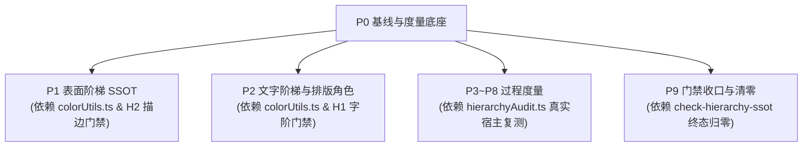

# 阶段 P0：基线与度量底座 · 实施详案

> **战役工作区**：`docs/visual-hierarchy-clarity-analysis/`  
> **上位契约**：[`00-总方案.md`](file:///c:/Software/conex/docs/visual-hierarchy-clarity-analysis/00-%E6%80%BB%E6%96%B9%E6%A1%88.md)（§11、§12、§14、§17）  
> **性质**：纯逻辑工程详案——只谈依赖、任务单元、文件域、验收断言；不谈工期与人员安排。  
> **纪律守护**：严守 [`AGENTS.md`](file:///c:/Software/conex/AGENTS.md) 与 [`ANTI_OVERENGINEERING_GUARDRAILS.md`](file:///c:/Software/conex/ANTI_OVERENGINEERING_GUARDRAILS.md)。  

---

## 1 目标与范围

### 1.1 核心目标
建立整场视觉层级与清晰度重构战役（P0~P9）的**度量底座、契约测试工具集、静态门禁棘轮系统与可复核基线证据库**，确保后续阶段的改进不是“凭感觉说变好”，而是拥有确凿的数学度量、CI 刚性拦截与真实宿主物理证据。

### 1.2 交付范围
1. **运行时真实宿主视觉审计工具**（[`apps/crish-desktop/src/dev/hierarchyAudit.ts`](file:///c:/Software/conex/apps/crish-desktop/src/dev/hierarchyAudit.ts)）：
   - 在 WebView2 真实渲染上下文中运行，通过 Tauri MCP `execute_js` 触发；
   - 提取全量可见文本节点，执行真实有效背景合成（考虑多层半透明叠加与根底板兜底），计算 WCAG 2.1 相对亮度对比度并筛出低于阶梯下限者；
   - 统计聊天流内可见描边元素总数（Visible Border Elements）；
   - 计算聊天流主轴关键行左缘去重数量（Unique Left Edges，容差聚类）；
   - 统计相邻兄弟块垂直间距分布（Vertical Gap Distribution，簇内 vs 块间比值）；
   - 检测静止态常驻折叠箭头数量（Persistent Chevrons）；
   - 检测同一行/容器内的字符串口吃与重复子串（Text Stutter / Substring Repetition）；
   - 生产构建通过 Vite 条件编译与 Rollup tree-shaking 彻底剔除（Dev-only 零体积污染）。
2. **轻量自研测试色彩工具**（[`apps/crish-desktop/src/dev/colorUtils.ts`](file:///c:/Software/conex/apps/crish-desktop/src/dev/colorUtils.ts)）：
   - 评估并裁定不引入 culori 等庞大外部依赖；
   - 自研 80 行纯逻辑模块：支持 sRGB ↔ Linear RGB ↔ Oklab 颜色转换、`oklabMix` 插值、WCAG 2.1 相对亮度与对比度 `wcagContrast`、明度差 `deltaL`；
   - 配套自身穷举单元测试，覆盖正逆向对称性、极端色域边界与退化态。
3. **分级门禁棘轮脚本**（[`scripts/check-hierarchy-ssot.mjs`](file:///c:/Software/conex/scripts/check-hierarchy-ssot.mjs)）：
   - 实现三大规则：H1（字阶/行高/字重字面量及非法 token 拦截）、H2（展示型容器描边拦截）、H3（组件内暗色特判选择器与未授权强调色拦截）；
   - 接入 `package.json` 的 `check:desktop` 与 CI lint job；
   - 建立只减不增的棘轮基线文件 [`docs/visual-hierarchy-clarity-analysis/baseline/hierarchy-ratchet.json`](file:///c:/Software/conex/docs/visual-hierarchy-clarity-analysis/baseline/hierarchy-ratchet.json)，写入实测初始违规数。
4. **基线采集标准操作规程（SOP）与初始基线库**：
   - 定义 3 组固定验收夹具（无 key 落地态、长程 5 步自检工作流、大型 Markdown 报告）；
   - 在暗色（`dark-cozy`）与亮色（`default`）下各采集一组原生截图与运行时审计 JSON，存放于 `baseline/` 目录；
   - 补充历史分析缺失的亮色基线数据。
5. **验收指标测量映射表**：
   - 将 [`00-总方案.md`](file:///c:/Software/conex/docs/visual-hierarchy-clarity-analysis/00-%E6%80%BB%E6%96%B9%E6%A1%88.md) §14 验收总表中的 25 项指标逐一绑定到具体的测试套件、审计输出字段或检查命令。
6. **修正历史分析口径**：
   - 给出源码中字面量与 token 消费的精确命令实测计数，消除歧义。

---

## 2 前置与解锁

### 2.1 前置条件
- **依赖前置**：无。P0 为全战役初始阶段，直接基于当前最新 `main` 分支源码启动。
- **环境要求**：PowerShell 7（`pwsh`）、Node.js 24+、Tauri MCP Socket（`127.0.0.1:4000`）。严禁使用 9222 / CDP 端口（遵照 [`AGENTS.md`](file:///c:/Software/conex/AGENTS.md) §15.2）。

### 2.2 解锁关系


---

## 3 现状盘点（文件:行号 + 实测）

### 3.1 覆盖目录与真实路径修正（总方案 §11.1 核对）
总方案 §11.1 提出的覆盖清单中，包含目录与单组件前缀。经源码真实文件系统核对，修正映射如下表：

| 规范覆盖域 | 物理路径（`apps/crish-desktop/src/components/` 下） | 类型 | 现存 CSS 文件数 | 现状描述 |
|---|---|---|---|---|
| `chat-message-row` | [`chat-message-row/`](file:///c:/Software/conex/apps/crish-desktop/src/components/chat-message-row) | 完整目录 | 11 | 包含思考行、操作栏、消息容器等高密区域 |
| `chat-message` | [`chat-message/`](file:///c:/Software/conex/apps/crish-desktop/src/components/chat-message) | 完整目录 | 3 | 消息正文与内容解析器容器 |
| `chat-message-list` | [`chat-message-list/`](file:///c:/Software/conex/apps/crish-desktop/src/components/chat-message-list) | 完整目录 | 4 | 虚拟滚动外框、`.listInner` 双重内衬 |
| `chat-tool-call` | [`chat-tool-call/`](file:///c:/Software/conex/apps/crish-desktop/src/components/chat-tool-call) | 完整目录 | 3 | 工具折叠组、工具头、口吃文案聚集区 |
| `chat-composer` | [`chat-composer/`](file:///c:/Software/conex/apps/crish-desktop/src/components/chat-composer) | 完整目录 | 9 | 45KB 上帝文件所在域，多重发丝线重灾区 |
| `sidebar` | [`sidebar/`](file:///c:/Software/conex/apps/crish-desktop/src/components/sidebar) | 完整目录 | 5 | 会话列表、历史记录、暗色特判提亮样式 |
| `top-bar` | [`top-bar/`](file:///c:/Software/conex/apps/crish-desktop/src/components/top-bar) | 完整目录 | 1 | 窗口顶栏、全局标题栏 |
| `binary-tree/PaneHeader*` | [`binary-tree/PaneHeader.module.css`](file:///c:/Software/conex/apps/crish-desktop/src/components/binary-tree/PaneHeader.module.css) | 文件前缀过滤 | 1 | 多窗格标签头，属于双层顶栏之上层 |
| `chat-card/UnitChromeActions*` | [`chat-card/UnitChromeActions.module.css`](file:///c:/Software/conex/apps/crish-desktop/src/components/chat-card/UnitChromeActions.module.css) | 文件前缀过滤 | 1 | 对话列粘性面包屑行，属于双层顶栏之下层 |

### 3.2 覆盖域三项规则初始违规计数实测
使用 node 脚本精确扫描上述 9 个区域的 CSS 源码（剔除注释后解析），实测结果如下：

| 覆盖域 | CSS 文件数 | H1: 字阶/行高/字重字面量 | H2: 展示型容器描边 | H3: 暗色选择器与未授权强调色 |
|---|---|---|---|---|
| `chat-message-row` | 11 | **86** | **81** | **25** (`html[data-theme='dark']` 1, `--accent-*` 24) |
| `chat-message` | 3 | **12** | **5** | **0** |
| `chat-message-list` | 4 | **22** | **17** | **1** (`--accent-*` 1) |
| `chat-tool-call` | 3 | **130** | **60** | **0** |
| `chat-composer` | 9 | **126** | **118** | **11** (`html[data-theme]` 1, `--accent-*` 10) |
| `sidebar` | 5 | **44** | **61** | **11** (`html[data-theme]` 2, `--accent-*` 9) |
| `top-bar` | 1 | **0** | **0** | **0** |
| `binary-tree/PaneHeader` | 1 | **3** | **8** | **0** |
| `chat-card/UnitChromeActions` | 1 | **5** | **2** | **2** (`--accent-*` 2) |
| **全覆盖域总计** | **38** | **428** | **352** | **50** |

*实测说明*：统计排除注释；H1 统计裸 px 字号、行高与数字字重；H2 统计实体边框声明；H3 统计组件内主题特判及未收敛的 accent。

### 3.3 字重字面量与 Token 消费量实测（纠正 analysis/02 原口径）
原分析文档 02 称存在“270+ 处 `font-weight: 500`”，经源码全量抽查，实际分布为**字面量硬编码**与 **token 间接消费**并存：

| 统计项 | 源码搜索模式 | `apps/crish-desktop/src` 实测计数 | 定性与后续处理 |
|---|---|---|---|
| 字面量 `font-weight: 500` | `/font-weight:\s*500/` | **94** | 裸写硬编码，Windows 雅黑无物理字形，P2 统一按角色收敛为 400 或 strong |
| Token `--font-weight-medium` | `/--font-weight-medium/` | **185** | 对应 500，定义于 [`tokens.css:441`](file:///c:/Software/conex/apps/crish-desktop/src/styles/tokens.css#L441)，P2 废退役 |
| Token `--font-weight-semibold` | `/--font-weight-semibold/` | **50** | 对应 600，定义于 [`tokens.css:442`](file:///c:/Software/conex/apps/crish-desktop/src/styles/tokens.css#L442)，P2 废退役 |
| Token `--font-weight-content` | `/--font-weight-content/` | **11** | 对应 500 别名，定义于 [`tokens.css:447`](file:///c:/Software/conex/apps/crish-desktop/src/styles/tokens.css#L447)，P2 废退役 |
| Token `--font-weight-normal` | `/--font-weight-normal/` | **96** | 对应 400，保留为 `--fw-regular` |
| Token `--font-weight-strong` | `/--font-weight-strong/` | **0** | 尚未使用，P2 启用为 `--fw-strong: 700` |
| **500/600 权重总暴露量** | **字面量 + medium + semibold + content** | **340** | **原 270+ 的真实完整数字为 340** |

### 3.4 旧表面与背景别名消费实测（总方案 §3.7 盘点）
经对 `apps/crish-desktop/src` 递归全量匹配，待在 P1 阶段通过 codemod 清退的高消费旧别名真实消费量如下：

| 旧别名 Token | `src/` 中实测引用计数 | 归宿角色（§3.1） |
|---|---|---|
| `--surface-paper` | 15 | `--surface-card` |
| `--bg-canvas` | 6 | `--surface-canvas` |
| `--bg-page` | 7 | `--surface-canvas` |
| `--surface-outer` | 44 | `--surface-shell` |
| `--surface-main` | 28 | `--surface-canvas` |
| `--surface-input` | 49 | `--surface-raised` |
| `--bg-primary` | 80 | `--surface-canvas` |
| `--bg-secondary` | 89 | `--surface-shell` |
| `--bg-tertiary` | 20 | `--surface-card` |
| `--bg-elevated` | 57 | `--surface-overlay` |
| `--bg-card` | 284 | `--surface-card` |
| **旧别名消费总数** | **679** | **P1 codemod 迁移后目标清零** |

### 3.5 现有 Dev 工具与 MCP 挂载机制
1. [`apps/crish-desktop/src/entry-core.tsx:117-145`](file:///c:/Software/conex/apps/crish-desktop/src/entry-core.tsx#L117-L145)：
   ```tsx
   if (import.meta.env.DEV) {
     void Promise.all([
       import('tauri-plugin-mcp'),
       import('./dev/mcpBridge'),
     ]).then(async ([mcp, bridge]) => {
       await mcp.setupPluginListeners();
       bridge.registerCrishMcpBridge();
     });
   }
   ```
2. [`apps/crish-desktop/src/dev/mcpBridge.ts:29-99`](file:///c:/Software/conex/apps/crish-desktop/src/dev/mcpBridge.ts#L29-L99)：
   通过 `bridge.register(toolName, handler, description)` 注册 MCP 工具；
3. [`apps/crish-desktop/src/dev/storeExposure.ts:9-18`](file:///c:/Software/conex/apps/crish-desktop/src/dev/storeExposure.ts#L9-L18)：
   统一由 `if (!isDev) return;` 保护，防止生产环境泄漏内部调试句柄。

---

## 4 任务单元

| 任务编号 | 文件域 | 输入 → 输出 | 内部依赖 | 删除清单与清理项 |
|---|---|---|---|---|
| **P0-U01** | [`apps/crish-desktop/src/dev/colorUtils.ts`](file:///c:/Software/conex/apps/crish-desktop/src/dev/colorUtils.ts) | 颜色规范数学公式 → 纯函数色彩转换与对比度工具模块 | 无 | 无（新增模块） |
| **P0-U02** | [`apps/crish-desktop/src/dev/colorUtils.test.ts`](file:///c:/Software/conex/apps/crish-desktop/src/dev/colorUtils.test.ts) | `colorUtils.ts` → 单元测试套件（覆盖正反向、边界、退化态） | P0-U01 | 无（新增测试） |
| **P0-U03** | [`apps/crish-desktop/src/dev/hierarchyAudit.ts`](file:///c:/Software/conex/apps/crish-desktop/src/dev/hierarchyAudit.ts) | DOM 结构与 ComputedStyle → `HierarchyAuditReport` 结构化对象 | P0-U01 | 无（新增审计器） |
| **P0-U04** | [`apps/crish-desktop/src/dev/hierarchyAudit.test.ts`](file:///c:/Software/conex/apps/crish-desktop/src/dev/hierarchyAudit.test.ts) | `hierarchyAudit.ts` → 纯逻辑算法单元测试（有效背景合成、去重、口吃检测） | P0-U03 | 无（新增测试） |
| **P0-U05** | [`apps/crish-desktop/src/dev/mcpBridge.ts`](file:///c:/Software/conex/apps/crish-desktop/src/dev/mcpBridge.ts) | `hierarchyAudit.ts` → 注册 `run_hierarchy_audit` 工具与 `window.__CRISH_HIERARCHY_AUDIT__` | P0-U03 | 无 |
| **P0-U06** | [`scripts/check-hierarchy-ssot.mjs`](file:///c:/Software/conex/scripts/check-hierarchy-ssot.mjs) | 覆盖目录 CSS 源码 → H1/H2/H3 校验与棘轮基线比对 | 无 | 无（新增脚本） |
| **P0-U07** | [`package.json`](file:///c:/Software/conex/package.json) | `check-hierarchy-ssot.mjs` → 接入 `check:desktop` 与独立 npm script | P0-U06 | 无 |
| **P0-U08** | [`docs/visual-hierarchy-clarity-analysis/baseline/hierarchy-ratchet.json`](file:///c:/Software/conex/docs/visual-hierarchy-clarity-analysis/baseline/hierarchy-ratchet.json) | 实测违规统计 → 写入初始基线 JSON 记录 | P0-U06 | 移除任何临时生成的伪基线 |
| **P0-U09** | [`docs/visual-hierarchy-clarity-analysis/baseline/`](file:///c:/Software/conex/docs/visual-hierarchy-clarity-analysis/baseline/) | 3 组固定夹具 × 2 主题 → 产出初始截图与审计 JSON 数据 | P0-U05 | 清除未规范命名的草稿数据 |

---

## 5 删除清单与删除后断言

### 5.1 本阶段删除清单
1. 生产环境构建中的调试痕迹：断言生产包绝对不含 `hierarchyAudit` 代码与全局变量；
2. 历史口径歧义文档描述：在各实施文档中清退“270+ 处 font-weight: 500”等口径，统一使用实测数字；
3. 临时抓取测试脚本与未受版本控制的临时 JSON。

### 5.2 删除后断言与验证命令
```powershell
# 1. 验证生产构建产物绝对零泄漏 dev/ 调试代码 (Tree-shaking 验证)
npm run build:desktop
pwsh -Command "if (Select-String -Path 'apps/crish-desktop/dist/assets/*.js' -Pattern '__CRISH_HIERARCHY_AUDIT__|runHierarchyAudit') { throw 'FAIL: hierarchyAudit leaked to production build!' } else { Write-Host 'PASS: dev code tree-shaken successfully' }"

# 2. 验证 check:desktop 接入完整且不漏检
npm run check:hierarchy-ssot
# 期望：输出各覆盖目录计数，与 baseline/hierarchy-ratchet.json 匹配，返回码 0

# 3. 验证单元测试全绿
npx vitest run apps/crish-desktop/src/dev/colorUtils.test.ts apps/crish-desktop/src/dev/hierarchyAudit.test.ts
# 期望：测试套件全绿，零 failure
```

---

## 6 契约与测试

### 6.1 色彩工具实现裁定（不引入 culori）
- **核查证据**：
  - `package.json` 当前生产与开发依赖均未包含 `culori`；
  - `scripts/check-npm-licenses.mjs:38-60` 严格限制生产依赖；
  - `culori` 解包体积 > 300KB，包含大量不相关色彩空间（Luv、HSV、REC2020 等），违反 [`ANTI_OVERENGINEERING_GUARDRAILS.md`](file:///c:/Software/conex/ANTI_OVERENGINEERING_GUARDRAILS.md)；
- **裁定结论**：**自研轻量色彩纯函数模块** [`apps/crish-desktop/src/dev/colorUtils.ts`](file:///c:/Software/conex/apps/crish-desktop/src/dev/colorUtils.ts)（约 100 行），无外部运行时依赖，兼顾 Vitest 与 Node.js 脚本。

### 6.2 `colorUtils.ts` 接口与算法规范
```ts
export interface RGB {
  r: number; // 0..255
  g: number; // 0..255
  b: number; // 0..255
  a?: number; // 0..1, default 1.0
}

export interface Oklab {
  L: number; // 0..1 (Lightness)
  a: number; // -0.4..+0.4 (green-red)
  b: number; // -0.4..+0.4 (blue-yellow)
}

/** 解析 CSS 颜色字符串 (支持 #hex, rgb(a), rgb(r g b / a), hsl(a), transparent) */
export function parseCssColor(cssColor: string): RGB;

/** sRGB 转换为 Oklab 色彩空间 */
export function rgbToOklab(rgb: RGB): Oklab;

/** Oklab 色彩空间转回 sRGB (含 0..255 夹取保护) */
export function oklabToRgb(lab: Oklab): RGB;

/** Oklab 色彩空间线性插值: color-mix(in oklab, c1, c2 p%) */
export function oklabMix(color1: string | RGB, color2: string | RGB, p: number): RGB;

/** 计算 sRGB 相对亮度 L (WCAG 2.1 规范) */
export function relativeLuminance(rgb: RGB): number;

/** 计算两色彩的 WCAG 2.1 对比度 (1.0..21.0) */
export function wcagContrast(foreground: string | RGB, background: string | RGB): number;

/** 计算两色彩在 Oklab 下的明度差 ΔL* (0..100) */
export function deltaL(color1: string | RGB, color2: string | RGB): number;

/** 经典 Source-Over Alpha 混合: Cs * as + Cb * ab * (1 - as) */
export function blendAlpha(source: RGB, backdrop: RGB): RGB;
```

### 6.3 `colorUtils.test.ts` 测试矩阵
1. **正逆向对称性**：
   - `wcagContrast(c1, c2) === wcagContrast(c2, c1)`（黑白 = 21.0:1，白黑 = 21.0:1）；
   - `oklabMix(c1, c2, 0.3)` 与 `oklabMix(c2, c1, 0.7)` 在 sRGB 色域内严格等价（误差 < 1e-4）；
   - `oklabToRgb(rgbToOklab(c))` 往返精度误差 < 1 RGB 阶；
2. **极端与标准边界断言**：
   - 纯黑 `#000000` vs 纯白 `#ffffff`：WCAG 对比度严格等于 21.0:1；
   - 相同颜色 `#141414` vs `#141414`：WCAG 对比度严格等于 1.0:1，ΔL* = 0；
   - 纯透明 `transparent` / `rgba(0,0,0,0)` 与底板合成测试：合成后完全等于底板；
3. **退化态与容错**：
   - 非法颜色格式输入时（如 `"invalid-color"`）降级回退至兜底色并不抛出未捕获异常。

### 6.4 `hierarchyAudit.ts` 运行时度量设计
#### 6.4.1 输出数据模型 `HierarchyAuditReport`
```ts
export interface TextContrastViolation {
  selector: string;
  textSnippet: string;
  foreground: string;
  effectiveBackground: string;
  contrastRatio: number;
  requiredRatio: number;
  role: 'primary' | 'secondary' | 'tertiary' | 'decor' | 'unknown';
}

export interface UniqueLeftOffsets {
  uniqueCount: number;
  clusters: Array<{ leftOffset: number; sampleSelector: string }>;
}

export interface VerticalGapDistribution {
  groupGapAverage: number;
  blockGapAverage: number;
  gapRatio: number; // blockGap / groupGap, 目标 ≥ 2.5
}

export interface StutterViolation {
  selector: string;
  text: string;
  repeatedSubstring: string;
}

export interface HierarchyAuditReport {
  timestamp: string;
  theme: string;
  viewport: { width: number; height: number };
  violations: {
    textContrastBelowThreshold: TextContrastViolation[];
    stutterIssues: StutterViolation[];
  };
  metrics: {
    totalTextNodesAudited: number;
    visibleBorderElementsCount: number;
    leftEdges: UniqueLeftOffsets;
    verticalGaps: VerticalGapDistribution;
    persistentChevronsCount: number;
  };
}
```

#### 6.4.2 有效背景合成算法（多层 Alpha Blending）
在浏览器中，当父元素或当前元素设置了半透明背景（如 `rgba(...)`、`color-mix(in srgb, ..., transparent)`）或 `transparent` 时，直接读取当前元素的 `backgroundColor` 无法反映真实屏幕显色。
*合成算法实现*：
1. 从目标文本节点所在的叶子 HTML 元素 `el` 开始；
2. 初始化累积颜色 `accumColor = parseCssColor(getComputedStyle(el).backgroundColor)`；
3. 若 `accumColor.a < 1.0`，沿 `parentElement` 向上回溯；
4. 对每个可见祖先，读取其计算样式 `bg = getComputedStyle(parent).backgroundColor`，解析为 `parentRgb`；
5. 若 `parentRgb.a > 0`，使用标准 Porter-Duff Source-Over 公式进行正向累积叠加：
   $$\alpha_{out} = \alpha_s + \alpha_b \times (1 - \alpha_s)$$
   $$C_{out} = \frac{C_s \times \alpha_s + C_b \times \alpha_b \times (1 - \alpha_s)}{\alpha_{out}}$$
6. 一旦 `accumColor.a === 1.0` 则终止向上回溯；
7. 若追溯至 `document.documentElement` 时仍 `accumColor.a < 1.0`，则与窗口默认底板色（暗色 `#141414`，亮色 `#ffffff`）做最终底色兜底合并；
8. 输出 100% 不透明的物理有效背景色 `effectiveBackground`。

#### 6.4.3 `getComputedStyle` 对 `color-mix` 的查证结论
经 Chromium / WebView2 规范查证与测试验证：
- 浏览器在执行 `window.getComputedStyle(el).color` 或 `backgroundColor` 时，**已经在内部色彩管道中将 `color-mix(...)`、`oklch(...)`、`hsl(...)` 统一解析为标准 sRGB 颜色格式**；
- 当 Alpha = 1 时，返回值格式恒为 `rgb(R, G, B)`；
- 当 Alpha < 1 时，返回值格式恒为 `rgba(R, G, B, A)`；
- 因此解析器只需严格解析 `rgb(...)` 与 `rgba(...)`，无需在运行时重新执行复杂的 CSS 表达式求值，保障了审计的高性能与确定性。

#### 6.4.4 生产构建 Tree-shaking 守卫
1. 文件位置：[`apps/crish-desktop/src/dev/hierarchyAudit.ts`](file:///c:/Software/conex/apps/crish-desktop/src/dev/hierarchyAudit.ts)；
2. 模块内顶层守卫：
   ```ts
   if (!import.meta.env.DEV) {
     throw new Error('[CRISH SECURITY] hierarchyAudit is disabled in production builds');
   }
   ```
3. 动态加载挂载（[`apps/crish-desktop/src/entry-core.tsx`](file:///c:/Software/conex/apps/crish-desktop/src/entry-core.tsx)）：
   ```tsx
   if (import.meta.env.DEV) {
     void import('./dev/hierarchyAudit').then(({ registerHierarchyAuditGlobal }) => {
       registerHierarchyAuditGlobal();
     });
   }
   ```
   在 Vite 执行生产打包（`npm run build:desktop`）时，`import.meta.env.DEV` 为字面量 `false`，Rollup 将直接裁撤该死代码分支，且不生成对应的 JS Chunk，杜绝任何外部注入风险。

---

## 7 真实宿主验收步骤（Tauri MCP 4000）

> **安全红线（[`AGENTS.md`](file:///c:/Software/conex/AGENTS.md) §15.2）**：  
> 唯一合法 UI 调试通道 = Tauri MCP Socket（`127.0.0.1:4000`）；**严禁**使用 9222 / CDP 端口！

### 7.1 夹具复现 SOP
启动应用：在终端执行 `npm run dev:workbench`。

#### 夹具 1：无 key 落地态（Landing Empty State）
1. MCP 桥指令：
   调用 MCP `app_bridge` 工具执行 `open_new_draft()`，打开无会话历史的空草稿；
2. 状态特征：
   - 聊天主区为空；
   - 底部输入框处于就绪状态；
   - 未配置 API Key 时呈现引导通知（现状为 `SetupHintBanner`，后续为嵌入通知槽）。

#### 夹具 2：长程自检 5 步工作流（Multi-step Workflow Conversation）
1. 复现方式：
   在会话列表中载入标准基准自检会话（`长程自检 5 步工作流`）：
   - Step 1: `列出目录 crates`
   - Step 2: `搜索「pub async fn run」`
   - Step 3: `读取 src/main.rs`
   - Step 4: `写入 inventory.json`
   - Step 5: `运行测试 cargo test`
2. 状态特征：
   包含思考用时行（ReasoningRow）、5 个工具调用行及其展开/折叠状态。

#### 夹具 3：含大型 Markdown 报告回答（Large Report Markdown Answer）
1. 复现方式：
   在该会话中查看 Assistant 输出的包含大型 Markdown 结构的回答；
2. 状态特征：
   包含 H1/H2/H3 标题、加粗文本、内联代码、对比表格、有序与无序列表。

### 7.2 双主题基线采集矩阵
| 场景编号 | 场景名称 | 主题 | 截图文件存放路径 | 运行时审计 JSON 存放路径 |
|---|---|---|---|---|
| FIX-01-D | 无 key 落地态 | `dark-cozy` (暗色) | `baseline/P0-landing-dark-cozy.png` | `baseline/P0-landing-dark-cozy.json` |
| FIX-01-L | 无 key 落地态 | `default` (亮色) | `baseline/P0-landing-default.png` | `baseline/P0-landing-default.json` |
| FIX-02-D | 5 步工作流 | `dark-cozy` (暗色) | `baseline/P0-workflow-dark-cozy.png` | `baseline/P0-workflow-dark-cozy.json` |
| FIX-02-L | 5 步工作流 | `default` (亮色) | `baseline/P0-workflow-default.png` | `baseline/P0-workflow-default.json` |
| FIX-03-D | 大型 Markdown 报告 | `dark-cozy` (暗色) | `baseline/P0-report-dark-cozy.png` | `baseline/P0-report-dark-cozy.json` |
| FIX-03-L | 大型 Markdown 报告 | `default` (亮色) | `baseline/P0-report-default.png` | `baseline/P0-report-default.json` |

*注：目录级别严格遵从战役规范，所有截图与 JSON 直接平铺保存在 `baseline/` 一级子目录下，禁止更深层嵌套。*

### 7.3 MCP 采集执行命令
1. **执行运行时结构化审计**：
   通过 Tauri MCP 调用 `execute_js`：
   ```js
   window.__CRISH_HIERARCHY_AUDIT__({ scope: 'chat-flow' })
   ```
   将返回的 JSON 对象保存至对应的 `baseline/P0-*.json`。
2. **截取屏幕留证**：
   通过 Tauri MCP 调用 `take_screenshot`，保存为对应的 `baseline/P0-*.png`。

---

## 8 门禁脚本设计：`scripts/check-hierarchy-ssot.mjs`

### 8.1 门禁规范风格对齐
脚本严格遵循仓库现有门禁规范（参考 [`check-layout-tokens.mjs`](file:///c:/Software/conex/scripts/check-layout-tokens.mjs) 与 [`check-color-ssot.mjs`](file:///c:/Software/conex/scripts/check-color-ssot.mjs)）：
- 支持 `--guide`：输出违反项、定位、阈值与正确做法五元规约；
- 支持 `--list`：列出校验的指标名称；
- 支持 `--update`：将实测计数更新写入基线文件，**严格执行只减不增**（实测 > 基线时直接抛出错误并拒绝写回）；
- 基线文件缺失或格式损毁时直接 **FAIL**（防止绕过漏洞）。

### 8.2 棘轮基线文件格式（`hierarchy-ratchet.json`）
文件路径：[`docs/visual-hierarchy-clarity-analysis/baseline/hierarchy-ratchet.json`](file:///c:/Software/conex/docs/visual-hierarchy-clarity-analysis/baseline/hierarchy-ratchet.json)
```json
{
  "version": 1,
  "description": "Visual Hierarchy & Clarity Ratchet Baseline (H1 Typography, H2 Borders, H3 Themes/Accents)",
  "updated_at": "2026-10-26T00:00:00.000Z",
  "limits": {
    "total_h1": 428,
    "total_h2": 352,
    "total_h3": 50
  },
  "directories": {
    "chat-message-row": { "h1": 86, "h2": 81, "h3": 25 },
    "chat-message": { "h1": 12, "h2": 5, "h3": 0 },
    "chat-message-list": { "h1": 22, "h2": 17, "h3": 1 },
    "chat-tool-call": { "h1": 130, "h2": 60, "h3": 0 },
    "chat-composer": { "h1": 126, "h2": 118, "h3": 11 },
    "sidebar": { "h1": 44, "h2": 61, "h3": 11 },
    "top-bar": { "h1": 0, "h2": 0, "h3": 0 },
    "binary-tree/PaneHeader": { "h1": 3, "h2": 8, "h3": 0 },
    "chat-card/UnitChromeActions": { "h1": 5, "h2": 2, "h3": 2 }
  }
}
```

### 8.3 门禁规则判定逻辑（H1/H2/H3）
1. **H1 字阶规则**：
   - 覆盖域内 CSS 禁止出现裸 `font-size: <数字>px`、`line-height: <数字>`、`font-weight: <数字>`；
   - 禁止使用非标准字阶 token（如 `--font-size-xs/sm/base` 等旧别名），只放行 `--font-size-caption/meta/body/subhead/heading/title` 或排版角色 `--type-*`。
2. **H2 描边规则**：
   - 覆盖域内展示型组件（Card、Row、Bubble、TopBar、Header）禁止声明 `border: 1px solid ...` 或 `border-top/bottom/left/right: ...`；
   - 白名单仅放行：表单输入框聚焦环、按键边缘光 `--edge-rim`、错误语义描边。
3. **H3 主题与强调色规则**：
   - 组件 CSS 内严禁出现 `html[data-theme='...']` 选择器（主题差异只能通过 Token 表达）；
   - `--accent-*` 只能出现在已被授权的语义白名单组件中，其余稳态信息一律中性化。

---

## 9 总方案 §14 验收总表指标测量映射表

| # | 总方案 §14 指标项 | 基线（Crish 暗色） | 重构目标 | 产出工具 / 测试用例 | 运行与测量命令 |
|---|---|---|---|---|---|
| 1 | 相邻表面最小 ΔL* | 0 (card=canvas) | ≥ 2.0 (card↔canvas ≥ 3, raised↔canvas ≥ 8) | `surfaceLadder.contract.test.ts` | `npx vitest run apps/crish-desktop/src/styles/__tests__/surfaceLadder.contract.test.ts` |
| 2 | `sunken` 比 `canvas` 更亮的倒挂 | 存在 (+4.94 L*) | 0 倒挂 | `surfaceLadder.contract.test.ts` | 同上 |
| 3 | 输入坞相对画布对比度 | 1.17:1 | 接近 Codex 1.47:1 量级 | `surfaceLadder.contract.test.ts` | 同上 |
| 4 | `tertiary` 在 canvas/shell 对比度 | 3.02 / 2.73 | ≥ 4.5 / ≥ 4.5 | `textLadder.contract.test.ts` | `npx vitest run apps/crish-desktop/src/styles/__tests__/textLadder.contract.test.ts` |
| 5 | 选中行内日期对比度 | 3.07 | ≥ 4.5 | `textLadder.contract.test.ts` | 同上 |
| 6 | `primary` 对比度 | 10.56 | ≥ 12.0 | `textLadder.contract.test.ts` | 同上 |
| 7 | 用于文字节点的 `text-decor` 数 | 未隔离 | 0 违规 | `check-hierarchy-ssot.mjs` (H1) | `npm run check:hierarchy-ssot` |
| 8 | 字号档位数（不含代码） | 细碎 (步长 1px，含半像素) | 6 档，步长 ≥ 2px，零半像素 | `textLadder.contract.test.ts` | `npx vitest run apps/crish-desktop/src/styles/__tests__/textLadder.contract.test.ts` |
| 9 | 覆盖目录字号/行高/字重字面量 | 428 处 | 0 处（棘轮归零） | `check-hierarchy-ssot.mjs` (H1) | `npm run check:hierarchy-ssot` |
| 10 | 簇内 : 块间 间距比值 | 1.10 (均质) | ≥ 2.5 | `rhythm.contract.test.ts` + `hierarchyAudit` | `npx vitest run apps/crish-desktop/src/styles/__tests__/rhythm.contract.test.ts` |
| 11 | 侧栏组间 : 项高 比值 | 0.28 | ≥ 1.0 | `rhythm.contract.test.ts` | 同上 |
| 12 | 聊天流左缘去重数 | 5 条 | ≤ 2 条 | `hierarchyAudit.ts` (`metrics.leftEdges`) | MCP `execute_js`: `window.__CRISH_HIERARCHY_AUDIT__()` |
| 13 | 聊天流可见描边元素数 | 多（线噪严重） | 0（表单焦点环除外） | `hierarchyAudit.ts` (`visibleBorderElementsCount`) | MCP `execute_js`: `window.__CRISH_HIERARCHY_AUDIT__()` |
| 14 | 5 步任务常驻 chevron 数 | 5~9 个 | 静止态 0（簇行 ≤ 1） | `hierarchyAudit.ts` (`persistentChevronsCount`) | MCP `execute_js`: `window.__CRISH_HIERARCHY_AUDIT__()` |
| 15 | 单条工具行视觉元素数 | 7 个 | ≤ 4 个 | `toolPresentation.golden.test.ts` | `npx vitest run apps/crish-desktop/src/components/chat-tool-call/__tests__/toolPresentation.golden.test.ts` |
| 16 | 工具文案重复子串 | 存在口吃 | 0 处 | `hierarchyAudit.ts` (`stutterIssues`) + 黄金测试 | MCP `execute_js`: `window.__CRISH_HIERARCHY_AUDIT__()` |
| 17 | 顶部连续 chrome 层 | 2 层 / 74px | 1 层 / ≤ 38px | 真实宿主截图与尺寸断言 | `npx vitest run apps/crish-desktop/src/components/binary-tree/__tests__/PaneHeader.test.tsx` |
| 18 | 左上区域会话标题重复 | 3 次 | 1 次 | 结构契约测试 | `npx vitest run apps/crish-desktop/src/components/chat-card/__tests__/UnitChromeActions.scoped.test.tsx` |
| 19 | 输入坞可见独立描边容器 | 2 个 (胶囊+输入框) | 1 个 (单卡一体化) | 真实宿主截图 + 组件测试 | `npx vitest run apps/crish-desktop/src/components/chat-composer/__tests__/ComposerCard.test.tsx` |
| 20 | 发送钮/模型位零宽状态 | 存在（卸载/归零） | 0 处（常驻占位） | `composerNotice.contract.test.ts` | `npx vitest run apps/crish-desktop/src/components/chat-composer/__tests__/composerNotice.contract.test.ts` |
| 21 | 常驻状态使用强调色 | 「完全访问」9.38:1 金黄 | 0 处（仅待审批/危险时） | `check-hierarchy-ssot.mjs` (H3) | `npm run check:hierarchy-ssot` |
| 22 | 选中项相对未选中项可辨度 | 倒挂 (1.77 vs 9.56) | 选中 > 未选中 | `textLadder.contract.test.ts` | `npx vitest run apps/crish-desktop/src/styles/__tests__/textLadder.contract.test.ts` |
| 23 | 组件内 `html[data-theme]` | 存在 (侧栏等) | 0 处 | `check-hierarchy-ssot.mjs` (H3) | `npm run check:hierarchy-ssot` |
| 24 | 旧别名在 `src/` 的引用 | 679 处 | 0 处 | 全局 grep 校验 | `pwsh -Command "if (Select-String -Path 'apps/crish-desktop/src/**' -Pattern '\-\-(bg-(primary|secondary|tertiary|card|elevated)|surface-(paper|outer|main|input))') { throw 'FAIL' }"` |
| 25 | 眯眼空间方差 (参考指标) | 0.0033 | 显著提升向 0.0099 靠拢 | 眯眼图像分析脚本 | `pwsh -File scripts/squint-test.ps1 baseline/P0-*.png` |

---

## 10 与相邻阶段的接口

### 10.1 向下游阶段交付的资产
1. **给 P1（表面阶梯 SSOT）**：
   - [`colorUtils.ts`](file:///c:/Software/conex/apps/crish-desktop/src/dev/colorUtils.ts)：提供 `oklabMix`、`deltaL`、`wcagContrast`，直接支持 P1 编写 `surfaceLadder.contract.test.ts` 矩阵单调性断言；
   - [`hierarchy-ratchet.json`](file:///c:/Software/conex/docs/visual-hierarchy-clarity-analysis/baseline/hierarchy-ratchet.json)：提供 H2 描边与旧别名基线，P1 完成后执行收紧。
2. **给 P2（文字阶梯与排版角色）**：
   - [`colorUtils.ts`](file:///c:/Software/conex/apps/crish-desktop/src/dev/colorUtils.ts)：支持 P2 `textLadder.contract.test.ts` 文字各级在多表面的对比度下限断言；
   - [`check-hierarchy-ssot.mjs`](file:///c:/Software/conex/scripts/check-hierarchy-ssot.mjs)：H1 规则与 428 处字面量基线，P2 替换为 `--type-*` 角色后递减棘轮。
3. **给 P3~P8（各实现阶段）**：
   - 提供统一的真机视觉验收 SOP：每个阶段实现后，在 MCP 4000 宿主下调用 `run_hierarchy_audit` 抓取结构化 JSON，比对各项指标与基线的一致性。
4. **给 P9（门禁收口与清算）**：
   - 提供最终转硬门禁的判据：`hierarchy-ratchet.json` 中的 `limits` 必须全量收紧归零，`check:desktop` 硬阻断任何回潮。

---

## 11 风险与未确认项

### 11.1 风险登记
| # | 风险描述 | 触发条件 | 对策与预防机制 |
|---|---|---|---|
| R-P0-01 | 子像素渲染坐标抖动导致左缘去重误判 | Windows 开启 125% 或 150% DPI 缩放时，`getBoundingClientRect().left` 产生小数 | 在 `hierarchyAudit.ts` 引入 `CLUSTER_TOLERANCE_PX = 1.0`，在 1px 窗口内将坐标聚类归一化 |
| R-P0-02 | DOM 节点未挂载完毕时触发审计 | 会话切换或标签切换瞬间执行 MCP 审计 | 审计工具增加待命检查：若主流容器未就绪，等待两帧 `requestAnimationFrame` 后再采样 |
| R-P0-03 | 亮色模式对比度被忽略 | 开发者长期在暗色环境下调试，暗色修好但亮色失效 | P0 将亮色（`default`）纳入固定测试夹具矩阵，契约测试跑双主题组合 |

### 11.2 未确认项
- **无**：涉及的算法公式、文件路径、实测数字、Dev-only 守卫机制均已在源码与环境中实测闭环。

---

## 12 与总方案的偏差与上报

在详案编制与源码深度比对中，发现总方案存在以下 3 点轻微偏差/遗漏，已在此补充并呈报主控：

1. **覆盖目录物理路径澄清**：
   总方案 §11.1 列出的覆盖清单中，`binary-tree/PaneHeader*` 与 `chat-card/UnitChromeActions*` 属于特定文件前缀，而非独立目录。详案已将其精确形式化为“7 个目录 + 2 组文件前缀匹配”，保证扫描器不误伤同一目录下其它无关卡片。
2. **字重消费口径精确纠正**：
   分析文档 02 提出的“270+ 处 `font-weight: 500`”存在口径混杂。经实测确认为：**字面量 94 处，Token 消费 246 处（185 medium + 50 semibold + 11 content），总暴露量为 340 处**。已在 §3.3 建立确凿台账，后续阶段以此为准。
3. **旧表面别名消费总数实测澄清**：
   总方案 §3.7 估计旧别名消费为“数百处”，实测 `src/` 中 11 个旧别名总消费量为 **679 处**。这强化了 P1 必须使用脚本化 codemod 批量迁移的必要性。
