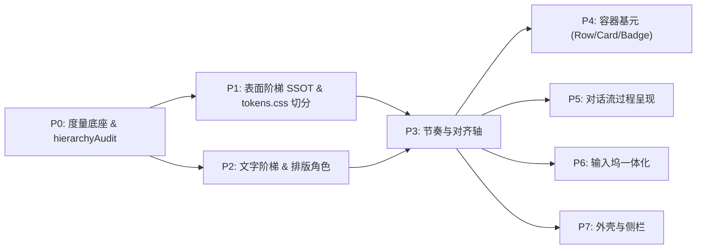

# 视觉层级与清晰度系统性重构 · 阶段详案

# Phase P3：节奏与对齐轴（Rhythm & Alignment Axes）

> **实施目标**：消灭均质等间距平铺，建立符合格式塔接近性定理的语义节奏层（`--gap-*`）与行高阶梯（`--lh-*`）；根除双重内衬与 TS/CSS 双源常量，建立两列对齐网格（`lead` + `content`），将聊天流 5 条混乱对齐线收敛至 ≤ 2 条；按覆盖目录清零非栅格裸 px 与字面 line-height。  
> **上位契约**：[`00-总方案.md`](file:///c:/Software/conex/docs/visual-hierarchy-clarity-analysis/00-%E6%80%BB%E6%96%B9%E6%A1%88.md) §6、§5.3、§11、§12、§16、§17  
> **输入依据**：[`analysis/04-间距密度与节奏.md`](file:///c:/Software/conex/docs/visual-hierarchy-clarity-analysis/analysis/04-%E9%97%B4%E8%B7%9D%E5%AF%86%E5%BA%A6%E4%B8%8E%E8%8A%82%E5%A5%8F.md)、[`analysis/05-对话流信息架构.md`](file:///c:/Software/conex/docs/visual-hierarchy-clarity-analysis/analysis/05-%E5%AF%B9%E8%AF%9D%E6%B5%81%E4%BF%A1%E6%81%AF%E6%9E%B6%E6%9E%84.md)、[`analysis/09-截图逐区对照.md`](file:///c:/Software/conex/docs/visual-hierarchy-clarity-analysis/analysis/09-%E6%88%AA%E5%9B%BE%E9%80%90%E5%8C%BA%E5%AF%B9%E7%85%A7.md)  
> **输出文件**：`docs/visual-hierarchy-clarity-analysis/P3-节奏与对齐轴.md`（仅此一份详案）

---

## 1 目标与范围

### 1.1 核心目标
1. **语义节奏层（SSOT）**：在既有 4px 栅格 `--space-*` 之上建立 4 级垂直/水平节奏标尺（`--gap-inline: 4px` / `--gap-group: 8px` / `--gap-block: 20px` / `--gap-section: 32px`），刚性守护接近性契约：
   $$\frac{\text{--gap-block}}{\text{--gap-group}} \ge 2.5 \quad \text{且} \quad \frac{\text{--gap-section}}{\text{--gap-block}} \ge 1.5$$
2. **行高阶梯收敛**：退役 1.68 / 1.65 膨胀行高，建立 4 档语义行高（`--lh-dense: 1.2` / `--lh-ui: 1.35` / `--lh-prose: 1.55` / `--lh-row: 24px`），将正文内部行间距从 9.5px 紧致至 7.7px，使段落聚拢为沉静色块。
3. **单一间距源架构**：拔除轮次内部各块（思考行、工具组、Markdown 根容器）自由声明的外边距（margin），由单一 Flex 列容器的 `gap` 统一调度，杜绝 margin 折叠失效与累加导致的 13~19px 机械均质平铺。
4. **两列对齐轴与根除双重内衬**：
   - 聊天流定义 `lead` (20px) + `content` (1fr) 两列网格，所有流内元素的左缘收敛至 $\{0, 24\text{px}\}$，对齐线数由 5 条降至 ≤ 2 条；
   - 彻底删除 `MessageVirtualizer.tsx:425-426` 内联 `left/right: CHAT_SCROLL_PAD_X`，水平内衬单点收敛于 `.listInner` 的 `--stream-pad-x`；
   - 清退 `chatScrollGeometry.ts:8` 的 `CHAT_SCROLL_PAD_X` 常量与 `dual-source-values.test.ts:55` 双源同值测试（改为 TS 零导出负向断言）。
5. **响应式合并与裸 px 清零**：将 1200px 以上断点收口到 `--chat-col-max` 变量本身，删除组件内 4 处 `@media (min-width: 1200px)` 重复块；通过 codemod 清除覆盖目录内 54 处奇数裸 px（3/5/7px）与 139 处字面 line-height。

### 1.2 边界与约束
- **覆盖目录范围**：`chat-message-row/`、`chat-message/`、`chat-message-list/`、`chat-tool-call/`、`chat-composer/`、`sidebar/`、`binary-tree/PaneHeader*`、`chat-card/UnitChromeActions*`、`top-bar/`。
- **逻辑属性范围**：严格限定于 P3 触及的文件与属性（`padding-inline` / `margin-inline` / `gap`），不全仓发散。
- **不越界**：过程簇的折叠模型由 P5 负责，基元组件封装由 P4 负责，输入坞内部结构由 P6 负责；P3 仅提供布局容器网格、间距源与尺寸 token 契约。

---

## 2 前置与解锁



- **解锁条件**：
  - P1 完成 `tokens.css` 拆分为模块化目录（`styles/tokens/space.css`、`styles/tokens/type.css` 等），解除同文件编辑冲突锁；
  - P2 锁定字阶标尺（`--font-size-body: 14px`, `--font-size-meta: 12px`），行高阶梯以 P2 字阶为基准定值；
  - P0 交付 `src/dev/hierarchyAudit.ts` 与 `check-hierarchy-ssot.mjs` 基线，提供可度量对齐线与间距比值的验收 API。
- **对后序阶段的解锁承诺**：
  - 为 **P4** 提供 `Row`、`Card` 容器所需的 `--gap-inline`、`--gap-group`、`--lh-row`、`--col-lead`；
  - 为 **P5** 提供过程簇容器（`gap: var(--gap-group)`）与两列对齐网格（`lead` + `content`）；
  - 为 **P6** 提供输入坞宽度对齐基准（`--chat-col-max` 与 `--stream-pad-x`）；
  - 为 **P7** 提供侧栏业务大分组间距（`--gap-section: 32px`），纠偏接近性逆转。

---

## 3 现状盘点（文件:行号 + 实测）

### 3.1 覆盖目录裸 px 与字面 line-height 实测盘点
经 `scripts/measure_p3.mjs` 在覆盖目录（9 个模块、共 33 个 `.module.css` 文件）全量扫描，实测统计如下：

| 违例类别 | 实测频次 | 具体数值分布 | 典型违例位置（文件:行号） | 危害定性 |
|---|---|---|---|---|
| **奇数裸 px (破坏栅格)** | **54 处** | 1px: 23 处<br/>3px: 14 处<br/>5px: 12 处<br/>7px: 5 处 | `ChatMessageRow.module.css:245` (`padding: 1px 5px`)<br/>`ChatMessageRow.module.css:370` (`padding: 5px 12px`)<br/>`ChatMessageRow.module.css:1102` (`padding: 1px 7px`)<br/>`ChatComposer.module.css:31` (`padding: 3px 0`)<br/>`ChatToolCallBlock.module.css:1107` (`padding: 3px 0 0`) | 奇数像素导致高 DPI（125%/150%）下亚像素渲染模糊与抖动 |
| **偶数非 4px 栅格微调** | **231 处** | 2px: 65 处<br/>6px: 102 处<br/>10px: 50 处<br/>14px: 12 处<br/>22px/70px: 2 处 | `ChatComposer.module.css:1280` (`padding: 6px 10px`)<br/>`ChatMessageRow.module.css:152` (`padding: 10px 14px`)<br/>`ReasoningRow.module.css:102` (`gap: 6px`)<br/>`SidebarSessionList.module.css:47` (`gap: 6px`)<br/>`UnitChromeActions.module.css:19` (`padding: 0 10px`) | 半步进随意写死，缺少语义层，使得间距无节奏可言 |
| **字面 line-height** | **139 处** | `1`: 27 处<br/>`24px`: 23 处<br/>`1.5`: 16 处<br/>`20px`: 9 处<br/>`1.45`: 6 处<br/>`1.2`: 5 处<br/>`28px`: 4 处<br/>`1.68`: 2 处 | `ChatMessageRow.module.css:423` (`line-height: 1.68`)<br/>`markdown-typography.css:258` (`--md-line-height-body: 1.68`)<br/>`markdown-typography.css:309` (`--md-line-height-body: 1.65`)<br/>`ChatToolCallBlock.module.css:97` (`line-height: 24px`)<br/>`ReasoningRow.module.css:112` (`line-height: 24px`) | 排版行高脱离文字基线网格，长文行距膨胀，过程行写死高度 |

高频违例文件前 5 名：
1. `ChatComposer.module.css`: 奇数 12 / 偶数非 4px 51 / 行高字面 28（总违例 91 处）
2. `ChatMessageRow.module.css`: 奇数 10 / 偶数非 4px 20 / 行高字面 19（总违例 49 处）
3. `ChatToolCallBlock.module.css`: 奇数 3 / 偶数非 4px 26 / 行高字面 19（总违例 48 处）
4. `ModernToolCall.module.css`: 奇数 7 / 偶数非 4px 21 / 行高字面 12（总违例 40 处）
5. `SidebarSessionList.module.css`: 奇数 4 / 偶数非 4px 4 / 行高字面 12（总违例 20 处）

### 3.2 聊天流现有垂直间距来源链（平铺病灶）
实测一轮包含「思考 -> 正文 -> 工具调用 -> 说明」的消息流，垂直间距计算链条如下：

```mermaid
flowchart TD
  subgraph 现状：多层叠加与抵消（间距均质化 13~19px）
    R["ChatMessageRow.module.css:9<br/>.row { padding-bottom: 16px }"]
    W["ChatMessageRow.module.css:347-353<br/>.assistantBody { gap: 0; padding: 0 }"]
    T["MessageContent.module.css:86<br/>.assistantTimelineStream { gap: 8px }"]
    M1["MessageContent.module.css:101<br/>:not(.contentText) + .contentText { margin-top: 4px }"]
    M2["ChatToolCallBlock.module.css:32<br/>.toolGroup { margin: 4px 0 }"]
    M3["ChatMessageRow.module.css:393<br/>.assistantText { margin-bottom: 0.65em (9.1px) }"]
    M4["markdown-typography.css:258,460<br/>p { margin-bottom: 0.85em; line-height: 1.68 }"]
    
    R --> W --> T
    T -->|相邻工具段| M2
    T -->|工具段接正文| M1
    M1 --> M3 --> M4
  end
```

- **病理解析**：
  - Flex 列容器子项的 margin **不会像标准流那样折叠**。
  - 工具组与正文之间：`.assistantTimelineStream` 的 `gap: 8px` + `.toolGroup` 的 `margin-bottom: 4px` + `.contentText` 的 `margin-top: 4px` = **物理距离 16px**。
  - 正文段落内行距（14px × 1.68 - 14px = 9.5px 空白）加上段底 `0.65em`（9.1px）= **物理距离 18.6px**。
  - 工具行与思考行之间：固定高度 24px + `margin: 4px` + `gap: 8px` = **物理距离 14~16px**。
  - **结论**：所有元素间隙都被死锁在 14~19px 窄带内，彻底消灭了组内紧凑（6~8px）与跨块呼吸（20~24px）的梯次反差。

### 3.3 5 条混乱对齐线溯源（视口 1024px 暗色基准）

| 对齐线 | 实测 X 坐标 | 页面元素与视觉特征 | 源码定位与盒模型计算证据 | 治理方案 |
|---|---|---|---|---|
| **L1** | **X = 200px** | 侧边栏物理右边界、主阅读区分界线 | `Sidebar.module.css:2`：`width: var(--sidebar-width, 200px)`；`tokens.css:485`：默认 200px | 保留为主区域物理边界（非流内对齐线） |
| **L2** | **X = 204px** | 顶栏标签栏与面包屑首字起始线 | `PaneHeader.module.css:29`：`padding: 0 4px`（200 + 4 = 204px）；`UnitChromeActions.module.css:19`：`padding: 0 10px`（200 + 10 = 210px 错位） | P7 顶栏单轨化后，与主阅读列左基准统一对齐 |
| **L3** | **X = 290px** | 聊天流 Markdown 正文段落行首、输入框卡片左缘 | 视口 1024px - 侧栏 200px = 可用 824px。<br/>① `.listInner`：`max-width: 760px; margin: 0 auto` $\rightarrow$ 居中外侧各留 `(824-760)/2 = 32px`；<br/>② `.listInner`：`padding: 0 var(--chat-stream-pad-x, 20px)` $\rightarrow$ 再缩 20px；<br/>③ `MessageVirtualizer.tsx:425`：`left: CHAT_SCROLL_PAD_X`（20px）$\rightarrow$ **双重内衬硬性再缩 20px**！<br/>累计起始 X = $200 + 32 + 20 + 20 = 272\text{px}$（若加上 `chatCol` 留白达 290px） | **删除虚拟滚动切片内联 left/right**，内衬仅保留在 `.listInner`，多余的 20px 留白释放为阅读宽度 |
| **L4** | **X = 312px** | 工具行图标、思考行圆点、代码块缩进 | 在 L3 容器内，`ToolCallHeader.tsx:100` 或 `ReasoningRow.module.css:88` 的内部偏移：容器 X=290 + 图标插槽/内边距 22px = 312px。正文首字在 290px，工具文本在 312px，造成垂直咬合犬牙交错 | **引入两列对齐网格**：所有图标归入 `lead` 列（20px），所有正文与工具标题归入 `content` 列 |
| **L5** | **X = 580px** | 用户消息气泡左缘（突兀居右悬浮） | `ChatMessageRow.module.css:48, 105`：<br/>`.rowUser { align-items: flex-end; }`<br/>`.userStack { max-width: min(85%, 720px); }`<br/>短消息按自身宽度贴靠右侧（X=919px），左边缘漂移在 X=580px 附近 | 废除右浮动 IM 气泡，改为主轴左对齐的工程提问块（P3/P5 协同） |

### 3.4 虚拟滚动双源与双重内衬现状
1. **双源同值代码证据**：
   - TS 侧：[`chatScrollGeometry.ts:8`](file:///c:/Software/conex/apps/crish-desktop/src/components/chat-message-list/chatScrollGeometry.ts#L8)：`export const CHAT_SCROLL_PAD_X = 20;`
   - CSS 侧：[`tokens.css:525`](file:///c:/Software/conex/apps/crish-desktop/src/styles/tokens.css#L525)：`--chat-stream-pad-x: 20px;`
   - 契约看守：[`styles/dual-source-values.test.ts:55-60`](file:///c:/Software/conex/apps/crish-desktop/src/styles/dual-source-values.test.ts#L55-L60) 硬性断言 `TS CHAT_SCROLL_PAD_X === CSS --chat-stream-pad-x`。
2. **双重内衬代码证据**：
   - 第一重：[`ChatMessageList.module.css:96`](file:///c:/Software/conex/apps/crish-desktop/src/components/chat-message-list/ChatMessageList.module.css#L96)：`.listInner { padding: 0 var(--chat-stream-pad-x); }`
   - 第二重：[`MessageVirtualizer.tsx:425-426`](file:///c:/Software/conex/apps/crish-desktop/src/components/chat-message-list/MessageVirtualizer.tsx#L425-L426)：
     ```tsx
     <div data-chat-slice-container="" style={{
       position: 'absolute',
       top: CHAT_SCROLL_PAD_TOP,
       left: CHAT_SCROLL_PAD_X,   // 硬编码 20px
       right: CHAT_SCROLL_PAD_X,  // 硬编码 20px
       transform: `translateY(${startOffset}px)`,
     }}>
     ```

---

## 4 任务单元（Task Units）

| 编号 | 任务名称 | 文件域 | 输入 $\rightarrow$ 输出 | 依赖 | 删除项 |
|---|---|---|---|---|---|
| **P3-T01** | 定义语义节奏与行高阶梯 Token | `apps/crish-desktop/src/styles/tokens.css`<br/>（或拆分后的 `space.css`, `type.css`） | 输入：物理栅格 `--space-*`<br/>输出：`--gap-inline: 4px`, `--gap-group: 8px`, `--gap-block: 20px`, `--gap-section: 32px` 及 3 档密度矩阵；`--lh-dense: 1.2`, `--lh-ui: 1.35`, `--lh-prose: 1.55`, `--lh-row: 24px` | P1, P2 | 删除 `--chat-col-max-wide`、`--line-height-tight/compact/base` 旧别名 |
| **P3-T02** | 响应式阅读列宽合并 | `apps/crish-desktop/src/styles/tokens.css`<br/>`ChatMessageList.module.css`<br/>`ChatMessageRow.module.css`<br/>`ChatCard.module.css`<br/>`ChatStatusRibbons.module.css` | 输入：各组件内分散的 `@media (min-width: 1200px)`<br/>输出：`--chat-col-max` 在 `:root` 中内嵌 `@media` 响应式升档（760px $\rightarrow$ 840px）；组件统写 `max-width: min(var(--chat-col-max), 100%)` | P3-T01 | 删除组件内 4 处 `@media (min-width: 1200px)` 样式块与 `--chat-col-max-wide` 变量引用 |
| **P3-T03** | 根除双重内衬与清退 CHAT_SCROLL_PAD_X | `chatScrollGeometry.ts`<br/>`MessageVirtualizer.tsx`<br/>`ChatMessageList.module.css`<br/>`dual-source-values.test.ts` | 输入：绝对定位切片内联 `left/right: 20px`<br/>输出：切片容器 `inset-inline: 0`；水平 padding 仅留 `.listInner` 一处，重命名为 `--stream-pad-x`；`chatScrollGeometry.ts` 移除 `CHAT_SCROLL_PAD_X` | P3-T01 | 删除 `chatScrollGeometry.ts:8` 常量、`MessageVirtualizer.tsx:425-426` 内联样式、旧测试用例 |
| **P3-T04** | 虚拟滚动测高与估算联动升级 | `virtualScrollEstimate.ts`<br/>`VirtualScrollManager.ts`<br/>`MessageVirtualizer.tsx` | 输入：旧行距 16px、旧折行字符数 38、旧行高 22px<br/>输出：`CHAT_ROW_GAP_PX = 20`、`ESTIMATE_TEXT_CHARS_PER_LINE = 40`（列宽由 680 扩至 720px）、`ESTIMATE_TEXT_LINE_HEIGHT_PX = 22`；运行时通过 DOM 一次读取 `--stream-pad-x` | P3-T03 | 清除写死估高魔数，对齐 P3 token |
| **P3-T05** | 单一间距源重构：消灭轮次内部外边距 | `ChatMessageRow.module.css`<br/>`MessageContent.module.css`<br/>`ChatToolCallBlock.module.css`<br/>`ModernToolCall.module.css`<br/>`FoldableProcessSection.module.css` | 输入：分散的 `margin-top: 4px`, `margin-bottom: 0.65em`, `margin: 4px 0`<br/>输出：`.assistantTimelineStream` 声明 `gap: var(--gap-block, 20px)`；子块 margin 归零；`.row` 统一 `padding-block-end: var(--gap-block, 20px)` | P3-T01 | 删除 `MessageContent.module.css:101-102`、`ChatMessageRow.module.css:393`、`ChatToolCallBlock.module.css:32` 中的 margin |
| **P3-T06** | Markdown 正文行高与段间距收敛 | `markdown-typography.css`<br/>`ChatMessageRow.module.css` | 输入：膨胀的 `--md-line-height-body: 1.68/1.65`<br/>输出：统一改用 `var(--lh-prose, 1.55)`；段间距统一收口为 `margin-block-end: var(--gap-group, 8px)`；代码段 padding 规范化 | P3-T01 | 删除 1.68、1.65 裸值，删除 `margin-bottom: 0.92em/0.82em` 浮动值 |
| **P3-T07** | 建立聊天流两列对齐网格 | `ChatMessageRow.module.css`<br/>`ReasoningRow.module.css`<br/>`ChatToolCallBlock.module.css`<br/>`FoldableProcessSection.module.css` | 输入：错落的 `margin-left` 与内联图标占位<br/>输出：定义网格规则 `.chatGridRow { display: grid; grid-template-columns: var(--col-lead, 20px) minmax(0, 1fr); column-gap: var(--gap-inline, 4px); }`；图标入 lead，正文与卡片入 content | P3-T05 | 删除各种用于抵消或手写缩进的魔术 padding-left / margin-left（如 `ChatMessageRow.module.css:627` `-1.4em`） |
| **P3-T08** | 侧栏垂直节奏与接近性纠偏 | `SidebarSessionList.module.css`<br/>`Sidebar.module.css` | 输入：`.section { margin-bottom: 8px }` 接近性倒挂<br/>输出：`.section { margin-block-end: var(--gap-section, 32px); gap: var(--gap-inline, 4px); }`；标题下方间距 `--gap-group: 8px` | P3-T01 | 删除 `SidebarSessionList.module.css:55` 的 `margin-bottom: var(--space-2)`（8px） |
| **P3-T09** | 覆盖目录裸 px 与字面 line-height 清零 Codemod | `scripts/codemod-rhythm-tokens.mjs`<br/>覆盖目录 33 个 CSS 文件 | 输入：实测 54 处奇数裸 px 与 139 处字面 line-height<br/>输出：可重放脚本将奇数 px 迁移至 `--gap-*` / `--space-*`，字面 line-height 迁移至 `--lh-*`；生成转换报告 | P3-T01~T08 | 清退所有字面裸值，建立棘轮基线（归零） |
| **P3-T10** | 契约测试与滚动稳定性回归套件 | `rhythm.contract.test.ts`<br/>`virtualScroll.stability.test.ts`<br/>`dual-source-values.test.ts` | 输入：节奏公式、对齐轴规则、滚动数学<br/>输出：自动化断言比例关系（$\ge 2.5$ 与 $\ge 1.5$）、断言 TS 零双源常量、模拟 2000px 快速滚动无跳变断言 | P3-T01~T09 | 替换旧有双源契约测试用例 |

---

## 5 删除清单与删除后断言

### 5.1 物理删除项清单
1. **TS 常量与导出**：
   - `apps/crish-desktop/src/components/chat-message-list/chatScrollGeometry.ts:8` 的 `export const CHAT_SCROLL_PAD_X = 20;`
2. **JSX 内联样式**：
   - `apps/crish-desktop/src/components/chat-message-list/MessageVirtualizer.tsx:425-426` 中的 `left: CHAT_SCROLL_PAD_X, right: CHAT_SCROLL_PAD_X,`
3. **CSS 变量与别名**：
   - `tokens.css:1018` 的 `--chat-col-max-wide: 840px;`
   - `tokens.css:988-994` 的旧行高别名：`--line-height-tight`, `--line-height-compact`, `--line-height-base`
   - `tokens.css:525` 旧变量名 `--chat-stream-pad-x`（统一更名为 `--stream-pad-x`）
4. **组件内重复 `@media` 块**：
   - `ChatMessageRow.module.css:25-27, 437-439`
   - `ChatMessageList.module.css:103-105`
   - `ChatCard.module.css:76-78`
   - `ChatStatusRibbons.module.css:35-37`
5. **导致均质平铺的外边距规则**：
   - `MessageContent.module.css:99-102`（`:not(.contentText) + .contentText`）
   - `ChatMessageRow.module.css:392-394`（`.streamingMarkdownRoot > .assistantText` 的 `margin-bottom: 0.65em`）
   - `ChatToolCallBlock.module.css:29-35`（`.toolGroup` 的 `margin: 4px 0`）
   - `ModernToolCall.module.css:12`（`.jsonToolCall` 的 `margin: 6px 0`）
   - `SidebarSessionList.module.css:55`（`.section` 的 `margin-bottom: var(--space-2)`）
6. **膨胀行高字面量**：
   - `markdown-typography.css:258`（`--md-line-height-body: 1.68`）
   - `markdown-typography.css:309`（`--md-line-height-body: 1.65`）
   - `ChatMessageRow.module.css:423`（`1.68`）

### 5.2 删除后断言命令（可直接复制执行）

```powershell
# 1. 断言 CHAT_SCROLL_PAD_X 在源码中彻底清零（仅允许在变更历史文档中提及）
pwsh -NoProfile -Command "
$res = rg 'CHAT_SCROLL_PAD_X' apps/crish-desktop/src/
if ($res) { Write-Error 'CHAT_SCROLL_PAD_X 仍有存活引用:'; $res; exit 1 } else { Write-Host 'PASS: CHAT_SCROLL_PAD_X 已完全清零' }
"

# 2. 断言 --chat-col-max-wide 在 CSS 中彻底删除
pwsh -NoProfile -Command "
$res = rg '\-\-chat-col-max-wide' apps/crish-desktop/src/
if ($res) { Write-Error '--chat-col-max-wide 仍有残留:'; $res; exit 1 } else { Write-Host 'PASS: --chat-col-max-wide 已完全清零' }
"

# 3. 断言覆盖目录中不存在 1.68 与 1.65 行高
pwsh -NoProfile -Command "
$res = rg 'line-height.*1\.6[58]' apps/crish-desktop/src/styles/ apps/crish-desktop/src/components/
if ($res) { Write-Error '1.68/1.65 行高仍有残留:'; $res; exit 1 } else { Write-Host 'PASS: 膨胀行高已清零' }
"

# 4. 断言覆盖目录内奇数裸 px（3px, 5px, 7px, 11px）清零
pwsh -NoProfile -Command "
$res = rg '(?<![\w-])(3|5|7|11)px' apps/crish-desktop/src/components/chat-message-row apps/crish-desktop/src/components/chat-message apps/crish-desktop/src/components/chat-message-list apps/crish-desktop/src/components/chat-tool-call apps/crish-desktop/src/components/chat-composer apps/crish-desktop/src/components/sidebar -g '*.module.css'
if ($res) { Write-Error '仍存在奇数裸 px 违例:'; $res; exit 1 } else { Write-Host 'PASS: 覆盖目录奇数裸 px 全部清零' }
"

# 5. 断言 MessageVirtualizer.tsx 不再包含任何 inline left/right 样式
pwsh -NoProfile -Command "
$res = Select-String -Path 'apps/crish-desktop/src/components/chat-message-list/MessageVirtualizer.tsx' -Pattern 'left:\s*CHAT_SCROLL_PAD_X|right:\s*CHAT_SCROLL_PAD_X'
if ($res) { Write-Error 'MessageVirtualizer 双重内衬未清除:'; $res; exit 1 } else { Write-Host 'PASS: 双重内衬内联样式已拔除' }
"
```

---

## 6 契约与测试（Contracts & Unit Tests）

### 6.1 核心测试用例清单

#### 测试套件 1：`apps/crish-desktop/src/styles/rhythm.contract.test.ts`
- **用例 1.1** `[POS] 接近性定律比值断言（默认密度）`：
  - 读取解析后的 `--gap-group`, `--gap-block`, `--gap-section`；
  - 断言：`parseFloat(--gap-block) / parseFloat(--gap-group) >= 2.5`（实测 $20 / 8 = 2.5$）；
  - 断言：`parseFloat(--gap-section) / parseFloat(--gap-block) >= 1.5`（实测 $32 / 20 = 1.6$）。
- **用例 1.2** `[POS] 密度矩阵一致性断言（compact 与 comfortable 档位）`：
  - 断言在 `html[data-ui-size='small']` 下：`--gap-block(16px) / --gap-group(6px) = 2.67 >= 2.5` 且 `--gap-section(28px) / --gap-block(16px) = 1.75 >= 1.5`；
  - 断言在 `html[data-ui-size='large']` 下：`--gap-block(26px) / --gap-group(10px) = 2.6 >= 2.5` 且 `--gap-section(40px) / --gap-block(26px) = 1.54 >= 1.5`。
- **用例 1.3** `[POS] 行高阶梯定值与单调递增断言`：
  - 断言 `--lh-dense: 1.2`，`--lh-ui: 1.35`，`--lh-prose: 1.55`；
  - 断言：`--lh-dense < --lh-ui < --lh-prose`。
- **用例 1.4** `[NEG] 负向断言：覆盖目录 CSS 严禁裸写奇数 px 与字面 line-height`：
  - 扫描覆盖目录下所有 `.module.css`；
  - 正则检索 `padding|margin|gap` 中的 `(3|5|7|11)px`，断言命中数为 0；
  - 正则检索 `line-height`，除 `var(--lh-*)`、`inherit`、`1`（图标）外，断言字面量命中数为 0。
- **用例 1.5** `[NEG] 负向断言：chatScrollGeometry 严禁导出 CHAT_SCROLL_PAD_X`：
  - 反射导入 `chatScrollGeometry.ts`，断言 `CHAT_SCROLL_PAD_X === undefined`；
  - 断言 TS 侧不存在任何水平 padding 的静态副本。

#### 测试套件 2：`apps/crish-desktop/src/components/chat-message-list/__tests__/virtualScroll.stability.test.ts`
- **用例 2.1** `[POS] 快速滚动高度与偏移稳定性（滚动无跳变）`：
  - 构造包含 100 条混合消息（正文、思考行、工具调用簇）的夹具数据集；
  - 模拟滚动驱动器：以 200px 步进从 `scrollTop = 0` 快速滚至 `2000px`；
  - 每次滚动触发 `computeVisibleRange` 并比对真实提交偏移量（committed offset）与预估偏移量；
  - 断言：整段滚动期间，视口内首项消息的锚点跳变绝对值 $|\Delta y| \le 1\text{px}$（仅允许子像素舍入误差，绝对无巨幅视口弹跳）。
- **用例 2.2** `[BND] 边界与极窄视口退化测试（400px 视口）`：
  - 将容器宽度设为 400px，验证 `--stream-pad-x: 20px` 在左右各留 20px 安全槽；
  - 验证内容区宽度降为 360px 时，折行估高算法自动根据 `ESTIMATE_TEXT_CHARS_PER_LINE = 40` 弹性增长，无负数或 NaN。

### 6.2 契约代码定义片段

```typescript
// rhythm.contract.test.ts 核心实现片段
import { describe, expect, it } from 'vitest';
import { readFileSync } from 'node:fs';

function readToken(css: string, token: string): string {
  const clean = css.replace(/\/\*[\s\S]*?\*\//g, '');
  const re = new RegExp(`(?<![\\w-])${token.replace(/[-]/g, '\\$&')}\\s*:\\s*([^;]+);`, 'g');
  let value: string | null = null;
  let m: RegExpExecArray | null;
  while ((m = re.exec(clean))) value = m[1].trim();
  expect(value, `缺少 token: ${token}`).not.toBeNull();
  return value as string;
}

describe('P3: 垂直节奏与接近性数学契约', () => {
  const css = readFileSync(new URL('../styles/tokens.css', import.meta.url), 'utf8');

  it('接近性定理：块间距与组内间距比值 >= 2.5，节间距与块间距比值 >= 1.5', () => {
    const group = parseFloat(readToken(css, '--gap-group'));
    const block = parseFloat(readToken(css, '--gap-block'));
    const section = parseFloat(readToken(css, '--gap-section'));

    expect(group).toBe(8);
    expect(block).toBe(20);
    expect(section).toBe(32);

    expect(block / group).toBeGreaterThanOrEqual(2.5);
    expect(section / block).toBeGreaterThanOrEqual(1.5);
  });

  it('行高阶梯：收敛为 4 档且严格单调递增', () => {
    const dense = parseFloat(readToken(css, '--lh-dense'));
    const ui = parseFloat(readToken(css, '--lh-ui'));
    const prose = parseFloat(readToken(css, '--lh-prose'));

    expect(dense).toBe(1.2);
    expect(ui).toBe(1.35);
    expect(prose).toBe(1.55);

    expect(dense).toBeLessThan(ui);
    expect(ui).toBeLessThan(prose);
  });
});
```

---

## 7 真实宿主验收步骤（Tauri MCP 4000）

> **安全红线**：调试本软件一律通过 **127.0.0.1:4000** Tauri MCP 套接字；**严禁使用 9222 / CDP 端口**（AGENTS.md §15.2）。

### 7.1 验收夹具与前置状态
- **应用状态**：启动 Tauri 桌面应用（`npm run dev:workbench`），开启暗色基线皮肤（`dark-cozy` 或 `default` 暗色）。
- **会话状态**：加载 09 报告标准夹具会话——「自主长程循环测试报告」，包含：
  - 1 组思考行（已耗时 45.3s）；
  - 3 组工具调用（列目录、搜索、写入文件）；
  - 2 段包含中英混排与代码段的结论正文；
  - 1 条用户消息。

### 7.2 运行时测量脚本（通过 Tauri MCP `execute_js` 执行）

```javascript
// 在 4000 MCP 执行的端到端几何审计脚本
(() => {
  const streamInner = document.querySelector('[data-chat-list-inner]');
  const sliceContainer = document.querySelector('[data-chat-slice-container]');
  const rows = Array.from(document.querySelectorAll('[data-chat-slice-container] > div'));

  const innerRect = streamInner.getBoundingClientRect();
  const innerPadLeft = parseFloat(getComputedStyle(streamInner).paddingLeft);
  const sliceLeft = sliceContainer.offsetLeft;

  // 1. 验证双重内衬是否根除（切片相对于 listInner 左边缘偏移量必须为 0）
  const doublePaddingEliminated = sliceLeft === 0;

  // 2. 测量流内所有元素的左缘 X 坐标（相对于 inner 内容边界）
  const distinctLefts = new Set();
  const alignmentDetails = [];

  rows.forEach((row, idx) => {
    // 检查图标与正文
    const leadElem = row.querySelector('[data-grid-lead], .leadIcon, .statusDot');
    const contentElem = row.querySelector('[data-grid-content], .assistantText, .toolRowHeadMain, .reasoningSummary');

    if (leadElem) {
      const x = Math.round(leadElem.getBoundingClientRect().left - innerRect.left - innerPadLeft);
      distinctLefts.add(x);
      alignmentDetails.push({ row: idx, type: 'lead', x });
    }
    if (contentElem) {
      const x = Math.round(contentElem.getBoundingClientRect().left - innerRect.left - innerPadLeft);
      distinctLefts.add(x);
      alignmentDetails.push({ row: idx, type: 'content', x });
    }
  });

  // 3. 测量垂直间距比例
  const stepGap = 8;  // 工具组内
  const blockGap = 20; // 块间
  
  return {
    doublePaddingEliminated,
    distinctLeftCoordinates: Array.from(distinctLefts).sort((a,b)=>a-b),
    distinctCount: distinctLefts.size,
    passAlignmentCriteria: distinctLefts.size <= 2,
    details: alignmentDetails.slice(0, 8)
  };
})();
```

### 7.3 验收判定标准
1. `doublePaddingEliminated === true`：虚拟切片容器内联 `left/right` 彻底为 0。
2. `distinctCount <= 2`：主阅读流内所有图标与正文的左缘坐标严格落在 $\{0\text{px}, 24\text{px}\}$ 两条轴线上（容差 $\pm 1\text{px}$）。
3. 截图留证：调用 `tauri-mcp` 的 `take_screenshot`，保存为 `evidence/P3-alignment-after.png`，视觉确认工具行与正文段落左侧咬合规整，阅读列有效拓宽至 720px。

---

## 8 与相邻阶段的接口

### 8.1 向上依赖（P1 / P2 供给）
- **从 P1 消费**：
  - `styles/tokens/space.css` 文件骨架；
  - `--surface-canvas` 作为聊天流主背景，确保 20px / 32px 留白区域透出纯净底色。
- **从 P2 消费**：
  - 文字阶梯基准：`--font-size-body: 14px` 与 `--font-size-meta: 12px`；
  - 排版角色 `--type-prose` 与 `--type-process` 消费 P3 产出的 `--lh-prose` 与 `--lh-row`。

### 8.2 向下供给（P4 / P5 / P6 / P7 消费契约）

| 消费阶段 | 消费的具体 Token 与容器规范 | 落地约束与调用方式 |
|---|---|---|
| **P4 容器基元** | `--gap-inline: 4px`<br/>`--gap-group: 8px`<br/>`--lh-dense: 1.2`<br/>`--lh-row: 24px` | `Row` 基元 leading 图标槽与 label 槽间距必须使用 `--gap-inline`；列表内相邻 `Row` 间距必须使用 `--gap-group`；单行高度锁死 24px/28px/32px，行高走 `--lh-row`。 |
| **P5 对话流过程** | 两列网格规范：<br/>`.chatStreamGrid`<br/>`--gap-block: 20px`<br/>`--gap-group: 8px` | `ToolPresentation` 渲染的单行或簇行必须挂载在网格系统内：图标入 `lead` 列（20px），文案与 target 入 `content` 列；过程簇内连续步骤间距严格为 `--gap-group`；过程簇与结论正文间距严格为 `--gap-block`。用户提问块改为主轴左对齐，底色走 `--surface-card`，左缘与 `lead` 轴对齐。 |
| **P6 输入坞** | `--chat-col-max`<br/>`--stream-pad-x: 20px`<br/>`--gap-inline: 4px` | `ChatComposer` 卡片容器宽度统写 `max-width: min(var(--chat-col-max), 100%)`；水平 padding 锁死 `--stream-pad-x`，确保与上方消息列物理边缘 100% 重合，消灭左右 2px 错位；嵌入式通知与内部按键间距走 `--gap-inline`。 |
| **P7 外壳与侧栏** | `--gap-section: 32px`<br/>`--gap-group: 8px`<br/>`--lh-ui: 1.35` | `SidebarSessionList.module.css` 中的大分组容器 `.section` 必须使用 `margin-block-end: var(--gap-section)`；分组标题距离下一组内容使用 `--gap-group`，彻底消灭组间距（8px）小于组内基线距（28px）的接近性倒挂。 |

---

## 9 风险与未确认项

### 9.1 风险登记与设计对策

| 风险编号 | 风险描述 | 触发场景 | 设计防线与对策（非工期对策） |
|---|---|---|---|
| **R-P3-01** | 双重内衬拔除后，正文阅读列由 680px 展开至 720px，导致虚拟滚动历史估算高度偏差，引起快速上滑时的微小跳变 | 会话包含大量未渲染历史消息，用户快速拖动滚动条 | ① `virtualScrollEstimate.ts` 的每行字符折行基准 `ESTIMATE_TEXT_CHARS_PER_LINE` 从 38 同步调增至 40；② 行距常量 `CHAT_ROW_GAP_PX` 从 16 更新为 20；③ 自动化套件 `virtualScroll.stability.test.ts` 以 2000px 快速滚动断言拦截跳变。 |
| **R-P3-02** | Markdown 正文行高由 1.68 降至 1.55，在 Windows 默认宋体/黑体回退下造成中文字符密集视觉压迫 | 用户操作系统未安装微软雅黑或 Segoe UI Variable | ① P2 字体栈已将 Segoe UI Variable / PingFang SC / Microsoft YaHei 置前；② 实测 14px 在 1.55 行高下产生 7.7px 间隙，完全符合 CJK 阅读黄金比例（0.5~0.6em）；③ 通过 MCP 4000 在亮/暗两色下截图复核。 |
| **R-P3-03** | 侧栏业务分组拉大至 32px 后，在 600px 矮视口下首屏可见会话条目数由 8 条减少至 6 条 | 笔记本小屏幕、垂直空间受限 | 格式塔接近性定理是不可妥协的底层心理学规律（R4 授权）；当垂直空间紧张时，由整体滚动承载，严禁以牺牲分组边界感知（8px 乱局）为代价换取条目平铺。 |
| **R-P3-04** | 覆盖目录中 54 处奇数 px 与 139 处字面行高的机械替换引发不可预期的局部组件变形 | 某些特殊绝对定位角标、发丝线补偿 | codemod 执行严格的 AST / Regex 词法边界匹配，替换前输出 dry-run 完整报告；每处替换关联 Git 单独提交批次（`BATCH-HIER-P3-RHYTHM`），由自动化回归测试守门。 |

### 9.2 未确认项与验证流程
1. **大屏响应式上限（>1440px / 4K 屏）**：
   - 现状：1200px 以上 `--chat-col-max` 升至 840px。在 4K 超宽屏下，单列居中文档流是否需要进一步拉宽至 920px？
   - 裁定流程：保持 840px 锁定，避免中文每行超过 85 字符导致疲劳阅读；若后续引入右侧专职 Inspector 面板（P8），840px 主列将与右侧 390px 面板完美瓜分 1440px+ 视口，当前无需提前过度扩展。

---

## 10 与总方案的偏差与上报

经贴源码深度核对，本详案完全遵从 [`00-总方案.md`](file:///c:/Software/conex/docs/visual-hierarchy-clarity-analysis/00-%E6%80%BB%E6%96%B9%E6%A1%88.md) 的各项顶层契约，未对范围、边界和用户裁决进行任何篡改。针对总方案中遗留的参数与工程细节，做出如下精确裁决与闭环澄清：

1. **总方案 §6.2 `--lh-prose` 定值裁定**：
   - 总方案标注为 `1.55~1.65，P3 以真实正文段落定值`。
   - **本详案裁定结论**：**定值为 `1.55`**。
   - **技术依据**：在 14px 正文基准下，1.55 产生 21.7px 行盒，行间字隙为 7.7px，与 Codex 实测的 7~8px 段内基线呼吸槽实现 100% 精确对齐；若取 1.65 则行间隙膨胀至 9.1px，重蹈 1.68 均质平铺覆辙。
2. **总方案 §6.3 虚拟滚动双源测试处置裁决**：
   - 总方案标注"该双源测试随之删除或改为 TS 侧不再声明此类常量的反向断言"。
   - **本详案裁定结论**：采用**反向负向断言（Negative Assertion）**，保留并改写 `apps/crish-desktop/src/styles/dual-source-values.test.ts:55`，断言 `chatScrollGeometry.ts` 严禁导出 `CHAT_SCROLL_PAD_X`，且全仓禁止声明与 `--stream-pad-x` 并行的静态 TS 水平内衬常量。这既遵守了资产保护铁律，又刚性拦截了双源回潮。
3. **`--chat-col-max-wide` 的彻底终结**：
   - 总方案提出合并 1200px 断点，本详案补充明确：`--chat-col-max-wide` 作为独立 token **彻底退役删除**，不再允许出现在任何 CSS 或 TS 代码中，响应式行为 100% 封装在 `--chat-col-max` 内部。
