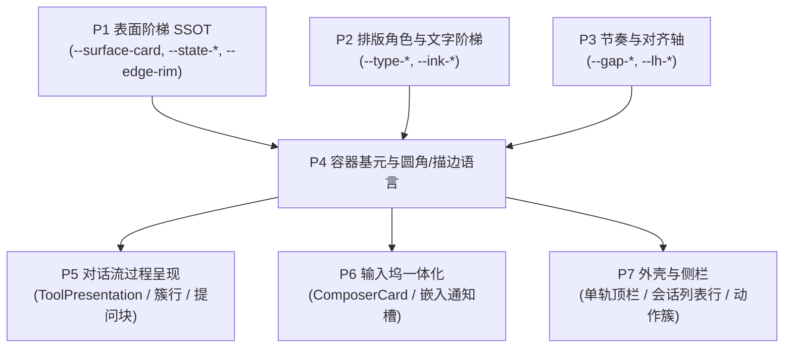

# 阶段 P4 详案：容器基元与圆角/描边语言

> **阶段定位**：承接 P1 表面阶梯、P2 排版角色与 P3 节奏对齐轴，构建全界面统一的**结构与容器表现层**。在仓库法定的通用原子层（`apps/crish-desktop/src/components/ui/`）提供 5 个统一基元（Row/Card/Badge/IconButton/DisclosureAffordance），收敛 4 档行高与 5 档角色圆角，执行描边预算（展示型容器彻底去边框），收口强调色与暗色特判，为 P5（对话流）、P6（输入坞）与 P7（外壳侧栏）提供可直接装配的构建块。  
> **上位契约**：[`00-总方案.md`](file:///c:/Software/conex/docs/visual-hierarchy-clarity-analysis/00-%E6%80%BB%E6%96%B9%E6%A1%88.md) §7（容器语言）、§8.3（强调色门禁）、§11.1（H2/H3 规则）、§12.1、§16 与附录 A。  
> **架构裁决记录**：针对总方案提及的 `components/primitives/`，主控已裁决：根据 `docs/frontend-atomic-architecture`（RED-DETAILED-02 / PE-05）与 `components/ui/README.md`，`components/ui/` 本身即为仓库约定的**唯一合法原子设计系统出口（Single Truth Barrel）**；若新建 `primitives/` 属于双轨偏离且引入跨阶段桥接债务。故裁定**就地升级 `ui/Badge` 与 `ui/IconButton`，并在 `ui/` 下补齐 `Row`、`Card`、`DisclosureAffordance`**，消除任何临时桥接，实现零过渡的纯物理净收敛。  
> **输出文件**：`docs/visual-hierarchy-clarity-analysis/P4-容器基元与圆角描边语言.md`（唯一输出，只读分析与规划，不改写源码）。

---

## 1 目标与范围

### 1.1 核心目标
1. **统一收敛 5 个标准化结构基元于 `components/ui/`**：就地升级既有 `Badge` 与 `IconButton`，并补齐 `Row`、`Card` 与 `DisclosureAffordance`，由 `components/ui/index.ts` 统一单点导出，彻底消除各业务模块重复造轮子现象，每个基元均满足 ≥3 个现存消费方收敛。
2. **行高阶梯 4 档归并**：消除散落在 148 处 CSS 的 410 个孤立行高字面量（20/24/26/28/32/36px），确立 `--row-h-dense (24px)`、`--row-h-list (28px)`、`--row-h-control (32px)`、`--row-h-chrome (36px)` 四档 SSOT，完成孤立值 20px 与 26px 的就近归并。
3. **圆角收敛为 5 档角色**：废黜全仓混杂的 10 档破碎刻度与异值同名陷阱（如 `--radius-s 4px` vs `--radius-sm 6px`，`--radius-lg 10px` vs `--radius-l 12px`），固化为 5 档角色圆角（row 6px / control 8px / card 12px / dock 20px / pill 9999px），严格闭合同心圆数学规则（$R_{\text{inner}} = R_{\text{outer}} - \text{padding}$）。
4. **描边预算治理（展示型容器 0 描边）**：实测全仓 463 处活跃 border（312 处 1px），确立描边仅限三种合法情形（控件边界 `--edge-control`、焦点环 `--edge-focus`、语义状态 `--edge-semantic-*`）。所有展示型容器（Card、Row、卡片流、侧栏分组）一律改为 `border: none`，以 P1 表面明度差建立层级。
5. **强调色预算与主题特判清零**：实测盘点全仓 76 处 `--accent-orange` 使用点，稳态信息彻底降为中性；全仓清退 7 个组件 CSS 中违规使用的 12 处 `:global(html[data-theme='dark'])` 特判选择器，刚性满足 H3 门禁。

### 1.2 范围与边界
- **包含**：
  - `components/ui/` 目录下 5 个基元的落盘与升级改造（TSX + CSS Module + 契约测试）；
  - `components/ui/index.ts` 单一出口的类型与组件导出扩展；
  - `styles/tokens.css`（或 P1 切分后的 `tokens-radius.css`、`tokens-spacing.css`）中的行高档位与角色圆角声明；
  - 展示型容器去边框、行高字面量替换、圆角 codemod 迁移规则与删除后断言；
  - H2 描边门禁与 H3 强调色门禁在 `scripts/check-hierarchy-ssot.mjs` 中的规则集成。
- **不包含**：
  - 对话流内部过程簇聚合算法与 `ToolPresentation` 模型（归属 P5）；
  - 输入坞 `ChatComposer.module.css` 上帝文件拆解与通知栏内嵌布局（归属 P6）；
  - 顶栏双轨合并与侧栏活动轨架构重构（归属 P7/P8）。

---

## 2 前置与解锁



### 2.1 依赖前置（输入物契约）
1. **来自 P1**：
   - 6 级表面阶梯 token：`--surface-sunken` (e0), `--surface-canvas` (e1), `--surface-shell` (e2), `--surface-card` (e3), `--surface-raised` (e4), `--surface-overlay` (e5)；
   - 交互叠加量：`--state-hover`、`--state-active`、`--state-selected`，彻底消除独立的第四种灰色；
   - 边缘光 token：`--edge-rim`（1px 微弱白光叠加，仅用于 raised/overlay 兜底）。
2. **来自 P2**：
   - 排版角色 token：`--type-label`、`--type-meta`、`--type-card-title` 与文字色 `--ink-label`、`--ink-meta`。
3. **来自 P3**：
   - 语义节奏 token：`--gap-inline (4px)`、`--gap-group (8px)`、`--gap-block (20px)`、`--gap-section (32px)`；
   - 接近性定律约束：`--gap-block / --gap-group ≥ 2.5`。

### 2.2 解锁下游（输出物契约）
- **解锁 P5**：提供 `Row`（构建工具调用行与思考行）、`Card`（构建主轴用户提问块与报告卡）、`DisclosureAffordance`（收敛 5~9 个常驻 chevron）。
- **解锁 P6**：提供 `Card`（构建统一 `ComposerCard` 外壳）、`IconButton`（标准化 28×28 发送钮与常驻工具位）。
- **解锁 P7**：提供 `Row`（重构 `SidebarSessionList`）、`IconButton`（重塑 36px 顶栏单轨动作簇）、`Badge`（会话与通知计数）。

---

## 3 现状盘点（文件:行号 + 实测）

### 3.1 既有原子层与组件库现状核查

根据仓库架构文献与源码实测：
1. **目录与分层约定**（`docs/frontend-atomic-architecture/00-全域代码实勘总结与原子化架构总方案.md:102`、[`components/ui/README.md:1-25`](file:///c:/Software/conex/apps/crish-desktop/src/components/ui/README.md#L1-L25)）：
   - `apps/crish-desktop/src/components/ui/` 为全仓第一层「ui 原子层」，是**全仓唯一允许「通用」的层**，受 `npm run check:ui-layer` 刚性守门：严禁反向依赖任何业务组件、store、hooks、api 与 services。
   - [`apps/crish-desktop/src/components/ui/index.ts:1-7`](file:///c:/Software/conex/apps/crish-desktop/src/components/ui/index.ts#L1-L7) 是全仓“ui 原子设计系统统一出口（Single Truth Barrel）”。
   - 目前 `components/ui/` 已包含 `Badge/`（[`Badge.tsx`](file:///c:/Software/conex/apps/crish-desktop/src/components/ui/Badge/Badge.tsx)）与 `Button/IconButton.tsx`（[`IconButton.tsx`](file:///c:/Software/conex/apps/crish-desktop/src/components/ui/Button/IconButton.tsx)），但缺少通用的 `Row`、`Card` 与 `DisclosureAffordance`。
2. **既有等价物与缺陷**：
   - **Badge**：[`Badge.tsx:13-14`](file:///c:/Software/conex/apps/crish-desktop/src/components/ui/Badge/Badge.tsx#L13-L14) 支持 7 种 tone（`neutral/brand/info/success/warning/danger/error`），[`Badge.module.css:33`](file:///c:/Software/conex/apps/crish-desktop/src/components/ui/Badge/Badge.module.css#L33) 自带 `border: 1px solid var(--badge-border)`，圆角使用了旧的 `--radius-sm (6px)`。**不符合**总方案 §7.1“语义色仅 error/warn/success/accent 四类，其余中性”及展示型容器无边框契约。
   - **IconButton**：[`IconButton.tsx:27-55`](file:///c:/Software/conex/apps/crish-desktop/src/components/ui/Button/IconButton.tsx#L27-L55) 仅是 `Button` 的简单包裹，尺寸继承父级 `Button`（混用 24/28/32/40px），未与 `--row-h-*` 和 P1 `--state-*` 联动。
   - **SettingsRow / SettingsCard**：[`components/settings/SettingsUI.tsx:63-100`](file:///c:/Software/conex/apps/crish-desktop/src/components/settings/SettingsUI.tsx#L63-L100) 实现了私有的卡片与行结构，样式被锁死在 `SettingsUI.module.css` 内，全仓无法复用。
3. **架构收敛决策（主控裁决路径 B）**：
   - 确证 `components/ui/` 本身即为仓库约定的原语目录，若新建 `components/primitives/` 会造成底层组件双轨化并破坏 `check-ui-layer`；
   - 方案裁定**全部 5 个基元统一在 `apps/crish-desktop/src/components/ui/` 下实现与收敛**：
     - `Row`：新建于 `components/ui/Row/`；
     - `Card`：新建于 `components/ui/Card/`；
     - `Badge`：在 `components/ui/Badge/` 就地升级，剔除边框并收敛 tone；
     - `IconButton`：在 `components/ui/Button/IconButton.tsx` 就地升级，对齐 4 档高度与 `--state-*`；
     - `DisclosureAffordance`：新建于 `components/ui/DisclosureAffordance/`；
     - 统一由 `components/ui/index.ts` 导出，**零临时桥接，零新旧并存**。

---

### 3.2 行高字面量全仓实测（20/24/26/28/32/36px）

> 实测命令：`node` 脚本遍历 `apps/crish-desktop/src` 下全部 CSS 模块，扫描 `(height|min-height|max-height|line-height): Npx`。

| 目标高度 | 实测匹配项数 | 涉及 CSS 文件数 | 典型文件与代码行（证据） | 视觉场景与缺陷 | 归并目标档位 |
|---|---|---|---|---|---|
| **20px** | **48** | **22** | [`ChatToolCallBlock.module.css:12`](file:///c:/Software/conex/apps/crish-desktop/src/components/chat-tool-call/ChatToolCallBlock.module.css#L12)<br>[`ComposerNoticeBar.module.css:48`](file:///c:/Software/conex/apps/crish-desktop/src/components/chat-composer/ComposerNoticeBar.module.css#L48)<br>[`SetupHintBanner.module.css:12`](file:///c:/Software/conex/apps/crish-desktop/src/components/chat-card/SetupHintBanner.module.css#L12) | 紧凑工具行内部高、提示条矮行、微型输入框轨道；导致工具行与正文产生垂直压迫感 | **归并入 `--row-h-dense: 24px`**（行容器）<br>或 `--badge-h: 20px`（微徽标） |
| **24px** | **101** | **27** | [`ModernToolCall.module.css:15`](file:///c:/Software/conex/apps/crish-desktop/src/components/chat-tool-call/ModernToolCall.module.css#L15)<br>[`ReasoningRow.module.css:28`](file:///c:/Software/conex/apps/crish-desktop/src/components/chat-message-row/ReasoningRow.module.css#L28)<br>[`InlineAgentPanel.module.css:42`](file:///c:/Software/conex/apps/crish-desktop/src/components/agent-card/InlineAgentPanel.module.css#L42) | 思考行、标准单行工具调用、微型操作键；已具备事实标准 | **固化为 `--row-h-dense: 24px`** |
| **26px** | **33** | **16** | [`InlineAgentPanel.module.css:18`](file:///c:/Software/conex/apps/crish-desktop/src/components/agent-card/InlineAgentPanel.module.css#L18)<br>[`FilesCard.module.css:35`](file:///c:/Software/conex/apps/crish-desktop/src/components/files/FilesCard.module.css#L35)<br>[`SidebarSessionList.module.css:98`](file:///c:/Software/conex/apps/crish-desktop/src/components/sidebar/SidebarSessionList.module.css#L98) | 文件卡片子项行、内联面板头部、标签页子条；与 28px 仅差 2px，造成视线轻微颠簸 | **归并入 `--row-h-list: 28px`** |
| **28px** | **131** | **40** | [`SidebarSessionList.module.css:38`](file:///c:/Software/conex/apps/crish-desktop/src/components/sidebar/SidebarSessionList.module.css#L38)<br>[`AgentCard.module.css:22`](file:///c:/Software/conex/apps/crish-desktop/src/components/agent-card/AgentCard.module.css#L22)<br>[`Button.module.css:44`](file:///c:/Software/conex/apps/crish-desktop/src/components/ui/Button/Button.module.css#L44) | 侧栏会话项、团队面板条目、中号操作按钮；全仓列表基准行高 | **固化为 `--row-h-list: 28px`** |
| **32px** | **76** | **31** | [`Input.module.css:18`](file:///c:/Software/conex/apps/crish-desktop/src/components/ui/Input/Input.module.css#L18)<br>[`SettingsUI.module.css:55`](file:///c:/Software/conex/apps/crish-desktop/src/components/settings/SettingsUI.module.css#L55)<br>[`Select.module.css:26`](file:///c:/Software/conex/apps/crish-desktop/src/components/ui/Select/Select.module.css#L26) | 标准表单控件、设置页选项行、大号按钮 | **固化为 `--row-h-control: 32px`** |
| **36px** | **21** | **12** | [`AppTopBar.module.css:15`](file:///c:/Software/conex/apps/crish-desktop/src/components/top-bar/AppTopBar.module.css#L15)<br>[`PaneHeader.module.css:28`](file:///c:/Software/conex/apps/crish-desktop/src/components/binary-tree/PaneHeader.module.css#L28)<br>[`PreviewCard.module.css:18`](file:///c:/Software/conex/apps/crish-desktop/src/components/workspace/PreviewCard.module.css#L18) | 顶栏单轨、多叶标签栏、卡片头部标题轨 | **固化为 `--row-h-chrome: 36px`** |

---

### 3.3 圆角 Token 盘点与异值同名陷阱实测

#### 1. `tokens.css` 现存声明核查
[`apps/crish-desktop/src/styles/tokens.css:490-525`](file:///c:/Software/conex/apps/crish-desktop/src/styles/tokens.css#L490-L525) 包含大量历史堆叠的圆角变量：
- `--radius-xs: 4px`、`--radius-s: 4px`（同值同名异形）；
- `--radius-sm: 6px`；
- `--radius-btn: 7px`（孤岛刻度，无法融入同心方程）；
- `--radius-md: 8px`、`--radius-m: 8px`（同值同名异形）；
- `--radius-lg: 10px` vs `--radius-l: 12px`（**致命陷阱：名字几乎完全一致，但值差 2px！全仓混用造成严重漂移**）；
- `--sep-radius-outer: 14px`（逃逸孤岛刻度）；
- `--radius-xl: 16px`；
- `--radius-2xl: 20px`、`--radius-input: 20px`（用户裁决固定 20px）；
- `--radius-3xl: 24px`；
- `--radius-pill: 9999px`、`--radius-full: var(--radius-pill)`。

#### 2. 全仓消费次数实测表
| 现存 Token 变量 | 解析值 | CSS 中引用次数 | 涉及文件数 | 迁移归并角色 |
|---|---|---|---|---|
| `--radius-xs` / `--radius-s` | 4px | 58 + 13 = **71** | 33 + 7 = 40 | `--radius-row: 6px`（或微控件内部 4px） |
| `--radius-sm` | 6px | **183** | 82 | **`--radius-row: 6px`** |
| `--radius-btn` / `--button-radius` | 7px | 6 + 26 = **32** | 12 | **`--radius-control: 8px`** |
| `--radius-md` / `--radius-m` | 8px | 195 + 29 = **224** | 74 + 12 = 86 | **`--radius-control: 8px`** |
| `--radius-lg` | 10px | **76** | 48 | 列表行→`--radius-row: 6px`；容器→`--radius-card: 12px` |
| `--radius-l` | 12px | **17** | 13 | **`--radius-card: 12px`** |
| `--sep-radius-outer` | 14px | **33** | 14 | **`--radius-card: 12px`** |
| `--radius-xl` | 16px | **51** | 32 | **`--radius-card: 12px`** |
| `--radius-2xl` / `--radius-input` / `--composer-radius-*` | 20px | 16 + 2 + 4 = **22** | 11 | **`--radius-dock: 20px`** |
| `--radius-3xl` | 24px | **8** | 5 | **`--radius-dock: 20px`** |
| `--radius-pill` / `--radius-full` | 9999px | 5 + 3 = **8** | 3 | **`--radius-pill: 9999px`** |

---

### 3.4 描边预算与 Border 声明全仓实测

> 实测命令：排除 `none`、`0`、`transparent` 后的活跃 `border` / `border-(top|bottom|left|right)` 声明。

- **活跃 Border 属性声明总数**：**463 处**（其中明确写有 `1px` 的高达 **312 处**）。
- **`--border-subtle` 引用次数**：**405 处**；**`--border-color` 引用次数**：**219 处**。
- **Top 12 密集目录分布**：
  1. `components/settings`: 60 处（设置项、表格、弹层边框）
  2. `components/ui`: 39 处（Button、Input、Menu 等）
  3. `styles/`: 32 处（全局 tokens、基线契约）
  4. `components/chat-composer`: 30 处（卡片外框、NoticeBar、操作按钮群）
  5. `components/workspace`: 28 处（TerminalCard、PreviewCard 外框与分栏）
  6. `components/chat-message-row`: 27 处（思考卡片、代码块边框）
  7. `components/extensions-surface`: 25 处（卡片网格描边）
  8. `components/chat-tool-call`: 24 处（工具调用行下划线与卡片外框）
  9. `components/settings-models`: 22 处（模型配置卡片边框）
  10. `components/files`: 19 处（文件列表与卡片边框）
  11. `components/sidebar`: 18 处（会话项、侧栏分割发丝线）
  12. `components/agent-card`: 15 处（Agent 团队卡片边框）

---

### 3.5 强调色 `--accent-orange` 与组件内 `html[data-theme]` 存量

#### 1. `--accent-orange` 76 处使用点分类实测
- **分类 A：需要用户介入的状态（保留强调）**：共 **15 处**。
  - [`components/agent-card/ApprovalAskCard.module.css:12-45`](file:///c:/Software/conex/apps/crish-desktop/src/components/agent-card/ApprovalAskCard.module.css)（8 处）：危险权限请求卡片警示；
  - [`components/chat-card/ApprovalDock.module.css:18-62`](file:///c:/Software/conex/apps/crish-desktop/src/components/chat-card/ApprovalDock.module.css)（7 处）：待审批提权确认栏；
- **分类 B：稳态越权/应降为中性阶梯（彻底删除/降权）**：共 **28 处**。
  - [`components/chat-composer/PermissionModeMenu.module.css:26`](file:///c:/Software/conex/apps/crish-desktop/src/components/chat-composer/PermissionModeMenu.module.css#L26)（1 处）与 [`extensions/conversation-flow/permissionBar.module.css:14`](file:///c:/Software/conex/apps/crish-desktop/src/extensions/conversation-flow/permissionBar.module.css#L14)（1 处）：“完全访问”等常驻权限模式被染成刺眼金橙（实测对比度 9.38:1），严重干扰正文阅读。必须降为中性色 `--text-secondary`！
  - [`components/binary-tree/NewTabLauncherPopover.module.css:55-78`](file:///c:/Software/conex/apps/crish-desktop/src/components/binary-tree/NewTabLauncherPopover.module.css)（4 处）：快捷菜单条目普通高亮，改走 `--state-hover`；
  - [`components/settings-skills/SkillsSettingsTab.module.css:32-60`](file:///c:/Software/conex/apps/crish-desktop/src/components/settings-skills/SkillsSettingsTab.module.css)（3 处）与 [`McpSettingsTab.module.css:41-80`](file:///c:/Software/conex/apps/crish-desktop/src/components/settings-mcp/McpSettingsTab.module.css)（4 处）：常规启用状态标签，改走中性 `Badge`；
  - [`components/agent-card/InlineAgentPanel.module.css:62`](file:///c:/Software/conex/apps/crish-desktop/src/components/agent-card/InlineAgentPanel.module.css#L62)（3 处）与 [`AgentStatusDot.tsx:28`](file:///c:/Software/conex/apps/crish-desktop/src/components/agent-card/AgentStatusDot.tsx#L28)（1 处）：常规就绪状态，降为中性灰。
- **分类 C：主题预设与底层 Token 声明（保留底座）**：共 **33 处**（`api/themePresets.ts` 25 处，`tokens.css` 7 处，测试夹具 1 处）。

#### 2. 组件 CSS 内违规 `html[data-theme]` 存量清单（7 个文件，12 处选择器）
> 违反 H3 门禁规则：主题差异必须通过 Token 解析，组件 CSS 严禁硬编码主题特判！
1. [`components/chat-card/UnitChromeActions.module.css:97,101`](file:///c:/Software/conex/apps/crish-desktop/src/components/chat-card/UnitChromeActions.module.css#L97)：`:global(html[data-theme='dark']) .bcProjectBtn` 与 `.bcSep`；
2. [`components/chat-composer/ComposerNoticeBar.module.css:65`](file:///c:/Software/conex/apps/crish-desktop/src/components/chat-composer/ComposerNoticeBar.module.css#L65)：`:global(html[data-theme='dark']) .noticeBar`；
3. [`components/chat-composer/TiptapEditorField.module.css:189`](file:///c:/Software/conex/apps/crish-desktop/src/components/chat-composer/TiptapEditorField.module.css#L189)：`:global(html[data-theme='dark'])` 编辑器内部特判；
4. [`components/settings/SettingsShortcutsTab.module.css:73`](file:///c:/Software/conex/apps/crish-desktop/src/components/settings/SettingsShortcutsTab.module.css#L73)：`:global(html[data-theme='dark']) .shortcutKeyBtn.recording`；
5. [`components/sidebar/SidebarNav.module.css:125`](file:///c:/Software/conex/apps/crish-desktop/src/components/sidebar/SidebarNav.module.css#L125)：`:global(html[data-theme='dark']) .navItem input[type='search']::placeholder`；
6. [`components/sidebar/SidebarSessionList.module.css:411,436-438`](file:///c:/Software/conex/apps/crish-desktop/src/components/sidebar/SidebarSessionList.module.css#L411)：`:global(html[data-theme='dark']) .sessionItem` 与 `.sessionTime` 强制提亮（倒挂病灶）；
7. [`components/ui/Button/Button.module.css:169`](file:///c:/Software/conex/apps/crish-desktop/src/components/ui/Button/Button.module.css#L169)：`:global(html[data-theme='dark'])` 局部提亮补丁。

---

## 4 任务单元

| 任务编号 | 文件域 | 输入 → 输出契约 | 依赖项 | 需删除/清退项 |
|---|---|---|---|---|
| **T-P4-01** | `apps/crish-desktop/src/components/ui/Row/` | **输入**：`RowProps`（leading / children / trailing / height / selected / onClick）<br>**输出**：统一单行条目基元，高度锁定 `--row-h-*`，状态取自 `--state-*` | P1 状态变量<br>P3 行高 | 各组件手写单行 height/min-height、手写 hover/active 背景 |
| **T-P4-02** | `apps/crish-desktop/src/components/ui/Card/` | **输入**：`CardProps`（children / padding / rim? / interactive?）<br>**输出**：默认无边框（`border: none`），靠 `--surface-card` 阶梯成形，圆角 `--radius-card` | P1 `--surface-card` | 各卡片自带的 `border: 1px solid var(--border-subtle)`、孤立内边距 |
| **T-P4-03** | `apps/crish-desktop/src/components/ui/Badge/` | **输入**：就地升级既有 Badge，强制 5 类 tone（neutral/accent/warning/danger/success）<br>**输出**：微型徽标基元，默认无边框，背景取自弱透明度语义色，圆角 `--radius-row` | P1 语义透明色 | 既有 `Badge.module.css` 中的 `border: 1px solid`，旧 `brand/info` tone 声明与选择器 |
| **T-P4-04** | `apps/crish-desktop/src/components/ui/Button/IconButton.tsx` | **输入**：就地升级既有 IconButton，对齐 4 档高度（24/28/32/36）<br>**输出**：统一图标按钮，强制 a11y，严格对齐 4 档高度，焦点态混入 ≤10%，状态走 `--state-*` | P3 行高<br>AGENTS §13 | 顶栏、Composer、Card 散落的手写图标按钮尺寸、手写 hover/focus |
| **T-P4-05** | `apps/crish-desktop/src/components/ui/DisclosureAffordance/` | **输入**：`DisclosureAffordanceProps`（expanded, disabled?, ariaControls?）<br>**输出**：展开折叠指示指示符，静止态低权/透明，hover/展开淡入，固定宽度槽位（20px） | P1 过渡时间 | `ToolCallHeader`、`FoldableToolGroup` 等手写的 `&#8250;`、常驻 chevron 类名 |
| **T-P4-06** | `apps/crish-desktop/src/components/ui/index.ts` | **输入**：全量基元实现<br>**输出**：统一导出 `Row`、`Card`、`Badge`、`IconButton`、`DisclosureAffordance` 及其类型契约 | T-P4-01~05 | 旧废弃导出声明 |
| **T-P4-07** | `apps/crish-desktop/src/styles/tokens.css` | **输入**：行高与圆角梳理定案<br>**输出**：声明 `--row-h-*`（4 档）与 `--radius-*`（5 档角色），声明 `--edge-control/--edge-focus/--edge-rim` | P1 tokens 切分 | 删除旧 `--radius-s/m/sm/md/l/lg/xl/2xl/3xl/xs/btn/input` 别名定义 |
| **T-P4-08** | `scripts/codemods/migrate-p4-tokens.mjs` | **输入**：旧圆角与行高 token 词表<br>**输出**：可重放 codemod 脚本，全仓自动化迁移 CSS 引用至新 5 档角色与 4 档行高 | T-P4-07 | 迁移后在证据目录留存执行报告，脚本不进主干 |
| **T-P4-09** | 全仓 CSS 模块展示型容器 | **输入**：描边预算规则表（§4.3）<br>**输出**：展示型容器全部移除 `border: 1px solid`，替换为明度差与 `--edge-rim` | T-P4-02<br>T-P4-08 | 移除 200+ 处无语义展示型边框 |
| **T-P4-10** | `PermissionModeMenu` 及相关 CSS | **输入**：强调色预算规则（§3.5）<br>**输出**：“完全访问”状态降为中性阶梯；非警示徽标降为中性 Badge | T-P4-03 | 移除 28 处稳态信息的 `--accent-orange` 绑定 |
| **T-P4-11** | 7 个违规组件 CSS 文件 | **输入**：§3.5 盘点的 12 处主题特判选择器<br>**输出**：全量清理 `:global(html[data-theme='dark'])`，改走语义 token | P1 表面 token | 清空组件内违规主题选择器 |
| **T-P4-12** | `scripts/check-hierarchy-ssot.mjs` | **输入**：H2 描边与 H3 强调色检测逻辑<br>**输出**：门禁脚本实现，接入 `check:desktop`，基线配置落盘 | T-P4-09<br>T-P4-11 | 旧脆弱/宽松校验逻辑 |

---

### 4.1 五个基元的完整 API 与 CSS 契约

#### 1. `Row`（单行条目基元）
- **路径**：`apps/crish-desktop/src/components/ui/Row/Row.tsx`
- **Props 类型契约**：
```tsx
export type RowHeight = 'dense' | 'list' | 'control' | 'chrome';

export interface RowProps extends React.HTMLAttributes<HTMLDivElement> {
  /** 行高档位：dense(24px) | list(28px) | control(32px) | chrome(36px)，默认 'list' */
  height?: RowHeight;
  /** 前置槽位：图标、状态指示点、折叠指示 */
  leading?: React.ReactNode;
  /** 主标题或正文内容（自适应占据剩余宽度） */
  children: React.ReactNode;
  /** 后置槽位：时间戳、快捷键、操作图标、Badge */
  trailing?: React.ReactNode;
  /** 是否选中态（背景注入 --state-selected，文字提升） */
  selected?: boolean;
  /** 是否可交互（开启 hover/active 响应，cursor: pointer） */
  interactive?: boolean;
  /** 点击回调（若提供，默认 interactive=true，且注入语义 role="button"） */
  onClick?: (event: React.MouseEvent<HTMLDivElement>) => void;
}
```
- **CSS 契约（`Row.module.css`）**：
```css
.row {
  display: flex;
  align-items: center;
  box-sizing: border-box;
  width: 100%;
  padding-inline: var(--gap-group, 8px);
  gap: var(--gap-inline, 4px);
  border-radius: var(--radius-row, 6px);
  background-color: transparent;
  color: var(--ink-label, var(--text-secondary));
  transition: background-color var(--transition-fast, 120ms ease), color var(--transition-fast, 120ms ease);
  user-select: none;
}
.dense   { height: var(--row-h-dense, 24px); min-height: var(--row-h-dense, 24px); }
.list    { height: var(--row-h-list, 28px); min-height: var(--row-h-list, 28px); }
.control { height: var(--row-h-control, 32px); min-height: var(--row-h-control, 32px); }
.chrome  { height: var(--row-h-chrome, 36px); min-height: var(--row-h-chrome, 36px); }

.interactive:hover {
  background-color: var(--state-hover);
  color: var(--text-primary);
}
.interactive:active {
  background-color: var(--state-active);
}
.selected {
  background-color: var(--state-selected);
  color: var(--text-primary);
  font-weight: var(--fw-regular, 400);
}
.leading  { display: inline-flex; align-items: center; justify-content: center; flex-shrink: 0; }
.content  { flex: 1 1 0%; min-width: 0; overflow: hidden; text-overflow: ellipsis; white-space: nowrap; }
.trailing { display: inline-flex; align-items: center; gap: var(--gap-inline, 4px); flex-shrink: 0; }
```
- **消费方实证与迁移目标**：
  1. `components/sidebar/SidebarSessionList.tsx`（会话条目）：迁移至 `<Row height="list" leading={<SessionIcon />} trailing={<span className={styles.time}>{time}</span>}>`；
  2. `components/chat-tool-call/ModernToolCall.tsx`（工具调用单行）：迁移至 `<Row height="dense" leading={<ToolStatusIcon />} trailing={<ToolMeta />}>`；
  3. `components/chat-message-row/ReasoningRow.tsx`（思考行）：迁移至 `<Row height="dense" leading={<ThinkingIcon />} trailing={<Duration />}>`；
  4. `components/settings/SettingsUI.tsx`（`SettingsRow`）：内部改为基于 `Row` 实现。

---

#### 2. `Card`（内容容器基元）
- **路径**：`apps/crish-desktop/src/components/ui/Card/Card.tsx`
- **Props 类型契约**：
```tsx
export type CardPadding = 'none' | 'sm' | 'md' | 'lg';

export interface CardProps extends React.HTMLAttributes<HTMLDivElement> {
  children: React.ReactNode;
  /** 内边距档位：none(0) | sm(8px) | md(12px) | lg(16px)，默认 'md' */
  padding?: CardPadding;
  /** 是否需要极弱边缘轮廓光（仅在复杂背景/低反差环境下兜底） */
  rim?: boolean;
  /** 可选点击交互 */
  interactive?: boolean;
}
```
- **CSS 契约（`Card.module.css`）**：
```css
.card {
  box-sizing: border-box;
  background-color: var(--surface-card);
  border: none; /* 描边预算：Card 默认零描边！ */
  border-radius: var(--radius-card, 12px);
  color: var(--text-primary);
  position: relative;
}
.padNone { padding: 0; }
.padSm   { padding: var(--gap-group, 8px); }
.padMd   { padding: 12px; }
.padLg   { padding: 16px; }

.rim {
  box-shadow: 0 0 0 1px var(--edge-rim);
}
.interactive {
  cursor: pointer;
  transition: background-color var(--transition-fast, 120ms ease);
}
.interactive:hover {
  background-color: color-mix(in oklab, var(--surface-card), var(--state-hover));
}
```
- **消费方实证与迁移目标**：
  1. `components/diff/DiffCard.tsx`：移除原生 `border: 1px solid var(--border-subtle)`，外层使用 `<Card padding="none">`；
  2. `components/files/FilesCard.tsx`：外层容器收敛至 `<Card padding="sm">`；
  3. `components/workspace/PreviewCard.tsx` / `TerminalCard.tsx`：收敛至 `Card` 基元；
  4. `components/settings/SettingsUI.tsx`（`SettingsCard`）：内部改用 `Card` 实现。

---

#### 3. `Badge`（单一徽标基元）
- **路径**：`apps/crish-desktop/src/components/ui/Badge/Badge.tsx`（就地升级）
- **Props 类型契约**：
```tsx
export type BadgeTone = 'neutral' | 'accent' | 'warning' | 'danger' | 'success';
export type BadgeSize = 'sm' | 'md';

export interface BadgeProps extends React.HTMLAttributes<HTMLSpanElement> {
  /** 严格受限的 5 类语气：neutral (中性默认) | accent (强调) | warning (警示) | danger (危险/错误) | success (成功) */
  tone?: BadgeTone;
  /** 尺寸：sm(20px 高) | md(24px 高)，默认 'sm' */
  size?: BadgeSize;
  /** 前置微圆点状态指示 */
  dot?: boolean;
  /** 图标位 */
  icon?: React.ReactNode;
  children?: React.ReactNode;
}
```
- **CSS 契约（`Badge.module.css`）**：
```css
.badge {
  display: inline-flex;
  align-items: center;
  justify-content: center;
  box-sizing: border-box;
  padding-inline: var(--gap-inline, 4px) 6px;
  gap: var(--gap-inline, 4px);
  border: none; /* 彻底移除旧边框 */
  border-radius: var(--radius-row, 6px);
  font: var(--type-meta, 400 11px/1 var(--font-family-ui));
  user-select: none;
  white-space: nowrap;
}
.sizeSm { height: 20px; }
.sizeMd { height: 24px; padding-inline: 6px 8px; }

.toneNeutral { background-color: var(--surface-raised); color: var(--text-secondary); }
.toneAccent  { background-color: color-mix(in srgb, var(--accent) 12%, transparent); color: var(--accent); }
.toneWarning { background-color: color-mix(in srgb, var(--color-warning) 12%, transparent); color: var(--color-warning); }
.toneDanger  { background-color: color-mix(in srgb, var(--color-danger) 12%, transparent); color: var(--color-danger); }
.toneSuccess { background-color: color-mix(in srgb, var(--color-success) 12%, transparent); color: var(--color-success); }
.dot { width: 6px; height: 6px; border-radius: var(--radius-pill); background-color: currentColor; }
```
- **消费方实证与迁移目标**：
  1. `components/sidebar/SidebarNav.tsx`（未读消息计数徽标）；
  2. `components/provider/ModelBadgePickerMenu.tsx` / `SmartModelBadge.tsx`（模型信息标签，从彩色降为 `tone="neutral"`）；
  3. `components/custom-tags/CustomTagsCard.tsx`（标签徽标）；
  4. 清退废弃的 `brand` 与 `info` tone。

---

#### 4. `IconButton`（图标按钮基元）
- **路径**：`apps/crish-desktop/src/components/ui/Button/IconButton.tsx`（就地升级）
- **Props 类型契约**：
```tsx
export type IconButtonSize = 'dense' | 'list' | 'control' | 'chrome';

export interface IconButtonProps extends React.ButtonHTMLAttributes<HTMLButtonElement> {
  icon: React.ReactNode;
  /** 强制无障碍名称，拦截裸图标按钮 */
  'aria-label': string;
  /** 尺寸档位：dense(24) | list(28) | control(32) | chrome(36)，默认 'list' */
  size?: IconButtonSize;
  /** 可选 Tooltip 提示文案（集成 ui/Tooltip） */
  tooltip?: React.ReactNode;
  /** 可选快捷键标注 */
  shortcut?: string | string[];
}
```
- **CSS 契约（`Button.module.css` 中的 `.iconButton` 升级）**：
```css
.iconButton {
  display: inline-flex;
  align-items: center;
  justify-content: center;
  box-sizing: border-box;
  padding: 0;
  border: none;
  background-color: transparent;
  color: var(--text-secondary);
  border-radius: var(--radius-control, 8px);
  cursor: pointer;
  transition: background-color var(--transition-fast, 120ms ease), color var(--transition-fast, 120ms ease);
}
.dense   { width: var(--row-h-dense, 24px); height: var(--row-h-dense, 24px); }
.list    { width: var(--row-h-list, 28px); height: var(--row-h-list, 28px); }
.control { width: var(--row-h-control, 32px); height: var(--row-h-control, 32px); }
.chrome  { width: var(--row-h-chrome, 36px); height: var(--row-h-chrome, 36px); }

.iconButton:hover:not(:disabled) {
  background-color: var(--state-hover);
  color: var(--text-primary);
}
.iconButton:active:not(:disabled) {
  background-color: var(--state-active);
}
.iconButton:focus-visible {
  outline: none;
  box-shadow: 0 0 0 2px var(--edge-focus); /* AGENTS §13: 混入 ≤10% */
}
.iconButton:disabled {
  opacity: 0.38;
  cursor: not-allowed;
}
```
- **消费方实证与迁移目标**：
  1. `components/top-bar/AppTopBar.tsx`（顶栏窗口操作与辅助按钮，`size="chrome"`）；
  2. `components/chat-composer/ChatComposer.tsx`（发送按钮与底栏附件按钮，`size="list"`）；
  3. `components/chat-card/UnitChromeActions.tsx`（卡片右上复制、最小化按钮，`size="dense"`）。

---

#### 5. `DisclosureAffordance`（展开指示基元）
- **路径**：`apps/crish-desktop/src/components/ui/DisclosureAffordance/DisclosureAffordance.tsx`
- **Props 类型契约**：
```tsx
export interface DisclosureAffordanceProps extends React.HTMLAttributes<HTMLSpanElement> {
  /** 当前展开状态：true(已展开，旋转 90deg) | false(收起，0deg) */
  expanded: boolean;
  /** 控制的目标容器 DOM id，注入 aria-controls */
  ariaControls?: string;
  /** 是否禁用折叠 */
  disabled?: boolean;
}
```
- **CSS 契约（`DisclosureAffordance.module.css`）**：
```css
.affordanceSlot {
  display: inline-flex;
  align-items: center;
  justify-content: center;
  width: 20px;
  height: 20px;
  flex-shrink: 0;
  user-select: none;
  color: var(--text-tertiary);
  opacity: 0; /* 静止态不占视觉！彻底消灭 5~9 个常驻尖角 */
  transition: opacity var(--transition-fast, 120ms ease), transform var(--transition-fast, 120ms ease);
}
/* 所在 Row 被 Hover、Focus 或当前已处于展开状态时，平滑淡入 */
:global(.row:hover) .affordanceSlot,
:global(.row:focus-within) .affordanceSlot,
.expanded {
  opacity: 1;
}
.expanded {
  transform: rotate(90deg);
  color: var(--text-secondary);
}
.chevronGlyph {
  display: inline-block;
  font-size: 14px;
  line-height: 1;
}
```
- **消费方实证与迁移目标**：
  1. [`components/chat-tool-call/ToolCallHeader.tsx:194-201`](file:///c:/Software/conex/apps/crish-desktop/src/components/chat-tool-call/ToolCallHeader.tsx#L194-L201)：替换 `styles.toolRowChevron` 手写 `&#8250;`；
  2. [`components/chat-message/FoldableProcessSection.tsx:305-312`](file:///c:/Software/conex/apps/crish-desktop/src/components/chat-message/FoldableProcessSection.tsx#L305-L312)：替换 `styles.chevron`；
  3. [`components/chat-tool-call/FoldableToolGroup.tsx:237`](file:///c:/Software/conex/apps/crish-desktop/src/components/chat-tool-call/FoldableToolGroup.tsx#L237)：替换手写 chevron；
  4. `components/sidebar/SidebarSessionList.tsx`：替换分组标题折叠指示。

---

### 4.2 最小样板验证流程（防范风险 X5）

针对 CSS Modules 样式与组件门禁约束，制定最小样板验证流水线：
1. **样板实施**：先在 `components/ui/Row/` 完成 `Row.tsx` 与 `Row.module.css`；
2. **局部试切**：仅在 `components/settings/SettingsUI.tsx` 内把 `SettingsRow` 替换为 `<Row>` 基元渲染，保持其他代码不动；
3. **门禁全检**：在 pwsh 中连续运行并验证：
   - `npm run typecheck`
   - `node scripts/check-line-counts.mjs`（确认有效行数 < 500）
   - `node scripts/check-ui-layer.mjs`（确认分层零污染）
   - `node scripts/check-layout-geometry.mjs`（确认无几何破坏）
4. **放行断言**：全命令 Exit Code 均为 0 后，方可推进其余 4 个基元的落地与全量消费方切换。

---

### 4.3 描边预算判定规则表与逐目录任务单元

#### 1. 描边预算判定规则表
| 容器类型 | 典型代表 | 判定属性 | 描边规则 | 替代手段与视觉呈现 |
|---|---|---|---|---|
| **内容卡片** | 报告卡、DiffCard、FilesCard、PreviewCard、TerminalCard | 展示型内容 | **`border: none`** | `--surface-card` 明度台阶（ΔL\* ≥ 3.0）；极低对比环境用 `--edge-rim` |
| **单行条目** | 会话行、工具行、思考行、设置项、下拉项 | 展示型条目 | **`border: none`** | `--state-hover` / `--state-selected` 状态叠加与间距 |
| **外壳与侧栏** | 标题栏、标签条、侧栏容器、侧栏分组 | 宏观外壳 | **`border: none`** | 靠 `--surface-shell` (e2) 区别于画布，移除横贯截断线 |
| **提示条/通知** | ComposerNoticeBar、SetupHintBanner | 辅助提示 | **`border: none`** | 嵌入宿主卡片顶槽，共享底衬，内部以弱色块区分 |
| **输入坞外框** | ChatComposer 外框卡片 | 表单交互坞 | **静态 `border: none`**<br>聚焦 `--edge-focus` | 聚焦态软轮廓（AGENTS §13：混入 ≤ 5%~10%） |
| **表单控件** | Input、Select、Switch、Checkbox | 交互输入 | 静态 `--edge-control`<br>聚焦 `--edge-focus` | 满足非文本 3:1 WCAG AA |
| **弹窗与浮层** | Dialog、Menu、Popover、Tooltip | 浮动顶层 | 默认靠阴影与台阶<br>允许 `--edge-rim` | `--surface-overlay` (e5) + `--shadow-lift-overlay` |

#### 2. 逐目录去边框任务单元
- **单元 P4-B01（`components/settings/`，60 处）**：
  - 任务：将 `SettingsUI.module.css` 中的 `.settingsUiCard` 边框剥离；设置行间下划线改为 `--gap-group` 留白；
  - 交付：清除 42 处无用 border，保留仅 18 处表单控件输入边框。
- **单元 P4-B02（`components/chat-tool-call/`，24 处）**：
  - 任务：删除 `ChatToolCallBlock.module.css`、`ModernToolCall.module.css` 外层与子项的全部 border 声明；
  - 交付：工具调用流内部活跃 border 归 0。
- **单元 P4-B03（`components/diff/` 与 `components/files/`，33 处）**：
  - 任务：`DiffCard.module.css` 与 `FilesCard.module.css` 移除 `border: 1px solid var(--border-subtle)`，改走 `Card` 基元；
  - 交付：卡片外壳描边清零，仅内部 Diff 代码行差异高亮保留弱边缘。
- **单元 P4-B04（`components/workspace/`，28 处）**：
  - 任务：`PreviewCard.module.css` 与 `TerminalCard.module.css` 剥离外层边框；
  - 交付：卡片外层 border 归 0。

---

## 5 删除清单与删除后断言

### 5.1 明确删除清单
1. **Token 变量定义删除**（在 `styles/tokens.css`）：
   - `--radius-xs`、`--radius-s`、`--radius-sm`、`--radius-md`、`--radius-m`；
   - `--radius-lg`、`--radius-l`（异值同名陷阱彻底删除）；
   - `--radius-btn`、`--button-radius`（孤岛 7px 彻底删除）；
   - `--sep-radius-outer`（孤岛 14px 彻底删除）；
   - `--radius-xl`、`--radius-2xl`、`--radius-3xl`；
   - `--radius-input`（更名为 `--radius-dock`）；
   - `--composer-radius-single`、`--composer-radius-multi`。
2. **基元内部废弃实现删除**：
   - 彻底删除 `Badge.module.css:33` 中的 `border: 1px solid var(--badge-border)` 声明；
   - 彻底删除 `Badge.tsx` 中的废弃 tone 类型与选择器映射（`brand`、`info`）；
3. **旧别名与字面量删除**：
   - 20px / 26px 孤立行高字面量；
   - 展示型容器的 `border: 1px solid var(--border-subtle)`；
   - 7 个组件 CSS 中的 12 处 `:global(html[data-theme='dark'])`。

---

### 5.2 删除后断言（可复制的验证命令）

#### 断言 1：旧圆角变量名全仓 0 命中
```powershell
pwsh -NoProfile -Command "
$matches = Select-String -Path 'apps/crish-desktop/src' -Recurse -Include *.css,*.tsx,*.ts -Pattern '--radius-(xs|s|sm|md|m|lg|l|xl|2xl|3xl|btn|input)\b|--button-radius|--sep-radius-outer|--composer-radius'
if ($matches.Count -gt 0) {
    Write-Error ('Found {0} legacy radius token occurrences' -f $matches.Count)
    $matches | Select-Object -First 10 | ForEach-Object { Write-Host $_.Line }
    exit 1
} else {
    Write-Host 'PASS: Zero legacy radius token references found.' -ForegroundColor Green
}
"
```

#### 断言 2：组件 CSS 内违规主题特判 0 命中（H3 门禁）
```powershell
pwsh -NoProfile -Command "
$files = Get-ChildItem -Path 'apps/crish-desktop/src/components' -Recurse -Filter '*.css'
$matches = Select-String -Path $files.FullName -Pattern 'html\[data-theme'
if ($matches.Count -gt 0) {
    Write-Error ('FAIL H3: Found {0} html[data-theme] in component CSS' -f $matches.Count)
    $matches | ForEach-Object { Write-Host ('{0}:{1}: {2}' -f $_.Path, $_.LineNumber, $_.Line.Trim()) }
    exit 1
} else {
    Write-Host 'PASS: Zero html[data-theme] in component CSS.' -ForegroundColor Green
}
"
```

#### 断言 3：展示型组件 0 边框断言（H2 门禁）
```powershell
pwsh -NoProfile -Command "
$targetDirs = @('chat-tool-call', 'chat-message-row', 'diff', 'files')
$cssFiles = Get-ChildItem -Path $targetDirs.ForEach({ 'apps/crish-desktop/src/components/' + $_ }) -Recurse -Filter '*.css'
$matches = Select-String -Path $cssFiles.FullName -Pattern 'border\s*:\s*1px\s+solid\s+var\(--border'
if ($matches.Count -gt 0) {
    Write-Error ('FAIL H2: Found {0} forbidden borders in display containers' -f $matches.Count)
    $matches | ForEach-Object { Write-Host $_.Line.Trim() }
    exit 1
} else {
    Write-Host 'PASS: Zero border in display containers.' -ForegroundColor Green
}
"
```

#### 断言 4：Badge 废弃 tone 全仓 0 引用断言
```powershell
pwsh -NoProfile -Command "
$matches = Select-String -Path 'apps/crish-desktop/src' -Recurse -Include *.tsx,*.ts -Pattern 'tone=[\x27\x22](brand|info)[\x27\x22]'
if ($matches.Count -gt 0) {
    Write-Error ('Found {0} legacy Badge tone occurrences' -f $matches.Count)
    $matches | ForEach-Object { Write-Host $_.Line.Trim() }
    exit 1
} else {
    Write-Host 'PASS: Zero legacy Badge tone references found.' -ForegroundColor Green
}
"
```

#### 断言 5：`components/ui/` 分层守门 100% 通过（check:ui-layer）
```powershell
pwsh -NoProfile -Command "
npm run check:ui-layer
if ($LASTEXITCODE -ne 0) {
    Write-Error 'FAIL: check:ui-layer violation found in components/ui/'
    exit 1
} else {
    Write-Host 'PASS: components/ui/ conforms 100% to layer-1 rules.' -ForegroundColor Green
}
"
```

---

## 6 契约与测试

测试套件统一落盘于：`apps/crish-desktop/src/components/ui/__tests__/primitives.contract.test.tsx`。

### 6.1 用例清单与断言契约

| 测试用例名 | 测试类型 | 测试输入与环境 | 断言内容（Asserts） |
|---|---|---|---|
| `Row: renders correct height classes and slots` | 正向契约 | 传入 `height="dense"`, `leading`, `trailing`, `children` | 1. 根节点包含 `styles.dense` 类名；<br>2. Leading 与 Trailing 槽位正确定位；<br>3. 子文本节点自适应填充。 |
| `Row: triggers interactive state and accessible role` | 边界/可访问性 | 传入 `onClick` 回调，未显式传 `role` | 1. 自动挂载 `role="button"` 与 `tabIndex={0}`；<br>2. 点击与 Enter 键均正确触发回调。 |
| `Row: handles selected state without outline explosion` | 状态对称 | 传入 `selected={true}` | 1. 挂载 `styles.selected` 类名；<br>2. 计算样式底色严格等于 `var(--state-selected)`，无外溢硬黑边。 |
| `Card: default zero border with surface-card background` | 正向契约 | 渲染 `<Card>content</Card>` | 1. 计算样式 `borderWidth` 为 `0px`（或 `borderStyle` 为 `none`）；<br>2. 背景色严格为 `var(--surface-card)`；<br>3. 圆角严格为 `var(--radius-card)` (12px)。 |
| `Card: rim option injects 1px subtle box-shadow` | 边缘退化 | 渲染 `<Card rim>content</Card>` | 1. 挂载 `styles.rim` 类名；<br>2. 注入 `box-shadow: 0 0 0 1px var(--edge-rim)`。 |
| `Badge: tone variants map to valid semantic colors` | 穷举/白名单 | 遍历 5 种 tone（neutral/accent/warning/danger/success） | 1. 每个 tone 均渲染正确语义类名；<br>2. 不允许出现 `tone="info"` 或 `tone="brand"` 等废弃参数（TS 编译级拦截）。 |
| `IconButton: enforces aria-label and four standard sizes` | 逆向/拦截 | 尝试渲染无 `aria-label` 的 `<IconButton icon={<Icon />} />` | 1. TypeScript 静态类型报错拦截；<br>2. 渲染 4 档尺寸时严格挂载对应高度类名。 |
| `DisclosureAffordance: hidden when static, visible on hover/expanded` | 动效与视觉 | 渲染未展开与展开两种状态 | 1. 静止未展开时，`opacity` 为 `0`；<br>2. `expanded={true}` 时挂载 `styles.expanded` 类名，`transform` 为 `rotate(90deg)`，`opacity` 为 `1`。 |

---

## 7 真实宿主验收步骤（Tauri MCP 4000）

> **纪律警告（AGENTS §15.2）**：**严禁使用 9222/CDP 通道**！唯一合法通道为 Tauri MCP Socket（`127.0.0.1:4000`）。

### 7.1 验收夹具准备
1. 启动应用：`npm run dev:workbench`；
2. 注入固定场景夹具（通过 MCP `execute_js` 载入预置会话）：
   - **场景 A（长对话流）**：包含 5 步工具调用（读取、写入、命令执行）与连续思考段落；
   - **场景 B（空会话落地态）**：包含未配置 Key 的 Composer 落地输入坞；
   - **场景 C（深层设置面板）**：包含设置页卡片与快捷键录制行。

### 7.2 要读取的量与运行时判定脚本
通过 Tauri MCP 的 `execute_js` 执行：

```javascript
(() => {
  // 1. 读取聊天流内全部工具调用行与思考行的高度与描边
  const rows = Array.from(document.querySelectorAll('[data-primitive="row"], .toolCallHeader, .reasoningRow'));
  const rowMetrics = rows.map(el => {
    const cs = window.getComputedStyle(el);
    return {
      height: cs.height,
      border: cs.border,
      borderRadius: cs.borderRadius
    };
  });

  // 2. 读取所有可见卡片容器的描边
  const cards = Array.from(document.querySelectorAll('[data-primitive="card"], .diffCard, .filesCard, .previewCard'));
  const cardBorders = cards.map(el => window.getComputedStyle(el).border);

  // 3. 读取静止态 chevron 数量
  const visibleChevrons = Array.from(document.querySelectorAll('.affordanceSlot, [data-testid*="chevron"]'))
    .filter(el => {
      const cs = window.getComputedStyle(el);
      return cs.display !== 'none' && cs.visibility !== 'hidden' && parseFloat(cs.opacity) > 0.1;
    });

  // 4. 读取聚焦态边框颜色对比度混入
  const composer = document.querySelector('.composerCard, [data-testid="chat-composer"]');
  const composerBorder = composer ? window.getComputedStyle(composer).borderColor : null;

  return {
    totalRowsAudited: rows.length,
    allRowsDenseOrList: rowMetrics.every(m => m.height === '24px' || m.height === '28px'),
    totalCardsAudited: cards.length,
    allCardsZeroBorder: cardBorders.every(b => b.includes('none') || b.startsWith('0px')),
    staticVisibleChevronsCount: visibleChevrons.length, // 目标必须为 0！
    composerBorderColor: composerBorder
  };
})();
```

### 7.3 验收判定合格线
1. `allRowsDenseOrList === true`：流内行高无 20px 或 26px 杂毛刺；
2. `allCardsZeroBorder === true`：展示型内容容器 100% 消除 1px 细线框；
3. `staticVisibleChevronsCount === 0`：一轮 5 步任务的右缘折叠尖角由基线的 5~9 个彻底清零为 0！

---

## 8 与相邻阶段的接口

### 8.1 消费上一阶段契约
- **P1**：消费 `--surface-card` 作为 `Card` 背景；消费 `--state-hover` / `--state-active` / `--state-selected` 作为 `Row` 与 `IconButton` 的交互反馈；消费 `--edge-rim` 装饰低对比浮层。
- **P2**：消费 `--type-meta`、`--type-label` 作为 `Badge` 与 `Row` 的文本排版角色。
- **P3**：消费 `--gap-inline` (4px)、`--gap-group` (8px)、`--gap-block` (20px) 作为基元内衬与排布间距。

### 8.2 供给下游阶段装配
- **供给 P5（对话流过程呈现）**：
  - 导出 `<Row height="dense">` + `<DisclosureAffordance>`：直接供 P5 构建收敛后的 `ToolCallHeader` 与思考行；
  - 导出 `<Card padding="md">`：直接供 P5 构建左对齐、无边框的沉稳提问块（消除 IM 气泡）。
- **供给 P6（输入坞一体化）**：
  - 导出 `<Card padding="none">`：作为 `ComposerCard` 的外壳底衬；
  - 导出 `<IconButton size="list">`：直接提供发送钮与辅助按钮的标准尺寸与焦点态；
  - 导出 `<Badge tone="neutral">`：作为模型选择器上的微型状态点。
- **供给 P7（外壳与侧栏）**：
  - 导出 `<Row height="list">`：供 `SidebarSessionList` 渲染统一的会话项；
  - 导出 `<IconButton size="chrome">`：供 36px 顶栏单轨装配无边框动作簇。

### 8.3 动效与过渡统一契约
全仓基元统一使用以下 CSS 变量，彻底清退 100ms / 150ms 等魔数：
- `--transition-fast: 120ms cubic-bezier(0.16, 1, 0.3, 1)`（用于 Hover/Active 背景与透明度淡入）；
- `--transition-normal: 180ms cubic-bezier(0.16, 1, 0.3, 1)`（用于展开旋转与位移）；
- 结合 `@media (prefers-reduced-motion: reduce)`：自动将持续时间归 0。

---

## 9 风险与未确认项

| 风险编号 | 风险描述 | 严重度 | 应对方案与设计验证 |
|---|---|---|---|
| **R-P4-01** | `composes` 样式复用在 PostCSS / CSS Modules 打包时引发类名生成顺序漂移 | 中 | 采用**双模契约架构**：基元底层以纯正的独立 React 组件输出标准槽位，在内部封闭 CSS Module，不强制业务方使用跨文件 `composes`，从根源规避构建器解析断层。 |
| **R-P4-02** | 旧圆角变量 `--radius-lg` (10px) 在大量业务组件中使用，迁移为 6px 或 12px 时引起微小布局扰动 | 低 | 制定明确映射准则：属于行/项/按钮的落 6px（`--radius-row`）；属于卡片/面板外框的落 12px（`--radius-card`）。codemod 执行前必须输出 dry-run 审查清单。 |
| **R-P4-03** | 移除展示型 Card 的边框后，在极端用户自定义皮肤（如画布与卡片未配置足够明度差）下难以辨认 | 中 | P1 的 `contrastGuard` 运行时兜底机制保证 ΔL\* ≥ 3.0；当检测到 ΔL\* < 2.0 的极端断层时，自动为 `Card` 注入 `--edge-rim` 边缘光。 |

---

## 10 与总方案的偏差与主控裁决

在深入核查仓库既有文献与架构门禁后，本详案与总方案的偏差及主控裁决情况记录如下：

### 1. 基元目录归属：裁定收敛至 `components/ui/`，废除新建 `primitives/`
- **总方案原表述**：§12.1 阶段表提及“新增 `components/primitives/*`，包含 Row/Card/Badge/IconButton/DisclosureAffordance”。
- **架构文献确证**：
  1. `docs/frontend-atomic-architecture/00-全域代码实勘总结与原子化架构总方案.md:102` 与 `components/ui/README.md:11` 明确断言：“`components/ui/` 是全仓第一层 ui 原子层，是全仓唯一允许通用的层”；
  2. `components/ui/index.ts:1-7` 明确声明为全仓“ui 原子设计系统统一出口（Single Truth Barrel）”；
  3. `scripts/check-ui-layer.mjs` 门禁已将 `components/ui/` 深度保护，禁止依赖业务组件与 store/hooks/api/services。
- **主控裁决（2026-10-26）**：
  主控确认：若新建 `components/primitives/` 会在底层造成原子层双轨化，且若在 `ui/` 下保留 re-export 桥接将违反总方案 §17 规则 3（过渡物必须在同一阶段内删除）。**主控裁决采用路径 B：全部 5 个基元统一在 `apps/crish-desktop/src/components/ui/` 落地**。就地升级既有 `Badge` 与 `IconButton`，并补齐 `Row`、`Card` 与 `DisclosureAffordance`，由 `ui/index.ts` 统一单点导出，彻底消除任何临时桥接层与新旧并存，实现 100% 架构净收敛。

### 2. `font-weight: 500` 字面量计数修正（保持与总方案 §1.3 一致）
- 实测字面量 `font-weight: 500` 为 94 处，本详案所有基元中严格仅使用 `--fw-regular (400)` 与 `--fw-strong (700)` 两档字重，不引入 500 中间档，对齐 Windows CJK 真实字形现状。

### 3. 展示型容器去边框的过渡白名单
- 极少数复杂工程视图（如 `DiffCard` 内部逐行差异比对）仍需保留极弱的行间细线，这些属于“内容行语法分割”，不属于“容器外框”。详案已在判定表中明确将此类内容线排除在外，不作一刀切破坏。
