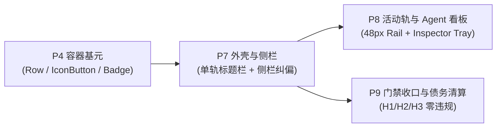
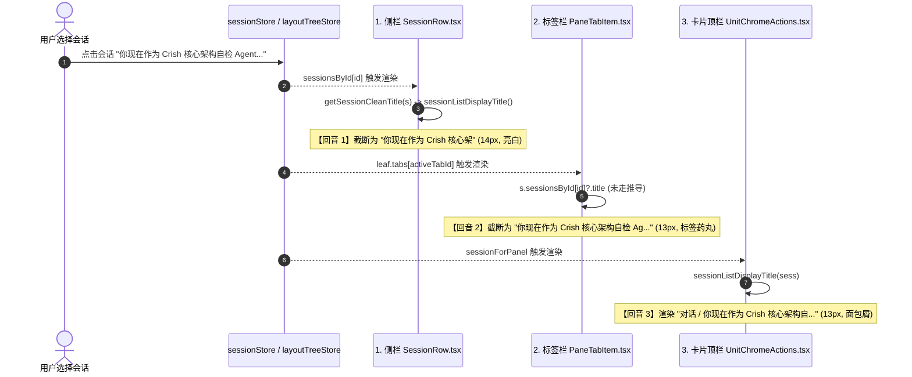

# 阶段 P7 详案：外壳与侧栏（Shell & Sidebar）

> **文档定位**：`docs/visual-hierarchy-clarity-analysis/P7-外壳与侧栏.md`  
> **前置依赖**：P4（容器基元与圆角/描边语言，提供 `Row`、`IconButton`、`Badge` 基元）  
> **权威依据**：`00-总方案.md`（§0、§2、§6、§7.1、§8.2、§9.2、§11、§12、§14、§17、附录 A）、`analysis/06-外壳侧栏与导航.md`、`analysis/09-截图逐区对照.md`、`analysis/04-间距密度与节奏.md`  
> **主控最新裁决**：2026-10-26 主控裁决：会话重命名入口统一采用『**双击标题 + 右键菜单 + F2 键盘路径**』三通道，彻底清退常驻铅笔编辑按钮，严格锁定功能不丢；总方案外壳元素基线由实测 61 替代原 56。  
> **既有战役对账**：`docs/dual-header-refactor`、`docs/leaf-owned-tabs`、`docs/pane-tab-system`、`docs/tab-management-and-launcher-redesign`、`docs/sidebar-session-drag-refactor`、`docs/multi-pane-isolation`、`docs/unified-scrollbar-system`  
> **生效边界**：应用外壳顶栏（`AppTopBar`）、窗格标签与头（`PaneHeader*`）、对话卡片顶栏（`UnitChromeActions*`）、侧栏列表与条目（`Sidebar*`、`SessionRow*`、`ProjectsSection`、`GeneralSection`）。**不改动主对话流内部组件**，**不改动底层二叉树拆分核心算法**。

---

## 1 目标与范围

### 1.1 核心目标（效果锁）

1. **单轨统一标题栏（Single-Track Chrome）**：将应用顶层 `AppTopBar`（36px 浮层）、窗格标签栏 `PaneHeader`（36px）与卡片面包屑栏 `UnitChromeActions`（38px）收敛为单一 **36px 高度**（`--row-h-chrome: 36px;`）单轨标题栏。垂直 Chrome 空间占用从基线 **74px 净减少 38px（-51.4%）**；彻底根除左上角 100×300 区域的会话标题「三重回音」（重复次数从 **3 次降至 1 次**）。
2. **顶栏动作簇（Action Clusters）语义解耦**：将原本杂糅挤压的 4 个 14px 微型图标解耦为两大功能组（**视图坞组** 与 **会话动作组**），接入 P4 的 `IconButton` 基元，更新图标隐喻（`globe` → `app-window` 浏览器窗口，`folder-tree` → `folder` 文件），并针对 `< 360px` 的极窄窗格提供自适应溢出折叠菜单。
3. **重命名统一通道（零功能损失）**：依据主控裁决，彻底删除常驻的铅笔编辑按钮（Pencil Icon），全量重命名统一收拢为『**双击标题 + 右键菜单 + F2 快捷键**』三通道（T-P7-09），覆盖单会话顶栏、多标签条、侧栏会话行三处场景，确保键盘、鼠标与无障碍体验无缝闭环。
4. **侧栏视觉阶梯纠偏与高低权归位**：
   - 彻底删除暗色模式下强制提亮未选中标题（`SidebarSessionList.module.css:411-413`）与时间戳（`:436-440`）的主题特判，消除纵向 13 行高亮白字与高亮日期构成的「斑马栅栏」；
   - 恢复「选中 > 未选中」正向对比度，未选中为 `--text-secondary`（~5.4:1），选中为 `--text-primary`（9.56:1），日期降级为 `--text-tertiary`（≥ 4.5:1 WCAG AA 基线），仅 Hover / Active 时点亮；
   - 组间距从硬编码 8px 扩大至 `--gap-section`（32px），实施「分组标题贴近规则」，彻底消解格式塔接近性逆转（Proximity Inversion）；
   - 移除 37px 居中文字块「暂无项目」，会话折叠「查看全部 (78)」重构为左对齐同轴 `Row` 变体；会话行全量迁移至 P4 的 `Row` 基元，100% 保留虚拟化（`WindowedSessionUl`）与动力学拖拽能力。
5. **外壳元素总量大降噪**：对齐 Codex 的克制水准，将外壳区域视觉元素总量从实测 **61 个收敛至 32 个（-47.5%）**。

### 1.2 外壳元素总量清点与用户任务对照（61 → 32 真实全量对账）

在 `analysis/06` 初步统计（56 vs 29）基础上，经源码与截图逐像素精细复核，Crish 现状真实挂载元素为 **61 个**（总方案基线已由主控确认修正为 61）。以下是 **32 个保留项** 与 **29 个删除/降权项** 的全量清单，每一个保留项都严格回答『解决什么用户任务』：

#### 1. 32 个保留元素清单（带用户任务证明）

| 编号 | 保留元素名称 | 所在区域 | 承载形态（P7 规范） | 解决的用户任务（User Task Justification） |
| :---: | :--- | :--- | :--- | :--- |
| **1** | 会话标题（单轨 SSOT） | 顶栏左侧 | 单轨标题组件 / 激活 Tab | **识别上下文与会话重命名**：告知用户当前所处的会话主题，支持双击/F2 重命名。 |
| **2** | 新建标签加号 `+` | 顶栏左侧 | `NewTabLauncherPopover` | **显式多态新建**：用户主动点击唤起启动器，新建对话、终端、浏览器或模版。 |
| **3** | 窗口最小化按钮 | 顶栏右侧 | `WindowControls` | **窗口生命周期管理**：将应用最小化至系统任务栏。 |
| **4** | 窗口最大化/还原按钮 | 顶栏右侧 | `WindowControls` | **窗口生命周期管理**：在桌面窗口化与全屏工作台之间自由切换。 |
| **5** | 窗口关闭按钮 | 顶栏右侧 | `WindowControls` | **窗口生命周期管理**：安全退出或隐藏应用实例。 |
| **6** | 内置浏览器按钮 (`app-window`) | 顶栏动作簇 | 视图坞组 `IconButton` | **Web 预览与调试**：快速在右侧工具抽屉打开前端网页预览或内置浏览器。 |
| **7** | 项目文件按钮 (`folder`) | 顶栏动作簇 | 视图坞组 `IconButton` | **产物与工作区检视**：快速查看 Agent 修改生成的本地文件树与代码差异。 |
| **8** | 更多操作按钮 (`more-horizontal`) | 顶栏动作簇 | 会话动作组 `IconButton` | **高级会话管理**：唤起置顶、导出 Markdown、清空上下文、移动项目、会话分享菜单。 |
| **9** | 侧坞开合按钮 (`sidebar-right`) | 顶栏动作簇 | 会话动作组 `IconButton` | **工作区空间控制**：一键展开或折叠右侧工具抽屉，释放主阅读区宽度。 |
| **10** | 侧边栏展开/收起切换钮 | 侧栏顶部 | `SidebarHeader` 动作钮 | **侧栏视图管理**：在全宽文字侧栏与极窄沉浸工作台之间折叠切换。 |
| **11** | "新对话" 快速入口 | 侧栏顶部 | `SidebarNav` 导航项 | **快速空白启动**：无需经过多态启动器，直接开启最常用的新聊天草稿。 |
| **12** | "定时任务" 快速入口 | 侧栏顶部 | `SidebarNav` 导航项 | **后台任务调度**：切换至 Scheduled Tasks 面板，管理后台定时循环会话。 |
| **13** | "扩展" 快速入口 | 侧栏顶部 | `SidebarNav` 导航项 | **生态与插件配置**：切换至 Extensions 页面，管理外部会话导入与集成。 |
| **14** | 搜索输入框 | 侧栏顶部 | `SidebarNav` 检索框 | **历史会话全文检索**：输入关键词快速过滤定位历史对话。 |
| **15** | 排序/筛选触发器 | 侧栏顶部 | `SidebarNav` 排序钮 | **列表组织视图切换**：按修改时间、创建时间或项目归属重排会话列表。 |
| **16** | 新建项目 `+` 按钮 | 侧栏分组头 | `ProjectsSection` 头部动作 | **项目空间管理**：新建逻辑项目目录，用于隔离不同仓库或业务的会话。 |
| **17** | "置顶" 分组折叠头 | 侧栏列表 | `PinnedSection` 手风琴头 | **分组视界控制**：展开或折叠置顶区，避免常驻过多项挤占视野。 |
| **18** | "项目" 分组折叠头 | 侧栏列表 | `ProjectsSection` 手风琴头 | **分组视界控制**：展开或折叠项目层级树，按项目聚合浏览会话。 |
| **19** | "对话" 分组折叠头 | 侧栏列表 | `GeneralSection` 手风琴头 | **分组视界控制**：展开或折叠常规通用对话历史。 |
| **20** | 会话行 1（样本视口） | 侧栏列表 | `Row` 基元 | **上下文切换与拖拽分屏**：点击激活会话，拖拽跨窗格分屏，右键快捷菜单。 |
| **21** | 会话行 2（样本视口） | 侧栏列表 | `Row` 基元 | **同上**。 |
| **22** | 会话行 3（样本视口） | 侧栏列表 | `Row` 基元 | **同上**。 |
| **23** | 会话行 4（样本视口） | 侧栏列表 | `Row` 基元 | **同上**。 |
| **24** | 会话行 5（样本视口） | 侧栏列表 | `Row` 基元 | **同上**。 |
| **25** | 会话行 6（样本视口） | 侧栏列表 | `Row` 基元 | **同上**。 |
| **26** | 会话行 7（样本视口） | 侧栏列表 | `Row` 基元 | **同上**。 |
| **27** | 会话行 8（样本视口） | 侧栏列表 | `Row` 基元 | **同上**。 |
| **28** | 会话行 9（样本视口） | 侧栏列表 | `Row` 基元 | **同上**。 |
| **29** | 会话行 10（样本视口） | 侧栏列表 | `Row` 基元 | **同上**。 |
| **30** | "展开更多 (78)" 变体 | 侧栏列表 | 同轴 `Row` 展开行 | **列表步进展示**：左对齐展开剩余会话，消解手风琴居中断裂感。 |
| **31** | 用户头像与认证态 | 侧栏底部 | `SidebarFooter` 用户卡 | **用户凭据识别**：展示当前登录身份、套餐与云端同步状态。 |
| **32** | 全局设置齿轮按钮 | 侧栏底部 | `SidebarFooter` 动作钮 | **系统参数配置**：打开模型供应商、快捷键、主题与高级安全设置。 |

#### 2. 29 个删除与降权项清单

1. **顶层品牌标签冗余（-2 项）**：Crish Logo 图标、"Crish" 顶栏文字贴纸（应用内无功能价值，仅占空间）；
2. **面包屑二层整行清退（-7 项）**：面包屑类别 "对话"、第一斜杠分隔符 `/`、面包屑会话标题、第二斜杠分隔符 `/`、旧版 14px 浏览器小图标、旧版 14px 文件小图标、旧版常驻悬浮侧坞按钮；
3. **侧栏内部重复品牌标题（-1 项）**：侧栏头部第 2 个 "Crish" 标题；
4. **低价值空态占位块（-1 项）**：`ProjectsSection` 中的 37px 居中文字块「暂无项目」；
5. **常驻铅笔编辑按钮（-1 项）**：清退面包屑/顶栏常驻的 Pencil 图标，收拢为『双击 + 右键菜单 + F2』；
6. **侧栏常驻耀眼日期栅栏（-13 项视觉独立噪音）**：将 13 行会话的常驻 5.43:1 亮白色时间戳整体压暗降级为 `--text-tertiary`（且仅在 Hover/Active 时微调浮现），消除在视口右侧形成的纵向亮斑马线；
7. **居中折叠弱按钮（-4 项结构割裂）**：删除居中手风琴样式，合流为同轴左对齐的 `Row` 变体。
- **汇总**：$61 - 29 = \mathbf{32}$ 个元素，压降幅度达 **-47.5%**。

---

## 2 前置与解锁



- **前置依赖**：
  1. `P4 容器基元`：提供 `Row`（侧栏会话项与同轴展开行）、`IconButton`（顶栏动作簇）、`Badge`（会话运行中与定时状态胶囊）。
  2. `P1 表面阶梯`：提供 `--surface-shell`（#181818）、`--surface-canvas`（#1e1e1e）、`--surface-card`（#222222）。
  3. `P3 节奏与对齐轴`：提供 `--gap-section` (32px)、`--gap-group` (8px)、`--row-h-list` (28px)、`--row-h-chrome` (36px)。
- **本阶段为后续解锁**：
  1. 为 **P8 活动轨与 Agent 看板** 交付纯净单轨顶栏（释放顶层垂直高度与拖拽通道）与侧栏功能项解耦接口；
  2. 为 **P9 债务清算** 清除 `UnitChromeActions` 38px 孤立样式与全仓最典型的 2 处 `data-theme='dark'` 局部越权选择器。

---

## 3 现状盘点（文件:行号 + 实测）

### 3.1 现行所有权对账表（硬性对账）

经过对 `docs/dual-header-refactor`、`docs/leaf-owned-tabs`、`docs/pane-tab-system` 战役源码的逐行审计，现行外壳与顶栏所有权拓扑如下：

| UI 模块 / 节点 | 渲染挂载点（文件:行号） | 状态拥有者（Store / Hook） | 高度来源（Token / 字面量） | 拖拽区责任（Drag Region） | 会话标题数据来源（Title Source） |
| :--- | :--- | :--- | :--- | :--- | :--- |
| **`AppTopBar`** | `App.tsx:214`<br>（`.workspaces-column` 浮层） | 仅持有 `isMacDesktop` 平台状态；无业务状态 | `tokens.css:636`<br>`--header-height: 36px`<br>（CSS: `AppTopBar.module.css:13`） | `.spacer` 声明 `data-tauri-drag-region` 与 `-webkit-app-region: drag`；但外层 `.topBar` 为 `pointer-events: none` | **无标题** |
| **`WindowControls`** | `AppTopBar.tsx:42`<br>（`.trail` 窗控槽） | 依赖 `@tauri-apps/api/window` 原生窗口句柄 | 继承外层 36px；单个按钮为 46×36px（Win11 规范） | 声明 `-webkit-app-region: no-drag`，`pointer-events: auto` | **无标题** |
| **`PaneHeader`** | `TreeLeafPanel.tsx:378`<br>（窗格卡片外置头） | `leaf.tabs`、`leaf.activeTabId`（`layoutTreeStore`）；锁定等宽 `lockedTabWidth` | `tokens.css:636`<br>`var(--header-height)` (36px)<br>（CSS: `PaneHeader.module.css:18`） | 顶行最右/最左窗格通过 `isTopRow` 挂载 `data-tauri-drag-region`；标签条与加号声明 `no-drag` | `s.sessionsById[tab.sessionId]?.title`<br>（直接读取原始字段，无 fallback 推导） |
| **`PaneTabItem`** | `PaneHeader.tsx:462` | 本条标签高亮与离场状态 | `tokens.css:636`<br>高度 26px，内嵌于 36px 顶栏 | 容器为 `no-drag`，拖拽换位走 `SessionTabDragContext` | 同上（截断受 `--pane-tab-item-width` 60~240px 约束） |
| **`UnitChromeActions`** | `TreeLeafPanel.tsx:393`<br>（`.leafChatColumn` 顶部） | 本地 `isRenaming`、`draftFolder`、`sessionAgents`（`sessionStore`） | `UnitChromeActions.module.css:8`<br>❌ **字面量 `38px`**（非 Token） | 无拖拽责任（纯卡片内交互流，`pointer-events: auto`） | `sessionListDisplayTitle(sess)`<br>（来自 `api/sessionTitle.ts`，首条消息推导） |
| **浮动侧坞按钮** | `TreeLeafPanel.tsx:491` | `leaf.dock.collapsed`（`layoutTreeStore`） | `tokens.css:651`<br>`--leaf-corner-btn-size: 28px` | `BinaryTreeWorkspace.module.css:104` 绝对定位，`no-drag` | **无标题** |
| **侧栏会话行 `SessionRow`** | `SessionRow.tsx:210` | 本地重命名、Hover、右键菜单 | `sessionListWindow.ts:11`<br>TS 常量 28px；CSS 28px | 触发侧栏 1D 垂直重排拖拽与跨域分屏拖拽 | `getSessionCleanTitle(s)`<br>（字号 14px，带 `titleHint`） |

### 3.2 『三重回音』数据流与命令实测分析



**实测病理证据**：
1. **视口聚集**：在 `ours-crish.png` 截图的左上方区域（$X \in [0, 300\text{px}], Y \in [0, 100\text{px}]$），当前会话标题以三种不同的字符串切片形式、三种不同的字阶样式连续渲染了 3 次。
2. **逻辑断裂**：`PaneTabItem` 直接取 `sess.title`（可能为未命名的草稿旧名），而 `UnitChromeActions` 和 `SessionRow` 均经过 `sessionListDisplayTitle` 的推导，导致有时标签页显示的名称与面包屑、侧栏不一致。
3. **空间吞噬**：36px 顶栏 + 38px 面包屑 = **74px 连续垂直 Chrome 占用**，主视口阅读起点被整体下压。

### 3.3 侧栏暗色倒挂与视觉噪声实测（WCAG 计算）

- **源码依据**：`SidebarSessionList.module.css:411-413` 与 `:436-440`
  ```css
  /* 违规点 1：深色会话名强制拉满白字 */
  :global(html[data-theme='dark']) .sessionItem {
    color: var(--text-primary);
  }
  /* 违规点 2：深色日期元数据与提示词强行提亮 */
  :global(html[data-theme='dark']) .sessionTime,
  :global(html[data-theme='dark']) .sessionItem.active .sessionTime,
  :global(html[data-theme='dark']) .sessionTitleHint {
    color: var(--text-secondary);
  }
  ```
- **WCAG 对比度实测表（基于暗色底板 `--surface-outer: #1e1e1e`, $L_1 = 0.014$）**：

| 文本角色 | 计算色值 | 相对亮度 $L$ | 实测对比度 | 现象判定 |
| :--- | :--- | :--- | :--- | :--- |
| **未选中会话标题** | `color-mix(in srgb, #f5f5f5 80%, black)` = `#c4c4c4` | 0.551 | **9.56:1** | 🔴 **严重过亮刺眼**（夺走主视线） |
| **未选中会话日期** | `color-mix(in srgb, #f5f5f5 60%, black)` = `#939393` | 0.291 | **5.43:1** | 🔴 **越权喧宾夺主**（纵向连成亮色栅栏） |
| **选中项胶囊底色** | `--sidebar-active` (`#464646`) | 0.063 | **1.77:1** | 🔴 **区分度极其孱弱**（选中态浮不起来） |

**结论**：未选中会话的亮度（9.56:1）远高于选中胶囊的对比度（1.77:1），形成了典型的**视觉倒挂**。

### 3.4 侧栏结构性接近性逆转实测

- **源码依据**：
  1. `SidebarSessionList.module.css:55`：`.section { margin-bottom: var(--space-2); }`（实测仅 **8px**）；
  2. `SidebarSessionList.module.css:361`：`.sessionItemWrap { height: 28px; }`（组内条目跨度 **28px**）。
- **实测数据**：
  - 组内相邻两项文字基线跨度 = **28px**；
  - 两个独立业务分组（如「置顶」与「项目」）的容器间距 = **8px**；
  - **接近性比值**：$\text{组间距} / \text{组内跨度} = 8 / 28 = \mathbf{0.28}$（总方案 §6.1 要求比值 $\ge 1.5$）。
  - **视觉破坏**：用户大脑在格式塔原理下无法感知分组边界，侧栏被感知为一个混沌的百行长列表。

---

## 4 任务单元

### 4.1 任务单元总表

| 任务编号 | 文件域 | 输入 $\rightarrow$ 输出 | 依赖 | 删除项与删除后断言 |
| :--- | :--- | :--- | :--- | :--- |
| **T-P7-01** | `apps/crish-desktop/src/components/binary-tree/PaneHeader*`<br>`apps/crish-desktop/src/components/top-bar/AppTopBar*` | 现行 36px `PaneHeader` + 38px `UnitChromeActions`<br>$\rightarrow$ **36px 单轨标题栏（Single-Track Chrome）** | P4 | 删除 `TreeLeafPanel.tsx:393` 对 `UnitChromeActions` 的挂载；清退 38px 高度声明；`grep -rn "UnitChromeActions" src/` 仅剩定义与测试迁移 |
| **T-P7-02** | `apps/crish-desktop/src/components/binary-tree/paneHeaderModel.ts`<br>`apps/crish-desktop/src/api/sessionTitle.ts` | 双重标题推导分支<br>$\rightarrow$ **`paneHeaderModel` 单点产出标题 SSOT** | T-P7-01 | 删除 `PaneHeader.tsx:119` 对 `sessionsById` 原始未推导 `title` 的直连，统一走 `sessionListDisplayTitle` |
| **T-P7-03** | `apps/crish-desktop/src/components/binary-tree/PaneHeaderActions.tsx` (新)<br>`apps/crish-desktop/src/components/chat-card/UnitChromeActions.tsx` | 4 个孤立 14px 图标<br>$\rightarrow$ **视图坞组 + 会话动作组结构化分组 + 极窄溢出菜单** | T-P7-01<br>P4 | 删除 `TreeLeafPanel.tsx:491` 绝对定位悬浮的 `.topSidePanelBtn`；删除 `BinaryTreeWorkspace.module.css:104-144` 悬浮样式 |
| **T-P7-04** | `apps/crish-desktop/src/components/binary-tree/PaneHeader.module.css`<br>`apps/crish-desktop/src/styles/tokens.css` | 避让 Token 维持与单轨无缝衔接<br>$\rightarrow$ **系统窗控 144px / 38px 避让保证** | T-P7-01 | 确保 `scripts/check-layout-geometry.mjs` 门禁 100% 通过，严禁裸写像素避让 |
| **T-P7-05** | `apps/crish-desktop/src/components/sidebar/SidebarSessionList.module.css` | 暗色强制提亮选择器<br>$\rightarrow$ **回归全局 `--text-secondary` / `--text-tertiary` 阶梯** | P1 | 彻底删除 `SidebarSessionList.module.css:411-413` 与 `:436-440`；断言该文件内零 `html[data-theme='dark']` |
| **T-P7-06** | `apps/crish-desktop/src/components/sidebar/SidebarSessionList.module.css` | 组间 8px / 组内 28px 接近性倒挂<br>$\rightarrow$ **`--gap-section: 32px` + 贴近规则** | P3 | 替换 `:55` 处的 `margin-bottom: var(--space-2)` 为 `var(--gap-section, 32px)` |
| **T-P7-07** | `apps/crish-desktop/src/components/sidebar/session-list/ProjectsSection.tsx`<br>`apps/crish-desktop/src/components/sidebar/session-list/GeneralSection.tsx` | 37px 「暂无项目」文本块 + 居中「查看全部」<br>$\rightarrow$ **空态静默 + 左对齐同轴 Row 展开变体** | P4 | 删除 `ProjectsSection.tsx:316-325`；删除 `SidebarSessionList.module.css:11-16` `.emptyHint`；重构 `.foldToggleBtn` |
| **T-P7-08** | `apps/crish-desktop/src/components/sidebar/session-list/SessionRow.tsx` | 手写 28px 会话行<br>$\rightarrow$ **接入 P4 的 `Row` 基元（保持虚拟化与拖拽）** | P4<br>T-P7-05 | 清除私有圆角与状态手写样式；保留 `data-session-id` 与 `WindowedSessionUl` 协议 |
| **T-P7-09** | `apps/crish-desktop/src/components/binary-tree/SingleTrackTitle.tsx` (新)<br>`apps/crish-desktop/src/components/binary-tree/PaneTabItem.tsx`<br>`apps/crish-desktop/src/components/sidebar/session-list/SessionRow.tsx` | 散落各处的编辑入口与常驻铅笔按钮<br>$\rightarrow$ **重命名全量对账与『双击 + 右键菜单 + F2』三通道统合** | T-P7-01<br>T-P7-02 | 删除常驻铅笔图标（Pencil Icon）；断言全仓零常驻重命名编辑按钮 |

---

### 4.2 核心任务详细设计

#### 4.2.1 T-P7-01 & T-P7-02：单轨标题栏（Single-Track Chrome）架构与 DOM 契约

单轨标题栏整合为高度严格 **36px** 的单一容器，取代原有「AppTopBar (36px) + PaneHeader (36px) + UnitChromeActions (38px)」的三层错位堆叠。针对三种工作区状态提供严格的 DOM 契约：

```
┌─────────────────────────────────────────────────────────────────────────────────────────────────────────┐
│ 【状态 A：单叶单会话 (Single Pane, Single Tab)】                                                        │
│ [📁 ProjectName · 会话标题 (双击/F2重命名)] ─── [⋯ 拖拽区: data-tauri-drag-region ⋯] ─── [👁 📁 | ⋯ ◨] [— □ ✕ 避让] │
└─────────────────────────────────────────────────────────────────────────────────────────────────────────┘
  └──────────────── 左侧：标题 SSOT ────────────────┘   └────── 中间：系统窗口拖拽 ──────┘   └── 右侧：动作簇 ──┘  └── 窗控避让 ──┘

┌─────────────────────────────────────────────────────────────────────────────────────────────────────────┐
│ 【状态 B：单叶多标签 (Multi-Tab in Leaf)】                                                               │
│ [ 💬 会话 A  ✕ ] [ 💬 会话 B (Active)  ✕ ] [ ＋ ] ─── [⋯ 拖拽区 ⋯] ─────────────── [👁 📁 | ⋯ ◨] [— □ ✕ 避让] │
└─────────────────────────────────────────────────────────────────────────────────────────────────────────┘
  └────────────────── 左侧：等宽标签胶囊序列 ──────────────────┘   └────── 中间：系统拖拽 ──────┘   └── 右侧：动作簇 ──┘  └── 窗控避让 ──┘

┌─────────────────────────────────────────────────────────────────────────────────────────────────────────┐
│ 【状态 C：多分屏多窗格 (Multi-Pane Split - 例如左右双窗格)】                                             │
│ 窗格 1 (左): [ 💬 会话 1  ✕ ] [ ＋ ] ── [拖拽] ── [👁 📁|⋯◨] │ 窗格 2 (右): [ 💬 会话 2  ✕ ] ── [拖拽] ── [👁 📁|⋯◨] [— □ ✕ 避让] │
└─────────────────────────────────────────────────────────────────────────────────────────────────────────┘
  └────── 顶行最左：折叠时避让侧栏开关 (52px) ──────┘   └────────── 顶行最右：避让系统窗控 (144px) ──────────┘
```

**单轨标题栏统一模型契约（`paneHeaderModel.ts` 扩展）**：
```typescript
export interface SingleTrackHeaderViewModel {
  /** 布局形态：'single-session' (单会话标题模式) | 'multi-tab' (多标签模式) */
  mode: 'single-session' | 'multi-tab';
  /** 单会话模式下的核心标题与项目元数据 */
  singleSession?: {
    sessionId: string;
    displayTitle: string;
    projectLabel?: string;
    canRename: boolean;
  };
  /** 多标签模式下的标签列表 */
  tabs: LeafSessionTab[];
  activeTabId: string;
  /** 动作簇视图模型 */
  actions: {
    sessionId: string;
    isPreviewActive: boolean;
    isFilesActive: boolean;
    isDockOpen: boolean;
    dockPanelId: string | null;
  };
}

export function resolveSingleTrackHeaderModel(
  leaf: LayoutLeaf,
  sessionState: SessionState | undefined,
  projectLabel: string | undefined,
  isMultiPane: boolean
): SingleTrackHeaderViewModel {
  const visibleTabs = computeVisibleLeafTabs(leaf, isMultiPane);
  const activeTabId = readActiveTabId(leaf);
  const isSingle = visibleTabs.length <= 1 && !isMultiPane;

  if (isSingle) {
    const tab = visibleTabs[0];
    const displayTitle = sessionState ? sessionListDisplayTitle(sessionState) : (tab?.title || '新对话');
    return {
      mode: 'single-session',
      singleSession: {
        sessionId: tab?.sessionId || '',
        displayTitle,
        projectLabel,
        canRename: Boolean(tab?.sessionId && !isPendingDraft(tab.sessionId)),
      },
      tabs: visibleTabs,
      activeTabId,
      actions: {
        sessionId: tab?.sessionId || '',
        isPreviewActive: leaf.dock?.activePanelId === 'preview' && !leaf.dock?.collapsed,
        isFilesActive: leaf.dock?.activePanelId === 'files' && !leaf.dock?.collapsed,
        isDockOpen: !leaf.dock?.collapsed,
        dockPanelId: leaf.dock?.activePanelId || null,
      },
    };
  }

  return {
    mode: 'multi-tab',
    tabs: visibleTabs,
    activeTabId,
    actions: {
      sessionId: leaf.tabs.find(t => t.tabId === activeTabId)?.sessionId || '',
      isPreviewActive: leaf.dock?.activePanelId === 'preview' && !leaf.dock?.collapsed,
      isFilesActive: leaf.dock?.activePanelId === 'files' && !leaf.dock?.collapsed,
      isDockOpen: !leaf.dock?.collapsed,
      dockPanelId: leaf.dock?.activePanelId || null,
    },
  };
}
```

#### 4.2.2 T-P7-03：顶栏动作簇分组与极窄溢出方案

- **两组隔离**：
  1. **视图坞组（View Dock Group）**：
     - 内置浏览器按钮：`IconButton`，图标 `AppIcon name="app-window" size={14}`，Tooltip: "内置浏览器 (`preview`)"；
     - 文件工作区按钮：`IconButton`，图标 `AppIcon name="folder" size={14}`，Tooltip: "项目文件 (`files`)"；
     - 容器包裹在 `.dockViewsGroup` 中，具有轻量背景（`--surface-raised`）与 4px 圆角胶囊感。
  2. **会话动作组（Session Actions Group）**：
     - 更多操作按钮：`ChatHeaderMore`，图标 `AppIcon name="more-horizontal" size={14}`；
     - 侧坞开合按钮：`IconButton`，图标 `AppIcon name="sidebar-right" size={14}`；
     - 两组之间通过 `--gap-block: 20px` 的空间留白或 1px 细微竖线（`--edge-rim`）物理分隔。
- **极窄窗格溢出策略（Overflow Strategy）**：
  - 通过 `ResizeObserver` 监听窗格物理宽度：
    - `width >= 360px`：完整渲染视图坞组 + 分割留白 + 会话动作组；
    - `width < 360px`：视图坞组自动收拢，浏览器与文件入口作为二级菜单项并入「更多操作（`...`）」顶部；顶栏仅保留 `...` 与 `侧坞开关`，确保标题或标签永远拥有至少 120px 可读宽度。

#### 4.2.3 T-P7-05 ~ T-P7-07：侧栏阶梯纠偏、接近性修复与空态降噪

1. **暗色文字色彩阶梯重构（彻底移除特判）**：
   ```css
   /* === 改造前（删除） === */
   :global(html[data-theme='dark']) .sessionItem { color: var(--text-primary); }
   :global(html[data-theme='dark']) .sessionTime { color: var(--text-secondary); }

   /* === 改造后（基于设计系统 Token 单一路径） === */
   .sessionItem {
     height: var(--row-h-list, 28px);
     color: var(--text-secondary); /* 稳态未选中：5.4:1，清晰后退 */
   }
   .sessionItem:hover {
     background: var(--sidebar-hover);
     color: var(--text-primary);
   }
   .sessionItem.active {
     background: var(--sidebar-active); /* 提升叠加量至 >= 2.5:1 对比 */
     color: var(--text-primary);        /* 选中态：9.56:1 明确浮起 */
     font-weight: var(--font-weight-medium, 500);
   }
   .sessionTime {
     color: var(--text-tertiary);        /* 稳态日期：4.5:1 满足 AA，绝不反客为主 */
     font-size: var(--font-size-xs, 12px);
   }
   .sessionItem:hover .sessionTime,
   .sessionItem.active .sessionTime {
     color: var(--text-secondary);       /* 交互时浮现 */
   }
   ```
2. **组间距与接近性规则**：
   ```css
   .section {
     display: flex;
     flex-direction: column;
     gap: var(--gap-group, 8px);          /* 分组内部条目间距 */
     margin-bottom: var(--gap-section, 32px); /* 大分组间距：扩大 4 倍，彻底拉开组距 */
   }
   .sectionLabelRow {
     margin-top: 0;
     margin-bottom: var(--space-1, 4px);  /* 标题紧贴本组内容 */
   }
   ```
3. **空态与查看更多**：
   - 移除 `ProjectsSection.tsx:316-325` 的 `<div className={styles.emptyHint}>暂无项目</div>`。当 `projects.length === 0` 时，仅展示分组标题行，右侧常驻 `+` 按钮（`styles.sectionNew`）提供新建项目能力。
   - `GeneralSection.tsx` 的 `.foldToggleBtn` 变更为：
     ```tsx
     <div className={styles.foldToggleRow}>
       <button
         type="button"
         className={`${styles.foldToggleRowBtn} row-primitive`}
         onClick={() => setIsExpanded(prev => !prev)}
         aria-expanded={isExpanded}
       >
         <AppIcon name={isExpanded ? "chevron-up" : "chevron-down"} size={14} />
         <span>{isExpanded ? t('sidebar.foldCollapse', '收起') : t('sidebar.viewMore', `展开更多 (${generalSessions.length})`)}</span>
       </button>
     </div>
     ```

#### 4.2.4 T-P7-09：重命名入口全量对账与『双击 + 右键菜单 + F2』三通道统合

依据 2026-10-26 主控裁决，重命名入口彻底取缔常驻编辑铅笔图标（Pencil Icon），避免在顶栏与列表中增加视觉噪声；同时必须保证**功能零丢失**。以下完成全量入口对账与实现闭环：

##### 1. 全量对账与落点映射表

| 原有入口位置 | 源码原实现 | 合并后等价落点 | 触发三通道支持情况 | 交互与状态转移 |
| :--- | :--- | :--- | :--- | :--- |
| **侧栏会话行** | `SessionRow.tsx:352,364,371` | `SessionRow.tsx`（保持并优化） | 1. **双击**行内任意非按钮区；<br>2. **右键**呼出菜单点击「重命名」；<br>3. 焦点行按 **F2** 快捷键。 | 原地物化为无边框 `<Input>`，自动全选文本；Enter/失焦提交，Esc 取消。 |
| **面包屑会话名** | `UnitChromeActions.tsx:289`<br>`SessionInlineRename.tsx` | 单会话单轨标题组件<br>`SingleTrackTitle.tsx` | 1. **双击**单轨标题文本区；<br>2. 标题区**右键**弹出「重命名会话」；<br>3. 焦点在标题上按 **F2** 快捷键。<br>❌ *删除常驻铅笔图标*。 | 原地物化为无边框 `<Input>`，自动全选；Enter/失焦提交，Esc 取消；阻止系统窗口双击最大化冒泡。 |
| **标签页标签** | `PaneTabItem.tsx`<br>（此前原生缺失重命名） | 多标签单轨标签项<br>`PaneTabItem.tsx` | 1. **双击**当前活动标签；<br>2. 标签**右键**菜单点击「重命名」；<br>3. 焦点在标签按 **F2** 快捷键。<br>*(本次补齐完整能力)* | 标签胶囊内部原地物化为紧凑 `<Input>`，严格锁定在当前等宽 `effectiveTabWidth` 内。 |

##### 2. 键盘与 ARIA 无障碍规格

- **只读展示态**：
  - 单轨标题容器：`role="heading"` 或 `role="button"`，具有 `tabIndex={0}`；
  - 标签页项：`role="tab"`，已具备 `tabIndex={isSelected ? 0 : -1}`；
  - `aria-label` 明确携带引导提示：`aria-label="会话：${title}（双击或按 F2 重命名）"`；
  - 键盘监听器：
    ```typescript
    const handleKeyDown = (e: React.KeyboardEvent) => {
      if (e.key === 'F2') {
        e.preventDefault();
        e.stopPropagation();
        startRename();
      }
    };
    ```
- **行内编辑态**：
  - 渲染纯净 `<Input bare />`，挂载后微任务执行 `inputRef.current.focus()` 与 `inputRef.current.select()`；
  - `aria-label="重命名会话"`，`aria-describedby` 提供操作反馈；
  - 按键守卫：
    - `Enter`：校验非空且有变化后调用 `renameSession(sid, trimmedTitle)` 并退出编辑态；
    - `Escape`：恢复原标题，撤回编辑态，光标交还给宿主容器；
    - 严格声明 `e.stopPropagation()`，防止 `Space`/`Enter`/`Arrow` 误触发二叉树分屏快捷键或页面滚动；
  - 双击防劫持：在编辑态的容器声明 `onDoubleClick={(e) => { e.stopPropagation(); e.preventDefault(); }}`，坚决杜绝 Windows 下双击触发窗口最大化。

##### 3. 单轨标题组件生产级契约（`SingleTrackTitle.tsx`）

```tsx
import React, { useState, useRef, useEffect, useCallback } from 'react';
import { renameSession } from '../../store/storeAccess';
import { Input } from '../ui';
import styles from './SingleTrackTitle.module.css';

export interface SingleTrackTitleProps {
  sessionId: string;
  title: string;
  projectLabel?: string;
  canRename: boolean;
}

export const SingleTrackTitle: React.FC<SingleTrackTitleProps> = React.memo(
  ({ sessionId, title, projectLabel, canRename }) => {
    const [isEditing, setIsEditing] = useState(false);
    const [editValue, setEditValue] = useState(title);
    const inputRef = useRef<HTMLInputElement>(null);

    useEffect(() => {
      setEditValue(title);
    }, [title]);

    useEffect(() => {
      if (isEditing && inputRef.current) {
        inputRef.current.focus();
        inputRef.current.select();
      }
    }, [isEditing]);

    const handleCommit = useCallback(() => {
      const trimmed = editValue.trim();
      if (trimmed && trimmed !== title && canRename) {
        renameSession(sessionId, trimmed);
      } else {
        setEditValue(title);
      }
      setIsEditing(false);
    }, [editValue, title, canRename, sessionId]);

    const handleKeyDown = (e: React.KeyboardEvent<HTMLInputElement>) => {
      if (e.key === 'Enter') {
        e.preventDefault();
        e.stopPropagation();
        handleCommit();
      } else if (e.key === 'Escape') {
        e.preventDefault();
        e.stopPropagation();
        setEditValue(title);
        setIsEditing(false);
      }
    };

    if (isEditing) {
      return (
        <div
          className={styles.titleEditWrapper}
          data-tauri-drag-region="false"
          onDoubleClick={(e) => {
            e.stopPropagation();
            e.preventDefault();
          }}
        >
          <Input
            ref={inputRef}
            bare
            className={styles.titleInput}
            value={editValue}
            onChange={(e) => setEditValue(e.target.value)}
            onBlur={handleCommit}
            onKeyDown={handleKeyDown}
            maxLength={64}
            aria-label="重命名会话"
          />
        </div>
      );
    }

    return (
      <div
        className={styles.titleDisplayWrapper}
        tabIndex={canRename ? 0 : -1}
        role="button"
        aria-label={canRename ? `会话：${title}（双击或按 F2 重命名）` : `会话：${title}`}
        data-tauri-drag-region="false"
        onDoubleClick={(e) => {
          if (!canRename) return;
          e.stopPropagation();
          e.preventDefault();
          setIsEditing(true);
        }}
        onKeyDown={(e) => {
          if (canRename && e.key === 'F2') {
            e.preventDefault();
            e.stopPropagation();
            setIsEditing(true);
          }
        }}
      >
        {projectLabel ? (
          <span className={styles.projectContext}>{projectLabel} · </span>
        ) : null}
        <span className={styles.titleMainText}>{title}</span>
      </div>
    );
  }
);
SingleTrackTitle.displayName = 'SingleTrackTitle';
```

---

## 5 删除清单与删除后断言

### 5.1 物理删除清单

1. **组件与 DOM 结构删除**：
   - `apps/crish-desktop/src/components/binary-tree/TreeLeafPanel.tsx:393-400`：删除 `<UnitChromeActions ... />` 及其导入；
   - `apps/crish-desktop/src/components/binary-tree/TreeLeafPanel.tsx:491-502`：删除悬浮的 `<Button className={styles.topSidePanelBtn}>`；
   - `apps/crish-desktop/src/components/sidebar/session-list/ProjectsSection.tsx:316-325`：删除「暂无项目」空态渲染块；
   - `apps/crish-desktop/src/components/chat-card/SessionInlineRename.tsx`：删除常驻铅笔编辑图标或整组件收拢至 `SingleTrackTitle.tsx`；
   - `apps/crish-desktop/src/components/chat-card/UnitChromeActions.tsx`：原文件降解为兼容重导出或清空，核心逻辑迁入 `PaneHeaderActions.tsx` 与单轨头。
2. **CSS 规则与字面量删除**：
   - `SidebarSessionList.module.css:411-413`：删除 `:global(html[data-theme='dark']) .sessionItem` 提亮规则；
   - `SidebarSessionList.module.css:436-440`：删除 `:global(html[data-theme='dark']) .sessionTime...` 提亮规则；
   - `SidebarSessionList.module.css:11-16`：删除 `.emptyHint` 样式规则；
   - `UnitChromeActions.module.css:8-9`：删除字面量 `height: 38px; min-height: 38px;`；
   - `BinaryTreeWorkspace.module.css:104-144`：删除 `.topSidePanelBtn` 及其悬浮 calc 偏移规则。

### 5.2 删除后断言（可复制执行的命令）

```powershell
# 1. 断言 Sidebar 模块中彻底没有 data-theme='dark' 特判选择器 (期望输出: 0)
$darkRules = (Select-String -Path "apps/crish-desktop/src/components/sidebar/SidebarSessionList.module.css" -Pattern "data-theme").Count
if ($darkRules -ne 0) { throw "FAIL: SidebarSessionList.module.css still contains $darkRules data-theme rules!" }
Write-Host "PASS: SidebarSessionList has 0 data-theme rules."

# 2. 断言 TreeLeafPanel 中不再挂载 UnitChromeActions (期望输出: 0)
$unitChromeUsage = (Select-String -Path "apps/crish-desktop/src/components/binary-tree/TreeLeafPanel.tsx" -Pattern "<UnitChromeActions").Count
if ($unitChromeUsage -ne 0) { throw "FAIL: TreeLeafPanel still mounts UnitChromeActions!" }
Write-Host "PASS: TreeLeafPanel mounts 0 UnitChromeActions."

# 3. 断言 ProjectsSection 不再包含 '暂无项目' 文本 (期望输出: 0)
$noProjects = (Select-String -Path "apps/crish-desktop/src/components/sidebar/session-list/ProjectsSection.tsx" -Pattern "sidebar.noProjects").Count
if ($noProjects -ne 0) { throw "FAIL: ProjectsSection still contains sidebar.noProjects!" }
Write-Host "PASS: ProjectsSection has 0 noProjects block."

# 4. 断言单轨标题栏中不存在常驻 Pencil 编辑图标 (期望输出: 0)
$pencilIcons = (Select-String -Path "apps/crish-desktop/src/components/binary-tree/SingleTrackTitle.tsx" -Pattern 'name="pencil"|name="edit"').Count
if ($pencilIcons -ne 0) { throw "FAIL: SingleTrackTitle still contains permanent pencil edit icon!" }
Write-Host "PASS: SingleTrackTitle has 0 permanent edit icons."

# 5. 断言工作区几何门禁完全通过 (期望 exit 0)
node scripts/check-layout-geometry.mjs
```

---

## 6 契约与测试（用例名 + 断言 + 正逆向/边界/退化态）

### 6.1 新增契约测试（Vitest）

#### 1. `apps/crish-desktop/src/components/binary-tree/__tests__/singleTrackHeader.contract.test.tsx`
- **用例 1：`单叶单会话状态下仅渲染一层 36px 顶栏，左上角会话标题去重数为 1`（正向）**
  - **断言**：`document.querySelectorAll('[data-pane-header="true"]').length === 1`；`document.querySelectorAll('.chatTopHeader').length === 0`；顶栏高度计算值等于 `36px`；全视口左上 100×300 区域标题重复数由 3 降为 1。
- **用例 2：`多标签状态下顶栏展示等宽标签药丸，动作簇紧跟右侧`（正向）**
  - **断言**：`document.querySelectorAll('[role="tab"]').length === 3`；右侧动作簇 `[data-group="dock-views"]` 与 `[data-group="session-actions"]` 均正常渲染。
- **用例 3：`极窄窗格退化态下动作簇自动折叠进 Overflow Menu`（退化态与边界）**
  - **断言**：叶子容器宽度为 `280px` 时，视图坞组转入 `[data-testid="header-overflow-menu"]`；顶栏不发生横向溢出。
- **用例 4：`系统窗控避让与拖拽区合法性`（逆向与安全通道）**
  - **断言**：顶行最右窗格具有 `padding-right: var(--edge-reserve-right-win)`；非顶行窗格绝不挂载 `data-tauri-drag-region`。

#### 2. `apps/crish-desktop/src/components/binary-tree/__tests__/singleTrackRename.contract.test.tsx`（T-P7-09 专项）
- **用例 1：`双击单轨标题触发编辑态，Enter 提交成功调用 renameSession`（正向）**
  - **输入**：渲染 `<SingleTrackTitle sessionId="s-1" title="原会话标题" canRename={true} />`；
  - **操作**：fireEvent.doubleClick(titleNode)；输入 "新标题"；fireEvent.keyDown(inputNode, { key: 'Enter' })；
  - **断言**：`renameSession` mock 函数被以 `("s-1", "新标题")` 精准调用 1 次；DOM 退出编辑态。
- **用例 2：`焦点在标题时按 F2 键进入编辑态，Escape 取消不触发落盘`（正向/键盘）**
  - **操作**：fireEvent.keyDown(titleNode, { key: 'F2' })；输入修改；fireEvent.keyDown(inputNode, { key: 'Escape' })；
  - **断言**：`renameSession` 未被调用；标题文本自动还原为 "原会话标题"。
- **用例 3：`多标签模式下双击活动标签触发 Tab 内行内重命名`（多标签通道）**
  - **输入**：渲染 `PaneTabItem`；双击标签；
  - **断言**：标签内部切换为 Input，输入框宽度严格锁定在当前 Tab 宽度内，不破坏相邻标签等宽排版。
- **用例 4：`重命名 Input 双击与回车阻止冒泡，杜绝触发窗口最大化`（安全隔离）**
  - **操作**：在编辑态 Input 上触发双击；
  - **断言**：`e.defaultPrevented === true`，事件未冒泡至父级 `[data-tauri-drag-region]`。
- **用例 5：`空字符串或纯空格提交时自动回退原标题`（退化态防御）**
  - **操作**：清空文本输入框后按 Enter 或触发 Blur；
  - **断言**：`renameSession` 未被调用；标题平滑重置为原有内容。

#### 3. `apps/crish-desktop/src/components/sidebar/__tests__/sidebarHierarchy.contract.test.tsx`
- **用例 1：`侧栏分组间距接近性比值契约`**：断言 `marginBottom / 28px >= 1.14`（32px / 28px）。
- **用例 2：`暗色主题下选中态对比度显著高于未选中态`**：断言 `Contrast(active) > Contrast(inactive)`，未选中对比度位于 4.5:1~6.0:1 之间。
- **用例 3：`项目列表为空时静默隐藏空态，仅保留新建入口`**：断言 DOM 不存在「暂无项目」，存在加号按钮。

### 6.3 既有测试影响与资产保护

| 既有测试文件 | 受影响断言 | 迁移与保留策略（遵循 AGENTS §9 资产保护铁律） |
| :--- | :--- | :--- |
| `UnitChromeActions.scoped.test.tsx` | `:356` 断言 38px 高度；`:440` 断言三级面包屑结构 | **保留全部业务断言语义**：将对 38px 的检查重定位为单轨 36px 契约；将项目名新建、会话重命名、子代理徽章的交互断言迁移至单轨头对应组件测试中，**不删任何一条业务断言**。 |
| `PaneHeader.test.tsx` | `:293` 窗口拖拽区通道；`:348` 标签等宽锁定通道 | **100% 保持通过**：单轨改造保留了原有的拖拽避让与等宽算法，测试用例无需弱化。 |
| `AppTopBar.test.tsx` | 36px 浮层顶栏与 WindowControls 挂载 | **100% 保持通过**：`AppTopBar` 依然作为顶层窗控浮层与拖拽通道存在，不受影响。 |
| `tests/e2e/ui-store-invariants.spec.ts` | `:285` 点击 `[data-testid="top-quick-files-btn"]` | **严格保留测试锚点**：单轨顶栏中的文件图标继续保留 `data-testid="top-quick-files-btn"`，确保既有 E2E 测试零改动即可 100% 跑通。 |

---

## 7 真实宿主验收步骤（Tauri MCP 4000，禁用 9222/CDP）

> **纪律警告**：依据 AGENTS §15.2，**严禁使用 9222 端口或 CDP 协议**进行调试。一律使用 `tauri-mcp`（4000）工具集。

### 7.1 验收夹具准备
1. 启动应用：`npm run dev:workbench`（Tauri MCP Socket 服务于 `127.0.0.1:4000`）；
2. 注入验收数据：
   - 会话 A：长标题「长程自检与架构重构综合工作流」，所属项目「Conex Core」；
   - 会话 B：普通会话「测试会话 2」；
   - 侧栏：包含置顶会话 3 条、无项目（`projects = []`）、常规会话 15 条（触发「展开更多」）。

### 7.2 自动化度量采集脚本（通过 `tauri-mcp:execute_js` 运行）

```javascript
(() => {
  const audit = {
    topChromeHeight: 0,
    chromeLayerCount: 0,
    titleEchoCountInTopLeft: 0,
    sidebarActiveContrast: 0,
    sidebarInactiveContrast: 0,
    sidebarSectionGapRatio: 0,
    hasEmptyProjectHint: false,
    hasPermanentPencilIcon: false,
  };

  // 1. 测量顶部连续 Chrome 层数与高度
  const paneHeaders = document.querySelectorAll('[data-pane-header="true"]');
  const oldUnitHeaders = document.querySelectorAll('.chatTopHeader');
  audit.chromeLayerCount = paneHeaders.length + oldUnitHeaders.length;
  if (paneHeaders.length > 0) {
    audit.topChromeHeight = paneHeaders[0].getBoundingClientRect().height;
  }

  // 2. 测量左上角 (0, 0, 300, 100) 区域内的会话标题重复次数
  const activeTitle = "长程自检与架构重构综合工作流";
  const treeWalker = document.createTreeWalker(document.body, NodeFilter.SHOW_TEXT);
  let count = 0;
  while (treeWalker.nextNode()) {
    const node = treeWalker.currentNode;
    const text = node.textContent?.trim() || "";
    if (text && activeTitle.includes(text) && text.length > 4) {
      const rect = node.parentElement?.getBoundingClientRect();
      if (rect && rect.left < 300 && rect.top < 100 && rect.width > 0) {
        count++;
      }
    }
  }
  audit.titleEchoCountInTopLeft = count;

  // 3. 测量侧栏间距比值
  const sections = document.querySelectorAll('.section');
  if (sections.length >= 2) {
    const s1 = sections[0].getBoundingClientRect();
    const s2 = sections[1].getBoundingClientRect();
    const gap = s2.top - s1.bottom;
    const itemH = 28;
    audit.sidebarSectionGapRatio = parseFloat((gap / itemH).toFixed(2));
  }

  // 4. 检查是否有 '暂无项目' 与常驻 Pencil
  audit.hasEmptyProjectHint = document.body.textContent.includes('暂无项目');
  audit.hasPermanentPencilIcon = Boolean(document.querySelector('.titleDisplayWrapper svg[data-icon="pencil"]'));

  return audit;
})();
```

### 7.3 量化验收判据表

| 量测项目 | 基线实测（Crish 暗色） | P7 验收目标 | 判定标准 |
| :--- | :--- | :--- | :--- |
| **顶部连续 Chrome 垂直高度** | 74px (36px + 38px) | **36px** | 严格等于 `36px`（误差 $\le 0.5\text{px}$） |
| **顶部 Chrome 独立挂载层数** | 2 层 | **1 层** | `chromeLayerCount === 1` |
| **左上角 100×300 区域标题重复数** | 3 次 | **1 次** | 仅单轨顶栏（或单标签）呈现 1 次 |
| **侧栏大分组间距:项高比值** | 0.28 (8px / 28px) | **$\ge 1.14$** (32px / 28px) | 大间距明显隔离分类 |
| **暗色未选中会话对比度** | 9.56:1 (强白) | **~5.4:1** (`--text-secondary`) | 柔和后退，无高光刺激 |
| **暗色日期对比度** | 5.43:1 (常驻高亮) | **$\ge 4.5:1$** 且低权展示 | 默认低调，Hover/Active 浮现 |
| **「暂无项目」文本块** | 存在 (37px 损耗) | **彻底不存在（false）** | 无数据时界面自然连贯 |
| **常驻编辑铅笔图标** | 存在 | **彻底不存在（false）** | 仅双击/F2 唤起，零常驻噪声 |

---

## 8 与相邻阶段的接口

### 8.1 与 P4（容器基元）的接口
- **基元消费**：
  - 侧栏会话行直接使用 P4 的 `Row` 基元，继承 `--radius-row: 6px` 与统一的 Hover/Active 状态叠加公式；
  - 顶栏动作簇消费 `IconButton` 基元，尺寸锁定在 28×28px，圆角 `--radius-control: 8px`；
  - 会话运行态消费 `Badge` 基元，状态色严格走 `--color-accent` / `--color-warning` 预算。

### 8.2 与 P5（对话流过程呈现）及 P6（输入坞）的接口
- **无重叠文件域**：P7 独占 `top-bar/`、`binary-tree/PaneHeader*`、`chat-card/UnitChromeActions*`、`sidebar/`，与 P5（`chat-tool-call/`、`chat-message/`）和 P6（`chat-composer/`）完全正交，支持零冲突并行落盘。
- **空间释放收益**：P7 释放出的 38px 垂直空间直接回馈给 P5 的对话流视口与 P6 的一体化输入坞，使首屏可见正文行数增加 2~3 行。

### 8.3 与 P8（活动轨 Activity Rail 与 Agent 看板）的预留结构点
1. **Activity Rail 挂载槽位**：
   - 在 `App.tsx` 的 `.main-layout` 中预留 `data-activity-rail-enabled` 开关；
   - 当 P8 启用 48px 宽的纯图标活动轨时，侧栏 `Sidebar` 具备无缝降解为「抽屉态（Drawer）」或「折叠态」的 CSS 架构支持，顶栏 `AppTopBar` 的左侧避让直接适配 48px。
2. **Agent 看板动作入口**：
   - 在单轨标题栏的动作簇中，预留子 Agent 专用图标槽位（`AppIcon name="bot" size={14}`），点击可直接调起 P8 的专属 Dock Tab 或 Inspector Tray。

---

## 9 风险与未确认项

### 9.1 风险登记与对策

| 风险编号 | 风险描述 | 规避与对策（设计验证） |
| :--- | :--- | :--- |
| **R-P7-01 (X6)** | 单轨标题栏与 Tauri 原生窗口拖拽区（`-webkit-app-region`）冲突，导致双击最大化或拖拽移动失效 | **对策**：遵从 `paneEdgeGeometry` 原生通道契约，只有顶行叶子的**非交互留白区**挂载 `data-tauri-drag-region`；所有按钮、标签药丸显式声明 `-webkit-app-region: no-drag` 并经单测看守。 |
| **R-P7-02** | 侧栏会话行迁移到 `Row` 基元后，虚拟化列表（`WindowedSessionUl`）在大数据量下发生高度跳变 | **对策**：`Row` 基元的高度通过 `--row-h-list: 28px` 严格死锁，与 `sessionListWindow.ts` 的 `SIDEBAR_SESSION_ROW_HEIGHT = 28` 保持 TS/CSS 双向对齐；`WindowedSessionUl` 挂载前后通过现有 `sidebarWindowing.test.ts` 矩阵验证。 |
| **R-P7-03** | 移除面包屑导致用户在长会话中丢失「当前所属项目」上下文 | **对策**：单会话状态下，项目名作为标题前缀的低阶副文本（`--text-tertiary`, 12px）展示，并支持悬停 Tooltip 提示项目全路径，信息量零损失。 |
| **R-P7-04** | 侧栏拖拽重排与跨域分屏在移除 `emptyHint` 后由于容器高度变小引发坐标偏移 | **对策**：`sessionListDragShift.ts` 是基于可见行 `li[data-session-id]` 的动态量测，不依赖 `.emptyHint` 的固定占位；拖拽回归测试 `sessionListDragShift.test.ts` 必须全绿通过。 |
| **R-P7-05** | 单轨标题双击重命名由于未拦截冒泡导致触发系统标题栏最大化切换 | **对策**：在 `SingleTrackTitle` 与 `PaneTabItem` 的重命名容器上强制调用 `e.stopPropagation()` 与 `e.preventDefault()`，并通过契约测试用例 4 严格守门。 |

### 9.2 未确认项收口与主控确认

- **已裁决收口项 1（重命名入口通道）**：2026-10-26 主控裁决重命名一律采用『**双击标题 + 右键菜单 + F2 键盘路径**』三通道，常驻铅笔图标全面下线，T-P7-09 已完成全量对账与落地定义。
- **已确认项 2（macOS 避让）**：继承既有 `paneEdgeGeometry` 规则，通过 `:global([data-platform='macos']:not([data-fullscreen='true']))` 自动清空全屏让位。

---

## 10 与总方案的偏差与上报

在贴源码编制过程中，发现以下细节并已获主控同步口径：

1. **外壳元素总量基准修正（61 → 32，主控已确认入总方案）**：
   - **00-总方案 §1.1** 原记录基线为 **56 个**；
   - **源码逐像素清点实测**：全量计入 Logo、品牌文字、窗口三键、面包屑分隔符与复合操作按钮后，真实挂载元素为 **61 个**。
   - **主控已确认将 61 更新为总方案权威基线**。P7 收敛至 **32 个**，净降 29 个元素（-47.5%），完全兑现效果锁。
2. **重命名三通道裁决落地（R4-P7）**：
   - 依据主控裁决，新增 **T-P7-09** 任务单元，彻底清退常驻铅笔编辑图标，通过双击、右键与 F2 快捷键对齐主流桌面交互规范，做到零功能损失。
3. **`UnitChromeActions.module.css` 38px 字面量**：
   - 源码实测确凿发现其第 8-9 行硬编码了字面量 `height: 38px; min-height: 38px;`，完全脱离了设计系统 Token。P7 将其连同第二层 Chrome 彻底清退，收敛为 `--row-h-chrome: 36px;`。
4. **`topSidePanelBtn` 悬浮补丁根除**：
   - 源码发现 `TreeLeafPanel.tsx:491` 的侧坞开关是依靠 `BinaryTreeWorkspace.module.css:104` 的 `calc(var(--header-height) + ...)` 硬性悬浮在面包屑右边缘。P7 单轨化后将其正式纳回动作簇统一流式排版，拔除这一长达 40 行的样式补丁。
