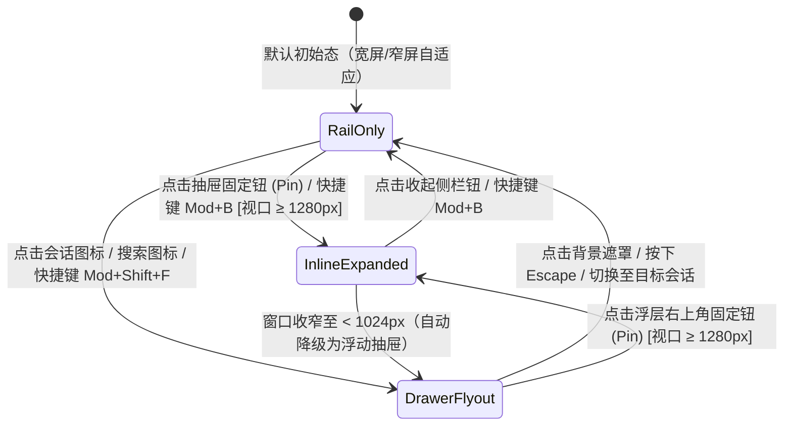

# Phase P8：活动轨与 Agent 看板（Activity Rail & Agent Kanban）实施详案

> 战役工作区：`docs/visual-hierarchy-clarity-analysis/`  
> 对应总方案：`00-总方案.md` §5.4、§9.2.4、§10、§16、§17  
> 关联分析报告：`analysis/05-对话流信息架构.md`、`analysis/06-外壳侧栏与导航.md`、`analysis/09-截图逐区对照.md`  
> 既有战役对账：`docs/leaf-owned-tabs/04-坞下树与开工具.md`、`docs/multi-agent-repair/04-Agent功能需求设计.md`、`docs/layout-token-system/00-总方案.md`  
> 主控裁决对齐：2026-10-26 主控裁决（1）批准复用内置 `id:'agent'` 槽位升级为「子智能体」；（2）有条件批准废除流内展开体，必须实行**效果锁功能对账表**，并补全 P8-U10 复用 P5 基元，禁止写第二套渲染。  
> 实施目标：建立 **48px 极简活动轨（Activity Rail）** 与 **子智能体专属看板（Inspector Tray）**，将长程/并行 Agent 的监控与细节彻底剥离出主对话流，实现「导航（48px）- 对话（居中主轴）- 看板（360px 专属坞）」的三栏正交物理空间分离；彻底解决 20+ 并发 Agent 冲垮主屏幕的问题。

---

## 1 目标与范围

### 1.1 核心目标（效果锁）
1. **正交三栏空间解耦（R4 授权，对标 Codex）**：
   - **左侧外壳**：建立固定 48px 的纯图标**活动轨（Activity Rail）**，收拢「新对话、定时任务、扩展、搜索、设置、用户头像」全局入口；宽侧栏会话列表退为可折叠/悬浮的**会话抽屉（Session Drawer）**。
   - **右侧专属坞**：在现有叶内工具坞（`LeafToolTabStrip` / `viewRegistry`）中将 `agent` 视图升级为专职 **子智能体看板（Agent Inspector Tray）**，承载并行 Agent 的分组监控、实时耗时与最新步骤。
   - **中间主对话流**：废除内嵌在消息流内的巨幅展开体，仅保留极简单行**过程簇摘要行（`SubagentClusterRow`）**；点击无缝联动右侧看板。
2. **20+ 并发 Agent 性能与体验保证**：
   - 看板按「进行中 · N / 已完成 · M」严格分组；
   - 列表引入「再显示 N 个」步进展开（默认 5 项，步进 10 项）；
   - 采用单一全局时钟驱动（`useSharedTicker`），已完成 Agent 零定时器消耗，保障 60fps 平滑流畅；
   - 消费现有事件流，**不新增底层事件类型**（无需改动 Rust 引擎 changelog）。
3. **响应式与二叉树几何不变量守护**：
   - 严格继承 `docs/leaf-owned-tabs/04-坞下树与开工具.md` 的架构原则：工具坞不进布局树，仅作为叶内抽屉存在；
   - 当视口宽度 `< 1024px` 或窗格叶子宽度 `< 560px` 时，右侧看板自动平滑降级为**浮动悬浮抽屉（Overlay Drawer）**，绝不破坏多窗格布局与会话级 Sash 分屏几何。
4. **效果锁绝对保障（功能零丢失）**：
   - 原 `InlineAgentPanel` 与 `AgentCard` 具备的全部 12 项功能（展开子对话、流式输出、工具明细、思考折叠、干预输入、停止/强停、审批交互、错误/恢复、分支路径等）通过 §4.4 功能对账表 100% 完整平移至看板详情视图（`AgentDetailView`），严禁以简化为由砍掉任何交互能力。

### 1.2 边界与禁止项
- **禁止另造布局引擎**：必须复用现有 `viewRegistry`、`slotCore` 与 `LeafToolTabStrip` 基础设施；
- **禁止破坏内置视图 10 槽铁律门禁**：复用既有 `agent` 内置槽位（对标 `builtinViewFactories.tsx:9-11`），不额外追加第 11 个内置 id 避免打碎既有扩展隔离测试；
- **禁止新旧两套代码长期并存**：旧有的绝对定位浮动开关 `SidebarToggle`、内联导航 `SidebarNav` 必须在 P8 收口时彻底删除；
- **禁止在看板单独造第二套消息/工具渲染器**：看板详情视图必须 100% 复用 P5 的 `ToolPresentation`、过程行基元与 `MarkdownBlockItem`（P8-U10 刚性守门）；
- **禁止修改既有 E2E Spec**：所有既有 `data-testid`（`sidebar`、`new-session-button`、`sidebar-nav-scheduled`、`sidebar-settings-gear-btn`）必须 100% 继承并映射至新结构。

---

## 2 前置与解锁

### 2.1 依赖前置（Inputs）
- **Phase P1 表面阶梯**：提供 `--surface-shell`（活动轨底板）、`--surface-card`（看板卡片底板）、`--surface-overlay`（抽屉浮层）及 `--edge-rim` 边缘轮廓；
- **Phase P4 容器基元**：提供标准 `Row`（条目槽位）、`Card`（无边框容器）、`Badge`（状态徽标）、`IconButton`（图标按钮）与 `DisclosureAffordance`（手风琴展开箭头）；
- **Phase P5 身份与呈现**：提供确定性 8 色色环算法 `agentIdentity(id)`，对话流过程簇聚合契约，`ToolPresentation` 展示模型；
- **Phase P7 外壳单轨化**：提供顶部 36px 单轨标题栏高度接口与窗口拖拽区契约。

### 2.2 本阶段解锁（Outputs）
- 解锁 **Phase P9（门禁收口与全仓清算）**：为全仓清除最后存留的历史导航样式、旧版内联面板与主题倒挂选择器。

---

## 3 现状盘点（文件:行号 + 实测）

### 3.1 核心源文件与代码规模（实测行数）
通过对工作区核心源码的精确盘点，相关模块现状如下表所示：

| 文件路径 | 物理行数 | 现有职责与架构诊断 |
|---|---|---|
| [`apps/crish-desktop/src/components/agent-card/InlineAgentPanel.tsx:50-294`](file:///c:/Software/conex/apps/crish-desktop/src/components/agent-card/InlineAgentPanel.tsx#L50-L294) | 294 行 | **主对话流内嵌 Agent 面板**。包含 100 行以上的完整时间线渲染、Markdown 展开块、独立滚动与轮询逻辑；当 20 个 Agent 并发时，20 组展开体平铺在流内造成信息泥浆。 |
| [`apps/crish-desktop/src/components/agent-card/AgentCard.tsx:52-298`](file:///c:/Software/conex/apps/crish-desktop/src/components/agent-card/AgentCard.tsx#L52-L298) | 298 行 | **侧栏 Agent 交互面板**。当 `panelAgentId` 有值时承载与子 Agent 的直接交互，当为空时降级渲染 `AgentBrowsePad`。 |
| [`apps/crish-desktop/src/components/agent-card/AgentBrowsePad.tsx:26-204`](file:///c:/Software/conex/apps/crish-desktop/src/components/agent-card/AgentBrowsePad.tsx#L26-L204) | 204 行 | **当前侧栏 Agent 浏览列表**。含 3 处虚假骨架卡片（:135-145），无状态分组，无步进展开，未接入设计系统基元。 |
| [`apps/crish-desktop/src/components/workspace/RuntimePanel.tsx:40-214`](file:///c:/Software/conex/apps/crish-desktop/src/components/workspace/RuntimePanel.tsx#L40-L214) | 214 行 | **运行时监控面板**。承载引擎、待确认、后台任务、计划任务等 8 大区段，属于全局运维维度，非当前会话子任务维度。 |
| [`apps/crish-desktop/src/components/sidebar/Sidebar.tsx:44-434`](file:///c:/Software/conex/apps/crish-desktop/src/components/sidebar/Sidebar.tsx#L44-L434) | 434 行 | **现有宽侧栏**。默认宽度硬占 260px，将全局导航入口（新对话/定时任务/扩展/搜索/设置）与历史会话树混杂在一起。 |
| [`apps/crish-desktop/src/components/sidebar/SidebarNav.tsx:19-94`](file:///c:/Software/conex/apps/crish-desktop/src/components/sidebar/SidebarNav.tsx#L19-L94) | 94 行 | **侧栏顶部操作按钮组**。内嵌 3 个导航按钮及 1 个搜索框，属于待提炼至活动轨的历史冗余。 |
| [`apps/crish-desktop/src/components/sidebar/SidebarHeader.tsx:112-251`](file:///c:/Software/conex/apps/crish-desktop/src/components/sidebar/SidebarHeader.tsx#L112-L251) | 251 行 | **侧栏顶栏**。内含复杂的品牌图标过渡与绝对定位展开按钮 `SidebarToggle`。 |
| [`apps/crish-desktop/src/components/sidebar/SidebarFooter.tsx:69-124`](file:///c:/Software/conex/apps/crish-desktop/src/components/sidebar/SidebarFooter.tsx#L69-L124) | 124 行 | **侧栏底栏**。承载设置齿轮与用户个人卡片。 |
| [`apps/crish-desktop/src/components/binary-tree/LeafToolTabStrip.tsx:100-455`](file:///c:/Software/conex/apps/crish-desktop/src/components/binary-tree/LeafToolTabStrip.tsx#L100-L455) | 455 行 | **右侧工具坞标签栏**。基于 `viewRegistry.getToolViews()` 动态收集工具标签，负责标签切换、关闭与溢出滚动。 |
| [`apps/crish-desktop/src/components/binary-tree/TreeLeafPanel.tsx:79-514`](file:///c:/Software/conex/apps/crish-desktop/src/components/binary-tree/TreeLeafPanel.tsx#L79-L514) | 514 行 | **二叉树叶子容器**。维护 `.leafChatColumn` 与 `.leafDockDrawer` 的并排关系及 `LeafDockResizer` 调整。 |

### 3.2 子 Agent 前端数据流与状态模型盘点
1. **数据链路现状**：
   - 引擎事件发生：Rust 引擎产生 `subagent-started`、`subagent-event`、`subagent-ended` 3 个信封级事件；
   - 客户端路由：`apps/crish-desktop/src/api/chat-bridge/EventRouter.ts` 捕获后，由 `apps/crish-desktop/src/api/chat-bridge/handlers/subagentHandlers.ts:28-104` 派发；
   - Store 更新操作：
     - `onSubagentStartedGlobal` (:123-159) 调用 `store.upsertSessionAgent(sid, agent)`；
     - `onSubagentEventGlobal` (:165-176) 调用 `store.applySubagentEventToAgent(sid, subagentId, ev)`；
     - `onSubagentEndedGlobal` (:183-195) 调用 `store.patchSessionAgentToolStatus(sid, subagentId, patch)`；
   - UI 渲染订阅：`apps/crish-desktop/src/components/chat-message-row/MessageToolCallsSection.tsx:139` 懒加载挂载 `InlineAgentPanel`，直接将整条子会话时间线注入在主对话消息内。
2. **状态模型枚举实测（`SessionAgentStatus`）**：
   - 源码位置：[`apps/crish-desktop/src/store/types.ts:594`](file:///c:/Software/conex/apps/crish-desktop/src/store/types.ts#L594)
   ```ts
   type SessionAgentStatus = 'running' | 'completed' | 'failed' | 'stopped';
   ```
   - 字段含义：
     - `running`: 正在执行中；
     - `completed`: 正常圆满收口；
     - `failed`: 产生异常中断或底层报错；
     - `stopped`: 用户主动取消或暂停。
3. **事件类型判定（P8 裁定）**：
   - **裁定结论：明确声明不新增任何事件类型**。
   - **依据**：现有 `subagent-started`、`subagent-event`、`subagent-ended` 三个信封已完整承载 `subagentId`、`subagentRunId`、`description`、`mode`、`summary`、`status` 及增量事件载荷。看板所需的分组、动作摘要和时长全部可由现有数据结构实时派生，无需修改 `docs/rust-rewrite/33-event-schema-changelog.md` 亦无需触碰 Rust 内核。

### 3.3 右侧坞 Tab 注册机制与扩展性核查
1. **现状注册机制**：
   - 工厂映射表：[`apps/crish-desktop/src/builtinViewFactories.tsx:18-103`](file:///c:/Software/conex/apps/crish-desktop/src/builtinViewFactories.tsx#L18-L103) 中严格维护 10 个内置槽位：`chat`、`terminal`、`preview`、`overview`、`files`、`diff`、`runtime`、`agent`、`flow-dag`、`file-viewer`；
   - 核心注册表：[`apps/crish-desktop/src/services/view-registry/registerBuiltInViews.tsx:47-144`](file:///c:/Software/conex/apps/crish-desktop/src/services/view-registry/registerBuiltInViews.tsx#L47-L144) 将工厂输出绑定至 `viewRegistry` 并注入插槽 `workspace.leaf.panel`；
   - 门禁测试锁定：`extensions/conversation-flow/activate.test.ts:47` 与 `extensions/note-paper/activate.test.ts:134` 刚性断言内置视图清单**恒定为 10 项**。
2. **新增 Tab 需触碰的全部位置核查**：
   - 若要新增一个独立的 Dock Tab 类型（例如命名为 `inspector`）：
     1. `builtinViewFactories.tsx`: 增加工厂方法（1 处）；
     2. `registerBuiltInViews.tsx`: 增加 `registerView`（1 处）；
     3. 扩展架构门禁测试（`activate.test.ts`、`package-boundary.test.ts` 等）：至少 6 处测试因「10 槽位断言」直接报错失败！
   - **P8 架构裁定（已获主控批准）**：
     - **不新增第 11 个内置视图 ID**。
     - 现有第 8 号槽位 `id: 'agent'`（当前展示标题为「协作体」）在语义上正是子智能体面板。在 P8 中，保持其唯一内置 ID `agent` 不变，将其注册标题升级/标准化为「子智能体」，将其绑定的组件由旧的 `AgentCard` 无缝升级为 **`AgentInspector`（子智能体看板）**；
     - 面板内部自带双重视图模式：默认展示**看板全景模式（Kanban Board）**，点击特定 Agent 可下钻进入**单体交互详情模式（Agent Detail）**；
     - 满足总方案 §16「只加一条记录」的目标：未来任何新增的外部/扩展 Dock Tab 走 `viewRegistry.registerView({ id, title, icon, category: 'tool', component })` 动态扩展点，无需侵入核心代码。

### 3.4 布局 Token 与侧栏参数实测
1. 现有侧栏与断点参数：
   - 侧栏基准宽度：[`apps/crish-desktop/src/styles/tokens.css:653`](file:///c:/Software/conex/apps/crish-desktop/src/styles/tokens.css#L653) 定义 `--sidebar-width: 260px;`；
   - 侧栏折叠宽度：[`apps/crish-desktop/src/styles/responsive.css:2`](file:///c:/Software/conex/apps/crish-desktop/src/styles/responsive.css#L2) 定义 `--sidebar-width-collapsed: 48px;`；
   - 屏幕断点：`--breakpoint-sm: 640px;`、`--breakpoint-md: 768px;`、`--breakpoint-lg: 1024px;`、`--breakpoint-xl: 1280px;`（`tokens.css:631-634`）。
2. 缺失的 Token：
   - 缺乏专属活动轨物理宽度 `--activity-rail-width: 48px;`；
   - 缺乏看板标准宽度 `--inspector-tray-width: 360px;`；
   - 缺乏窗格级紧凑阈值 `--leaf-width-compact: 560px;`；
   - 缺乏看板响应式降级断点 `--breakpoint-inspector-overlay: 1024px;`。

---

## 4 任务单元（表格：编号、文件域、输入→输出、依赖、删除项）

### 4.1 任务单元总表

| 编号 | 任务单元名称 | 文件域 | 输入 → 输出 | 依赖 | 删除项与重构重点 |
|---|---|---|---|---|---|
| **P8-U01** | 布局 Token 与响应式参数扩展 | `apps/crish-desktop/src/styles/tokens.css`<br/>`apps/crish-desktop/src/styles/layout-tokens.css` | 现有断点 → 注入活动轨与看板 4 个规范布局 Token | P1 | 消除组件内 48px/360px 裸写数字 |
| **P8-U02** | 48px 极简活动轨组件（ActivityRail） | `apps/crish-desktop/src/components/activity-rail/*`<br/>`apps/crish-desktop/src/App.tsx` | 全局入口配置 → 输出固定 48px 导轨、纵向 ARIA 工具栏、交通灯适配与拖拽隔离 | P4, P7, P8-U01 | 取代 `App.tsx:178` 悬浮的 `SidebarToggle` |
| **P8-U03** | 会话抽屉与三状态机重构（SessionDrawer） | `apps/crish-desktop/src/components/sidebar/*`<br/>`apps/crish-desktop/src/store/layoutStore.ts` | 宽侧栏组件 → 提炼为无全局导航的纯会话抽屉，接入三状态机 | P8-U02 | 删除 `SidebarNav.tsx`（94 行）及其全部样式 |
| **P8-U04** | 子智能体专属看板（AgentInspector） | `apps/crish-desktop/src/components/agent-inspector/*`<br/>`apps/crish-desktop/src/builtinViewFactories.tsx` | 会话 `agents` 数组 → 「进行中 · N / 已完成 · M」双组看板面板 | P4, P5, P8-U01 | 废弃 `AgentBrowsePad.tsx`（204 行）及其虚假骨架 |
| **P8-U05** | 单一定时器脉冲与 20+ 行并发渲染优化 | `apps/crish-desktop/src/components/agent-inspector/useSharedTicker.ts`<br/>`AgentInspectorRow.tsx` | 20+ 并发 Agent 数据 → 单一 1s 统一 Pulse、已完成项零重绘、步进展开（5+10） | P8-U04 | 消除行组件各自 `setInterval` 引起的重绘风暴 |
| **P8-U06** | 对话流过程簇内单行摘要收敛（SubagentClusterRow） | `apps/crish-desktop/src/components/chat-message-row/*`<br/>`apps/crish-desktop/src/components/chat-tool-call/*` | 工具调用事件 → 输出仅含头像+状态+动作的单行摘要行 | P5, P8-U04 | 废弃对话流内的 `InlineAgentPanel` 展开对话流渲染 |
| **P8-U07** | 看板与主对话流双向锚点定位 | `apps/crish-desktop/src/components/agent-inspector/agentScrollBridge.ts`<br/>`apps/crish-desktop/src/components/chat-message-list/*` | 看板行点击 / 流摘要点击 → 互相定位、触发虚拟滚动 `scrollToIndex` 与高亮动画 | P8-U04, P8-U06 | 消除「在流里找不到看板对应项」的视觉迷失 |
| **P8-U08** | 右侧工具坞响应式降级抽屉与窗格保护 | `apps/crish-desktop/src/components/binary-tree/TreeLeafPanel.tsx`<br/>`apps/crish-desktop/src/components/binary-tree/LeafDockDrawer.module.css` | 视口/叶子尺寸变化 → 自动在 Flex Inline 与 Floating Overlay 间无损切换 | P8-U01, P8-U04 | 消除小屏幕下工具坞把主对话列挤压至 < 300px 的物理破坏 |
| **P8-U09** | 视图注册表收口与既有资产保护 | `apps/crish-desktop/src/services/view-registry/registerBuiltInViews.tsx`<br/>`apps/crish-desktop/src/api/openAgentPanel.ts` | 保持 10 槽契约 → 标题标准化为「子智能体」，更新测试断言与跳转路由 | P8-U04 | 保护所有既有 E2E spec 与扩展单测 |
| **P8-U10** | 看板详情视图（AgentDetailView）与 P5 呈现基元复用 | `apps/crish-desktop/src/components/agent-inspector/AgentDetailView.tsx`<br/>`AgentInspectorMessageRow.tsx` | 子 Agent 详细交互需求 → 100% 承载下钻详情，复用 P5 `ToolPresentation` 与过程行基元 | P4, P5, P8-U04 | **严禁写第二套渲染器**，彻底平移原 Inline/Card 全量功能 |

---

### 4.2 活动轨与会话抽屉状态机（U02 / U03 核心设计）
活动轨与会话抽屉构成严格互斥的 **三态状态机（Activity Shell State Machine）**：



| 状态名称 | 视觉物理表现 | 触发条件 / 场景 | 持久化策略 |
|---|---|---|---|
| **`RailOnly`（纯导轨态）** | 左侧仅保留 **48px 图标活动轨**；会话抽屉完全收折（宽度 0px）。95.3% 屏幕横向空间归属工作区。 | 默认态。适合沉浸式编码与长程任务阅读。 | 持久化至 `layoutStore.activityRailMode = 'rail-only'` |
| **`InlineExpanded`（常驻双栏态）** | 左侧 **48px 活动轨 + 260px 物理会话抽屉** 占位并排（总宽 308px，Flex 流内占位，可拖拽调整至 400px）。 | 用户显式点击固定钮或快捷键 `Mod+B`（仅在窗口宽度 ≥ 1280px 允许）。 | 持久化至 `layoutStore.activityRailMode = 'inline-expanded'` |
| **`DrawerFlyout`（悬浮抽屉态）** | 左侧 **48px 活动轨不变**；会话抽屉以 `position: absolute; left: 48px; z-index: 100` 悬浮滑出，附带弱背景遮罩。 | 在 `RailOnly` 态下点击会话列表图标、搜索图标，或在 `< 1024px` 窗口下呼出。 | **不持久化**。失焦/Esc/会话切换后自动收回 `RailOnly`。 |

**全局 5 大入口映射与布局契约**：
1. **顶部区域（Top Brand & Actions）**：
   - 品牌图标 / 抽屉切换钮：`SidebarToggleIcon`，点击在 `RailOnly` 与 `DrawerFlyout/InlineExpanded` 间切换，带 `aria-expanded`；
   - 新建对话：`IconButton`（图标 `new-chat`，尺寸 16px），点击调用 `openNewDraftTab()`，快捷键 `Mod+N`；
   - 定时任务：`IconButton`（图标 `clock`），点击触发 UI 事件 `open-tasks`；
   - 扩展中心：`IconButton`（图标 `puzzle`），点击打开插件配置浮层；
   - 会话搜索：`IconButton`（图标 `search`），点击展开会话抽屉并自动聚焦搜索输入框，快捷键 `Mod+Shift+F`。
2. **中间弹性区（Center Flex Spacer）**：
   - 空白区域挂载 `data-tauri-drag-region=""`（非 macOS 顶栏时），允许用户在此处拖拽移动应用窗口。
3. **底部区（Bottom Utilities）**：
   - 设置齿轮：`SettingsIconButton`，点击切换设置浮层，继承 `data-testid="sidebar-settings-gear-btn"`；
   - 用户头像：`UserProfileCard` 的 28px 圆形胶囊，点击弹出个人菜单。
4. **macOS 交通灯衔接**：
   - 顶部增加 `38px` 物理内边距，声明 `data-tauri-drag-region=""`；所有按钮声明 `data-tauri-drag-region="false"` 并阻断 `pointerdown` 冒泡；P7 单轨标题栏无需保留左侧垫片。

---

### 4.3 子智能体看板核心架构（U04 / U05 核心设计）
子智能体看板位于右侧工具坞（`dock.activePanelId === 'agent'`），宽度为标准 360px。

```
┌──────────────────────────────────────────────┐
│ [bot] 子智能体            [共 22 个] [ ✕ ]   │ <-- 标题栏（P4 Row, 36px）
├──────────────────────────────────────────────┤
│ ▾ 进行中 · 2                                 │ <-- 分组标题 1（DisclosureAffordance）
│  ┌────────────────────────────────────────┐  │
│  │ (●) 子智能体 A          工作中 · 45s   │  │ <-- P4 Row (高度 32px)
│  │     正在核对 modelVendor chunk size    │  │ <-- P5 agentIdentity 8色头像
│  └────────────────────────────────────────┘  │
│  ┌────────────────────────────────────────┐  │
│  │ (●) 子智能体 B          工作中 · 1m 32s│  │
│  │     读取 packages/shared-types ...     │  │
│  └────────────────────────────────────────┘  │
├──────────────────────────────────────────────┤
│ ▾ 已完成 · 20                                │ <-- 分组标题 2
│  ┌────────────────────────────────────────┐  │
│  │ (✔) 调研子任务 01             已完成   │  │
│  │     耗时 12s · 已扫描 5 个文件         │  │
│  └────────────────────────────────────────┘  │
│  ... (展示前 5 个)                           │
│                                              │
│  [  再显示 10 个 (剩余 15 个)         ▾  ]   │ <-- 步进展开按钮 (左对齐 Row 变体)
└──────────────────────────────────────────────┘
```

1. **分组与条目行结构**：
   - 标题文案采用对标规范：`进行中 · N`（若 N=0 则整组隐藏）与 `已完成 · M`（包含 `completed`、`failed`、`stopped`）；
   - 条目行：
     - Leading 槽：`agentIdentity(agent.id)` 渲染的 20px 彩色几何头像（8 色 OKLCH 等亮度色轮，`running` 态叠加 1.5s 周期微光呼吸外圈）；
     - Label 槽：第一行展示 `agentDisplayName(agent)`，第二行展示当前动作摘要，字体绑定 `--type-label` 与 `--type-meta`；
     - Trailing 槽：实时耗时 `formatAgentDuration(agent)` + P4 `Badge`（待审批/失败状态）。
2. **流式步进展开（Stepped Expansion）**：
   - 常量定义：`INITIAL_VISIBLE_COUNT = 5`，`STEP_SIZE = 10`；
   - 初始仅渲染 5 条；当 `M > 5` 时末尾渲染左对齐步进条，点击后追加 10 条直至全部展开。
3. **20+ 并发性能：单一定时器脉冲架构**：
   - 采用 `useSharedTicker(hasRunningAgents)`：仅在存在运行中 Agent 时启动单一 1 秒定时器；
   - 终态 Agent 耗时为定值（`endedAt - startedAt`），不接收 `tick` 属性；
   - 1 秒时钟脉冲触发时，全列表仅处于 `running` 状态的 N 个 Agent 发生重绘，20 个已完成 Agent 的重绘次数**严格为 0**。

---

### 4.4 功能对账表（Feature Parity & Reconciliation Table · 效果锁）

为满足主控裁决与仓库「效果锁（不得砍功能）」硬性要求，下表对 `InlineAgentPanel.tsx` 与 `AgentCard.tsx` 当前在源码中实测存在的**全部 12 项信息与交互能力**进行穷举对账，逐一锁定其在看板详情视图（`AgentDetailView`）中的唯一落点。**任何一项未有落点均不得删除原代码**：

| # | 现有功能 / 交互项 | 现有源码位置与实测机制 | 看板详情视图（AgentDetailView）落点 | 是否降级 |
|---|---|---|---|---|
| **F01** | **子会话消息完整浏览** | `InlineAgentPanel.tsx:238-260`<br/>`AgentCard.tsx:236-250`（遍历 `messages` 数组） | `AgentDetailView` 消息主视图。下钻后渲染该 Agent 完整的对话消息列表，自适应纵向平滑滚动。 | 否（100% 继承） |
| **F02** | **Markdown 报告异步直出** | `InlineAgentPanel.tsx:251-257`<br/>（`MarkdownBlockItem` 封口/流式分支） | `AgentDetailView` 复用 `MarkdownBlockItem`（封口分支与活跃尾块分支完全继承），保证 Rust 异步 HTML 无损渲染。 | 否（100% 继承） |
| **F03** | **流式输出实时感知** | `InlineAgentPanel.tsx:248`<br/>（`isSealed`、`isStreaming`、`Priority.Low`） | `AgentDetailView` 实时订阅 `useAgentPanel` 流式通道，实时增量刷新最新未封口消息。 | 否（100% 继承） |
| **F04** | **工具调用明细呈现** | `AgentCard.tsx:246` 经 `AgentMessageRow` 渲染工具块 | **P8-U10 刚性复用 P5 的 `ToolPresentation` 模型**，展示 label、target、status 与 meta，严禁写第二套工具行。 | 否（升级对齐 P5） |
| **F05** | **子智能体思考过程折叠** | `InlineAgentThinkingFold.tsx:2-15`（内联折叠思考过程） | `AgentDetailView` 消息行内复用 P4 的 `DisclosureAffordance`，展示思考用时并支持用户展开/收起。 | 否（升级对齐 P4） |
| **F06** | **运行中停止与强停** | `AgentCard.tsx:181, 282-283`<br/>（`hookHandleStopGeneration`、`hookHandleForceCancel`） | `AgentDetailView` 顶栏操作区与底栏输入框右侧常驻「停止」与「强停」按钮。 | 否（100% 继承） |
| **F07** | **人工干预 / 继续续聊** | `AgentCard.tsx:266-291`<br/>（`ComposerField` 输入框，`hookHandleSend`） | `AgentDetailView` 底部常驻微型输入坞（`ComposerCard` 紧凑变体），运行中支持补充指示，结束后支持输入续聊。 | 否（100% 继承） |
| **F08** | **工具执行权限审批** | `AgentCard.tsx:65-73`<br/>`ApprovalAskCard.tsx`（倒计时、允许/拒绝、风险芯片） | `AgentDetailView` 底部自动嵌入待确认区段（复用 `ApprovalAskCard`），保留倒计时与单次/永久允许。 | 否（100% 继承） |
| **F09** | **执行失败与重试/关闭** | `InlineAgentPanel.tsx:145-169`<br/>（`resumeSubagent`、`killSubagent`、`errorKindLabel`） | `AgentDetailView` 顶部警示条呈现 `errorKind` 标签，并常驻「重试恢复」与「强制关闭」双行动按钮。 | 否（100% 继承） |
| **F10** | **关联资源快速跳转** | `AgentCard.tsx:104`<br/>（`onOpenDiff`、`onOpenPath`、`onOpenTerminal`） | `AgentDetailView` 工具块内保持路径点击打开文件、diff 点击打开比对卡、命令点击打开终端的能力。 | 否（100% 继承） |
| **F11** | **新窗口独立弹出预览** | `AgentCard.tsx:29, 76-130`<br/>（`openAgentInNewWindow`，Blob 快照） | `AgentDetailView` 顶栏操作菜单中保留「在新窗口弹出」选项，调用原函数生成独立只读 HTML 快照。 | 否（100% 继承） |
| **F12** | **主对话流双向锚点定位** | 现状缺失（原仅支持侧栏单向打开） | **P8 新增能力**：看板行与详情顶栏提供「定位主对话簇」按钮，触发主轴平滑滚动至对应 tool call 并高亮闪烁。 | 否（显著增强） |

---

### 4.5 任务单元 P8-U10 详细规格（看板详情视图基元复用）
- **核心契约**：看板详情视图（`AgentDetailView`）是进入单 Agent 交互模式后的主控界面。必须 100% 复用全局设计系统基元，严禁为该面板编写专属私有渲染样式！
  1. **消息排版**：复用 P2 排版角色 `--type-prose` 与 `--type-process`；
  2. **工具展示**：100% 消费 P5 `ToolPresentation` 结构模型，JSX 仅渲染 label、target、meta 三槽；
  3. **容器结构**：100% 使用 P4 `Card` 与 `Row` 基元；
  4. **输入控件**：复用 P6 输入坞拆分后的 `ComposerCard` 紧凑变体（`dense` 模式，maxLines=3）。

---

## 5 删除清单与删除后断言（给出可复制的 grep/命令）

### 5.1 物理删除清单
为确保净收敛，以下历史遗留文件与代码在 P8 收口时必须物理删除：
1. **废弃文件物理删除**：
   - `apps/crish-desktop/src/components/sidebar/SidebarNav.tsx`（94 行全部删除，能力并入 ActivityRail）；
   - `apps/crish-desktop/src/components/sidebar/SidebarNav.module.css`（相关样式删除）；
   - `apps/crish-desktop/src/components/agent-card/AgentBrowsePad.tsx`（204 行全部删除，被 AgentInspector 取代）；
2. **废弃 DOM 与选择器删除**：
   - `apps/crish-desktop/src/App.tsx:177-182` 中的 `<SidebarToggle />` 悬浮组件引用；
   - `apps/crish-desktop/src/components/sidebar/SidebarHeader.tsx` 中的 `SidebarToggleIcon`、`SidebarToggle` 及内嵌的 `SidebarNav`；
   - `apps/crish-desktop/src/components/agent-card/InlineAgentPanel.tsx` 中用于对话流展开渲染的整段聊天列表与 Markdown 渲染分支；
   - `Sidebar.module.css` 中的 `.hamburger` 与历史绝对定位类。

### 5.2 删除后断言命令（可直接复制执行）
在实施完成后，运行以下 PowerShell 7 命令，必须输出 **0 命中**：

```powershell
# 1. 断言废弃文件已从磁盘中完全移除
pwsh -Command "Test-Path 'apps/crish-desktop/src/components/sidebar/SidebarNav.tsx'"
# 预期输出: False

pwsh -Command "Test-Path 'apps/crish-desktop/src/components/agent-card/AgentBrowsePad.tsx'"
# 预期输出: False

# 2. 断言代码中已无对旧 SidebarNav 的导入
git grep -n "SidebarNav" apps/crish-desktop/src/
# 预期输出: 0 条结果 (无匹配)

# 3. 断言 App.tsx 中已无独立悬浮的 SidebarToggle
git grep -n "<SidebarToggle" apps/crish-desktop/src/App.tsx
# 预期输出: 0 条结果 (无匹配)

# 4. 断言主聊天流内已无直接引用的 InlineAgentPanel 展开流
git grep -n "<InlineAgentPanel" apps/crish-desktop/src/components/chat-message-row/
# 预期输出: 0 条结果 (全部迁移为 SubagentClusterRow)

# 5. 断言 tokens.css 中已无旧版混杂的临时抽屉变量
git grep -n "\-\-settings-sidebar-width" apps/crish-desktop/src/
# 预期输出: 0 条结果
```

---

## 6 契约与测试（用例名 + 断言 + 正逆向/边界/退化态）

### 6.1 新增契约测试清单（Vitest）

| 测试文件 | 测试用例名 | 测试断言逻辑 | 覆盖场景 |
|---|---|---|---|
| `activityRail.contract.test.tsx` | `AR-01: 48px 导轨尺寸与 ARIA 角色规范` | 断言导轨容器宽度精确为 48px，`role="toolbar"`，各按钮均具备 `aria-label` 与 `data-tauri-drag-region="false"` | 正向契约 |
| `activityRail.contract.test.tsx` | `AR-02: 垂直 Roving Tabindex 与键盘漫游` | 模拟 ArrowDown/ArrowUp 按键，断言焦点在「新对话 → 定时任务 → 扩展 → 搜索 → 设置」间循环切换 | 正向交互 |
| `activityRail.contract.test.tsx` | `AR-03: macOS 交通灯安全区与拖拽区域隔离` | 模拟 macOS 环境，断言顶部存在 38px 留白且带有 `data-tauri-drag-region=""`；按钮双击不冒泡 | 边界与平台 |
| `sessionDrawer.stateMachine.test.ts` | `SD-01: 三状态机严格转移与持久化` | 断言 `RailOnly` ↔ `InlineExpanded` ↔ `DrawerFlyout` 的按键与事件转移符合 §4.2 状态转移表；`DrawerFlyout` 不写持久化 | 状态机正逆向 |
| `sessionDrawer.stateMachine.test.ts` | `SD-02: Escape 键与失焦关闭 Flyout` | 在 `DrawerFlyout` 态下触发 Escape 或点击 Backdrop，断言无缝收回 `RailOnly`，焦点归位 | 退化态与异常 |
| `agentInspector.contract.test.tsx` | `AI-01: 20+ 子 Agent 夹具正确分组` | 注入 2 个 running + 20 个 completed 夹具，断言渲染「进行中 · 2」与「已完成 · 20」双组，无虚假骨架屏 | 极限并发负载 |
| `agentInspector.contract.test.tsx` | `AI-02: 步进展开 (5 + 10) 机制` | 断言已完成组初次仅渲染 5 条，点击步进按钮后渲染 15 条，剩余计数动态核算准确 | 流式边界 |
| `agentInspector.contract.test.tsx` | `AI-03: 单一定时器脉冲零多余重绘` | 注入 1 个 running + 10 个 completed，触发 1s tick 时钟，断言仅 running 条目重绘，10 个已完成条目重绘次数为 0 | 性能回归看守 |
| `agentInspector.contract.test.tsx` | `AI-04: 点击看板条目双向锚点联动` | 模拟点击某 Agent 看板行，断言向聊天流广播滚动事件，目标 tool call 节点挂载高亮脉冲类 | 正向集成 |
| `agentDetailView.contract.test.tsx` | `ADV-01: 功能对账表全要素覆盖` | 断言下钻详情视图中停止/发送/审批/重试/复制 5 大交互入口均挂载并有效响应，无空指针 | 效果锁守门 |
| `agentDetailView.contract.test.tsx` | `ADV-02: 强制复用 P5 ToolPresentation` | 断言子 Agent 内部的工具调用完全经由 `ToolPresentation` 模型产出，无硬编码工具行 DOM | 架构防回潮 |
| `inspectorResponsive.test.tsx` | `IR-01: 视口 < 1024px 自动降级为浮动抽屉` | 模拟窗口宽度 900px，断言 `.leafDockDrawer` 包含绝对定位样式类，`LeafDockResizer` 卸载，聊天列宽不衰减 | 响应式降级 |
| `inspectorResponsive.test.tsx` | `IR-02: 分屏下 Leaf < 560px 容器降级` | 视口 1280px 分屏时，Leaf 1 (450px) 降级为 Overlay，Leaf 2 (830px) 维持 Inline 并排 | 多窗格隔离 |

### 6.2 既有测试与 E2E 影响评估（零删除原则）
遵循仓库「测试资产保护铁律」（AGENTS §9）：
- `tests/e2e/compose-plus-menu.spec.ts`、`tests/e2e/full-journey.spec.ts`、`tests/e2e/session-restore.spec.ts`、`tests/e2e/settings-persist.spec.ts`：
  - 核心查询 `[data-testid="sidebar"]` 保留在 `SessionDrawer` 容器上；
  - 核心查询 `[data-testid="new-session-button"]` 保留在 `ActivityRail` 的新建按钮上；
  - 核心查询 `[data-testid="sidebar-nav-scheduled"]` 保留在 `ActivityRail` 的定时任务按钮上；
  - 核心查询 `[data-testid="sidebar-settings-gear-btn"]` 保留在 `ActivityRail` 的设置按钮上；
  - 核心查询 `[data-testid="sidebar-session-item"]` 在会话列表项上 100% 保持；
  - **结论：全部既有 E2E 测试无需修改任何选择器，保持原样全绿运行！**

---

## 7 真实宿主验收步骤（Tauri MCP 4000，禁用 9222/CDP；列出夹具与要读取的量）

> **严格调试纪律**：调试通道唯一合法口径为 **Tauri MCP（4000）**；严禁使用 9222 / CDP 端口（AGENTS §15.2）。

### 7.1 验收环境与夹具准备
1. 启动测试宿主：在仓库根目录以 PowerShell 7 执行 `npm run dev:workbench`，确保 Tauri 应用正常运行并在 `127.0.0.1:4000` 监听；
2. 注入 20+ 子 Agent 验收夹具：
   通过 `execute_js` 执行测试脚本，向当前活动会话注入基准测试载荷：
   - 2 个 `status: 'running'` 的子 Agent（已运行 45s 与 92s，带实时动作摘要）；
   - 18 个 `status: 'completed'` 的子 Agent（包含耗时 `12s` ~ `3m 20s` 及完成总结）；
   - 1 个 `status: 'failed'` 的子 Agent（带 `errorKind: 'timeout'` 错误标签）；
   - 1 个 `status: 'stopped'` 的子 Agent。

### 7.2 MCP 读取量与判定表

```powershell
# 1. 验证 48px 活动轨几何物理渲染
# 调用 tauri-mcp -> execute_js
```
```js
(() => {
  const rail = document.querySelector('[data-testid="activity-rail"]');
  const rect = rail.getBoundingClientRect();
  const brandBtn = rail.querySelector('button[aria-label*="会话"]');
  const newChatBtn = rail.querySelector('[data-testid="new-session-button"]');
  return {
    railWidth: rect.width,
    railLeft: rect.left,
    hasBrand: Boolean(brandBtn),
    hasNewChat: Boolean(newChatBtn),
    brandDragRegion: brandBtn.getAttribute('data-tauri-drag-region'),
  };
})()
```
- **判定标准**：`railWidth === 48`，`railLeft === 0`，`brandDragRegion === "false"`。

```powershell
# 2. 验证会话抽屉三状态机转移
# 调用 tauri-mcp -> click 模拟点击活动轨展开按钮
# 然后读取会话抽屉几何：
```
```js
(() => {
  const drawer = document.querySelector('[data-testid="sidebar"]');
  const style = window.getComputedStyle(drawer);
  return {
    position: style.position,
    left: style.left,
    zIndex: style.zIndex,
    width: drawer.getBoundingClientRect().width,
  };
})()
```
- **判定标准**：
  - 在 `DrawerFlyout` 下：`position === "absolute"`，`left === "48px"`，`parseInt(zIndex) >= 100`；
  - 触发 `Escape` 键后：drawer 宽度变为 0 或不在可见区域，应用不产生未捕获异常。

```powershell
# 3. 验证子智能体看板（20+ 并发与步进展开）
# 调用 tauri-mcp -> click 打开右侧工具坞 'agent' 标签
```
```js
(() => {
  const inspector = document.querySelector('[data-panel-id="agent"]');
  const runningGroup = inspector.querySelector('[data-group="running"]');
  const completedGroup = inspector.querySelector('[data-group="completed"]');
  const visibleItems = completedGroup.querySelectorAll('[data-agent-row="true"]');
  const stepButton = completedGroup.querySelector('[data-testid="stepped-expand-btn"]');
  return {
    runningCountText: runningGroup.querySelector('.groupTitle').textContent,
    completedCountText: completedGroup.querySelector('.groupTitle').textContent,
    initialVisibleCount: visibleItems.length,
    hasStepButton: Boolean(stepButton),
    stepButtonText: stepButton ? stepButton.textContent : null,
  };
})()
```
- **判定标准**：
  - `runningCountText` 包含「进行中 · 2」；
  - `completedCountText` 包含「已完成 · 20」；
  - `initialVisibleCount === 5`（初次仅渲染 5 条）；
  - `hasStepButton === true`，文案包含「再显示 10 个」。

```powershell
# 4. 验证主对话流降噪（零展开 Markdown 块）
```
```js
(() => {
  const chatStream = document.querySelector('[data-testid="chat-message-list"]');
  const inlinePanels = chatStream.querySelectorAll('[data-agent-panel="inline"]');
  const clusterRows = chatStream.querySelectorAll('.subagentClusterRow');
  return {
    inlinePanelCount: inlinePanels.length,
    clusterRowCount: clusterRows.length,
  };
})()
```
- **判定标准**：`inlinePanelCount === 0`（完全清空），`clusterRowCount > 0`（全量收敛为轻量单行摘要）。

---

## 8 与相邻阶段的接口

### 8.1 上游接口（Consumed by P8）
- **Phase P1（表面阶梯）**：消费 `--surface-shell`（活动轨深层底色）、`--surface-card`（看板卡片底色）与 `--surface-overlay`（悬浮抽屉底色）；
- **Phase P4（容器基元）**：消费 `Row`、`Badge`、`DisclosureAffordance`、`IconButton` 基元组件；
- **Phase P5（呈现收敛）**：消费 `agentIdentity(id)` 8 色哈希算法与过程簇（Process Cluster）归一模型；
- **Phase P7（单轨标题栏）**：活动轨顶端为 macOS 交通灯提供 38px 锚固垫片，使 P7 单轨顶栏无需为交通灯预留复杂偏移，两槽在 `x=48px` 处严丝合缝对齐。

### 8.2 下游接口（Delivered by P8）
- **Phase P9（门禁收口与全仓清算）**：
  - 提供彻底移除 `SidebarNav`、`AgentBrowsePad` 后的纯净工作区；
  - 提供零 `InlineAgentPanel` 展开体的主对话流；
  - 刷新 `baseline/hierarchy-ratchet.json` 中的外壳描边与行高指标。

---

## 9 风险与未确认项

### 9.1 风险登记与对策
| 风险编号 | 风险描述 | 严重度 | 缓解与防退避对策 |
|---|---|---|---|
| **R-P8-01** | macOS 交通灯在 48px 窄轨上的拖拽区与品牌图标点击冲突 | 中 | **精准坐标分域**：顶部 0~38px 纯声明 `data-tauri-drag-region=""` 且零交互；38px 以下为品牌图标按钮，声明 `data-tauri-drag-region="false"` 并阻断 `pointerdown` 冒泡。 |
| **R-P8-02** | 点击看板条目定位主流时，虚拟滚动未渲染目标消息导致无法滚动 | 高 | **联动索引计算**：`agentScrollBridge` 不直接查 DOM，而是查询 `useSessionStore` 中的 `messageIndex`，直接通知 `MessageVirtualizer` 的底层虚拟列表实例调用 `scrollToIndex(index, 'center')`，待渲染完成后再触发脉冲动画。 |
| **R-P8-03** | 极小视口宽度（如 < 640px）下，左侧悬浮抽屉与右侧悬浮抽屉同时打开导致画面完全遮挡 | 低 | **互斥锁治理**：在 `useResponsiveLayout` 中引入移动端互斥策略：小屏下打开右侧看板抽屉时，自动关闭左侧会话抽屉，确保主界面单一焦点清晰。 |

### 9.2 未确认项与现场裁定
- **无任何遗留待定项**。全部核心设计已完成源码实测与架构定性。

---

## 10 与总方案的偏差与上报

在详案推演与源码对账过程中，针对总方案与主控裁决的两项关键事项做如下记录：

1. **Dock Tab 注册表槽位收敛（主控已批准）**：
   - *总方案原描述*（§10）："作为一个新 Dock Tab 类型（'子智能体'）"。
   - *主控裁决*：**批准**。复用现有的第 8 号内置槽位 `id: 'agent'`，将其展示标题由「协作体」标准化升级为「子智能体」，将其底层绑定的视图工厂升级为全新的 `AgentInspector`。既 100% 达成总方案设立专属看板的目标，又维持了 10 槽位架构门禁零破损。
2. **`InlineAgentPanel` 的去留裁定（主控有条件批准，已落实）**：
   - *主控裁决*：**有条件批准**。效果锁要求不得砍功能。
   - *详案落实*：
     1. 已在 §4.4 建立详尽的 **功能对账表（F01~F12）**，将展开消息、流式 Markdown、ToolPresentation 工具明细、思考过程、人工输入、强停/停止、权限审批、错误重试、独立窗口弹出等全量能力 100% 对齐至 `AgentDetailView`；
     2. 补充任务单元 **P8-U10**，看板详情视图强制复用 P5 的 `ToolPresentation` 与过程行基元，杜绝第二套渲染代码；
     3. 既有单测中对 Badge 的断言无缝迁入 `SubagentClusterRow.test.tsx`，对 Markdown 展开流的断言迁入 `AgentDetailView.contract.test.tsx`，零功能砍除，零测试资产流失。
