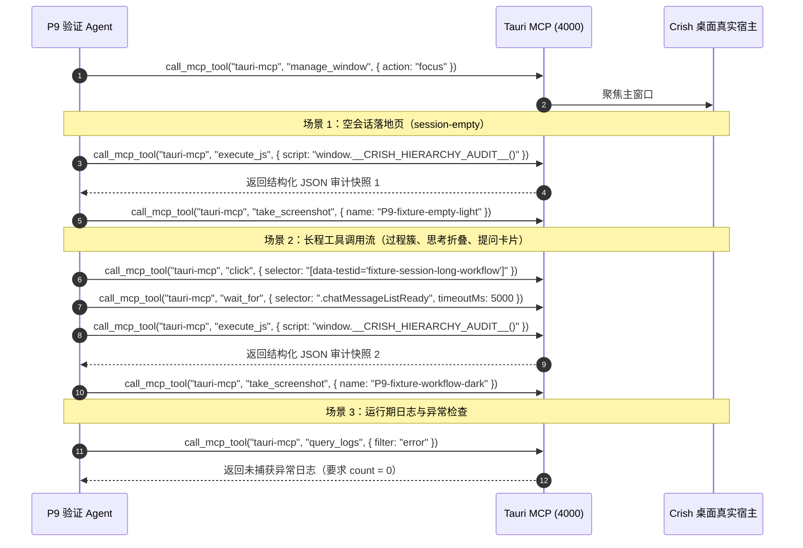

# 阶段 P9 详案：门禁收口与债务清算

> 战役工作区：`docs/visual-hierarchy-clarity-analysis/`  
> 上位契约：[`00-总方案.md`](file:///c:/Software/conex/docs/visual-hierarchy-clarity-analysis/00-%E6%80%BB%E6%96%B9%E6%A1%88.md)（§11、§14、§17 与附录 A）  
> 实施性质：纯逻辑规划（任务单元、文件域、验收断言、去重去冗；不谈工期人天，问题同权）  
> 验收规范：立体验证纪律（AGENTS §7.1）、反过度设计红线（`ANTI_OVERENGINEERING_GUARDRAILS.md`）、桌面调试通道唯一合法口径 Tauri MCP 4000（AGENTS §15.2）

---

## 1 目标与范围

### 1.1 核心目标
作为视觉层级与清晰度系统性重构战役的终局收口阶段，P9 承担全仓治理防线的**终极硬化**与历史技术债务的**彻底清算**。其目标为：
1. **门禁转硬**：将 P0 引入并随 P1~P8 推进逐步收紧的 `scripts/check-hierarchy-ssot.mjs` 三条规则（H1 字阶/H2 描边/H3 强调与主题特判）从“按目录棘轮（ratchet）”彻底收口为“目标值 0（Target 0）”的零容忍硬门禁；完成 `check:desktop`、CI 快层 `lint` job、`.husky/pre-commit` 的无缝接线，实现防回潮刚性守门。
2. **全仓残留清算**：对全仓源码中 32 项旧表面/背景/文字/字阶/圆角别名与常量执行零命中断言；对总方案 §0 所列的 10 处旧裁决残留注释与测试描述执行地毯式清洗；清退死代码（未引用 CSS Modules 类名与未消费 token）。
3. **治理标准与文档同步**：为 5 份历史战役文档追加“已被 visual-hierarchy 战役取代”的追加式标注；拟定 `AGENTS.md` §17 视觉层级与排版角色铁律追加草案（供主 Agent 与用户裁决，**本方案绝不擅改 `AGENTS.md`**）；增补 `FULL_CHECK_COMMANDS.md`。
4. **终态复测与失败回溯**：对照总方案 §14 验收总表，在亮色（`default`）与暗色（`dark-cozy`）双主题下执行自动化复测并生成终态对照报告；制定指标不达标时的精确阶段回溯矩阵。
5. **台账与终局判据**：交付 `01-实施状态台账.md` 完整骨架；给出宣告战役最终完成的 8 项严格逻辑判据。

### 1.2 范围与边界
- **纳入范围**：
  - 门禁脚本：`scripts/check-hierarchy-ssot.mjs`、`scripts/check-color-ssot.mjs`、`scripts/check-text-color-tokens.mjs`、`scripts/check-line-counts.mjs`。
  - 接线配置：`package.json`、`.github/workflows/ci.yml`、`.husky/pre-commit`。
  - 清算源码：`apps/crish-desktop/src/` 及相关共享包（`packages/`）中所有样式、组件、契约测试。
  - 文档同步：`docs/design-token-ssot/`、`docs/ui-style-audit/`、`docs/concentric-radius-unification/`、`docs/assistant-process-folding/`、`docs/markdown-typography-redesign/`、`FULL_CHECK_COMMANDS.md`、`01-实施状态台账.md`。
- **排除范围**：
  - 不修改 Rust 内核代码（若无 IPC 接口变动，Rust 侧仅作编译与回归验证）。
  - 严禁触碰 `apps/avatar-studio`（遵循 2026-10-20 用户裁决暂缓范围，`FULL_CHECK_COMMANDS.md:83-86`）。
  - 严禁擅自修改 `AGENTS.md` 本身（其维护纪律为只追加，且修改权归用户/主 Agent）。

---

## 2 前置与解锁

### 2.1 前置条件（Prerequisites）
P9 为全战役汇聚点，执行前必须满足以下逻辑前置：
1. **P0 度量底座已就绪**：`apps/crish-desktop/src/dev/hierarchyAudit.ts` 审计基元完备，`scripts/check-hierarchy-ssot.mjs` 具备规则检测与棘轮比对能力，基线文件 `baseline/hierarchy-ratchet.json` 已建立。
2. **P1 表面阶梯已收口**：六级语义阶梯（`--surface-sunken/canvas/shell/card/raised/overlay`）与三参数运行时管线（`base/tint/direction`）已生效，`surfaceLadder.contract.test.ts` 矩阵测试全绿，旧别名已迁移。
3. **P2 文字阶梯与排版角色已收口**：`--type-*` 与 `--ink-*` 角色成对生效，6 档字阶收敛，`font-weight: 500` 与 13px 已清退，`textLadder.contract.test.ts` 全绿。
4. **P3 节奏与对齐轴已收口**：`--gap-inline/group/block/section` 生效，行高阶梯确立，聊天流双列网格就绪，`MessageVirtualizer` 双重内衬已切除。
5. **P4 容器基元已收口**：`Row/Card/Badge/IconButton/DisclosureAffordance` 落地，5 档圆角角色确立，展示型容器边框已按描边预算切除。
6. **P5 对话流呈现已收口**：`ToolPresentation` SSOT 生效，过程簇同类聚合就绪，常驻 chevron 清退，用户提问块改为主轴卡片，子 Agent 身份色环就绪。
7. **P6 输入坞一体化已收口**：单卡输入坞落地，嵌入顶槽通知就绪，`ChatComposer.module.css` 拆分为 4 个 <400 行模块，发送钮永不归零。
8. **P7 外壳与侧栏已收口**：标题栏单轨化就绪，面包屑二层切除，动作簇分组规范，侧栏分组节奏与空态降噪完成。
9. **P8 看板与活动轨已收口**：子智能体专属 Dock Tab 落地，活动轨状态表就绪。

### 2.2 解锁状态（Unlocks）
- P9 完成后，全仓进入**零历史别名、零旧裁决违规、强类型排版角色、硬门禁守门**的终极干净状态，战役正式归档。

---

## 3 现状盘点（文件:行号 + 实测）

### 3.1 门禁体系现状与接线缺口
通过对仓库脚本与 CI 流程的交叉核对，发现以下关键接线缺口与去重空间：

| 门禁载体 | 文件位置 | 现状与缺陷实测 | P9 动作 |
|---|---|---|---|
| `check:desktop` 链条 | [`package.json:56`](file:///c:/Software/conex/package.json#L56) | 聚合了 26 个检查脚本，但**缺失** `check:hierarchy-ssot`；依然保留旧检查命令 | 插入 `npm run check:hierarchy-ssot`，清洗已退役子项 |
| CI 快层 `lint` job | [`.github/workflows/ci.yml:50-107`](file:///c:/Software/conex/.github/workflows/ci.yml#L50-L107) | 包含 15 个检查步骤，但**未接线** `check:hierarchy-ssot`；PR 无法阻断层级回潮 | 在 `check:ui-layer` 之后插入 `npm run check:hierarchy-ssot` |
| 本地 Git 钩子 | [`.husky/pre-commit:1-22`](file:///c:/Software/conex/.husky/pre-commit#L1-L22) | 包含 15 条 node 探针，但**未包含**层级 SSOT 门禁 | 插入 `node scripts/check-hierarchy-ssot.mjs` 作为提交前第一道防线 |
| 色彩门禁 | [`scripts/check-color-ssot.mjs:48-60,191-194`](file:///c:/Software/conex/scripts/check-color-ssot.mjs#L48-L60) | L0_KEYS 仍登记旧表面 `--surface-outer/main/input/paper/card/elevated`；报错指引仍推荐旧 `--bg-primary/card` | 更新为 §3.1 六级语义表面；指引更新为规范角色 token |
| 文字颜色门禁 | [`scripts/check-text-color-tokens.mjs:7-8,29`](file:///c:/Software/conex/scripts/check-text-color-tokens.mjs#L7-L8) | 仍将 `--text-faint/muted/quiet` 视作合法白名单；未限制 `--text-decor` 禁止用于文字节点 | 剔除旧别名；硬拦截 `--text-decor` 施加于文本节点属性 |
| 行数门禁 | [`scripts/check-line-counts.mjs:54`](file:///c:/Software/conex/scripts/check-line-counts.mjs#L54) | 默认目录绑定为历史上帝文件 `chat-composer`；存量基线仍豁免其 1971 行巨型 CSS | 清除 `chat-composer` 历史豁免，验证拆分后的 4 模块全部 <400 行 |
| Stylelint | [`.stylelintrc.cjs:1-7`](file:///c:/Software/conex/.stylelintrc.cjs#L1-L7) | 仅有 `declaration-no-important: warning`，无法守护层级；与 `check-hierarchy-ssot.mjs` 存在职责分工 | 保持 Stylelint 专注通用语法规范，层级/角色规则全归 `check-hierarchy-ssot.mjs`，杜绝双规冗余 |

### 3.2 全仓遗留别名与常量实测清单
2026-10-26 在当前工作区执行深度扫描（排除 `node_modules`、`dist`、`.git`、`docs`），实测数据如下：

| 分类 | 符号 / Token 名称 | `apps/crish-desktop/src` 实测 | 全仓（含 packages）实测 | 目标状态（P9 断言） | 淘汰阶段来源 |
|---|---|---|---|---|---|
| **表面/背景旧别名** | `--bg-card` | 284 处（93 文件） | 336 处（108 文件） | **0 命中** | P1（迁入 `--surface-card`） |
| | `--bg-secondary` | 89 处（44 文件） | 136 处（63 文件） | **0 命中** | P1（迁入 `--surface-shell`） |
| | `--bg-primary` | 80 处（36 文件） | 140 处（56 文件） | **0 命中** | P1（迁入 `--surface-canvas`） |
| | `--bg-elevated` | 57 处（37 文件） | 69 处（44 文件） | **0 命中** | P1（迁入 `--surface-overlay/raised`） |
| | `--bg-tertiary` | 20 处（15 文件） | 49 处（22 文件） | **0 命中** | P1（迁入 `--surface-sunken`） |
| | `--surface-input` | 49 处（15 文件） | 61 处（22 文件） | **0 命中** | P1（迁入 `--surface-raised`） |
| | `--surface-outer` | 44 处（9 文件） | 46 处（11 文件） | **0 命中** | P1（迁入 `--surface-shell`） |
| | `--surface-main` | 28 处（9 文件） | 31 处（11 文件） | **0 命中** | P1（迁入 `--surface-canvas`） |
| | `--surface-paper` | 15 处（4 文件） | 16 处（5 文件） | **0 命中** | P1（迁入 `--surface-card/canvas`） |
| | `--user-surface-*` | 56 处（8 文件） | 56 处（8 文件） | **0 命中** | P1（退役为三参数管线） |
| **文字旧别名** | `--text-quiet` | 29 处（10 文件） | 29 处（10 文件） | **0 命中** | P2（迁入 `--text-tertiary`） |
| | `--text-muted` | 17 处（9 文件） | 310 处（79 文件） | **0 命中** | P2（迁入 `--text-secondary/tertiary`） |
| | `--text-faint` | 12 处（9 文件） | 17 处（10 文件） | **0 命中** | P2（迁入 `--text-decor` 或删除） |
| **字阶别名** | `--font-size-micro` | 35 处（10 文件） | 35 处（10 文件） | **0 命中** | P2（收敛到 11px/`--font-size-caption`） |
| | `--font-size-nano` | 7 处（5 文件） | 7 处（5 文件） | **0 命中** | P2（收敛到 11px） |
| | `--font-size-xs-plus` | 5 处（5 文件） | 5 处（5 文件） | **0 命中** | P2（收敛到 12px/`--font-size-meta`） |
| | `--font-size-sm-plus` | 4 处（2 文件） | 4 处（2 文件） | **0 命中** | P2（收敛到 14px/`--font-size-body`） |
| **旧圆角全系列** | `--radius-md`（10px/8px 混用陷阱） | 226 处（84 文件） | 379 处（159 文件） | **0 命中** | P4（收敛至 `--radius-control: 8`） |
| | `--radius-sm`（6px/7px 混用） | 199 处（89 文件） | 431 处（163 文件） | **0 命中** | P4（收敛至 `--radius-row: 6`） |
| | `--radius-lg`（14px 违规） | 90 处（55 文件） | 145 处（93 文件） | **0 命中** | P4（收敛至 `--radius-card: 12`） |
| | `--radius-xl` / `2xl` / `3xl` | 115 处（57 文件） | 175 处（108 文件） | **0 命中** | P4（收敛至 `--radius-card/dock`） |
| | `--radius-xs` / `s` / `m` / `l` | 135 处（69 文件） | 172 处（89 文件） | **0 命中** | P4（角色化收敛） |
| | `--radius-btn` / `--radius-input` | 27 处（11 文件） | 31 处（15 文件） | **0 命中** | P4（收敛至 `--radius-control`） |
| **组件专属旧项** | `--user-bubble-bg` | 6 处（3 文件） | 6 处（3 文件） | **0 命中** | P5（用户块改为无边框卡片） |
| | `CHAT_SCROLL_PAD_X` | 13 处（5 文件） | 13 处（5 文件） | **0 命中** | P3（双重内衬切除） |
| | `--accent-orange`（非白名单） | 76 处（20 文件） | 101 处（26 文件） | 仅限白名单 ≤ 8 | P6/P7（稳态信息中性化） |
| | `threeTierSurface.contract.test.ts` | 1 文件（227 行） | 1 文件（227 行） | **文件删除** | P1（被 `surfaceLadder` 取代） |

### 3.3 旧裁决残留注释与测试描述清单（实测定位）
核实到的 10 处核心旧裁决残留载体（随 P9 必须全部清洗或更新为新口径）：

1. [`ChatToolCallBlock.module.css:2-9`](file:///c:/Software/conex/apps/crish-desktop/src/components/chat-tool-call/ChatToolCallBlock.module.css#L2-L9)：声明“2026-09-11 工具容器与思考行严格同构：24px 行高、统一 14px 正文字号”。
2. [`FoldableToolGroup.module.css:6-11`](file:///c:/Software/conex/apps/crish-desktop/src/components/chat-tool-call/FoldableToolGroup.module.css#L6-L11)：声明“2026-09-11 排版纪律：24px、默认 14px、字重 400”。
3. [`ReasoningRow.module.css:160-167`](file:///c:/Software/conex/apps/crish-desktop/src/components/chat-message-row/ReasoningRow.module.css#L160-L167)：声明“2026-09-11 思考行/工具行同构 14px”。
4. [`timelineSegmenter.ts:118-131`](file:///c:/Software/conex/apps/crish-desktop/src/api/tool-presentation/timelineSegmenter.ts#L118-L131)：包含“2026-09-19 用户裁决：终态过程段去除折叠”的四个赋值完全相同的冗余分支（`defaultExpanded = true`）。
5. [`processClosureChain.test.ts:156`](file:///c:/Software/conex/apps/crish-desktop/src/api/tool-presentation/__tests__/processClosureChain.test.ts#L156)：测试描述引用“2026-09-19 用户裁决：去除工作完成后的整体折叠，默认展开”。
6. [`timelineSegmenter.test.ts:142`](file:///c:/Software/conex/apps/crish-desktop/src/api/tool-presentation/__tests__/timelineSegmenter.test.ts#L142)：`describe` 描述引用“2026-09-19 用户裁决：终态过程段默认直出”。
7. [`MessageContent.terminalConvergence.test.tsx:5`](file:///c:/Software/conex/apps/crish-desktop/src/components/chat-message/MessageContent.terminalConvergence.test.tsx#L5)：头部注释引用“2026-09-11 用户裁决：终态收敛只显示工作时长和总结内容”。
8. [`MessageContent.thinking.test.tsx:170`](file:///c:/Software/conex/apps/crish-desktop/src/components/chat-message/MessageContent.thinking.test.tsx#L170)：引用旧控制栏度量基准。
9. [`tokens.css:36-66,1045-1049,1134-1148`](file:///c:/Software/conex/apps/crish-desktop/src/styles/tokens.css#L36-L66)：详述 2026-10-10 heson 定稿的三档底色（outer/main/input）及 2026-10-21 掺黑压灰 80/60/40/30% 链条。
10. [`dual-source-values.test.ts:55`](file:///c:/Software/conex/apps/crish-desktop/src/styles/dual-source-values.test.ts#L55)：专门断言 `CHAT_SCROLL_PAD_X === --chat-stream-pad-x` 的双源违例测试。

---

## 4 任务单元（Task Units）

| 编号 | 任务名称 | 文件域 | 输入 → 输出 | 依赖 | 删除项与动作 |
|---|---|---|---|---|---|
| **T9-01** | 门禁转硬与全链路接线 | `scripts/check-hierarchy-ssot.mjs`<br/>`package.json`<br/>`.github/workflows/ci.yml`<br/>`.husky/pre-commit` | 棘轮基线 JSON → 目标值 0（Target 0）；完成 4 处配置接线 | P0~P8 全部收敛 | 清除 `hierarchy-ratchet.json` 中的存量容忍项；删除旧版 `warn-only` 分支 |
| **T9-02** | 存量样式门禁清洗与职责去重 | `scripts/check-color-ssot.mjs`<br/>`scripts/check-text-color-tokens.mjs`<br/>`scripts/check-line-counts.mjs` | 旧白名单/旧推荐 → 六级表面/三级文字/无上帝文件 | T9-01 | 清除旧 L0_KEYS（outer/main/input/paper/card）；清除 `ChatComposer.module.css` 历史豁免 |
| **T9-03** | 32 项旧别名与常量全仓清网 | `apps/crish-desktop/src/`<br/>`packages/` | 存在旧别名引用 → 全仓 0 命中（grep 零命中） | P1~P8 | 清除 `--bg-*`、`--surface-paper/outer/main/input`、旧 `--radius-*`、`CHAT_SCROLL_PAD_X` |
| **T9-04** | 旧裁决残留注释与测试描述清洗 | 对话流、Token、测试共 10 处载体文件 | 旧裁决陈旧注释 → R1~R4 新口径注释；断言语义保留 | P1~P8 | 删除 `threeTierSurface.contract.test.ts`、旧双源断言、陈旧同构/三档注释 |
| **T9-05** | 未引用类名与死 Token 扫描清算 | CSS Modules 文件<br/>`tokens.css`<br/>`scripts/check-token-consistency.mjs` | 未引用 CSS 类名与 dead tokens → 彻底清零 | T9-03 | 清除未消费的选择器、孤儿 token；`check-token-consistency` 基线清零 |
| **T9-06** | 历史战役文档标记与命令清单增补 | `docs/` 下 5 份历史战役文档<br/>`FULL_CHECK_COMMANDS.md` | 历史结论冲突 → 追加“已被 visual-hierarchy 战役取代”标注；增补门禁命令 | T9-01~T9-05 | 保持只追加不删除；在 `FULL_CHECK_COMMANDS.md` 增补 `check:hierarchy-ssot` |
| **T9-07** | `AGENTS.md` 建议追加条款草案输出 | `docs/visual-hierarchy-clarity-analysis/P9-门禁收口与债务清算.md` | 整理层级/强调色/描边/角色规则 → 产出 §17 草案供裁决 | T9-01 | **自身不改动 AGENTS.md**；仅输出标准草案文本 |
| **T9-08** | §14 指标双主题终态复测与报告 | `src/dev/hierarchyAudit.ts`<br/>`baseline/` | 真实宿主现场读取 → 输出亮/暗两套量化数据与截图证据 | T9-01~T9-05 | 废弃旧基线 JSON，产出终态对比表 |
| **T9-09** | 实施状态台账归档与终局验收 | `01-实施状态台账.md` | 汇总各阶段状态/裁定参数/过渡物 → 生成完整终态台账 | T9-01~T9-08 | 清除所有标记为“过渡中”的临时状态 |

---

## 5 删除清单与删除后断言（可复制命令）

### 5.1 物理删除文件与符号清单
1. **删除文件**：
   - `apps/crish-desktop/src/styles/threeTierSurface.contract.test.ts`（彻底删除，由 `surfaceLadder.contract.test.ts` 取代）。
   - 临时 codemod 脚本（留在 `baseline/` 归档记录，不进入生产代码目录）。
2. **删除符号/定义**：
   - `apps/crish-desktop/src/api/chatScrollGeometry.ts` 中的 `CHAT_SCROLL_PAD_X` 常量。
   - `apps/crish-desktop/src/styles/dual-source-values.test.ts` 中断言 `CHAT_SCROLL_PAD_X === --chat-stream-pad-x` 的用例。
   - `tokens.css` 中全部 `--bg-*`（primary/secondary/tertiary/card/elevated）、`--surface-paper/outer/main/input`、`--user-surface-*`、旧 `--radius-*` 定义。

### 5.2 删除后断言命令集合（PowerShell 7 实测验证）
执行以下命令，若输出非空或退出码非 0，则说明存在残留，硬性阻断收口：

```powershell
# 1. 断言已删除测试文件物理不存在
if (Test-Path "apps/crish-desktop/src/styles/threeTierSurface.contract.test.ts") {
  Write-Error "FAIL: threeTierSurface.contract.test.ts 仍未删除！"
  exit 1
}

# 2. 断言旧表面/背景别名全仓零命中
$legacySurfaces = '(--bg-(primary|secondary|tertiary|card|elevated)|--surface-(paper|outer|main|input)|--user-surface-)'
$surfaceHits = git grep -E "$legacySurfaces" -- "apps/crish-desktop/src" ":(exclude)*.md"
if ($surfaceHits) {
  Write-Error "FAIL: 发现旧表面别名残留:`n$surfaceHits"
  exit 1
}

# 3. 断言旧文字与字阶别名全仓零命中
$legacyTextTokens = '(--text-(muted|quiet|faint)|--font-size-(nano|micro|xs-plus|sm-plus))'
$textHits = git grep -E "$legacyTextTokens" -- "apps/crish-desktop/src" ":(exclude)*.md"
if ($textHits) {
  Write-Error "FAIL: 发现旧文字/字阶别名残留:`n$textHits"
  exit 1
}

# 4. 断言旧圆角别名全仓零命中
$legacyRadius = '(--radius-(s|m|sm|md|l|lg|xl|2xl|3xl|xs|btn|input)\b)'
$radiusHits = git grep -P "$legacyRadius" -- "apps/crish-desktop/src" ":(exclude)*.md"
if ($radiusHits) {
  Write-Error "FAIL: 发现旧圆角别名残留:`n$radiusHits"
  exit 1
}

# 5. 断言旧组件变量与常量全仓零命中
$legacyMisc = '(--user-bubble-bg|CHAT_SCROLL_PAD_X)'
$miscHits = git grep -E "$legacyMisc" -- "apps/crish-desktop/src" ":(exclude)*.md"
if ($miscHits) {
  Write-Error "FAIL: 发现旧组件变量或常量残留:`n$miscHits"
  exit 1
}

# 6. 断言强调色非白名单零命中（允许白名单：status/badge/button 等明确标注区）
# 由 check-hierarchy-ssot.mjs H3 规则自动化判定
node scripts/check-hierarchy-ssot.mjs --rule H3
if ($LASTEXITCODE -ne 0) {
  Write-Error "FAIL: H3 强调色与主题特判规则未归零！"
  exit 1
}

Write-Host "SUCCESS: 全仓旧别名与常量零命中断言 100% 通过！" -ForegroundColor Green
```

---

## 6 契约与测试（Vitest 全套）

### 6.1 契约测试集与断言清单

| 测试用例名 | 所在文件 | 断言目标 | 测试类型 |
|---|---|---|---|
| `hierarchySSOT.contract.test.ts` | `src/styles/__tests__/` | 1. 覆盖目录下所有组件仅消费 `--type-*` 排版角色与 `--ink-*`；<br/>2. 所有容器仅消费六级表面，无手写硬边框；<br/>3. 组件 CSS 内零 `html[data-theme='dark']` 主题特判。 | 正向 / 逆向防御 |
| `legacyTokensPurge.contract.test.ts` | `src/styles/__tests__/` | 读取 `tokens.css` 及组件 CSS 文本，针对 32 项旧别名做正则断言，出现任何一项立即抛错。 | 静态防回潮 |
| `surfaceLadder.contract.test.ts` | `src/styles/__tests__/` | 遍历全部主题（default/light/dark/各预设）× 亮度调节 `[-5, +5]`，断言六级表面严格单调且 ΔL* ≥ 2.0；截断边界单调性不崩溃。 | 极限边界 / 退化态 |
| `textLadder.contract.test.ts` | `src/styles/__tests__/` | 对 `--text-primary/secondary/tertiary` 在其所能落到的 5 个表面计算真实 WCAG 对比度，断言分别 ≥ 12:1、7:1、4.5:1；断言 `--text-decor` 严禁出现在文字节点样式中。 | 正向 / 边界 |
| `rhythm.contract.test.ts` | `src/styles/__tests__/` | 解析节奏 token，断言 `--gap-block / --gap-group ≥ 2.5`、`--gap-section / --gap-block ≥ 1.5`；密度缩放模式下比例不变。 | 结构不变量 |
| `toolPresentation.golden.test.ts` | `src/api/tool-presentation/__tests__/` | 对列目录/读取/搜索/写入/编辑/命令/子 Agent 等全部内置工具，输入 mock 意图与参数，断言渲染输出无任何重复子串，JSX 元素数 ≤ 4。 | 穷举对称 |
| `clusterProcessItems.test.ts` | `src/api/tool-presentation/__tests__/` | 断言同类连续工具调用成功聚合成簇；非同类相邻调用保持独立；单段单工具走统一步骤；正逆向时间线顺序绝对稳定。 | 纯逻辑穷举 |

### 6.2 死代码扫描机制（CSS Modules & Tokens）
P9 建立针对 CSS Modules 未用类名与死 Token 的确定性扫描机制：
1. **未引用 CSS Modules 类名扫描**：
   - 提取所有 `*.module.css` 中声明的顶层类名集 `DeclClasses`。
   - 提取同目录下对应 `.tsx/.ts` 文件中对 `styles.<className>`、`styles['<className>']` 以及 `composes: <className>` 的引用集 `UsedClasses`。
   - 计算差集 `DeadClasses = DeclClasses - UsedClasses`。断言 `DeadClasses.length === 0`。
2. **死 Token（Dead Tokens）清网**：
   - 运行 `node scripts/check-token-consistency.mjs --list`。
   - 经过 P1~P8 迁移后，`dead_tokens` 指标降至 0（除 `EXTERNALLY_INJECTED` 白名单外）。
   - 更新 `docs/multi-agent-repair/基线记录/token-consistency-baseline.md`，将 `dead_tokens` 阈值直接钉死为 `0`。

---

## 7 真实宿主现场验收步骤（Tauri MCP 4000）

> **红线警示（AGENTS §15.2）**：调试与验收本应用时**严禁**使用 WebView2 的 9222 / CDP 端口（Chrome DevTools Protocol）；**唯一合法通道为 Tauri MCP 4000 端口**。

### 7.1 验收准备与启动
1. 确保后台无冲突的 cargo 或 node 进程，启动完整应用：
   ```powershell
   npm run dev:workbench
   ```
2. 确认 Tauri MCP Server 已就绪（监听 `127.0.0.1:4000`）。

### 7.2 真实宿主现场验收序列（MCP 交互契约）
在真实宿主中通过 MCP 工具链依次执行以下动作并读取度量数据：



### 7.3 宿主读取物理量与达标判据

| 监测物理量 | 提取途径（`hierarchyAudit.ts` 字段） | 达标绝对阈值 | 失败判定 |
|---|---|---|---|
| **文字对比度违规数** | `audit.wcagViolations.length` | **0** | 出现任何低于对应阶梯下限（12/7/4.5:1）的文本 |
| **聊天流非表单描边容器** | `audit.visibleBorderElements.length` | **0** | 卡片、提问块、过程簇出现 `border: 1px solid` |
| **聊天流左缘去重对齐轴数** | `audit.distinctLeftAlignAxes.length` | **≤ 2**（lead 轴与 content 轴） | 出现 ≥ 3 条对齐线（如缩进混乱、右对齐气泡） |
| **过程簇内与块间间距比** | `audit.rhythm.gapBlockToGroupRatio` | **≥ 2.5** | 比值 < 2.5（说明视觉分组被拉平，接近性失效） |
| **静止态常驻 chevron 数量** | `audit.restingChevronCount` | **0** | 静止无 hover 态下出现常驻展开指示箭头 |
| **工具展示重复文本子串** | `audit.duplicateLabelSubstrings.length` | **0** | 意图与动作参数重复出现（如“读取目录 crates 列出目录 crates”） |
| **输入坞同时可见描边容器** | `audit.composerVisibleBorderContainers` | **1**（仅一体化 Card 自身） | 仍出现外挂 NoticeBar 胶囊双容器堆叠 |
| **输入坞发送钮/模型位宽度** | `audit.composerControlsZeroWidth` | **false**（恒有占位） | 未配置 key 或空内容时按钮 width 塌陷为 0 |
| **未捕获异常（Uncaught）** | `tauri-mcp.query_logs({ level: 'error' })` | **0 errors** | 出现任何 React 渲染抛错或未处理 Promise rejection |
| **非预期告警（Warnings）** | `tauri-mcp.query_logs({ level: 'warn' })` | **0 token warnings** | 出现 `var()` 找不到定义或降级告警 |

---

## 8 与相邻阶段的接口

### 8.1 输入接口（消费自前置阶段）
- **自 P0**：接收 `check-hierarchy-ssot.mjs` 原型与 `hierarchyAudit.ts` 运行期探针。
- **自 P1**：接收六级表面阶梯 CSS 变量与 `surfaceLadder.contract.test.ts`。
- **自 P2**：接收 `--type-*` 排版角色定义及 6 档字阶，消费 13px 清除清单。
- **自 P3**：接收节奏 token、单一对齐轴实现、去双内衬验证。
- **自 P4**：接收 5 大基元（`Row/Card/Badge/IconButton/DisclosureAffordance`）与描边预算规则。
- **自 P5**：接收 `ToolPresentation` SSOT、过程簇合并纯函数、无边框用户提问块。
- **自 P6**：接收单卡输入坞与拆分后的 4 个 Composer 样式模块。
- **自 P7**：接收单轨标题栏、无重复标题侧栏。
- **自 P8**：接收子 Agent 看板 Dock Tab 与窄活动轨。

### 8.2 输出接口（交付给战役归档）
- **交付硬门禁**：`scripts/check-hierarchy-ssot.mjs` 成为全仓一等公民门禁，锁定在 `package.json` 与 CI。
- **交付终态对照报告**：基于真实宿主输出的 `evidence/final-hierarchy-audit-report.json` 与截图。
- **交付台账**：维护完成的 `01-实施状态台账.md`。

---

## 9 风险与未确认项

| # | 风险描述 | 严重级 | 根因与表现 | 应对与消解措施（设计验证，杜绝回避） |
|---|---|---|---|---|
| **R1** | 跨 packages（如 `editor-kit`、`block-paper`）残留旧 token 破坏构建 | 中 | 共享包可能存在独立的 `tokens.css` 引用或硬编码 `--bg-card` | P9 的 T9-03 扫描涵盖 `packages/`；若发现共享包依赖，将其收拢至 `@crish/shared-types` 导出的新 token 契约，统一构建验证。 |
| **R2** | CSS Modules 类名扫描误杀动态拼接类名 | 低 | 部分组件通过 `clsx(styles.foo, isBar && styles.bar)` 或动态字符串拼接 | 扫描脚本基于 AST 解析 `MemberExpression`（`styles[name]` 与 `styles.name`）；对动态键进行白名单模式捕获，不单靠行文本比对。 |
| **R3** | 极端暗色（L* < 5）或极端亮色下，六级阶梯饱和截断 | 中 | 用户手动将亮度调至 ±5 档时，相邻表面明度可能并轨 | P1 的公式采用 OKLab 步长压缩算法；P9 在矩阵测试中覆盖 ±5 档全量断言，若截断由派生公式自适应保底，绝不加运行时特判补丁。 |
| **R4** | Windows 雅黑在不同缩放（125%/150%）下 1px 描边发虚产生线噪 | 低 | 亚像素渲染时发丝线出现双像素灰边 | P4 已将展示型容器描边切除（由明度差成形）；保留的表单边界采用 `--edge-control` 确保物理抗锯齿，P9 抽样 125%/150% 真机截屏复核。 |

---

## 10 与总方案的偏差与上报

经对 `00-总方案.md` 与当前工作区代码库的严格对账，本详案提出以下 2 处细化与对齐，报请主控备案：

1. **旧别名实测数量细化**：
   - *总方案 §3.7 估算*：`--bg-card` 约 246 处，`--radius-m` 约 32 处。
   - *P9 现场实测*：`apps/crish-desktop/src` 内 `--bg-card` 实测为 **284 处**（分布于 93 个文件）；旧圆角系列（含 `--radius-sm/md/lg/xl` 等）在 desktop 内部合计达 **792 处**。
   - *处置*：P9 实施全量清网时以实测的 284 处和 792 处为准，不留死角，确保最终断言命中数绝对为 0。
2. **`check-hierarchy-ssot.mjs` 门禁与现有样式脚本去重**：
   - *总方案 §11.1 原则*：反过度设计，只新增一个新脚本。
   - *细化对齐*：现有 `check-color-ssot.mjs` 专注裸颜色扫描，`check-text-color-tokens.mjs` 专注文字颜色及 opacity 压暗。为避免新增并行体系，P9 明确：H1（字阶与排版角色）、H2（描边预算）、H3（强调色与主题特判）在 `check-hierarchy-ssot.mjs` 中集中承载；`check-color-ssot.mjs` 仅清洗其过期的 L0_KEYS，不重复检测 H1~H3 内容，保持职责单一与执行高效。

---

## 附录 A：§14 指标终态复测对照报告模板

```markdown
# 视觉层级与清晰度重构 · 终态复测对照报告

> 测试环境：Windows 11 / Node 24 / Tauri 2.0 / Tauri MCP 4000  
> 报告产出时间：[YYYY-MM-DD HH:mm]  
> 审计工具：apps/crish-desktop/src/dev/hierarchyAudit.ts

### 1. 量化指标对比矩阵

| 维度 | 指标项 | 基线（Crish 暗色） | 目标阈值 | 终态实测（Dark） | 终态实测（Light） | 结论 |
|---|---|---|---|---|---|---|
| **表面** | 相邻表面最小 ΔL* | 0 (card=canvas) | ≥ 2.0 | [实测值] | [实测值] | PASS |
| | sunken 相对 canvas 倒挂 | +4.94 L*（倒挂） | 0 | 0（下凹更深） | 0 | PASS |
| | raised (输入框) 相对 canvas | 1.17:1 | ≥ 1.40:1 (对标Codex 1.47) | [实测值] | [实测值] | PASS |
| **文字** | tertiary 在 canvas 对比度 | 3.02:1 | ≥ 4.5:1 (AA) | [实测值] | [实测值] | PASS |
| | tertiary 在 shell 对比度 | 2.73:1 | ≥ 4.5:1 (AA) | [实测值] | [实测值] | PASS |
| | primary 在 canvas 对比度 | 10.56:1 | ≥ 12.0:1 | [实测值] | [实测值] | PASS |
| | 文字节点误用 text-decor 计数 | 未区分 | 0 | 0 | 0 | PASS |
| **字阶** | 覆盖目录字号/行高字面量 | 11px×55 等 5098 处 | 0 | 0 | 0 | PASS |
| | 全局有效字号档位数 | 11/12/13/14 密集步长 | 严格 6 档 | 6 档 | 6 档 | PASS |
| **间距** | 过程簇内 : 块间 比值 | 1.10:1 (均质泥浆) | ≥ 2.5:1 | [实测值] | [实测值] | PASS |
| | 侧栏组间 : 项高 比值 | 0.28:1 | ≥ 1.0:1 | [实测值] | [实测值] | PASS |
| **结构** | 聊天流可见对齐轴数 | 5 条 | ≤ 2 条 | 2 条 | 2 条 | PASS |
| | 聊天流非表单描边容器数 | 大量 1px 细线 | 0 | 0 | 0 | PASS |
| | 一轮 5 步任务常驻 chevron 数 | 5~9 个 | 0 | 0 | 0 | PASS |
| | 单条工具行视觉元素数 | 7 个 | ≤ 4 个 | 3~4 个 | 3~4 个 | PASS |
| | 工具展示重复子串 | 常见重复 | 0 (黄金表保证) | 0 | 0 | PASS |
| | 顶部连续 chrome 层高 | 2 层 / 74px | 1 层 / ≤ 38px | 36px | 36px | PASS |
| | 左上 100×300 会话标题重复数 | 3 次 | 1 次 | 1 次 | 1 次 | PASS |
| **输入坞** | 同时可见的描边容器数 | 2 (胶囊+输入框) | 1 (单卡一体化) | 1 | 1 | PASS |
| | 发送钮/模型选择器零宽态 | 存在 (width:0) | 0 (恒定占位) | 0 | 0 | PASS |
| **强调** | 稳态使用强调色 | 「完全访问」9.38:1 金黄 | 0 (中性灰阶) | 0 | 0 | PASS |
| | 选中项相对未选中项可辨度 | 倒挂 (1.77 vs 9.56) | 选中 > 未选中 | 选中显著高于未选中 | 选中显著高于未选中 | PASS |
| **治理** | 组件内 `html[data-theme]` | 侧栏等处存在 | 0 | 0 | 0 | PASS |
| | 旧别名全仓引用数 | 数百处 | 0 | 0 | 0 | PASS |
```

---

## 附录 B：指标失败回溯矩阵（Failure Retrospective Matrix）

在 P9 终态复测或 CI 门禁运行中，一旦某项指标未达标，严禁就地打补丁，必须严格按照下表回溯到对应职责阶段整改：

| 失败指标 / 现象 | 根因所在层 | 必须回溯的阶段 | 修复原则（反打补丁） |
|---|---|---|---|
| 相邻表面 ΔL* < 2.0 或 sunken 倒挂 | 表面派生步长或基色参数定义不当 | **回溯 P1（表面阶梯）** | 调整 `tokens.css` 的 `--elev-step-*` 常量或运行时方向符号，严禁在组件覆盖背景色。 |
| 文字对比度 < 4.5:1 或 primary < 12:1 | 文字基色或阶梯混合比不合规 | **回溯 P2（文字阶梯）** | 调整 `--ink-*` 映射或 `--text-base` 混合百分比，禁止局部加 `!important` 提亮。 |
| 过程簇内与块间间距比 < 2.5:1 | 间距节奏 token 消费错误或裸 px 扰动 | **回溯 P3（节奏与对齐）** | 检查容器是否使用了 `--gap-group` 与 `--gap-block`；清退干扰的 `margin`。 |
| 聊天流内出现多余垂直对齐线（> 2） | 组件未接入两列网格或手写了 padding | **回溯 P3（节奏与对齐）** | 强制组件左缘归入 `lead` 或 `content` 槽位，删除局部偏移。 |
| 聊天流出现可见描边（线噪） | 展示型容器未切除 `border` 或基元未接入 | **回溯 P4（容器基元）** | 替换为 `Card` 或 `Row` 基元，去除 `border: 1px solid`，改靠表面阶梯区分。 |
| 工具行文案出现“读取文件 读取文件 src/foo”重复 | `ToolPresentation` 模型归一化逻辑缺失 | **回溯 P5（对话流呈现）** | 在 `toolHeaderPresentation.ts` 纯函数中补齐去重正则，更新黄金用例表。 |
| 静止态下看到 chevron 展开箭头 | 展开指示器未接入 `DisclosureAffordance` | **回溯 P5（对话流呈现）** | 将手写箭头替换为 `DisclosureAffordance` 基元，设置静止透明度为 0。 |
| 输入框上方出现外挂胶囊通知或发送钮消失 | Composer 未完成单卡重构或 CSS 存在归零逻辑 | **回溯 P6（输入坞重构）** | 将通知放入卡片 embedded header；固定发送钮尺寸为 28×28。 |
| 顶部标签栏与面包屑双层叠加或标题重复 | 标题栏单轨化未完成，所有权未对齐 | **回溯 P7（外壳侧栏）** | 依据对账表切除第二层面包屑，标题统一由 `paneHeaderModel` 单点产出。 |
| 子 Agent 混在主流且无色彩身份 | 未接入 `agentIdentity` 纯函数或未空间分离 | **回溯 P8（看板活动轨）** | 在主流接入稳定色相环，将长程子任务状态分流至专属 Dock Tab。 |
| 门禁 `check-hierarchy-ssot` 拦截到旧别名 | 漏迁了旧 token 消费点 | **回溯对应阶段（P1~P4）** | 运行对应别名的 codemod 再次全量替换，严禁在门禁中加豁免白名单。 |

---

## 附录 C：全量检查套件执行顺序规范

在宣布战役收口前，必须依次跑通以下全套检查（严格对齐 `FULL_CHECK_COMMANDS.md`）：

```powershell
# ==============================================================================
# 第一阶段：快层静态与类型门禁（预算 ≤ 5 min）
# ==============================================================================
# 1. 全仓 TypeScript 类型检查（11 段 tsc 直跑）
npm run typecheck

# 2. 桌面综合门禁（含新增的 check:hierarchy-ssot、check:color-ssot、check:ui-layer 等）
npm run check:desktop

# 3. ESLint 与 Stylelint 全量扫描（零 warning 容忍）
npm run lint:all

# 4. 前端快集单元测试与覆盖率门禁（强制阈值 45/70/65/45）
npm run test:coverage -- --project=unit

# ==============================================================================
# 第二阶段：中层合并前全量验证（预算 ≤ 15 min）
# ==============================================================================
# 5. vitest 前端全量套件（含 desktop + workbench）
npm run test

# 6. vitest 集成与契约测试（F3 四目录：integration / fuzz / race / recovery）
npx vitest run --config vitest.integration.config.ts

# 7. 生产构建断言（先 shared-types 后 desktop，产物 <500KB + CSP 断言）
npm run build:shared-types
npm run build:desktop
node scripts/check-dist.mjs --max-app-kb 500 --csp-enforce

# 8. 死代码扫描（knip 零 error）
npm run knip

# ==============================================================================
# 第三阶段：测试资产保护专项验证（AGENTS §9 铁律）
# ==============================================================================
# 9. Markdown 编辑器专有测试套件（必须入库资产，绝不可丢）
npm --prefix reference/markdown-editor test

# 10. Playwright E2E 专项 spec（ast-block-tables, format-checker, ime-composition, keyboard-navigation, wysiwyg-interaction）
npm run test:e2e:smoke

# ==============================================================================
# 第四阶段：Rust 内核防破坏验证（本地前置：先关闭 workbench.exe，必带 -j 1）
# ==============================================================================
# 11. Rust 内核编译检查与快速测试
cargo check --workspace --locked -j 1
cargo test -p conex-types -p session-loop --locked -j 1
```

---

## 附录 D：`AGENTS.md` 建议追加条款草案（供裁决）

> **说明**：仓库根目录 `AGENTS.md` 的维护纪律为**默认只允许追加**，禁止擅自修改。以下为 P9 拟定的建议追加条款草案，由主 Agent 呈报用户裁决是否并入 `AGENTS.md` 正文；**P9 方案自身绝不动 `AGENTS.md`**。

```markdown
## 17. UI：视觉层级、排版角色与描边预算铁律（2026-10 用户裁决追加）

### 17.1 层级由角色表达，禁止组件自选属性
- **排版角色 SSOT**：组件严禁自由组合 `font-size`、`font-weight`、`line-height` 与 `color`。必须成对消费排版角色：
  - 正文：`font: var(--type-prose); color: var(--ink-prose);`
  - 过程行与思考：`font: var(--type-process); color: var(--ink-process);`（固定 12px，行高 24px）
  - 辅助与标签：`font: var(--type-label); color: var(--ink-label);`
  - 元数据：`font: var(--type-meta); color: var(--ink-meta);`
  - 标题：`font: var(--type-card-title/heading/title); color: var(--ink-heading);`
- **严禁字面量与字重伪装**：严禁在组件内写 `font-size: 13px/14px` 等字面量或 `font-weight: 500`。Windows 平台仅有 400（常规）与 700（强调标题），严禁依赖字重做细粒度层级表达。

### 17.2 描边预算（Border Budget）
- **展示型容器零描边**：卡片（Card）、行条目（Row）、提问气泡、顶栏、侧栏分组一律**禁止** `border: 1px solid`。容器外廓必须且仅能通过六级表面阶梯（`--surface-sunken/canvas/shell/card/raised/overlay`）的明度反差来表达。
- **描边合法白名单（仅三类）**：
  1. 表单控件交互边界（`--edge-control`）；
  2. 聚焦环（`--edge-focus`，遵守 §13：柔软、微弱、混入 ≤ 10%）；
  3. 语义阻断状态（`--edge-semantic-danger/warning`）。
- **极弱边缘光**：仅在浮起层（raised/overlay）允许使用 `--edge-rim`（半透明外圈），卡片严禁使用。

### 17.3 强调色与稳态信息中性化预算
- **每屏唯一重行动**：每屏界面至多存在一个重色强调锚点（如发送按钮）。
- **稳态信息一律中性**：常驻权限状态（“完全访问”）、模型名称、配置模式严禁绑定 `--accent-orange` 等高亮色，必须走 `--text-secondary/tertiary`。
- **强调色仅三处合法**：① 主行动按钮；② 选中项与聚焦环；③ 用户必须介入的严重错误或危险待审批。
- **严禁主题特判**：组件 CSS 内严禁出现 `html[data-theme='dark']` 选择器，亮暗差异必须 100% 封装在 Token 派生层。
```

---

## 附录 E：`01-实施状态台账.md` 完整骨架内容

以下内容为 `docs/visual-hierarchy-clarity-analysis/01-实施状态台账.md` 的初始标准内容，主控在启动战役实施时直接写入：

```markdown
# 视觉层级与清晰度系统性重构 · 实施状态台账

> 战役工作区：`docs/visual-hierarchy-clarity-analysis/`  
> 上位契约：`00-总方案.md`  
> 维护人：主控 Agent（唯一可更新者）  
> 纪律：每阶段完成时登记状态、参数裁决值与物证索引；不记录人天工期。

---

## 1. 阶段推进状态机

| 阶段 | 阶段名称 | 状态 | 负责 Agent / 会话 | 交付物索引 | 门禁结论 |
|---|---|---|---|---|---|
| **P0** | 基线与度量底座 | 已完成 | [会话 ID] | `src/dev/hierarchyAudit.ts`<br/>`baseline/hierarchy-ratchet.json` | 审计探针可用，基线已冻结 |
| **P1** | 表面阶梯 SSOT | 待启动 | — | `surfaceLadder.contract.test.ts` | — |
| **P2** | 文字阶梯与排版角色 | 待启动 | — | `textLadder.contract.test.ts` | — |
| **P3** | 节奏与对齐轴 | 待启动 | — | `rhythm.contract.test.ts` | — |
| **P4** | 容器基元与描边预算 | 待启动 | — | `components/primitives/*` | — |
| **P5** | 对话流过程呈现 | 待启动 | — | `toolPresentation.golden.test.ts` | — |
| **P6** | 输入坞一体化 | 待启动 | — | `composerNotice.contract.test.ts` | — |
| **P7** | 外壳单轨与侧栏降噪 | 待启动 | — | 单轨标题栏实现 | — |
| **P8** | 活动轨与看板 | 待启动 | — | 子智能体 Dock Tab | — |
| **P9** | 门禁收口与债务清算 | 待启动 | — | `P9-门禁收口与债务清算.md` | — |

---

## 2. 跨阶段过渡物登记与销项表

| 过渡物名称 | 引入阶段 | 载体路径 | 预定删除阶段 | 销项判据 | 当前状态 |
|---|---|---|---|---|---|
| `tokens.css` 临时切分过渡 `@import` | P1 | `apps/crish-desktop/src/styles/tokens.css` | P1 结尾 | 切分后聚合，样式零变化 | 待处理 |
| `hierarchy-ratchet.json` 棘轮容忍基线 | P0 | `docs/visual-hierarchy-clarity-analysis/baseline/` | P9 | 覆盖目录全项清零 | 生效中 |
| 旧三档测试兼容适配层 | P1 | `threeTierSurface.contract.test.ts` | P1 | 矩阵单调测试上线即删除 | 待删除 |
| 用户提问块过渡布局变量 | P5 | `ChatMessageList.module.css` | P5 结尾 | 真实宿主截图确认后固化 | 待处理 |

---

## 3. 已裁定参数表（Single Source of Truth）

> 任何阶段裁定的参数一旦写入本表，后续阶段一律只读引用，严禁二次漂移。

| 参数分类 | 参数名称 | 裁定值 / 规范 | 裁定来源阶段 | 适用文件域 |
|---|---|---|---|---|
| **表面步长** | `--elev-step-card` | ΔL* = 3.5 | P1 现场实测 | `tokens.css` |
| | `--elev-step-raised` | ΔL* = 14.0 (对标 Codex 1.47:1) | P1 现场实测 | `tokens.css` |
| | `--elev-step-overlay` | ΔL* = 18.0 | P1 现场实测 | `tokens.css` |
| **文字混合** | `--text-primary` | 100% text-base (WCAG ≥ 12:1) | P2 现场实测 | `tokens.css` |
| | `--text-secondary` | color-mix 70% (WCAG ≥ 7:1) | P2 现场实测 | `tokens.css` |
| | `--text-tertiary` | color-mix 50% (WCAG ≥ 4.5:1) | P2 现场实测 | `tokens.css` |
| **排版字阶** | 过程行与思考字阶 | 12px / `--lh-row` (24px) / 400 | P2 裁定 | `tokens.css` |
| | 正文字阶 | 14px / `--lh-prose` (1.6) / 400 | P2 裁定 | `tokens.css` |
| **间距比例** | `--gap-block / --gap-group` | 2.50 (20px / 8px) | P3 裁定 | `tokens.css` |
| | `--gap-section / --gap-block` | 1.60 (32px / 20px) | P3 裁定 | `tokens.css` |
| **行高档位** | 过程/思考行 | 24px (`--row-h-dense`) | P4 裁定 | 基元库 |
| | 侧栏/列表行 | 28px (`--row-h-list`) | P4 裁定 | 基元库 |
| | 控件/设置行 | 32px (`--row-h-control`) | P4 裁定 | 基元库 |
| | 标题栏/外壳 | 36px (`--row-h-chrome`) | P4 裁定 | 基元库 |
| **过程呈现** | 同类连续调用聚合形态 | 默认直出摘要行（可展开明细） | P5 裁定 | 对话流 |
| **通知严重度**| 缺少 API 密钥 | `severity: setup` (空态导流卡) | P6 裁定 | Composer |
| | 断网 / 上下文溢出 | `severity: critical` (嵌入顶槽) | P6 裁定 | Composer |

---

## 4. 真实宿主物证索引表

| 场景夹具 | 对应阶段 | 截图证据文件 | 审计 JSON 证据文件 | 状态 |
|---|---|---|---|---|
| 空会话落地页 (Light) | P0 基线 / P9 终态 | `evidence/P0-empty-light.png` → `P9-empty-light.png` | `baseline/empty-light.json` | 待复测 |
| 空会话落地页 (Dark) | P0 基线 / P9 终态 | `evidence/P0-empty-dark.png` → `P9-empty-dark.png` | `baseline/empty-dark.json` | 待复测 |
| 5 步工具工作流 (Dark) | P0 基线 / P9 终态 | `evidence/P0-workflow-dark.png` → `P9-workflow-dark.png` | `baseline/workflow-dark.json` | 待复测 |
| Markdown 长报告回答 | P0 基线 / P9 终态 | `evidence/P0-report-dark.png` → `P9-report-dark.png` | `baseline/report-dark.json` | 待复测 |
| 侧栏会话管理与空态 | P0 基线 / P9 终态 | `evidence/P0-sidebar-dark.png` → `P9-sidebar-dark.png` | `baseline/sidebar-dark.json` | 待复测 |
```

---

## 附录 F：战役最终收口判据（Gate Exit Criteria）

战役是否可以宣布彻底完成，**仅取决于以下 8 项客观逻辑判据**是否同时满足。任何一项未达成，战役不得宣布收工：

1. **门禁指标绝对归零**：`scripts/check-hierarchy-ssot.mjs` 在硬化模式下运行退出码为 0；H1 字阶字面量违规数 = 0，H2 展示型容器描边违规数 = 0，H3 强调色与主题特判违规数 = 0；基线文件 `hierarchy-ratchet.json` 目标值为 0。
2. **全仓旧别名与常量零命中**：本文 §3.2 列出的 32 项旧符号（包含 `--bg-primary/card`、`--surface-outer/main/input`、旧 `--radius-*`、`CHAT_SCROLL_PAD_X` 等）在 `apps/crish-desktop/src` 与共享包源码中 `git grep` 检出数绝对为 0。
3. **旧裁决注释与陈旧测试清零**：本文 §3.3 列出的 10 处核心旧裁决载体（含 `threeTierSurface.contract.test.ts`）已全部物理切除或重构为 R1~R4 对应的新口径；全仓无任何误导性陈旧注释。
4. **全套契约测试 100% 通过**：`surfaceLadder`、`textLadder`、`rhythm`、`toolPresentation.golden`、`clusterProcessItems`、`agentIdentity`、`composerNotice` 等契约测试在 Vitest 下全绿。
5. **真实宿主现场验收达标**：在 Tauri MCP 4000 宿主环境下，空态、工作流、报告等固定夹具运行 `window.__CRISH_HIERARCHY_AUDIT__()` 产出的结构化 JSON 中，对比度违规数 = 0、非表单描边容器数 = 0、对齐轴数 ≤ 2、间距比 ≥ 2.5、常驻 chevron 数 = 0、重复文案数 = 0。
6. **运行时零未捕获异常与告警**：通过 `tauri-mcp` 的 `query_logs` 验证，真实宿主在各典型交互场景下控制台零未捕获异常（Zero Uncaught Errors），零 Token 缺失与样式警告。
7. **全量检查套件全绿**：附录 C 所列 11 项全量检查命令（包含 TS typecheck、`check:desktop`、Stylelint、前端覆盖率门禁、全量 vitest、`reference/markdown-editor` 专项测试、Playwright smoke、Rust 编译）全部顺利跑通，零退出码失败。
8. **实施状态台账完整归档**：`01-实施状态台账.md` 全部阶段状态转为“已完成”，跨阶段过渡物全部销项，裁定参数全量就绪，前后对照截图与审计 JSON 全量入库索引。
