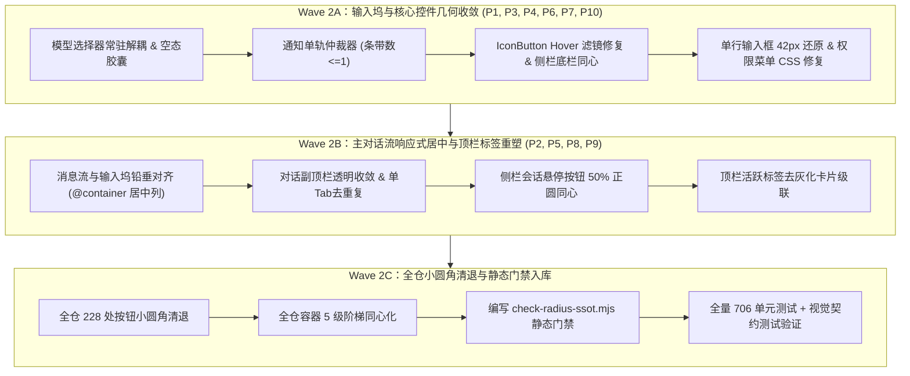

# 视觉层级清晰度与几何形态综合改进方案（Round 2 总纲）

> **归档路径**：`docs/visual-hierarchy-clarity-analysis/round2-proposals/00-总体改进方案.md`  
> **基线状态**：代码工作区已 100% 干净回滚至 Wave 1 完成态（706/706 单元测试全绿、Token/Color/Hierarchy 3 门禁零违规）。  
> **方案来源**：9 维度子 Agent 深度实勘详案 + 用户 8 组真实缺陷截图与交互现场精准穿透。

---

## 目录

1. [核心问题清单与现场穿透](#一核心问题清单与现场穿透)
2. [十大核心整改维度设计](#二十大核心整改维度设计)
   - 2.1 [输入坞通知单轨互斥与防堆叠仲裁](#21-输入坞通知单轨互斥与防堆叠仲裁)
   - 2.2 [侧栏会话项与动作按钮同心圆角](#22-侧栏会话项与动作按钮同心圆角)
   - 2.3 [侧栏底栏功能区 16px 胶囊统一与同频](#23-侧栏底栏功能区-16px-胶囊统一与同频)
   - 2.4 [全仓按钮 Hover 颜色双层发暗根除](#24-全仓按钮-hover-颜色双层发暗根除)
   - 2.5 [对话副顶栏透明收敛与单会话双标题解耦](#25-对话副顶栏透明收敛与单会话双标题解耦)
   - 2.6 [单行输入框经典形态与纯粹正圆胶囊二值守卫](#26-单行输入框经典形态与纯粹正圆胶囊二值守卫)
   - 2.7 [输入框「+」与「权限模式」圆角及 Hover 统一治愈](#27-输入框--与-权限模式-圆角及-hover-统一治愈)
   - 2.8 [全仓按钮微交互与展示容器小圆角地毯式清退](#28-全仓按钮微交互与展示容器小圆角地毯式清退)
   - 2.9 [主对话流与输入坞铅垂咬合自适应居中布局](#29-主对话流与输入坞铅垂咬合自适应居中布局)
   - 2.10 [输入框模型选择器 100% 常驻渲染与空态引导](#210-输入框模型选择器-100-常驻渲染与空态引导)
3. [分阶段实施波次规划（Wave 2A / 2B / 2C）](#三分阶段实施波次规划)
4. [守门契约与全套自动化测试验收矩阵](#四守门契约与全套自动化测试验收矩阵)

---

## 一、核心问题清单与现场穿透

| 序号 | 现场问题描述 | 对应截图 | 源码定位与直接病根 |
| :--- | :--- | :--- | :--- |
| **P1** | **通知条带上下“夹汉堡”双层堆叠** | `media_1793001056638` | `ChatStatusRibbons.tsx:310-351` 中 `SetupHintBanner` 与 `ComposerErrorBar` 独立无锁渲染，两分支同显。 |
| **P2** | **侧栏会话项动作按钮圆角突兀** | `media_1793001252579` | `SidebarSessionList.module.css:638`：在 28px、`--radius-lg` 大药丸行内，悬停按钮硬生生切出 26px、8px（`--radius-md`）生硬方角。 |
| **P3** | **侧栏底栏左右圆角严重割裂** | `media_1793001292471` | `Sidebar.module.css:309-312`：右侧齿轮按钮被硬编码 `--btn-radius: var(--radius-md)`（8px 方块），与左侧 16px 胶囊卡片严重脱节。 |
| **P4** | **按钮 Hover 遮罩过深发黑** | `media_1793001950734` | `Button.module.css:61` 的 `::before` 伪元素遮罩与 `Button.module.css:352` `.iconButton` 的 background 重复叠加，产生**双层灰黑滤镜**！ |
| **P5** | **对话副顶栏整行变深割裂** | `media_1793001992214` | `UnitChromeActions.module.css:12`：`.chatTopHeader` 被指定 `background: var(--bg-card)`，横切出死灰色水平带；且在单 Tab 下与标签栏复读。 |
| **P6** | **输入框「+」与「权限」圆角及 Hover 双重不一致** | `media_1793002056709` | `PermissionModeMenu.tsx:97` 类名写为 `styles.permPill`，但 CSS Module 只有 `.trigger`，导致类名失效回退至普通按钮 8px 方块；且 Hover token 脱节。 |
| **P7** | **单行输入框形态走形与内部方角残留** | `media_1793001692737` | 历史重构破坏了 42px 经典单行紧致高度；内部微操作散落 6px/8px 小圆角方块。 |
| **P8** | **顶栏激活标签粗笨灰膏药** | `media_1793001992214` | `PaneHeader.module.css:194` 使用脏灰 `--tab-active-bg`（#303030）与外散生硬黑阴影，像突兀悬空的膏药。 |
| **P9** | **主对话流失去居中与宽屏自适应** | `media_1793001992214` | `MessageVirtualizer.tsx:413` 与 `ChatCard.module.css:27` 满宽 100%，大屏下用户输入顶右、AI 回复顶左，分屏贴边无呼吸护城河。 |
| **P10** | **未配置 Key 时模型选择器蒸发** | 用户原声反馈 | `profileStoreActivation.ts:237` 将 `showModelPicker` 强绑定 `hasKey`，导致未配 Key 时模型胶囊被计算为 `null` 彻底消失。 |

---

## 二、十大核心整改维度设计

### 2.1 输入坞通知单轨互斥与防堆叠仲裁
*详案见：[`01-输入坞通知分支全景与互斥方案.md`](./01-输入坞通知分支全景与互斥方案.md)*

* **单一真理路径（SSOT）**：建立 `dockNotificationArbiter` 纯函数仲裁器。将输入框上方 23 个通知分支严格归并为单轨 6 级优先级：
  $$\text{Gate 0 (空态主画布向导)} \succ \text{L1 (引擎崩溃)} \succ \text{L2 (配置/执行阻断)} \succ \text{L3 (权限审批)} \succ \text{L4 (任务推进)} \succ \text{L5 (常态引导)}$$
* **刚性不变量**：
  1. **条带数量严格 $\le 1$**：任何时刻输入框上方最多只允许渲染 1 个状态条带，绝不允许再出现垂直“夹汉堡”堆叠；
  2. **高阶静默低阶**：当处于未配 Key 发送报错（L2）时，底部的首次使用软提示（L5）必须物理卸载（不渲染节点）；主画布已有向导卡片时，输入框上方通知让位。

### 2.2 侧栏会话项与动作按钮同心圆角
*详案见：[`03-侧栏与底部功能区圆角同心方案.md`](./03-侧栏与底部功能区圆角同心方案.md)*

* **几何治愈**：
  - 会话容器：高度 28px，保持 `--radius-lg`（12px）大圆角胶囊形态；
  - 行内悬停动作按钮（`...` 更多、分屏、静音）：尺寸锁定为 $24 \times 24\text{px}$，`border-radius: 50%`（正圆）；
  - 留白呼吸：上下各 2px、右侧 2px 边距，Hover 时背景为极浅微光，与外层大胶囊完美同心共轴。

### 2.3 侧栏底栏功能区 16px 胶囊统一与同频
*详案见：[`03-侧栏与底部功能区圆角同心方案.md`](./03-侧栏与底部功能区圆角同心方案.md)*

* **底栏统一律**：
  - 彻底删除 `Sidebar.module.css:309-312` 对 `.footerGearCol button` 的 `var(--radius-md)`（8px）方块覆写；
  - 右侧设置齿轮按钮与左侧 `UserProfileCard` 统一使用 `--radius-xl`（16px）柔和胶囊圆角（展开态）或 50% 正圆（折叠单图标态）；
  - 两者高度统一锁定为 32px，外框边缘平行，彻底消除“左大圆右小方”的视觉割裂。

### 2.4 全仓按钮 Hover 颜色双层发暗根除
*实勘结论与治理契约*：

* **根治双重滤镜**：
  - 清退 `Button.module.css:352-355` 中 `.iconButton:hover` 重复声明的 `background-color: var(--state-hover)`；
  - `IconButton` 与 `Button` 统一走单个 `::before` 伪元素遮罩机制，或直接将 `--btn-hover-overlay` 注入背景；
  - 严格限制浅色模式下 Hover 混合比例 $\le 4\%$（`color-mix(in srgb, var(--text-primary) 4%, transparent)`），严禁出现局部黑块或脏灰。

### 2.5 对话副顶栏透明收敛与单会话双标题解耦
*详案见：[`08-顶栏标签栏与激活态样式重构方案.md`](./08-顶栏标签栏与激活态样式重构方案.md)*

* **通透地平面**：
  - 将 `UnitChromeActions.module.css` 中的 `.chatTopHeader` 背景置为 `transparent`，直接透出叶片卡片底色，消除横切灰带；
  - 会话重命名按钮 `SessionInlineRename` Hover 时使用浅透胶囊（`border-radius: var(--radius-pill)` + 微透明底色），禁止方角黑块；
  - **单 Tab 合流**：当窗口只有一个会话标签时，顶栏与副顶栏合流，不在两层中重复复读会话标题，垂直净释放 38px 空间。

### 2.6 单行输入框经典形态与纯粹正圆胶囊二值守卫
*详案见：[`02-单行输入框与按钮胶囊正圆守卫方案.md`](./02-单行输入框与按钮胶囊正圆守卫方案.md)*

* **形态守卫原则**：
  - **单行形态**：保持经典 42px 紧致高度，外轮廓锁定为饱满胶囊 `border-radius: var(--radius-pill, 9999px)`；
  - **二值形态铁律**：输入框内部**仅允许两类几何形态**：
    1. **正圆形（50%）**：单图标按钮（「+」添加按钮、语音统计按钮、发送按钮）；
    2. **胶囊形（--radius-pill）**：多字控件（权限模式药丸、模型选择器、上下文引用 Chip）；
    3. **严禁小圆角**：绝不允许在输入框内出现 4px、6px、8px 等任何微圆角矩形。

### 2.7 输入框「+」与「权限模式」圆角及 Hover 统一治愈
*实勘结论与治理契约*：

* **类名修复与 Token 对齐**：
  - 修复 `PermissionModeMenu.module.css`：补全 `.permPill` 样式声明，显式绑定 `border-radius: var(--radius-pill, 9999px)` 与 `height: 28px`；
  - 对齐「+」与「权限模式」的 Hover 行为：均消费同一套 `--composer-control-hover-bg`（浅透柔和），消除 Hover 样式、明度与圆角的双重漂移。

### 2.8 全仓按钮微交互与展示容器小圆角地毯式清退
*详案见：[`04-全仓按钮与微交互圆角清退方案.md`](./04-全仓按钮与微交互圆角清退方案.md) 与 [`05-全仓容器与卡片圆角分层体系方案.md`](./05-全仓容器与卡片圆角分层体系方案.md)*

* **五级容器阶梯**：
  $$\text{顶层外壳/对话主卡片 (16px)} \succ \text{次级面板/弹层 (12px)} \succ \text{表单控件/输入框 (10px)} \succ \text{单行条目 (8px)} \succ \text{按钮/微交互 (正圆/胶囊)}$$
* **同心圆法则**：子容器圆角必须满足 $R_{inner} = R_{outer} - \text{Padding}$。若内层圆角 $<6\text{px}$，一律退化为 $0\text{px}$（直角）或升格为满胶囊，彻底清退 4px/6px 生硬小碎角。
* **门禁工具**：建立 `scripts/check-radius-ssot.mjs`，在 CI 中静态拦截所有单图标按钮非 50% 正圆及未授权的裸写小圆角。

### 2.9 主对话流与输入坞铅垂咬合自适应居中布局
*详案见：[`07-主对话流自适应与居中响应式布局方案.md`](./07-主对话流自适应与居中响应式布局方案.md)*

* **居中响应式模型**：
  - 建立 CSS 容器查询 `@container chatContainer`，以统一的 `--chat-column-width` 变量驱动消息流与底栏输入坞：
    - **宽屏视口（$\ge 1000\text{px}$）**：`max-width: min(840px, 100% - 64px); margin: 0 auto;` 居中对齐；
    - **中等视口（$700\text{px} \sim 999\text{px}$）**：`max-width: min(760px, 100% - 48px); margin: 0 auto;`；
    - **分屏/窄屏视口（$< 700\text{px}$）**：满宽自适应，两侧维持 $\ge 16\text{px}$ 呼吸护城河，严禁贴边撞击分屏 Sash；
  - 滚动条挂靠外层 100% 容器边缘，正文内容通过内部居中列铅垂咬合，输入框与消息列左右边距严格 1:1 对齐。

### 2.10 输入框模型选择器 100% 常驻渲染与空态引导
*详案见：[`09-输入框模型选择器常驻与空态引导方案.md`](./09-输入框模型选择器常驻与空态引导方案.md)*

* **常驻存在性铁律**：
  - 解绑 `profileStoreActivation.ts` 中的 `showModelPicker: hasKey`，使 `showModelPicker` 在任何状态下均恒为 `true`；
  - 未配置任何 Key 或模型时，模型选择器依然稳固渲染在输入框右侧（单行态紧贴发送按钮左侧，多行态位于操作底轨）；
  - 显示优雅的未配置胶囊：“未配置模型”；点击平滑弹出菜单，提供“前往配置服务商密钥” Primary 按钮引导，杜绝物理蒸发。

---

## 三、分阶段实施波次规划

依据反退避与安全实施原则，采用分波次小步验证、立体门禁护航：

---

## 四、守门契约与全套自动化测试验收矩阵

本次重构落地后，将新增并接入以下 4 套刚性自动化测试，杜绝未来任何视觉退化：

1. **`composerNoticeExclusion.contract.test.ts`**：
   - 穷举 128 种激活组合，断言通知条带节点数量严格 $\le 1$；断言报错激活时软提示物理不渲染。
2. **`composerGeometry.contract.test.ts`**：
   - 断言单行输入框高度在 40~44px 标称区间；断言输入框内所有按钮 `border-radius` 必须为 `50%` 或 `9999px`。
3. **`CentralColumnLayoutContract.test.ts`**：
   - 断言消息虚拟滚动容器宽度为 100%，内部正文列与输入坞拥有相同的前端变量与最大宽度。
4. **`check-radius-ssot.mjs`**（CI Lint 门禁）：
   - 静态扫描全仓 CSS Module，对任何单图标按钮使用 $\le 8\text{px}$ 圆角或未授权小圆角进行阻断报错。

---

> [!IMPORTANT]
> **确认与执行指示**：
> 本方案已涵盖此前反馈的全部 10 项缺陷与 3 张最新截图的精准根因。如审阅无异议，请确认进入 **Wave 2A** 实施阶段。实施过程将继续全量采用 `flash` 模型子 Agent 串行/无冲突执行，且由主 Agent 统一核查后提交。
