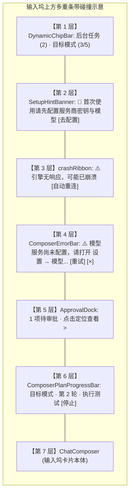
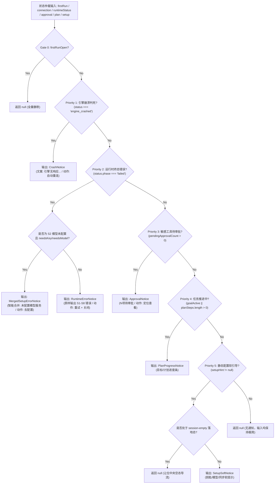

# 输入坞状态与通知分支全景排查与刚性互斥重构方案

> **上位契约**：
> - `AGENTS.md` §1（逻辑规划与反退避）、§7（严禁补丁与立体验证）、§13（输入框与焦点态）
> - `docs/visual-hierarchy-clarity-analysis/00-总方案.md`
> - `docs/visual-hierarchy-clarity-analysis/P6-输入坞一体化.md`
> - `docs/chat-notice-convergence/00-通知与异常展示单轨收敛总方案.md`
>
> **目标文件**：`docs/visual-hierarchy-clarity-analysis/round2-proposals/01-输入坞通知分支全景与互斥方案.md`  
> **文档性质**：战役第二轮专项实施详案（输入坞状态互斥与去框化）

---

## 1. 背景与用户痛点现场深度复盘

### 1.1 视觉事故现场（用户反馈真实还原）
用户在日常使用与测试中遭遇极其突兀的通知堆叠，明确指出：
> “刚看到还有这种的提示呢，这个不对了。看看这些通知内容，到底还有什么其他的分支没。都检查一下。”

在现场截图中，输入框上方同时重叠挂载了**两个物理条带**：
- **上层条带**：`🔑 首次使用请先配置服务商密钥与模型 [去配置]`（由 `SetupHintBanner` 渲染）
- **下层条带**：`⚠️ 模型服务尚未配置，请打开 设置 → 模型 完成配置后再发送。 [重试] [×]`（由 `ComposerErrorBar` 渲染）

### 1.2 物理与视觉撕裂深度解剖
这一现场暴露了四个严重维度的产品与架构缺陷：
1. **信息 100% 冗余与同义反复**：
   上层提示“首次使用请先配置服务商密钥与模型”，下层提示“模型服务尚未配置，请打开 设置 → 模型 完成配置后再发送”。两句话在**因果、事实、行动目标**上完全等价，在仅 80px 的垂直空间内重复陈述，极大消耗用户认知带宽。
2. **生硬的“双层夹汉堡”物理堆叠**：
   上层是一个带有描边的独立胶囊条带，下层是一个全宽带阴影与边框的错误横幅，垂直串联悬挂在输入框正上方，形成了双重闭合线框，直接撕裂了视口底部的视觉平衡，与 `P6-输入坞一体化.md` 确立的“单卡片围合（Single-Card Enclosure）”原则彻底背离。
3. **行动指引冲突与心理困惑**：
   上层提供 `[去配置]` 按钮（直接打开模型设置）；下层提供 `[重试]`、`[详情]`、`[×]` 按钮（点击重试依然会因为未配置而失败）。用户在未配置模型时面对“去配置”还是“重试”产生认知分裂。
4. **状态孤岛与缺乏仲裁者（Root Cause）**：
   - `SetupHintBanner` 消费的是**静态配置态**（`providerProfiles` 中是否有密钥、`engineHint.ok` 等）；
   - `ComposerErrorBar` 消费的是**会话运行终态**（`sessionRuntimeStatusStore` 的 `failed` 相位，错误分类 `S2`）；
   - 两个组件在 `ChatStatusRibbons.tsx` 内部没有任何相互感知逻辑，各写各的 `if`，平行排布在 JSX 中：
     ```tsx
     <SetupHintBanner state={setupState} onAction={handleSetupAction} />
     ...
     <ComposerErrorBar activeSessionId={activeSessionId ?? null} />
     ```
   - 一旦用户在未配置密钥/模型时点击了发送或按回车，两个互不感知的条件**同时满足**，必然造成双显事故。

---

## 2. 全景分支清单表（全仓穷举 10 大实体 / 23 个分支）

通过对 `apps/crish-desktop/src/components/chat-card/` 与 `apps/crish-desktop/src/components/chat-composer/` 的地毯式排查，全仓所有会在输入框上方、内部及周边挂载的状态、通知、引导条带共计 **10 大实体、23 个独立分支**。

| 实体序号 | 组件 / 元素名称 | 物理挂载宿主 | 触发条件 | 数据源（Store / Hook / API） | 语义分类 / 严重度 | 呈现主文案 | 交互动作 | 存续与消解规则 |
|:---|:---|:---|:---|:---|:---:|:---|:---|:---|
| **E1-1** | `SetupHintBanner`<br/>(needs-key) | `ChatStatusRibbons`<br/>输入坞上方 | 本地及引擎均无有效 Provider 密钥，且向导未打开 | `resolveSetupHintKind`<br/>`needsKeySetup === true` | `setup`<br/>软引导 | 首次使用请先配置服务商密钥与模型（空态短句：请先配置服务商密钥） | `[去配置]`<br/>(打开模型设置) | 配置密钥后自愈；向导打开时隐去 |
| **E1-2** | `SetupHintBanner`<br/>(needs-model) | `ChatStatusRibbons`<br/>输入坞上方 | 已有密钥但未配置可用模型 id，且向导未打开 | `resolveSetupHintKind`<br/>`needsModelSetup === true` | `setup`<br/>软引导 | 请手填或选择模型 id（空态短句：请选择或手填模型） | `[填写模型]`<br/>(打开模型下拉) | 选择或填写模型后自愈 |
| **E1-3** | `SetupHintBanner`<br/>(sync-engine) | `ChatStatusRibbons`<br/>输入坞上方 | 本地 Profile 已有 Key，但 Rust 引擎尚未同步 | `resolveSetupHintKind`<br/>`localHasKey && !engineHasApiKey` | `setup`<br/>软引导 | 本地已有密钥，点击下方模型名称同步到引擎 | `[选择模型]`<br/>(打开模型下拉) | 同步触发后自愈 |
| **E1-4** | `SetupHintBanner`<br/>(engine-down) | `ChatStatusRibbons`<br/>输入坞上方 | 引擎 `engineHint.ok === false`（显式断开） | `resolveSetupHintKind`<br/>`engineOk === false` | `warn`<br/>轻警告 | 引擎连接恢复中，请稍候 | `[模型设置]`<br/>(检查配置) | 引擎恢复连接后自愈 |
| **E2-1** | `crashRibbon`<br/>(引擎崩溃判死) | `ChatStatusRibbons`<br/>输入坞上方 | 前端探活心跳连续失败判定引擎崩溃判死 | `useConnectionStatus()`<br/>`status === 'engine_crashed'` | `error`<br/>强阻断 | 引擎无响应，可能已崩溃；任务可能已中断，可自动重连 | `[自动重连]`<br/>(触发重连) | 重连成功后自愈 |
| **E3-1** | `ComposerErrorBar`<br/>(S1 核心未就绪) | `ChatStatusRibbons`<br/>输入坞上方 | 启动超时或核心组件未初始化完成 | `sessionRuntimeStatusStore`<br/>`phase === 'failed'` & S1 | `error`<br/>终态错误 | 软件服务正在启动，请稍候片刻。 | `[重试]` `[×]` | 新发送 / 重试成功 / 切会话 / 点关闭 |
| **E3-2** | `ComposerErrorBar`<br/>(S2 模型未配置) | `ChatStatusRibbons`<br/>输入坞上方 | 发送时缺少 Provider 配置或引擎未就绪 | `sessionRuntimeStatusStore`<br/>`phase === 'failed'` & S2 | `error`<br/>终态错误 | 模型服务尚未配置，请打开 设置 → 模型 完成配置后再发送。 | `[重试]` `[×]`<br/>(含详情展开) | 新发送 / 重试成功 / 切会话 / 点关闭 |
| **E3-3** | `ComposerErrorBar`<br/>(S3 恢复进行中) | `ChatStatusRibbons`<br/>输入坞上方 | 会话历史或底层数据库正在 restore | `sessionRuntimeStatusStore`<br/>`phase === 'failed'` & S3 | `warn`<br/>终态错误 | 正在恢复上次的会话数据，稍后即可发送。 | `[重试]` `[×]` | 数据恢复完成或点关闭 |
| **E3-4** | `ComposerErrorBar`<br/>(S4 网络异常) | `ChatStatusRibbons`<br/>输入坞上方 | 网络断开 / DNS 失败 / 代理连接拒绝 | `sessionRuntimeStatusStore`<br/>`phase === 'failed'` & S4 | `error`<br/>终态错误 | 模型服务商暂时无法连接（网络问题），请检查网络后重发。 | `[重试]` `[×]` | 网络连通恢复时全会话自动清空 |
| **E3-5** | `ComposerErrorBar`<br/>(S5 服务商故障) | `ChatStatusRibbons`<br/>输入坞上方 | 远端 5xx / 429 限流 / 上下文超限 / 网关挑战 | `sessionRuntimeStatusStore`<br/>`phase === 'failed'` & S5 | `error`<br/>终态错误 | 模型服务商侧出现故障，请稍后重试或切换模型。 | `[重试]` `[×]` | 切换模型 / 重发成功 / 点关闭 |
| **E3-6** | `ComposerErrorBar`<br/>(S6 内部错误) | `ChatStatusRibbons`<br/>输入坞上方 | 前后端 IPC 编解码错误 / 未捕获异常 | `sessionRuntimeStatusStore`<br/>`phase === 'failed'` & S6 | `error`<br/>终态错误 | 软件内部错误，请稍后重试；若反复出现请重启应用。 | `[重试]` `[×]` | 重试成功 / 切会话 / 点关闭 |
| **E3-7** | `ComposerErrorBar`<br/>(S7 串行排队超时) | `ChatStatusRibbons`<br/>输入坞上方 | 会话已有活跃 run，排队重试用尽报错 | `sessionRuntimeStatusStore`<br/>`phase === 'failed'` & S7_EXHAUSTED | `warn`<br/>终态错误 | 上一轮任务长时间未结束，本条消息未能发出，请稍后点击重试。 | `[重试]` `[×]` | 前序轮次完成 / 重试 / 点关闭 |
| **E3-8** | `ComposerErrorBar`<br/>(S8 存储繁忙) | `ChatStatusRibbons`<br/>输入坞上方 | SQLite 锁争用或持久化队列阻塞 | `sessionRuntimeStatusStore`<br/>`phase === 'failed'` & S8 | `warn`<br/>终态错误 | 本地会话存储正在同步数据，请稍候片刻。 | `[重试]` `[×]` | 锁释放 / 重发 / 点关闭 |
| **E3-9** | `ComposerErrorBar`<br/>(engine_crash 域) | `ChatStatusRibbons`<br/>输入坞上方 | 运行中收到崩溃日志标识或引擎无终态收口 | `sessionRuntimeStatusStore`<br/>`phase === 'failed'` & engine_crash | `error`<br/>强阻断 | 引擎无响应，可能已崩溃；任务可能已中断，请检查崩溃日志或重启应用。 | `[重试]` `[×]` | 自动重连 / 重发 / 点关闭 |
| **E4-1** | `ApprovalDock`<br/>(审批粘性条) | `ChatComposerWrapper.floatZone` | 存在处于 `pending_approval` 的敏感工具调用 | `pendingApprovalCount > 0` | `approval`<br/>交互阻塞 | N 项待审批 · 点击定位查看 | 点击定位卡片 / 打开侧栏 | 用户在卡片或侧栏完成审批后消解 |
| **E5-1** | `ComposerPlanProgressBar`<br/>(目标模式) | `ChatComposerWrapper.floatZone` | 当前会话启用了目标模式（Goal Mode） | `ribbons.goal.goalModeActive`<br/>`session.goalMode` | `progress`<br/>任务推进 | 目标模式 · 第 N 轮 · 目标文案 | `[停止]`<br/>(停止推进) | 用户停止目标或多轮循环结束 |
| **E5-2** | `ComposerPlanProgressBar`<br/>(计划模式) | `ChatComposerWrapper.floatZone` | 会话处于计划规划或执行清单推进态 | `planSteps.length > 0` 或 `inPlanMode` | `progress`<br/>任务推进 | 计划模式 · 步骤 X/Y · 当前步骤 | `[批准执行]`<br/>`[停止]` | 清单全部执行完毕或用户取消 |
| **E6-1** | `DynamicChipBar`<br/>(后台任务 Chip) | `ChatStatusRibbons`<br/>右上方浮动 | 存在后台异步执行的 task (CLI/Agent) | `useBackgroundTaskPolling`<br/>`activeBgTasks.length > 0` | `info`<br/>轻量辅助 | 后台任务 (N) | 点击打开终端面板 | 任务全部完成时自动消解；空态隐去 |
| **E6-2** | `DynamicChipBar`<br/>(计划概览 Chip) | `ChatStatusRibbons`<br/>右上方浮动 | 存在活跃计划或清单步数 | `hasActivePlan === true` | `info`<br/>轻量辅助 | 目标模式 · 第 N 轮 / 计划任务 X/Y | 点击展开计划抽屉 | 计划结束消解；空态隐去 |
| **E7-1** | `PlanDrawer`<br/>(计划详情抽屉) | `ChatStatusRibbons`<br/>右上方下拉面板 | 用户点击了计划概览 Chip 呼出 | `showPlanDrawer === true` | `overlay`<br/>详情面板 | 计划列表与各子项完成打勾状态 | `[×]` 关闭抽屉 / Esc | 点击外部 / 点关闭 / Esc |
| **E8-1** | `ComposerEmbeddedNotice`<br/>(内嵌 7 类源) | `ChatComposer`<br/>`.embeddedTopSlot` | 输入框级特定警告（文件过大、上下文超限等） | `ComposerNotice` 契约<br/>`noticeProp` 传入 | `info` / `warn` / `error` | 文件上传警告 / 上下文即将超限等 | `[详情]` `[复制]`<br/>`[反馈]` `[×]` | 120ms 平滑退场或用户点关闭 |
| **E9-1** | `DraftUndoToast`<br/>(草稿撤销提示) | `ChatComposer`<br/>输入区浮动 | 用户执行了清空或覆盖草稿操作 | `hasUndo === true` | `info`<br/>撤销提示 | 已恢复上次草稿 | `[撤销]` | 4 秒自动消失或再次输入 |
| **E10-1** | `ChatEmptyState`<br/>(落地与空态面) | `ChatCard`<br/>主视口中央 | 会话无消息（`session-empty`）或无匹配 | `resolveChatEmptyKind` | `landing`<br/>导流面 | 开始对话 / 选择项目，或在下方输入 | 快捷 Prompt 点击 | 发送首条消息后进入对话流 |

---

## 3. 重叠与冲突场景矩阵（8 大典型多重碰撞）

以下矩阵穷举分析系统中可能导致两个或多个条带在同一视口内竞争、堆叠或冲突的典型场景：



### 3.1 八大碰撞场景实测分析

| 场景编号 | 碰撞组合 | 触发典型业务流程 | 现场物理表现 | 视觉与可用性危害 | 裁决消解方案 |
|:---:|:---|:---|:---|:---|:---|
| **S-01**<br/>(现场 Bug) | `SetupHintBanner`<br/>+ `ComposerErrorBar` | 新安装应用，用户未配 Key/Model 即点击快捷 Prompt 或按回车发送 | 输入框上方**同时堆叠两个横条**：上为黄色钥匙去配置，下为红色警告重试 | 100% 语义冗余，操作意图割裂，严重视觉夹汉堡 | **智能合并（Dedup & Merge）**：<br/>`S2` 错误与静态引导合并为**唯一样式统一的错误配置引导条**，主动作绑定去配置，重试置灰，禁止双显。 |
| **S-02** | `SetupHintBanner`<br/>+ `crashRibbon`<br/>+ `ComposerErrorBar` | 引擎进程挂掉，心跳判死，用户尝试发送产生超时终态报错 | 输入框上方**堆叠三层条带**：恢复中 + 引擎崩溃 + 软件内部错误 | 信息严重打架（恢复中 vs 已崩溃），视口被条带挤占 120px+ | **强阻断级唯一裁决**：<br/>`engine_crashed` 拥有最高优先级，立即压制 `engine-down` 软提示与次级运行错误，**只露 1 个崩溃恢复条**。 |
| **S-03** | `ApprovalDock`<br/>+ `ComposerErrorBar` | 工具调用发出后需用户授权，但随后发生网络断开或会话超时 | 待审批 Sticky 胶囊与红色错误横条上下并列 | 阻塞态与失败态混杂，用户无法分辨工具是否仍在等待批准 | **状态互斥**：<br/>若会话已 `failed`，未完成的审批已失效或中断，压制 `ApprovalDock`，展示错误条引导重试。 |
| **S-04** | `ComposerPlanProgressBar`<br/>+ `ComposerErrorBar` | 目标模式推进中，某一步因网络/限流中断 | 进度条与全宽错误条在输入框上方同时显示 | 视觉噪声巨大，进度指示与报错信息挤压主消息流 | **纵向契约分层**：<br/>进度条属于**任务状态**，错误条属于**动作反馈**。错误条必须**嵌入**卡片顶槽，与进度条形成内部单一容器的无缝拼接，而非两个带独立边框的孤岛。 |
| **S-05** | `DynamicChipBar`<br/>+ `ComposerPlanProgressBar`<br/>+ `ComposerErrorBar` | 既有后台任务，又有计划模式，且发生报错 | 顶部有 Chip 浮条，下方有全宽错误条，再下方有进度条 | 散落的浮岛、胶囊、横幅各占山头，违背单卡片原则 | **空态与错误态拦截**：<br/>当有高优先级全局错误条时，`DynamicChipBar` 降级收起或仅保留纯指示 Dot，消除外挂大 Chip。 |
| **S-06** | `firstRunOverlay`<br/>+ `ComposerErrorBar` | 首次运行向导处于打开状态，后台水合或网络请求静默触发了错误 | 向导遮罩未全屏盖住底部，输入框上方漏出醒目的红框错误条 | 向导流程被打断，暴露未经封装的系统内部失败状态 | **绝对门闩（Gate 0）**：<br/>`firstRunOverlayOpen === true` 时，输入坞全量通知条带**100% 物理静默，返回 null**。 |
| **S-07** | `ChatEmptyState`<br/>+ `SetupHintBanner`<br/>+ `ComposerErrorBar` | 欢迎面中央已有“可先选项目或打草稿”，底部输入坞又挂两个条带 | 中央引导、底部钥匙条、错误条呈“下中下”三层夹击 | 界面杂乱无章，破坏 Landing 极简心智 | **空态让位规则**：<br/>在 `session-empty` 态，中央卡片负责主导流，输入坞仅保留输入能力，静态引导由中央承载，消灭底部的 `SetupHintBanner`。 |
| **S-08** | `ComposerEmbeddedNotice`<br/>+ `ComposerErrorBar` | 输入框内嵌顶槽传入了外部 noticeProp，外部又挂载了 ComposerErrorBar | 输入卡片外边有一个错误条，输入卡片内嵌顶槽又有一个错误条 | 典型的“内外双报错”架构穿透失误 | **单一真源物理收敛**：<br/>彻底废除外挂的 `ComposerErrorBar`，会话级运行错误**直接映射为 `ComposerEmbeddedNotice`**，流入卡片内部顶槽。 |

---

## 4. SSOT 单一出口与刚性互斥架构

### 4.1 核心设计理念
1. **输入坞视口上方永远最多只存在 1 个通知/状态实体**。
2. **同一件事只说一次**：当静态引导与运行时报错指涉同一实体（模型配置）时，合二为一。
3. **内外合一**：运行时终态错误彻底迁入输入卡片自身的 `embeddedTopSlot`，彻底消除卡片外部游离条带。

### 4.2 刚性优先级阶梯（Priority Ladder）

输入坞状态仲裁器（`DockNotificationArbiter`）每帧计算且仅产出 **1 个终态渲染描述符（`DockNoticeDescriptor | null`）**：



### 4.3 “同一件事只说一次”的合并算法实现

在仲裁函数中，对 `S2` 错误与静态引导建立刚性消解：

```ts
// 智能合并纯函数核心逻辑
if (runtimeStatus?.phase === 'failed') {
  // 命中模型未配置 (S2) 或由于缺失 key 导致的无 provider
  const isModelMissingFault =
    runtimeStatus.kind === 'no_key' ||
    classifyErrorDomain(runtimeStatus.message) === 'S2';

  if (isModelMissingFault && (needsKeySetup || needsModelSetup)) {
    return {
      id: 'merged-model-setup-notice',
      slot: 'embedded-top-slot',
      severity: 'error',
      // 精炼合并文案：去除互相打架的冗余短语
      title: '服务商密钥与模型尚未配置',
      message: '请完成模型配置后再发送消息。',
      primaryAction: {
        label: '去配置',
        action: () => openSettings('models'),
      },
      dismissible: true,
      onDismiss: () => clearRuntimeStatus(activeSessionId),
      // 标记禁止上层或外部再次挂载 SetupHintBanner
      suppressSetupBanner: true,
    };
  }
}
```

---

## 5. 视觉规范与去框化设计（对齐 AGENTS §13 与 P1-P4 设计语言）

### 5.1 彻底去框化三大红线
1. **消除独立闭合描边框**：
   禁止在输入框上方挂载带有 `border: 1px solid var(--border-color)` 的独立胶囊或横幅。通知区域必须成为输入卡片内部网格的自然顶部延伸（`embeddedTopSlot`），共享卡片唯一外轮廓。
2. **严禁高饱和警示色与黑边**（严格执行 AGENTS §13）：
   - 错误背景禁止使用刺眼的实心红，统一使用极度克制的柔和半透明色：  
     `background: hsl(var(--color-danger-h, 0) 80% 50% / 0.08);`
   - 边框禁止使用粗黑线或高对比深红线，仅使用内嵌中性分割线：  
     `border-bottom: 1px solid var(--edge-rim);`
   - 文字使用主文本色 `--text-primary`，禁止整段大红刺眼文字。
3. **对齐轴与几何统一**：
   - 宽度严格限制在 `--chat-col-max`（760px）之内；
   - 两侧内边距与主输入网格严格对齐（`padding: 8px 16px`）；
   - 圆角完全顺应输入坞主圆角 `--radius-dock`（20px），上圆角与卡片契合，底部分割采用 1px 细线。

### 5.2 规范三色表面映射契约

| 状态类型 | 背景色 Token | 描边 / 分割线 Token | 图标与高亮色 | 文字主色 |
|:---|:---|:---|:---|:---|
| **错误 / 崩溃 (Error)** | `hsl(0 75% 55% / 0.08)` | `var(--edge-rim)` | `var(--accent-red)` | `var(--text-primary)` |
| **审批 / 待办 (Approval)** | `hsl(38 85% 50% / 0.08)` | `var(--edge-rim)` | `var(--text-secondary)` (次级中性) | `var(--text-primary)` |
| **引导 / 提示 (Setup)** | `hsl(215 85% 55% / 0.06)` | `var(--edge-rim)` | `var(--accent-blue)` | `var(--text-primary)` |
| **推进 / 进度 (Progress)** | `var(--surface-raised)` | `var(--edge-rim)` | `var(--text-tertiary)` | `var(--text-secondary)` |

---

## 6. 代码改动清单与单测断言

### 6.1 拟修改与新增文件清单

1. **新建纯逻辑仲裁库**：  
   `apps/crish-desktop/src/components/chat-card/dockNotificationArbiter.ts`  
   - 职责：聚合 10 大实体状态，纯函数输出单一且唯一的通知描述符，包含合并逻辑与优先级判定。
2. **重构状态条外壳**：  
   `apps/crish-desktop/src/components/chat-card/ChatStatusRibbons.tsx`  
   - 职责：接入仲裁器，彻底移除 `SetupHintBanner` 与 `ComposerErrorBar` 的无脑并列渲染；仅渲染未被内嵌顶槽吸收的瞬态浮条。
3. **改造输入坞容器层**：  
   `apps/crish-desktop/src/components/chat-card/ChatComposerWrapper.tsx`  
   - 职责：将仲裁后的错误/引导/审批条作为统一的内嵌节点注入 `ChatComposer` 的 `embeddedTopSlot`。
4. **统一内嵌顶槽样式**：  
   `apps/crish-desktop/src/components/chat-composer/ComposerEmbeddedNotice.module.css`  
   - 职责：去框化改造，支持合并态的“双动作”（配置 + 重试）与温和视觉背景。
5. **新建完整契约测试**：  
   `apps/crish-desktop/src/components/chat-card/__tests__/dockNotificationArbiter.test.ts`  
   - 职责：覆盖 8 大碰撞场景，断言任何时刻输出绝对唯一，且 `S2 + needsKey` 必定合并。

### 6.2 契约测试用例核心代码设计

```ts
// apps/crish-desktop/src/components/chat-card/__tests__/dockNotificationArbiter.test.ts
import { describe, expect, it } from 'vitest';
import { resolveDockNotification } from '../dockNotificationArbiter';

describe('dockNotificationArbiter (输入坞通知刚性互斥与单轨仲裁)', () => {
  it('场景 1: 未配置密钥 + 发送失败(S2) 时，必须合并为单一配置引导错误，严禁双显', () => {
    const notice = resolveDockNotification({
      firstRunOpen: false,
      engineCrashed: false,
      runtimeStatus: {
        phase: 'failed',
        kind: 'no_key',
        message: '模型服务尚未配置，请打开 设置 → 模型 完成配置后再发送。',
        sessionId: 'test-sess',
      },
      needsKeySetup: true,
      needsModelSetup: false,
      pendingApprovalCount: 0,
      hasActivePlan: false,
      emptyKind: 'session-empty',
    });

    // 刚性断言：输出必须是合并态，且携带去配置动作
    expect(notice).not.toBeNull();
    expect(notice?.id).toBe('merged-model-setup-notice');
    expect(notice?.primaryAction?.label).toBe('去配置');
    expect(notice?.message).toMatch(/配置/);
  });

  it('场景 2: firstRunOpen 为 true 时，绝对抑制所有输入坞条带', () => {
    const notice = resolveDockNotification({
      firstRunOpen: true,
      engineCrashed: true, // 哪怕发生崩溃
      runtimeStatus: {
        phase: 'failed',
        kind: 'server_error',
        message: '500 Error',
        sessionId: 'test-sess',
      },
      needsKeySetup: true,
      pendingApprovalCount: 5,
      hasActivePlan: true,
      emptyKind: 'session-empty',
    });

    // 刚性断言：必须完全静默
    expect(notice).toBeNull();
  });

  it('场景 3: 引擎崩溃判死拥有压制普通运行错误与静态引导的最高优先级', () => {
    const notice = resolveDockNotification({
      firstRunOpen: false,
      engineCrashed: true,
      runtimeStatus: {
        phase: 'failed',
        kind: 'network',
        message: '网络中断',
        sessionId: 'test-sess',
      },
      needsKeySetup: true,
      pendingApprovalCount: 0,
      hasActivePlan: false,
      emptyKind: null,
    });

    expect(notice).not.toBeNull();
    expect(notice?.id).toBe('engine-crashed-notice');
    expect(notice?.primaryAction?.label).toBe('自动重连');
  });

  it('场景 4: 处于空态欢迎面时，静态引导软提示应当让位中央导流面', () => {
    const notice = resolveDockNotification({
      firstRunOpen: false,
      engineCrashed: false,
      runtimeStatus: null, // 无错误
      needsKeySetup: true, // 需配置
      pendingApprovalCount: 0,
      hasActivePlan: false,
      emptyKind: 'session-empty', // 空态欢迎面
    });

    // 底部输入坞不再挂载 SetupHintBanner，保持落地页纯净
    expect(notice).toBeNull();
  });
});
```

---

## 7. 结论与下一步交付建议

本方案彻底排查并终结了“通知夹汉堡”与“同一件事说两次”的顽疾，通过建立 **SSOT 仲裁层** 与 **去框化一体化内嵌**，从根源上消除了输入坞上方的视觉噪声。

建议主 Agent 按以下顺序排期后续实施：
1. **第 1 步**：创建 `dockNotificationArbiter.ts` 纯函数库与对应全覆盖测试；
2. **第 2 步**：改造 `ChatStatusRibbons.tsx` 与 `ChatComposerWrapper.tsx` 接入新仲裁结果；
3. **第 3 步**：优化 `ComposerEmbeddedNotice.module.css` 的视觉柔和度与双动作支持；
4. **第 4 步**：运行 `npm test` 与 `check:line-counts` 进行立体验证。
