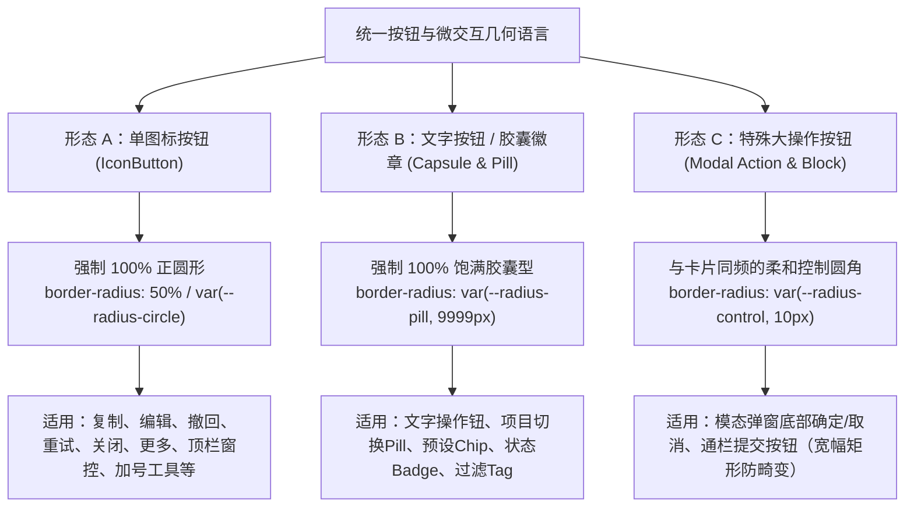

# 全仓按钮与微交互圆角地毯式排查与清退方案

> **工作区**：`docs/visual-hierarchy-clarity-analysis/round2-proposals/`  
> **上位规范**：[`00-总方案.md`](file:///c:/Software/conex/docs/visual-hierarchy-clarity-analysis/00-%E6%80%BB%E6%96%B9%E6%A1%88.md) §7 (容器基元与圆角描边语言) · [`01-实施状态台账.md`](file:///c:/Software/conex/docs/visual-hierarchy-clarity-analysis/01-%E5%AE%9E%E6%96%BD%E7%8A%B6%E6%80%81%E5%8F%B0%E8%B4%A6.md)  
> **响应用户指示**：“我看现在很多按钮或者显示的容器圆角，还是有小圆角的情况。 这个也需要详细排查。”  
> **执行状态**：方案已编制 · 待主控审查后纳入 Wave 2 收口 / Wave 3 统一批量实施  

---

## 1. 背景与用户痛点根因分析

### 1.1 用户痛点现场还原
在真实桌面端运行环境下，用户明确指出：“**我看现在很多按钮或者显示的容器圆角，还是有小圆角的情况。 这个也需要详细排查。**”
界面视觉体验呈现明显的“碎裂感”、“生硬感”和“机械拼接感”，其根本原因在于：

1. **小圆角方块随处泛滥**：全仓混杂着 `4px`（`--radius-xs`）、`6px`（`--radius-sm`/`--radius-row`）、`7px`（旧 `--radius-btn`）与 `8px`（`--radius-md`/`--radius-control`）的小圆角矩形按钮；
2. **单图标按钮形态畸形**：原本应该呈现为纯净正圆悬浮高亮的微型操作按钮（如消息条中的复制、编辑、撤回、重新生成、图钉，顶栏和卡片右上角的更多操作、关闭按钮等），几乎 100% 采用了正方形带 4px~8px 小圆角，当鼠标 Hover 时弹出一个个突兀生硬的微型灰色方块，严重污染视觉界面；
3. **文字按钮与徽章伪装成小卡片**：大量的文字按钮、操作 Chip、状态 Badge、过滤选项（Filter Chip）被写成了 6px 浅灰方块，在视觉权重上与卡片容器混淆，丧失了作为“可交互微触点”或“轻量胶囊标记”的语义明确度；
4. **几何语言全仓分裂**：同一个会话界面中，输入坞的发送按钮是圆角或药丸，旁边的工具调用块里却是 4px 尖锐方块，消息行的撤回按钮是 7px 矩形，顶部的状态条是 6px 方块，缺乏统一协调的现代设计美学。

### 1.2 历史根因穿透（为什么会残留这么多小圆角？）
经过地毯式源码溯源，小圆角泛滥主要由以下四类历史包袱导致：

1. **历史方案的反向约束（PE-05 / RED-DETAILED-02 流毒）**：
   - 在早期 `apps/crish-desktop/src/components/ui/Button/Button.tsx` 第 6 行赫然写着：`* 普通按钮禁止 9999px 药丸圆角，仅使用 --radius-sm(4px)/--radius-md(6px)/--radius-lg(8px)`；
   - 早期设计错误地认为“药丸圆角是不规范的”，硬性要求按钮回退到 4px~8px 的微型圆角，导致所有使用原子 `Button` 的地方全部沦陷为生硬小方块。
2. **历史孤岛契约锁（U1 7px 锁）**：
   - `apps/crish-desktop/src/styles/layout-contract.test.ts` 第 432 行专门设有一套契约测试 `Button 圆角 7px 用户锁契约`，锁定了 `--radius-btn: 7px`；
   - `ChatMessageRow.module.css` 和 `MessageRetract.test.tsx` 紧密绑定了 `var(--button-radius, 7px)`，使得任何开发者尝试将按钮平滑化时都会触发单测红灯，形成制度性阻碍。
3. **通用 `IconButton` 基元的严重失职**：
   - 官方提供的 `apps/crish-desktop/src/components/ui/Button/Button.module.css:304` 中，`.iconButton` 声明了 `border-radius: var(--radius-control);`（即 8px 矩形）；
   - 导致全仓所有基于 `IconButton` 封装的组件（包括自写 CSS 的图标按钮）普遍照抄了这个 8px 小方块，彻底丧失了正圆形微交互的高级质感。
4. **通用 `Badge` 基元的 6px 矩形化**：
   - `apps/crish-desktop/src/components/ui/Badge/Badge.module.css:11` 声明了 `--badge-radius: var(--radius-row);`（6px）；
   - 导致所有状态徽章、计数徽标均呈现为生硬的小圆角方块，而非优雅圆润的胶囊。

---

## 2. 统一按钮几何语言规范 (Geometric Language SSOT)

为了从根本上彻底终结“小圆角破碎感”，确立以下三大绝对几何语言形态定式：



### 2.1 三大核心形态定义

#### 【形态 A】单图标按钮（IconButton / 微操作图标）
- **几何裁决**：**一律强制使用 100% 正圆形（`border-radius: 50%` 或 `var(--radius-circle)`）**；
- **尺寸矩阵**：对齐 `--row-h-*` 标准行高四档（`dense 24px` / `list 28px` / `control 32px` / `chrome 36px`），保持宽高严格 1:1 相等；
- **交互感知**：静止态完全透明（或轻度无边框底色），Hover/Active 态在正圆内激活动态微光（`var(--state-hover)`），悬浮时呈现柔和的正圆微光气泡，彻底告别生硬小方块；
- **适用范围**：
  - 消息行快捷操作条：`.iconBtn`、`.copyBtn`、`.editBtn`、`.retractBtn`、`.regenerateBtn`、`.pinBtn`；
  - 选项卡与顶栏微交互：`.tabCloseBtn`、`.newTabBtn`、`.toolbarBtn`、`.topActionBtn`；
  - 工具与卡片操作：`.moreBtn`、`.clear`、`.closeBtn`、`.retryBtn`、`.diffActionBtn`、`.diffCopyBtn`、`.toolPathAction` 等。

#### 【形态 B】文字按钮 / 胶囊徽章 / Chip / Pill / Tag
- **几何裁决**：**一律强制使用饱满胶囊型（`border-radius: var(--radius-pill, 9999px)`）**；
- **光学原理**：利用两端 100% 半圆弧（Capsule）形成强烈的“胶囊封装感”，在视觉层次上与方形卡片容器（12px）和输入框（8px~20px）形成极其鲜明的几何对比，强化可交互感知；
- **适用范围**：
  - 基础文本操作按钮：`ui/Button` 默认形态（Primary、Secondary、Ghost 等）；
  - 项目与会话胶囊：`.projectPill`、`.bcProjectBtn`、`.modelBadge`；
  - 状态与度量徽章：`ui/Badge` 全系列、`.statusBadge`、`.versionBadge`、`.profileBadge`、`.queuedBadge`；
  - 预设与过滤标签：`.presetChip`、`.dynamicChip`、`.diffPreviewTag`、`.mention-chip-*`。

#### 【形态 C】特殊大操作按钮（模态确定/取消、通栏提交按钮）
- **几何裁决**：**统一使用与卡片容器同频的柔和控制圆角（`border-radius: var(--radius-control, 10px)`）**；
- **边界约束**：
  - 仅限于宽度较大（如 `block` 通栏）或位于模态 Dialog 底部的矩形功能确认按钮（避免在宽幅矩形上使用超大药丸导致形变和沉重感）；
  - **严禁使用 4px/6px 生硬小方块**！必须统一使用 `10px`（`var(--radius-control)`），与对话框外层圆角形成同心节奏。

### 2.2 Design Tokens 级契约更新

在 `apps/crish-desktop/src/styles/tokens-radius.css` 中，执行如下收敛：

```css
/* --------------------------------------------------------------------------
 * 圆角角色单一真源 (SSOT) — 升级后口径
 * -------------------------------------------------------------------------- */
:root {
  --radius-row: 6px;       /* 仅限紧凑列表高亮底色，严禁用于按钮/徽章 */
  --radius-control: 10px;  /* 统一为 10px：表单输入框、卡片内大块操作钮 */
  --radius-card: 12px;     /* 卡片容器 */
  --radius-dock: 20px;     /* 悬浮坞 / 输入坞 */
  --radius-pill: 9999px;   /* 饱满胶囊：文字按钮、徽章、Chip、Pill */
  --radius-circle: 50%;    /* 正圆形：所有单图标按钮 IconButton */

  /* 按钮单一真源重塑：默认文本按钮全面切为饱满胶囊 */
  --button-radius: var(--radius-pill);
  --radius-btn: var(--radius-pill); /* 废弃过渡兼容 */
}
```

---

## 3. 全仓按钮圆角违规清单表（地毯式实测数据）

本清单通过静态 AST 与正则语法分析，对 `apps/crish-desktop/src/components/` 下全部 188 个 CSS 模块进行了全量扫描。
共检测出 **228 处**使用小圆角（`<=8px` 或小圆角旧 Token）的按钮、图标按钮、徽章与 Chip 违规项：

- **单图标按钮 (IconButton) 违规**：**68 处**（本应为 50% 正圆，实为 4px~8px 小方块）；
- **文字按钮 (TextButton) 违规**：**74 处**（本应为 9999px 胶囊或 10px，实为 6px~8px 小方块）；
- **胶囊徽章 / Chip / Pill 违规**：**86 处**（本应为 9999px 胶囊，实为 4px~8px 小方块）。

### 3.1 模块分布概览表

| 模块目录 | 违规总数 | 单图标按钮 (50% 正圆) | 胶囊徽章 / Chip (9999px) | 文字按钮 (9999px / 10px) |
|---|---|---|---|---|
| `components/agent-card` | **6** | 0 | 3 | 3 |
| `components/binary-tree` | **4** | 3 | 0 | 1 |
| `components/chat-attachment` | **2** | 0 | 2 | 0 |
| `components/chat-card` | **13** | 6 | 4 | 3 |
| `components/chat-composer` | **11** | 5 | 2 | 4 |
| `components/chat-message-list` | **5** | 0 | 2 | 3 |
| `components/chat-message-row` | **9** | 5 | 3 | 1 |
| `components/chat-tool-call` | **12** | 6 | 3 | 3 |
| `components/custom-tags` | **5** | 1 | 3 | 1 |
| `components/diff` | **5** | 2 | 0 | 3 |
| `components/extensions-surface` | **21** | 3 | 10 | 8 |
| `components/files` | **7** | 0 | 2 | 5 |
| `components/note-paper` | **6** | 3 | 1 | 2 |
| `components/overlay` | **5** | 0 | 2 | 3 |
| `components/overview` | **4** | 1 | 1 | 2 |
| `components/plugins` | **11** | 0 | 3 | 8 |
| `components/provider` | **2** | 0 | 1 | 1 |
| `components/settings` | **37** | 9 | 24 | 4 |
| `components/settings-extensions` | **3** | 0 | 0 | 3 |
| `components/settings-mcp` | **2** | 0 | 2 | 0 |
| `components/settings-models` | **13** | 2 | 5 | 6 |
| `components/settings-skills` | **5** | 1 | 3 | 1 |
| `components/sidebar` | **15** | 7 | 1 | 7 |
| `components/ui` | **16** | 10 | 4 | 2 |
| `components/workspace` | **9** | 4 | 5 | 0 |

---

### 3.2 重点模块全景违规清单明细

#### 模块：`components/agent-card` (6 处违规)

| 序号 | 文件路径 | 行号 | 目标选择器 / 类名 | 当前圆角值 | 违规交互类型 | 整改目标规范 |
|---|---|---|---|---|---|---|
| 1 | [`components/agent-card/AgentCard.module.css`](file:///c:/Software/conex/apps/crish-desktop/src/components/agent-card/AgentCard.module.css#L59) | 59 | `.agentCardBadge` | `var(--radius-sm)` | 胶囊徽章 / Chip / Pill | `var(--radius-pill, 9999px)` (饱满胶囊) |
| 2 | [`components/agent-card/AgentCard.module.css`](file:///c:/Software/conex/apps/crish-desktop/src/components/agent-card/AgentCard.module.css#L97) | 97 | `.agentCardBtn` | `var(--radius-sm)` | 文字按钮 (TextButton) | `var(--radius-pill, 9999px)` (饱满胶囊) |
| 3 | [`components/agent-card/ApprovalAskCard.module.css`](file:///c:/Software/conex/apps/crish-desktop/src/components/agent-card/ApprovalAskCard.module.css#L101) | 101 | `.approvalCardChip` | `var(--radius-sm)` | 胶囊徽章 / Chip / Pill | `var(--radius-pill, 9999px)` (饱满胶囊) |
| 4 | [`components/agent-card/ApprovalAskCard.module.css`](file:///c:/Software/conex/apps/crish-desktop/src/components/agent-card/ApprovalAskCard.module.css#L217) | 217 | `.approvalCardBtn` | `var(--radius-sm)` | 文字按钮 (TextButton) | `var(--radius-pill, 9999px)` (饱满胶囊) |
| 5 | [`components/agent-card/InlineAgentPanel.module.css`](file:///c:/Software/conex/apps/crish-desktop/src/components/agent-card/InlineAgentPanel.module.css#L251) | 251 | `.agentHeadBtn` | `var(--radius-sm)` | 文字按钮 (TextButton) | `var(--radius-pill, 9999px)` (饱满胶囊) |
| 6 | [`components/agent-card/InlineAgentPanel.module.css`](file:///c:/Software/conex/apps/crish-desktop/src/components/agent-card/InlineAgentPanel.module.css#L307) | 307 | `.inlineAgentBadge` | `var(--radius-sm)` | 胶囊徽章 / Chip / Pill | `var(--radius-pill, 9999px)` (饱满胶囊) |

#### 模块：`components/binary-tree` (4 处违规)

| 序号 | 文件路径 | 行号 | 目标选择器 / 类名 | 当前圆角值 | 违规交互类型 | 整改目标规范 |
|---|---|---|---|---|---|---|
| 1 | [`components/binary-tree/BinaryTreeWorkspace.module.css`](file:///c:/Software/conex/apps/crish-desktop/src/components/binary-tree/BinaryTreeWorkspace.module.css#L116) | 116 | `.topSidePanelBtn, .topSidePanelBtn` | `var(--radius-md)` | 文字按钮 (TextButton) | `var(--radius-pill, 9999px)` (饱满胶囊) |
| 2 | [`components/binary-tree/LeafToolTabStrip.module.css`](file:///c:/Software/conex/apps/crish-desktop/src/components/binary-tree/LeafToolTabStrip.module.css#L194) | 194 | `.tabCloseBtn, .tabCloseBtn` | `var(--radius-xs)` | 单图标按钮 (IconButton) | `border-radius: 50%` (正圆) |
| 3 | [`components/binary-tree/LeafToolTabStrip.module.css`](file:///c:/Software/conex/apps/crish-desktop/src/components/binary-tree/LeafToolTabStrip.module.css#L386) | 386 | `.toolbarBtn, .toolbarBtn` | `var(--radius-sm)` | 单图标按钮 (IconButton) | `border-radius: 50%` (正圆) |
| 4 | [`components/binary-tree/PaneHeader.module.css`](file:///c:/Software/conex/apps/crish-desktop/src/components/binary-tree/PaneHeader.module.css#L260) | 260 | `.tabCloseBtn, .tabCloseBtn` | `var(--radius-sm)` | 单图标按钮 (IconButton) | `border-radius: 50%` (正圆) |

#### 模块：`components/chat-attachment` (2 处违规)

| 序号 | 文件路径 | 行号 | 目标选择器 / 类名 | 当前圆角值 | 违规交互类型 | 整改目标规范 |
|---|---|---|---|---|---|---|
| 1 | [`components/chat-attachment/AttachmentCard.module.css`](file:///c:/Software/conex/apps/crish-desktop/src/components/chat-attachment/AttachmentCard.module.css#L237) | 237 | `.attachWarnBadge` | `var(--radius-sm)` | 胶囊徽章 / Chip / Pill | `var(--radius-pill, 9999px)` (饱满胶囊) |
| 2 | [`components/chat-attachment/AttachmentCard.module.css`](file:///c:/Software/conex/apps/crish-desktop/src/components/chat-attachment/AttachmentCard.module.css#L314) | 314 | `.attachProgressBadge` | `var(--radius-sm)` | 胶囊徽章 / Chip / Pill | `var(--radius-pill, 9999px)` (饱满胶囊) |

#### 模块：`components/chat-card` (13 处违规)

| 序号 | 文件路径 | 行号 | 目标选择器 / 类名 | 当前圆角值 | 违规交互类型 | 整改目标规范 |
|---|---|---|---|---|---|---|
| 1 | [`components/chat-card/ChatCard.module.css`](file:///c:/Software/conex/apps/crish-desktop/src/components/chat-card/ChatCard.module.css#L209) | 209 | `.modelBadge, .modelBadge` | `var(--radius-sm)` | 胶囊徽章 / Chip / Pill | `var(--radius-pill, 9999px)` (饱满胶囊) |
| 2 | [`components/chat-card/ChatEmptyState.module.css`](file:///c:/Software/conex/apps/crish-desktop/src/components/chat-card/ChatEmptyState.module.css#L81) | 81 | `.chatEmptyAction` | `var(--radius-sm)` | 文字按钮 (TextButton) | `var(--radius-pill, 9999px)` (饱满胶囊) |
| 3 | [`components/chat-card/ChatHeaderMore.module.css`](file:///c:/Software/conex/apps/crish-desktop/src/components/chat-card/ChatHeaderMore.module.css#L16) | 16 | `.moreBtn` | `var(--radius-sm)` | 单图标按钮 (IconButton) | `border-radius: 50%` (正圆) |
| 4 | [`components/chat-card/ChatMsgFilterBar.module.css`](file:///c:/Software/conex/apps/crish-desktop/src/components/chat-card/ChatMsgFilterBar.module.css#L90) | 90 | `.clear` | `var(--radius-sm)` | 单图标按钮 (IconButton) | `border-radius: 50%` (正圆) |
| 5 | [`components/chat-card/ChatStatusRibbons.module.css`](file:///c:/Software/conex/apps/crish-desktop/src/components/chat-card/ChatStatusRibbons.module.css#L19) | 19 | `.dynamicChip` | `var(--radius-sm)` | 胶囊徽章 / Chip / Pill | `var(--radius-pill, 9999px)` (饱满胶囊) |
| 6 | [`components/chat-card/ComposerProjectPicker.module.css`](file:///c:/Software/conex/apps/crish-desktop/src/components/chat-card/ComposerProjectPicker.module.css#L18) | 18 | `.projectPill` | `var(--radius-sm)` | 胶囊徽章 / Chip / Pill | `var(--radius-pill, 9999px)` (饱满胶囊) |
| 7 | [`components/chat-card/PlanGoalRibbons.module.css`](file:///c:/Software/conex/apps/crish-desktop/src/components/chat-card/PlanGoalRibbons.module.css#L72) | 72 | `.planModeRibbonIconBtn` | `var(--radius-md)` | 单图标按钮 (IconButton) | `border-radius: 50%` (正圆) |
| 8 | [`components/chat-card/ProjectPickerMenu.module.css`](file:///c:/Software/conex/apps/crish-desktop/src/components/chat-card/ProjectPickerMenu.module.css#L48) | 48 | `.rowDeleteBtn, .rowDeleteBtn` | `var(--radius-sm, var(--button-radius, 7px))` | 单图标按钮 (IconButton) | `border-radius: 50%` (正圆) |
| 9 | [`components/chat-card/SessionInlineRename.module.css`](file:///c:/Software/conex/apps/crish-desktop/src/components/chat-card/SessionInlineRename.module.css#L42) | 42 | `.titleBtn, .titleBtn` | `var(--radius-sm)` | 文字按钮 (TextButton) | `var(--radius-pill, 9999px)` (饱满胶囊) |
| 10 | [`components/chat-card/SubagentHeaderPanel.module.css`](file:///c:/Software/conex/apps/crish-desktop/src/components/chat-card/SubagentHeaderPanel.module.css#L13) | 13 | `.breadcrumbAgentBtn, .agentTrigger, .breadcrumbAgentBtn` | `var(--radius-md)` | 单图标按钮 (IconButton) | `border-radius: 50%` (正圆) |
| 11 | [`components/chat-card/SubagentHeaderPanel.module.css`](file:///c:/Software/conex/apps/crish-desktop/src/components/chat-card/SubagentHeaderPanel.module.css#L144) | 144 | `.statusBadge` | `var(--radius-xs)` | 胶囊徽章 / Chip / Pill | `var(--radius-pill, 9999px)` (饱满胶囊) |
| 12 | [`components/chat-card/UnitChromeActions.module.css`](file:///c:/Software/conex/apps/crish-desktop/src/components/chat-card/UnitChromeActions.module.css#L82) | 82 | `.bcProjectBtn, .bcProjectBtn` | `var(--radius-sm)` | 文字按钮 (TextButton) | `var(--radius-pill, 9999px)` (饱满胶囊) |
| 13 | [`components/chat-card/UnitChromeActions.module.css`](file:///c:/Software/conex/apps/crish-desktop/src/components/chat-card/UnitChromeActions.module.css#L176) | 176 | `.topActionBtn, .topActionBtn` | `var(--radius-md)` | 单图标按钮 (IconButton) | `border-radius: 50%` (正圆) |

#### 模块：`components/chat-composer` (11 处违规)

| 序号 | 文件路径 | 行号 | 目标选择器 / 类名 | 当前圆角值 | 违规交互类型 | 整改目标规范 |
|---|---|---|---|---|---|---|
| 1 | [`components/chat-composer/ComposerDirTree.module.css`](file:///c:/Software/conex/apps/crish-desktop/src/components/chat-composer/ComposerDirTree.module.css#L39) | 39 | `.upBtn, .upBtn` | `var(--radius-sm)` | 文字按钮 (TextButton) | `var(--radius-pill, 9999px)` (饱满胶囊) |
| 2 | [`components/chat-composer/ComposerEmbeddedNotice.module.css`](file:///c:/Software/conex/apps/crish-desktop/src/components/chat-composer/ComposerEmbeddedNotice.module.css#L104) | 104 | `.actionBtn` | `var(--radius-row)` | 单图标按钮 (IconButton) | `border-radius: 50%` (正圆) |
| 3 | [`components/chat-composer/ComposerEmbeddedNotice.module.css`](file:///c:/Software/conex/apps/crish-desktop/src/components/chat-composer/ComposerEmbeddedNotice.module.css#L127) | 127 | `.ghostBtn` | `var(--radius-row)` | 文字按钮 (TextButton) | `var(--radius-pill, 9999px)` (饱满胶囊) |
| 4 | [`components/chat-composer/ComposerEmbeddedNotice.module.css`](file:///c:/Software/conex/apps/crish-desktop/src/components/chat-composer/ComposerEmbeddedNotice.module.css#L152) | 152 | `.closeBtn` | `var(--radius-sm, 6px)` | 单图标按钮 (IconButton) | `border-radius: 50%` (正圆) |
| 5 | [`components/chat-composer/ComposerPermissionBar.module.css`](file:///c:/Software/conex/apps/crish-desktop/src/components/chat-composer/ComposerPermissionBar.module.css#L202) | 202 | `.flowPermissionBtn` | `var(--radius-sm, 6px)` | 文字按钮 (TextButton) | `var(--radius-pill, 9999px)` (饱满胶囊) |
| 6 | [`components/chat-composer/ComposerPlanProgressBar.module.css`](file:///c:/Software/conex/apps/crish-desktop/src/components/chat-composer/ComposerPlanProgressBar.module.css#L135) | 135 | `.planModeBadge` | `var(--radius-md)` | 胶囊徽章 / Chip / Pill | `var(--radius-pill, 9999px)` (饱满胶囊) |
| 7 | [`components/chat-composer/ComposerPlanProgressBar.module.css`](file:///c:/Software/conex/apps/crish-desktop/src/components/chat-composer/ComposerPlanProgressBar.module.css#L261) | 261 | `.planActionBtn` | `var(--radius-sm)` | 单图标按钮 (IconButton) | `border-radius: 50%` (正圆) |
| 8 | [`components/chat-composer/DraftUndoToast.module.css`](file:///c:/Software/conex/apps/crish-desktop/src/components/chat-composer/DraftUndoToast.module.css#L57) | 57 | `.undoBtn, .undoBtn` | `var(--radius-btn)` | 文字按钮 (TextButton) | `var(--radius-pill, 9999px)` (饱满胶囊) |
| 9 | [`components/chat-composer/DraftUndoToast.module.css`](file:///c:/Software/conex/apps/crish-desktop/src/components/chat-composer/DraftUndoToast.module.css#L88) | 88 | `.closeBtn, .closeBtn` | `var(--radius-md)` | 单图标按钮 (IconButton) | `border-radius: 50%` (正圆) |
| 10 | [`components/chat-composer/PermissionModeMenu.module.css`](file:///c:/Software/conex/apps/crish-desktop/src/components/chat-composer/PermissionModeMenu.module.css#L16) | 16 | `.trigger` | `var(--radius-control)` | 单图标按钮 (IconButton) | `border-radius: 50%` (正圆) |
| 11 | [`components/chat-composer/TiptapEditorField.module.css`](file:///c:/Software/conex/apps/crish-desktop/src/components/chat-composer/TiptapEditorField.module.css#L242) | 242 | `.proseMirrorField :global(.mention-chip-goal)` | `var(--radius-sm)` | 胶囊徽章 / Chip / Pill | `var(--radius-pill, 9999px)` (饱满胶囊) |

#### 模块：`components/chat-message-list` (5 处违规)

| 序号 | 文件路径 | 行号 | 目标选择器 / 类名 | 当前圆角值 | 违规交互类型 | 整改目标规范 |
|---|---|---|---|---|---|---|
| 1 | [`components/chat-message-list/ChatScrollFloorSlot.module.css`](file:///c:/Software/conex/apps/crish-desktop/src/components/chat-message-list/ChatScrollFloorSlot.module.css#L85) | 85 | `.unreadBadge` | `var(--radius-sm)` | 胶囊徽章 / Chip / Pill | `var(--radius-pill, 9999px)` (饱满胶囊) |
| 2 | [`components/chat-message-list/FlowScrubber.module.css`](file:///c:/Software/conex/apps/crish-desktop/src/components/chat-message-list/FlowScrubber.module.css#L253) | 253 | `.scrubberPinBtn, .scrubberPinBtn` | `var(--radius-sm)` | 文字按钮 (TextButton) | `var(--radius-pill, 9999px)` (饱满胶囊) |
| 3 | [`components/chat-message-list/FlowScrubber.module.css`](file:///c:/Software/conex/apps/crish-desktop/src/components/chat-message-list/FlowScrubber.module.css#L290) | 290 | `.scrubberTooltipUserBtn, .scrubberTooltipUserBtn` | `var(--radius-sm)` | 文字按钮 (TextButton) | `var(--radius-pill, 9999px)` (饱满胶囊) |
| 4 | [`components/chat-message-list/FlowScrubber.module.css`](file:///c:/Software/conex/apps/crish-desktop/src/components/chat-message-list/FlowScrubber.module.css#L326) | 326 | `.scrubberTooltipAssistantBtn, .scrubberTooltipAssistantBtn` | `var(--radius-sm)` | 文字按钮 (TextButton) | `var(--radius-pill, 9999px)` (饱满胶囊) |
| 5 | [`components/chat-message-list/ScheduledTaskExecutionCard.module.css`](file:///c:/Software/conex/apps/crish-desktop/src/components/chat-message-list/ScheduledTaskExecutionCard.module.css#L69) | 69 | `.statusBadge` | `var(--radius-sm)` | 胶囊徽章 / Chip / Pill | `var(--radius-pill, 9999px)` (饱满胶囊) |

#### 模块：`components/chat-message-row` (9 处违规)

| 序号 | 文件路径 | 行号 | 目标选择器 / 类名 | 当前圆角值 | 违规交互类型 | 整改目标规范 |
|---|---|---|---|---|---|---|
| 1 | [`components/chat-message-row/ChatMessageRow.module.css`](file:///c:/Software/conex/apps/crish-desktop/src/components/chat-message-row/ChatMessageRow.module.css#L246) | 246 | `.userBubbleContextBadge` | `var(--radius-xs, 4px)` | 胶囊徽章 / Chip / Pill | `var(--radius-pill, 9999px)` (饱满胶囊) |
| 2 | [`components/chat-message-row/ChatMessageRow.module.css`](file:///c:/Software/conex/apps/crish-desktop/src/components/chat-message-row/ChatMessageRow.module.css#L369) | 369 | `.planApproveChip` | `var(--radius-sm)` | 胶囊徽章 / Chip / Pill | `var(--radius-pill, 9999px)` (饱满胶囊) |
| 3 | [`components/chat-message-row/ChatMessageRow.module.css`](file:///c:/Software/conex/apps/crish-desktop/src/components/chat-message-row/ChatMessageRow.module.css#L1001) | 1001 | `.iconBtn, button.iconBtn, .iconBtn.iconBtn, .iconBtn` | `var(--button-radius, 7px)` | 单图标按钮 (IconButton) | `border-radius: 50%` (正圆) |
| 4 | [`components/chat-message-row/ChatMessageRow.module.css`](file:///c:/Software/conex/apps/crish-desktop/src/components/chat-message-row/ChatMessageRow.module.css#L1031) | 1031 | `.retractBtn` | `var(--button-radius, 7px)` | 单图标按钮 (IconButton) | `border-radius: 50%` (正圆) |
| 5 | [`components/chat-message-row/ChatMessageRow.module.css`](file:///c:/Software/conex/apps/crish-desktop/src/components/chat-message-row/ChatMessageRow.module.css#L1047) | 1047 | `.regenerateBtn` | `var(--button-radius, 7px)` | 单图标按钮 (IconButton) | `border-radius: 50%` (正圆) |
| 6 | [`components/chat-message-row/ChatMessageRow.module.css`](file:///c:/Software/conex/apps/crish-desktop/src/components/chat-message-row/ChatMessageRow.module.css#L1063) | 1063 | `.editBtn` | `var(--button-radius, 7px)` | 单图标按钮 (IconButton) | `border-radius: 50%` (正圆) |
| 7 | [`components/chat-message-row/ChatMessageRow.module.css`](file:///c:/Software/conex/apps/crish-desktop/src/components/chat-message-row/ChatMessageRow.module.css#L1091) | 1091 | `.queuedBadge` | `var(--radius-sm)` | 胶囊徽章 / Chip / Pill | `var(--radius-pill, 9999px)` (饱满胶囊) |
| 8 | [`components/chat-message-row/ChatMessageRow.module.css`](file:///c:/Software/conex/apps/crish-desktop/src/components/chat-message-row/ChatMessageRow.module.css#L1103) | 1103 | `.triggerBadge` | `var(--radius-sm)` | 单图标按钮 (IconButton) | `border-radius: 50%` (正圆) |
| 9 | [`components/chat-message-row/ChatMessageRow.module.css`](file:///c:/Software/conex/apps/crish-desktop/src/components/chat-message-row/ChatMessageRow.module.css#L1485) | 1485 | `.pinResetBtn` | `var(--radius-sm)` | 文字按钮 (TextButton) | `var(--radius-pill, 9999px)` (饱满胶囊) |

#### 模块：`components/chat-tool-call` (12 处违规)

| 序号 | 文件路径 | 行号 | 目标选择器 / 类名 | 当前圆角值 | 违规交互类型 | 整改目标规范 |
|---|---|---|---|---|---|---|
| 1 | [`components/chat-tool-call/ChatToolCallBlock.module.css`](file:///c:/Software/conex/apps/crish-desktop/src/components/chat-tool-call/ChatToolCallBlock.module.css#L366) | 366 | `.diffStatsBtn` | `var(--radius-xs)` | 文字按钮 (TextButton) | `var(--radius-pill, 9999px)` (饱满胶囊) |
| 2 | [`components/chat-tool-call/ChatToolCallBlock.module.css`](file:///c:/Software/conex/apps/crish-desktop/src/components/chat-tool-call/ChatToolCallBlock.module.css#L466) | 466 | `.retryBtn` | `var(--radius-xs)` | 单图标按钮 (IconButton) | `border-radius: 50%` (正圆) |
| 3 | [`components/chat-tool-call/ChatToolCallBlock.module.css`](file:///c:/Software/conex/apps/crish-desktop/src/components/chat-tool-call/ChatToolCallBlock.module.css#L639) | 639 | `.toolSectionActionBtn` | `var(--radius-btn)` | 单图标按钮 (IconButton) | `border-radius: 50%` (正圆) |
| 4 | [`components/chat-tool-call/ChatToolCallBlock.module.css`](file:///c:/Software/conex/apps/crish-desktop/src/components/chat-tool-call/ChatToolCallBlock.module.css#L978) | 978 | `.openInspectorBtn` | `var(--radius-md)` | 文字按钮 (TextButton) | `var(--radius-pill, 9999px)` (饱满胶囊) |
| 5 | [`components/chat-tool-call/ChatToolCallBlock.module.css`](file:///c:/Software/conex/apps/crish-desktop/src/components/chat-tool-call/ChatToolCallBlock.module.css#L1036) | 1036 | `.toolPathAction` | `var(--radius-xs)` | 单图标按钮 (IconButton) | `border-radius: 50%` (正圆) |
| 6 | [`components/chat-tool-call/ChatToolCallBlock.module.css`](file:///c:/Software/conex/apps/crish-desktop/src/components/chat-tool-call/ChatToolCallBlock.module.css#L1122) | 1122 | `.toolResultHintBtn, .toolResultOpenFile` | `var(--radius-xs)` | 文字按钮 (TextButton) | `var(--radius-pill, 9999px)` (饱满胶囊) |
| 7 | [`components/chat-tool-call/ModernToolCall.module.css`](file:///c:/Software/conex/apps/crish-desktop/src/components/chat-tool-call/ModernToolCall.module.css#L83) | 83 | `.paramPill` | `var(--radius-md)` | 胶囊徽章 / Chip / Pill | `var(--radius-pill, 9999px)` (饱满胶囊) |
| 8 | [`components/chat-tool-call/ModernToolCall.module.css`](file:///c:/Software/conex/apps/crish-desktop/src/components/chat-tool-call/ModernToolCall.module.css#L376) | 376 | `.terminalMidFoldBar, .terminalMidFoldBar` | `var(--radius-sm)` | 单图标按钮 (IconButton) | `border-radius: 50%` (正圆) |
| 9 | [`components/chat-tool-call/ModernToolCall.module.css`](file:///c:/Software/conex/apps/crish-desktop/src/components/chat-tool-call/ModernToolCall.module.css#L487) | 487 | `.approvalScopePill` | `var(--radius-sm)` | 胶囊徽章 / Chip / Pill | `var(--radius-pill, 9999px)` (饱满胶囊) |
| 10 | [`components/chat-tool-call/ModernToolCall.module.css`](file:///c:/Software/conex/apps/crish-desktop/src/components/chat-tool-call/ModernToolCall.module.css#L803) | 803 | `.diffActionBtn, .diffCopyBtn` | `var(--radius-xs)` | 单图标按钮 (IconButton) | `border-radius: 50%` (正圆) |
| 11 | [`components/chat-tool-call/ModernToolCall.module.css`](file:///c:/Software/conex/apps/crish-desktop/src/components/chat-tool-call/ModernToolCall.module.css#L835) | 835 | `.diffPreviewTag, .gitDiffPreviewTag` | `var(--radius-xs)` | 胶囊徽章 / Chip / Pill | `var(--radius-pill, 9999px)` (饱满胶囊) |
| 12 | [`components/chat-tool-call/ModernToolCall.module.css`](file:///c:/Software/conex/apps/crish-desktop/src/components/chat-tool-call/ModernToolCall.module.css#L980) | 980 | `.diffMoreBtn` | `var(--radius-md)` | 单图标按钮 (IconButton) | `border-radius: 50%` (正圆) |

#### 模块：`components/custom-tags` (5 处违规)

| 序号 | 文件路径 | 行号 | 目标选择器 / 类名 | 当前圆角值 | 违规交互类型 | 整改目标规范 |
|---|---|---|---|---|---|---|
| 1 | [`components/custom-tags/custom-tags.module.css`](file:///c:/Software/conex/apps/crish-desktop/src/components/custom-tags/custom-tags.module.css#L88) | 88 | `.actionBtn` | `var(--radius-sm)` | 单图标按钮 (IconButton) | `border-radius: 50%` (正圆) |
| 2 | [`components/custom-tags/custom-tags.module.css`](file:///c:/Software/conex/apps/crish-desktop/src/components/custom-tags/custom-tags.module.css#L163) | 163 | `.diffModeBtn, .diffModeBtn` | `var(--radius-xs)` | 文字按钮 (TextButton) | `var(--radius-pill, 9999px)` (饱满胶囊) |
| 3 | [`components/custom-tags/custom-tags.module.css`](file:///c:/Software/conex/apps/crish-desktop/src/components/custom-tags/custom-tags.module.css#L380) | 380 | `.fileTreeNodeBadge` | `var(--radius-xs)` | 胶囊徽章 / Chip / Pill | `var(--radius-pill, 9999px)` (饱满胶囊) |
| 4 | [`components/custom-tags/custom-tags.module.css`](file:///c:/Software/conex/apps/crish-desktop/src/components/custom-tags/custom-tags.module.css#L452) | 452 | `.aiCardBadge` | `var(--radius-sm)` | 胶囊徽章 / Chip / Pill | `var(--radius-pill, 9999px)` (饱满胶囊) |
| 5 | [`components/custom-tags/custom-tags.module.css`](file:///c:/Software/conex/apps/crish-desktop/src/components/custom-tags/custom-tags.module.css#L486) | 486 | `.customTagError` | `var(--radius-m)` | 胶囊徽章 / Chip / Pill | `var(--radius-pill, 9999px)` (饱满胶囊) |

#### 模块：`components/diff` (5 处违规)

| 序号 | 文件路径 | 行号 | 目标选择器 / 类名 | 当前圆角值 | 违规交互类型 | 整改目标规范 |
|---|---|---|---|---|---|---|
| 1 | [`components/diff/DiffCard.module.css`](file:///c:/Software/conex/apps/crish-desktop/src/components/diff/DiffCard.module.css#L318) | 318 | `.chevronBtn` | `var(--radius-sm)` | 文字按钮 (TextButton) | `var(--radius-pill, 9999px)` (饱满胶囊) |
| 2 | [`components/diff/DiffCard.module.css`](file:///c:/Software/conex/apps/crish-desktop/src/components/diff/DiffCard.module.css#L400) | 400 | `.fileNameLinkBtn, .fileNameLinkBtn` | `var(--radius-sm)` | 文字按钮 (TextButton) | `var(--radius-pill, 9999px)` (饱满胶囊) |
| 3 | [`components/diff/DiffCard.module.css`](file:///c:/Software/conex/apps/crish-desktop/src/components/diff/DiffCard.module.css#L936) | 936 | `.commitCloseBtn` | `var(--radius-md)` | 单图标按钮 (IconButton) | `border-radius: 50%` (正圆) |
| 4 | [`components/diff/DiffCard.module.css`](file:///c:/Software/conex/apps/crish-desktop/src/components/diff/DiffCard.module.css#L991) | 991 | `.commitActions button` | `var(--radius-md)` | 文字按钮 (TextButton) | `var(--radius-pill, 9999px)` (饱满胶囊) |
| 5 | [`components/diff/DiffCard.module.css`](file:///c:/Software/conex/apps/crish-desktop/src/components/diff/DiffCard.module.css#L1046) | 1046 | `.groupActionBtn` | `var(--radius-md)` | 单图标按钮 (IconButton) | `border-radius: 50%` (正圆) |

#### 模块：`components/extensions-surface` (21 处违规)

| 序号 | 文件路径 | 行号 | 目标选择器 / 类名 | 当前圆角值 | 违规交互类型 | 整改目标规范 |
|---|---|---|---|---|---|---|
| 1 | [`components/extensions-surface/ExtensionsMainSurface.module.css`](file:///c:/Software/conex/apps/crish-desktop/src/components/extensions-surface/ExtensionsMainSurface.module.css#L275) | 275 | `.backToListBtn` | `var(--radius-md, 8px)` | 文字按钮 (TextButton) | `var(--radius-pill, 9999px)` (饱满胶囊) |
| 2 | [`components/extensions-surface/ExtensionsMainSurface.module.css`](file:///c:/Software/conex/apps/crish-desktop/src/components/extensions-surface/ExtensionsMainSurface.module.css#L491) | 491 | `.metaPill` | `var(--radius-md, 8px)` | 胶囊徽章 / Chip / Pill | `var(--radius-pill, 9999px)` (饱满胶囊) |
| 3 | [`components/extensions-surface/ExtensionsMainSurface.module.css`](file:///c:/Software/conex/apps/crish-desktop/src/components/extensions-surface/ExtensionsMainSurface.module.css#L499) | 499 | `.copyCmdBtn` | `var(--radius-md, 8px)` | 单图标按钮 (IconButton) | `border-radius: 50%` (正圆) |
| 4 | [`components/extensions-surface/ExtensionsMainSurface.module.css`](file:///c:/Software/conex/apps/crish-desktop/src/components/extensions-surface/ExtensionsMainSurface.module.css#L516) | 516 | `.statusBadge` | `var(--radius-md, 8px)` | 胶囊徽章 / Chip / Pill | `var(--radius-pill, 9999px)` (饱满胶囊) |
| 5 | [`components/extensions-surface/ExternalImportWorkbench.module.css`](file:///c:/Software/conex/apps/crish-desktop/src/components/extensions-surface/ExternalImportWorkbench.module.css#L165) | 165 | `.sourceBadge` | `var(--radius-sm, 4px)` | 胶囊徽章 / Chip / Pill | `var(--radius-pill, 9999px)` (饱满胶囊) |
| 6 | [`components/extensions-surface/ExternalImportWorkbench.module.css`](file:///c:/Software/conex/apps/crish-desktop/src/components/extensions-surface/ExternalImportWorkbench.module.css#L240) | 240 | `.importSymbolBtn` | `var(--radius-md)` | 文字按钮 (TextButton) | `var(--radius-pill, 9999px)` (饱满胶囊) |
| 7 | [`components/extensions-surface/ExternalImportWorkbench.module.css`](file:///c:/Software/conex/apps/crish-desktop/src/components/extensions-surface/ExternalImportWorkbench.module.css#L264) | 264 | `.importedBadge` | `var(--radius-sm, 4px)` | 胶囊徽章 / Chip / Pill | `var(--radius-pill, 9999px)` (饱满胶囊) |
| 8 | [`components/extensions-surface/McpConnectModal.module.css`](file:///c:/Software/conex/apps/crish-desktop/src/components/extensions-surface/McpConnectModal.module.css#L42) | 42 | `.tabBtn` | `var(--button-radius, 7px)` | 文字按钮 (TextButton) | `var(--radius-pill, 9999px)` (饱满胶囊) |
| 9 | [`components/extensions-surface/McpConnectModal.module.css`](file:///c:/Software/conex/apps/crish-desktop/src/components/extensions-surface/McpConnectModal.module.css#L100) | 100 | `.presetBtn` | `var(--button-radius, 7px)` | 文字按钮 (TextButton) | `var(--radius-pill, 9999px)` (饱满胶囊) |
| 10 | [`components/extensions-surface/McpConnectModal.module.css`](file:///c:/Software/conex/apps/crish-desktop/src/components/extensions-surface/McpConnectModal.module.css#L307) | 307 | `.sourceBadge` | `4px` | 胶囊徽章 / Chip / Pill | `var(--radius-pill, 9999px)` (饱满胶囊) |
| 11 | [`components/extensions-surface/McpConnectModal.module.css`](file:///c:/Software/conex/apps/crish-desktop/src/components/extensions-surface/McpConnectModal.module.css#L376) | 376 | `.actionBtn` | `var(--button-radius, 7px)` | 单图标按钮 (IconButton) | `border-radius: 50%` (正圆) |
| 12 | [`components/extensions-surface/McpDetailWorkbench.module.css`](file:///c:/Software/conex/apps/crish-desktop/src/components/extensions-surface/McpDetailWorkbench.module.css#L189) | 189 | `.toolsStatsBadge` | `var(--radius-md, 8px)` | 胶囊徽章 / Chip / Pill | `var(--radius-pill, 9999px)` (饱满胶囊) |
| 13 | [`components/extensions-surface/McpDetailWorkbench.module.css`](file:///c:/Software/conex/apps/crish-desktop/src/components/extensions-surface/McpDetailWorkbench.module.css#L326) | 326 | `.probeBadge` | `var(--radius-sm)` | 胶囊徽章 / Chip / Pill | `var(--radius-pill, 9999px)` (饱满胶囊) |
| 14 | [`components/extensions-surface/McpDetailWorkbench.module.css`](file:///c:/Software/conex/apps/crish-desktop/src/components/extensions-surface/McpDetailWorkbench.module.css#L410) | 410 | `.toolSearchClearBtn` | `var(--radius-xs)` | 单图标按钮 (IconButton) | `border-radius: 50%` (正圆) |
| 15 | [`components/extensions-surface/PluginCreateModal.module.css`](file:///c:/Software/conex/apps/crish-desktop/src/components/extensions-surface/PluginCreateModal.module.css#L17) | 17 | `.modalPanel button` | `var(--radius-md, 8px)` | 文字按钮 (TextButton) | `var(--radius-pill, 9999px)` (饱满胶囊) |
| 16 | [`components/extensions-surface/PluginCreateModal.module.css`](file:///c:/Software/conex/apps/crish-desktop/src/components/extensions-surface/PluginCreateModal.module.css#L93) | 93 | `.modalFooter button` | `var(--radius-md, 8px)` | 文字按钮 (TextButton) | `var(--radius-pill, 9999px)` (饱满胶囊) |
| 17 | [`components/extensions-surface/PluginCreateModal.module.css`](file:///c:/Software/conex/apps/crish-desktop/src/components/extensions-surface/PluginCreateModal.module.css#L212) | 212 | `.fileBadge` | `var(--radius-sm, 4px)` | 胶囊徽章 / Chip / Pill | `var(--radius-pill, 9999px)` (饱满胶囊) |
| 18 | [`components/extensions-surface/PluginShareModal.module.css`](file:///c:/Software/conex/apps/crish-desktop/src/components/extensions-surface/PluginShareModal.module.css#L17) | 17 | `.modalPanel button` | `var(--radius-md)` | 文字按钮 (TextButton) | `var(--radius-pill, 9999px)` (饱满胶囊) |
| 19 | [`components/extensions-surface/SkillCreateModal.module.css`](file:///c:/Software/conex/apps/crish-desktop/src/components/extensions-surface/SkillCreateModal.module.css#L18) | 18 | `.modalPanel button` | `var(--radius-md)` | 文字按钮 (TextButton) | `var(--radius-pill, 9999px)` (饱满胶囊) |
| 20 | [`components/extensions-surface/SkillDetailModal.module.css`](file:///c:/Software/conex/apps/crish-desktop/src/components/extensions-surface/SkillDetailModal.module.css#L79) | 79 | `.metaBadge` | `var(--radius-sm, 6px)` | 胶囊徽章 / Chip / Pill | `var(--radius-pill, 9999px)` (饱满胶囊) |
| 21 | [`components/extensions-surface/SkillDetailModal.module.css`](file:///c:/Software/conex/apps/crish-desktop/src/components/extensions-surface/SkillDetailModal.module.css#L134) | 134 | `.yamlPill` | `var(--radius-md, 8px)` | 胶囊徽章 / Chip / Pill | `var(--radius-pill, 9999px)` (饱满胶囊) |

#### 模块：`components/files` (7 处违规)

| 序号 | 文件路径 | 行号 | 目标选择器 / 类名 | 当前圆角值 | 违规交互类型 | 整改目标规范 |
|---|---|---|---|---|---|---|
| 1 | [`components/files/FilesCard.module.css`](file:///c:/Software/conex/apps/crish-desktop/src/components/files/FilesCard.module.css#L57) | 57 | `.filesNavBtn` | `var(--radius-sm)` | 文字按钮 (TextButton) | `var(--radius-pill, 9999px)` (饱满胶囊) |
| 2 | [`components/files/FilesCard.module.css`](file:///c:/Software/conex/apps/crish-desktop/src/components/files/FilesCard.module.css#L218) | 218 | `.filesBcChip` | `var(--radius-md)` | 胶囊徽章 / Chip / Pill | `var(--radius-pill, 9999px)` (饱满胶囊) |
| 3 | [`components/files/FilesCard.module.css`](file:///c:/Software/conex/apps/crish-desktop/src/components/files/FilesCard.module.css#L295) | 295 | `.filesBcDirectOpenBtn` | `var(--radius-sm)` | 文字按钮 (TextButton) | `var(--radius-pill, 9999px)` (饱满胶囊) |
| 4 | [`components/files/FilesCard.module.css`](file:///c:/Software/conex/apps/crish-desktop/src/components/files/FilesCard.module.css#L384) | 384 | `.filesPendingBadge` | `var(--radius-md)` | 胶囊徽章 / Chip / Pill | `var(--radius-pill, 9999px)` (饱满胶囊) |
| 5 | [`components/files/FilesCard.module.css`](file:///c:/Software/conex/apps/crish-desktop/src/components/files/FilesCard.module.css#L434) | 434 | `.filesSoftBtn` | `var(--radius-md)` | 文字按钮 (TextButton) | `var(--radius-pill, 9999px)` (饱满胶囊) |
| 6 | [`components/files/FileViewerCard.module.css`](file:///c:/Software/conex/apps/crish-desktop/src/components/files/FileViewerCard.module.css#L106) | 106 | `.actBtn` | `var(--radius-sm)` | 文字按钮 (TextButton) | `var(--radius-pill, 9999px)` (饱满胶囊) |
| 7 | [`components/files/FileViewerCard.module.css`](file:///c:/Software/conex/apps/crish-desktop/src/components/files/FileViewerCard.module.css#L258) | 258 | `.drawerActBtn` | `var(--radius-xs)` | 文字按钮 (TextButton) | `var(--radius-pill, 9999px)` (饱满胶囊) |

#### 模块：`components/note-paper` (6 处违规)

| 序号 | 文件路径 | 行号 | 目标选择器 / 类名 | 当前圆角值 | 违规交互类型 | 整改目标规范 |
|---|---|---|---|---|---|---|
| 1 | [`components/note-paper/NotePaperPanel.module.css`](file:///c:/Software/conex/apps/crish-desktop/src/components/note-paper/NotePaperPanel.module.css#L153) | 153 | `.dropdownTriggerBtn, .dropdownTriggerBtn` | `var(--radius-xs)` | 单图标按钮 (IconButton) | `border-radius: 50%` (正圆) |
| 2 | [`components/note-paper/NotePaperPanel.module.css`](file:///c:/Software/conex/apps/crish-desktop/src/components/note-paper/NotePaperPanel.module.css#L221) | 221 | `.dropdownNewBtn, .dropdownNewBtn` | `var(--radius-xs)` | 文字按钮 (TextButton) | `var(--radius-pill, 9999px)` (饱满胶囊) |
| 3 | [`components/note-paper/NotePaperPanel.module.css`](file:///c:/Software/conex/apps/crish-desktop/src/components/note-paper/NotePaperPanel.module.css#L435) | 435 | `.badge` | `var(--radius-sm)` | 胶囊徽章 / Chip / Pill | `var(--radius-pill, 9999px)` (饱满胶囊) |
| 4 | [`components/note-paper/NoteSidebarDrawer.module.css`](file:///c:/Software/conex/apps/crish-desktop/src/components/note-paper/NoteSidebarDrawer.module.css#L78) | 78 | `.iconBtn, .iconBtn` | `var(--radius-xs)` | 单图标按钮 (IconButton) | `border-radius: 50%` (正圆) |
| 5 | [`components/note-paper/NoteSidebarDrawer.module.css`](file:///c:/Software/conex/apps/crish-desktop/src/components/note-paper/NoteSidebarDrawer.module.css#L370) | 370 | `.miniBtn, .sessionActionBtn, .actionBtn, .miniBtn` | `var(--radius-md)` | 单图标按钮 (IconButton) | `border-radius: 50%` (正圆) |
| 6 | [`components/note-paper/NoteSidebarDrawer.module.css`](file:///c:/Software/conex/apps/crish-desktop/src/components/note-paper/NoteSidebarDrawer.module.css#L478) | 478 | `.dangerBtn, .cancelBtn, .dangerBtn` | `var(--radius-xs)` | 文字按钮 (TextButton) | `var(--radius-pill, 9999px)` (饱满胶囊) |

#### 模块：`components/overlay` (5 处违规)

| 序号 | 文件路径 | 行号 | 目标选择器 / 类名 | 当前圆角值 | 违规交互类型 | 整改目标规范 |
|---|---|---|---|---|---|---|
| 1 | [`components/overlay/FirstRunWizard.module.css`](file:///c:/Software/conex/apps/crish-desktop/src/components/overlay/FirstRunWizard.module.css#L38) | 38 | `.firstRunStepBadge` | `var(--radius-md)` | 胶囊徽章 / Chip / Pill | `var(--radius-pill, 9999px)` (饱满胶囊) |
| 2 | [`components/overlay/FirstRunWizard.module.css`](file:///c:/Software/conex/apps/crish-desktop/src/components/overlay/FirstRunWizard.module.css#L53) | 53 | `.firstRunChip` | `var(--radius-md)` | 胶囊徽章 / Chip / Pill | `var(--radius-pill, 9999px)` (饱满胶囊) |
| 3 | [`components/overlay/TelemetryDialog.module.css`](file:///c:/Software/conex/apps/crish-desktop/src/components/overlay/TelemetryDialog.module.css#L73) | 73 | `.actions button` | `var(--radius-md, 8px)` | 文字按钮 (TextButton) | `var(--radius-pill, 9999px)` (饱满胶囊) |
| 4 | [`components/overlay/ToastStackModern.module.css`](file:///c:/Software/conex/apps/crish-desktop/src/components/overlay/ToastStackModern.module.css#L419) | 419 | `.undoButton, .undoButton` | `var(--toast-btn-radius, var(--radius-md, 8px))` | 文字按钮 (TextButton) | `var(--radius-pill, 9999px)` (饱满胶囊) |
| 5 | [`components/overlay/ToastStackModern.module.css`](file:///c:/Software/conex/apps/crish-desktop/src/components/overlay/ToastStackModern.module.css#L450) | 450 | `.actionButton, .actionButton` | `var(--toast-btn-radius, var(--radius-md, 8px))` | 文字按钮 (TextButton) | `var(--radius-pill, 9999px)` (饱满胶囊) |

#### 模块：`components/overview` (4 处违规)

| 序号 | 文件路径 | 行号 | 目标选择器 / 类名 | 当前圆角值 | 违规交互类型 | 整改目标规范 |
|---|---|---|---|---|---|---|
| 1 | [`components/overview/GitStatusBadge.module.css`](file:///c:/Software/conex/apps/crish-desktop/src/components/overview/GitStatusBadge.module.css#L7) | 7 | `.badge` | `var(--radius-sm)` | 胶囊徽章 / Chip / Pill | `var(--radius-pill, 9999px)` (饱满胶囊) |
| 2 | [`components/overview/OverviewCard.module.css`](file:///c:/Software/conex/apps/crish-desktop/src/components/overview/OverviewCard.module.css#L249) | 249 | `.itemBtn` | `var(--radius-sm)` | 文字按钮 (TextButton) | `var(--radius-pill, 9999px)` (饱满胶囊) |
| 3 | [`components/overview/OverviewCard.module.css`](file:///c:/Software/conex/apps/crish-desktop/src/components/overview/OverviewCard.module.css#L442) | 442 | `.iconBtn` | `var(--radius-sm)` | 单图标按钮 (IconButton) | `border-radius: 50%` (正圆) |
| 4 | [`components/overview/OverviewChangesList.module.css`](file:///c:/Software/conex/apps/crish-desktop/src/components/overview/OverviewChangesList.module.css#L45) | 45 | `.changesItemBtn, .changesItemBtn` | `var(--radius-sm)` | 文字按钮 (TextButton) | `var(--radius-pill, 9999px)` (饱满胶囊) |

#### 模块：`components/plugins` (11 处违规)

| 序号 | 文件路径 | 行号 | 目标选择器 / 类名 | 当前圆角值 | 违规交互类型 | 整改目标规范 |
|---|---|---|---|---|---|---|
| 1 | [`components/plugins/ExternalSessionImportModal.module.css`](file:///c:/Software/conex/apps/crish-desktop/src/components/plugins/ExternalSessionImportModal.module.css#L28) | 28 | `.modalOverlay button` | `var(--radius-md, 8px)` | 文字按钮 (TextButton) | `var(--radius-pill, 9999px)` (饱满胶囊) |
| 2 | [`components/plugins/ExternalSessionImportModal.module.css`](file:///c:/Software/conex/apps/crish-desktop/src/components/plugins/ExternalSessionImportModal.module.css#L43) | 43 | `.header button` | `var(--radius-md, 8px)` | 文字按钮 (TextButton) | `var(--radius-pill, 9999px)` (饱满胶囊) |
| 3 | [`components/plugins/ExternalSessionImportModal.module.css`](file:///c:/Software/conex/apps/crish-desktop/src/components/plugins/ExternalSessionImportModal.module.css#L96) | 96 | `.filterTab` | `var(--radius-md, 8px)` | 文字按钮 (TextButton) | `var(--radius-pill, 9999px)` (饱满胶囊) |
| 4 | [`components/plugins/ExternalSessionImportModal.module.css`](file:///c:/Software/conex/apps/crish-desktop/src/components/plugins/ExternalSessionImportModal.module.css#L174) | 174 | `.sessionCard input[type='checkbox'], .sessionCard input[type='radio'], .sessionCard button` | `var(--radius-md, 8px)` | 文字按钮 (TextButton) | `var(--radius-pill, 9999px)` (饱满胶囊) |
| 5 | [`components/plugins/ExternalSessionImportModal.module.css`](file:///c:/Software/conex/apps/crish-desktop/src/components/plugins/ExternalSessionImportModal.module.css#L199) | 199 | `.sourceBadge` | `var(--radius-sm, 6px)` | 胶囊徽章 / Chip / Pill | `var(--radius-pill, 9999px)` (饱满胶囊) |
| 6 | [`components/plugins/ExternalSessionImportModal.module.css`](file:///c:/Software/conex/apps/crish-desktop/src/components/plugins/ExternalSessionImportModal.module.css#L220) | 220 | `.workspaceBadge` | `var(--radius-sm, 6px)` | 胶囊徽章 / Chip / Pill | `var(--radius-pill, 9999px)` (饱满胶囊) |
| 7 | [`components/plugins/ExternalSessionImportModal.module.css`](file:///c:/Software/conex/apps/crish-desktop/src/components/plugins/ExternalSessionImportModal.module.css#L259) | 259 | `.cardAction button` | `var(--radius-md, 8px)` | 文字按钮 (TextButton) | `var(--radius-pill, 9999px)` (饱满胶囊) |
| 8 | [`components/plugins/ExternalSessionImportModal.module.css`](file:///c:/Software/conex/apps/crish-desktop/src/components/plugins/ExternalSessionImportModal.module.css#L270) | 270 | `.syncedBadge` | `var(--radius-md, 8px)` | 胶囊徽章 / Chip / Pill | `var(--radius-pill, 9999px)` (饱满胶囊) |
| 9 | [`components/plugins/ExternalSessionImportModal.module.css`](file:///c:/Software/conex/apps/crish-desktop/src/components/plugins/ExternalSessionImportModal.module.css#L305) | 305 | `.footerActions button, .footer button` | `var(--radius-md, 8px)` | 文字按钮 (TextButton) | `var(--radius-pill, 9999px)` (饱满胶囊) |
| 10 | [`components/plugins/ExternalSessionImportModal.module.css`](file:///c:/Software/conex/apps/crish-desktop/src/components/plugins/ExternalSessionImportModal.module.css#L324) | 324 | `.topNavBtn` | `var(--radius-md, 8px)` | 文字按钮 (TextButton) | `var(--radius-pill, 9999px)` (饱满胶囊) |
| 11 | [`components/plugins/ExternalSessionImportModal.module.css`](file:///c:/Software/conex/apps/crish-desktop/src/components/plugins/ExternalSessionImportModal.module.css#L399) | 399 | `.inputActionRow button` | `var(--radius-md, 8px)` | 文字按钮 (TextButton) | `var(--radius-pill, 9999px)` (饱满胶囊) |

#### 模块：`components/provider` (2 处违规)

| 序号 | 文件路径 | 行号 | 目标选择器 / 类名 | 当前圆角值 | 违规交互类型 | 整改目标规范 |
|---|---|---|---|---|---|---|
| 1 | [`components/provider/ModelBadgePickerMenu.module.css`](file:///c:/Software/conex/apps/crish-desktop/src/components/provider/ModelBadgePickerMenu.module.css#L92) | 92 | `.settingsBtn, .settingsBtn` | `var(--radius-s)` | 文字按钮 (TextButton) | `var(--radius-pill, 9999px)` (饱满胶囊) |
| 2 | [`components/provider/ModelBadgePickerMenu.module.css`](file:///c:/Software/conex/apps/crish-desktop/src/components/provider/ModelBadgePickerMenu.module.css#L236) | 236 | `.thinkingPill, .thinkingPill` | `var(--radius-m)` | 胶囊徽章 / Chip / Pill | `var(--radius-pill, 9999px)` (饱满胶囊) |

#### 模块：`components/settings` (37 处违规)

| 序号 | 文件路径 | 行号 | 目标选择器 / 类名 | 当前圆角值 | 违规交互类型 | 整改目标规范 |
|---|---|---|---|---|---|---|
| 1 | [`components/settings/AccountAuthCard.module.css`](file:///c:/Software/conex/apps/crish-desktop/src/components/settings/AccountAuthCard.module.css#L92) | 92 | `.statusPill` | `var(--radius-sm)` | 胶囊徽章 / Chip / Pill | `var(--radius-pill, 9999px)` (饱满胶囊) |
| 2 | [`components/settings/ExternalSessionImport.module.css`](file:///c:/Software/conex/apps/crish-desktop/src/components/settings/ExternalSessionImport.module.css#L47) | 47 | `.importRootBadge` | `var(--radius-sm)` | 胶囊徽章 / Chip / Pill | `var(--radius-pill, 9999px)` (饱满胶囊) |
| 3 | [`components/settings/ExternalSessionImport.module.css`](file:///c:/Software/conex/apps/crish-desktop/src/components/settings/ExternalSessionImport.module.css#L56) | 56 | `.importRootBadgeMuted` | `var(--radius-sm)` | 胶囊徽章 / Chip / Pill | `var(--radius-pill, 9999px)` (饱满胶囊) |
| 4 | [`components/settings/FontSelectField.module.css`](file:///c:/Software/conex/apps/crish-desktop/src/components/settings/FontSelectField.module.css#L32) | 32 | `.settingsSelectTrigger, .settingsSelectTrigger` | `var(--radius-md)` | 单图标按钮 (IconButton) | `border-radius: 50%` (正圆) |
| 5 | [`components/settings/FontSelectField.module.css`](file:///c:/Software/conex/apps/crish-desktop/src/components/settings/FontSelectField.module.css#L158) | 158 | `.customApplyBtn, .customApplyBtn` | `var(--radius-sm)` | 文字按钮 (TextButton) | `var(--radius-pill, 9999px)` (饱满胶囊) |
| 6 | [`components/settings/FontSelectField.module.css`](file:///c:/Software/conex/apps/crish-desktop/src/components/settings/FontSelectField.module.css#L178) | 178 | `.actionBtn, .actionBtn` | `var(--radius-md)` | 单图标按钮 (IconButton) | `border-radius: 50%` (正圆) |
| 7 | [`components/settings/RunDetailDialog.module.css`](file:///c:/Software/conex/apps/crish-desktop/src/components/settings/RunDetailDialog.module.css#L29) | 29 | `.badge` | `var(--radius-sm)` | 胶囊徽章 / Chip / Pill | `var(--radius-pill, 9999px)` (饱满胶囊) |
| 8 | [`components/settings/RunHistoryList.module.css`](file:///c:/Software/conex/apps/crish-desktop/src/components/settings/RunHistoryList.module.css#L102) | 102 | `.runBadge` | `var(--radius-sm)` | 胶囊徽章 / Chip / Pill | `var(--radius-pill, 9999px)` (饱满胶囊) |
| 9 | [`components/settings/ScheduledTasksPanel.module.css`](file:///c:/Software/conex/apps/crish-desktop/src/components/settings/ScheduledTasksPanel.module.css#L112) | 112 | `.schedPresetChip` | `var(--radius-md)` | 胶囊徽章 / Chip / Pill | `var(--radius-pill, 9999px)` (饱满胶囊) |
| 10 | [`components/settings/ScheduledTasksPanel.module.css`](file:///c:/Software/conex/apps/crish-desktop/src/components/settings/ScheduledTasksPanel.module.css#L118) | 118 | `.actionBtn` | `var(--radius-md)` | 单图标按钮 (IconButton) | `border-radius: 50%` (正圆) |
| 11 | [`components/settings/ScheduledTasksPanel.module.css`](file:///c:/Software/conex/apps/crish-desktop/src/components/settings/ScheduledTasksPanel.module.css#L236) | 236 | `.schedSelect :global(.settings-select-trigger), .schedField :global(.settings-select-trigger)` | `var(--radius-md)` | 单图标按钮 (IconButton) | `border-radius: 50%` (正圆) |
| 12 | [`components/settings/ScheduledTasksPanel.module.css`](file:///c:/Software/conex/apps/crish-desktop/src/components/settings/ScheduledTasksPanel.module.css#L336) | 336 | `.sessionBadge` | `var(--radius-sm)` | 胶囊徽章 / Chip / Pill | `var(--radius-pill, 9999px)` (饱满胶囊) |
| 13 | [`components/settings/ScheduledTasksPanel.module.css`](file:///c:/Software/conex/apps/crish-desktop/src/components/settings/ScheduledTasksPanel.module.css#L350) | 350 | `.badgeInterrupted` | `var(--radius-sm)` | 胶囊徽章 / Chip / Pill | `var(--radius-pill, 9999px)` (饱满胶囊) |
| 14 | [`components/settings/SettingsAboutTab.module.css`](file:///c:/Software/conex/apps/crish-desktop/src/components/settings/SettingsAboutTab.module.css#L57) | 57 | `.versionBadge` | `var(--radius-sm)` | 胶囊徽章 / Chip / Pill | `var(--radius-pill, 9999px)` (饱满胶囊) |
| 15 | [`components/settings/SettingsAboutTab.module.css`](file:///c:/Software/conex/apps/crish-desktop/src/components/settings/SettingsAboutTab.module.css#L69) | 69 | `.monoBadge` | `var(--radius-sm)` | 胶囊徽章 / Chip / Pill | `var(--radius-pill, 9999px)` (饱满胶囊) |
| 16 | [`components/settings/SettingsAboutTab.module.css`](file:///c:/Software/conex/apps/crish-desktop/src/components/settings/SettingsAboutTab.module.css#L81) | 81 | `.licenseBadge` | `var(--radius-sm)` | 胶囊徽章 / Chip / Pill | `var(--radius-pill, 9999px)` (饱满胶囊) |
| 17 | [`components/settings/SettingsAboutTab.module.css`](file:///c:/Software/conex/apps/crish-desktop/src/components/settings/SettingsAboutTab.module.css#L148) | 148 | `.pill` | `var(--radius-sm)` | 胶囊徽章 / Chip / Pill | `var(--radius-pill, 9999px)` (饱满胶囊) |
| 18 | [`components/settings/SettingsDevicesTab.module.css`](file:///c:/Software/conex/apps/crish-desktop/src/components/settings/SettingsDevicesTab.module.css#L159) | 159 | `.revokedBadge` | `var(--radius-sm)` | 胶囊徽章 / Chip / Pill | `var(--radius-pill, 9999px)` (饱满胶囊) |
| 19 | [`components/settings/SettingsDevicesTab.module.css`](file:///c:/Software/conex/apps/crish-desktop/src/components/settings/SettingsDevicesTab.module.css#L195) | 195 | `.profileBadge` | `var(--radius-md)` | 胶囊徽章 / Chip / Pill | `var(--radius-pill, 9999px)` (饱满胶囊) |
| 20 | [`components/settings/SettingsDevicesTab.module.css`](file:///c:/Software/conex/apps/crish-desktop/src/components/settings/SettingsDevicesTab.module.css#L209) | 209 | `.profileBadgeSuccess` | `var(--radius-md)` | 胶囊徽章 / Chip / Pill | `var(--radius-pill, 9999px)` (饱满胶囊) |
| 21 | [`components/settings/SettingsDevicesTab.module.css`](file:///c:/Software/conex/apps/crish-desktop/src/components/settings/SettingsDevicesTab.module.css#L223) | 223 | `.profileBadgeWarn` | `var(--radius-md)` | 胶囊徽章 / Chip / Pill | `var(--radius-pill, 9999px)` (饱满胶囊) |
| 22 | [`components/settings/SettingsPanel.module.css`](file:///c:/Software/conex/apps/crish-desktop/src/components/settings/SettingsPanel.module.css#L144) | 144 | `.settingsClose` | `var(--radius-md)` | 单图标按钮 (IconButton) | `border-radius: 50%` (正圆) |
| 23 | [`components/settings/SettingsPanel.module.css`](file:///c:/Software/conex/apps/crish-desktop/src/components/settings/SettingsPanel.module.css#L258) | 258 | `.searchClear, .searchClear` | `var(--radius-sm)` | 单图标按钮 (IconButton) | `border-radius: 50%` (正圆) |
| 24 | [`components/settings/SettingsRulesTab.module.css`](file:///c:/Software/conex/apps/crish-desktop/src/components/settings/SettingsRulesTab.module.css#L75) | 75 | `.actionBtn` | `var(--radius-md)` | 单图标按钮 (IconButton) | `border-radius: 50%` (正圆) |
| 25 | [`components/settings/SettingsRulesTab.module.css`](file:///c:/Software/conex/apps/crish-desktop/src/components/settings/SettingsRulesTab.module.css#L105) | 105 | `.presetChip, .presetChip` | `var(--radius-md)` | 胶囊徽章 / Chip / Pill | `var(--radius-pill, 9999px)` (饱满胶囊) |
| 26 | [`components/settings/SettingsScheduleTab.module.css`](file:///c:/Software/conex/apps/crish-desktop/src/components/settings/SettingsScheduleTab.module.css#L30) | 30 | `.presetChips :global(button)` | `var(--radius-btn)` | 胶囊徽章 / Chip / Pill | `var(--radius-pill, 9999px)` (饱满胶囊) |
| 27 | [`components/settings/SettingsScheduleTab.module.css`](file:///c:/Software/conex/apps/crish-desktop/src/components/settings/SettingsScheduleTab.module.css#L58) | 58 | `.actionBtn` | `var(--radius-btn)` | 单图标按钮 (IconButton) | `border-radius: 50%` (正圆) |
| 28 | [`components/settings/SettingsScheduleTab.module.css`](file:///c:/Software/conex/apps/crish-desktop/src/components/settings/SettingsScheduleTab.module.css#L73) | 73 | `.sessionBadge` | `var(--radius-sm)` | 胶囊徽章 / Chip / Pill | `var(--radius-pill, 9999px)` (饱满胶囊) |
| 29 | [`components/settings/SettingsScheduleTab.module.css`](file:///c:/Software/conex/apps/crish-desktop/src/components/settings/SettingsScheduleTab.module.css#L87) | 87 | `.badgeInterrupted` | `var(--radius-sm)` | 胶囊徽章 / Chip / Pill | `var(--radius-pill, 9999px)` (饱满胶囊) |
| 30 | [`components/settings/SettingsSecurityTab.module.css`](file:///c:/Software/conex/apps/crish-desktop/src/components/settings/SettingsSecurityTab.module.css#L58) | 58 | `.actionBtn, .addBtn` | `var(--radius-md)` | 单图标按钮 (IconButton) | `border-radius: 50%` (正圆) |
| 31 | [`components/settings/SettingsSecurityTab.module.css`](file:///c:/Software/conex/apps/crish-desktop/src/components/settings/SettingsSecurityTab.module.css#L79) | 79 | `.presetChip` | `var(--radius-md)` | 胶囊徽章 / Chip / Pill | `var(--radius-pill, 9999px)` (饱满胶囊) |
| 32 | [`components/settings/SettingsShortcutsTab.module.css`](file:///c:/Software/conex/apps/crish-desktop/src/components/settings/SettingsShortcutsTab.module.css#L12) | 12 | `.controlGroup :global(button)` | `var(--radius-btn)` | 文字按钮 (TextButton) | `var(--radius-pill, 9999px)` (饱满胶囊) |
| 33 | [`components/settings/SettingsShortcutsTab.module.css`](file:///c:/Software/conex/apps/crish-desktop/src/components/settings/SettingsShortcutsTab.module.css#L35) | 35 | `.shortcutKeyBtn` | `var(--button-radius)` | 文字按钮 (TextButton) | `var(--radius-pill, 9999px)` (饱满胶囊) |
| 34 | [`components/settings/SettingsUI.module.css`](file:///c:/Software/conex/apps/crish-desktop/src/components/settings/SettingsUI.module.css#L151) | 151 | `.filterInput :global(input), .filterInputGrow :global(input)` | `var(--button-radius)` | 文字按钮 (TextButton) | `var(--radius-pill, 9999px)` (饱满胶囊) |
| 35 | [`components/settings/StatusDiagnosticsPanel.module.css`](file:///c:/Software/conex/apps/crish-desktop/src/components/settings/StatusDiagnosticsPanel.module.css#L62) | 62 | `.badgeOk` | `var(--radius-sm)` | 胶囊徽章 / Chip / Pill | `var(--radius-pill, 9999px)` (饱满胶囊) |
| 36 | [`components/settings/StatusDiagnosticsPanel.module.css`](file:///c:/Software/conex/apps/crish-desktop/src/components/settings/StatusDiagnosticsPanel.module.css#L73) | 73 | `.badgeBad` | `var(--radius-sm)` | 胶囊徽章 / Chip / Pill | `var(--radius-pill, 9999px)` (饱满胶囊) |
| 37 | [`components/settings/StatusDiagnosticsPanel.module.css`](file:///c:/Software/conex/apps/crish-desktop/src/components/settings/StatusDiagnosticsPanel.module.css#L88) | 88 | `.monoBadge` | `var(--radius-sm)` | 胶囊徽章 / Chip / Pill | `var(--radius-pill, 9999px)` (饱满胶囊) |

#### 模块：`components/settings-extensions` (3 处违规)

| 序号 | 文件路径 | 行号 | 目标选择器 / 类名 | 当前圆角值 | 违规交互类型 | 整改目标规范 |
|---|---|---|---|---|---|---|
| 1 | [`components/settings-extensions/ExtensionDetailModal.module.css`](file:///c:/Software/conex/apps/crish-desktop/src/components/settings-extensions/ExtensionDetailModal.module.css#L78) | 78 | `.headerActions :global(button)` | `var(--button-radius, var(--radius-lg))` | 文字按钮 (TextButton) | `var(--radius-pill, 9999px)` (饱满胶囊) |
| 2 | [`components/settings-extensions/SettingsExtensionsTab.module.css`](file:///c:/Software/conex/apps/crish-desktop/src/components/settings-extensions/SettingsExtensionsTab.module.css#L133) | 133 | `.actions :global(button)` | `var(--button-radius)` | 文字按钮 (TextButton) | `var(--radius-pill, 9999px)` (饱满胶囊) |
| 3 | [`components/settings-extensions/SettingsExtensionsTab.module.css`](file:///c:/Software/conex/apps/crish-desktop/src/components/settings-extensions/SettingsExtensionsTab.module.css#L170) | 170 | `.detailActions :global(button)` | `var(--button-radius)` | 文字按钮 (TextButton) | `var(--radius-pill, 9999px)` (饱满胶囊) |

#### 模块：`components/settings-mcp` (2 处违规)

| 序号 | 文件路径 | 行号 | 目标选择器 / 类名 | 当前圆角值 | 违规交互类型 | 整改目标规范 |
|---|---|---|---|---|---|---|
| 1 | [`components/settings-mcp/McpSettingsTab.module.css`](file:///c:/Software/conex/apps/crish-desktop/src/components/settings-mcp/McpSettingsTab.module.css#L31) | 31 | `.mcpStatusPill` | `var(--radius-sm)` | 胶囊徽章 / Chip / Pill | `var(--radius-pill, 9999px)` (饱满胶囊) |
| 2 | [`components/settings-mcp/McpSettingsTab.module.css`](file:///c:/Software/conex/apps/crish-desktop/src/components/settings-mcp/McpSettingsTab.module.css#L164) | 164 | `.mcpStateBadge` | `var(--radius-sm)` | 胶囊徽章 / Chip / Pill | `var(--radius-pill, 9999px)` (饱满胶囊) |

#### 模块：`components/settings-models` (13 处违规)

| 序号 | 文件路径 | 行号 | 目标选择器 / 类名 | 当前圆角值 | 违规交互类型 | 整改目标规范 |
|---|---|---|---|---|---|---|
| 1 | [`components/settings-models/ModelsSettingsTab.module.css`](file:///c:/Software/conex/apps/crish-desktop/src/components/settings-models/ModelsSettingsTab.module.css#L317) | 317 | `.mrdCtxPill` | `var(--radius-sm)` | 胶囊徽章 / Chip / Pill | `var(--radius-pill, 9999px)` (饱满胶囊) |
| 2 | [`components/settings-models/ModelsSettingsTab.module.css`](file:///c:/Software/conex/apps/crish-desktop/src/components/settings-models/ModelsSettingsTab.module.css#L332) | 332 | `.mrdCapTag` | `var(--radius-sm)` | 胶囊徽章 / Chip / Pill | `var(--radius-pill, 9999px)` (饱满胶囊) |
| 3 | [`components/settings-models/ModelsSettingsTab.module.css`](file:///c:/Software/conex/apps/crish-desktop/src/components/settings-models/ModelsSettingsTab.module.css#L352) | 352 | `.mrdModelActions button` | `var(--radius-md)` | 文字按钮 (TextButton) | `var(--radius-pill, 9999px)` (饱满胶囊) |
| 4 | [`components/settings-models/ModelsSettingsTab.module.css`](file:///c:/Software/conex/apps/crish-desktop/src/components/settings-models/ModelsSettingsTab.module.css#L515) | 515 | `.mrdAddFooterActions button, .mrdAddFormFooter button` | `var(--radius-sm)` | 文字按钮 (TextButton) | `var(--radius-pill, 9999px)` (饱满胶囊) |
| 5 | [`components/settings-models/ModelsSettingsTab.module.css`](file:///c:/Software/conex/apps/crish-desktop/src/components/settings-models/ModelsSettingsTab.module.css#L566) | 566 | `.mrdLatencyBadge` | `var(--radius-sm)` | 胶囊徽章 / Chip / Pill | `var(--radius-pill, 9999px)` (饱满胶囊) |
| 6 | [`components/settings-models/ModelsSettingsTab.module.css`](file:///c:/Software/conex/apps/crish-desktop/src/components/settings-models/ModelsSettingsTab.module.css#L696) | 696 | `.cascadeSelectTrigger, .cascadeTrigger` | `var(--radius-sm)` | 单图标按钮 (IconButton) | `border-radius: 50%` (正圆) |
| 7 | [`components/settings-models/ModelsSettingsTab.module.css`](file:///c:/Software/conex/apps/crish-desktop/src/components/settings-models/ModelsSettingsTab.module.css#L891) | 891 | `.mrdKeySaveBtn` | `var(--radius-md)` | 文字按钮 (TextButton) | `var(--radius-pill, 9999px)` (饱满胶囊) |
| 8 | [`components/settings-models/ModelsSettingsTab.module.css`](file:///c:/Software/conex/apps/crish-desktop/src/components/settings-models/ModelsSettingsTab.module.css#L933) | 933 | `.mrdModalityChip` | `var(--radius-sm)` | 胶囊徽章 / Chip / Pill | `var(--radius-pill, 9999px)` (饱满胶囊) |
| 9 | [`components/settings-models/ModelsSettingsTab.module.css`](file:///c:/Software/conex/apps/crish-desktop/src/components/settings-models/ModelsSettingsTab.module.css#L1128) | 1128 | `.confirmDeleteBtn` | `var(--radius-sm)` | 单图标按钮 (IconButton) | `border-radius: 50%` (正圆) |
| 10 | [`components/settings-models/YamlConfigEditorModal.module.css`](file:///c:/Software/conex/apps/crish-desktop/src/components/settings-models/YamlConfigEditorModal.module.css#L59) | 59 | `.menuItemBtn` | `var(--radius-md)` | 文字按钮 (TextButton) | `var(--radius-pill, 9999px)` (饱满胶囊) |
| 11 | [`components/settings-models/YamlConfigEditorModal.module.css`](file:///c:/Software/conex/apps/crish-desktop/src/components/settings-models/YamlConfigEditorModal.module.css#L205) | 205 | `.searchNavBtn, .searchNavBtn` | `var(--radius-xs)` | 文字按钮 (TextButton) | `var(--radius-pill, 9999px)` (饱满胶囊) |
| 12 | [`components/settings-models/YamlConfigEditorModal.module.css`](file:///c:/Software/conex/apps/crish-desktop/src/components/settings-models/YamlConfigEditorModal.module.css#L395) | 395 | `.footerActionGroup .footerBtn, .footerBtn` | `var(--button-radius)` | 文字按钮 (TextButton) | `var(--radius-pill, 9999px)` (饱满胶囊) |
| 13 | [`components/settings-models/YamlConfigEditorModal.module.css`](file:///c:/Software/conex/apps/crish-desktop/src/components/settings-models/YamlConfigEditorModal.module.css#L444) | 444 | `.errorInlineTag` | `var(--radius-sm)` | 胶囊徽章 / Chip / Pill | `var(--radius-pill, 9999px)` (饱满胶囊) |

#### 模块：`components/settings-skills` (5 处违规)

| 序号 | 文件路径 | 行号 | 目标选择器 / 类名 | 当前圆角值 | 违规交互类型 | 整改目标规范 |
|---|---|---|---|---|---|---|
| 1 | [`components/settings-skills/SkillEditorModal.module.css`](file:///c:/Software/conex/apps/crish-desktop/src/components/settings-skills/SkillEditorModal.module.css#L79) | 79 | `.skillsDiscoverActions button` | `var(--radius-md)` | 文字按钮 (TextButton) | `var(--radius-pill, 9999px)` (饱满胶囊) |
| 2 | [`components/settings-skills/SkillsSettingsTab.module.css`](file:///c:/Software/conex/apps/crish-desktop/src/components/settings-skills/SkillsSettingsTab.module.css#L294) | 294 | `.skillsScopeSelect :global(button), .skillsScopeSelect :global(.trigger)` | `var(--radius-md)` | 单图标按钮 (IconButton) | `border-radius: 50%` (正圆) |
| 3 | [`components/settings-skills/SkillsSettingsTab.module.css`](file:///c:/Software/conex/apps/crish-desktop/src/components/settings-skills/SkillsSettingsTab.module.css#L317) | 317 | `.skillsSlashChip` | `var(--radius-sm)` | 胶囊徽章 / Chip / Pill | `var(--radius-pill, 9999px)` (饱满胶囊) |
| 4 | [`components/settings-skills/SkillsSettingsTab.module.css`](file:///c:/Software/conex/apps/crish-desktop/src/components/settings-skills/SkillsSettingsTab.module.css#L494) | 494 | `.skillsSysBadge` | `var(--radius-sm)` | 胶囊徽章 / Chip / Pill | `var(--radius-pill, 9999px)` (饱满胶囊) |
| 5 | [`components/settings-skills/SkillsSettingsTab.module.css`](file:///c:/Software/conex/apps/crish-desktop/src/components/settings-skills/SkillsSettingsTab.module.css#L726) | 726 | `.skillsScope, .skillsTag` | `var(--radius-sm)` | 胶囊徽章 / Chip / Pill | `var(--radius-pill, 9999px)` (饱满胶囊) |

#### 模块：`components/sidebar` (15 处违规)

| 序号 | 文件路径 | 行号 | 目标选择器 / 类名 | 当前圆角值 | 违规交互类型 | 整改目标规范 |
|---|---|---|---|---|---|---|
| 1 | [`components/sidebar/session-list/ProjectManageModal.module.css`](file:///c:/Software/conex/apps/crish-desktop/src/components/sidebar/session-list/ProjectManageModal.module.css#L47) | 47 | `.folderPickerDropzone` | `var(--radius-md, 8px)` | 单图标按钮 (IconButton) | `border-radius: 50%` (正圆) |
| 2 | [`components/sidebar/session-list/ProjectManageModal.module.css`](file:///c:/Software/conex/apps/crish-desktop/src/components/sidebar/session-list/ProjectManageModal.module.css#L126) | 126 | `.folderListCard` | `var(--radius-md, 8px)` | 单图标按钮 (IconButton) | `border-radius: 50%` (正圆) |
| 3 | [`components/sidebar/session-list/ProjectManageModal.module.css`](file:///c:/Software/conex/apps/crish-desktop/src/components/sidebar/session-list/ProjectManageModal.module.css#L140) | 140 | `.folderItem` | `var(--radius-sm, 6px)` | 单图标按钮 (IconButton) | `border-radius: 50%` (正圆) |
| 4 | [`components/sidebar/session-list/ProjectManageModal.module.css`](file:///c:/Software/conex/apps/crish-desktop/src/components/sidebar/session-list/ProjectManageModal.module.css#L200) | 200 | `.folderRemoveBtn` | `var(--radius-xs, 4px)` | 单图标按钮 (IconButton) | `border-radius: 50%` (正圆) |
| 5 | [`components/sidebar/session-list/ProjectManageModal.module.css`](file:///c:/Software/conex/apps/crish-desktop/src/components/sidebar/session-list/ProjectManageModal.module.css#L221) | 221 | `.addMoreBtn` | `var(--radius-md, 8px)` | 单图标按钮 (IconButton) | `border-radius: 50%` (正圆) |
| 6 | [`components/sidebar/session-list/ProjectManageModal.module.css`](file:///c:/Software/conex/apps/crish-desktop/src/components/sidebar/session-list/ProjectManageModal.module.css#L342) | 342 | `.modalFooter button` | `var(--radius-md, 8px)` | 文字按钮 (TextButton) | `var(--radius-pill, 9999px)` (饱满胶囊) |
| 7 | [`components/sidebar/Sidebar.module.css`](file:///c:/Software/conex/apps/crish-desktop/src/components/sidebar/Sidebar.module.css#L311) | 311 | `.footerGearCol :global(.icon-button), .footerGearCol button` | `var(--radius-md)` | 文字按钮 (TextButton) | `var(--radius-pill, 9999px)` (饱满胶囊) |
| 8 | [`components/sidebar/Sidebar.module.css`](file:///c:/Software/conex/apps/crish-desktop/src/components/sidebar/Sidebar.module.css#L491) | 491 | `.iconCollapse .footerGearCol :global(.icon-button), .iconCollapse .footerGearCol button, .iconCollapse :global(.sidebar-toggle-btn)` | `var(--radius-md)` | 文字按钮 (TextButton) | `var(--radius-pill, 9999px)` (饱满胶囊) |
| 9 | [`components/sidebar/SidebarContextMenus.module.css`](file:///c:/Software/conex/apps/crish-desktop/src/components/sidebar/SidebarContextMenus.module.css#L128) | 128 | `.sortFilterRow` | `var(--radius-m)` | 文字按钮 (TextButton) | `var(--radius-pill, 9999px)` (饱满胶囊) |
| 10 | [`components/sidebar/SidebarContextMenus.module.css`](file:///c:/Software/conex/apps/crish-desktop/src/components/sidebar/SidebarContextMenus.module.css#L227) | 227 | `.sortFilterOption` | `var(--radius-m)` | 文字按钮 (TextButton) | `var(--radius-pill, 9999px)` (饱满胶囊) |
| 11 | [`components/sidebar/SidebarSessionList.module.css`](file:///c:/Software/conex/apps/crish-desktop/src/components/sidebar/SidebarSessionList.module.css#L148) | 148 | `.sectionNew[data-size], .sectionSortBtn[data-size], .sectionSort[data-size], .sectionNew, .sectionSortBtn, .sectionSort` | `var(--radius-md)` | 文字按钮 (TextButton) | `var(--radius-pill, 9999px)` (饱满胶囊) |
| 12 | [`components/sidebar/SidebarSessionList.module.css`](file:///c:/Software/conex/apps/crish-desktop/src/components/sidebar/SidebarSessionList.module.css#L309) | 309 | `.folderMoreBtn[data-size], .folderNewBtn[data-size], .folderNewSession[data-size], .folderMoreBtn, .folderNewBtn, .folderNewSession` | `var(--radius-md)` | 单图标按钮 (IconButton) | `border-radius: 50%` (正圆) |
| 13 | [`components/sidebar/SidebarSessionList.module.css`](file:///c:/Software/conex/apps/crish-desktop/src/components/sidebar/SidebarSessionList.module.css#L617) | 617 | `.sessionScheduleBadge` | `var(--radius-sm)` | 胶囊徽章 / Chip / Pill | `var(--radius-pill, 9999px)` (饱满胶囊) |
| 14 | [`components/sidebar/SidebarSessionList.module.css`](file:///c:/Software/conex/apps/crish-desktop/src/components/sidebar/SidebarSessionList.module.css#L638) | 638 | `.sessionItem .sessionActionsBtn, .sessionActionsBtn` | `var(--radius-md, 8px)` | 文字按钮 (TextButton) | `var(--radius-pill, 9999px)` (饱满胶囊) |
| 15 | [`components/sidebar/SidebarSessionList.module.css`](file:///c:/Software/conex/apps/crish-desktop/src/components/sidebar/SidebarSessionList.module.css#L892) | 892 | `.foldToggleBtn` | `var(--radius-md)` | 单图标按钮 (IconButton) | `border-radius: 50%` (正圆) |

#### 模块：`components/ui` (16 处违规)

| 序号 | 文件路径 | 行号 | 目标选择器 / 类名 | 当前圆角值 | 违规交互类型 | 整改目标规范 |
|---|---|---|---|---|---|---|
| 1 | [`components/ui/Badge/Badge.module.css`](file:///c:/Software/conex/apps/crish-desktop/src/components/ui/Badge/Badge.module.css#L144) | 144 | `.removeButton` | `var(--radius-row)` | 文字按钮 (TextButton) | `var(--radius-pill, 9999px)` (饱满胶囊) |
| 2 | [`components/ui/Button/Button.module.css`](file:///c:/Software/conex/apps/crish-desktop/src/components/ui/Button/Button.module.css#L304) | 304 | `.iconButton` | `var(--radius-control)` | 单图标按钮 (IconButton) | `border-radius: 50%` (正圆) |
| 3 | [`components/ui/Dialog/Dialog.module.css`](file:///c:/Software/conex/apps/crish-desktop/src/components/ui/Dialog/Dialog.module.css#L171) | 171 | `.dialogClose` | `var(--radius-md)` | 单图标按钮 (IconButton) | `border-radius: 50%` (正圆) |
| 4 | [`components/ui/ScrollArea/ScrollArea.module.css`](file:///c:/Software/conex/apps/crish-desktop/src/components/ui/ScrollArea/ScrollArea.module.css#L122) | 122 | `.stepperButton` | `var(--radius-xs)` | 文字按钮 (TextButton) | `var(--radius-pill, 9999px)` (饱满胶囊) |
| 5 | [`components/ui/SegmentedControl/SegmentedControl.module.css`](file:///c:/Software/conex/apps/crish-desktop/src/components/ui/SegmentedControl/SegmentedControl.module.css#L253) | 253 | `.itemBadge` | `var(--radius-sm)` | 胶囊徽章 / Chip / Pill | `var(--radius-pill, 9999px)` (饱满胶囊) |
| 6 | [`components/ui/Select/Combobox.module.css`](file:///c:/Software/conex/apps/crish-desktop/src/components/ui/Select/Combobox.module.css#L84) | 84 | `.clearBtn` | `var(--radius-s)` | 单图标按钮 (IconButton) | `border-radius: 50%` (正圆) |
| 7 | [`components/ui/Select/Combobox.module.css`](file:///c:/Software/conex/apps/crish-desktop/src/components/ui/Select/Combobox.module.css#L164) | 164 | `.chip` | `var(--radius-sm)` | 胶囊徽章 / Chip / Pill | `var(--radius-pill, 9999px)` (饱满胶囊) |
| 8 | [`components/ui/Select/Combobox.module.css`](file:///c:/Software/conex/apps/crish-desktop/src/components/ui/Select/Combobox.module.css#L197) | 197 | `.chipRemove` | `var(--radius-s)` | 胶囊徽章 / Chip / Pill | `var(--radius-pill, 9999px)` (饱满胶囊) |
| 9 | [`components/ui/Select/Select.module.css`](file:///c:/Software/conex/apps/crish-desktop/src/components/ui/Select/Select.module.css#L59) | 59 | `.triggerSm, .size-sm` | `var(--radius-md)` | 单图标按钮 (IconButton) | `border-radius: 50%` (正圆) |
| 10 | [`components/ui/Select/Select.module.css`](file:///c:/Software/conex/apps/crish-desktop/src/components/ui/Select/Select.module.css#L137) | 137 | `.clearBtn` | `var(--radius-s)` | 单图标按钮 (IconButton) | `border-radius: 50%` (正圆) |
| 11 | [`components/ui/Select/SelectTrigger.module.css`](file:///c:/Software/conex/apps/crish-desktop/src/components/ui/Select/SelectTrigger.module.css#L62) | 62 | `.triggerSm, .size-sm` | `var(--radius-md)` | 单图标按钮 (IconButton) | `border-radius: 50%` (正圆) |
| 12 | [`components/ui/Select/SelectTrigger.module.css`](file:///c:/Software/conex/apps/crish-desktop/src/components/ui/Select/SelectTrigger.module.css#L140) | 140 | `.clearBtn` | `var(--radius-s)` | 单图标按钮 (IconButton) | `border-radius: 50%` (正圆) |
| 13 | [`components/ui/SmartExpandablePanel/SmartExpandablePanel.module.css`](file:///c:/Software/conex/apps/crish-desktop/src/components/ui/SmartExpandablePanel/SmartExpandablePanel.module.css#L100) | 100 | `.searchClearBtn` | `var(--radius-sm)` | 单图标按钮 (IconButton) | `border-radius: 50%` (正圆) |
| 14 | [`components/ui/SmartPanel/SmartPanel.module.css`](file:///c:/Software/conex/apps/crish-desktop/src/components/ui/SmartPanel/SmartPanel.module.css#L128) | 128 | `.searchClearBtn` | `var(--radius-s)` | 单图标按钮 (IconButton) | `border-radius: 50%` (正圆) |
| 15 | [`components/ui/SmartPanel/SmartPanel.module.css`](file:///c:/Software/conex/apps/crish-desktop/src/components/ui/SmartPanel/SmartPanel.module.css#L297) | 297 | `.badge` | `var(--radius-s)` | 胶囊徽章 / Chip / Pill | `var(--radius-pill, 9999px)` (饱满胶囊) |
| 16 | [`components/ui/Tabs/Tabs.module.css`](file:///c:/Software/conex/apps/crish-desktop/src/components/ui/Tabs/Tabs.module.css#L259) | 259 | `.triggerBadge` | `var(--radius-sm)` | 单图标按钮 (IconButton) | `border-radius: 50%` (正圆) |

#### 模块：`components/workspace` (9 处违规)

| 序号 | 文件路径 | 行号 | 目标选择器 / 类名 | 当前圆角值 | 违规交互类型 | 整改目标规范 |
|---|---|---|---|---|---|---|
| 1 | [`components/workspace/PreviewCard.module.css`](file:///c:/Software/conex/apps/crish-desktop/src/components/workspace/PreviewCard.module.css#L138) | 138 | `.aiRunningBadge` | `var(--radius-sm)` | 胶囊徽章 / Chip / Pill | `var(--radius-pill, 9999px)` (饱满胶囊) |
| 2 | [`components/workspace/PreviewCard.module.css`](file:///c:/Software/conex/apps/crish-desktop/src/components/workspace/PreviewCard.module.css#L182) | 182 | `.aiStopBtn, .miniActionBtn` | `var(--radius-sm)` | 单图标按钮 (IconButton) | `border-radius: 50%` (正圆) |
| 3 | [`components/workspace/PreviewCard.module.css`](file:///c:/Software/conex/apps/crish-desktop/src/components/workspace/PreviewCard.module.css#L205) | 205 | `.inspectorBadge` | `var(--radius-md)` | 胶囊徽章 / Chip / Pill | `var(--radius-pill, 9999px)` (饱满胶囊) |
| 4 | [`components/workspace/PreviewCard.module.css`](file:///c:/Software/conex/apps/crish-desktop/src/components/workspace/PreviewCard.module.css#L253) | 253 | `.inspectorCloseBtn` | `var(--radius-sm)` | 单图标按钮 (IconButton) | `border-radius: 50%` (正圆) |
| 5 | [`components/workspace/PreviewCard.module.css`](file:///c:/Software/conex/apps/crish-desktop/src/components/workspace/PreviewCard.module.css#L307) | 307 | `.inspectorActionBtn` | `var(--radius-sm)` | 单图标按钮 (IconButton) | `border-radius: 50%` (正圆) |
| 6 | [`components/workspace/PreviewCard.module.css`](file:///c:/Software/conex/apps/crish-desktop/src/components/workspace/PreviewCard.module.css#L341) | 341 | `.inspectorHoverTag` | `var(--radius-sm)` | 胶囊徽章 / Chip / Pill | `var(--radius-pill, 9999px)` (饱满胶囊) |
| 7 | [`components/workspace/PreviewCard.module.css`](file:///c:/Software/conex/apps/crish-desktop/src/components/workspace/PreviewCard.module.css#L568) | 568 | `.quickChip` | `var(--radius-md)` | 胶囊徽章 / Chip / Pill | `var(--radius-pill, 9999px)` (饱满胶囊) |
| 8 | [`components/workspace/PreviewCard.module.css`](file:///c:/Software/conex/apps/crish-desktop/src/components/workspace/PreviewCard.module.css#L643) | 643 | `.histClear` | `var(--radius-sm)` | 单图标按钮 (IconButton) | `border-radius: 50%` (正圆) |
| 9 | [`components/workspace/TerminalCard.module.css`](file:///c:/Software/conex/apps/crish-desktop/src/components/workspace/TerminalCard.module.css#L77) | 77 | `.termTag` | `var(--radius-xs)` | 胶囊徽章 / Chip / Pill | `var(--radius-pill, 9999px)` (饱满胶囊) |

---

## 4. 核心原子基元重塑方案 (Foundation Primitives)

要从根源彻底解决小圆角，首先必须重塑基础组件库：

### 4.1 `ui/Button` 全局升级
- **文件**：`apps/crish-desktop/src/components/ui/Button/Button.module.css`
- **改动点**：
  1. 行 11：`--btn-radius: var(--button-radius);`（而 `--button-radius` 已升级为 `var(--radius-pill)`）；
  2. 彻底删除各尺寸档位对小圆角的覆写：
     - 移除行 103：`.buttonXs { --btn-radius: var(--radius-sm); }`；
     - 移除行 112：`.buttonSm { --btn-radius: var(--button-radius); }`；
     - 移除行 130：`.buttonLg { --btn-radius: var(--radius-lg); }`；
     - 统一继承基座 `--btn-radius: var(--button-radius);`（饱满胶囊）；
  3. 新增块级/模态大按钮变体支持：
     ```css
     .buttonBlock,
     .button[data-shape="rounded"],
     .buttonModalAction {
       --btn-radius: var(--radius-control, 10px);
     }
     ```

### 4.2 `ui/IconButton` 全局升级
- **文件**：`apps/crish-desktop/src/components/ui/Button/Button.module.css`
- **改动点**：
  1. 将行 304 由 `border-radius: var(--radius-control);` 彻底改为：
     ```css
     .iconButton {
       /* 强制 100% 正圆微交互 */
       border-radius: 50%;
     }
     ```
  2. 检查 `::after` 触控热区扩展（行 399 `border-radius: inherit;`），自动同步继承 50% 正圆热区。

### 4.3 `ui/Badge` 全局升级
- **文件**：`apps/crish-desktop/src/components/ui/Badge/Badge.module.css`
- **改动点**：
  1. 将行 11 由 `--badge-radius: var(--radius-row);`（6px 方块）修改为：
     ```css
     .badge {
       --badge-radius: var(--radius-pill, 9999px);
     }
     ```
  2. 全局所有使用 `<Badge>` 的徽标自动升级为饱满圆润的高质感胶囊。

---

## 5. 核心业务模块批量整改指南 (Before / After)

### 5.1 消息流微交互悬浮条 (`chat-message-row`)
**现状缺陷**：用户在聊天消息上 Hover 时，弹出的撤回、复制、重新生成、编辑按钮全是 `28x28px` 方块带着 `7px` 小圆角，极其突兀。

```css
/* Before: apps/crish-desktop/src/components/chat-message-row/ChatMessageRow.module.css */
.iconBtn {
  height: 28px;
  min-width: 28px;
  max-width: 28px;
  border-radius: var(--button-radius, 7px); /* 7px 生硬小方块 */
}
.retractBtn, .regenerateBtn, .editBtn {
  border-radius: var(--button-radius, 7px); /* 7px 生硬小方块 */
}
.queuedBadge, .triggerBadge {
  border-radius: var(--radius-sm); /* 6px 小方块 */
}

/* After: 彻底整改为正圆与胶囊 */
.iconBtn {
  height: 28px;
  min-width: 28px;
  max-width: 28px;
  border-radius: 50%; /* 100% 正圆 */
}
.retractBtn, .regenerateBtn, .editBtn {
  border-radius: 50%; /* 100% 正圆 */
}
.queuedBadge, .triggerBadge {
  border-radius: var(--radius-pill, 9999px); /* 饱满胶囊 */
}
```

### 5.2 卡片头部与筛选条 (`chat-card`)
**现状缺陷**：`ChatHeaderMore` 的更多按钮、`ProjectPickerMenu` 的删除按钮是 6px 方块；`ComposerProjectPicker` 的 `projectPill` 明明叫 Pill 却设为 6px 方块！

```css
/* Before: apps/crish-desktop/src/components/chat-card/ComposerProjectPicker.module.css */
.projectPill {
  border-radius: var(--radius-sm); /* 6px 伪药丸 */
}
/* After */
.projectPill {
  border-radius: var(--radius-pill, 9999px); /* 真饱满胶囊 */
}

/* Before: apps/crish-desktop/src/components/chat-card/ChatHeaderMore.module.css */
.moreBtn {
  border-radius: var(--radius-sm); /* 6px 方块 */
}
/* After */
.moreBtn {
  border-radius: 50%; /* 50% 正圆 */
}
```

### 5.3 标签页与窗控 (`binary-tree`)
**现状缺陷**：标签页内部的关闭按钮 `.tabCloseBtn` 是 18x18px，圆角是 `var(--radius-xs)` (4px) 或 `var(--radius-sm)` (6px)；新建标签按钮 `.newTabBtn` 是 `var(--radius-lg)` (8px) 方块。

```css
/* Before: apps/crish-desktop/src/components/binary-tree/PaneHeader.module.css */
.tabCloseBtn {
  width: 18px;
  height: 18px;
  border-radius: var(--radius-sm); /* 6px 方块 */
}
.newTabBtn {
  border-radius: var(--radius-lg); /* 8px 方块 */
}

/* After */
.tabCloseBtn {
  width: 18px;
  height: 18px;
  border-radius: 50%; /* 50% 精致正圆 */
}
.newTabBtn {
  border-radius: 50%; /* 50% 正圆加号按钮 */
}
```

### 5.4 工具调用块 (`chat-tool-call`)
**现状缺陷**：代码块头部复制按钮 `.diffCopyBtn`（24x24px）是 4px 尖锐方块；参数药丸 `.paramPill` 是 8px 方块；重试按钮 `.retryBtn`（16x16px）是 4px 方块。

```css
/* Before: apps/crish-desktop/src/components/chat-tool-call/ModernToolCall.module.css */
.diffActionBtn, .diffCopyBtn {
  width: 24px;
  height: 24px;
  border-radius: var(--radius-xs); /* 4px 尖角方块 */
}
.paramPill {
  border-radius: var(--radius-md); /* 8px 方块 */
}

/* After */
.diffActionBtn, .diffCopyBtn {
  width: 24px;
  height: 24px;
  border-radius: 50%; /* 50% 正圆 */
}
.paramPill {
  border-radius: var(--radius-pill, 9999px); /* 饱满胶囊 */
}
```

---

## 6. 历史测试契约升级策略

在执行上述样式清退时，以下历史契约测试文件会因为断言旧的 `7px` 或小圆角而报错，必须由主 Agent 统一安排波次同步升级断言：

1. **`apps/crish-desktop/src/components/chat-message-row/MessageRetract.test.tsx`**：
   - 行 202：原断言 `border-radius: var(--button-radius, 7px)`；
   - 行 283：原断言 `border-radius: var(--button-radius, 7px)`；
   - 行 289：原断言 `border-radius: var(--button-radius, 7px)`；
   - **升级后断言**：`border-radius:\s*(?:50%|var\(--radius-circle\))`。
2. **`apps/crish-desktop/src/styles/layout-contract.test.ts`**：
   - 行 432~463：原 `Button 圆角 7px 用户锁契约`；
   - **升级方案**：将该 describe 块彻底升级为 `Button 与 IconButton 统一几何契约（正圆 50% 与饱满胶囊 9999px）`，断言 `--button-radius: var(--radius-pill)` 且 `.iconButton` 拥有 `border-radius: 50%`。

---

## 7. 门禁守护规则建议 (Static Guardrails & CI)

为了防止后续迭代再次引入生硬的 4px/6px/8px 小圆角按钮，建议在 CI 流水线中引入刚性守护：

### 7.1 新增静态检查脚本：`scripts/check-button-radii.mjs`
在 `npm run check:desktop` 或 CI lint 环节执行如下检查逻辑：

```javascript
/**
 * scripts/check-button-radii.mjs
 * 严格拦截按钮、图标按钮、Chip 引入 <=8px 的生硬小圆角
 */
import fs from "node:fs";
import path from "node:path";

const FORBIDDEN_BUTTON_RADIUS = /border(?:-(?:top|bottom)-(?:left|right))?-radius\s*:\s*(var\(--radius-(?:xs|s|sm|m|md|row|control|btn)\)|[1-8]px)/i;
const INTERACTIVE_SELECTOR = /(?:button|btn|iconbtn|actionbtn|chip|pill|badge|tag|close)/i;

// 扫描 apps/crish-desktop/src/components 下所有 CSS 文件
// 若选择器命中 INTERACTIVE_SELECTOR 且声明了 FORBIDDEN_BUTTON_RADIUS 则硬性阻断 Exit 1！
```

### 7.2 新增 Vitest 契约测试：`buttonRadiusLanguage.contract.test.ts`
在 `apps/crish-desktop/src/styles/__tests__/buttonRadiusLanguage.contract.test.ts` 中建立刚性断言：
1. 断言 `Button.module.css` 的 `.iconButton` 必须显式声明 `border-radius: 50%`；
2. 断言 `Button.module.css` 的 `--btn-radius` 必须为 `var(--button-radius)` 或 `var(--radius-pill)`；
3. 断言 `Badge.module.css` 的 `--badge-radius` 必须为 `var(--radius-pill)`；
4. 断言重点模块（`chat-message-row`、`chat-card`、`binary-tree`）中的所有单图标按钮必须为 `50%`。

---

## 8. 实施路线图建议

1. **第一波（基座与原子组件奠基）**：
   - 升级 `tokens-radius.css`（`--button-radius: var(--radius-pill)`）；
   - 升级 `Button.module.css`（`.iconButton` 正圆 50%，基础文本按钮饱满胶囊）；
   - 升级 `Badge.module.css`（`--badge-radius: var(--radius-pill)`）；
   - 升级 `layout-contract.test.ts` 契约。
2. **第二波（高频核心微交互整改）**：
   - 整改 `chat-message-row/ChatMessageRow.module.css`（消息浮动操作条全切正圆，同步更新 `MessageRetract.test.tsx`）；
   - 整改 `chat-card/`（顶部更多按钮、项目胶囊等）；
   - 整改 `binary-tree/`（标签关闭正圆、新建标签正圆）；
   - 整改 `chat-composer/`（发送、撤销、权限操作按钮）；
   - 整改 `chat-tool-call/`（工具调用参数胶囊与复制操作按钮）。
3. **第三波（外围与设置面板批量 Codemod）**：
   - 批量整改 `settings/`、`settings-*`、`sidebar/`、`workspace/`、`files/`；
   - 上线 `scripts/check-button-radii.mjs` 门禁，实现永久防回归。
