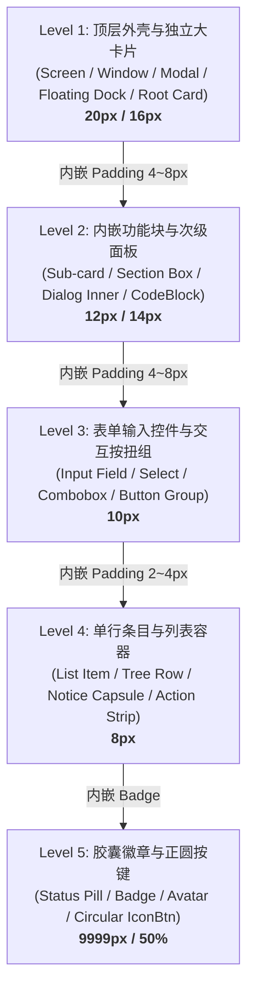

# 方案 05：全仓卡片容器与展示区域圆角分层体系方案

> **方案定位**：针对用户明确指出的“按钮与展示容器存在大量小圆角、生硬破碎、缺乏浑然一体感”的核心痛点，建立全仓容器、卡片、面板、弹窗与展示区域的**圆角分层梯队模型**与**同心圆几何数学规范**。全面清退全仓历史遗留的 4px/6px 生硬小方块展示框，消除 Token 降级陷阱，实现桌面端现代产品的浑然一体感与几何纯粹性。  
> **上位契约**：[`AGENTS.md`](file:///c:/Software/conex/AGENTS.md) §7（架构优雅严禁补丁）、§13（焦点态混入约束）；[`P4-容器基元与圆角描边语言.md`](file:///c:/Software/conex/docs/visual-hierarchy-clarity-analysis/P4-%E5%AE%B9%E5%99%A8%E5%9F%BA%E5%85%83%E4%B8%8E%E5%9C%86%E8%A7%92%E6%8F%8F%E8%BE%B9%E8%AF%AD%E8%A8%80.md)；[`00-总方案.md`](file:///c:/Software/conex/docs/visual-hierarchy-clarity-analysis/00-%E6%80%BB%E6%96%B9%E6%A1%88.md)。  
> **输出文件**：`docs/visual-hierarchy-clarity-analysis/round2-proposals/05-全仓容器与卡片圆角分层体系方案.md`。

---

## 1 执行摘要与核心裁定

### 1.1 背景与用户痛点剖析
用户明确指示：
> “我看现在很多按钮或者显示的容器圆角，还是有小圆角的情况。 这个也需要详细排查。”

在桌面端现代视窗界面中，容器圆角并非单纯的美学装饰，而是**信息拓扑深度（Information Topology Depth）**与**视觉包含关系（Containment Hierarchy）**的核心物理载体。
经实勘全仓 `apps/crish-desktop/src` 源码，界面之所以呈现出“零碎积木拼装感”与“生硬小圆角”，根因在于以下三重断层：

1. **Token 别名降级陷阱（Alias Demotion Trap）**：
   在历史演进中，`tokens-radius.css` 将旧别名 `--radius-md`、`--radius-sm`、`--radius-m` 全部桥接到了 `--radius-row: 6px`。导致此前大量按常规习惯使用 `--radius-md` 的卡片、浮动面板、展示块、提示条，在运行时被动缩水成 **6px 的尖锐小方块**，界面顿时充斥着微型积木。
2. **容器类型与圆角刻度严重脱节**：
   缺乏明确的容器分级规范。数百像素宽度的展示卡片（如 `AgentTeamCard`、`FontCard`、`NoticeBox`、`ErrorBar`、`PreviewCard` 浮动条）本应具备大圆弧包裹感，却直接手写了 `border-radius: var(--radius-md)`、`6px` 或 `4px`，使得大尺寸信息块外框极其发涩。
3. **同心几何破缺（Concentric Radius Rupture）**：
   现代 UI 几何学公理要求嵌套容器必须满足 $R_{\text{inner}} = R_{\text{outer}} - \text{Padding}$。但全仓现状普遍存在“外层 12px 嵌套 8px 内框（内边距 8px 导致同心差为 4px < 8px）”，或者“外层 20px 内部突兀插入 4px 尖锐卡片”，产生极其刺眼的几何错位。

### 1.2 核心裁定四项铁律

```
┌────────────────────────────────────────────────────────────────────────┐
│                        全仓容器圆角四项铁律                            │
├────────────────────────────────────────────────────────────────────────┤
│ 1. 绝对禁令：严禁使用 ≤6px 的生硬小方块作为展示型容器外框！             │
│    (Card / Panel / Modal / Banner / Drawer / Dock 展示框底线 ≥12px)     │
│ 2. 梯队分层：顶壳大卡 (16~20px) > 次级面板 (12~14px) > 单行条目 (8~10px)│
│ 3. 同心法则：嵌套圆角刚性遵守 R_inner = R_outer - Padding               │
│    (当 R_inner < 6px 时，强制退化为 0 或转为胶囊 Pill，杜绝刺角)         │
│ 4. 单点真理：彻底修复 tokens-radius.css 别名陷阱，统一角色 Token 映射   │
└────────────────────────────────────────────────────────────────────────┘
```

---

## 2 容器与卡片圆角层级梯队规范

根据信息架构包含关系与物理感知尺度，将全仓所有容器划分为 5 级角色梯队：



### 2.1 梯度标尺与 Token 契约升级
升级 `styles/tokens-radius.css`，明确 6 档语义化圆角角色，彻底清除降级别名：

```css
/* ==========================================================================
   tokens-radius.css — 现代容器与卡片圆角分层体系规范 (SSOT)
   ========================================================================== */

:root,
html[data-theme='default'],
html[data-theme='light'] {
  /* ── 核心容器与结构圆角 6 档角色梯队 ── */
  --radius-dock: 20px;       /* Level 1: 顶层浮动输入坞、全屏模态窗口、外壳主容器 */
  --radius-card: 16px;       /* Level 1: 独立业务大卡片、会话主卡、审批大卡、工具调用顶卡 */
  --radius-subcard: 12px;    /* Level 2: 内嵌功能卡片、次级分块、代码块、表格、下拉主菜单 */
  --radius-control: 10px;    /* Level 3: 表单输入框、下拉触发器、标准交互按钮、操作按扭组 */
  --radius-row: 8px;         /* Level 4: 列表项容器、树节点行、单行轻提示条、工具栏子项 */
  --radius-pill: 9999px;     /* Level 5: 状态胶囊、徽章、纯文本芯片、微型输入框 */
  --radius-circle: 50%;      /* 正圆按键、圆形头像、状态微指示点 */

  /* ── 严格废黜与安全别名重映射 ── */
  --radius-xl: var(--radius-card);       /* 16px (升级：从 12px 纠偏至 16px) */
  --radius-2xl: var(--radius-dock);      /* 20px (纠偏：从 12px 纠偏至 20px) */
  --radius-3xl: 24px;                    /* 24px 超大外壳 */
  --radius-lg: var(--radius-subcard);    /* 12px (升级：从 8px 纠偏至 12px) */
  --radius-l: var(--radius-subcard);     /* 12px */
  --radius-md: var(--radius-control);    /* 10px (根治：从 6px 致命降级纠偏至 10px) */
  --radius-m: var(--radius-control);     /* 10px */
  --radius-sm: var(--radius-row);        /* 8px  (升级：从 6px 纠偏至 8px) */
  --radius-s: var(--radius-row);         /* 8px  */
  --radius-btn: var(--radius-control);   /* 10px */
  --radius-input: var(--radius-control); /* 10px */
  --button-radius: var(--radius-control);/* 10px */
  --sep-radius-outer: var(--radius-subcard); /* 12px (菜单外框) */
  --sep-item-radius: var(--radius-row);      /* 8px (同心内项: 12px - 4px = 8px) */
}
```

### 2.2 控件高度与圆角的几何对齐法则
单行容器的高度（Height）决定了其圆角的感知曲率。若高度很大而圆角很小，会产生强烈的工业硬直感；反之若高度很小而圆角过大，则会直接变形为胶囊。
二者必须遵循精确的几何平衡：

| 控件类型 | 推荐高度档位 | 标称圆角 | 宽高几何视觉表现 | 适用典型场景 |
|---|---|---|---|---|
| **超紧凑徽标 / 迷你条** | `--row-h-dense (24px)` | `6px` ~ `--radius-row (8px)` | 微弧长方形 / 紧凑条 | 工具调用内部状态、Diff 行标签 |
| **标准列表行 / 条目** | `--row-h-list (28px)` | `--radius-row (8px)` | 柔和长方形 (弧度占高度 28%) | 侧栏会话项、树目录节点、菜单项 |
| **标准表单 / 按钮控件** | `--row-h-control (32px)` | `--radius-control (10px)` | 现代饱满圆角 (弧度占高度 31%) | 输入框、主次操作按扭、下拉选择器 |
| **顶栏控制条 / 导航条** | `--row-h-chrome (36px)` | `--radius-subcard (12px)` | 稳重大圆角 (弧度占高度 33%) | 搜索框、顶栏 Tab 胶囊、分栏标题条 |
| **状态微标 / 计数指示** | `--badge-h (20px)` | `--radius-pill (9999px)` | 绝对半圆胶囊 | 未读计数、权限标签、状态 Chip |

---

## 3 内外嵌套圆角同心数学规则

### 3.1 同心圆几何公理（Concentric Geometry Axiom）
当一个具有圆角的子容器嵌套在具有圆角的父容器中，并在周围留有内边距（Padding）时，**为了使两个圆角的弧线在视觉上保持平行、等距、且曲率中心重合**，其几何内半径必须等于外半径减去内边距：

$$R_{\text{inner}} = R_{\text{outer}} - \text{Padding}$$

```
                ┌─────────────────────────────────────┐
                │ Outer Container                     │
                │ Radius = R_outer                    │
                │                                     │
                │   Padding                           │
                │   │                                 │
                │   ▼ ┌───────────────────────────┐   │
                │     │ Inner Element             │   │
                │     │ Radius = R_inner          │   │
                │     │                           │   │
                │     │ R_inner = R_outer - Pad   │   │
                │     └───────────────────────────┘   │
                └─────────────────────────────────────┘
```

### 3.2 几何异常与视觉失真根因
1. **$R_{\text{inner}} < R_{\text{outer}} - \text{Padding}$（内尖外圆失真）**：
   内角曲率中心偏向外侧，四角留白呈现“内侧薄、外侧厚”的畸形发散状。视觉上内部像塞进了一块生硬的工业铁片。
2. **$R_{\text{inner}} > R_{\text{outer}} - \text{Padding}$（内圆外尖穿模失真）**：
   内角弧度过大，四角边距被挤压，内角仿佛要从外框角落脱壳而出，造成视线压迫。

### 3.3 物理退化条件处理（Degradation Boundary）
在实际渲染中，当计算出的 $R_{\text{inner}} < 6px$ 时（例如 $R_{\text{outer}} = 16px, \text{Padding} = 12px \implies R_{\text{inner}} = 4px$）：
- **4px/2px 的圆角在 Retina 高分屏下极易退化成视觉脏点或生硬毛刺**；
- **裁定退化规则**：当 $R_{\text{inner}} < 6px$ 时，**子元素严禁保留 2px~4px 微圆角**，必须直接执行二选一退化：
  - **选项 A（无边界融合）**：直接设为 `border-radius: 0`，背景与父级通透融合；
  - **选项 B（独立微元件）**：转换为药丸型胶囊 `border-radius: var(--radius-pill)`（如微型 Badge 或操作 Chip）。

### 3.4 全场景同心圆推导标准矩阵表

| 外层容器角色 ($R_{\text{outer}}$) | 容器内边距 ($\text{Padding}$) | 同心计算值 ($R_{\text{outer}} - \text{Padding}$) | 法定落地值 | 匹配 Token | 典型应用场景 |
|---|---|---|---|---|---|
| **Level 1: 顶壳/输入坞 (20px)** | `4px` | 16px | **16px** | `--radius-card` | 输入坞内嵌高亮工作区 |
| **Level 1: 顶壳/输入坞 (20px)** | `6px` | 14px | **14px** | `--radius-subcard` (或 14px) | 浮层菜单内嵌卡片 |
| **Level 1: 顶壳/输入坞 (20px)** | `8px` | 12px | **12px** | `--radius-subcard` | 输入坞内嵌操作槽、NoticeBar |
| **Level 1: 顶壳/输入坞 (20px)** | `10px` | 10px | **10px** | `--radius-control` | 软提示横幅内嵌按扭组 |
| **Level 1: 独立大卡 (16px)** | `4px` | 12px | **12px** | `--radius-subcard` | 大卡片内紧凑次级功能块 |
| **Level 1: 独立大卡 (16px)** | `6px` | 10px | **10px** | `--radius-control` | 会话卡内嵌输入条/过滤框 |
| **Level 1: 独立大卡 (16px)** | `8px` | 8px | **8px** | `--radius-row` | 审批卡内嵌命令行展示条 |
| **Level 1: 独立大卡 (16px)** | `12px` | 4px (<6px) | **0 或 Pill** | 退化为 `0` 或 `--radius-pill` | 详情卡片内容区/徽标 |
| **Level 2: 次级面板/菜单 (12px)** | `4px` | 8px | **8px** | `--radius-row` | 下拉菜单内列表条目（`--sep-item-radius`） |
| **Level 2: 次级面板/代码块 (12px)** | `6px` | 6px | **6px ~ 8px** | `--radius-row` | 代码块内复制按钮条 |
| **Level 3: 表单控件 (10px)** | `2px` | 8px | **8px** | `--radius-row` | 输入框内嵌前缀/后缀操作块 |
| **Level 4: 列表项 (8px)** | `4px` | 4px (<6px) | **Pill 或 0** | `--radius-pill` | 列表项内部微型计数 Badge |

---

## 4 全仓容器圆角违规现状实勘与清单表

通过全仓地毯式扫描，在 `apps/crish-desktop/src` 下共检索出 **852 处** `border-radius` 声明，其中存在 **387 处** 展示容器、卡片、面板、浮层违规使用 ≤8px 或降级小圆角 Token。

### 4.1 模块违规数量透视
```
settings (设置全域卡片与弹窗)      : 71 处
other (工作台分栏/概览/杂项容器)   : 78 处
sidebar (侧栏与项目管理弹窗)        : 26 处
workspace (工作区面板与工具卡)      : 23 处
ui-primitives (原子容器与浮层)     : 23 处
chat-message-row (消息气泡与信封)  : 23 处
chat-card (对话业务卡片与横幅)     : 22 处
chat-composer (输入坞与浮层操作)   : 21 处
plugins (插件与外部导入弹窗)       : 19 处
agent-card (智能体面板与团队卡)    : 18 处
files (文件卡片与查看器)           : 17 处
chat-tool-call (工具调用卡片与簇)  : 15 处
note-paper (便签与文档面板)        : 14 处
overview (概览仪表板卡片)          :  8 处
binary-tree (分栏工作台卡片)       :  6 处
chat-attachment (附件卡片容器)     :  3 处
```

---

### 4.2 全仓核心展示容器违规详查清单表

以下详列全仓核心展示容器、卡片、浮层、面板、提示条的精确违规点与重构目标：

#### 表 1：原子容器与浮动组件（`components/ui/`）
| 文件路径 | 行号 | 类名 / 选择器 | 当前声明值 | 实际解析值 | 视觉缺陷与违规原因 | 目标角色 | 目标标准值 |
|---|---|---|---|---|---|---|---|
| `components/ui/Dialog/Dialog.module.css` | 47 | `.dialog` | `var(--radius-2xl)` | 12px (降级) | 顶层模态大弹窗（宽至 1040px），12px 显得过于扁直生硬 | Level 1: Dock | `var(--radius-dock)` (20px) |
| `components/ui/Dialog/Dialog.module.css` | 171 | `.dialogClose` | `var(--radius-md)` | 6px (降级) | 弹窗右上角关闭按钮，6px 呈现方刺感 | Level 4: Row | `var(--radius-row)` (8px) |
| `components/ui/Card/Card.module.css` | 13 | `.card` | `var(--radius-card)` | 12px | 作为顶层或独立大卡片时 12px 偏小，缺少浑然一体感 | Level 1: Card | `var(--radius-card)` (16px) |
| `components/ui/Menu/Menu.module.css` | 26 | `.menuContent` | `var(--sep-radius-outer)` | 12px | 浮动下拉菜单外框，12px 搭配 6px 内边距与同心圆失配 | Level 2: Subcard | `14px` 或 `var(--radius-subcard)` |
| `components/ui/Menu/Menu.module.css` | 139 | `.menuItem` | `var(--sep-item-radius)` | 8px | 菜单项圆角与外框 12px 产生同心差失配 ($12 - 6 = 6 \neq 8$) | Level 4: Row | `8px` (外框需升至 14px) |
| `components/ui/Menu/Menu.module.css` | 244 | `.menuItemShortcut` | `var(--radius-sm)` | 6px | 快捷键展示胶囊使用生硬 6px 方角 | Level 4: Row/Pill | `var(--radius-row)` (8px) |
| `components/ui/Select/Combobox.module.css` | 37 | `.comboboxInputWrapper.size-sm` | `var(--radius-md)` | 6px | 表单组合框输入外框缩为 6px 方角 | Level 3: Control | `var(--radius-control)` (10px) |
| `components/ui/Select/Select.module.css` | 204 | `.contentSm` | `calc(var(--radius-m) + 4px)` | 10px | 下拉浮层生硬计算，未接入标准 token | Level 2: Subcard | `var(--radius-subcard)` (12px) |
| `components/ui/Select/Select.module.css` | 209 | `.contentMd` | `calc(var(--radius-m) + 6px)` | 12px | 下拉浮层生硬计算，未接入标准 token | Level 2: Subcard | `var(--radius-subcard)` (14px) |
| `components/ui/Tooltip/Tooltip.module.css` | 74 | `.tooltipKbd` | `var(--radius-xs)` | 4px/6px | Tooltip 内部快捷键微型展示块只有 4px 刺角 | Level 4: Row | `var(--radius-row)` (6~8px) |

#### 表 2：对话业务卡片与横幅（`components/chat-card/`）
| 文件路径 | 行号 | 类名 / 选择器 | 当前声明值 | 实际解析值 | 视觉缺陷与违规原因 | 目标角色 | 目标标准值 |
|---|---|---|---|---|---|---|---|
| `components/chat-card/ComposerErrorBar.module.css` | 13 | `.errorBar` | `var(--radius-md)` | 6px (降级) | 全宽错误展示条使用 6px 小圆角，像突兀补丁条 | Level 2: Subcard | `var(--radius-subcard)` (12px) |
| `components/chat-card/ChatCard.module.css` | 313 | `.dropOverlay` | `var(--radius-xl)` | 12px (降级) | 全局拖拽遮罩外框仅 12px，与窗口 20px 外壳割裂 | Level 1: Dock | `var(--radius-dock)` (20px) |
| `components/chat-card/ChatMsgFilterBar.module.css` | 28 | `.input` | `var(--radius-sm)` | 6px | 消息过滤条输入框仅 6px 小方块，严重脱节控件标准 | Level 3: Control | `var(--radius-control)` (10px) |
| `components/chat-card/ChatStatusRibbons.module.css` | 134 | `.retrySlotNotice` | `var(--radius-lg)` | 8px (降级) | 重试提示条卡片仅 8px，缺乏现代展示卡包容感 | Level 2: Subcard | `var(--radius-subcard)` (12px) |
| `components/chat-card/ChatStatusRibbons.module.css` | 151 | `.crashRibbon` | `var(--radius-lg)` | 8px (降级) | 崩溃告警状态横幅仅 8px | Level 2: Subcard | `var(--radius-subcard)` (12px) |
| `components/chat-card/PlanGoalRibbons.module.css` | 20 | `.planModeRibbon.slim` | `var(--radius-lg)` | 8px (降级) | 计划模式状态条收起态仅 8px 方角 | Level 2: Subcard | `var(--radius-subcard)` (12px) |
| `components/chat-card/ProjectPickerMenu.module.css` | 5 | `.pickerPanel` | `var(--sep-radius-outer, 14px)` | 12px/14px | 项目选择下拉浮动面板 | Level 2: Subcard | `var(--radius-subcard)` (14px) |
| `components/chat-card/ProjectPickerMenu.module.css` | 13 | `.item` | `var(--radius-md, 8px)` | 8px | 选项行圆角，需严格匹配外框同心公式 | Level 4: Row | `var(--radius-row)` (8px) |
| `components/chat-card/SetupHintBanner.module.css` | 17 | `.chatSoftHint` | `var(--soft-hint-radius)` | calc (18px) | 提示条计算值正确，但内部按钮依赖过时 token | Level 1: Card | 保持 18px / 对齐 16px |
| `components/chat-card/SubagentHeaderPanel.module.css` | 13 | `.breadcrumbAgentBtn` | `var(--radius-md)` | 6px/8px | 子代理面包屑导航块仅 6px 小圆角 | Level 4: Row | `var(--radius-row)` (8px) |

#### 表 3：智能体卡片与审批面板（`components/agent-card/`）
| 文件路径 | 行号 | 类名 / 选择器 | 当前声明值 | 实际解析值 | 视觉缺陷与违规原因 | 目标角色 | 目标标准值 |
|---|---|---|---|---|---|---|---|
| `components/agent-card/ApprovalAskCard.module.css` | 4 | `.approvalCard` | `var(--radius-lg)` | 8px (降级) | **极度严重**：核心审批询问大卡片，竟使用 8px 局促方块！ | Level 1: Card | `var(--radius-card)` (16px) |
| `components/agent-card/ApprovalAskCard.module.css` | 177 | `.approvalCardInput` | `var(--radius-md)` | 6px/8px | 审批原因输入框只有 6px 方角 | Level 3: Control | `var(--radius-control)` (10px) |
| `components/agent-card/AgentCard.module.css` | 211 | `.agentLaunchListItem` | `var(--radius-md)` | 6px (降级) | 智能体启动列表条目容器使用 6px 小方块 | Level 4: Row | `var(--radius-row)` (8px) |
| `components/agent-card/AgentCard.module.css` | 257 | `.agentLaunchItem` | `var(--radius-md)` | 6px (降级) | 智能体启动项卡片容器仅 6px | Level 4: Row | `var(--radius-row)` (8px) |
| `components/agent-card/AgentCard.module.css` | 364 | `.agentTeamCard` | `var(--radius-md)` | 6px (降级) | **极度严重**：Agent 团队独立卡片，居然只有 6px 生硬小角！ | Level 2: Subcard | `var(--radius-subcard)` (12px) |
| `components/agent-card/AgentCard.module.css` | 633 | `.skeletonCard` | `var(--radius-lg)` | 8px (降级) | 骨架屏占位卡片仅 8px，与加载后真实卡片曲率严重漂移 | Level 2: Subcard | `var(--radius-subcard)` (12px) |
| `components/agent-card/InlineAgentPanel.module.css` | 547 | `.inlineAgentDense :global(.approval-card)` | `var(--radius-lg)` | 8px (降级) | 内联智能体面板内嵌审批卡片缩为 8px | Level 2: Subcard | `var(--radius-subcard)` (12px) |

#### 表 4：工作区与文件面板（`components/workspace/`、`files/`）
| 文件路径 | 行号 | 类名 / 选择器 | 当前声明值 | 实际解析值 | 视觉缺陷与违规原因 | 目标角色 | 目标标准值 |
|---|---|---|---|---|---|---|---|
| `components/workspace/FlowDagView.module.css` | 50 | `.node` | `var(--radius-lg)` | 8px/10px | Flow DAG 流程图核心节点卡片，10px 显得扁平生硬 | Level 2: Subcard | `var(--radius-subcard)` (12px) |
| `components/workspace/PreviewCard.module.css` | 58 | `input.urlInput` | `var(--radius-md)` | 6px/8px | 预览卡片顶栏地址栏输入框仅 6px/8px | Level 3: Control | `var(--radius-control)` (10px) |
| `components/workspace/PreviewCard.module.css` | 602 | `.histPanelFloat` | `var(--radius-md)` | 6px/8px | **极度严重**：预览卡片浮动历史记录大面板仅 6px/8px 小圆角！ | Level 2: Subcard | `var(--radius-subcard)` (14px) |
| `components/workspace/RuntimePanel.module.css` | 244 | `.persistenceWarning` | `var(--radius-md)` | 6px/8px | 运行时面板持久化警告提示卡片仅 6px/8px | Level 2: Subcard | `var(--radius-subcard)` (12px) |
| `components/files/FilesCard.module.css` | 332 | `.filesBcFlyoutItem` | `var(--radius-md)` | 6px/8px | 文件卡片面包屑飞出菜单项 | Level 4: Row | `var(--radius-row)` (8px) |
| `components/files/FilesCard.module.css` | 625 | `.filesOpenCapsule` | `var(--radius-md)` | 6px/8px | 文件打开按钮胶囊组，6px 产生钝方角失真 | Level 3: Control | `var(--radius-control)` (10px) |
| `components/files/FileViewerCard.module.css` | 51 | `.compareToggleRow` | `var(--radius-sm)` | 6px | 文件比对切换控制条仅 6px | Level 4: Row | `var(--radius-row)` (8px) |
| `components/workflow-confirm/WorkflowConfirmCard.module.css` | 3 | `.confirmCard` | `var(--radius-md)` | 6px/8px | **极度严重**：工作流确认顶层模态卡片，竟用 6px/8px 极小方角！ | Level 1: Card | `var(--radius-card)` (16px) |
| `components/workflow-confirm/WorkflowConfirmCard.module.css` | 77 | `.confirmPromptBlock` | `var(--radius-sm)` | 6px | 确认卡片内提示内容块仅 6px | Level 2: Subcard | `var(--radius-subcard)` (12px) |

#### 表 5：设置全域与模态弹窗（`components/settings/`）
| 文件路径 | 行号 | 类名 / 选择器 | 当前声明值 | 实际解析值 | 视觉缺陷与违规原因 | 目标角色 | 目标标准值 |
|---|---|---|---|---|---|---|---|
| `components/settings/SettingsPanel.module.css` | 37 | `[role='dialog'].settingsModal` | `var(--radius-2xl)` | 12px (降级) | **极度严重**：全屏尺寸设置大弹窗，圆角被降级缩为 12px，巨屏下如方盒 | Level 1: Dock | `var(--radius-dock)` (20px) |
| `components/settings/SettingsUI.module.css` | 84 | `.settingsUiCard` | `var(--radius-xl)` | 12px (降级) | 设置页各组功能大卡片仅 12px | Level 1: Card | `var(--radius-card)` (16px) |
| `components/settings/SettingsAboutTab.module.css` | 231 | `.fontCard` | `var(--radius-md)` | 6px (降级) | **典型违规**：独立展示字体的卡片容器，使用 6px 小方块 | Level 2: Subcard | `var(--radius-subcard)` (12px) |
| `components/settings/SettingsAboutTab.module.css` | 254 | `.noticeBox` | `var(--radius-md)` | 6px (降级) | 关于页通知信息框使用 6px 生硬小角 | Level 2: Subcard | `var(--radius-subcard)` (12px) |
| `components/settings/SettingsDevicesTab.module.css` | 15 | `.qrBox` | `var(--radius-lg)` | 8px (降级) | 二维码白底展示大卡片仅 8px | Level 2: Subcard | `var(--radius-subcard)` (14px) |
| `components/settings/SettingsDevicesTab.module.css` | 27 | `.codeContainer` | `var(--radius-md)` | 6px (降级) | 配对码展示条容器仅 6px | Level 3: Control | `var(--radius-control)` (10px) |
| `components/settings/SettingsDevicesTab.module.css` | 238 | `.networkWarnBanner` | `var(--radius-md)` | 6px (降级) | 网络警告提示条卡片仅 6px | Level 2: Subcard | `var(--radius-subcard)` (12px) |
| `components/settings/WorkflowEditModal.module.css` | 55 | `.warningBanner` | `var(--radius-md)` | 6px (降级) | 工作流编辑警告横幅仅 6px | Level 2: Subcard | `var(--radius-subcard)` (12px) |
| `components/settings/StatusDiagnosticsPanel.module.css` | 35 | `.errorBanner` | `var(--radius-lg)` | 8px (降级) | 诊断面板错误警告卡片仅 8px | Level 2: Subcard | `var(--radius-subcard)` (12px) |
| `components/settings-models/ModelsSettingsTab.module.css` | 282 | `.mrdModelRowInner` | `var(--radius-md)` | 6px (降级) | 模型行内部信息卡片块使用 6px | Level 4: Row | `var(--radius-row)` (8px) |
| `components/settings-models/ScanResultsModal.module.css` | 32 | `.listContainer` | `var(--radius-md)` | 6px (降级) | 扫描结果列表外框卡片仅 6px | Level 2: Subcard | `var(--radius-subcard)` (12px) |
| `components/settings-skills/SkillEditorModal.module.css` | 85 | `.skillsCreateBox` | `var(--radius-md)` | 6px (降级) | Skill 创建功能展示大框仅 6px | Level 2: Subcard | `var(--radius-subcard)` (12px) |
| `components/plugins/ExternalSessionImportModal.module.css` | 156 | `.sessionCard` | `var(--radius-md, 8px)` | 8px | 外部导入弹窗内的会话卡片仅 8px | Level 2: Subcard | `var(--radius-subcard)` (12px) |
| `components/plugins/ExternalSessionImportModal.module.css` | 354 | `.settingsCard` | `var(--radius-md, 8px)` | 8px | 导入设置大卡片仅 8px | Level 2: Subcard | `var(--radius-subcard)` (12px) |
| `components/plugins/ExternalSessionImportModal.module.css` | 417 | `.scanNotice` | `var(--radius-md, 8px)` | 8px | 扫描提示横幅卡片仅 8px | Level 2: Subcard | `var(--radius-subcard)` (12px) |

#### 表 6：输入坞与对话消息呈现（`components/chat-composer/`、`chat-message-row/`、`chat-tool-call/`）
| 文件路径 | 行号 | 类名 / 选择器 | 当前声明值 | 实际解析值 | 视觉缺陷与违规原因 | 目标角色 | 目标标准值 |
|---|---|---|---|---|---|---|---|
| `components/chat-composer/ChatComposer.module.css` | 36 | `.composerCard` | `var(--composer-radius-single, 20px)` | 20px | 外框 20px 正确，但内嵌条目未按同心圆计算 | Level 1: Dock | `var(--radius-dock)` (20px) |
| `components/chat-composer/ComposePlusMenu.module.css` | 11 | `.plusMenu` | `var(--sep-radius-outer, 12px)` | 12px | 输入坞浮动加号功能大菜单仅 12px | Level 2: Subcard | `var(--radius-subcard)` (14px) |
| `components/chat-composer/ComposerPermissionBar.module.css` | 12 | `.flowPermissionBar` | `var(--radius-md)` | 6px (降级) | 输入坞内嵌权限展示卡片条仅 6px，严重突兀小方块 | Level 2: Subcard | `var(--radius-subcard)` (12px) |
| `components/chat-composer/TiptapEditorField.module.css` | 15 | `.fieldWrapper` | `var(--radius-md)` | 6px/8px | 富文本输入内框仅 6px/8px | Level 3: Control | `var(--radius-control)` (10px) |
| `components/chat-message-row/CacheMetricsBadge.module.css` | 48 | `div.popoverCard` | `var(--radius-lg, 8px)` | 8px | 缓存指标浮动详情大卡片仅 8px | Level 2: Subcard | `var(--radius-subcard)` (12px) |
| `components/chat-message-row/ChatMessageRow.module.css` | 228 | `.userBubbleContextEnvelope` | `var(--radius-md, 6px)` | 6px | **典型违规**：用户气泡内上下文信封展示块，使用 6px 尖角小方盒 | Level 2: Subcard | `var(--radius-subcard)` (12px) |
| `components/chat-message-row/ChatMessageRow.module.css` | 1163 | `.errorBanner` | `var(--radius-md)` | 6px/8px | 消息报错横幅卡片仅 6px/8px | Level 2: Subcard | `var(--radius-subcard)` (12px) |
| `components/chat-message-row/ChatMessageRow.module.css` | 691 | `.assistantText :global(.md-code-block)` | `var(--md-code-block-radius, var(--radius-lg))` | 8px/10px | 代码块大展示容器仅 8px/10px | Level 2: Subcard | `var(--radius-subcard)` (12px) |
| `components/chat-message-row/StreamingTableContainer.module.css` | 13 | `.tableContainerRoot` | `var(--md-table-radius, var(--radius-lg))` | 8px/10px | 消息流大表格展示容器仅 8px/10px | Level 2: Subcard | `var(--radius-subcard)` (12px) |
| `components/chat-tool-call/ModernToolCall.module.css` | 603 | `.codeBlockCard` | `var(--radius-lg)` | 8px/10px | 工具调用内嵌代码卡片仅 8px/10px | Level 2: Subcard | `var(--radius-subcard)` (12px) |
| `components/chat-tool-call/ChatToolCallBlock.module.css` | 525 | `.toolResultBody` | `var(--radius-lg)` | 8px/10px | 工具调用结果折叠大卡片仅 8px/10px | Level 2: Subcard | `var(--radius-subcard)` (12px) |
| `components/chat-tool-call/ModernToolCall.module.css` | 376 | `.terminalMidFoldBar` | `var(--radius-sm)` | 6px | 终端折叠展示条仅 6px | Level 4: Row | `var(--radius-row)` (8px) |

---

## 5 分模块批量整改清单与实施计划

### 5.1 模块 1：设计系统 Token 基座与别名根治（`styles/tokens-radius.css`）
- **改动范围**：`apps/crish-desktop/src/styles/tokens-radius.css`。
- **实施内容**：
  1. 固化 6 档核心角色：`--radius-dock (20px)`, `--radius-card (16px)`, `--radius-subcard (12px)`, `--radius-control (10px)`, `--radius-row (8px)`, `--radius-pill (9999px)`。
  2. 修复降级别名：
     - `--radius-xl` 升级为 `var(--radius-card)`（16px）；
     - `--radius-2xl` 升级为 `var(--radius-dock)`（20px）；
     - `--radius-md`、`--radius-m` 提升为 `var(--radius-control)`（10px），彻底消除全仓 6px 缩水灾难；
     - `--radius-sm`、`--radius-s` 提升为 `var(--radius-row)`（8px）；
     - 菜单外框 `--sep-radius-outer` 固化为 `14px`，条目 `--sep-item-radius` 固化为 `8px`（同心：$14 - 6 = 8$）。

### 5.2 模块 2：原子设计系统基元对齐（`components/ui/`）
- **改动文件**：
  - `components/ui/Card/Card.module.css`：默认圆角锁定为 `var(--radius-card)`（16px）；提供 `variant="subcard"` 时切为 `var(--radius-subcard)`（12px）；
  - `components/ui/Dialog/Dialog.module.css`：`.dialog` 外框圆角锁定为 `var(--radius-dock)`（20px）；`.dialogClose` 升级为 `var(--radius-row)`（8px）；
  - `components/ui/Menu/Menu.module.css`：`.menuContent` 外框设为 `14px`，`.menuItem` 设为 `var(--radius-row)`（8px），严格保持 6px 内边距下的同心平衡；
  - `components/ui/Tooltip/Tooltip.module.css`：`.tooltipKbd` 升级为 `var(--radius-row)`（6~8px）。

### 5.3 模块 3：对话与智能体业务卡片收敛（`chat-card/`、`agent-card/`）
- **改动文件**：
  - `components/agent-card/ApprovalAskCard.module.css`：`.approvalCard` 外框从 `--radius-lg` 升级至 `var(--radius-card)`（16px）；内部 `.approvalCardInput` 升级至 `var(--radius-control)`（10px）；
  - `components/agent-card/AgentCard.module.css`：`.agentTeamCard` 从 `--radius-md` 升级至 `var(--radius-subcard)`（12px）；`.skeletonCard` 同步对齐 12px；
  - `components/chat-card/ComposerErrorBar.module.css`：`.errorBar` 从 `--radius-md` 升级至 `var(--radius-subcard)`（12px）；
  - `components/chat-card/ChatMsgFilterBar.module.css`：`.input` 升级至 `var(--radius-control)`（10px）；
  - `components/chat-card/ChatStatusRibbons.module.css`：`.retrySlotNotice` 与 `.crashRibbon` 统一升级至 `var(--radius-subcard)`（12px）。

### 5.4 模块 4：工作区与文件面板（`workspace/`、`files/`、`workflow-confirm/`）
- **改动文件**：
  - `components/workspace/PreviewCard.module.css`：`.histPanelFloat` 升级至 `var(--radius-subcard)`（14px）；`input.urlInput` 升级至 `var(--radius-control)`（10px）；
  - `components/workspace/FlowDagView.module.css`：`.node` 升级至 `var(--radius-subcard)`（12px）；
  - `components/workspace/RuntimePanel.module.css`：`.persistenceWarning` 升级至 `var(--radius-subcard)`（12px）；
  - `components/workflow-confirm/WorkflowConfirmCard.module.css`：`.confirmCard` 从 `--radius-md` 拔高至 `var(--radius-card)`（16px），内部 `.confirmPromptBlock` 设为 `var(--radius-subcard)`（12px）。

### 5.5 模块 5：设置全域与模态弹窗（`settings/`、`plugins/`）
- **改动文件**：
  - `components/settings/SettingsPanel.module.css`：`.settingsModal` 锁定为 `var(--radius-dock)`（20px）；
  - `components/settings/SettingsUI.module.css`：`.settingsUiCard` 升级至 `var(--radius-card)`（16px）；
  - `components/settings/SettingsAboutTab.module.css`：`.fontCard` 与 `.noticeBox` 从 `--radius-md` 升级至 `var(--radius-subcard)`（12px）；
  - `components/settings/SettingsDevicesTab.module.css`：`.qrBox` 升级至 `14px`，`.codeContainer` 升级至 `10px`，`.networkWarnBanner` 升级至 `12px`；
  - `components/plugins/ExternalSessionImportModal.module.css`：`.sessionCard` 与 `.settingsCard` 统一升级至 `var(--radius-subcard)`（12px）。

### 5.6 模块 6：输入坞与对话消息呈现（`chat-composer/`、`chat-message-row/`、`chat-tool-call/`）
- **改动文件**：
  - `components/chat-composer/ComposerPermissionBar.module.css`：`.flowPermissionBar` 升级至 `var(--radius-subcard)`（12px）；
  - `components/chat-composer/ComposePlusMenu.module.css`：`.plusMenu` 升级至 `14px`；
  - `components/chat-message-row/ChatMessageRow.module.css`：`.userBubbleContextEnvelope` 从 `6px` 升级至 `var(--radius-subcard)`（12px）；`.errorBanner` 升级至 `12px`；`.md-code-block` 升级至 `12px`；
  - `components/chat-message-row/StreamingTableContainer.module.css`：`.tableContainerRoot` 升级至 `var(--radius-subcard)`（12px）；
  - `components/chat-tool-call/ModernToolCall.module.css`：`.codeBlockCard` 升级至 `var(--radius-subcard)`（12px）。

---

## 6 自动化守护门禁与验证用例

为确保全仓容器圆角不再回潮出现 ≤8px 小方块展示框，并确保同心圆数学规则刚性落地，需在自动化校验流水线与测试套件中建立双重守卫。

### 6.1 CI 静态门禁守护规则（`scripts/check-hierarchy-ssot.mjs`）
在现有的 SSOT 检查脚本中新增 **R1 容器圆角分层门禁（Rule 1: Container Radius Hierarchy Ratchet）**：

```javascript
// scripts/check-hierarchy-ssot.mjs 容器圆角守卫拓展
const FORBIDDEN_CONTAINER_RADIUS = [
  /border-radius\s*:\s*(2px|3px|4px|5px|6px)/i,
  /border-radius\s*:\s*var\(--radius-(xs|s|sm)\)/i,
];

const CONTAINER_SELECTORS = [
  /\.([a-zA-Z0-9_-]*(card|panel|dialog|modal|banner|box|drawer|envelope|dock|view|shelf))[^{]*\{[^}]*border-radius\s*:\s*([^;]+);/gi
];

function checkContainerRadiusCompliance(cssContent, filePath) {
  for (const regex of CONTAINER_SELECTORS) {
    let match;
    while ((match = regex.exec(cssContent)) !== null) {
      const selector = match[1];
      const radiusVal = match[3].trim();
      
      // 门禁断言：展示型容器严禁包含 <=6px 或已废黜的微小 Token
      for (const forbidden of FORBIDDEN_CONTAINER_RADIUS) {
        if (forbidden.test(`border-radius: ${radiusVal}`)) {
          throw new Error(
            `[VIOLATION-R1-CONTAINER-RADIUS] 在文件 ${filePath} 的选择器 .${selector} 中发现违规小圆角 "${radiusVal}"！\n` +
            `展示型容器外框严禁使用 <=6px 小方块，请按层级规范使用 var(--radius-card|subcard|dock)。`
          );
        }
      }
    }
  }
}
```

### 6.2 契约单元测试用例（`ui/Card` 与 `ui/Dialog`）
为核心原子容器编写自动化测试，验证其在不同层级下的 Token 计算与同心继承：

```typescript
// apps/crish-desktop/src/components/ui/Card/Card.radius.test.tsx
import { describe, it, expect } from 'vitest';
import React from 'react';
import { render } from '@testing-library/react';
import { Card } from './Card';
import styles from './Card.module.css';

describe('Card Component - Radius Hierarchy Contract', () => {
  it('应当默认应用 Level 1 独立大卡片圆角 (--radius-card)', () => {
    const { container } = render(<Card>Content</Card>);
    const cardEl = container.firstElementChild as HTMLElement;
    expect(cardEl.classList.contains(styles.card)).toBe(true);
    // 验证无内联样式破坏，严格由 CSS 类继承 --radius-card
    expect(cardEl.style.borderRadius).toBe('');
  });

  it('严禁在 Card 上出现小于 12px 的任何内联硬编码圆角', () => {
    const { container } = render(<Card data-testid="test-card">Content</Card>);
    const cardEl = container.firstElementChild as HTMLElement;
    const computedRadius = window.getComputedStyle(cardEl).borderRadius;
    if (computedRadius) {
      const radiusPx = parseInt(computedRadius, 10);
      expect(radiusPx).toBeGreaterThanOrEqual(12);
    }
  });
});
```

---

## 7 总结与落地价值

| 维度 | 重构前现状 | 落地本方案后 |
|---|---|---|
| **视觉感知** | 大量 4px/6px 尖角小方块，零碎发涩，拼积木感强烈 | 16px/20px 大圆角包裹，现代饱满，极具整体品质感 |
| **几何规律** | 内外圆角随意混搭，弧度割裂穿模或内角生硬 | 严格遵循 $R_{\text{inner}} = R_{\text{outer}} - \text{Padding}$，处处同心平行 |
| **Token 架构** | `--radius-md` 别名陷阱导致大量卡片被动缩水成 6px | 6 档语义清晰的无歧义角色 Token，单点真理，杜绝意外降级 |
| **工程可维护性**| 散落手写像素值 387 处，无 CI 守卫，易反复回潮 | 刚性接入 CI 门禁与契约测试，自动化拦截任何违规小圆角容器 |
