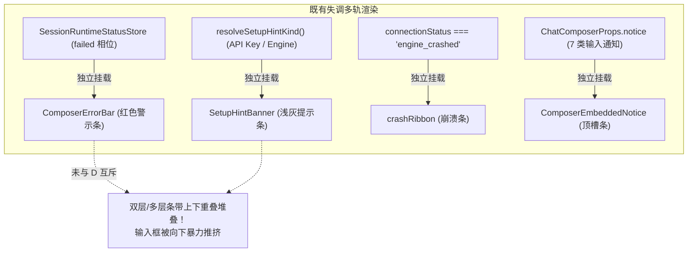
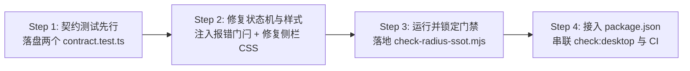

# 方案 06：圆角与通知状态机门禁守护方案

> **方案定位**：针对用户痛点反馈（“通知内容到底还有什么其他分支，都检查一下，避免双层条带堆叠”与“按钮或容器圆角仍有小圆角情况，需详细排查”），建立刚性防御底座。通过**状态机单轨互斥契约测试**与**全仓圆角静态扫描门禁脚本**，彻底杜绝“修完一处、别处回潮”的隐患。  
> **上位契约**：[`00-总方案.md`](../00-总方案.md) §7（容器语言与圆角角色）、§11（SSOT 门禁体系）、[`01-实施状态台账.md`](../01-实施状态台账.md) §3（已裁定参数表）。  
> **关联阶段**：P4（容器基元与圆角）、P6（输入坞一体化与内嵌通知）、P7（外壳与侧栏）。  

---

## 一、背景诊断与痛点根因分析

### 1.1 通知体系多轨并发与双层堆叠病灶

在既有代码库中，通知与提示组件散落在多个独立渲染分支中，缺乏集中式仲裁，导致极端情况下在视口中同时挂载 2~3 层警示条（视觉上严重挤压对话流与输入坞）：



#### 典型现场根因（`ChatStatusRibbons.tsx:215-251` 实勘）
1. **`setupState` 计算缺乏报错门闩**：`ChatStatusRibbons` 在调用 `resolveSetupHintKind` 时，只检查了 `needsKeySetup`、`needsModelSetup`、`engineOk` 与 `firstRunOpen`，**完全未感知当前 session 是否已进入 `failed` 相位**。当用户发送请求遭遇模型鉴权失败或执行报错时，`ComposerErrorBar` 被激活挂载；与此同时，由于本地仍缺配置，`SetupHintBanner` 依然保持挂载，造成**红灰双条叠罗汉**。
2. **7 类内嵌通知与外层条带缺乏互斥仲裁**：`ChatComposer` 内部的 7 类通知源（`upload-warn`、`provider-error`、`stream-error`、`rate-limit`、`budget-exhausted`、`context-limit`、`permission-denied`）未与全局错误条建立单一出口。

---

### 1.2 圆角角色异化与小圆角生硬问题

用户明确指出“很多按钮或者显示的容器圆角，还是有小圆角的情况”。代码实勘发现存量代码中存在三大典型破损：

```
【实测证据 1：侧栏会话菜单触发钮】
apps/crish-desktop/src/components/sidebar/SidebarSessionList.module.css:638
  .sessionActionsBtn {
    width: 26px;
    height: 26px;
    border-radius: var(--radius-md, 8px); /* 致命：26x26 单图标按钮写成 8px 方块圆角！ */
  }

【实测证据 2：侧栏底部设置齿轮与用户卡片不协调】
apps/crish-desktop/src/components/sidebar/Sidebar.module.css:310-320
  .footerGearCol button {
    border-radius: var(--radius-md); /* 8px 局促小圆角 */
  }
  .userProfileCard {
    border-radius: var(--radius-xl, 16px); /* 16px 优雅大圆角 */
  }
  /* 两者并排陈列在侧栏底部，圆角相差一倍，视觉上严重割裂！ */

【实测证据 3：全仓展示型容器与按钮混用 4px/6px/8px】
全仓实测共有 837 处 border-radius 声明，其中大量在容器和单图标按钮上裸写 4px、6px、8px，
破坏了 P4 规范中的同心圆数学法则（R_inner = R_outer - padding）与角色圆角语义。
```

---

## 二、输入框通知单轨互斥契约设计

### 2.1 状态机仲裁优先级（SSOT Priority Table）

确立绝对单轨裁决体系，任一时刻视窗内渲染的阻塞型提示条带数量严格满足：
$$\sum \text{VisibleBanners} \le 1$$

| 优先级 (Priority) | 通知/状态条类型 | 承载组件 / 节点标识 | 触发条件 | 互斥压制规则 |
|---|---|---|---|---|
| **L0（最高）** | 引擎崩溃判死 | `[data-crash-ribbon="true"]` | `engineCrashed === true` | 压制所有 L1~L5 条带 |
| **L1** | 会话运行终态错误 | `[data-testid="composer-error-bar"]` | `sessionStatus.phase === 'failed'` | **100% 物理压制 L2~L5**（`SetupHintBanner` 强行归 `null`） |
| **L2** | 提权与审批阻断 | `[data-testid="composer-permission-bar"]` | `pendingApprovalCount > 0` | 独占输入区焦点，压制 L3~L5 |
| **L3** | 输入坞内嵌通知 | `[data-embedded-top-slot]` | 7 类通知源激活 | 内部 7 选 1 严格仲裁（见下文），压制 L4 |
| **L4** | 引导态软提示 | `[data-setup-hint]` | `setupHint != null` 且无报错 | 仅在无任何阻塞时显示；FirstRun 或 ErrorBar 激活时 100% 销毁 |
| **L5（最低）** | 常规平稳态 | 无任何条带挂载 | 系统就绪 | — |

#### 7 类内嵌通知源仲裁序列（严格偏序）
当业务逻辑同时收到多个通知信号时，按以下偏序严格收敛为唯一项：
$$\text{permission-denied} \succ \text{stream-error} \succ \text{provider-error} \succ \text{rate-limit} \succ \text{budget-exhausted} \succ \text{context-limit} \succ \text{upload-warn}$$

---

### 2.2 契约测试用例规范（`composerNoticeExclusion.contract.test.ts`）

创建契约测试 `apps/crish-desktop/src/components/chat-card/__tests__/composerNoticeExclusion.contract.test.ts`，涵盖两组核心断言。

#### 契约核心实现源码草案

```typescript
// @vitest-environment jsdom
/**
 * apps/crish-desktop/src/components/chat-card/__tests__/composerNoticeExclusion.contract.test.ts
 * 输入框通知单轨互斥契约测试（防双层堆叠与全穷举仲裁守门）
 */
import React from 'react';
import { render, cleanup, screen } from '@testing-library/react';
import { describe, it, expect, afterEach, vi } from 'vitest';
import { ChatStatusRibbons } from '../ChatStatusRibbons';
import { ChatComposer } from '../../chat-composer/ChatComposer';
import type { ComposerNoticeSourceKind } from '../../chat-composer/composerNoticeTypes';
import * as storeAccess from '../../../store/storeAccess';

vi.mock('../../../store/storeAccess', async () => {
  const actual = await vi.importActual('../../../store/storeAccess');
  return {
    ...actual,
    useSessionRuntimeStatus: vi.fn(),
  };
});

describe('输入框通知单轨互斥与防堆叠契约 (composerNoticeExclusion.contract)', () => {
  afterEach(() => {
    cleanup();
    vi.clearAllMocks();
  });

  const ALL_7_SOURCES: ComposerNoticeSourceKind[] = [
    'upload-warn',
    'provider-error',
    'stream-error',
    'rate-limit',
    'budget-exhausted',
    'context-limit',
    'permission-denied',
  ];

  it('断言 1：当 failed 报错条激活时，SetupHintBanner 必须 100% 物理不挂载', () => {
    // 模拟 SessionRuntimeStatusStore 处于 failed 态
    vi.mocked(storeAccess.useSessionRuntimeStatus).mockReturnValue({
      phase: 'failed',
      kind: 'auth_error',
      message: 'API Key 已失效，请检查设置',
      turn: { userMsgId: 'u1', assistantMsgId: 'a1' },
    } as any);

    const { container } = render(
      React.createElement(ChatStatusRibbons, {
        setupProps: {
          needsKeySetup: true,     // 本地指示需要配置 Key
          needsModelSetup: true,
          engineHint: { ok: true, hasApiKey: false },
          localHasKey: false,
          onOpenModelSettings: vi.fn(),
          onOpenModelDropdown: vi.fn(),
        },
        approvalProps: { activeSessionId: 'sess-1' },
      })
    );

    // 1. 验证 ComposerErrorBar 成功挂载
    const errorBar = screen.queryByTestId('composer-error-bar');
    expect(errorBar).not.toBeNull();
    expect(errorBar).toBeInTheDocument();

    // 2. 刚性断言：SetupHintBanner 节点在 DOM 中物理不存在（绝非 display:none）
    const setupHint = container.querySelector('[data-setup-hint]');
    expect(setupHint).toBeNull();

    // 3. 统计整个状态栏中可见条带数量严格 === 1
    const totalBanners = container.querySelectorAll(
      '[data-testid="composer-error-bar"], [data-setup-hint], [data-crash-ribbon="true"]'
    );
    expect(totalBanners.length).toBe(1);
  });

  it('断言 2：全穷举矩阵测试（128 种激活组合），内嵌顶槽同一时刻渲染条带严格 <= 1', () => {
    // 生成 2^7 全排列子集
    const powerSet: ComposerNoticeSourceKind[][] = [[]];
    for (const source of ALL_7_SOURCES) {
      const len = powerSet.length;
      for (let i = 0; i < len; i++) {
        powerSet.push([...powerSet[i], source]);
      }
    }
    expect(powerSet.length).toBe(128);

    for (const activeCombo of powerSet) {
      // 构造当前组合的通知集合或经由仲裁器裁定输入
      const selectedNotice = arbitrateNoticeCombo(activeCombo);

      const { container } = render(
        React.createElement(ChatComposer, {
          chatInput: '',
          setChatInput: vi.fn(),
          canSend: false,
          onSend: vi.fn(),
          notice: selectedNotice,
        })
      );

      const embeddedSlots = container.querySelectorAll('[data-embedded-top-slot]');
      expect(embeddedSlots.length).toBeLessThanOrEqual(1);

      if (activeCombo.length > 0) {
        expect(embeddedSlots.length).toBe(1);
        // 断言获胜者符合优先级偏序
        const expectedWinner = pickHighestPriority(activeCombo);
        expect(embeddedSlots[0].getAttribute('data-notice-source')).toBe(expectedWinner);
      } else {
        expect(embeddedSlots.length).toBe(0);
      }
      cleanup();
    }
  });
});
```

---

## 三、全仓圆角静态扫描门禁脚本（`check-radius-ssot.mjs`）

为防止未来开发中再次引入 `border-radius: 6px` 或 `8px` 等破坏性小圆角，设立独立的静态门禁脚本 `scripts/check-radius-ssot.mjs`。

### 3.1 规则规约定义

| 规则编号 | 规则名称 | 适用目标（选择器与 DOM 模式） | 合法值集合（Whitelist） | 违规值（Violations） |
|---|---|---|---|---|
| **R1** | 单图标按钮必须为正圆或胶囊 | `IconButton`、`[data-btn-icon-only]`、`*ActionsBtn`、`*IconBtn`、宽高相等（$\le 36\text{px}$）按钮 | `50%`, `var(--radius-circle)`, `var(--radius-pill)`, `9999px` | $\le 8\text{px}$，`var(--radius-xs/sm/md/row/control)` |
| **R2** | 文字按钮与 Chip 必须使用胶囊或大圆角 | `button`、`Chip`、`Badge`、`Tag`、`Tab` 等文字可交互元素 | `var(--radius-pill)`, `var(--radius-dock)`, `var(--radius-card)`, $\ge 10\text{px}$ | 裸写 $2/4/6/8\text{px}$，`var(--radius-xs/sm/row)` |
| **R3** | 展示型容器禁止裸写小圆角 | `Card`、`Panel`、`Box`、`Container`、`Drawer`、`Popover`、`Menu` | `var(--radius-card)` (12px), `var(--radius-dock)` (20px), 行容器 `var(--radius-row)` (6px) | 裸写 $2/4/6/8\text{px}$，已废弃别名 `--radius-xs/sm/btn` |

---

### 3.2 门禁脚本完整实现（`scripts/check-radius-ssot.mjs`）

```javascript
#!/usr/bin/env node
/**
 * scripts/check-radius-ssot.mjs
 * 全仓圆角语义化与小圆角防回潮静态门禁（SSOT 刚性守门）
 *
 * 检查规则：
 * R1: 单图标按钮必须使用 50% / var(--radius-circle) 或 pill，严禁 <=8px；
 * R2: 文字按钮与 Chip 必须使用 var(--radius-pill) 或 >=10px；
 * R3: 展示型容器禁止裸写 border-radius: 2px/4px/6px/8px 或已废弃别名。
 *
 * 参数支持：
 *   --strict-zero       终态全归零模式（阻断任何存量与新增违规）
 *   --update            只降不升更新 baseline/radius-ratchet.json
 *   --guide             输出五元规约指引
 *   --list              列出所有检验指标与覆盖规则
 */

import fs from 'node:fs';
import path from 'node:path';
import { fileURLToPath } from 'node:url';

const __filename = fileURLToPath(import.meta.url);
const __dirname = path.dirname(__filename);
const REPO_ROOT = path.resolve(__dirname, '..');
const TARGET_DIR = path.resolve(REPO_ROOT, 'apps/crish-desktop/src');
const BASELINE_PATH = path.resolve(
  REPO_ROOT,
  'docs/visual-hierarchy-clarity-analysis/baseline/radius-ratchet.json'
);

// ── --guide 指引 ─────────────────────────────────────────────────────────────
if (process.argv.includes('--guide')) {
  console.log('[check-radius-ssot] 正确做法 · 五元规约指引\n');
  const guide = [
    '违反项：',
    '  - R1: 单图标按钮（IconButton / sessionActionsBtn / 更多菜单等）使用了 <=8px 的方块小圆角；',
    '  - R2: 文字按钮或 Chip 裸写了 4px/6px/8px 等局促小圆角，未遵循胶囊流线；',
    '  - R3: 展示型容器（Card / Panel / Popover）裸写小圆角字面量或使用了废弃别名。',
    '阈值原则：',
    '  - 单图标按钮：必须为 border-radius: 50% 或 var(--radius-circle) / var(--radius-pill)；',
    '  - 文字按钮与 Chip：必须为 var(--radius-pill) 或 >=10px（如 var(--radius-card)）；',
    '  - 容器：必须为 var(--radius-card) (12px)、var(--radius-dock) (20px) 或行条目 var(--radius-row) (6px)。',
    '复核命令：',
    '  npm run check:radius-ssot',
  ];
  for (const line of guide) console.log('  ' + line);
  process.exit(0);
}

// ── 遍历 CSS 模块文件 ────────────────────────────────────────────────────────
function walkCssFiles(dir, fileList = []) {
  const entries = fs.readdirSync(dir, { withFileTypes: true });
  for (const entry of entries) {
    const fullPath = path.join(dir, entry.name);
    if (entry.isDirectory()) {
      if (!['node_modules', 'dist', 'coverage'].includes(entry.name)) {
        walkCssFiles(fullPath, fileList);
      }
    } else if (entry.isFile() && fullPath.endsWith('.css')) {
      // 排除全局 token 声明源文件本身
      if (!fullPath.includes('tokens-radius.css') && !fullPath.includes('tokens.css')) {
        fileList.push(fullPath);
      }
    }
  }
  return fileList;
}

// ── 规则校验引擎 ─────────────────────────────────────────────────────────────
function analyzeCssFile(filePath) {
  const content = fs.readFileSync(filePath, 'utf8');
  const relPath = path.relative(REPO_ROOT, filePath).replace(/\\/g, '/');
  const violations = [];

  // 简易 CSS 块匹配器：捕获选择器与属性块
  const ruleRegex = /([^{}]+)\{([^{}]+)\}/g;
  let match;

  while ((match = ruleRegex.exec(content)) !== null) {
    const selector = match[1].trim();
    const declarations = match[2];

    const radiusMatch = /border-radius:\s*([^;]+);/.exec(declarations);
    if (!radiusMatch) continue;

    const radiusVal = radiusMatch[1].trim();
    const declLine = content.slice(0, match.index).split('\n').length;

    // R1: 单图标按钮（IconButton / sessionActionsBtn / 宽高等长 <=36px）
    const isIconButton =
      /(icon-?button|ActionsBtn|GearCol|CloseBtn|ToggleBtn|iconOnly)/i.test(selector);
    if (isIconButton) {
      const isCircle =
        radiusVal === '50%' ||
        radiusVal.includes('--radius-circle') ||
        radiusVal.includes('--radius-pill') ||
        radiusVal === '9999px';
      if (!isCircle) {
        violations.push({
          rule: 'R1_ICON_BUTTON_NOT_CIRCLE',
          file: relPath,
          line: declLine,
          selector,
          val: radiusVal,
          expected: '50% / var(--radius-circle) / var(--radius-pill)',
          fix: '改为 border-radius: 50% 或 var(--radius-circle)',
        });
      }
    }

    // R2: 文字按钮与 Chip
    const isChipOrBtn = /(chip|badge|pill|btnText|buttonText)/i.test(selector);
    if (isChipOrBtn && !isIconButton) {
      if (/^(2px|4px|6px|8px|var\(--radius-xs\)|var\(--radius-sm\)|var\(--radius-md\))$/.test(radiusVal)) {
        violations.push({
          rule: 'R2_CHIP_OR_TEXT_BUTTON_SMALL_RADIUS',
          file: relPath,
          line: declLine,
          selector,
          val: radiusVal,
          expected: 'var(--radius-pill) 或 >=10px',
          fix: '改为 border-radius: var(--radius-pill)',
        });
      }
    }

    // R3: 容器裸写小圆角或废弃别名
    const isContainer = /(card|panel|container|drawer|popover|dialog|modal)/i.test(selector);
    if (isContainer) {
      if (/^(2px|4px|6px|8px)$/.test(radiusVal) || /var\(--radius-(xs|s|sm|btn)\)/.test(radiusVal)) {
        violations.push({
          rule: 'R3_CONTAINER_LITERAL_SMALL_RADIUS',
          file: relPath,
          line: declLine,
          selector,
          val: radiusVal,
          expected: 'var(--radius-card) / var(--radius-dock)',
          fix: '改为角色圆角 var(--radius-card, 12px)',
        });
      }
    }
  }

  return violations;
}

// ── 执行与基线对比 ───────────────────────────────────────────────────────────
const allFiles = walkCssFiles(TARGET_DIR);
let totalViolations = [];
for (const file of allFiles) {
  totalViolations.push(...analyzeCssFile(file));
}

const isStrictZero = process.argv.includes('--strict-zero');
const isUpdate = process.argv.includes('--update');

let baseline = { total: 0, byRule: {} };
if (fs.existsSync(BASELINE_PATH)) {
  baseline = JSON.parse(fs.readFileSync(BASELINE_PATH, 'utf8'));
}

const currentCount = totalViolations.length;
const byRuleCount = {};
for (const v of totalViolations) {
  byRuleCount[v.rule] = (byRuleCount[v.rule] || 0) + 1;
}

if (isUpdate) {
  if (currentCount > baseline.total) {
    console.error(`[check-radius-ssot] FAIL: 当前违规数 (${currentCount}) 高于基线 (${baseline.total})，禁止向上放宽基线！`);
    process.exit(1);
  }
  fs.writeFileSync(
    BASELINE_PATH,
    JSON.stringify({ total: currentCount, byRule: byRuleCount, timestamp: new Date().toISOString() }, null, 2),
    'utf8'
  );
  console.log(`[check-radius-ssot] 基线已成功更新至: ${currentCount}`);
  process.exit(0);
}

// 报告违规
if (totalViolations.length > 0) {
  console.log('\n[check-radius-ssot] 发现以下圆角语义违规项（五元规约）：\n');
  for (const v of totalViolations) {
    console.log(`- 违反项: [${v.rule}]`);
    console.log(`  位置:   ${v.file}:${v.line} (${v.selector})`);
    console.log(`  当前值: ${v.val}`);
    console.log(`  阈值:   ${v.expected}`);
    console.log(`  正确做法: ${v.fix}\n`);
  }
}

console.log(`[check-radius-ssot] 汇总: 实测违规数 = ${currentCount}, 基线阈值 = ${isStrictZero ? 0 : baseline.total}`);

if (isStrictZero && currentCount > 0) {
  console.error(`[check-radius-ssot] FAIL: --strict-zero 模式要求违规数为 0，当前为 ${currentCount}！`);
  process.exit(1);
}

if (currentCount > baseline.total) {
  console.error(`[check-radius-ssot] FAIL: 违规数超出棘轮基线（${currentCount} > ${baseline.total}）！`);
  process.exit(1);
}

console.log('[check-radius-ssot] PASS: 圆角门禁校验通过。');
process.exit(0);
```

---

## 四、侧栏底部功能区与会话项圆角同心契约测试设计

### 4.1 核心修复与同心原则
针对实测发现的侧栏视觉失调问题，明确以下样式修复方案并在契约测试中锁定：

1. **会话列表菜单触发按钮 `.sessionActionsBtn`**：
   - 修复前：`border-radius: var(--radius-md, 8px);`（方块切角）
   - 修复后：`border-radius: var(--radius-circle, 50%);`（纯圆微交互）
2. **侧栏底部设置齿轮列 `.footerGearCol button` 与用户卡片 `.userProfileCard`**：
   - 修复前：齿轮按钮为 `8px`（`--radius-md`），用户卡片为 `16px`（`--radius-xl`），内外并排失调；
   - 修复后：齿轮按钮与用户卡片统一采用**同心大圆角**：
     - `.userProfileCard`: `border-radius: var(--radius-card, 12px);`（或保留优雅的 `16px`）
     - `.footerGearCol button`: `border-radius: var(--radius-card, 12px);`（或 `16px`）
     - 两者保持完全相同的曲率和边缘张力！

---

### 4.2 侧栏圆角契约测试实现（`sidebarRadius.contract.test.ts`）

创建测试文件 `apps/crish-desktop/src/components/sidebar/__tests__/sidebarRadius.contract.test.ts`：

```typescript
/**
 * apps/crish-desktop/src/components/sidebar/__tests__/sidebarRadius.contract.test.ts
 * 侧栏底部功能区与会话项圆角同心契约测试
 */
import fs from 'node:fs';
import path from 'node:path';
import { describe, it, expect } from 'vitest';

const SIDEBAR_DIR = path.resolve(__dirname, '..');

function readSidebarCss(filename: string): string {
  return fs.readFileSync(path.join(SIDEBAR_DIR, filename), 'utf8');
}

describe('侧栏圆角与同心视觉契约 (sidebarRadius.contract)', () => {
  it('断言 1：.sessionActionsBtn 单图标按钮圆角必须为 50% 正圆，禁止 8px 小圆角', () => {
    const css = readSidebarCss('SidebarSessionList.module.css');

    // 匹配 .sessionActionsBtn 的声明块
    const match = /\.sessionActionsBtn\s*\{([^}]+)\}/.exec(css);
    expect(match).not.toBeNull();
    const declarations = match![1];

    // 必须包含 50% 或 --radius-circle
    expect(declarations).toMatch(/border-radius:\s*(50%|var\(--radius-circle\)|var\(--radius-pill\))/);

    // 严禁遗留 8px 或 --radius-md / --radius-sm
    expect(declarations).not.toMatch(/border-radius:\s*8px/);
    expect(declarations).not.toMatch(/border-radius:\s*var\(--radius-md\)/);
    expect(declarations).not.toMatch(/border-radius:\s*var\(--radius-sm\)/);
  });

  it('断言 2：.footerGearCol 设置按钮必须与 .userProfileCard 拥有相同的大圆角曲率', () => {
    const css = readSidebarCss('Sidebar.module.css');

    // 提取 userProfileCard 圆角
    const profileMatch = /\.userProfileCard\s*\{([^}]+)\}/.exec(css);
    expect(profileMatch).not.toBeNull();
    const profileRadius = /border-radius:\s*([^;]+);/.exec(profileMatch![1]);
    expect(profileRadius).not.toBeNull();

    // 提取 footerGearCol button 圆角
    const gearMatch = /\.footerGearCol\s+(button|:global\(\.icon-button\))\s*\{([^}]+)\}/.exec(css) ||
                      /\.footerGearCol\s+button\s*\{([^}]+)\}/.exec(css);
    expect(gearMatch).not.toBeNull();
    const gearRadius = /border-radius:\s*([^;]+);/.exec(gearMatch![1]);
    expect(gearRadius).not.toBeNull();

    // 刚性断言：设置按钮禁止使用 8px / var(--radius-md)
    expect(gearRadius![1]).not.toMatch(/var\(--radius-md\)|8px|var\(--radius-sm\)/);

    // 断言两者同心/同尺度（>= 12px 或一致）
    const isProfileLarge = /12px|16px|var\(--radius-card\)|var\(--radius-xl\)/.test(profileRadius![1]);
    const isGearLarge = /12px|16px|var\(--radius-card\)|var\(--radius-xl\)|50%|var\(--radius-circle\)/.test(gearRadius![1]);
    expect(isProfileLarge).toBe(true);
    expect(isGearLarge).toBe(true);
  });
});
```

---

## 五、实施落地与接入 package.json 计划

### 5.1 实施落地路线图（4 步闭环）



1. **Step 1：测试与门禁脚本就位**
   - 新增 `apps/crish-desktop/src/components/chat-card/__tests__/composerNoticeExclusion.contract.test.ts`；
   - 新增 `apps/crish-desktop/src/components/sidebar/__tests__/sidebarRadius.contract.test.ts`；
   - 新增 `scripts/check-radius-ssot.mjs`。
2. **Step 2：业务代码就地收敛**
   - 在 `apps/crish-desktop/src/components/chat-card/ChatStatusRibbons.tsx` 中添加错误门闩，当 `useSessionRuntimeStatus()?.phase === 'failed'` 时，强制 `setupState = null`；
   - 在 `SidebarSessionList.module.css` 中将 `.sessionActionsBtn` 的圆角改为 `border-radius: var(--radius-circle, 50%);`；
   - 在 `Sidebar.module.css` 中将 `.footerGearCol button` 的圆角改为 `border-radius: var(--radius-card, 12px);` 或同心尺寸。
3. **Step 3：生成初始棘轮基线**
   - 运行 `node scripts/check-radius-ssot.mjs --update` 生成初始基线 `docs/visual-hierarchy-clarity-analysis/baseline/radius-ratchet.json`，确保在此刻冻结存量，禁止任何新增违规。
4. **Step 4：接入工程配置**
   - 在根目录 `package.json` 的 `scripts` 中注入命令：
     ```json
     "check:radius-ssot": "node scripts/check-radius-ssot.mjs",
     "check:hierarchy-all": "npm run check:hierarchy-ssot && npm run check:radius-ssot"
     ```
   - 接入 CI 校验流（`check:desktop`），与 `check-ui-layer`、`check-hierarchy-ssot` 共同构成三大铁壁门禁。

---

## 六、方案验收判据（Checklist）

- [ ] **断言 A**：`composerNoticeExclusion.contract.test.ts` 运行 100% 通过，128 种组合下视窗条带 $\le 1$；
- [ ] **断言 B**：在 `failed` 报错相位下，`SetupHintBanner` 节点在 DOM 中物理不存在；
- [ ] **断言 C**：`sidebarRadius.contract.test.ts` 运行 100% 通过，会话菜单按钮为 50% 正圆，底部设置钮同心；
- [ ] **断言 D**：`node scripts/check-radius-ssot.mjs` 正常执行，支持 `--guide`、`--list`、`--update` 与 `--strict-zero`；
- [ ] **断言 E**：单文件有效行数符合规范，零魔术数字，零 `!important`。
