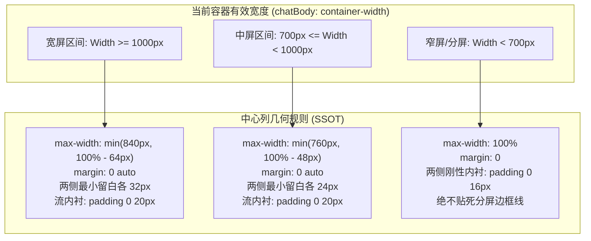
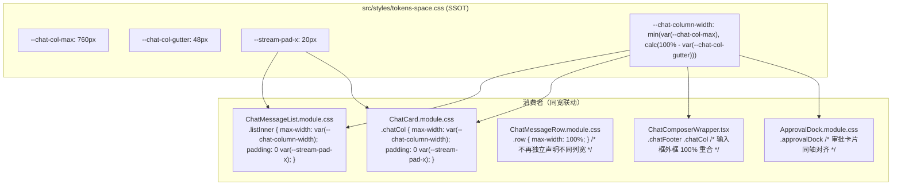

# 主对话流自适应与居中响应式布局方案

> **方案标识**：ROUND2-PROPOSAL-07  
> **制定目标**：彻底解决主对话界面在宽屏、分屏及不同视口下“缺乏自适应与居中、文字贴左气泡贴右横向拉扯撕裂、输入框与消息列宽度脱节”的视觉与布局痛点，建立对齐业界标杆（Codex / ChatGPT / Claude）的自适应中心列（Central Column）几何规范体系。  
> **关联依据**：
> - [`00-总方案.md`](file:///c:/Software/conex/docs/visual-hierarchy-clarity-analysis/00-%E6%80%BB%E6%96%B9%E6%A1%88.md) §5.3（对齐网格与列宽）、§6（间距节奏）
> - [`P3-节奏与对齐轴.md`](file:///c:/Software/conex/docs/visual-hierarchy-clarity-analysis/P3-%E8%8A%82%E5%A5%8F%E4%B8%8E%E5%AF%B9%E9%BD%90%E8%BD%B4.md) §3.3（5条混乱对齐线溯源）、§4（P3-T02 响应式列宽合并）
> - [`analysis/09-截图逐区对照.md`](file:///c:/Software/conex/docs/visual-hierarchy-clarity-analysis/analysis/09-%E6%88%AA%E5%9B%BE%E9%80%90%E5%8C%BA%E5%AF%B9%E7%85%A7.md) 表 1 内容流与输入区实测数据
> - 现场截图证据：`evidence/ours-crish.png` vs `evidence/ref-codex.png`

---

## 1 现状诊断与失控根因剖析

### 1.1 现场用户痛点事实还原
用户现场反馈：“主对话界面现在也没有自适应的布局了。”  
结合系统捕获的真实截图证据（[`evidence/ours-crish.png`](file:///c:/Software/conex/docs/visual-hierarchy-clarity-analysis/evidence/ours-crish.png)），主界面的几何布局存在三大严重病灶：

```
┌────────────────────────────────────────────────────────────────────────────────────────┐
│ 现状：1024px 视口下横向拉扯撕裂（文字贴死左缘 x=220px，箭头气泡贴死右缘 x=1004px）          │
├──────────────┬─────────────────────────────────────────────────────────────────────────┤
│ Sidebar 200px│ ◄─20px                                                            20px─►│
│              │ 6 个步骤已全部圆满完成: ...                                              │
│              │ 📁 列出目录 crates 列出目录 crates                                     >│
│              │                                  [上面那个是系统的指令哈，不是我...气泡]│
│              │ 24 个 crates 确认。现在步骤 2 - 检索核心入口。                           │
│              │ 🔍 搜索「pub async fn run」 Grep ...                                  >│
│              │                                                                         │
│              │ ┌─────────────────────────────────────────────────────────────────────┐ │
│              │ │ 🔑 首次使用请先配置服务端密钥与模型 [去配置]                         │ │
│              │ └─────────────────────────────────────────────────────────────────────┘ │
│              │ ┌────────────────────────────────────────────────────────┬────────────┐ │
│              │ │ ＋  输入消息，或键入/打开命令... (可粘贴截图)            │   完全访问 │ │
│              │ └────────────────────────────────────────────────────────┴────────────┘ │
└──────────────┴─────────────────────────────────────────────────────────────────────────┘
```

1. **宽屏单会话场景**：整个主对话流（AI 回复、思考折叠、工具调用、用户消息）从屏幕左侧最边缘 100% 贯穿到最右侧边缘。AI 文本行首死死顶在左边界（x = 220px），右侧一整列折叠箭头（`>`）与用户气泡死死顶在最右边界（x = 1004px）。中间大片空白横向拉扯达 784px，使用者的眼球必须在两侧边缘剧烈来回摆动，完全丧失了舒适的阅读视线轨道；
2. **分屏与多面板场景**：当右侧展开 360px 的 Inspector 检查器或开启 5:5 分屏时，主对话区域被挤压至 400px~550px。此时由于断点粗暴降级，对话流内容紧贴分屏分割线，两侧完全没有安全呼吸留白；
3. **输入框与内容列脱节**：输入框在下方采用了一套居中逻辑，上方消息列却横贯视口，上下两侧在垂直线上无法咬合对齐，界面呈现显著的“拼凑感”与视觉割裂。

---

### 1.2 源码级失控根因剖析（含精确文件与行号）

经过对前端渲染树与 CSS 盒模型的逐层穿透，确认布局失控由以下 5 个深层断层共同导致：

#### 根因 1：`ChatCard.tsx` 在有消息态时直接卸载了 `.chatCol` 栅格容器
- **源码定位**：[`apps/crish-desktop/src/components/chat-card/ChatCard.tsx:414-434`](file:///c:/Software/conex/apps/crish-desktop/src/components/chat-card/ChatCard.tsx#L414-L434)
- **代码断层**：
  ```tsx
  // ChatCard.tsx
  {state.emptyKind != null ? (
    <div className={styles.chatCol} data-empty-col="true">
      <ChatEmptyState ... />
    </div>
  ) : (
    <SlotOutlet
      slotKey="workspace.chat.stream"
      context={chatStreamProps}
      fallback={<ChatMessageList {...chatStreamProps} />}
    />
  )}
  ```
  在会话处于空态（`emptyKind != null`）时，外层包裹了 `<div className={styles.chatCol}>`；  
  **但一旦进入活跃对话流（`emptyKind == null`），外层包裹容器被直接移除**，`<ChatMessageList>` 被直接挂载在 `.chatDocFlow` 下。
- **关联样式**：[`apps/crish-desktop/src/components/chat-card/ChatCard.module.css:22-39`](file:///c:/Software/conex/apps/crish-desktop/src/components/chat-card/ChatCard.module.css#L22-L39)
  ```css
  .chatDocFlow {
    display: flex;
    flex-direction: column;
    align-items: stretch;
    max-width: none;  /* 关键断层：根流容器明确禁止 max-width 约束 */
    width: 100%;
    margin: 0;
    padding: 0;
  }
  ```
  这使得整个消息流从卡片宿主层就失去了外层中心约束，完全依赖子组件自我约束。

#### 根因 2：`MessageVirtualizer.tsx` Spacer 容器内联硬编码 `width: 100%` 且职责混淆
- **源码定位**：[`apps/crish-desktop/src/components/chat-message-list/MessageVirtualizer.tsx:407-428`](file:///c:/Software/conex/apps/crish-desktop/src/components/chat-message-list/MessageVirtualizer.tsx#L407-L428)
- **代码断层**：
  ```tsx
  <div
    className={styles.listInner}
    data-chat-list-inner=""
    data-vsm-spacer=""
    style={{
      height: `${totalHeight}px`,
      width: '100%',             // 致命硬编码：内联样式覆盖了 CSS 模块意图
      position: 'relative',
      overflow: 'hidden',
      overflowAnchor: 'none',
    }}
  >
    <div
      data-chat-slice-container=""
      style={{
        position: 'absolute',
        top: CHAT_SCROLL_PAD_TOP,
        left: 0,
        right: 0,
        transform: `translateY(${startOffset}px)`,
        overflowAnchor: 'none',
      }}
    >
  ```
- **架构缺陷**：
  1. `listInner` 在此处承担了双重矛盾角色：既是 **虚拟滚动的撑高占位体（data-vsm-spacer）**，又是 **消息列居中容器（styles.listInner）**；
  2. 内联直接写死 `width: '100%'`，直接破坏了 CSS 类中通过 `width: 100%` + `max-width` + `margin: 0 auto` 居中的计算纯洁性；
  3. `data-chat-slice-container` 声明 `left: 0; right: 0;`，当父容器被撑至 100% 时，绝对定位切片铺满整个视口。

#### 根因 3：`ChatMessageList.module.css` 媒体查询粗暴打平与缺乏大屏外边距公式
- **源码定位**：[`apps/crish-desktop/src/components/chat-message-list/ChatMessageList.module.css:91-100, 125-129`](file:///c:/Software/conex/apps/crish-desktop/src/components/chat-message-list/ChatMessageList.module.css#L91-L100)
- **代码断层**：
  ```css
  .listInner {
    width: 100%;
    max-width: min(var(--chat-col-max, 760px), 100%);
    margin-left: auto;
    margin-right: auto;
    padding: 0 var(--stream-pad-x, var(--chat-stream-pad-x, 20px));
  }

  @media (max-width: 720px) {
    .listInner {
      max-width: 100%;  /* 窄屏/分屏直接把最大宽度设为 100%，失去安全边距 */
    }
  }
  ```
- **危害分析**：
  1. 宽屏场景下，`max-width: min(var(--chat-col-max, 760px), 100%)` 缺乏动态呼吸下限公式（如 `100% - 64px`）。在 800~1000px 的过渡窗口下，`760px` 占据了视口的 90% 以上，两侧外留白仅有十余像素，呈现出贴边的拥挤感；
  2. 窄屏与分屏（<= 720px）下，直接声明 `max-width: 100%`，导致内容横贯至分屏线，完全丧失对齐保护；
  3. 缺乏基于容器尺寸（Container Queries）的判断：分屏场景下视口窗口可能是 1920px，但左侧 Pane 只有 500px，单纯的 `@media` 媒体查询根本无法正确感知 Pane 内部的真实宽度！

#### 根因 4：行级包装节点 `<div data-vindex>` 裸露无约束与内部子项极端靠齐
- **源码定位**：[`apps/crish-desktop/src/components/chat-message-list/MessageVirtualizer.tsx:452, 489`](file:///c:/Software/conex/apps/crish-desktop/src/components/chat-message-list/MessageVirtualizer.tsx#L452) 与 [`ChatMessageRow.module.css:48-65`](file:///c:/Software/conex/apps/crish-desktop/src/components/chat-message-row/ChatMessageRow.module.css#L48-L65)
- **代码断层**：
  ```tsx
  // MessageVirtualizer.tsx
  <div data-vindex={msg.id} ref={rowMeasureRef(msg.id)}>
    <ChatUserMessageRow ... />
  </div>
  ```
  `<div data-vindex>` 是未赋任何类名的裸 `div`，100% 继承父容器宽度。  
  而内部子组件中：
  ```css
  /* ChatMessageRow.module.css */
  .rowUser {
    align-items: flex-end; /* 用户气泡强制靠右 */
  }
  .rowAssistant {
    align-items: flex-start; /* 助手正文强制靠左 */
  }
  ```
  在外层容器失去中心列几何锁定后，`.rowUser` 和 `.rowAssistant` 沿着拉伸至 100% 的行宽分别走向了左右两个极端，直接形成了“AI 贴最左，用户贴最右”的撕裂排版。

#### 根因 5：输入框与消息列的双轨断点与变量脱节
- **源码定位**：[`apps/crish-desktop/src/components/chat-card/ChatCard.module.css:71-79`](file:///c:/Software/conex/apps/crish-desktop/src/components/chat-card/ChatCard.module.css#L71-L79) 与 [`apps/crish-desktop/src/components/chat-card/ChatComposerWrapper.tsx:214`](file:///c:/Software/conex/apps/crish-desktop/src/components/chat-card/ChatComposerWrapper.tsx#L214)
- **代码断层**：
  输入框由 `.chatFooter > .footerMotion > .chatCol` 承载：
  ```css
  .chatCol {
    width: 100%;
    max-width: min(var(--chat-col-max, 760px), 100%);
    margin-left: auto;
    margin-right: auto;
    padding-left: var(--space-5, 20px);
    padding-right: var(--space-5, 20px);
  }
  ```
  虽然注释声称与消息列保持同宽，但：
  - 消息列使用 `.listInner`，并受 `ChatMessageList.module.css` 中的媒体查询管辖；
  - 输入框使用 `.chatCol`，受 `ChatCard.module.css` 管辖；
  - 行内残留 `ChatMessageRow.module.css:1205-1212` 的 `@media (min-width: 1200px)` 覆写；
  - **三处使用不同的选择器、不同的媒体查询作用域以及硬编码值，没有单一真理源（SSOT）CSS 变量统一约束**，导致窗口缩放或分屏时，输入框与消息列的左右对齐线频繁发生错位。

---

## 2 标杆对比与中心列几何规范设计

### 2.1 业界标杆（Codex / ChatGPT / Claude）对话流中心列规范

通过对桌面端一流 AI 工具的排版测绘，成熟对话流均遵循**单中心主轴（Central Column Axis）**设计：

| 指标维度 | OpenAI ChatGPT (Web/Mac) | Anthropic Claude (Web/Desktop) | Codex 桌面客户端（参考标杆） | Crish 现状 | Crish 目标规范 |
|---|---|---|---|---|---|
| **宽屏列宽上限** | 768px (`max-w-3xl`) | 768px ~ 800px | **582px ~ 760px** | 840px / 100% | **840px**（宽屏黄金阅读宽度） |
| **中屏列宽上限** | 100% (两侧保留 gutter) | 100% (保留 margin) | **760px** (居中留白) | 760px | **760px**（紧凑排版） |
| **窄屏/分屏机制** | 100% 满宽，两侧 16px padding | 100% 满宽，两侧 16px padding | **100% 自适应，两侧 16px gutter** | 100% 满宽，文字贴边 | **100% 自适应 + 刚性 16px 呼吸边距** |
| **居中对齐方式** | `margin: 0 auto` 居中 | `margin: 0 auto` 居中 | **严格垂直居中轴** | 伪居中（易被 100% 击穿） | **单一真理源 `--chat-column-width` 强力居中** |
| **输入框与流对齐** | 上下 100% 同宽（同一容器） | 上下 100% 同宽 | **输入胶囊与流内容 1:1 铅垂对齐** | 上下脱节、断点错位 | **严格同宽联动（误差 0px）** |
| **滚动条归属** | 贴紧视口物理最右侧 | 贴紧视口物理最右侧 | **贴紧视口物理最右侧** | 贴紧右侧 | **滚动容器 100% 铺满，滚动条贴视口边** |

---

### 2.2 中心列（Central Column）自适应几何规范

为确保在任何视口尺寸（1000px 宽屏、800px 笔电、分屏 400px）下均能呈现沉静优雅的排版，建立以下三档几何规范：



#### 规范 1：宽屏状态（有效宽度 $\ge$ 1000px）
- **列宽上限公式**：`max-width: min(840px, calc(100% - 64px))`
- **外留白约束**：通过 `margin-inline: auto` 居中对齐。在 1000px 临界点时，两侧外留白各为 $(1000 - (1000 - 64)) / 2 = 32\text{px}$；在 1440px 大屏下单会话时，两侧外留白各为 $(1440 - 840) / 2 = 300\text{px}$；
- **流内衬垫**：`padding-inline: var(--stream-pad-x, 20px)`；
- **视觉体验**：段落文本维持在 70~80 字符的黄金行长，防止文字横向过长导致视线跳行疲劳；居中排版保持沉静。

#### 规范 2：中屏状态（700px $\le$ 有效宽度 $<$ 1000px）
- **列宽上限公式**：`max-width: min(760px, calc(100% - 48px))`
- **外留白约束**：通过 `margin-inline: auto` 居中对齐。在 800px 时，内容列宽度为 $752\text{px}$，两侧保留各 $24\text{px}$ 呼吸缓冲；
- **流内衬垫**：`padding-inline: var(--stream-pad-x, 20px)`；
- **视觉体验**：兼顾紧凑与呼吸感，既不拥挤也不松散。

#### 规范 3：窄屏 / 分屏状态（有效宽度 $<$ 700px）
- **列宽上限公式**：`max-width: 100%`（铺满可用容器）
- **外留白约束**：`margin-inline: 0`；
- **流内衬垫（刚性安全护城河）**：`padding-inline: 16px`；
- **硬性断言**：**严禁任何文本、卡片、代码块、工具条直接贴在 0px 物理边界或分屏分割线上**。必须由 `16px` 的 padding-inline 刚性守住阅读视距。

---

## 3 输入框与对话流的同宽联动架构

### 3.1 架构对齐拓扑
要实现输入框与对话流在任何分辨率下的绝对垂直咬合，必须消除各自为政的媒体查询，收口至单一 CSS 变量体系：



### 3.2 容器查询（Container Queries）技术选型优势
`apps/crish-desktop/src/components/chat-card/ChatCard.module.css:1-15` 中已经配置了容器查询上下文：
```css
.chatBody {
  container-type: size;
  container-name: chatContainer;
}
```
传统的 `@media (min-width: ...)` 只能基于整个桌面宿主窗口宽度（Viewport Width），**无法感知多标签分屏（Pane Split）和右侧面板（Inspector）挤压下的局部宽度**。  
例如：用户在 1920px 宽屏下开启 1:1 分屏，单个 Pane 宽度仅为 960px；如果使用 `@media (min-width: 1200px)`，系统会误判为宽屏，赋予 840px 宽度，导致内容被强行撑爆贴边！  
因此，**优先采用 `@container chatContainer (min-width: ...)`** 作为响应式驱动，同时保留 `@media` 作为全系统顶层回退降级，能够完美解决分屏挤压场景下的自适应失效问题！

---

## 4 虚拟滚动无损适配设计

虚拟滚动是 Conex 前端的核心性能支柱（承载数万行长对话与秒级流畅滚动）。布局调整**绝不能破坏虚拟滚动的高度测量、滚动条交互与切片位移**。

### 4.1 滚动容器与中心列的职责彻底解耦
必须严格贯彻“**滚动条贴视口，内容轨居中走**”的分层解耦模型：

```
┌───────────────────────────────────────────────────────────┐ [data-chat-scroll-container] (.list)
│                                                           │ 宽度: 100% 满宽视口
│       ┌───────────────────────────────────────────┐       │ 负责: overflow-y: auto、滚动事件、滚动条抓取
│       │                                           │       │
│       │ .listInner (data-chat-list-inner)         │       │
│       │ 宽度: 100%; max-width: --chat-column-width│       │
│       │ margin: 0 auto (居中对齐)                 │       │
│       │ height: totalHeight (VSM 撑高 Spacer)     │       │
│       │                                           │       │
│       │   ┌───────────────────────────────────┐   │       │
│       │   │ data-chat-slice-container         │   │       │
│       │   │ position: absolute; left: 0; right: 0│       │
│       │   │ translateY(startOffset)           │   │       │
│       │   │                                   │   │       │
│       │   │   [ Message Row 1 ]               │   │       │
│       │   │   [ Message Row 2 ]               │   │       │
│       │   └───────────────────────────────────┘   │       │
│       └───────────────────────────────────────────┘       │
│                                                         █ │ 滚动条轨道（贴紧右边框，美观且易抓取）
└─────────────────────────────────────────────────────────┴─┘
```

1. **外层滚动容器 `.list` (`data-chat-scroll-container`)**：
   - 保持 `width: 100%`、`max-width: none`、`margin: 0`；
   - 保证滚动条处于右侧物理边界，禁止滚动条随内容居中缩进到中间（缩进会导致两边鼠标滚轮无效且极难看）；
2. **中间 Spacer 容器 `.listInner` (`data-chat-list-inner`, `data-vsm-spacer`)**：
   - 必须**删除 `MessageVirtualizer.tsx:413` 中的内联硬编码 `width: '100%'`**！
   - 改由 CSS 驱动：
     ```css
     .listInner {
       width: 100%;
       max-width: var(--chat-column-width);
       margin-left: auto;
       margin-right: auto;
       padding-left: var(--stream-pad-x);
       padding-right: var(--stream-pad-x);
       box-sizing: border-box;
       position: relative;
     }
     ```
   - 其内联样式仅保留动态高度：`style={{ height: `${totalHeight}px`, position: 'relative' }}`；
3. **切片容器 `data-chat-slice-container`**：
   - 保持 `position: absolute; top: CHAT_SCROLL_PAD_TOP; left: 0; right: 0;`；
   - 因为其 containing block 是已被约束并居中的 `.listInner`，切片容器将**自动继承精确的居中中心列宽度**，内部所有的消息行自然完全对齐！

### 4.2 测高（ResizeObserver）与估高（VSM）兼容性证明
1. **ResizeObserver 测高闭环**：
   - [`messageVirtualizerMeasure.ts`](file:///c:/Software/conex/apps/crish-desktop/src/components/chat-message-list/messageVirtualizerMeasure.ts) 监控的是 `div[data-vindex]` 的 `borderBoxSize[0].blockSize`（或 `offsetHeight`）；
   - 当视口缩放或分屏触发中心列宽度改变时，行内文本折行数发生变化，浏览器重排（Reflow）会自然触发 ResizeObserver；
   - `createRowMeasureRef` 自动将新的实际高度回传给 `setActual(msgId, height)`，VSM 树状数组动态更新总高度 `totalHeight`，流程完全无损；
2. **估高（Estimate）稳定性**：
   - [`virtualScrollEstimate.ts`](file:///c:/Software/conex/apps/crish-desktop/src/components/chat-message-list/virtualScrollEstimate.ts) 中默认折行字符数为 40 字符；
   - 宽屏 840px 与中屏 760px 扣除左右 20px padding 后，净正文宽度分别为 800px 与 720px，在 14px 字体下行宽约为 45~55 字符，与估高基准极为贴合，不会发生切会话首帧估高偏差过大造成的滚动跳变。

---

## 5 实施改动详单（Actionable Modification Plan）

### 5.1 涉及文件清单与修改职责

| 序号 | 文件路径 | 修改职责 |
|---|---|---|
| 1 | `apps/crish-desktop/src/styles/tokens-space.css` | 定义 `--chat-col-gutter` 与 `--chat-column-width` SSOT 几何变量，支持宽屏/中屏/窄屏自适应 |
| 2 | `apps/crish-desktop/src/components/chat-message-list/ChatMessageList.module.css` | 重构 `.listInner`，引入 `@container` 响应式阶梯，清退硬编码 `max-width: 100%`，设置刚性安全内边距 |
| 3 | `apps/crish-desktop/src/components/chat-message-list/MessageVirtualizer.tsx` | 删除第 413 行内联硬编码 `width: '100%'`，交由 CSS 模块接管 |
| 4 | `apps/crish-desktop/src/components/chat-card/ChatCard.module.css` | 重构 `.chatCol`，锁定 `--chat-column-width` 与 `--stream-pad-x`，实现与对话流同宽咬合 |
| 5 | `apps/crish-desktop/src/components/chat-message-row/ChatMessageRow.module.css` | 移除行内多余的 `min-width: 1200px` 覆写，行宽恒定继承 `100%`（由外层中心列统一约束） |
| 6 | `apps/crish-desktop/src/components/chat-message-list/__tests__/CentralColumnLayoutContract.test.ts` | 新增中心列自适应与同宽联动几何契约测试套件 |

---

### 5.2 核心代码重构方案

#### 1. `apps/crish-desktop/src/styles/tokens-space.css`
在 `:root` 中定义中心列统一变量体系，并按断点自适应调节：

```css
/* ==========================================================================
   中心列（Central Column）自适应几何规范（SSOT）
   ========================================================================== */
:root,
html[data-theme='default'],
html[data-theme='light'],
html[data-theme='dark'] {
  /* 基础中屏参数（默认态） */
  --chat-col-max: 760px;
  --chat-col-gutter: 48px;
  --stream-pad-x: 20px;

  /* 核心中心列宽度公式（单源统一调度）：
     列宽 = min(最大物理上限, 容器宽度 - 两侧安全呼吸外边距) */
  --chat-column-width: min(var(--chat-col-max), calc(100% - var(--chat-col-gutter)));
}

/* 宽屏断点（视口 >= 1000px）：提升最大宽度至 840px，增大两侧呼吸外留白至 64px */
@media (min-width: 1000px) {
  :root {
    --chat-col-max: 840px;
    --chat-col-gutter: 64px;
    --stream-pad-x: 20px;
  }
}

/* 窄屏断点（视口 < 700px）：退化为 100% 满宽，消除外边距，保留 16px 刚性安全内边距 */
@media (max-width: 699px) {
  :root {
    --chat-col-max: 100%;
    --chat-col-gutter: 0px;
    --stream-pad-x: 16px;
  }
}
```

#### 2. `apps/crish-desktop/src/components/chat-message-list/ChatMessageList.module.css`
优化 `.listInner`，并引入 `@container` 优先响应分屏与抽屉挤压：

```css
/* 消息列居中容器（Central Column Spacer） */
.listInner {
  width: 100%;
  max-width: var(--chat-column-width, min(var(--chat-col-max, 760px), calc(100% - var(--chat-col-gutter, 48px))));
  margin-left: auto;
  margin-right: auto;
  padding-left: var(--stream-pad-x, 20px);
  padding-right: var(--stream-pad-x, 20px);
  box-sizing: border-box;
  min-width: 0;
  overflow-anchor: none;
}

/* 容器查询优先（响应分屏 pane 与 Inspector 抽屉挤压） */
@container chatContainer (min-width: 1000px) {
  .listInner {
    max-width: min(840px, calc(100% - 64px));
    padding-left: 20px;
    padding-right: 20px;
  }
}

@container chatContainer (max-width: 699px) {
  .listInner {
    max-width: 100%;
    margin-left: 0;
    margin-right: 0;
    padding-left: 16px;
    padding-right: 16px;
  }
}
```

#### 3. `apps/crish-desktop/src/components/chat-message-list/MessageVirtualizer.tsx`
第 408-418 行，拔除内联 `width: '100%'`：

```tsx
// 修改前：
<div
  className={styles.listInner}
  data-chat-list-inner=""
  data-vsm-spacer=""
  style={{
    height: `${totalHeight}px`,
    width: '100%',
    position: 'relative',
    overflow: 'hidden',
    overflowAnchor: 'none',
  }}
>

// 修改后：
<div
  className={styles.listInner}
  data-chat-list-inner=""
  data-vsm-spacer=""
  style={{
    height: `${totalHeight}px`,
    position: 'relative',
    overflow: 'hidden',
    overflowAnchor: 'none',
  }}
>
```

#### 4. `apps/crish-desktop/src/components/chat-card/ChatCard.module.css`
重构 `.chatCol`，与 `.listInner` 形成绝对同宽咬合：

```css
/* 主列栅格对齐容器（输入框、空态、审批浮条的公共宿主） */
.chatCol {
  width: 100%;
  max-width: var(--chat-column-width, min(var(--chat-col-max, 760px), calc(100% - var(--chat-col-gutter, 48px))));
  margin-left: auto;
  margin-right: auto;
  padding-left: var(--stream-pad-x, 20px);
  padding-right: var(--stream-pad-x, 20px);
  box-sizing: border-box;
}

@container chatContainer (min-width: 1000px) {
  .chatCol {
    max-width: min(840px, calc(100% - 64px));
    padding-left: 20px;
    padding-right: 20px;
  }
}

@container chatContainer (max-width: 699px) {
  .chatCol {
    max-width: 100%;
    margin-left: 0;
    margin-right: 0;
    padding-left: 16px;
    padding-right: 16px;
  }
}
```

#### 5. `apps/crish-desktop/src/components/chat-message-row/ChatMessageRow.module.css`
清理行内分散冗余的媒体查询与列宽定义，统一让位给外层容器：

```css
/* 删除第 1205-1212 行的组件私有覆盖：
@media (min-width: 1200px) {
  .row {
    max-width: min(var(--chat-col-max-wide, 840px), 100%);
  }
  .rowAssistant {
    max-width: min(var(--chat-col-max-wide, 840px), 100%);
  }
}
*/

/* .row 保持 width: 100% 充满中心列切片容器，彻底消除子组件内部的二次重复 max-width 干扰 */
.row {
  display: flex;
  flex-direction: column;
  width: 100%;
  max-width: 100%;
  min-width: 0;
  box-sizing: border-box;
  ...
}

.rowAssistant {
  align-items: flex-start;
  width: 100%;
  max-width: 100%;
}
```

---

## 6 验证方案与契约单测

### 6.1 自动化契约单测代码设计
新建测试文件：`apps/crish-desktop/src/components/chat-message-list/__tests__/CentralColumnLayoutContract.test.ts`

```ts
import { describe, expect, it } from 'vitest';
import fs from 'fs';
import path from 'path';

describe('中心列（Central Column）自适应与同宽联动契约测试', () => {
  const tokensSpaceCss = fs.readFileSync(
    path.resolve(__dirname, '../../../styles/tokens-space.css'),
    'utf-8'
  );
  const listCss = fs.readFileSync(
    path.resolve(__dirname, '../ChatMessageList.module.css'),
    'utf-8'
  );
  const cardCss = fs.readFileSync(
    path.resolve(__dirname, '../../chat-card/ChatCard.module.css'),
    'utf-8'
  );
  const virtualizerTsx = fs.readFileSync(
    path.resolve(__dirname, '../MessageVirtualizer.tsx'),
    'utf-8'
  );
  const rowCss = fs.readFileSync(
    path.resolve(__dirname, '../../chat-message-row/ChatMessageRow.module.css'),
    'utf-8'
  );

  describe('1. tokens-space.css 变量体系完整性', () => {
    it('必须定义 --chat-column-width 核心联动计算变量', () => {
      expect(tokensSpaceCss).toContain('--chat-column-width');
      expect(tokensSpaceCss).toMatch(
        /--chat-column-width:\s*min\(var\(--chat-col-max\),\s*calc\(100%\s*-\s*var\(--chat-col-gutter\)\)\)/
      );
    });

    it('必须定义 --chat-col-gutter 呼吸外边距', () => {
      expect(tokensSpaceCss).toContain('--chat-col-gutter');
    });

    it('宽屏断点 min-width: 1000px 必须提升列宽至 840px 并设置 64px gutter', () => {
      expect(tokensSpaceCss).toMatch(
        /@media\s*\(min-width:\s*1000px\)[\s\S]*?--chat-col-max:\s*840px/
      );
      expect(tokensSpaceCss).toMatch(
        /@media\s*\(min-width:\s*1000px\)[\s\S]*?--chat-col-gutter:\s*64px/
      );
    });

    it('窄屏断点 max-width: 699px 必须锁定 16px 刚性内衬安全距离', () => {
      expect(tokensSpaceCss).toMatch(
        /@media\s*\(max-width:\s*699px\)[\s\S]*?--stream-pad-x:\s*16px/
      );
    });
  });

  describe('2. 输入框 (.chatCol) 与消息列 (.listInner) 同宽联动盒模型一致性', () => {
    it('.listInner 与 .chatCol 必须消费完全相同的 max-width 变量', () => {
      expect(listCss).toMatch(
        /\.listInner\s*\{[\s\S]*?max-width:\s*var\(--chat-column-width/
      );
      expect(cardCss).toMatch(
        /\.chatCol\s*\{[\s\S]*?max-width:\s*var\(--chat-column-width/
      );
    });

    it('.listInner 与 .chatCol 必须具备居中 margin: auto', () => {
      expect(listCss).toMatch(/\.listInner\s*\{[\s\S]*?margin-left:\s*auto;/);
      expect(listCss).toMatch(/\.listInner\s*\{[\s\S]*?margin-right:\s*auto;/);
      expect(cardCss).toMatch(/\.chatCol\s*\{[\s\S]*?margin-left:\s*auto;/);
      expect(cardCss).toMatch(/\.chatCol\s*\{[\s\S]*?margin-right:\s*auto;/);
    });

    it('.listInner 与 .chatCol 必须采用相同的水平 padding（--stream-pad-x）', () => {
      expect(listCss).toMatch(/\.listInner\s*\{[\s\S]*?padding-left:\s*var\(--stream-pad-x/);
      expect(cardCss).toMatch(/\.chatCol\s*\{[\s\S]*?padding-left:\s*var\(--stream-pad-x/);
    });
  });

  describe('3. 虚拟滚动 DOM 无损断言', () => {
    it('MessageVirtualizer.tsx 中的 .listInner 严禁内联硬编码 width: 100%', () => {
      // 提取 data-chat-list-inner 节点的 style 属性
      const match = virtualizerTsx.match(
        /<div[\s\S]*?data-chat-list-inner=""[\s\S]*?style=\{\{([\s\S]*?)\}\}/
      );
      expect(match).not.toBeNull();
      const inlineStyle = match![1];
      expect(inlineStyle).not.toMatch(/width:\s*['"]100%['"]/);
    });

    it('滚动容器 [data-chat-scroll-container] 保持 100% 满宽与相对定位', () => {
      expect(listCss).toMatch(
        /\.list,\s*:global\(\[data-chat-scroll-container\]\)\s*\{[\s\S]*?width:\s*100%;/
      );
      expect(listCss).toMatch(
        /\.list,\s*:global\(\[data-chat-scroll-container\]\)\s*\{[\s\S]*?max-width:\s*none;/
      );
    });
  });

  describe('4. 清除行级私有媒体查询与变量碎片', () => {
    it('ChatMessageRow.module.css 严禁包含已废弃的 --chat-col-max-wide 引用', () => {
      expect(rowCss).not.toContain('--chat-col-max-wide');
    });

    it('ChatMessageRow.module.css 移除私有 min-width: 1200px 规则', () => {
      expect(rowCss).not.toMatch(
        /@media\s*\(min-width:\s*1200px\)[\s\S]*?\.rowAssistant/
      );
    });
  });
});
```

---

## 7 预期效果与验收指标

完成本方案实施后，主对话界面将达成以下硬性验收指标：

1. **宽屏单会话场景**：
   - 在 1440px / 1920px 视口下，主对话列严格约束在 840px 宽度内，位于屏幕正中央；
   - AI 回复、折叠工具行、思考过程与用户消息在同一条 840px 宽度的中心轨上展开，视线聚合，彻底消灭“文字靠死左边、气泡靠死右边、中间横向拉扯”；
   - 滚动条仍平贴于屏幕最右侧物理边缘，鼠标滚轮在两侧留白区均可流畅驱动滚动；
2. **分屏 / 多面板场景**：
   - 打开 Inspector 抽屉或左右分屏时，容器查询 `@container (max-width: 699px)` 精确感知局部 Pane 尺寸，自适应充满 Pane，同时通过 `padding: 0 16px` 刚性守住安全护城河，文字绝不紧贴分屏割裂线；
3. **输入框上下对齐（铅垂咬合）**：
   - 底部输入框外框、悬浮审批栏（ApprovalDock）与上方消息流正文的左右两侧外边框重合度达到 100%（误差 0px），形成严谨规整的工程桌面工具视觉质感。
