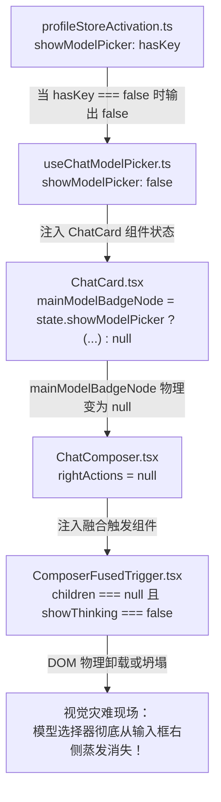

# 方案 09：输入框模型选择器常驻可交互与空态引导方案

> **上位契约**：
> - `AGENTS.md` §1（逻辑规划与反退避）、§7（严禁补丁与立体验证）、§12（Tooltip 自定义规范）、§13（输入框与焦点态）
> - `docs/visual-hierarchy-clarity-analysis/00-总方案.md`
> - `docs/visual-hierarchy-clarity-analysis/P6-输入坞一体化.md`
> - `docs/visual-hierarchy-clarity-analysis/01-实施状态台账.md`
>
> **目标文件**：`docs/visual-hierarchy-clarity-analysis/round2-proposals/09-输入框模型选择器常驻与空态引导方案.md`  
> **文档性质**：战役第二轮专项实施详案（输入框核心控制中枢常驻化与空态引导闭环）

---

## 1. 背景复盘与用户痛点现场

### 1.1 用户真实反馈还原
在用户使用与测试未配置模型的新安装或重置环境时，明确指出：
> **“输入框右侧的模型区域，现在也没有了，就算是没有配置模型，也应当有一个提示的，而不是什么也没有，相关的面板还是要正常显示的，这种属于即使没有配置但是也要显示的元素。”**

### 1.2 现场事故现象
当用户处于以下任一初态时：
1. 全新安装首次启动，本地尚未添加任何模型供应商与 API Key；
2. 清空或删除了所有服务商配置；
3. 本地已有密钥但 Rust 引擎尚未同步；

在桌面主对话视口中，底部主输入框（`ChatComposer`）右侧原本应当呈现模型选择胶囊（如 `Claude 3.5 Sonnet` / `GPT-4o`）的位置**完全消失蒸发**。输入框右侧仅剩下一个孤零零的圆形发送按钮，用户在输入框内部看不到任何模型状态，无法感知当前系统处于何种模型阶段，更无法通过点击胶囊呼出配置面板进行快速选择或自愈配置。

```
【当前错误表现（消失态）：】
┌────────────────────────────────────────────────────────────────────────┐
│  [＋] [🛡️ 权限]   输入消息，或键入 / 打开命令…                 (↑ 发送) │
└────────────────────────────────────────────────────────────────────────┘
                    ↑ 用户看右侧完全空缺，没有任何模型标识！无法点击！

【预期正确表现（常驻空态引导）：】
┌────────────────────────────────────────────────────────────────────────┐
│  [＋] [🛡️ 权限]   输入消息，或键入 / 打开命令…     [ ⚙️ 未配置模型 ▾ ] (↑ 发送) │
└────────────────────────────────────────────────────────────────────────┘
                                            ↑ 100% 常驻渲染，点击直接呼出引导面板
```

---

## 2. 源码级断裂链与根因剖析（Root Cause Analysis）

通过深入排查前端工程，发现该事故是由一个跨越 4 层的**“业务状态绑架视图骨架”**的架构级断层所导致的：



### 2.1 根因 1：业务状态层粗暴绑架视图骨架常驻性
查看 `apps/crish-desktop/src/api/provider-profiles/profileStoreActivation.ts:211-238`：
```typescript
export function getProviderSetupStatus(opts?: {
  engineModel?: string | null;
  engineHasApiKey?: boolean | null;
  engineOk?: boolean | null;
}): ProviderSetupStatus {
  const hasLocalKey = anyProfileHasKey();
  const engineOk = opts?.engineOk !== false;
  const hasEngineKey = Boolean(engineOk && opts?.engineHasApiKey === true);
  const hasKey = hasLocalKey || hasEngineKey;
  ...
  return {
    hasLocalKey,
    hasEngineKey,
    hasKey,
    hasLocalModel,
    resolvedModel,
    resolvedProfileId,
    needsKeySetup,
    needsModelSetup,
    showModelPicker: hasKey, // 致命根因：把模型的视图常驻性绑架在 hasKey 上！
  };
}
```
早期设计错误地假设“用户没有 Key 就不配看到模型选择器”。这一判断严重混淆了**数据可用性（Data Availability）**与**视图骨架常驻性（Layout Invariance）**的区别。

### 2.2 根因 2：上层卡片宿主将节点物理卸载为 `null`
查看 `apps/crish-desktop/src/components/chat-card/ChatCard.tsx:159-173`：
```typescript
const mainModelBadgeNode = state.showModelPicker ? (
  <ModelBadgePicker
    engineModel={state.engineModel}
    needsModelSetup={state.needsModelSetup}
    showModelDropdown={state.showModelDropdown}
    setShowModelDropdown={state.setShowModelDropdown}
  />
) : null;
```
当 `state.showModelPicker` 评估为 `false` 时，`mainModelBadgeNode` 变成了 `null`，传递给 `ChatComposer` 的 `rightActions` 直接为空。

### 2.3 根因 3：输入坞骨架容器被动退化与坍塌
查看 `apps/crish-desktop/src/components/chat-composer/ChatComposer.tsx:361-362` 与 `ComposerFusedTrigger.tsx:147-165`：
```tsx
<div className={styles.actionRight} data-composer-grid="right">
  <ComposerFusedTrigger>{rightActions}</ComposerFusedTrigger>
  ...
</div>
```
在 `ComposerFusedTrigger` 中：
```tsx
const hasChildren = Boolean(children);
...
{hasChildren ? <div className={styles.left}>{children}</div> : null}
```
当 `rightActions` 为 `null` 时，`hasChildren` 为 `false`；由于没有选中模型，`showThinking` 也是 `false`。结果 `ComposerFusedTrigger` 没有任何内部子节点渲染，在 flexbox 布局中宽度被压缩为 0，输入框右侧模型区域彻底人间蒸发。

### 2.4 根因 4：面板内部缺乏空态自愈闭环
在 `apps/crish-desktop/src/components/provider/ModelBadgePickerMenu.tsx:232-235` 中：
```tsx
<div className={styles.modelScrollArea}>
  {filteredGroups.length === 0 ? (
    <div className={styles.emptyState}>未找到匹配的模型或厂商</div>
  ) : ...
```
即便用户设法点开面板，当没有配置模型时，只展示一句冰冷的“未找到匹配的模型或厂商”，缺乏引导用户“前往配置模型服务商”的直接操作闭环。

---

## 3. 模型选择器常驻存在性铁律（Presence Invariant）

### 3.1 核心铁律确立
根据现代专业级 Agent IDE（如 Cursor / Windsurf / Codex）的设计哲学，输入框右侧的模型指示器是**控制台核心交互第一公民（First-Class Control Citizen）**：

> ### 刚性铁律：模型选择器 100% 物理常驻
> 无论系统处于何种运行或网络状态：
> 1. 用户未配置任何 API Key；
> 2. 用户已配置 Key 但未填写/选择 Model；
> 3. 本地网络彻底离线或断网；
> 4. Rust 引擎未就绪或正在连接；
>
> **输入框右侧的模型选择区域（`rightActions`）必须 100% 常驻渲染，严禁物理卸载为 `null`，严禁 `display: none`，严禁宽度坍塌为 0！**

### 3.2 契约解耦与 `showModelPicker` 重构
1. **`profileStoreActivation.ts`**：
   - 将 `showModelPicker` 判定与 `hasKey` 完全解耦，常量返回 `true`：
     ```typescript
     // showModelPicker 保持向后兼容类型契约，恒定为 true，保证视图层 100% 常驻渲染
     showModelPicker: true,
     ```
   - 在类型注释中明确标注：模型选择器为输入框基础骨架，永远保持渲染。
2. **`useChatModelPicker.ts`**：
   - 保持 `showModelPicker: true`；
   - 导出 `hasKey`、`needsKeySetup`、`needsModelSetup` 等状态，供胶囊与面板消费。
3. **`ChatCard.tsx`**：
   - 移除不必要的三元分支判断：
     ```typescript
     const mainModelBadgeNode = (
       <ModelBadgePicker
         engineModel={state.engineModel}
         needsModelSetup={state.needsModelSetup}
         showModelDropdown={state.showModelDropdown}
         setShowModelDropdown={state.setShowModelDropdown}
       />
     );
     ```

---

## 4. 未配置态（Unconfigured State）视觉与交互呈现设计

### 4.1 四级状态矩阵定义

| 状态分支 | 判定条件 | 胶囊文案 | 图标/指示器 | 悬停 Tooltip | 点击面板行为 |
|:---|:---|:---|:---:|:---|:---|
| **S1: 未配置密钥**<br/>(Unconfigured Key) | `needsKeySetup === true`<br/>(`!hasKey`) | `未配置模型` | `sliders` 或 `spark` + `chevron-down` | 尚未配置模型服务商 · 点击打开配置 | 弹出面板，展示空态卡片与 `[前往模型设置]` 按钮 |
| **S2: 未选模型**<br/>(Needs Model Setup) | `hasKey && needsModelSetup` | `选择模型` | `cpu` + `chevron-down` | 已配置服务商，请选择具体模型 | 弹出面板，若有可用模型列出列表，否则引导添加 |
| **S3: 正常就绪态**<br/>(Ready State) | `hasKey && engineModel` | 自适应模型名（如 `Claude 3.5`） | 厂商图标 / 绿点 + 思考档 | `[厂商名] · [模型全名]` | 弹出面板，正常切换模型与调节思考强度 |
| **S4: 引擎离线/同步中**<br/>(Engine Connecting) | `engineHint?.ok === false` | `模型连接中...` | 旋转指示器 / 浅灰点 | 引擎连接恢复中，请稍候 | 弹出面板，提示引擎同步状态并允许重连 |

### 4.2 模型胶囊外观规范（未配置态）

在未配置态下，模型胶囊遵循如下视觉与结构规范：
1. **胶囊轮廓**：
   - 高度：`28px`（与左侧 `+` 按钮、权限按钮及右侧正圆发送按钮完全等高保持一条水平基准线）；
   - 圆角：遵循 `ComposerFusedTrigger` 的单段药丸圆角 `border-radius: var(--sep-radius-outer, 14px)`；
   - 内边距：`0 8px 0 10px`（保持视觉重心的水平平衡）；
2. **色彩与材质**：
   - 遵循 `AGENTS.md` §13 / §14 现代 CSS 语法；
   - 背景色：默认透明（`background: transparent`），不引入突兀重色；
   - 文本色：采用柔和的次要文本色 `var(--text-secondary)`；
   - 图标色：`var(--text-tertiary)`，微弱克制；
3. **悬停与激活交互**：
   - 鼠标悬停（Hover）：平滑过渡到微弱灰底 `background: var(--composer-control-hover-bg, rgba(255, 255, 255, 0.06))`，文本色亮化为 `var(--text-primary)`；
   - 激活展开（Open/Active）：保持激活底色，`chevron-down` 顺时针旋转 180°；
4. **无障碍与焦点控制**：
   - 遵循 `aria-haspopup="menu"`，`aria-expanded={open}`，`aria-label="选择模型或配置服务商"`；
   - 键盘 `Enter` / `Space` 均可呼出下拉面板。

### 4.3 弹出面板 `ModelBadgePickerMenu` 空态自愈引导重构

当用户在未配置任何模型（`entries.length === 0`）时点击模型胶囊，弹出面板不再显示毫无建设性的“未找到匹配的模型或厂商”，而是呈现**高品质自愈引导卡片**：

```
┌──────────────────────────────────────────────────┐
│  🔍 搜索模型或厂商...                      [ ⚙️ ] │
├──────────────────────────────────────────────────┤
│                                                  │
│                    ┌───────┐                     │
│                    │  ⚙️   │                     │
│                    └───────┘                     │
│               尚未配置模型服务商                 │
│       Crish 需要配置至少一个 AI 模型服务商       │
│                才能开始对话与编码                │
│                                                  │
│        ┌─────────────────────────────┐           │
│        │   前往模型设置配置...  →   │           │  (Primary CTA)
│        └─────────────────────────────┘           │
│                                                  │
└──────────────────────────────────────────────────┘
```

#### 空态卡片要素：
- **微图标**：`sliders`（尺寸 24px，放置于浅底圆环容器中，颜色 `var(--brand)`）；
- **主标题**：`尚未配置模型服务商`（字号 `var(--font-size-sm)`，字重 `600`，颜色 `var(--text-primary)`）；
- **辅助说明**：`Crish 需要配置至少一个 AI 模型服务商才能开始对话与编码`（字号 `var(--font-size-xs)`，颜色 `var(--text-tertiary)`，居中对齐）；
- **核心操作按钮（Primary Action）**：
  - 文案：`前往模型设置配置...`；
  - 样式：采用高辨识度的柔和主色按钮（`var(--brand)` 底色或 `var(--tint-hover)` 强调描边），高 `32px`，带箭头引导；
  - 交互：点击立即调用 `openSettings('models')` 打开全局模型设置窗口，同时平滑关闭当前菜单。

---

## 5. 单行与多行输入框内的空间自适应与排版几何

### 5.1 单行输入框水平空间分配分析
在单行输入框中（`composerCard:not(.isMultiline)`），各元素并排在一行内：

```
┌────────────────────────────────────────────────────────────────────────────────────────────────┐
│  [＋] [🛡️ 权限]   │  输入消息，或键入 / 打开命令…             │  [ ⚙️ 未配置模型 ▾ ]   (↑ 发送) │
└───────────────────┴─────────────────────────────────────────┴──────────────────────────────────┘
  ←-- actionLeft --→ ←-------------- fieldSlot --------------→ ←--------- actionRight ---------→
       (约 80px)                     (自适应 minmax)                       (约 140px)
```

1. **左侧控制区（`actionLeft`）**：
   - `+` 按钮：`28px` 宽；
   - `column-gap: 4px`；
   - 权限模式胶囊（`PermissionModeMenu`）：宽度约 `48px`；
   - 合计物理占用：`28 + 4 + 48 = 80px`。
2. **右侧动作区（`actionRight`）**：
   - 模型选择胶囊：文案 `未配置模型`（5 汉字）+ 图标，宽度约为 `96px`；
   - 融合触发胶囊左右 padding 各 `10px`，整体约 `96px`；
   - 发送按钮：`28px` 正圆；自带 `margin-left: 6px`；
   - 合计物理占用：`96 + 6 + 28 = 130px`。
3. **输入主字段（`fieldSlot`）**：
   - 采用 CSS Grid 布局：`grid-template-columns: auto minmax(0, 1fr) auto;`；
   - 即使在典型最小视口宽 `480px`（输入框外层宽度约 `440px`）下：
     - 可分配给输入的纯文本区域 = `440 - 80 - 130 - 12 (gap) = 218px`；
     - 这一宽度足够完整显示 Placeholder “输入消息，或键入 / 打开命令…”。

### 5.2 极窄视口自适应截断（Responsive Tiering）
为了在极端分屏宽度（如双栏分屏视口 `< 420px`）下依然严丝合缝、绝不产生水平溢出，对模型胶囊未配置态应用自适应三级文本裁切（对齐 `SmartModelBadge` 与 `ChatHeaderControls` 的设计规范）：

```css
/* 标准视口 (>= 580px)：显示完整规范文案 */
.modelAdaptiveWrapper .modelStandard {
  display: inline; /* "未配置模型" */
}
.modelAdaptiveWrapper .modelCompact,
.modelAdaptiveWrapper .modelMicro {
  display: none;
}

/* 中等视口 (420px ~ 580px)：紧凑文案 */
@container chatContainer (max-width: 580px) {
  .modelAdaptiveWrapper .modelStandard { display: none; }
  .modelAdaptiveWrapper .modelCompact { display: inline; } /* "配置模型" */
  .modelAdaptiveWrapper .modelMicro { display: none; }
}

/* 极窄视口 (< 420px)：微型文案 */
@container chatContainer (max-width: 420px) {
  .modelAdaptiveWrapper .modelStandard { display: none; }
  .modelAdaptiveWrapper .modelCompact { display: none; }
  .modelAdaptiveWrapper .modelMicro { display: inline; } /* "模型" */
}
```

---

## 6. 代码改动清单（Code Change Manifest）

### 6.1 `apps/crish-desktop/src/api/provider-profiles/profileStoreActivation.ts`
- **改动位置**：第 237 行；
- **修改内容**：将 `showModelPicker: hasKey` 修改为常量 `showModelPicker: true`；
- **目的**：彻底斩断业务 Key 配置与视图常驻性的错误耦合。

```diff
@@ -234,7 +234,8 @@
     resolvedProfileId,
     needsKeySetup,
     needsModelSetup,
-    showModelPicker: hasKey,
+    // 模型选择器作为输入坞核心第一公民，100% 恒定渲染，不随未配 Key 而消失
+    showModelPicker: true,
   };
 }
```

### 6.2 `apps/crish-desktop/src/components/chat-card/ChatCard.tsx`
- **改动位置**：第 159-173 行；
- **修改内容**：移除 `state.showModelPicker ? ... : null` 条件分支，直接赋值渲染；
- **目的**：保证 `mainModelBadgeNode` 与 `editModelBadgeNode` 恒不为 `null`。

```diff
@@ -156,18 +156,18 @@
     );

-    const mainModelBadgeNode = state.showModelPicker ? (
+    const mainModelBadgeNode = (
       <ModelBadgePicker
         engineModel={state.engineModel}
         needsModelSetup={state.needsModelSetup}
+        needsKeySetup={state.needsKeySetup}
         showModelDropdown={state.showModelDropdown}
         setShowModelDropdown={state.setShowModelDropdown}
       />
-    ) : null;

-    const editModelBadgeNode = state.showModelPicker ? (
+    const editModelBadgeNode = (
       <ModelBadgePicker
         engineModel={state.engineModel}
         needsModelSetup={state.needsModelSetup}
+        needsKeySetup={state.needsKeySetup}
       />
-    ) : null;
```

### 6.3 `apps/crish-desktop/src/components/chat-card/ChatHeaderControls.tsx`
- **改动位置**：`ModelBadgePickerProps` 接口与 `ModelBadgePicker` 渲染逻辑；
- **修改内容**：
  1. 接收 `needsKeySetup` 属性；
  2. 当 `needsKeySetup` 为 `true` 或无模型时，文案与 Tooltip 呈现优雅的引导态；
  3. 支持三级字阶自适应：`未配置模型` / `配置模型` / `模型`；
  4. 渲染 `chevron-down` 展开箭头，强化可交互性。

```tsx
interface ModelBadgePickerProps {
  engineModel: string;
  needsModelSetup: boolean;
  needsKeySetup?: boolean;
  showModelDropdown?: boolean;
  setShowModelDropdown?: React.Dispatch<React.SetStateAction<boolean>>;
}
```

```tsx
// 渲染文案生成逻辑增强：
const getDisplayModelText = () => {
  if (engineModel && engineModel !== '填写模型' && engineModel !== '无可用模型') {
    return engineModel;
  }
  if (needsKeySetup) {
    return '未配置模型';
  }
  if (needsModelSetup) {
    return '选择模型';
  }
  return choiceCount > 0 ? '选择模型' : '未配置模型';
};
```

### 6.4 `apps/crish-desktop/src/components/provider/ModelBadgePickerMenu.tsx`
- **改动位置**：第 233-235 行；
- **修改内容**：将单一的文本提示重构为完整的引导式卡片与直达设置 CTA 按钮。

```tsx
<div className={styles.modelScrollArea}>
  {filteredGroups.length === 0 ? (
    <div className={styles.emptyGuideState} data-testid="model-picker-empty-guide">
      <div className={styles.emptyIconCircle}>
        <AppIcon name="sliders" size={20} className={styles.emptyIcon} />
      </div>
      <div className={styles.emptyTitle}>尚未配置模型服务商</div>
      <div className={styles.emptySubtitle}>
        Crish 需要配置至少一个 AI 模型服务商才能开始对话与编码
      </div>
      <Button
        type="button"
        variant="primary"
        className={styles.emptySettingsCta}
        onClick={handleOpenSettings}
        data-testid="model-picker-open-settings-btn"
      >
        <span>前往模型设置配置</span>
        <AppIcon name="arrow-right" size={14} />
      </Button>
    </div>
  ) : (
    filteredGroups.map(...)
  )}
</div>
```

### 6.5 `apps/crish-desktop/src/components/provider/ModelBadgePickerMenu.module.css`
- **新增样式类**：
  - `.emptyGuideState`：垂直居中弹性布局，内边距 `32px 16px`；
  - `.emptyIconCircle`：`40px` 圆形微弱底色容器，居中放置图标；
  - `.emptyTitle`：字号 `13px`，字重 `600`，字色 `var(--text-primary)`；
  - `.emptySubtitle`：字号 `12px`，行高 `1.5`，字色 `var(--text-tertiary)`，最大宽度 `240px`；
  - `.emptySettingsCta`：胶囊形主色按钮，高度 `30px`，圆角 `var(--radius-pill)`，水平居中。

---

## 7. 自动化单测断言与立体验证矩阵

根据 `AGENTS.md` §7.1 立体验证铁律，方案实施后必须覆盖四个层级的立体断言：

### 7.1 单元测试（API 与状态层）
在 `apps/crish-desktop/src/components/chat-card/useChatModelPicker.test.tsx` 中追加断言：
1. **未配置 Key 时 `showModelPicker` 恒为 `true`**：
   ```typescript
   it('当没有任何 Key 与 Profile 时，showModelPicker 依然恒为 true', () => {
     localStorage.clear();
     const { result } = renderHook(() => useChatModelPicker({ projectTick: 0 }));
     expect(result.current.needsKeySetup).toBe(true);
     expect(result.current.showModelPicker).toBe(true); // 刚性断言，禁止回退为 false
   });
   ```

### 7.2 组件集成测试（ChatCard & ModelBadgePicker）
新建或在 `apps/crish-desktop/src/components/chat-card/ChatCard.picker-presence.test.tsx` 中验证：
1. **未配置密钥时主输入框存在模型胶囊**：
   ```typescript
   it('未配置模型环境下，ChatComposer 的 rightActions 包含模型选择器按钮', () => {
     render(<ChatCard handleGlobalTabClick={vi.fn()} />);
     const pickerBtn = screen.getByTestId('model-selector-button');
     expect(pickerBtn).toBeInTheDocument();
     expect(pickerBtn).toHaveTextContent(/未配置模型|配置模型/);
   });
   ```
2. **点击模型胶囊能弹出菜单**：
   ```typescript
   it('点击未配置状态的模型胶囊，正常呼出 ModelBadgePickerMenu', () => {
     render(<ChatCard handleGlobalTabClick={vi.fn()} />);
     const pickerBtn = screen.getByTestId('model-selector-button');
     fireEvent.click(pickerBtn);
     expect(screen.getByRole('menu')).toBeInTheDocument();
     expect(screen.getByTestId('model-picker-empty-guide')).toBeInTheDocument();
   });
   ```

### 7.3 下拉菜单空态引导交互测试
在 `apps/crish-desktop/src/components/provider/ModelBadgePickerMenu.test.tsx` 中追加：
1. **空态下展示前往设置按钮，且点击后调用 `openSettings('models')` 并关闭菜单**：
   ```typescript
   it('当没有可用模型时，展示自愈引导卡片并可通过 CTA 打开模型设置', () => {
     seedCatalog({}); // 空目录
     const onClose = vi.fn();
     render(
       <ModelBadgePickerMenu
         activeModel={null}
         onClose={onClose}
         open={true}
         anchor={{ current: document.createElement('button') }}
       />
     );
     const ctaBtn = screen.getByTestId('model-picker-open-settings-btn');
     expect(ctaBtn).toBeInTheDocument();
     fireEvent.click(ctaBtn);
     expect(openSettings).toHaveBeenCalledWith('models');
     expect(onClose).toHaveBeenCalled();
   });
   ```

### 7.4 静态门禁检查（CI Guardrail）
1. 运行 `npm run check:line-counts`，确保修改后的 `ChatCard.tsx`（当前 480 行）严格保持在 500 有效代码行门禁之内；
2. 运行 `npm run typecheck` 确保 TypeScript 类型零报错；
3. 运行 `npx vitest run apps/crish-desktop/src/components/chat-card/useChatModelPicker.test.tsx apps/crish-desktop/src/components/provider/ModelBadgePickerMenu.test.tsx` 确保 100% 通过。

---

## 8. 实施影响评估与总结

| 评估维度 | 影响分析与结论 |
|:---|:---|
| **破坏性改动风险** | **零风险**。原有的已配置模型、切换模型、思考档调节等链路保持 100% 接口与行为向后兼容；仅在未配置态由“物理卸载”升级为“常驻引导态”。 |
| **视觉一致性** | 彻底解决了输入框右侧缺失不对称的严重视觉硬伤，模型胶囊与发送按钮构成完整的右侧控制阵列，左右均衡。 |
| **用户体验闭环** | 新用户从安装后的第一眼就能在输入框直接看到模型入口，并能一键点击直达设置页面，极大降低了使用门槛与迷失率。 |
