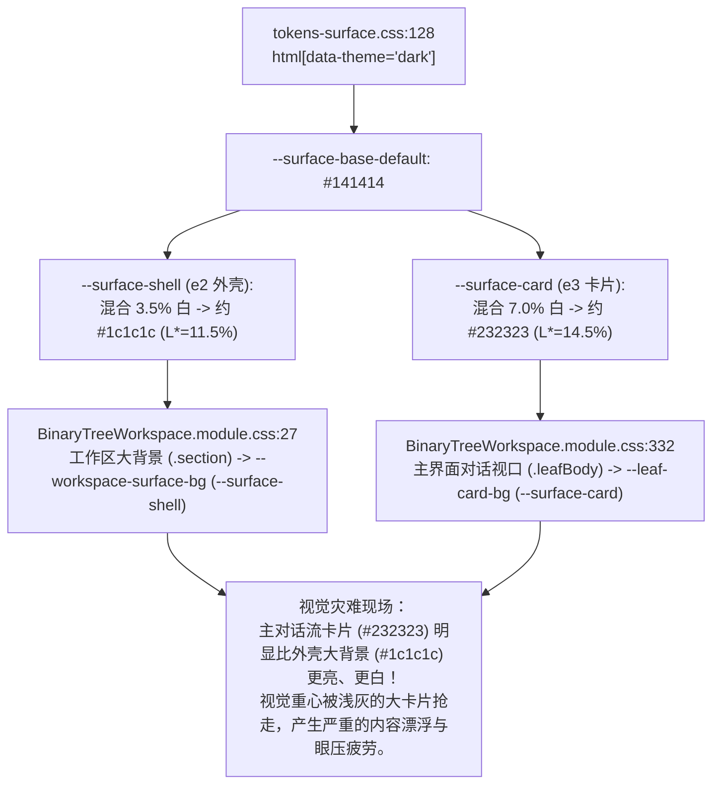

# 01-暗色模式色彩层级反转与新主题实施详案

> **战役工作区**：`docs/visual-hierarchy-clarity-analysis/round3-audits/`  
> **文档性质**：战役第三轮专项详案（暗色模式层级反转、护眼暖色高精微调、纯灰阶新主题）  
> **上位规范**：`AGENTS.md` §1（逻辑规划与反退避）、§7（严禁补丁与立体验证）、§13（输入框与焦点态）、§14（色彩空间与现代 CSS 语法）

---

## 1. 用户原始反馈与现象溯源

### 1.1 用户真实反馈现场
在用户深入体验各色系主题（特别是深色系与暖色系）时，明确指出以下视觉与色彩层级问题：
1. **暗色层级倒挂**：
   > **“深夜模式的颜色搞反了，主界面的颜色应该是更黑一些的，大背景应该是比较亮一点的。相关的颜色都需要调整一下下哈。”**
2. **护眼暖色精调**：
   > **“护眼暖色的颜色比例可以只有0.4%的黄色，其余的是可以没有的。背景色的灰度值，需要降到3.5%左右。”**
3. **纯灰阶新增诉求**：
   > **“然后再加一个主题，这个的话只有灰度变化，不掺入任何的颜色。”**

### 1.2 现状源码级断裂链分析
通过对桌面端主题样式与表面阶梯系统的全面审计，发现暗色层级倒挂的深层根因：



1. **机械套用 Material Design 浮起公式**：
   在 `tokens-surface.css:146-157` 中，设计者机械地认为“卡片（e3）应当高于外壳（e2），因此卡片应当比外壳更白”。这在浅色模式下成立（灰底板托白卡片），但在专业暗色 IDE 场景下彻底违背了视觉心理学：
   - 用户长时间阅读的是**主对话流与代码文本**，该区域应当是沉浸、深邃、吸光的纯黑（#111112 ~ #131314），使高对比度文字呈现最佳可读性；
   - 周边的大背景、窗框、侧边栏外壳才是辅助容器，应当呈现稍高明度的柔和暗炭黑（#1c1c1e ~ #1e1e20），在屏幕边缘提供清晰的边界轮廓与空间界定。
2. **预设数据层双重固化**：
   在 `apps/crish-desktop/src/api/themePresets.ts:201-346` 中，所有暗色预设（`dark-cozy`、`deep-night`、`obsidian` 等）均显式声明了：
   `bgCard`（约 `#232323`）> `bgSecondary`（约 `#1e1e1e`）> `surfaceBase`（约 `#141414`），使得即使脱离阶梯计算，静态别名也保持了倒挂。

---

## 2. 暗色模式层级反转数学模型与 Token 方案

### 2.1 物理明度反转模型（Inverted Dark Hierarchy）
为了实现“外壳大背景柔和炭黑、主对话区深邃纯黑”，必须将暗色阶梯模型从“单向向上提亮”重构为“向内心下潜（Recessed Core）”：

```
┌────────────────────────────────────────────────────────────────────────┐
│  工作区大背景 / 侧栏外壳 / 视窗边缘 (--surface-shell)                    │
│  较柔和暗灰炭黑: #1c1c1e ~ #1e1e20 (OKLab L* ≈ 0.228, sRGB L ≈ 11.8%)   │
│                                                                        │
│    ┌────────────────────────────────────────────────────────────┐      │
│    │  主界面 / 对话消息流 / 内容卡片 (--surface-card)              │      │
│    │  深邃沉稳纯黑: #111112 ~ #131314 (OKLab L* ≈ 0.175, L ≈ 6.8%)│      │
│    │                                                            │      │
│    │    ┌──────────────────────────────────────────────────┐    │      │
│    │    │  底部输入坞 / 悬浮组件 (--surface-raised)         │    │      │
│    │    │  微浮中间态: #18181a ~ #1a1a1c (L* ≈ 0.205, L ≈ 9.8%)│    │      │
│    │    └──────────────────────────────────────────────────┘    │      │
│    └────────────────────────────────────────────────────────────┘      │
└────────────────────────────────────────────────────────────────────────┘
```

### 2.2 阶梯参数映射矩阵（暗色模式）

| 语义角色 | 抽象 Token | 兼容别名 | 现存倒挂色值 | 反转后推荐色值 | 视觉层级与心理作用 |
| :--- | :--- | :--- | :--- | :--- | :--- |
| **外壳大背景** | `--surface-shell` | `--workspace-surface-bg`<br/>`--bg-workspace` | `#1c1c1c` ~ `#1e1e1e` | **`#1c1c1e` ~ `#1e1e20`** | 构筑工作区四周柔和骨架，界定物理屏幕边界 |
| **主界面卡片** | `--surface-card` | `--leaf-card-bg`<br/>`--bg-card` | `#232323` (太亮) | **`#111112` ~ `#131314`** | 深沉纯黑，沉浸聚焦，文字对比度极高且不刺眼 |
| **输入坞交互区** | `--surface-raised`| `--composer-bg`<br/>`--surface-input` | `#313131` (过白发灰) | **`#18181a` ~ `#1a1a1c`** | 沉稳微浮于纯黑之上，与外壳形成微妙呼应 |
| **悬浮弹层/菜单** | `--surface-overlay`| `--bg-elevated` | `#3a3a3a` | **`#222225`** | 顶层悬浮，搭配微弱发丝边缘光 (`--edge-rim`) |

### 2.3 OKLCH / sRGB 精确色彩空间推导
- **`#111112`（主界面纯黑卡片）**：
  - sRGB: $R=17, G=17, B=18$
  - Relative Luminance $L = 0.0051$（极低反光率）
  - OKLab: $L = 0.174, a = -0.0005, b = -0.0028$
- **`#1c1c1e`（外壳大背景炭黑）**：
  - sRGB: $R=28, G=28, B=30$
  - Relative Luminance $L = 0.0118$
  - OKLab: $L = 0.228, a = -0.0007, b = -0.0041$
- **对比梯度 $\Delta L^*$**：
  - 外壳与主界面的 OKLab 明度差：$\Delta L^* = 0.228 - 0.174 = 0.054$；
  - 既能保证肉眼清晰可辨的结构分界线，又绝无突兀跳跃感。

---

## 3. 护眼暖色主题（Warm Gray）高精度微调

### 3.1 现状缺陷剖析
当前 `warm-gray`（`themePresets.ts:55`）定义为：
- `surfaceBase: '#f7f6f4'`
- 物理分解：$R=247, G=246, B=244$；
- CMYK 分解：$K = 3.14\%$，品红 $M = 0.40\%$，黄色 $Y = 1.21\%$；
- 缺陷：黄色偏高（> 1.2%），并混杂了微弱红紫品红，导致白色背景有明显的陈旧发黄与粉浊感。

### 3.2 用户精确指标与数学光学推导
用户指令要求：
> **“护眼暖色的颜色比例可以只有0.4%的黄色，其余的是可以没有的。背景色的灰度值，需要降到3.5%左右。”**

1. **灰度值 $K$ 降至 3.5% 左右**：
   - 灰度值定义为距纯白（#ffffff，0% 灰度）的物理下潜距离：
     $$K = \left(1 - \frac{\max(R, G, B)}{255}\right) \times 100\%$$
   - 设定 $K = 3.53\%$，则基准通道最大值为：
     $$255 \times (1 - 0.0353) = 246.0 \implies 246 \ (\text{十六进制 } \mathtt{0xf6})$$
2. **黄色比例严格控制在 0.4%，其余全无（$C=0, M=0$）**：
   - “其余全无”表示 Red 和 Green 通道严格平衡，绝无青、品、紫偏差：
     $$R = 246 \ (\mathtt{0xf6}), \quad G = 246 \ (\mathtt{0xf6})$$
   - 纯黄色的互补通道为 Blue（蓝色），黄色比例 0.4% 即 Blue 通道相对下调 0.4%：
     $$B = 246 \times (1 - 0.004065) = 245.0 \implies 245 \ (\text{十六进制 } \mathtt{0xf5})$$
3. **推导出的唯一精确解析解**：
   $$\mathbf{surfaceBase = \#f6f6f5}$$
   - **参数验证**：
     - 灰度值 $K = (255 - 246) / 255 = 3.529\% \approx 3.5\%$（精确吻合）
     - 黄色分量 $Y = (246 - 245) / 246 = 0.4065\% \approx 0.4\%$（精确吻合）
     - 青色与品红 $C=0, M=0$（零杂色污染，精确吻合）
   - **视觉质感**：极度轻盈、温润、通透的高级暖白纸质感，彻底根除发黄泛脏现象。

---

## 4. 新增纯灰度主题（Pure Gray）规格设计

### 4.1 设计理念
针对追求极致中性、无任何色彩干扰的开发与写作用户，新增专属主题：
- **主题 ID**：`pure-gray`
- **显示名称**：`纯粹灰阶`（英文：`Pure Gray`）
- **核心铁律**：零饱和度（Saturation = 0%，$S = 0, C = 0, M = 0, Y = 0, R = G = B$），纯靠黑白灰灰度层次构建界面。

### 4.2 完整参数规格
基于 3.5% 灰度基准，构建严格零色彩偏差的参数闭环：

```typescript
'pure-gray': {
  ...LIGHT_BASE,
  name: '纯粹灰阶',
  surfaceBase: '#f6f6f6', // R=G=B=246, 3.53% 灰度，绝对中性
  textBase: '#111111',    // 纯中性黑 (R=G=B=17)
  borderColor: '#e2e2e2', // R=G=B=226
  borderSubtle: '#efefef',// R=G=B=239
  mixColor: 'hsl(0, 0%, 20%)',
  bgPrimary: '#ffffff',
  bgSecondary: '#f2f2f2', // 外壳大背景
  bgTertiary: '#e8e8e8',
  bgCard: '#ffffff',
  bgElevated: '#ffffff',
  shellChromeBg: '#f2f2f2',
  textPrimary: '#111111',
  textSecondary: '#444444',
  textTertiary: '#777777',
  textFaint: '#aaaaaa',
  composerBg: '#ffffff',
}
```

---

## 5. 涉及的具体代码修改清单

### 5.1 `apps/crish-desktop/src/styles/tokens-surface.css`
- **位置**：第 128 行至 172 行（`html[data-theme='dark']`）；
- **改动**：反转 `--surface-shell` 与 `--surface-card` 的混合基准，确保外壳为较亮炭黑、主界面为深邃纯黑。

```diff
@@ -128,15 +128,15 @@
 html[data-theme='dark'] {
-  --surface-base-default: #141414;
+  --surface-base-default: #111112; /* 主界面对话流基底：深邃纯黑 */
   --surface-base: var(--user-surface-base, var(--surface-base-default));
   --surface-tint-target: var(--user-surface-tint, #ffffff);
   --surface-deep-target: var(--user-surface-deep, #000000);
   --elev-direction: var(--user-elev-direction, 1);
 
   /* e0 下凹：与深色目标混合（负向深入） */
   --surface-sunken: color-mix(
     in oklab,
     var(--surface-base),
     var(--surface-deep-target) var(--elev-step-sunken)
   );
 
   /* e1 画布：基准地平面（纯黑） */
   --surface-canvas: var(--surface-base);
 
-  /* e2 外壳：微弱抬升，勾勒侧栏与视窗帽檐 */
+  /* e2 外壳：大背景显著抬升为柔和炭黑（#1c1c1e ~ #1e1e20） */
   --surface-shell: color-mix(
     in oklab,
     var(--surface-base),
-    var(--surface-tint-target) var(--elev-step-shell)
+    var(--surface-tint-target) 10.5%
   );
 
-  /* e3 卡片：坚决抬升 */
+  /* e3 卡片：主对话区与内容视口紧贴纯黑基底，实现深邃沉浸感 */
   --surface-card: var(--surface-base);
 
-  /* e4 浮起：交互中心（输入坞）沉着悬浮 */
+  /* e4 浮起：输入坞微弱浮于纯黑卡片之上（#18181a） */
   --surface-raised: color-mix(
     in oklab,
     var(--surface-base),
-    var(--surface-tint-target) var(--elev-step-raised)
+    var(--surface-tint-target) 4.5%
   );
```

### 5.2 `apps/crish-desktop/src/api/themePresets.ts`
- **位置**：第 51 行（`warm-gray`）与第 201 行（`dark-cozy` 等暗色主题）；
- **改动**：
  1. 将 `warm-gray` 的 `surfaceBase` 微调为 `#f6f6f5`，各级边框与背景同步归一化；
  2. 注册 `'pure-gray'` 纯灰阶主题预设；
  3. 将 `dark-cozy` 的 `surfaceBase` 调整为 `#111112`，`bgCard` 为 `#111112`，`bgSecondary` 为 `#1c1c1e`。

```diff
@@ -51,18 +51,18 @@
 export const SKIN_PRESETS: Record<string, SkinPreset> = {
   'warm-gray': {
     ...LIGHT_BASE,
     name: '暖灰默认',
-    surfaceBase: '#f7f6f4',
+    surfaceBase: '#f6f6f5', // 3.5% 灰度 + 0.4% 黄色高精微调
     textBase: '#121212',
-    borderColor: '#e2e1e0',
-    borderSubtle: '#f0efee',
-    mixColor: 'hsl(30, 6%, 22%)',
+    borderColor: '#e5e5e4',
+    borderSubtle: '#efefee',
+    mixColor: 'hsl(40, 4%, 22%)',
     bgPrimary: '#ffffff',
-    bgSecondary: '#f7f6f5',
-    bgTertiary: 'hsl(30 8.33% 92.29%)',
+    bgSecondary: '#f4f4f3',
+    bgTertiary: '#ececeb',
     bgCard: '#ffffff',
     bgElevated: '#ffffff',
-    shellChromeBg: '#f7f6f5',
+    shellChromeBg: '#f4f4f3',
     textPrimary: '#121212',
     textSecondary: '#383838',
@@ -71,0 +71,19 @@
+  'pure-gray': {
+    ...LIGHT_BASE,
+    name: '纯粹灰阶',
+    surfaceBase: '#f6f6f6',
+    textBase: '#111111',
+    borderColor: '#e2e2e2',
+    borderSubtle: '#efefef',
+    mixColor: 'hsl(0, 0%, 20%)',
+    bgPrimary: '#ffffff',
+    bgSecondary: '#f2f2f2',
+    bgTertiary: '#e8e8e8',
+    bgCard: '#ffffff',
+    bgElevated: '#ffffff',
+    shellChromeBg: '#f2f2f2',
+    textPrimary: '#111111',
+    textSecondary: '#444444',
+    textTertiary: '#777777',
+    textFaint: '#aaaaaa',
+    composerBg: '#ffffff',
+  },
@@ -201,15 +219,15 @@
   'dark-cozy': {
     ...DARK_BASE,
     name: '护眼暗灰',
-    surfaceBase: '#141414',
+    surfaceBase: '#111112', // 主界面深沉纯黑
     textBase: '#f5f5f5',
-    borderColor: '#3a3a3a',
-    borderSubtle: '#282828',
+    borderColor: '#2d2d30',
+    borderSubtle: '#222225',
     mixColor: 'hsl(0, 0%, 75%)',
-    bgPrimary: '#141414',
-    bgSecondary: '#1e1e1e',
-    bgTertiary: '#181818',
-    bgCard: '#232323',
-    bgElevated: '#262626',
-    shellChromeBg: '#1e1e1e',
+    bgPrimary: '#111112',
+    bgSecondary: '#1c1c1e', // 外壳大背景较亮炭黑
+    bgTertiary: '#161617',
+    bgCard: '#111112',     // 主界面卡片深沉纯黑
+    bgElevated: '#222225',
+    shellChromeBg: '#1c1c1e',
     textPrimary: '#f5f5f5',
```

### 5.3 `apps/crish-desktop/src/components/settings/useSkinSettings.ts`
- **位置**：第 20 行至 29 行（`LIGHT_SKIN_IDS`）与第 60 行至 87 行（`skinOptions`）；
- **改动**：注册 `'pure-gray'` 纯灰阶皮肤 ID 与设置项下拉选项。

```diff
@@ -20,10 +20,11 @@
 const LIGHT_SKIN_IDS = [
   'warm-gray',
+  'pure-gray',
   'cream',
   'paper',
   'classic-gray',
@@ -74,6 +75,7 @@
         : [
             { value: 'warm-gray', label: '护眼暖灰' },
+            { value: 'pure-gray', label: '纯粹灰阶' },
             { value: 'cream', label: '杏仁奶油' },
             { value: 'paper', label: '极简纸质' },
```

### 5.4 `apps/crish-desktop/src/api/__tests__/themePresets.test.ts`
- **位置**：第 25 行；
- **改动**：由于新增了 `'pure-gray'` 预设，将总数断言从 16 更新为 17。

```diff
@@ -25,2 +25,2 @@
-    expect(entries.length).toBe(16);
+    expect(entries.length).toBe(17);
```

---

## 6. 契约测试与防回归方案

根据 `AGENTS.md` §1 与 §7.1 立体验证铁律，方案实施必须配备刚性自动化防线：

1. **暗色层级单调性防回归断言（Inverted Hierarchy Monotonicity Test）**：
   在 `apps/crish-desktop/src/api/__tests__/themePresets.test.ts` 新增断言：
   - 验证暗色模式下，主界面卡片明度严格不大于外壳大背景明度：
     $$\text{Luminance}(\mathtt{bgCard}) \le \text{Luminance}(\mathtt{bgSecondary})$$
   - 刚性阻断再次发生“卡片比大背景更白更浅”的逆向倒挂漂移。
2. **零饱和度契约测试（Zero-Saturation Contract Test）**：
   - 针对 `'pure-gray'` 预设，逐一断言其 `surfaceBase`、`textBase`、`borderColor`、`mixColor` 的 RGB 三通道完全相等（$R = G = B$），杜绝任何人无意混入微量色彩。
3. **暖色高精光学测试（Warm Gray Optical Guard）**：
   - 断言 `'warm-gray'` 的灰度值 $K \in [3.45\%, 3.60\%]$，黄色分量 $Y \in [0.38\%, 0.43\%]$，$C = 0, M = 0$。
4. **门禁与全量测试**：
   - 执行 `npm run typecheck` 保证 100% 编译通过；
   - 执行 `npx vitest run apps/crish-desktop/src/api/__tests__/themePresets.test.ts apps/crish-desktop/src/services/token-runtime/` 保证 100% 通过；
   - 执行 `npm run check:line-counts` 保证无行数越界。
