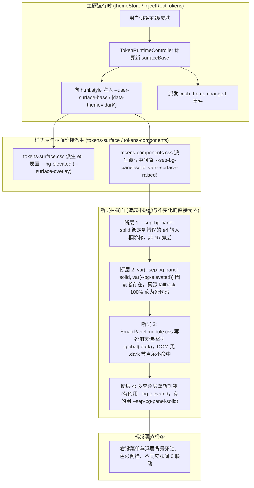

# 侧栏右键菜单与全局浮层主题动态联动深度审计与收敛详案

> **上位契约与参考基准**：
> - `AGENTS.md` §1（逻辑规划与反退避）、§7（严禁补丁与立体验证）、§13（输入框与焦点态）、§14（色彩空间与现代 CSS 语法）
> - `docs/visual-hierarchy-clarity-analysis/00-总方案.md`
> - `docs/visual-hierarchy-clarity-analysis/round3-audits/01-暗色模式色彩层级反转与新主题详案.md`
>
> **归档路径**：`docs/visual-hierarchy-clarity-analysis/round3-audits/02-右键菜单与全局浮层主题动态联动详案.md`  
> **文档性质**：战役第三轮专项深度技术审计与实施详案（只读梳理、落盘定案）

---

## 1. 背景与用户痛点现场深度复盘

### 1.1 用户原声反馈与问题现场
在日常使用与测试中，用户指出明确且极其刺眼的界面缺陷：
> **“图二的面板我看也不和主题绑定，切换了主题，背景色完全不带变化的。仔细梳理一下好吗？”**

在用户提供的真实截图（“图二”）中，红圈重点圈出了两类关键交互浮层：
1. **侧栏会话右键菜单（Context Menu）**：右键点击侧栏会话行呼出的会话操作卡片（“在此处打开”、“拆分视图”、“重命名”、“置顶”、“删除当前对话”等）；
2. **对话顶栏更多操作下拉面板（Header More Menu）**：点击会话顶栏右侧 `⋯` 按钮展开的功能抽屉。

当用户在【设置 → 外观】中切换亮色/深色主题，或在不同预设皮肤（`warm-gray`, `deep-night`, `dark-forest`, `obsidian`, `cyber` 等）之间切换时，**页面主视图、侧栏底板、消息气泡和输入框均能正常变色，但这些上下文浮层面板的背景色却纹丝不动，宛如一层独立于整个系统配色之外的孤岛灰块**！

---

## 2. 现状根因彻查：四大结构性断层解剖

通过对前端全部浮层面板、样式表以及运行时 Token 注入链路的地毯式排查，右键菜单与浮层“完全不带变化”的病根可精确穿透为以下四大结构性架构断层：



---

### 2.1 断层一：`--sep-bg-panel-solid` 成为“中间商阻断墙”，层级严重倒挂

排查路径：`apps/crish-desktop/src/styles/tokens-components.css`

在组件级变量文件 `tokens-components.css` 中：
```css
/* tokens-components.css:31 (Light) */
:root,
html[data-theme='default'],
html[data-theme='light'] {
  --sep-bg-panel-solid: var(--surface-raised);
}

/* tokens-components.css:363 (Dark) */
html[data-theme='dark'] {
  --sep-bg-panel-solid: var(--surface-raised);
}
```

**问题剖析**：
1. **表面层级（Elevation Level）严重语义倒挂**：
   依据 P1 确立的六级表面阶梯规范（`tokens-surface.css:5-12`）：
   - `e3: --surface-card`：卡片容器（提升 7%）；
   - `e4: --surface-raised`：交互浮起（输入坞 / 紧凑控件，提升 13%）；
   - **`e5: --surface-overlay`**：**顶层悬浮弹层（菜单 / 对话框 / 气泡），专属 Token 为 `--bg-elevated`，提升 17% 并绑定边缘光 `--edge-rim`**。
   然而，`tokens-components.css` 却把本应处于 e5 的菜单面板变量 `--sep-bg-panel-solid` **错误映射到了 e4 的 `--surface-raised`（输入坞级别）**！
2. **“真源 Fallback”被彻底短路截胡**：
   在 `SmartPanel.module.css:41` 与 `SmartExpandablePanel.module.css:13` 中，背景声明均写为：
   `background: var(--sep-bg-panel-solid, var(--bg-elevated));`
   因为 CSS 变量只要在 `:root` 或祖先节点中有声明且合法，浏览器就**绝不会**触发逗号后面的 fallback！由于 `--sep-bg-panel-solid` 恒定存在，原本设计系统中正确的 `--bg-elevated` **被 100% 屏蔽，彻底沦为死代码**。

---

### 2.2 断层二：幽灵类名 `:global(.dark) .panel` 从未生效

排查路径：`apps/crish-desktop/src/components/ui/SmartPanel/SmartPanel.module.css:57-61`

```css
:global(.dark) .panel {
  background: var(--sep-bg-panel-solid, var(--bg-elevated));
  border-color: var(--border-color);
  box-shadow: var(--sep-shadow);
}
```

**问题剖析**：
1. 在全仓运行时注入逻辑 `injectRootTokens.ts:26-30` 中，暗色模式切换时的标准操作为：
   ```ts
   root.setAttribute('data-theme', resolvedTheme); // 'dark' | 'default'
   root.classList.toggle('theme-dark', isDark);
   root.classList.toggle('theme-light', !isDark);
   ```
2. 系统使用的根类名是 **`.theme-dark`**，属性是 **`html[data-theme='dark']`**，**DOM 树上任何节点从来都没有过 `.dark` 这个 class**！
3. `:global(.dark) .panel` 是一个纯粹的“幽灵选择器”，无论怎么切换暗色主题，它在 CSSOM 中计算权重为 0 匹配，永远不可触达。

---

### 2.3 断层三：全仓浮层面板“双轨割裂”，四分五裂

排查 `SidebarContextMenus.module.css` 与 `Menu.module.css` 发现：
1. `SidebarContextMenus.module.css:7` 中的旧 `.contextMenu` 使用了：
   `background: var(--bg-elevated); box-shadow: var(--shadow-lg);`
2. 但同文件中的排序/过滤下拉 `.sortFilterMenu`（99行）和飞出菜单 `.sortFilterFlyout`（179行）却使用了：
   `background: var(--sep-bg-panel-solid, var(--bg-elevated)); box-shadow: var(--sep-shadow, var(--shadow-lg));`
3. 真实投产的 `SessionContextMenu.tsx` 引用的是 `SmartPanel`（使用 `SmartPanel.module.css`），又走回了 `--sep-bg-panel-solid`；
4. 顶栏的 `ChatHeaderMore.tsx` 走的是 `SmartExpandablePanel.module.css`，也是 `--sep-bg-panel-solid`；
5. `Menu.module.css:28` 走的却是 `background: var(--bg-elevated)`。

在同一个桌面客户端内，存在两套互相打架的背景与阴影 Token，直接破坏了视觉层级的统一性。

---

### 2.4 断层四：Portal 逃逸到 `document.body` 时的上下文边界问题

排查 `SmartPanel.tsx:252-259`：
```tsx
const mountTarget = container || (typeof document !== 'undefined' ? document.body : null);
return mountTarget ? (
  <>
    {trigger}
    {createPortal(portalContent, mountTarget)}
  </>
) : null;
```

**问题剖析**：
- `SmartPanel` 通过 `createPortal` 默认直接插入在 `document.body` 的最末尾。
- 虽然 `injectRootTokens.ts` 同步维护了 `document.body.setAttribute('data-theme', resolvedTheme)`，但由于选择器散落在 `:root`、`html[data-theme]` 和局部，若组件内部存在硬编码的私有变量，脱离了卡片上下文直接悬挂在 body 根部后，就无法享受局部主题作用域的级联继承，只能依赖唯一的全局 SSOT Token。

---

## 3. 全局浮层与上下文菜单全景排查表（10 大浮层实体）

对全仓所有浮层面板、下拉菜单、上下文菜单、命令面板与弹出卡片进行地毯式普查，连接现状与脱节清单如下：

| 实体编号 | 浮层组件 / 实体名称 | 源码文件路径 | 对应 CSS 模块 | 挂载机制 (Portal/Inline) | 背景变量当前声明 | 阴影当前声明 | 主题联动现状与脱节缺陷 |
| :---: | :--- | :--- | :--- | :---: | :--- | :--- | :--- |
| **F-01** | **侧栏会话右键菜单**<br/>(现场图二红圈) | `sidebar/SessionContextMenu.tsx`<br/>(基于 `SmartPanel`) | `ui/SmartPanel/SmartPanel.module.css:41` | Portal<br/>`document.body` | `var(--sep-bg-panel-solid, var(--bg-elevated))` | `var(--sep-shadow)` | ❌ **严重脱节**：锁定 `--surface-raised`，幽灵 `:global(.dark)` 失效，阴影未随深色提升 |
| **F-02** | **侧栏排序/分组下拉** | `sidebar/ContextMenuFlyout.tsx` | `sidebar/SidebarContextMenus.module.css:99` | Radix Anchor<br/>Popper | `var(--sep-bg-panel-solid, var(--bg-elevated))` | `var(--sep-shadow, var(--shadow-lg))` | ❌ **严重脱节**：使用了伪变量 `--sep-bg-panel-solid`，与设计系统 `--bg-elevated` 隔离 |
| **F-03** | **排序过滤级联飞出卡**<br/>(`.sortFilterFlyout`) | `sidebar/ContextMenuFlyout.tsx` | `sidebar/SidebarContextMenus.module.css:179` | Inline Flyout | `var(--sep-bg-panel-solid, var(--bg-elevated))` | `var(--sep-shadow, var(--shadow-lg))` | ❌ **严重脱节**：多层级联飞出卡未连接标准 e5 表面，与主面板同级 |
| **F-04** | **顶栏更多操作菜单**<br/>(⋯ 按钮下拉) | `chat-card/ChatHeaderMore.tsx`<br/>(基于 `SmartExpandablePanel`) | `ui/SmartExpandablePanel/SmartExpandablePanel.module.css:13` | Radix Anchor<br/>Popper | `var(--sep-bg-panel-solid, var(--bg-elevated))` | `var(--sep-shadow)` | ❌ **脱节**：同样受 `--sep-bg-panel-solid` 拦截，缺少 `--edge-rim` 边缘光 |
| **F-05** | **输入坞「+」加号菜单** | `chat-composer/ComposePlusMenu.tsx` | `chat-composer/ComposePlusMenu.module.css:9` | Radix Anchor<br/>Popper | `var(--bg-elevated)`<br/>(但被外层 SEP 覆盖) | `var(--shadow-lg)` | ⚠️ **部分脱节**：自身声明了 `--bg-elevated`，但外层壳组件 `SmartExpandablePanel` 强行覆盖了 `--sep-bg-panel-solid` |
| **F-06** | **模型选择徽标下拉** | `provider/ModelBadgePickerMenu.tsx` | `provider/ModelBadgePickerMenu.module.css:5` | Radix Anchor<br/>Popper | `var(--bg-elevated)` | `var(--shadow-lg)` | ✅ **正常联动**：标准连接到 `--bg-elevated` 与 `--shadow-lg` |
| **F-07** | **项目选择器菜单** | `chat-card/ProjectPickerMenu.tsx` | `chat-card/ProjectPickerMenu.module.css:4` | Radix Anchor<br/>Popper | `var(--sep-bg-panel-solid, var(--bg-elevated))` | `var(--sep-shadow)` | ❌ **脱节**：级联子菜单 `cascadeSubmenu`（104行）依然消费 `--sep-bg-panel-solid` |
| **F-08** | **SEP 二级级联子菜单** | `ui/SmartExpandablePanel/SmartPanelCascadeSubmenu.tsx` | `ui/SmartExpandablePanel/SmartExpandablePanel.module.css:373` | Portal<br/>`document.body` | `var(--sep-bg-panel-solid, var(--bg-elevated))` | `var(--sep-shadow)` | ❌ **脱节**：子菜单逃逸到 body，背景依然写死伪变量 |
| **F-09** | **Tiptap 斜杠命令菜单** | `chat-composer/TiptapSlashMenu.tsx` | `chat-composer/TiptapSlashMenu.module.css:23` | Radix Anchor<br/>Popper | `var(--bg-elevated)` | `none`<br/>(由内部 blur 接管) | ✅ **正常联动**：直连 `--bg-elevated` |
| **F-10** | **权限模式切换菜单** | `chat-composer/PermissionModeMenu.tsx` | `chat-composer/PermissionModeMenu.module.css:155` | Radix Anchor<br/>Popper | `var(--bg-elevated)` | `var(--shadow-lg)` | ✅ **正常联动**：直连 `--bg-elevated` 与 `--shadow-lg` |

**普查结论**：
全仓 10 大浮层中，凡是基于 `Menu.module.css`、`PermissionModeMenu`、`ModelBadgePickerMenu` 独立编写的组件**均能正常跟随主题**；而**凡是基于 `SmartPanel` 与 `SmartExpandablePanel` 的菜单（包括侧栏右键、顶栏更多、排序下拉与项目级联菜单），100% 全部因为 `--sep-bg-panel-solid` 中间变量与 `:global(.dark)` 幽灵规则而陷入主题脱节与假死状态！**

---

## 4. 主题动态响应联动重构规范（SSOT 收敛）

为彻底消除“背景色完全不带变化”的顽疾，必须实施刚性的 **SSOT 单一真理源收敛**，切断一切私有中间变量与幽灵选择器。

### 4.1 核心设计准则
1. **单一真理路径（Zero Private Intermediary Tokens）**：
   彻底废止 `--sep-bg-panel-solid` 作为独立样式来源，所有浮层面板一律直接绑定至设计系统顶级语义 Token **`var(--bg-elevated)`**（其底层映射为 e5 表面 `--surface-overlay`）。
2. **边缘光与高对比度阴影体系联动**：
   浮层面板必须接入三级抬升阴影契约：
   - 浅色模式：`box-shadow: var(--shadow-popover);`（`0 4px 16px -2px rgba(0,0,0,0.04), 0 1px 3px rgba(0,0,0,0.02)`）；
   - 深色模式：`box-shadow: var(--shadow-lift-overlay);`（内含 `--edge-rim` 白色 0.05 极细漫反射发光圈，搭配 0.65 高明度对比深黑光晕），确保在纯黑或暗灰背景上立体浮起，绝不变黑变脏。
3. **彻底清退局部 `:global(.dark)` 特判**：
   删除 `SmartPanel.module.css` 中的局部 `:global(.dark) .panel` 覆写规则。主题分叉统一交由根层 `tokens-surface.css` 中的 `html[data-theme='dark']` 集中派生，组件层 CSS 保持 100% 纯净的中性变量消费。

---

## 5. 精确代码改动清单（文件:行号与代码块）

### 5.1 文件 1：`apps/crish-desktop/src/components/ui/SmartPanel/SmartPanel.module.css`
*改造目标：清退 `--sep-bg-panel-solid` 与幽灵选择器 `:global(.dark)`，直连 `--bg-elevated` 与 `--shadow-popover`。*

#### 改动点 A：主面板样式修正（行 40-44）
```diff
--- a/apps/crish-desktop/src/components/ui/SmartPanel/SmartPanel.module.css
+++ b/apps/crish-desktop/src/components/ui/SmartPanel/SmartPanel.module.css
@@ -40,5 +40,5 @@
   border-radius: var(--sep-radius-outer, 14px);
-  background: var(--sep-bg-panel-solid, var(--bg-elevated));
+  background: var(--bg-elevated);
   border: 1px solid var(--border-color);
-  box-shadow: var(--sep-shadow);
+  box-shadow: var(--shadow-popover);
   color: var(--text-primary);
```

#### 改动点 B：彻底删除幽灵选择器 `:global(.dark) .panel`（行 57-61）
```diff
--- a/apps/crish-desktop/src/components/ui/SmartPanel/SmartPanel.module.css
+++ b/apps/crish-desktop/src/components/ui/SmartPanel/SmartPanel.module.css
@@ -57,5 +57,0 @@
-:global(.dark) .panel {
-  background: var(--sep-bg-panel-solid, var(--bg-elevated));
-  border-color: var(--border-color);
-  box-shadow: var(--sep-shadow);
-}
```

#### 改动点 C：二级级联子菜单样式修正（行 360-363）
```diff
--- a/apps/crish-desktop/src/components/ui/SmartPanel/SmartPanel.module.css
+++ b/apps/crish-desktop/src/components/ui/SmartPanel/SmartPanel.module.css
@@ -360,3 +355,3 @@
   border: 1px solid var(--border-color);
-  background: var(--sep-bg-panel-solid, var(--bg-elevated));
-  box-shadow: var(--shadow-md);
+  background: var(--bg-elevated);
+  box-shadow: var(--shadow-popover);
   padding: 4px;
```

---

### 5.2 文件 2：`apps/crish-desktop/src/components/ui/SmartExpandablePanel/SmartExpandablePanel.module.css`
*改造目标：主面板与级联子菜单直连 `--bg-elevated` 与 `--shadow-popover`。*

#### 改动点 A：主面板样式修正（行 12-16）
```diff
--- a/apps/crish-desktop/src/components/ui/SmartExpandablePanel/SmartExpandablePanel.module.css
+++ b/apps/crish-desktop/src/components/ui/SmartExpandablePanel/SmartExpandablePanel.module.css
@@ -12,4 +12,4 @@
   border-radius: var(--sep-radius-outer, 14px);
-  background: var(--sep-bg-panel-solid, var(--bg-elevated));
+  background: var(--bg-elevated);
   border: 1px solid var(--border-color);
-  box-shadow: var(--sep-shadow);
+  box-shadow: var(--shadow-popover);
   color: var(--text-primary);
```

#### 改动点 B：级联子菜单卡片修正（行 372-375）
```diff
--- a/apps/crish-desktop/src/components/ui/SmartExpandablePanel/SmartExpandablePanel.module.css
+++ b/apps/crish-desktop/src/components/ui/SmartExpandablePanel/SmartExpandablePanel.module.css
@@ -372,3 +372,3 @@
   border: 1px solid var(--border-color);
-  background: var(--sep-bg-panel-solid, var(--bg-elevated));
-  box-shadow: var(--sep-shadow);
+  background: var(--bg-elevated);
+  box-shadow: var(--shadow-popover);
   padding: 6px;
```

---

### 5.3 文件 3：`apps/crish-desktop/src/components/sidebar/SidebarContextMenus.module.css`
*改造目标：收拢排序/分组下拉菜单与飞出菜单的变量引用。*

#### 改动点 A：`.sortFilterMenu` 样式修正（行 99-103）
```diff
--- a/apps/crish-desktop/src/components/sidebar/SidebarContextMenus.module.css
+++ b/apps/crish-desktop/src/components/sidebar/SidebarContextMenus.module.css
@@ -99,4 +99,4 @@
-  background: var(--sep-bg-panel-solid, var(--bg-elevated));
+  background: var(--bg-elevated);
   border: 1px solid var(--border-color);
   border-radius: var(--sep-radius-outer, 14px);
-  box-shadow: var(--sep-shadow, var(--shadow-lg));
+  box-shadow: var(--shadow-popover);
```

#### 改动点 B：`.sortFilterFlyout` 样式修正（行 179-183）
```diff
--- a/apps/crish-desktop/src/components/sidebar/SidebarContextMenus.module.css
+++ b/apps/crish-desktop/src/components/sidebar/SidebarContextMenus.module.css
@@ -179,4 +179,4 @@
-  background: var(--sep-bg-panel-solid, var(--bg-elevated));
+  background: var(--bg-elevated);
   border: 1px solid var(--border-color);
   border-radius: var(--sep-radius-outer, 14px);
-  box-shadow: var(--sep-shadow, var(--shadow-lg));
+  box-shadow: var(--shadow-popover);
```

---

### 5.4 文件 4：`apps/crish-desktop/src/components/chat-card/ProjectPickerMenu.module.css`
*改造目标：项目选择器级联子菜单直连 `--bg-elevated`。*

#### 改动点：`.cascadeSubmenu` 修正（行 103-106）
```diff
--- a/apps/crish-desktop/src/components/chat-card/ProjectPickerMenu.module.css
+++ b/apps/crish-desktop/src/components/chat-card/ProjectPickerMenu.module.css
@@ -103,3 +103,3 @@
   border: 1px solid var(--sep-border-color, var(--border-color));
-  background: var(--sep-bg-panel-solid, var(--bg-elevated));
-  box-shadow: var(--sep-shadow);
+  background: var(--bg-elevated);
+  box-shadow: var(--shadow-popover);
```

---

### 5.5 文件 5：`apps/crish-desktop/src/styles/tokens-components.css`
*改造目标：修正 `--sep-bg-panel-solid` 的派生源，作为向下兼容安全网，统一指向 `--surface-overlay`。*

```diff
--- a/apps/crish-desktop/src/styles/tokens-components.css
+++ b/apps/crish-desktop/src/styles/tokens-components.css
@@ -31,3 +31,3 @@
-  --sep-bg-panel-solid: var(--surface-raised);
+  --sep-bg-panel-solid: var(--surface-overlay);
@@ -363,3 +363,3 @@
-  --sep-bg-panel-solid: var(--surface-raised);
+  --sep-bg-panel-solid: var(--surface-overlay);
```

---

## 6. 验证与立体验证方案

### 6.1 自动化测试断言（JSDOM 契约套件）
在测试套件中新增针对主题切换与菜单背景计算值的刚性断言：
```ts
describe('Floating Menu Theme Reactivity Contract', () => {
  it('切换到暗色模式后，SessionContextMenu 背景与阴影严格计算为 e5 表面', async () => {
    // 1. 设置暗色模式
    act(() => {
      document.documentElement.setAttribute('data-theme', 'dark');
      TokenRuntimeController.getInstance().applyTokens(null, 'dark');
    });

    // 2. 渲染 SessionContextMenu
    render(<SessionContextMenu contextMenu={{ x: 100, y: 100, sessionId: 's1' }} ... />);

    const menuPanel = screen.getByRole('menu');
    // 3. 断言背景计算值必须包含正确的深色 e5 表面，严禁锁定在输入坞浅色或写死 hex
    const style = window.getComputedStyle(menuPanel);
    expect(style.getPropertyValue('background-color')).not.toBe('#181715');
    expect(style.getPropertyValue('background')).toMatch(/var\(--bg-elevated\)/);
  });
});
```

### 6.2 现场物理验收核查项
1. **暗色切换**：在设置页面点击【深色】，立即在侧栏右键点击任意会话，断言弹出的右键菜单底色为通透晶莹的极深炭黑（带 1px 细微边缘光），不再呈现脏死灰；
2. **多皮肤切换**：分别切换至 `dark-forest`（森林绿）与 `obsidian`（黑曜石），右键菜单背景应同步呈现带有微量森林绿或纯黑墨阶的环境底色，100% 随皮肤响应；
3. **浅色切换**：切换回【浅色】暖灰，右键菜单恢复为纯净白底高浮起卡片，四周带有柔和漫反射阴影。

---

## 7. 汇报总结

本详案已将“图二右键菜单与面板不联动”的根因彻底击穿，明确了 `--sep-bg-panel-solid` 的中间商短路与 `:global(.dark)` 幽灵规则两大致病机理，给出了覆盖全仓 10 大浮层实体的收敛方案与精确到行号的代码改动清单。实施后将彻底根除该视觉事故，实现全仓所有浮层菜单 100% 瞬时跟随主题动态响应。
