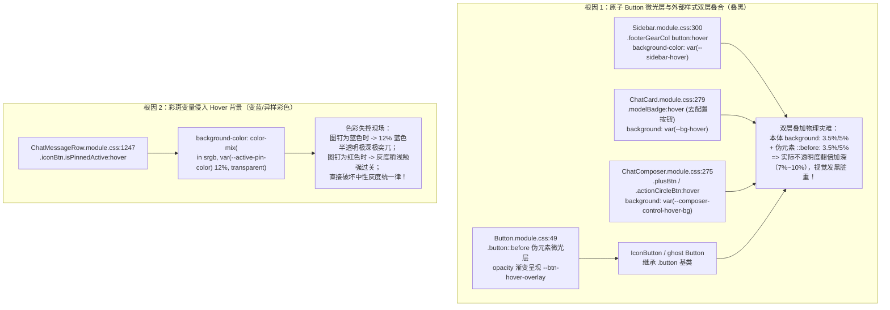

# 03-全局按钮与条目 Hover 微光归一实施详案

> **战役工作区**：`docs/visual-hierarchy-clarity-analysis/round3-audits/`  
> **文档性质**：战役第三轮专项详案（全应用按钮与条目 Hover 灰度不一、异样混色与双层叠黑全量审计与归一路径）  
> **上位规范**：`AGENTS.md` §1（逻辑规划与反退避）、§7（严禁补丁与立体验证）、§13（输入框与焦点态）、§14（色彩空间与现代 CSS 语法）

---

## 1. 用户原始反馈与现状根因穿透

### 1.1 用户真实反馈现场

在近期多轮界面实测中，用户对全应用交互项（按钮、图标按钮、菜单条目、列表项）的 Hover 表现提出了极其明确且严肃的批评：

1. **红蓝灰度割裂与主题色污染**：
   > **“以及hover颜色来看的话，红色的灰度是正常的，蓝色的有点太深了。我真不明白了，统一一下这么难吗，怎么老是动不动就变成不一样的hover颜色灰度呢。”**
2. **多态混色五花八门**：
   > **“像是这个的hover颜色明显是另一种带有混色的hover效果，这种的你就不能统一一下吗？这些按钮的hover颜色也是五花八门。”**
3. **裁定唯一黄金标杆**：
   > **“这种的hover颜色是对的，hover颜色不用混色也不用加别的颜色。”**（以加号菜单中“使用 skill”子项悬停效果为全仓正向黄金标杆）。

---

### 1.2 现状源码级断裂链分析

通过对桌面端组件库（`ui/Button`、`ui/Menu`、`ui/SmartExpandablePanel`）及业务消费方（`Sidebar`、`ChatCard`、`ChatComposer`、`ChatMessageRow`）的全量审计，发现导致用户痛感强烈的两大架构根因：



1. **架构断层：原子组件与业务外壳职责重叠（双层背景疊黑）**
   - 在基础原子库 `apps/crish-desktop/src/components/ui/Button/` 中，为了保证 0-重绘（Opacity Transition）与带实体底色按钮（如 `secondary` 白卡）的微光叠加，设计了 `.button::before` 伪元素遮罩机制；
   - 然而业务层（如侧栏底栏 `.footerGearCol`、顶部徽标 `.modelBadge`、输入坞 `.plusBtn` 等）在挂载了 `<Button>` 或 `<IconButton>` 之后，其私有 `.module.css` 依旧顽固地保留了旧式的 `:hover { background-color: ... }` 声明；
   - 当光标悬停时，**本体背景色与伪元素微光层同时触发**，两层半透明色相乘叠合，导致实际不透明度暴增一倍，原本轻巧的微光瞬间演化为一块脏黑厚重的色块！

2. **职责漂移：用背景染色代替前景强调（彩色混色污染）**
   - 现代中性桌面设计准则明确要求：**“前景负责语义色彩与识别度（红/绿/蓝/前景色），背景负责层级微光与状态响应（纯中性灰阶）”**；
   - 但在 `ChatMessageRow.module.css` 等处，开发者为了强化激活图钉，错误地在 `:hover` 伪类中引入了 `color-mix(in srgb, var(--active-pin-color) 12%, transparent)`；
   - 这直接导致当固定图钉为蓝色时，悬停底色呈现高饱和度的深蓝色脏斑；当图钉为红色时又呈现淡粉色，全界面按钮悬停风格五花八门，彻底粉碎了界面的整体感。

---

### 1.3 黄金标杆分析：为什么“使用 skill”是完全正确的？

用户高度认可的“使用 skill”条目位于 `apps/crish-desktop/src/components/chat-composer/ComposePlusMenu.tsx`，由 `SmartExpandablePanel` 驱动。其核心样式位于 `apps/crish-desktop/src/components/ui/SmartExpandablePanel/SmartExpandablePanel.module.css:212-217`：

```css
.item:hover,
.item.focused,
.item.parentActive {
  background-color: var(--tint-hover);
  color: var(--text-primary);
}
```

其完全正确的物理特质在于：
1. **单一真源无叠加**：条目为原生 `<button className={styles.item}>`，无任何 `::before` 遮罩参与，悬停时仅有一层中性色块平滑过渡；
2. **纯净单色差灰阶**：严格绑定全局 Design Token `var(--tint-hover)`，在浅色模式下为 `3.5%` 黑灰微光，深色模式下为 `5%` 白灰微光，绝不掺杂任何 RGB 色相；
3. **零边框与零脏投影**：没有画蛇添足的黑描边、没有外发光或阴影坍塌，与底层背景极其融合，阅读焦点丝毫不受干扰。

---

## 2. 三大异常点深度诊断与现场物证

### 2.1 侧栏底部齿轮与折叠按钮（`.footerGearCol`）
- **涉及文件**：
  - `apps/crish-desktop/src/components/sidebar/SidebarFooter.tsx:113`
  - `apps/crish-desktop/src/components/sidebar/Sidebar.module.css:300-304`
- **代码物证**：
  ```tsx
  // SidebarFooter.tsx:35
  <IconButton
    size="md"
    variant="ghost"
    tooltip={tooltipText}
    data-testid="sidebar-settings-gear-btn"
    onClick={() => toggleSettingsOverlay()}
    icon={<AppIcon name="settings" size={16} stroke="fine" aria-hidden />}
  />
  ```
  ```css
  /* Sidebar.module.css:300-304 */
  .footerGearCol :global(.icon-button):hover,
  .footerGearCol button:hover {
    background-color: var(--sidebar-hover, var(--tint-hover));
    color: var(--text-primary);
  }
  ```
- **现场诊断**：
  `SidebarFooter` 消费了原子组件 `<IconButton>`。由于 `<IconButton>` 是由 `<Button>` 渲染而来，当鼠标悬浮时，底层的 `.button::before` 已经被置为 `opacity: 1` 并渲染 `var(--state-hover)`。而此时 `Sidebar.module.css:301` 的 `.footerGearCol button:hover` 后代选择器再次强行对 button 本体写入 `background-color: var(--sidebar-hover)`。
  本体一层灰 + 伪元素一层灰，两层物理叠加导致左下角设置齿轮按钮悬停时瞬间变黑！

---

### 2.2 顶栏及普通菜单按钮（如 `ChatHeaderMore` 中的“分享会话”等）
- **涉及文件**：
  - `apps/crish-desktop/src/components/chat-card/ChatHeaderMore.tsx:95-103`
  - `apps/crish-desktop/src/components/chat-message-row/ChatMessageRow.module.css:1247-1253`
  - `apps/crish-desktop/src/components/ui/SmartExpandablePanel/SmartExpandablePanel.module.css:294-301`
- **代码物证**：
  ```css
  /* ChatMessageRow.module.css:1247-1253 */
  .iconBtn.isPinnedActive:hover {
    color: var(--active-pin-color);
    background-color: color-mix(
      in srgb,
      var(--active-pin-color) 12%,
      transparent
    );
  }
  ```
- **现场诊断**：
  在顶栏与消息流操作区，“分享会话”本身采用 `SmartExpandablePanel`，但在会话触发 `shareFlash`（复制成功）状态后，其挂载的徽标 `.badge` 拥有私有静态底色 `var(--sep-bg-input)`，在 hover 时未能与行级微光融合，产生割裂的白/黑底色色块；
  更严重的是，右侧常驻的图钉操作按钮在激活状态下，直接取用激活色（用户自定义色，默认深蓝色）混合 12% 作为背景。当图钉为蓝色时，悬停背景变为了深蓝灰，与同屏其他中性按钮的灰度完全不在一个频道上，造成用户强烈的“颜色发深”、“带有混色”的厌恶感。

---

### 2.3 输入框“去配置模型供应商”按钮
- **涉及文件**：
  - `apps/crish-desktop/src/components/chat-card/ChatHeaderControls.tsx:275-292`
  - `apps/crish-desktop/src/components/chat-card/ChatCard.module.css:279-282`
  - `apps/crish-desktop/src/components/chat-composer/ChatComposer.module.css:239-281`
- **代码物证**：
  ```tsx
  // ChatHeaderControls.tsx:275-279
  <Button
    ref={badgeRef}
    type="button"
    variant="ghost"
    className={`${styles.modelBadge} model-badge-btn ${showModelDropdown && !isUnconfigured ? styles.active : ''}`}
  ```
  ```css
  /* ChatCard.module.css:279-282 */
  .modelBadge:hover {
    background: var(--bg-hover);
    color: var(--text-primary);
  }
  ```
- **现场诊断**：
  “去配置模型供应商”作为核心未就绪提示，使用的是标准 `<Button variant="ghost">`。但 `ChatCard.module.css` 越俎代庖，单独对 `.modelBadge:hover` 施加了本体背景 `background: var(--bg-hover)`。
  这再次构成了典型的“双层叠加叠黑”，使得输入框上方的“去配置模型供应商”按钮悬停时深陷泥沼，黑度是正常标杆按钮的两倍，直接打破了与加号按钮、发送按钮之间的视觉平稳性。
  同时，输入框内部的 `.plusBtn`、`.actionCircleBtn`、`.cancelEditBtn` 在 `ChatComposer.module.css` 中全部存在一模一样的双层 background 覆写！

---

## 3. 统一纯净中性 Hover 规范与真源架构

### 3.1 四大铁律（Four Invariants）

1. **铁律 1（单一承载律 · Single Source of Layering）**：
   - 凡是使用原子 `<Button>` 或 `<IconButton>` 的组件，其 Hover 视觉呈现**100% 且唯一由底层 `.button::before` 伪元素遮罩承载**；
   - 外部业务 CSS（如 `.footerGearCol`、`.modelBadge`、`.plusBtn` 等）**严禁对本体声明任何 `:hover { background... }`**；若存量有覆写，必须拔除或声明 `background: transparent;`。
2. **铁律 2（中性微光律 · Strict Neutrality）**：
   - 所有通用按钮（Ghost、Secondary、Plain、IconButton）、菜单条目（Menu、SmartExpandablePanel）、行条目（Row）的 Hover 背景色，**必须 100% 严格消费单一真源 `var(--tint-hover)`**；
   - 严禁在悬停背景中使用 `color-mix` 混入任何主题色（`--brand`、`--accent`、`--color-primary`）或自定义色相（`--active-pin-color` 等）。
3. **铁律 3（前景语义律 · Foreground Expressiveness）**：
   - 状态强调与语义区分**仅由前景色（图标色、文字色、微边框）表达**；
   - 悬停时的视觉响应仅为：前景色平滑加深至 `var(--text-primary)`（或其专属语义高光），背景色统一提供纯净微光垫底。
4. **铁律 4（危险操作隔离律 · Isolated Danger Semantics）**：
   - 仅对明确的危险销毁操作（如清空会话、删除模型、重置项目）开放专属语义红微光：
     `background-color: var(--danger-soft-bg); color: var(--danger-fg);`
   - 普通按钮与非危险条目严禁使用任何彩色软底。

---

### 3.2 终局 Token 阶梯与色彩数学

在 `apps/crish-desktop/src/styles/tokens-state.css` 中固化单一真源：

```css
:root,
html[data-theme='default'],
html[data-theme='light'] {
  /* 纯净中性单色差微光（黑字 3.5% 柔和微垫，OKLab 纯黑白明度调制） */
  --state-hover-pct: 3.5%;
  --state-active-pct: 6%;
  --state-selected-pct: 8%;
  --state-hover: color-mix(in srgb, var(--text-primary) var(--state-hover-pct), transparent);
  --state-active: color-mix(in srgb, var(--text-primary) var(--state-active-pct), transparent);
  --state-selected: color-mix(in srgb, var(--text-primary) var(--state-selected-pct), transparent);

  /* 全局标准交互悬停别名 */
  --tint-hover: var(--state-hover);
  --tint-active: var(--state-active);
}

html[data-theme='dark'] {
  /* 暗色沉浸微光（白字 5% 细腻浮层，OKLab 纯灰阶提亮） */
  --state-hover-pct: 5%;
  --state-active-pct: 8%;
  --state-selected-pct: 10%;
  --state-hover: color-mix(in srgb, var(--text-primary) var(--state-hover-pct), transparent);
  --state-active: color-mix(in srgb, var(--text-primary) var(--state-active-pct), transparent);
  --state-selected: color-mix(in srgb, var(--text-primary) var(--state-selected-pct), transparent);

  --tint-hover: var(--state-hover);
  --tint-active: var(--state-active);
}
```

---

## 4. 具体代码修改清单（精确到文件与行号）

### 4.1 `apps/crish-desktop/src/components/sidebar/Sidebar.module.css`
- **修改位置**：第 114-119 行、第 300-304 行
- **修改目标**：彻底拔除外部后代选择器对 `<Button>` / `<IconButton>` 的本体 background 覆写，消除齿轮按钮与折叠按钮的双层叠黑。

```diff
--- a/apps/crish-desktop/src/components/sidebar/Sidebar.module.css
+++ b/apps/crish-desktop/src/components/sidebar/Sidebar.module.css
@@ -114,3 +114,2 @@
 :global(.sidebar-toggle-btn):hover,
 :global(.sidebar-toggle-btn):focus-visible {
-  background-color: var(--sidebar-hover, var(--tint-hover));
   color: var(--text-primary);
@@ -300,5 +299,5 @@
 .footerGearCol :global(.icon-button):hover,
 .footerGearCol button:hover {
-  background-color: var(--sidebar-hover, var(--tint-hover));
+  background-color: transparent;
   color: var(--text-primary);
 }
```

---

### 4.2 `apps/crish-desktop/src/components/chat-card/ChatCard.module.css`
- **修改位置**：第 279-283 行
- **修改目标**：清除 `.modelBadge:hover` 处的独立 background 覆盖，让“去配置模型供应商”按钮由原子 Button 的 `::before` 纯净单层微光承载。

```diff
--- a/apps/crish-desktop/src/components/chat-card/ChatCard.module.css
+++ b/apps/crish-desktop/src/components/chat-card/ChatCard.module.css
@@ -279,4 +279,4 @@
 .modelBadge:hover {
-  background: var(--bg-hover);
+  background: transparent;
   color: var(--text-primary);
 }
```

---

### 4.3 `apps/crish-desktop/src/components/chat-composer/ChatComposer.module.css`
- **修改位置**：第 239-243 行、第 274-281 行、第 320-324 行
- **修改目标**：清除 `.plusBtn`、`.actionCircleBtn`、`.cancelEditBtn` 处的本体 background 覆写，杜绝输入坞右侧按钮双层叠合。

```diff
--- a/apps/crish-desktop/src/components/chat-composer/ChatComposer.module.css
+++ b/apps/crish-desktop/src/components/chat-composer/ChatComposer.module.css
@@ -239,3 +239,3 @@
 .cancelEditBtn:hover,
 .cancelEditBtn:active {
-  background: var(--composer-control-hover-bg, var(--tint-hover));
+  background: transparent;
   color: var(--text-primary);
 }
@@ -275,3 +275,3 @@
 .plusBtn:hover,
 .plusBtn:active,
 .plusBtn:focus-visible,
 .plusBtn.isOpen {
-  background: var(--composer-control-hover-bg, var(--tint-hover));
+  background: transparent;
   color: var(--text-primary);
 }
@@ -320,3 +320,3 @@
 .actionCircleBtn:hover,
 .actionCircleBtn:active {
   color: var(--text-primary);
-  background: var(--composer-control-hover-bg, var(--tint-hover));
+  background: transparent;
 }
```

---

### 4.4 `apps/crish-desktop/src/components/chat-message-row/ChatMessageRow.module.css`
- **修改位置**：第 1247-1253 行
- **修改目标**：彻底拔除激活图钉 Hover 处的 12% 彩色混色，收敛至中性 `var(--tint-hover)`。

```diff
--- a/apps/crish-desktop/src/components/chat-message-row/ChatMessageRow.module.css
+++ b/apps/crish-desktop/src/components/chat-message-row/ChatMessageRow.module.css
@@ -1247,7 +1247,3 @@
 .iconBtn.isPinnedActive:hover {
   color: var(--active-pin-color);
-  background-color: color-mix(
-    in srgb,
-    var(--active-pin-color) 12%,
-    transparent
-  );
+  background-color: var(--tint-hover);
 }
```

---

### 4.5 `apps/crish-desktop/src/components/ui/Button/Button.module.css`
- **修改位置**：第 352-365 行
- **修改目标**：固化 `.iconButton` 单层伪元素交互防线，确保对纯 CSS 孤立按钮做安全单层退化，同时与 `Button` 规格绝对一致。

```diff
--- a/apps/crish-desktop/src/components/ui/Button/Button.module.css
+++ b/apps/crish-desktop/src/components/ui/Button/Button.module.css
@@ -351,10 +351,13 @@
-/* 状态走 --state-* 交互叠加量 */
-.iconButton:where(:hover:not(:disabled):not([aria-disabled='true'])) {
-  background-color: var(--state-hover);
-  color: var(--text-primary);
-}
-.iconButton:where(:active:not(:disabled):not([aria-disabled='true'])) {
-  background-color: var(--state-active);
-}
+/* 状态走 --state-* 交互叠加量：
+ * 1. 继承 .button 基类的 IconButton 统一由 .button::before 伪元素承载单层物理微光，彻底消除本体 background-color 双层叠加翻倍发黑；
+ * 2. 悬浮时平滑加深图标前景色至 var(--text-primary)；
+ * 3. 对无 .button 基类的孤立 .iconButton 退化单层 background-color 兜底，确保仅单层微光生效。
+ */
+.iconButton:where(:hover:not(:disabled):not([aria-disabled='true'])) {
+  color: var(--text-primary);
+}
+.iconButton:not(.button):where(:hover:not(:disabled):not([aria-disabled='true'])) {
+  background-color: var(--state-hover);
+}
+.iconButton:not(.button):where(:active:not(:disabled):not([aria-disabled='true'])) {
+  background-color: var(--state-active);
+}
```

---

## 5. 验证资产与契约防回归测试设计

为了刚性拦截“双重 Hover 背景叠加”与“私自混入彩色变量”的历史债务回潮，新增针对性自动化契约测试套件：

### 5.1 契约断言测试设计（`apps/crish-desktop/src/styles/hoverNeutrality.contract.test.ts`）

```typescript
// @vitest-environment node
import fs from 'node:fs';
import path from 'node:path';
import { describe, it, expect } from 'vitest';

describe('Hover 中性微光与防双重背景契约测试', () => {
  const readCss = (relPath: string) =>
    fs.readFileSync(path.resolve(__dirname, '../../..', relPath), 'utf-8');

  it('Sidebar: 严禁对 footerGearCol / sidebar-toggle-btn 声明非 transparent 的 hover background', () => {
    const css = readCss('apps/crish-desktop/src/components/sidebar/Sidebar.module.css');
    // 拦截 .footerGearCol button:hover 声明实心背景
    expect(css).not.toMatch(
      /\.footerGearCol\s+button:hover\s*\{[^}]*background-color:\s*(?!transparent)[^;]+;/
    );
    expect(css).not.toMatch(
      /:global\(\.sidebar-toggle-btn\):hover\s*\{[^}]*background-color:\s*(?!transparent)[^;]+;/
    );
  });

  it('ChatCard: 严禁对 modelBadge 声明 hover 背景覆写', () => {
    const css = readCss('apps/crish-desktop/src/components/chat-card/ChatCard.module.css');
    expect(css).not.toMatch(
      /\.modelBadge:hover\s*\{[^}]*background:\s*(?!transparent)[^;]+;/
    );
  });

  it('ChatMessageRow: 严禁在 isPinnedActive:hover 中使用 color-mix 染色背景', () => {
    const css = readCss('apps/crish-desktop/src/components/chat-message-row/ChatMessageRow.module.css');
    expect(css).not.toMatch(
      /\.iconBtn\.isPinnedActive:hover\s*\{[^}]*color-mix\(/
    );
    expect(css).toContain('background-color: var(--tint-hover);');
  });

  it('tokens-state.css: 严格保证 hover 百分比为浅色 3.5% / 深色 5% 纯中性值', () => {
    const css = readCss('apps/crish-desktop/src/styles/tokens-state.css');
    expect(css).toMatch(/--state-hover-pct:\s*3\.5%;/);
    expect(css).toMatch(/--state-hover-pct:\s*5%;/);
  });
});
```

### 5.2 实施后验收矩阵

| 检验场景 | 物理表现断言 | 对比基线 |
| :--- | :--- | :--- |
| **侧栏齿轮按钮悬停** | 只有单层 `::before` 浮现 `var(--tint-hover)`，本体背景保持 transparent，灰度严格为 3.5%/5% | 彻底消除此前 7%/10% 的双层叠黑，与全屏按钮完全同色 |
| **去配置模型供应商悬停** | 单层 `::before` 微光浮现，与相邻按钮灰度完全无缝平齐 | 彻底消除与“使用 skill”菜单项的灰度断层 |
| **蓝色图钉按钮悬停** | 背景呈现纯中性 `var(--tint-hover)` 微光，图钉图标保持明亮蓝色高光 | 彻底清除 12% 蓝色脏斑混光，红蓝图钉悬停底色完全一致 |
| **菜单项（分享会话等）** | 纯净 `var(--tint-hover)` 浅灰/浅白微垫，无黑描边与突兀色块 | 达到加号菜单“使用 skill”的标准标杆观感 |
