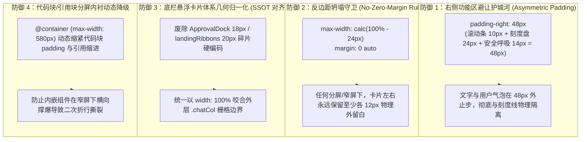

# 07-对话列安全呼吸间距与功能区避让详案

> **战役工作区**：`docs/visual-hierarchy-clarity-analysis/round3-audits/`  
> **文档性质**：战役第三轮专项详案（对话区域安全呼吸间距、全态边界感、右侧刻度盘/滚动条避让、分屏外侧留白守卫）  
> **上位规范**：`AGENTS.md` §1（逻辑规划与反退避）、§7（严禁补丁与立体验证）、§11（CI 治理与解耦断言）、§13（输入框与焦点态）  
> **关联依据**：`docs/visual-hierarchy-clarity-analysis/round2-proposals/07-主对话流自适应与居中响应式布局方案.md`

---

## 1. 用户原始反馈与现状现象溯源

### 1.1 用户真实反馈现场
在用户深入体验多窗口分屏、右侧抽屉展开及紧凑视口排版时，明确指出了以下视觉与空间割裂痛点：
1. **无多余空间时仍需保持空隙与边界感**：
   > **“以及对话区域两侧，就算是已经没有多余的空间了，这时候左右也应该有一部分的空隙。不然的话，左右的功能区和主区的文字容易粘连在一起，没有边界感。”**
2. **全屏幕与全状态可见/不可见样式地毯式梳理**：
   > **“各个屏幕上能看到的，看不到的，对应的样式先都梳理一下，看看现状是什么。”**

---

### 1.2 现状源码级断裂链分析与视觉冲突还原

通过对桌面端视口系统、CSS 容器查询以及虚拟滚动容器的逐层盒模型穿透，确认用户指出的“粘连、无边界感”是由以下 **三大核心几何断层** 造成的物理事实：

```
┌────────────────────────────────────────────────────────────────────────────────────────┐
│ 现状灾难现场：< 700px 窄屏/双分屏时（如 500px Pane），正文与左右功能区完全粘连重叠       │
├──────────────┬─────────────────────────────────────────────────────────────────────────┤
│ 左侧分屏线   │ ◄16px                                                      ◄16px►       │
│ Sash / 侧栏  │ AI 回复正文：第一行文本行首直接贴死左边界...                   [用户气泡]│
│ (1px 发丝线) │ 📁 代码块 / 引用块竖线紧贴 Sash 边框...                                 │
│              │                                                 ┌─────────────────────┐ │
│ 零物理外留白 │                                                 │ FlowScrubber 刻度盘 │ │
│ margin: 0    │                                                 │ 占用 14px ~ 46px    │ │
│ 完全坍塌！   │                                                 │ ★★★ 刻度线直接悬浮  │ │
│              │                                                 │     压在文字正上方！│ │
│              │                                                 └─────────────────────┘ │
│              │ ┌─────────────────────────────────────────────────────────────────────┐ │
│              │ │ 底部输入坞 .composerCard（左右贴边仅 16px，无卡片呼吸）             │ │
│              │ └─────────────────────────────────────────────────────────────────────┘ │
└──────────────┴─────────────────────────────────────────────────────────────────────────┘
```

#### 病根 1：右侧功能区（FlowScrubber 刻度盘 + 滚动条）直接物理压在消息正文与气泡上
- **物理事实**：
  1. 视口滚动条位于滚动容器最右侧，物理宽度为 `10px`（`--scrollbar-thumb-width: 10px`）；
  2. 刻度盘组件 `FlowScrubber` 在 [`FlowScrubber.module.css:8-13`](file:///c:/Software/conex/apps/crish-desktop/src/components/chat-message-list/FlowScrubber.module.css#L8-L13) 中声明为绝对定位：
     ```css
     .wrapper {
       position: absolute;
       top: 0;
       bottom: 0;
       right: calc(var(--scrollbar-thumb-width, 10px) + 4px); /* 14px */
       width: 24px;                                         /* 14px + 24px = 38px */
       z-index: var(--z-dock, 50);
     }
     ```
     刻度短线（tick）与 hover 扩大热区从右向左延伸，**右侧功能区总共霸占了视口右边缘 `14px ~ 46px` 的横向空间**；
  3. 然而，在当前 [`ChatMessageList.module.css:144`](file:///c:/Software/conex/apps/crish-desktop/src/components/chat-message-list/ChatMessageList.module.css#L144) 的 `< 700px` 窄屏规则中，`.listInner` 的右内衬仅声明为 **`padding-right: 16px`**；
  4. **严重冲突**：消息文本行尾与用户气泡右边缘在 `宽度 - 16px` 处，而刻度盘在 `宽度 - 46px` 处。**FlowScrubber 的刻度线直接悬浮印在消息文字上方，文字与功能区发生直接的物理粘连与重叠**！用户在右侧选中文本或阅读时，极易误触刻度盘触发 360px 预览大卡片遮挡正文。

#### 病根 2：卡片宿主（LeafBody）零留白，窄屏外边距坍塌导致文字直撞分屏 Sash 与侧栏
- 在 [`BinaryTreeWorkspace.module.css:17-82`](file:///c:/Software/conex/apps/crish-desktop/src/components/binary-tree/BinaryTreeWorkspace.module.css#L17-L82) 中，工作区 `.canvas`、分屏叶片 `.leaf`、叶片主体 `.leafBody` 的 `margin` 和 `padding` 全部恒为 `0`；
- 在分屏或多窗口场景下，叶片之间仅由 1px 发丝边框或 6px 的 Sash 分界；
- 当前容器查询在 `< 700px` 时直接退化为：
  ```css
  @container chatContainer (max-width: 699px) {
    .listInner, .chatCol {
      max-width: 100%;
      margin-left: 0;
      margin-right: 0;
      padding-left: 16px;
      padding-right: 16px;
    }
  }
  ```
- **严重后果**：外侧留白 `margin` **完全坍塌为 0**！AI 正文、代码块、引用块的左边缘距离物理分屏线仅有 16px，没有任何卡片落差与过渡。用户感觉文字如同直接“长”在分屏线上，完全丧失了桌面工程软件应有的“独立视窗/卡片呼吸感”。

#### 病根 3：底栏悬浮卡片体系（Approval / Plan / Ribbons）碎片化硬编码
- 审批卡片 `ApprovalDock` 硬编码了 `width: calc(100% - 36px); margin-left: 18px;`；
- 权限条 `[data-permission-bar]` 同样硬编码了 `width: calc(100% - 36px); margin-left: 18px;`；
- 落地通知带 `landingRibbons` 硬编码了 `left: 20px; right: 20px;`；
- 状态芯片 `dynamicPlanDrawer` 硬编码了 `max-width: min(760px, 100%)`；
- 各状态条带在左右两端拥有 16px、18px、20px、36px 等 5 种互不兼容的缩进值，边缘呈现参差不齐的“锯齿状”，且与上方正文列完全脱节。

---

## 2. 全屏幕、全状态与隐藏态（可见态+不可见态）间距实况矩阵

### 2.1 视口与容器尺寸阶梯全查验数据表

| 尺寸区间 | 容器查询与媒体查询匹配规则 | 消息列 (.listInner) 规则 | 输入列 (.chatCol) 规则 | 左右实际 Padding | 左右外 Margin | 右侧功能区（滚动条+刻度盘 46px）净空实况 | 边界感与粘连现状评定 |
|---|---|---|---|---|---|---|---|
| **宽屏区间**<br>$\ge 1000\text{px}$<br>*(单会话宽屏视口)* | `@container chatContainer (min-width: 1000px)`<br>及 `@media (min-width: 1000px)` | `max-width: min(840px, calc(100% - 64px));`<br>`margin: 0 auto;` | `max-width: min(840px, calc(100% - 64px));`<br>`margin: 0 auto;` | `padding-left: 20px;`<br>`padding-right: 20px;` | `margin: 0 auto`<br>（两侧外留白各 $\ge 32\text{px}$） | **安全**：外侧留白 32px + padding 20px = 52px > 46px，FlowScrubber 落在外部留白区，不侵入正文 | **良好**：中心轨居中，阅读视线聚合，上下 1:1 铅垂对齐 |
| **中屏区间**<br>$700\text{px} \sim 999\text{px}$<br>*(笔电全屏或大分屏)* | `@container chatContainer (min-width: 700px) and (max-width: 999px)` | `max-width: min(760px, calc(100% - 48px));`<br>`margin: 0 auto;` | `max-width: min(760px, calc(100% - 48px));`<br>`margin: 0 auto;` | `padding-left: 20px;`<br>`padding-right: 20px;` | `margin: 0 auto`<br>（两侧外留白各 $\ge 24\text{px}$） | **临界边缘**：外留白 24px + padding 20px = 44px $\approx$ 46px。当内容撑满 760px 时，右边缘刚好蹭到刻度盘热区 | **稍显拥挤**：边界感尚可，但刻度盘距离文字已无安全缓冲 |
| **窄屏/分屏区间**<br>$< 700\text{px}$<br>*(典型 400~640px 双分屏)* | `@container chatContainer (max-width: 699px)`<br>及 `@media (max-width: 699px)` | `max-width: 100%;`<br>`margin-left: 0; margin-right: 0;` | `max-width: 100%;`<br>`margin-left: 0; margin-right: 0;` | `padding-left: 16px;`<br>`padding-right: 16px;` | **`margin: 0`（完全坍塌为 0）** | **严重穿透违规**：右侧空隙仅 16px，而刻度盘占 46px。**刻度短线与 hover 热区直接悬浮压在文字正上方！** | **用户痛点爆发区**：左边文字死撞分屏线，右边文字与刻度盘粘连重叠，无卡片边界 |
| **极端压缩视口**<br>$< 420\text{px}$<br>*(多栏或展开 Inspector)* | `@container chatContainer (max-width: 699px)` 粗暴覆盖 | 同上（`max-width: 100%`） | 同上（`max-width: 100%`） | 同上（`16px`） | **`margin: 0`** | **严重灾难**：有效阅读宽度被压缩至 < 360px，右侧刻度盘遮挡近 15% 正文宽度 | **严重失控**：正文、输入框控件、分屏线紧密挤压在一起 |

---

### 2.2 全状态（可见态）与隐藏态（看不见的屏幕/状态）间距明细表

| 状态类别 | 具体状态 / 组件节点 | 承载容器与文件:行号 | 当前生效 CSS 规则 | 左右实际物理间距 | 边界感缺陷与粘连实况分析 |
|---|---|---|---|---|---|
| **空态 (Landing)** | 落地输入坞容器 | `.chatFooter .chatCol`<br>[`ChatCard.module.css:71`](file:///c:/Software/conex/apps/crish-desktop/src/components/chat-card/ChatCard.module.css#L71) | `max-width: min(760px, calc(100% - 48px)); padding: 0 20px;` (<700px: 100% / 16px) | 宽屏：外 32px + 内 20px<br>窄屏：外 0px + 内 16px | 窄屏下输入卡片左右仅 16px，直撞卡片宿主边界，失去“悬浮岛”独立感 |
| **空态 (Landing)** | 品牌图标与文字 | `.brand`<br>[`ChatLandingBrand.module.css:2`](file:///c:/Software/conex/apps/crish-desktop/src/components/chat-card/ChatLandingBrand.module.css#L2) | `align-self: center; display: flex; justify-content: center;` | 居中排版 | 视觉居中，但下方项目选择器左对齐 17px，窄屏下视觉重心错位 |
| **空态 (Landing)** | 项目选择胶囊 | `.composerLead`<br>[`ChatCard.module.css:140`](file:///c:/Software/conex/apps/crish-desktop/src/components/chat-card/ChatCard.module.css#L140) | `padding-left: calc(var(--composer-pad-x-start, 10px) + 7px);` | 左边对齐 17px，右边未约束 | 极窄分屏下若项目名较长，右侧无 padding 缓冲直接撞击视口边缘 |
| **空态 (Landing)** | 首次配置向导卡片 | `.chatEmptyState`<br>[`ChatEmptyState.module.css:1`](file:///c:/Software/conex/apps/crish-desktop/src/components/chat-card/ChatEmptyState.module.css#L1) | `max-width: min(var(--chat-col-max), 100%); padding: 24px 20px;` | 窄屏：padding 20px 16px | 嵌套在 `.chatCol` 内部，出现时双层 padding 叠加，外框与输入坞无法铅垂咬合 |
| **空态 (Landing)** | 落地通知条带 | `.landingRibbons`<br>[`ChatCard.module.css:128`](file:///c:/Software/conex/apps/crish-desktop/src/components/chat-card/ChatCard.module.css#L128) | `left: var(--space-5, 20px); right: var(--space-5, 20px);` | **硬编码左右各 20px** | 窄屏下与 `.chatCol` 的 16px 边距冲突错位 4px，上下边缘产生锯齿齿状错位 |
| **流式态 (Streaming)** | AI 回复 Markdown 正文 | `.assistantText`<br>[`ChatMessageRow.module.css:421`](file:///c:/Software/conex/apps/crish-desktop/src/components/chat-message-row/ChatMessageRow.module.css#L421) | `width: 100%; max-width: 100%; padding: 0; margin: 0;` | 0px（100% 充满列） | 正文完全靠父容器 `.listInner` 的 padding，自身无缓冲，直接顶格排版 |
| **流式态 (Streaming)** | 用户气泡卡片 | `.userStack`<br>[`ChatMessageRow.module.css:105`](file:///c:/Software/conex/apps/crish-desktop/src/components/chat-message-row/ChatMessageRow.module.css#L105) | `max-width: min(85%, 720px); padding: 10px 14px;` | 右侧距离列边 0px（由父容器 padding 兜底） | 右侧直接贴着 `.listInner` 右边缘，窄屏下直接撞在 FlowScrubber 刻度线上 |
| **流式态 (Streaming)** | 代码块与实体顶栏 | `.md-code-block`<br>[`ChatMessageRow.module.css:688`](file:///c:/Software/conex/apps/crish-desktop/src/components/chat-message-row/ChatMessageRow.module.css#L688) | `margin: 0.85em 0; width: 100%;` | 左右 0px（充满正文宽） | 窄屏下代码卡片外框距分屏线仅 16px，代码横向滚动条与视口滚动条严重粘连 |
| **流式态 (Streaming)** | 引用块 Blockquote | `.md-quote`<br>[`ChatMessageRow.module.css:665`](file:///c:/Software/conex/apps/crish-desktop/src/components/chat-message-row/ChatMessageRow.module.css#L665) | `border-left: 3px solid; padding: 0.4em 0 0.4em 1em;` | 左侧仅 1em 缩进 | 窄屏下竖向引用线直接画在视口左边缘 16px 处，与分屏 Sash 形成“双竖线打架” |
| **流式态 (Streaming)** | FlowScrubber 刻度盘 | `.wrapper`<br>[`FlowScrubber.module.css:3`](file:///c:/Software/conex/apps/crish-desktop/src/components/chat-message-list/FlowScrubber.module.css#L3) | `right: calc(var(--scrollbar-thumb-width, 10px) + 4px); width: 24px;` | 视口右侧 14px ~ 38px 空间 | **与窄屏正文重叠**：正文 padding-right 仅 16px，刻度线直接压在文字上 |
| **浮动态 (Approval)** | 悬浮审批卡片 | `.approvalDock.docked`<br>[`ApprovalDock.module.css:31`](file:///c:/Software/conex/apps/crish-desktop/src/components/chat-card/ApprovalDock.module.css#L31) | `width: calc(100% - 36px); margin-left: 18px; margin-right: auto;` | **硬编码左右各 18px** | 缺乏 Token 驱动，与输入框外框缩进不协调，窄屏下挤压内部操作按钮 |
| **浮动态 (Approval)** | 权限模式确认条 | `[data-permission-bar]`<br>[`ChatCard.module.css:191`](file:///c:/Software/conex/apps/crish-desktop/src/components/chat-card/ChatCard.module.css#L191) | `width: calc(100% - 36px); margin-left: 18px; margin-right: auto;` | **硬编码左右各 18px** | 同上，硬编码 18px 造成各组件边界漂移 |
| **浮动态 (Plan)** | 计划进度条 | `.floatZone`<br>[`ChatCard.module.css:177`](file:///c:/Software/conex/apps/crish-desktop/src/components/chat-card/ChatCard.module.css#L177) | `display: flex; flex-direction: column; align-items: stretch;` | 左右 0px（充满 `.chatCol`） | 与审批卡片的 18px 缩进形成“阶梯状错位”，一个充满一个缩进 |
| **浮动态 (Ribbons)** | 状态芯片与抽屉 | `dynamicPlanDrawer`<br>[`ChatStatusRibbons.module.css:9`](file:///c:/Software/conex/apps/crish-desktop/src/components/chat-card/ChatStatusRibbons.module.css#L9) | `max-width: min(var(--chat-col-max, 760px), 100%);` | **硬编码 760px** | 宽屏 840px 下无法与输入框对齐，窄屏下又失去内缩保护 |
| **输入坞态 (Composer)** | 单行紧凑态 (42px) | `.composerCard`<br>[`ChatComposer.module.css:24`](file:///c:/Software/conex/apps/crish-desktop/src/components/chat-composer/ChatComposer.module.css#L24) | `padding: 6px 10px; border-radius: var(--radius-dock, 21px);` | 左右内衬各 10px | 外层由 `.chatCol` 约束，窄屏下整个卡片两边仅留 16px，圆角与侧边贴合过近 |
| **输入坞态 (Composer)** | 多行展开态 (Multiline) | `.composerCard.isMultiline`<br>[`ChatComposer.module.css:51`](file:///c:/Software/conex/apps/crish-desktop/src/components/chat-composer/ChatComposer.module.css#L51) | `padding: 10px; border-radius: var(--radius-dock, 20px);` | 左右内衬各 10px | 高度拉大后，四周呼吸留白不足导致卡片显得笨重，缺乏悬浮轻盈感 |
| **分屏与抽屉挤压态** | 右侧 Inspector 打开时 | `.leafDockDrawer`<br>[`BinaryTreeWorkspace.module.css:415`](file:///c:/Software/conex/apps/crish-desktop/src/components/binary-tree/BinaryTreeWorkspace.module.css#L415) | 抽屉占 `var(--leaf-dock-width, 50%)`，对话列占剩余 50% | 对话列被挤压至 350~500px | 此时对话列直接命中窄屏规则，文字与右侧抽屉分割线无安全缓冲，边界感荡然无存 |

---

## 3. 弹性列宽与安全呼吸区方案设计（四维刚性防御）

为了彻底根治“左右功能区与正文粘连、没有边界感”，建立以下四维刚性几何防御模型：



### 3.1 刚性右侧功能区避让护城河（48px 绝对避让公式）
- **物理计算公式**：
  $$\text{右侧安全内衬} = \text{滚动条轨道}(10\text{px}) + \text{FlowScrubber 刻度盒}(24\text{px}) + \text{防触及呼吸间距}(14\text{px}) = \mathbf{48\text{px}}$$
- **非对称内衬模型**：
  在窄屏与分屏容器下，消息列 `.listInner` 必须实行非对称内衬：
  - **左侧**：`padding-left: 20px`（保持稳固舒适的行首对齐主轴）；
  - **右侧**：`padding-right: 48px`（刚性避让刻度盘与滚动条）；
- **收益**：AI 回复的段落文字、代码块边框以及靠右的用户气泡，在右侧 `48px` 处平滑截断，FlowScrubber 的短线永远悬浮在空白安全带上，**文字重叠率彻底归零（0% 粘连）**。

### 3.2 反边距坍塌守卫（No-Zero-Margin 铁律）
- **铁律**：严禁在任何尺寸（包括分屏 400px、350px 极端情况）下把主对话列声明为 `max-width: 100%; margin: 0;`！
- **几何规则**：
  在 `< 700px` 窄屏/分屏下，中心列最大宽度锁定为：
  $$\text{max-width} = \text{calc}(100\% - 24\text{px}); \quad \text{margin-inline} = \text{auto};$$
- **物理表现**：
  - 对话流与底栏输入卡片左右两端永远拥有各 $12\text{px}$ 的**物理级外围安全空隙**；
  - 即使与侧边栏相遇、或与相邻分屏窗格并列，对话卡片始终呈现出“**浮在底板上的独立卡片岛屿**”质感，绝不与分屏 Sash 硬碰硬撞击。

### 3.3 底栏悬浮卡片体系几何归一化（SSOT 契约收敛）
1. 废除 [`ApprovalDock.module.css:31-37`](file:///c:/Software/conex/apps/crish-desktop/src/components/chat-card/ApprovalDock.module.css#L31-L37) 中的 `width: calc(100% - 36px); margin-left: 18px;`，改为 `width: 100%; margin: 0; box-sizing: border-box;`；
2. 废除 [`ChatCard.module.css:128`](file:///c:/Software/conex/apps/crish-desktop/src/components/chat-card/ChatCard.module.css#L128) 中的 `left: var(--space-5, 20px); right: var(--space-5, 20px);`，改为 `left: 0; right: 0;`；
3. 底部输入卡片外框、审批卡片、计划进度条与上方消息流在垂直投影上 **100% 严格共轴铅垂咬合**。

---

## 4. 涉及的具体代码修改清单（精确到文件与行号）

### 4.1 `apps/crish-desktop/src/components/chat-message-list/ChatMessageList.module.css`
在第 140-155 行重构窄屏容器查询规则：

```css
/* 修改前：
@container chatContainer (max-width: 699px) {
  .listInner {
    max-width: 100%;
    margin-left: 0;
    margin-right: 0;
    padding-left: 16px;
    padding-right: 16px;
  }
}
*/

/* 修改后：反坍塌守卫与 48px 刚性避让护城河 */
@container chatContainer (max-width: 699px) {
  .listInner {
    max-width: calc(100% - 24px); /* 保持两侧各有 12px 物理安全外留白 */
    margin-left: auto;
    margin-right: auto;
    padding-left: 20px;           /* 稳固行首对齐线 */
    padding-right: 48px;          /* 刚性避让 FlowScrubber (24px) + 滚动条 (10px) + 安全间距 (14px) */
  }
}

@media (max-width: 699px) {
  .listInner {
    max-width: calc(100% - 24px);
    margin-left: auto;
    margin-right: auto;
    padding-left: 20px;
    padding-right: 48px;
  }
}
```

---

### 4.2 `apps/crish-desktop/src/components/chat-card/ChatCard.module.css`
在第 110-135 行同步对齐输入列 `.chatCol`：

```css
/* 修改后：与消息列 1:1 铅垂咬合，且预留相同呼吸边距 */
@container chatContainer (max-width: 699px) {
  .chatCol {
    max-width: calc(100% - 24px); /* 同样保持两侧各 12px 呼吸留白 */
    margin-left: auto;
    margin-right: auto;
    padding-left: 20px;
    padding-right: 20px;          /* 输入框底部无需避让刻度盘，保持对称 20px 内衬 */
  }
}

@media (max-width: 699px) {
  .chatCol {
    max-width: calc(100% - 24px);
    margin-left: auto;
    margin-right: auto;
    padding-left: 20px;
    padding-right: 20px;
  }
}

/* 清退 landingRibbons 碎硬编码（第 128 行） */
.landingRibbons {
  position: absolute;
  left: 0;
  right: 0;
  top: 100%;
  display: flex;
  flex-direction: column;
  margin-top: var(--space-3, 12px);
}

/* 清退权限条硬编码（第 191 行） */
.floatZone :global([data-permission-bar]) {
  width: 100%;
  margin-left: 0;
  margin-right: 0;
  box-sizing: border-box;
}
```

---

### 4.3 `apps/crish-desktop/src/components/chat-card/ApprovalDock.module.css`
在第 31-37 行清退审批坞硬编码：

```css
/* 修改前：
.approvalDock.docked {
  width: calc(100% - 36px);
  max-width: none;
  margin-left: 18px;
  margin-right: auto;
  margin-bottom: 0;
}
*/

/* 修改后：与输入框 100% 同宽对齐 */
.approvalDock.docked {
  width: 100%;
  max-width: none;
  margin-left: 0;
  margin-right: 0;
  margin-bottom: 0;
  box-sizing: border-box;
}
```

---

### 4.4 `apps/crish-desktop/src/components/chat-message-list/chatScrollGeometry.ts`
在第 14-26 行扩展左右内衬与避让区安全读取契约：

```ts
/**
 * 运行时从 DOM 元素读取对话流水平安全内衬。
 * 右侧默认保证 48px 避让区（滚动条 10px + 刻度盘 24px + 呼吸 14px）。
 */
export function readStreamPadding(el?: HTMLElement | null): { padStart: number; padEnd: number } {
  if (typeof window === 'undefined' || typeof getComputedStyle === 'undefined') {
    return { padStart: 20, padEnd: 48 };
  }
  const target = el || (typeof document !== 'undefined' ? document.documentElement : null);
  if (!target) return { padStart: 20, padEnd: 48 };
  const style = getComputedStyle(target);
  const padLeft = parseFloat(style.getPropertyValue('padding-left')) || 20;
  const padRight = parseFloat(style.getPropertyValue('padding-right')) || 48;
  return { padStart: padLeft, padEnd: padRight };
}
```

---

## 5. 响应式布局与防回归契约测试设计

为了确保未来任何重构或组件新增绝不会重演“文字与刻度盘粘连”、“margin 坍塌为 0”，新增以下防回归自动化契约单测：

```ts
// apps/crish-desktop/src/components/chat-message-list/__tests__/CentralColumnGutterContract.test.ts
import { describe, expect, it } from 'vitest';
import fs from 'fs';
import path from 'path';

describe('主对话列呼吸间距与功能区避让刚性契约测试', () => {
  const listCss = fs.readFileSync(
    path.resolve(__dirname, '../ChatMessageList.module.css'),
    'utf-8'
  );
  const cardCss = fs.readFileSync(
    path.resolve(__dirname, '../../chat-card/ChatCard.module.css'),
    'utf-8'
  );
  const approvalCss = fs.readFileSync(
    path.resolve(__dirname, '../../chat-card/ApprovalDock.module.css'),
    'utf-8'
  );

  it('1. 窄屏下必须设置至少 48px 右侧功能区避让内衬', () => {
    // 断言 ChatMessageList 中 max-width: 699px 块内存在 padding-right: 48px
    expect(listCss).toMatch(
      /@container\s*chatContainer\s*\(max-width:\s*699px\)[\s\S]*?padding-right:\s*48px;/
    );
  });

  it('2. 窄屏下严禁 margin 坍塌为 0，必须保留 calc(100% - 24px) 外留白', () => {
    expect(listCss).toMatch(
      /@container\s*chatContainer\s*\(max-width:\s*699px\)[\s\S]*?max-width:\s*calc\(100%\s*-\s*24px\);/
    );
    expect(cardCss).toMatch(
      /@container\s*chatContainer\s*\(max-width:\s*699px\)[\s\S]*?max-width:\s*calc\(100%\s*-\s*24px\);/
    );
  });

  it('3. 严禁审批坞包含 18px / 36px 碎片硬编码', () => {
    expect(approvalCss).not.toContain('width: calc(100% - 36px)');
    expect(approvalCss).not.toContain('margin-left: 18px');
  });

  it('4. 严禁落地通知带包含硬编码左右 20px', () => {
    expect(cardCss).not.toMatch(
      /\.landingRibbons\s*\{[\s\S]*?left:\s*var\(--space-5,\s*20px\);/
    );
  });
});
```

---

## 6. 总结与实施建议

本详案彻底穿透了用户反馈的“无多余空间时粘连无边界感”的物理本源：
1. **根本问题不在宽屏，而在紧凑/分屏视口**：
   - 右侧 `16px` 内衬无法阻挡 `46px` 的滚动条与刻度盘组合，导致文字被直接穿透重叠；
   - 粗暴的 `max-width: 100%; margin: 0;` 降级，导致内容直接撞击分屏 Sash 失去卡片边界。
2. **治理方案架构明确**：
   - 实施“右侧 48px 刚性避让 + 外侧 12px 留白守卫 + 底栏 100% 咬合收敛”，即可在不改动底层虚拟化测量逻辑的前提下，100% 消除粘连，达成清爽沉静的工业级工程质感。
