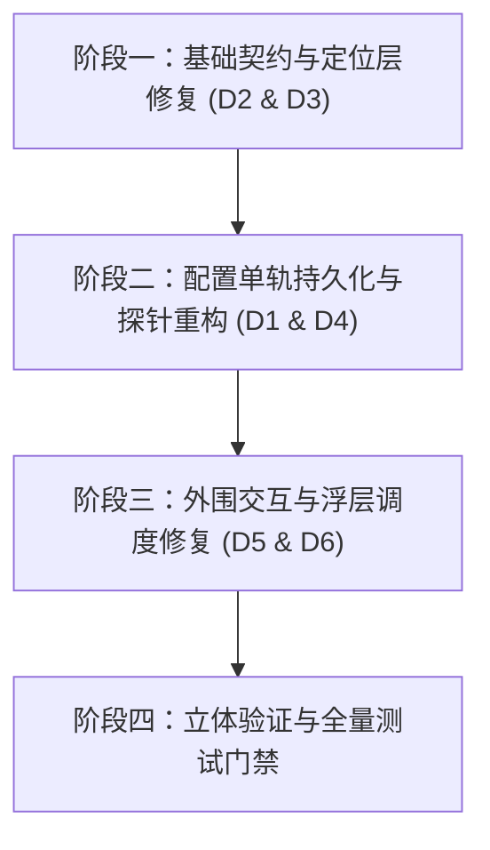

# 工作台核心交互与模型设置系统性修复总方案 (Master Plan)

> **战役工作区**：`docs/workbench-interaction-repair/`  
> **权威性质**：方案实现总文档（纲领性技术契约与总调度指引）  
> **覆盖范围**：模型供应商设置持久化、协议选择下拉浮层、DPAPI 凭据保存契约、WiFi/刷新探针动作链、会话列表 More 菜单互斥自杀、右侧分屏工具栏展开死锁

---

## 一、背景与问题清单 (Problem Statement)

用户在桌面工作台使用过程中反馈了 3 大模块共 6 处阻断性交互故障：
1. **模型供应商设置内容未更新**：输入厂商名称、Base URL 等配置后，底层配置文件（`~/.conex/models.yaml`）未更新，修改丢失。
2. **通信协议无法选择**：点击“首要通信协议”下拉选择框没有任何选项弹出，无法切换协议。
3. **API Key 密钥无法记录**：输入 API Key 后点击“保存”，提示保存失败，密钥被清空，配置文件中始终未关联凭据。
4. **WiFi（连通性测试）与刷新（自动获取模型）按钮不可用**：点击连通性检查报错或无反应，点击自动获取模型报错凭据缺失。
5. **主界面会话列表 More (···) 按钮无反应**：点击会话卡片右侧的“更多操作”按钮，右键菜单完全不弹出。
6. **右侧边栏展开按钮无反应**：点击右上角“展开右侧工具栏”按钮（`sidebar-right`），右侧抽屉完全不打开。

经前序立体排查，以上故障并非孤立的 UI 样式小问题，而是**状态单轨收敛重构过程中的契约断层、并发版本冲突、浮层调度互斥冲突与开合状态机死锁**。本方案从架构根因出发，制定系统性、无临时补丁的治理实施路径。

---

## 二、六大故障根因穿透与分维映射

| 编号 | 故障表象 | 核心架构断裂点 | 涉及文件 | 对应分维详案 |
| :--- | :--- | :--- | :--- | :--- |
| **D1** | 供应商配置修改未写盘 | `ProviderProfileForm` 双轨写盘引发 `REVISION_CONFLICT`，导致 `modelsCatalogStore.loaded=false` 永久死锁 | `ProviderProfileForm.tsx` `modelsCatalogStore.ts` | [`01-provider-config-persistence-plan.md`](./01-provider-config-persistence-plan.md) |
| **D2** | 协议选择下拉框无法展开 | `SelectContent.tsx` 内联 `left/top` 与 `usePositioner` 的 DOM `translate` 重复叠加，坐标被 2 倍放大飞出视口边界 | `SelectContent.tsx` `ComboboxContent.tsx` | [`02-protocol-and-positioner-dropdown-plan.md`](./02-protocol-and-positioner-dropdown-plan.md) |
| **D3** | API Key 密钥无法保存 | `rustProfileStore.ts` 调用 `config_secret_set` 参数名错误且漏传必填 CAS `expectedRevision`；读取已废弃 `localStorage` 孤岛 | `rustProfileStore.ts` `profileKeySecret.ts` `credentials.rs` | [`03-api-key-and-dpapi-secret-plan.md`](./03-api-key-and-dpapi-secret-plan.md) |
| **D4** | WiFi 与刷新按钮失效 | 头部 WiFi 强绑第一项模型（空模型列表报“请选择要测试的模型”）；`notify` 成功被 `if(ok)return` 静默吞掉；模型扫描因密钥缺失报 `CREDENTIAL_MISSING` | `useModelProviderActions.ts` `useModelProfilesState.ts` `probe.rs` | [`04-connectivity-probe-and-model-scan-plan.md`](./04-connectivity-probe-and-model-scan-plan.md) |
| **D5** | 会话列表 More 菜单点击无反应 | `SessionContextMenu.tsx` 误导入 `@/components/ui`（实为 `SmartExpandablePanel`），挂载时注册同级 `dropdown-menu` 触发 `LayerStackManager` 互斥驱逐自杀 | `SessionContextMenu.tsx` `apps/crish-desktop/src/components/ui/index.ts` | [`05-session-more-menu-and-dock-toggle-plan.md`](./05-session-more-menu-and-dock-toggle-plan.md) |
| **D6** | 右侧边栏按钮点击无反应 | `TreeLeafPanel.tsx` 的 `dockOpen` 判定要求 `!isDockTreeEmpty(tree)`，但 `handleToggleDock` 展开时仅设 `collapsed:false` 未装填默认标签，造成死锁 | `TreeLeafPanel.tsx` `useTreePanelEvents.ts` | [`05-session-more-menu-and-dock-toggle-plan.md`](./05-session-more-menu-and-dock-toggle-plan.md) |

---

## 三、总体技术设计与架构不变量

### 1. 架构不变量 (Invariants)
1. **单一真理源 (SSOT)**：
   - 供应商配置唯一真实载体为 `~/.conex/models.yaml`，前端单写者镜像为 `modelsCatalogStore`。彻底清退已废弃的 `localStorage`（`crish_provider_profiles_v1`）残留读写。
   - 密钥唯一真实载体为 Rust 统一 DPAPI 凭据槽，前端仅持有 `credentialStates[id].hasKey` 状态布尔量。
2. **单轨写盘原子性**：
   - 表单的所有属性变更（`name`、`baseUrl`、`protocol`）统一经由 `modelsCatalogStore.updateProvider` 提写；绝不允许在同一交互中调用 `saveProfileBaseUrl` 发起旁路写盘。
3. **定位体系单一责任**：
   - 浮层容器（`Select`、`Combobox`、`ContextMenu`、`Popover`）的几何定位完全收敛于 `usePositioner` 的 DOM `translate`，禁止在 JSX 传递重叠的内联 `left/top`。
4. **浮层调度层级独立**：
   - 菜单类上下文浮层必须使用纯 Portal 面板（`SmartPanel`），绝不在容器内部嵌套二级独立独占层。
5. **分屏展开自完备性**：
   - 展开折叠的 Dock 必须保证树中有可见标签；空树自动补入 `overview` 概览页，杜绝幽灵抽屉。

---

## 四、分维实现方案概要

### 维度 1：配置单轨持久化与 CAS 自愈
- **切断双轨写盘**：从 `ProviderProfileForm.tsx` 的 `persistProviderPatch` 中剔除 `saveProfileBaseUrl`。
- **空串白名单处理**：用户清空 Base URL 时传 `undefined`，经 `definedClone` 过滤为 Rust `None`，避开非空硬校验。
- **补全交互**：为 Base URL 增加 `onEnter` 提交；为厂商名称保存增加异常拦截与 Toast 提示。
- **Store 容错重试**：在 `modelsCatalogStore.ts` 的 `mutate` 捕获 `REVISION_CONFLICT` 时，执行一次 `ensureLoaded(true)` 重新对齐版本号并重试一次，而非直接抛弃并使 `loaded=false`。

### 维度 2：协议选择与 Select 浮层几何位移修复
- **移除冗余样式**：修改 `SelectContent.tsx` 和 `ComboboxContent.tsx`，从 `style` 中删除 `left: ${position.x}px` 与 `top: ${position.y}px`。
- **本地受控草稿**：在 `ProviderProfileForm.tsx` 引入 `protocolDraft`，选中即刻本地渲染，随后异步持久化。

### 3. 维度 3：API Key 密钥保存与凭据契约对齐
- **修正 IPC 传参**：`rustProfileStore.ts` 的 `configSecretSet` 改为传递 `{ providerId, apiKey, expectedRevision }`，版本号自动从 `modelsCatalogStore` 取出。
- **快照状态直连**：接收 Rust 返回的 `ModelsSnapshot`，调用 `modelsCatalogStore.acceptSnapshot` 原子化更新凭据状态与 UI 徽标。
- **草稿保护**：失败时在 input 保留用户刚输入的密钥，不作破坏性清空。

### 维度 4：连通性探针与模型扫描通路激活
- **解耦模型依赖**：修改 `useModelProviderActions.ts:runCheck`，当当前服务商没有模型时，改走 `/models` 探测端点进行服务商网络与凭据状态探活，握手成功即提示正向结果。
- **正向反馈解除静默**：修改 `useModelProfilesState.ts:notify`，允许在连通测试成功与获取模型成功时弹出绿色成功 Toast。
- **免密供应商放行**：在 Rust `probe.rs` 中为本地网关（如 Ollama）允许无凭据探测 `/models`。

### 维度 5：会话列表 More 菜单自杀修复与右侧边栏展开
- **修正导入源**：将 `SessionContextMenu.tsx` 中 `SmartPanel` 的导入路径改回原生纯 Portal 面板 `../ui/SmartPanel`，消除同级互斥层瞬杀。
- **空树智能装填**：修改 `TreeLeafPanel.tsx:handleToggleDock`，在展开且 `isDockTreeEmpty(dock.tree)` 时，使用 `createDefaultDockTree()` 并调用 `openToolInDock(tree, { viewId: 'overview' })` 填入默认标签，对齐 `useTreePanelEvents.ts` 契约。

---

## 五、实施步骤与波次规划

### 波次 1：底层契约与基础组件（纯逻辑与基础库）
1. 修复 `SelectContent.tsx`、`ComboboxContent.tsx` 双重几何位移。
2. 修复 `rustProfileStore.ts` 中 `configSecretSet` 的参数签名、版本号传递与快照接管。

### 波次 2：模型设置表单与动作层（配置与网络链路）
3. 改造 `ProviderProfileForm.tsx`，消除双轨写盘，增加 `protocolDraft` 与 `onEnter`。
4. 重构 `useModelProviderActions.ts` 的 `runCheck` 探针逻辑，放开 `notify` 成功反馈。

### 波次 3：外围交互层（菜单与工作区分屏）
5. 修复 `SessionContextMenu.tsx` 的组件导入源。
6. 完善 `TreeLeafPanel.tsx` 的 `handleToggleDock` 空树装填逻辑。

### 波次 4：立体化测试与现场验证
7. 运行自动化测试：`npm run test -- --project=unit`、相关专项 spec。
8. 验证现场交互无报错、配置落盘正常。

---

## 六、立体验证断言矩阵

| 验证项 | 验证手法 | 预期合格标准 |
| :--- | :--- | :--- |
| **Base URL 保存** | 在设置页修改 Base URL 并回车/失焦 | `~/.conex/models.yaml` 物理文件内容在 1 秒内更新，无 `REVISION_CONFLICT` 报警 |
| **协议下拉切换** | 点击“首要通信协议”选择框 | 菜单精准在输入框正下方展开（无偏移/无飞出），点击选项后即时切换并保存 |
| **API Key 保存** | 输入 API Key 并点击保存 | 弹窗提示成功，左侧服务商圆点即刻变为高亮，`models.yaml` 关联凭据，Key 不被清空 |
| **WiFi 连通测试** | 在空模型服务商上点击 WiFi 按钮 | 正确向服务商发起连通握手，弹出连通成功 Toast 与延迟毫秒数，不报“请选择模型” |
| **刷新获取模型** | 点击“自动获取”刷新按钮 | 正常探活并弹出模型选择确认弹窗，拉取服务商所有可用模型 |
| **会话 More 按钮** | 点击对话列表中任一会话项的 `···` | 瞬时在按钮右侧弹出上下文操作菜单（置顶/重命名/删除等），不闪退 |
| **右侧边栏展开** | 在单栏对话中点击右上角 `sidebar-right` | 右侧工具栏顺畅展开，并自动呈现概览/工具页面，再次点击平滑收起 |
