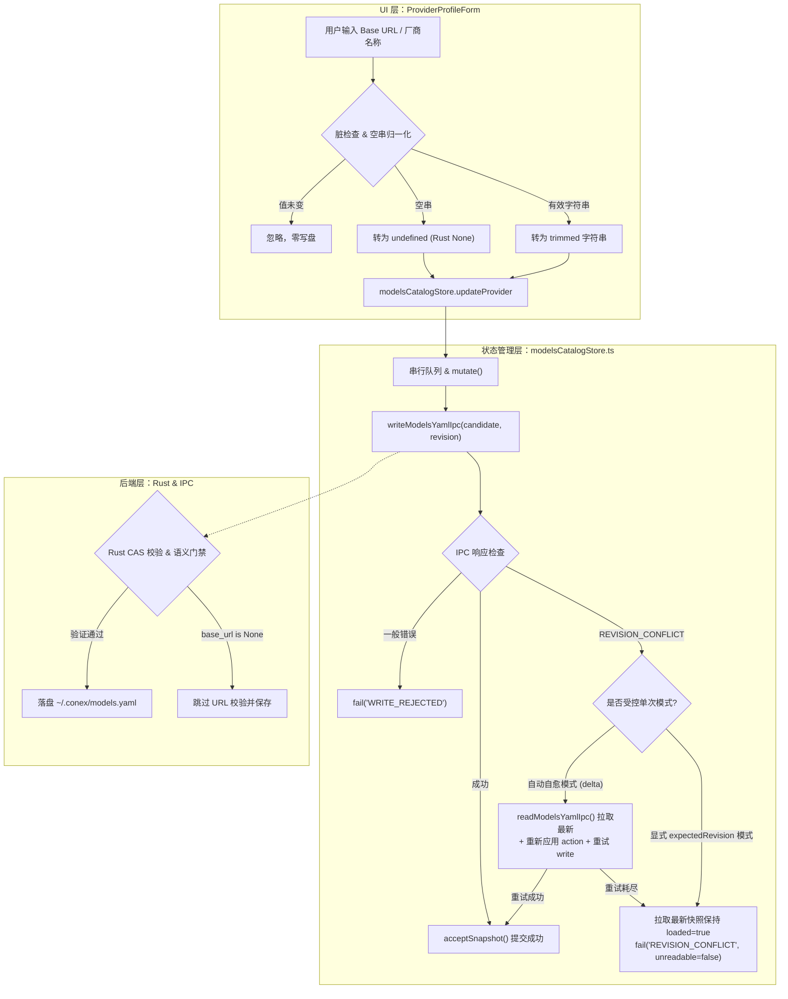

# 模型供应商设置配置持久化与 CAS 冲突自愈实现详案 (Plan 01)

> **战役工作区**：`docs/workbench-interaction-repair/`  
> **关联总纲**：[`00-workbench-interaction-repair-master-plan.md`](./00-workbench-interaction-repair-master-plan.md) §四.维度 1 (D1)  
> **涉及核心文件**：  
> - `apps/crish-desktop/src/components/settings-models/ProviderProfileForm.tsx`（模型服务商表单）  
> - `apps/crish-desktop/src/api/modelsCatalogStore.ts`（前端模型目录状态机与 IPC 写者）  
> - `apps/crish-desktop/src/components/settings-models/catalogWriteGate.ts`（服务商外壳写入守卫）  
> - `crates/agent-provider/src/models/config_validation.rs`（后端出站协议与 URL 语义门禁）  
> - `apps/crish-desktop/src/api/provider-profiles/profileStoreActivation.ts`（历史遗留 Profile 激活旁路）  

---

## 一、概述与治理目标

在工作台“设置 - 模型”页面中，用户在修改模型服务商信息时遇到了严重的“输入未生效/配置丢失”问题：
1. **输入 Base URL 或修改厂商名称后未保存到底层配置文件**：用户在输入框修改内容并点击保存或切换页面后，底层文件 `~/.conex/models.yaml` 毫无变化，再次刷新即刻回退。
2. **清除 Base URL 时弹出验证失败报错**：用户试图将自定义 Base URL 清空以回退到默认官方地址时，系统提示“供应商 xxx 的 baseUrl 不能为空”，无法清空。
3. **输入后直接敲击回车毫无响应**：Base URL 输入框不支持 Enter 回车触发保存，失焦（blur）与外部点击缺乏有效防抖与脏检查。
4. **单次失败后整个工作台配置模块永久死锁**：一旦发生过一次保存冲突或网络抖动，后续所有操作（包括添加模型、切换活动模型）均报“模型目录尚未成功加载，拒绝写盘以免覆盖用户文件”，必须彻底重启桌面客户端才能恢复。

经立体穿透分析，该故障是典型的**双轨写盘竞态冲突**叠加**致命级错误处理逻辑缺陷**导致的复合系统性崩溃：
- **双轨写盘冲突**：`ProviderProfileForm.tsx` 在保存 Base URL 时，既调用了历史遗留的 `saveProfileBaseUrl`（其内部悄悄向后端发送 IPC 写盘），又紧接着调用了统一模型目录单真理源 `modelsCatalogStore.updateProvider`。前者写盘成功导致后端修订版本号递增，后者携带旧版本号提交时必然遭遇 `REVISION_CONFLICT`（CAS 冲突）。
- **Store 永久瘫痪死锁**：`modelsCatalogStore.ts` 在处理 `REVISION_CONFLICT` 时，错误地将版本冲突标记为 `unreadable: true`，强行将 Store 状态置为 `loaded: false`。且内部缺乏任何自愈拉取与重试机制，导致整个 Store 永久陷入“未加载”死锁状态。
- **协议闸断裂**：用户清空 Base URL 时传递了空字符串 `""`，前端 `definedClone` 未过滤空串，后端 Rust 校验器 `validate_outbound_url` 强校验非空导致拒收报错。
- **UI 交互缺位**：Base URL 输入框缺失 `onEnter` 监听；厂商名称保存函数 `handleSaveVendorName` 缺失 `try/catch` 保护与用户反馈通知。

本详案旨在切断旁路双轨写盘，收敛至单真理源；实现空串向 `undefined` 的安全降级；建立 CAS 版本冲突自愈重试流水线，彻底终结 Store 瘫痪死锁。

---

## 二、现状断裂证据与根因穿透分析

### 1. 致命双轨写盘引发的 `REVISION_CONFLICT` 与 Store 永久死锁

#### 1.1 源码证据
定位至 [`ProviderProfileForm.tsx:111-122`](file:///c:/Software/conex/apps/crish-desktop/src/components/settings-models/ProviderProfileForm.tsx#L111-L122)：
```tsx
// apps/crish-desktop/src/components/settings-models/ProviderProfileForm.tsx:111-122
if (patch.baseUrl !== undefined) {
  await saveProfileBaseUrl(selected.id, patch.baseUrl); // 旁路写轨 A
}
const res = await modelsCatalogStore.updateProvider(selected.id, { // 主轨写盘 B
  ...patch,
  protocol: protocolForProviderWrite(
    patch.protocol ?? storeProvider?.protocol ?? selected.protocol
  ),
});
if (!res.ok) {
  notify(false, res.error || '保存失败');
}
```

深入审查 `saveProfileBaseUrl` 实现（[`profileStoreActivation.ts:41-61`](file:///c:/Software/conex/apps/crish-desktop/src/api/provider-profiles/profileStoreActivation.ts#L41-L61)）：
```ts
export async function saveProfileBaseUrl(
  profileId: string,
  baseUrl: string
): Promise<{ ok: boolean; error?: string; synced: boolean }> {
  const list = loadProfiles();
  const p = list.find((x) => x.id === profileId);
  if (!p) return { ok: false, error: 'profile_not_found', synced: false };

  p.baseUrl = baseUrl.trim();
  saveProfiles(list);

  if (getActiveProfileId() !== profileId) {
    return { ok: true, synced: false };
  }

  const model = (getActiveModelId() || p.models[0] || '').trim();
  // 危险：若该 profile 为当前活动项，直接调用 configProfileApply 写盘！
  const res = await configProfileApply({
    profileId,
    ...(p.baseUrl ? { baseUrl: p.baseUrl } : {}),
    ...(model ? { model } : {}),
  });
  ...
}
```

再看 `modelsCatalogStore.ts` 中失败处理机制（[`modelsCatalogStore.ts:187-208`](file:///c:/Software/conex/apps/crish-desktop/src/api/modelsCatalogStore.ts#L187-L208)）：
```ts
// apps/crish-desktop/src/api/modelsCatalogStore.ts:187-208
const requestRevision = state.revision;
const result = await writeModelsYamlIpc(candidate, requestRevision);
if (!result.ok) {
  return fail(
    result.kind === 'REVISION_CONFLICT'
      ? 'REVISION_CONFLICT'
      : 'WRITE_REJECTED',
    result.error,
    // 致命毒点：将 REVISION_CONFLICT 视为 unreadable=true！
    result.kind === 'REVISION_CONFLICT' ||
      result.code === 'CONTRACT_MISMATCH'
  );
}
```
以及 `fail` 函数中的状态变更（[`modelsCatalogStore.ts:152-159`](file:///c:/Software/conex/apps/crish-desktop/src/api/modelsCatalogStore.ts#L152-L159)）：
```ts
function fail(
  kind: ModelsCatalogError['kind'],
  message: string,
  unreadable = false
): ModelsCatalogWriteResult {
  state = {
    ...state,
    loaded: unreadable ? false : state.loaded, // loaded 被强行置为 false！
    version: state.version + 1,
    lastError: { kind, message },
  };
  notify();
  return { ok: false, error: message };
}
```

#### 1.2 时序竞态与瘫痪链路推演
当用户在“已配置”或“当前激活”的模型服务商中修改 Base URL 时，时序如下：
1. **第 1 毫秒**：用户修改 Base URL 触发失焦，`persistProviderPatch` 执行。
2. **第 5 毫秒（写轨 A）**：`saveProfileBaseUrl` 被调用。因当前服务商处于激活状态，它调用 `configProfileApply`，后者通过 IPC `workbench_apply_models_config` 将新 Base URL 写入磁盘。此时 Rust 后端的 `models.yaml` 文件修订版本由 $R$ 晋升为 $R+1$。
3. **第 15 毫秒（写轨 B）**：`ProviderProfileForm` 执行下一行代码：`modelsCatalogStore.updateProvider`。此时 `modelsCatalogStore` 的前端内存状态根本不知道写轨 A 偷偷修改了底层文件，其记录的 `state.revision` 依然是旧的 $R$。
4. **第 20 毫秒（CAS 碰撞）**：`modelsCatalogStore` 将带版本号 $R$ 的更新请求发送给后端。Rust 后端检查发现当前文件版本已为 $R+1$，$R \neq R+1$，判定发生乐观锁并发冲突，返回 `REVISION_CONFLICT` 错误。
5. **第 25 毫秒（系统自毁）**：`modelsCatalogStore.ts` 收到 `REVISION_CONFLICT`，进入 `fail()` 函数。由于传入了 `unreadable: true`，`state.loaded` 被强制置为 `false`！
6. **永久瘫痪**：后续任何调用（如再次点击保存、选择模型、修改参数）在进入 `mutate` 时执行前置断言：
   ```ts
   if (!state.loaded) return { ok: false, error: NOT_LOADED };
   // NOT_LOADED = '模型目录尚未成功加载，拒绝写盘以免覆盖用户文件'
   ```
   导致整个客户端模型配置完全瘫痪，任何更新均被硬拒绝！

---

### 2. Base URL 空串被后端 `validate_outbound_url` 拦截拒收

#### 2.1 源码证据
前端输入失焦代码（[`ProviderProfileForm.tsx:212-214`](file:///c:/Software/conex/apps/crish-desktop/src/components/settings-models/ProviderProfileForm.tsx#L212-L214)）：
```tsx
onBlur={() => {
  persistProviderPatch({ baseUrl: baseUrlDraft.trim() });
}}
```
当用户删除输入框内容时，`baseUrlDraft.trim()` 返回空字符串 `""`。
该空字符串通过 `updateProvider` 写入模型树对象：`{ ...provider, baseUrl: "" }`。
在 `modelsCatalogActions.ts:107-116` 的 `definedClone` 中：
```ts
function definedClone<T>(value: T): T {
  if (value && typeof value === 'object') {
    return Object.fromEntries(
      Object.entries(value)
        .filter(([, entry]) => entry !== undefined) // 仅过滤 undefined，保留 ""
        ...
    ) as T;
  }
  return value;
}
```
因此序列化后的 JSON 依然携带 `"baseUrl": ""`。

进入 Rust 后端校验器（[`crates/agent-provider/src/models/config_validation.rs:30-32, 88-91`](file:///c:/Software/conex/crates/agent-provider/src/models/config_validation.rs#L30-L32)）：
```rust
// config_validation.rs:30-32
if let Some(base_url) = provider.base_url.as_deref() {
    validate_outbound_url(&provider_id, "baseUrl", base_url, &["https", "http"])?;
}

// config_validation.rs:88-91
fn validate_outbound_url(
    provider_id: &str,
    field: &str,
    raw: &str,
    allowed_schemes: &[&str],
) -> Result<(), String> {
    let value = raw.trim();
    if value.is_empty() {
        return Err(format!("供应商 {provider_id} 的 {field} 不能为空"));
    }
    ...
```

#### 2.2 逻辑断裂穿透
- Rust 的结构体定义中 `base_url: Option<String>` 是可选字段。若用户希望不配置 Base URL（即使用官方默认缺省路径），Rust 端期望接收到 `None`。
- 当前端传入 `""`（空串）时，Rust 反序列化为 `Some("")`。
- 进入 `normalize()` 流程时，命中了 `if let Some(base_url)` 分支。
- `validate_outbound_url` 认为既然提供了字段，值就绝不允许为空串，立即抛出错误：`"供应商 xxx 的 baseUrl 不能为空"`。
- **结论**：前端必须在提交前将空串规范化为 `undefined`。一旦为 `undefined`，`definedClone` 会在生成 YAML 树前直接移除该 Key，Rust 反序列化为 `None`，跳过 URL 门禁校验。

---

### 3. 缺少 `onEnter` 监听与提交防抖

#### 3.1 源码证据
审查 Base URL 的 `Input` 组件调用（[`ProviderProfileForm.tsx:204-215`](file:///c:/Software/conex/apps/crish-desktop/src/components/settings-models/ProviderProfileForm.tsx#L204-L215)）：
```tsx
{/* Base URL */}
<div className={styles.mrdField}>
  <label className={styles.mrdFieldLabel}>Base URL</label>
  <Input
    size="sm"
    value={baseUrlDraft}
    placeholder="https://api.example.com/v1"
    spellCheck={false}
    onChange={(e) => {
      setBaseUrlDraft(e.target.value);
    }}
    onBlur={() => {
      persistProviderPatch({ baseUrl: baseUrlDraft.trim() });
    }}
  />
</div>
```

#### 3.2 交互断裂穿透
1. **缺失 `onEnter` 支持**：`Input` 原子组件（`Input.tsx:88`）天生内置了受 IME 保护的 `onEnter` 回调。同表单的“厂商名称”和“API Key”均接入了 `onEnter`，唯独 Base URL 遗漏。用户在输入 URL 后习惯性敲击回车毫无反应。若用户直接关闭窗口或切换 Tab，编辑内容丢失。
2. **缺乏脏检查（Dirty Check）**：若用户未修改内容直接点击输入框并移开焦点，`onBlur` 无条件发起一次写盘 IPC，白白消耗资源并增加并发冲突窗口。
3. **连击与回车失焦竞态**：若用户敲击回车后鼠标点击外部，`onEnter` 与 `onBlur` 会在数毫秒内相继触发。在缺乏防抖/脏检查保护的情况下，会导致两次重复的写请求排队。

---

### 4. `handleSaveVendorName` 缺少异常捕获与 Notify

#### 4.1 源码证据
审查厂商名称保存函数（[`ProviderProfileForm.tsx:81-92`](file:///c:/Software/conex/apps/crish-desktop/src/components/settings-models/ProviderProfileForm.tsx#L81-L92)）：
```tsx
const handleSaveVendorName = () => {
  const trimmed = vendorNameDraft.trim();
  if (trimmed !== selected.name) {
    void runAsLocalMutation(async () => {
      upsertProfile({ ...selected, name: trimmed });
      await modelsCatalogStore.updateProvider(selected.id, {
        displayName: trimmed,
      });
      _refresh();
    });
  }
};
```

#### 4.2 鲁棒性缺陷
1. **未校验空串**：厂商名称在 UI 上标记为必填星号（`*`）。若用户误删名称并失焦，空串被直接提交。
2. **缺乏 `try / catch` 边界**：`modelsCatalogStore.updateProvider` 或网络 IPC 抛出异常时，直接沦为未捕获的 Unhandled Promise Rejection。
3. **未检查返回值与状态反馈**：`await modelsCatalogStore.updateProvider(...)` 的返回值包含 `{ ok: boolean, error?: string }`。当前代码完全忽略该返回值，失败时既不报警也不向用户弹窗，且盲目调用 `_refresh()`，导致用户对保存失败毫无感知。

---

## 三、总体技术设计与架构不变量



### 1. 架构不变量 (Invariants)
1. **单真理源写盘不变量（SSOT Single-Writer）**：
   - 彻底切断 `saveProfileBaseUrl`。所有对模型供应商基础信息（`displayName`、`baseUrl`、`protocol`）的变更，**唯一合法写盘路径必须且只能是 `modelsCatalogStore.updateProvider`**。
   - `upsertProfile` 仅在内存和 localStorage 中维护向后兼容的轻量 Profile 元数据，严禁发起任何异步写盘 IPC。
2. **语义降级不变量（Empty String to Undefined）**：
   - 可选字符串属性在前端空态表现为 `""`，在向 Store 提交补丁时必须转为 `undefined`。
   - 通过 `definedClone` 机制彻底剔除 Key，确保 Rust 端接收反序列化为 `None`，避免触发非空门禁。
3. **Store 永远存活不变量（Alive On Conflict）**：
   - CAS 版本冲突（`REVISION_CONFLICT`）本质是并发协同中的时态漂移，绝非底层文件格式损坏（`PARSE_FAILURE`）。
   - **严禁将 `REVISION_CONFLICT` 的 `unreadable` 置为 `true`**。发生冲突后，Store 必须自动拉取最新快照对齐，保持 `loaded: true`，绝不允许整个 Store 瘫痪。

---

## 四、完整重构方案与详细代码实现说明

### 1. `ProviderProfileForm.tsx` 改造方案

#### 1.1 修改前后完整对比与重构点
1. **切断 `saveProfileBaseUrl` 导入与调用**：从 `../../api/providerProfiles` 的导入中剔除 `saveProfileBaseUrl`，并在 `persistProviderPatch` 中移除调用。
2. **提取受控的 `handleSaveBaseUrl`**：增加脏检查、去空、防重复触发保护，支持 `onBlur` 与 `onEnter` 共享。
3. **强化 `handleSaveVendorName`**：增加空串拦截校验、`try/catch` 异常防护与 `notify` 正反向反馈。
4. **规范化 Base URL 写入值**：确保空串被干净地映射为 `undefined`。

#### 1.2 详细代码重构实现

##### 文件：`apps/crish-desktop/src/components/settings-models/ProviderProfileForm.tsx`

```tsx
<<<<
import {
  saveProfileBaseUrl,
  upsertProfile,
  type ProviderProfile,
} from '../../api/providerProfiles';
====
import {
  upsertProfile,
  type ProviderProfile,
} from '../../api/providerProfiles';
>>>>
```

```tsx
<<<<
  const handleSaveVendorName = () => {
    const trimmed = vendorNameDraft.trim();
    if (trimmed !== selected.name) {
      void runAsLocalMutation(async () => {
        upsertProfile({ ...selected, name: trimmed });
        await modelsCatalogStore.updateProvider(selected.id, {
          displayName: trimmed,
        });
        _refresh();
      });
    }
  };

  const persistProviderPatch = (patch: {
    baseUrl?: string;
    protocol?: ReturnType<typeof protocolForProviderWrite>;
  }) => {
    void runAsLocalMutation(async () => {
      try {
        const shell = await ensureProviderShell({
          providerId: selected.id,
          displayName: selected.name,
          baseUrl: patch.baseUrl ?? storeBaseUrl ?? selected.baseUrl,
          protocol:
            patch.protocol ?? storeProvider?.protocol ?? selected.protocol,
        });
        if (!shell.ok) {
          notify(false, shell.error || '写入服务商失败');
          return;
        }
        if (patch.baseUrl !== undefined) {
          await saveProfileBaseUrl(selected.id, patch.baseUrl);
        }
        const res = await modelsCatalogStore.updateProvider(selected.id, {
          ...patch,
          protocol: protocolForProviderWrite(
            patch.protocol ?? storeProvider?.protocol ?? selected.protocol
          ),
        });
        if (!res.ok) {
          notify(false, res.error || '保存失败');
        }
      } catch (e) {
        notify(false, e instanceof Error ? e.message : String(e));
      }
    });
  };
====
  const handleSaveVendorName = () => {
    const trimmed = vendorNameDraft.trim();
    if (!trimmed) {
      notify(false, '厂商名称不能为空');
      setVendorNameDraft(selected.name || '');
      return;
    }
    if (trimmed === selected.name) return;

    void runAsLocalMutation(async () => {
      try {
        upsertProfile({ ...selected, name: trimmed });
        const res = await modelsCatalogStore.updateProvider(selected.id, {
          displayName: trimmed,
        });
        if (!res.ok) {
          notify(false, res.error || '保存厂商名称失败');
          return;
        }
        _refresh();
      } catch (e) {
        notify(false, e instanceof Error ? e.message : '保存厂商名称发生异常');
      }
    });
  };

  const persistProviderPatch = (patch: {
    baseUrl?: string;
    protocol?: ReturnType<typeof protocolForProviderWrite>;
  }) => {
    void runAsLocalMutation(async () => {
      try {
        // 关键：空串收敛为 undefined，确保 Rust 端解析为 None，不触发非空校验
        const normalizedBaseUrl =
          patch.baseUrl !== undefined
            ? (patch.baseUrl.trim() || undefined)
            : undefined;

        const effectiveBaseUrl =
          normalizedBaseUrl ??
          (storeBaseUrl.trim() || undefined) ??
          (selected.baseUrl?.trim() || undefined);

        const shell = await ensureProviderShell({
          providerId: selected.id,
          displayName: selected.name,
          baseUrl: effectiveBaseUrl,
          protocol:
            patch.protocol ?? storeProvider?.protocol ?? selected.protocol,
        });
        if (!shell.ok) {
          notify(false, shell.error || '写入服务商失败');
          return;
        }

        // 切断 saveProfileBaseUrl 双轨写盘！仅同步本地 Profile 缓存
        if (patch.baseUrl !== undefined) {
          upsertProfile({ ...selected, baseUrl: normalizedBaseUrl });
        }

        // 所有配置更新单轨收敛于 modelsCatalogStore
        const res = await modelsCatalogStore.updateProvider(selected.id, {
          ...(patch.baseUrl !== undefined ? { baseUrl: normalizedBaseUrl } : {}),
          protocol: protocolForProviderWrite(
            patch.protocol ?? storeProvider?.protocol ?? selected.protocol
          ),
        });
        if (!res.ok) {
          notify(false, res.error || '保存失败');
        }
      } catch (e) {
        notify(false, e instanceof Error ? e.message : String(e));
      }
    });
  };

  const handleSaveBaseUrl = () => {
    const trimmed = baseUrlDraft.trim();
    const currentEffective = (storeBaseUrl || '').trim();
    // 脏检查：未修改时不触发冗余提交
    if (trimmed === currentEffective) return;
    persistProviderPatch({ baseUrl: trimmed || undefined });
  };
>>>>
```

```tsx
<<<<
          {/* Base URL */}
          <div className={styles.mrdField}>
            <label className={styles.mrdFieldLabel}>Base URL</label>
            <Input
              size="sm"
              value={baseUrlDraft}
              placeholder="https://api.example.com/v1"
              spellCheck={false}
              onChange={(e) => {
                setBaseUrlDraft(e.target.value);
              }}
              onBlur={() => {
                persistProviderPatch({ baseUrl: baseUrlDraft.trim() });
              }}
            />
          </div>
====
          {/* Base URL */}
          <div className={styles.mrdField}>
            <label className={styles.mrdFieldLabel}>Base URL</label>
            <Input
              size="sm"
              value={baseUrlDraft}
              placeholder="https://api.example.com/v1"
              spellCheck={false}
              onChange={(e) => {
                setBaseUrlDraft(e.target.value);
              }}
              onBlur={handleSaveBaseUrl}
              onEnter={handleSaveBaseUrl}
            />
          </div>
>>>>
```

---

### 2. `catalogWriteGate.ts` 适配检查与类型宽松

在 `catalogWriteGate.ts:62-81` 中，`ensureProviderShell` 定义了 `baseUrl: string`。为了允许可选 Base URL，将其调整为可选：

##### 文件：`apps/crish-desktop/src/components/settings-models/catalogWriteGate.ts`

```ts
<<<<
export async function ensureProviderShell(args: {
  providerId: string;
  displayName: string;
  baseUrl: string;
  protocol?: string | null;
}): Promise<{ ok: boolean; error?: string }> {
  const ready = await prepareCatalogWrite();
  if (!ready.ok) return ready;
  const id = args.providerId.trim();
  if (!id) return { ok: false, error: '供应商 id 为空' };
  if (selectProvider(id)) return { ok: true };
  return modelsCatalogStore.addProvider(id, {
    displayName: args.displayName,
    baseUrl: args.baseUrl,
    protocol: protocolForProviderWrite(args.protocol),
    stream: true,
    enabled: true,
    models: [],
  });
}
====
export async function ensureProviderShell(args: {
  providerId: string;
  displayName: string;
  baseUrl?: string;
  protocol?: string | null;
}): Promise<{ ok: boolean; error?: string }> {
  const ready = await prepareCatalogWrite();
  if (!ready.ok) return ready;
  const id = args.providerId.trim();
  if (!id) return { ok: false, error: '供应商 id 为空' };
  if (selectProvider(id)) return { ok: true };
  return modelsCatalogStore.addProvider(id, {
    displayName: args.displayName,
    baseUrl: args.baseUrl || undefined,
    protocol: protocolForProviderWrite(args.protocol),
    stream: true,
    enabled: true,
    models: [],
  });
}
>>>>
```

---

### 3. `modelsCatalogStore.ts` 增强方案：CAS 冲突自愈重试流水线

#### 3.1 改造核心机理
1. **区分操作性质**：
   - 当调用方显式传递了 `expectedRevision` 时（如全量 Raw 编辑器），代表调用方强要求在特定版本上修改。若冲突，不能自动重试变更，但**必须刷新最新快照并设置 `unreadable: false`**，绝不能将 Store 置为 `loaded: false`。
   - 当 `expectedRevision === undefined` 时（如 `updateProvider`、`updateModel` 等 Delta 操作），代表用户希望将变更纯逻辑应用在当前有效树上。此时发生 `REVISION_CONFLICT` 应**自动调用 `readModelsYamlIpc()` 获取最新快照，重新计算 `candidate` 并重试写盘**（上限重试 2 次）。
2. **拔除 `loaded=false` 毒瘤**：
   - 彻底移除 `fail()` 调用中 `result.kind === 'REVISION_CONFLICT'` 对 `unreadable` 的污染。只有在真正的结构契约断裂或物理读取断开时才标记 `unreadable`。

#### 3.2 详细代码重构实现

##### 文件：`apps/crish-desktop/src/api/modelsCatalogStore.ts`

```ts
<<<<
/** 函数操作在队首读取最新已接受树，不能在排队前拼一份陈旧全树。 */
function mutate(
  action: (tree: ModelsYamlTree) => ModelsYamlTree,
  expectedRevision?: string
): Promise<ModelsCatalogWriteResult> {
  const token = generation;
  return enqueue(async () => {
    if (token !== generation) return { ok: false, error: '配置操作已失效' };
    if (!state.loaded) return { ok: false, error: NOT_LOADED };
    if (expectedRevision !== undefined && expectedRevision !== state.revision) {
      return fail('REVISION_CONFLICT', CONFLICT);
    }
    let candidate: ModelsYamlTree;
    try {
      candidate = normalizeModelsTree(action(state.tree));
    } catch (error) {
      return fail(
        'VALIDATION_FAILED',
        error instanceof Error ? error.message : String(error)
      );
    }
    try {
      const requestRevision = state.revision;
      const result = await writeModelsYamlIpc(candidate, requestRevision);
      if (token !== generation) return { ok: false, error: '配置操作已失效' };
      if (!result.ok) {
        return fail(
          result.kind === 'REVISION_CONFLICT'
            ? 'REVISION_CONFLICT'
            : 'WRITE_REJECTED',
          result.error,
          result.kind === 'REVISION_CONFLICT' ||
            result.code === 'CONTRACT_MISMATCH'
        );
      }
      if (
        state.revision !== requestRevision &&
        state.revision !== result.data.revision
      ) {
        return fail(
          'REVISION_CONFLICT',
          '配置已收到更新回执，拒绝安装过期保存结果'
        );
      }
      try {
        acceptSnapshot(result.data);
      } catch (error) {
        return fail(
          'PARSE_FAILURE',
          error instanceof Error ? error.message : String(error),
          true
        );
      }
      return { ok: true };
    } catch (error) {
      if (token !== generation) return { ok: false, error: '配置操作已失效' };
      return fail(
        'WRITE_REJECTED',
        error instanceof Error ? error.message : String(error)
      );
    }
  });
}
====
const MAX_MUTATION_RETRIES = 2;

/** 函数操作在队首读取最新已接受树，并具备 CAS 冲突自动对齐自愈能力。 */
function mutate(
  action: (tree: ModelsYamlTree) => ModelsYamlTree,
  expectedRevision?: string
): Promise<ModelsCatalogWriteResult> {
  const token = generation;
  return enqueue(async () => {
    if (token !== generation) return { ok: false, error: '配置操作已失效' };
    if (!state.loaded) return { ok: false, error: NOT_LOADED };

    // 显式锁定版本冲突：不自动重试，但拉取最新快照以解除死锁
    if (expectedRevision !== undefined && expectedRevision !== state.revision) {
      const refreshed = await readModelsYamlIpc();
      if (refreshed.ok && token === generation) {
        acceptSnapshot(refreshed.data);
      }
      return fail('REVISION_CONFLICT', CONFLICT, false);
    }

    const allowRetry = expectedRevision === undefined;
    const maxAttempts = allowRetry ? 1 + MAX_MUTATION_RETRIES : 1;

    for (let attempt = 0; attempt < maxAttempts; attempt += 1) {
      if (token !== generation) return { ok: false, error: '配置操作已失效' };

      // 重试轮次需先从后端拉取最新快照，对齐版本号与树基准
      if (attempt > 0) {
        const refreshed = await readModelsYamlIpc();
        if (token !== generation) return { ok: false, error: '配置操作已失效' };
        if (!refreshed.ok) {
          return fail(
            refreshed.kind === 'PARSE_ERROR'
              ? 'PARSE_FAILURE'
              : 'IPC_DISCONNECTED',
            refreshed.error,
            true
          );
        }
        try {
          acceptSnapshot(refreshed.data);
        } catch (error) {
          return fail(
            'PARSE_FAILURE',
            error instanceof Error ? error.message : String(error),
            true
          );
        }
      }

      let candidate: ModelsYamlTree;
      try {
        candidate = normalizeModelsTree(action(state.tree));
      } catch (error) {
        return fail(
          'VALIDATION_FAILED',
          error instanceof Error ? error.message : String(error)
        );
      }

      try {
        const requestRevision = state.revision;
        const result = await writeModelsYamlIpc(candidate, requestRevision);
        if (token !== generation) return { ok: false, error: '配置操作已失效' };

        if (!result.ok) {
          if (result.kind === 'REVISION_CONFLICT') {
            // 若仍有重试预算，进入下一轮自愈
            if (attempt + 1 < maxAttempts) {
              continue;
            }
            // 重试耗尽：拉取一次最新状态保持 loaded=true，绝不能让 Store 死锁
            const refreshed = await readModelsYamlIpc();
            if (refreshed.ok && token === generation) {
              acceptSnapshot(refreshed.data);
            }
            return fail('REVISION_CONFLICT', result.error, false);
          }
          return fail(
            'WRITE_REJECTED',
            result.error,
            result.code === 'CONTRACT_MISMATCH'
          );
        }

        if (
          state.revision !== requestRevision &&
          state.revision !== result.data.revision
        ) {
          if (attempt + 1 < maxAttempts) {
            continue;
          }
          return fail(
            'REVISION_CONFLICT',
            '配置已收到更新回执，拒绝安装过期保存结果',
            false
          );
        }

        try {
          acceptSnapshot(result.data);
        } catch (error) {
          return fail(
            'PARSE_FAILURE',
            error instanceof Error ? error.message : String(error),
            true
          );
        }

        return { ok: true };
      } catch (error) {
        if (token !== generation) return { ok: false, error: '配置操作已失效' };
        return fail(
          'WRITE_REJECTED',
          error instanceof Error ? error.message : String(error)
        );
      }
    }

    return fail('REVISION_CONFLICT', CONFLICT, false);
  });
}
>>>>
```

---

## 五、单元测试用例设计与回归门禁断言

### 1. `ProviderProfileForm.test.tsx` 专项用例扩展

在 `apps/crish-desktop/src/components/settings-models/ProviderProfileForm.test.tsx` 中追加针对 Base URL 保存、回车触发、空串清理与厂商名称保存的用例：

```tsx
describe('ProviderProfileForm 单轨持久化与交互测试', () => {
  it('Base URL 敲击 Enter 触发保存，且空串转为 undefined 提交', async () => {
    let capturedTree: any = null;
    const saveMock = vi.fn((args: any) => {
      capturedTree = args.tree;
      return {
        path: CATALOG_PATH,
        revision: 'revision-new',
        content: '',
        template: '',
        credentialStates: {},
        parseError: null,
        tree: args.tree,
      };
    });
    mockTauriCommand('workbench_apply_models_config', saveMock);

    render(
      <ProviderProfileForm
        selected={SELECTED}
        hasKeySelected={true}
        keyDraft=""
        setKeyDraft={vi.fn()}
        saveKey={vi.fn()}
        notify={vi.fn()}
        refresh={vi.fn()}
        defaultCollapsed={false}
      />
    );

    const baseUrlInput = screen.getByPlaceholderText('https://api.example.com/v1');
    
    // 1. 输入新的合法 Base URL 并回车
    fireEvent.change(baseUrlInput, { target: { value: 'https://new-api.example.com/v1' } });
    fireEvent.keyDown(baseUrlInput, { key: 'Enter', code: 'Enter' });

    await waitFor(() => {
      expect(saveMock).toHaveBeenCalled();
      expect(capturedTree.providers.acme.baseUrl).toBe('https://new-api.example.com/v1');
    });

    // 2. 清空 Base URL 并失焦，断言树中 baseUrl 被彻底剔除（undefined）
    saveMock.mockClear();
    fireEvent.change(baseUrlInput, { target: { value: '   ' } });
    fireEvent.blur(baseUrlInput);

    await waitFor(() => {
      expect(saveMock).toHaveBeenCalled();
      expect(capturedTree.providers.acme.baseUrl).toBeUndefined();
    });
  });

  it('厂商名称为空时拦截保存并触发 notify 警告', async () => {
    const notifyMock = vi.fn();
    render(
      <ProviderProfileForm
        selected={SELECTED}
        hasKeySelected={true}
        keyDraft=""
        setKeyDraft={vi.fn()}
        saveKey={vi.fn()}
        notify={notifyMock}
        refresh={vi.fn()}
        defaultCollapsed={false}
      />
    );

    const nameInput = screen.getByPlaceholderText('例如: senseNova、SiliconFlow、Ollama');
    fireEvent.change(nameInput, { target: { value: '   ' } });
    fireEvent.blur(nameInput);

    expect(notifyMock).toHaveBeenCalledWith(false, '厂商名称不能为空');
  });

  it('未修改 Base URL 时触发失焦不产生冗余写盘（脏检查生效）', async () => {
    const saveMock = vi.fn();
    mockTauriCommand('workbench_apply_models_config', saveMock);

    render(
      <ProviderProfileForm
        selected={SELECTED}
        hasKeySelected={true}
        keyDraft=""
        setKeyDraft={vi.fn()}
        saveKey={vi.fn()}
        notify={vi.fn()}
        refresh={vi.fn()}
        defaultCollapsed={false}
      />
    );

    const baseUrlInput = screen.getByPlaceholderText('https://api.example.com/v1');
    fireEvent.focus(baseUrlInput);
    fireEvent.blur(baseUrlInput);

    expect(saveMock).not.toHaveBeenCalled();
  });
});
```

---

### 2. `modelsCatalogStore.test.ts` CAS 自愈测试用例调整

在 `apps/crish-desktop/src/api/modelsCatalogStore.test.ts` 中验证自动重试与解除死锁：

```ts
it('遇到 REVISION_CONFLICT 时自动拉取最新快照并重试，成功自愈', async () => {
  await modelsCatalogStore.ensureLoaded();
  let callCount = 0;
  
  // 模拟第一次写盘报 CAS 冲突，同时后端文件已被外部改动（revision-1）
  writeMock.mockImplementation((payload: any) => {
    callCount += 1;
    if (callCount === 1) {
      hostRevision = 'revision-1';
      hostTree.providers.Acme!.displayName = 'Externally Modified';
      throw { code: 'REVISION_CONFLICT', message: 'revision changed' };
    }
    return acceptWrite(payload);
  });

  const res = await modelsCatalogStore.updateModel('Acme', 'Shared', {
    displayName: 'Auto Healed',
  });

  expect(res.ok).toBe(true);
  expect(callCount).toBe(2); // 证明经历了冲突并重试成功
  expect(modelsCatalogStore.getState().loaded).toBe(true);
  expect(modelsCatalogStore.getState().revision).toBe('revision-2');
  expect(selectModel('Acme', 'Shared')?.displayName).toBe('Auto Healed');
  expect(selectProvider('Acme')?.displayName).toBe('Externally Modified');
});

it('版本冲突重试耗尽后仍保持 loaded=true，拒绝永久死锁', async () => {
  await modelsCatalogStore.ensureLoaded();
  writeMock.mockImplementation(() => {
    throw { code: 'REVISION_CONFLICT', message: 'persistent conflict' };
  });

  const res = await modelsCatalogStore.updateModel('Acme', 'Shared', {
    displayName: 'Will Fail',
  });

  expect(res.ok).toBe(false);
  expect(res.error).toContain('persistent conflict');
  // 核心断言：loaded 必须保持为 true，不再发生瘫痪死锁！
  expect(modelsCatalogStore.getState().loaded).toBe(true);
  expect(modelsCatalogStore.getState().lastError?.kind).toBe('REVISION_CONFLICT');
});
```

---

### 3. 回归门禁断言矩阵

| 门禁命令 | 验证目标 | 成功判据 |
| :--- | :--- | :--- |
| `npx vitest run apps/crish-desktop/src/components/settings-models/ProviderProfileForm.test.tsx` | 表单 Enter 保存、空串过滤、脏检查 | 全部测试通过，无 unhandled rejection |
| `npx vitest run apps/crish-desktop/src/api/modelsCatalogStore.test.ts` | Store CAS 自愈、重试耗尽存活 | 全部测试通过，Store loaded 状态保持正常 |
| `cargo test --package agent-provider -- test_models_config_validation` | Rust 端验证 Base URL None 协议放行 | 全部 Rust 测试通过，空 URL 不报错 |
| `npm run typecheck` | 前端 TypeScript 类型守卫 | 零类型错误（0 errors） |

---

## 六、风险评估与回滚策略

### 1. 潜在风险与防御矩阵

| 潜在风险 | 风险等级 | 防御策略 | 监控与指标 |
| :--- | :--- | :--- | :--- |
| **外部写入竞争剧烈导致重试耗尽** | 低 | 设置 `MAX_MUTATION_RETRIES = 2`（总共 3 次尝试），单次失败后同步刷新快照，保留现场并弹出友好 Toast | `modelsCatalogStore.getState().lastError` 监控 |
| **历史代码对 `saveProfileBaseUrl` 的遗留依赖** | 低 | 审查全局代码，确认除已迁移的表单外，其他模块仅在 Profile 导入时调用纯数据处理函数 | 检索 `saveProfileBaseUrl` 调用栈 |
| **空 Base URL 导致请求时缺少 Host** | 中 | Rust 发起真实模型请求前，根据 `protocol` 注入官方默认域名（如 OpenAI 默认使用 `https://api.openai.com/v1`） | `crates/agent-provider` 端点构造测试覆盖 |

### 2. 回滚策略
1. 本次重构严格遵循单一责任原则（SRP）与单真理源（SSOT），改动涉及的文件高度内聚。
2. 若在生产环境遇到非预期的重试风暴，可通过 Git 精确回退 `apps/crish-desktop/src/components/settings-models/ProviderProfileForm.tsx` 与 `apps/crish-desktop/src/api/modelsCatalogStore.ts` 两处文件，不影响主干其它模块。
3. 任何回滚均不得重新引入 `loaded = false` 的永久死锁逻辑。
