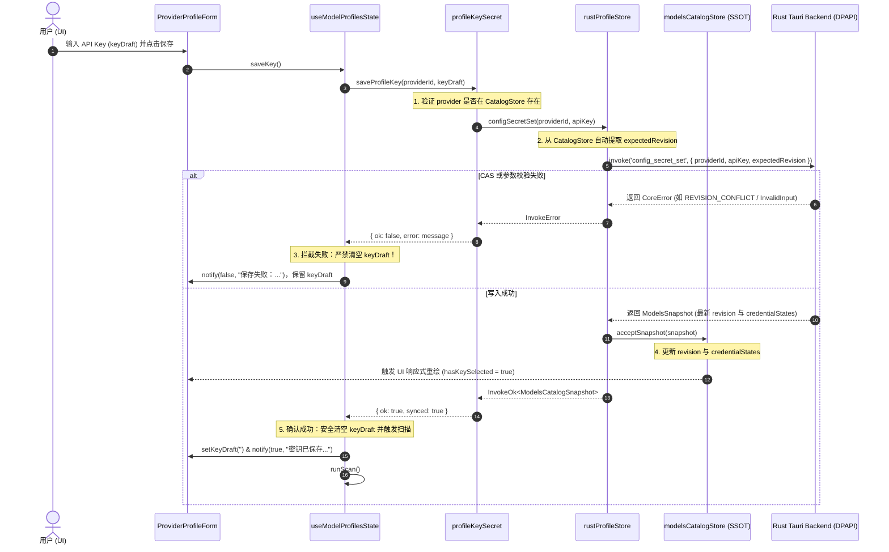

# 模型供应商设置 API Key 密钥记录与 DPAPI 凭据契约对齐实现详案 (Plan 03)

> **战役工作区**：`docs/workbench-interaction-repair/`  
> **关联总纲**：[`00-workbench-interaction-repair-master-plan.md`](./00-workbench-interaction-repair-master-plan.md) §四.维度 3 (D3)  
> **涉及核心文件**：  
> - `apps/agent-workbench/src-tauri/src/config/credentials.rs`（Rust 后端 DPAPI 凭据命令入口）  
> - `crates/agent-provider/src/model_store.rs`（Rust 核心模型配置与 DPAPI 凭据存储引擎）  
> - `apps/crish-desktop/src/api/provider-profiles/rustProfileStore.ts`（前端 Rust 配置命令 IPC 薄封装）  
> - `apps/crish-desktop/src/api/provider-profiles/profileKeySecret.ts`（密钥内存缓存与 DPAPI 调度层）  
> - `apps/crish-desktop/src/components/settings-models/useModelProfilesState.ts`（设置页模型状态与操作控制器）  
> - `apps/crish-desktop/src/components/settings-models/ProviderProfileForm.tsx`（供应商配置表单 UI）  
> - `apps/crish-desktop/src/api/modelsCatalogStore.ts`（前端统一模型树镜像与快照真理源）  
> - `apps/crish-desktop/src/api/modelsCatalogLive.ts`（凭据状态只读查询 SSOT 导出）  

---

## 一、概述与治理目标

### 1.1 问题表象与影响范围
在工作台“设置 - 模型”页面及首次运行向导中，用户尝试为模型服务商配置 API Key 密钥时发生严重阻断性故障：
1. **保存提示错误**：在 API Key 输入框填入有效密钥并点击“保存”按钮后，页面提示“保存失败：profile_not_found”或“保存失败：key_save_failed”，密钥无法记录到系统安全的 DPAPI 凭据槽中。
2. **用户草稿被野蛮清空**：保存失败的同时，用户刚刚精心复制或输入的 API Key 被输入框直接清空重置，造成极差的人机工程学体验。
3. **连锁阻断模型探测与通信**：由于密钥未能写入，随后的自动获取模型（探针扫描）抛出 `CREDENTIAL_MISSING`，且无法与大模型服务端发起任何真实会话。

### 1.2 治理核心目标
1. **纠正 IPC 通信契约断层**：修复前端 `rustProfileStore.ts` 与 Rust 后端 `credentials.rs` 之间的命令参数名失配（`profileId` vs `provider_id`）与 CAS 必填修订号（`expected_revision`）缺失，确保 Tauri 反序列化 100% 成功。
2. **打通快照闭环安装**：前端接收 Rust 后端写入成功后返回的最新 `ModelsSnapshot`，调用 `modelsCatalogStore.acceptSnapshot` 原子更新凭据状态与版本号，驱动 UI 实时刷新密钥掩码与配置完备标识。
3. **彻底清退 `localStorage` 孤岛**：彻底移除 `profileKeySecret.ts` 中对已废弃 `localStorage`（`crish_provider_profiles_v1`）的依赖，将存在性判定与凭据状态判定唯一收敛于 `modelsCatalogStore` 与 DPAPI（单一真理源 SSOT）。
4. **刚性落实草稿保护原则**：重构 `useModelProfilesState.ts:saveKey` 事务，确保在任何错误或网络异常场景下，严格保留用户在 `keyDraft` 输入框中填写的密钥明文，仅在确认写入成功后才清空草稿。

---

## 二、现状断裂证据与根因穿透分析

### 2.1 断裂点 1：Rust 与 TS IPC 传输契约严重失配（参数名与修订号双重缺失）

#### 源码证据
Rust 后端 Tauri 命令入口定义于 [`credentials.rs:6-19`](file:///c:/Software/conex/apps/agent-workbench/src-tauri/src/config/credentials.rs#L6-L19)：
```rust
// apps/agent-workbench/src-tauri/src/config/credentials.rs:6-19
#[tauri::command]
pub(crate) async fn config_secret_set(
    app: tauri::AppHandle,
    provider_id: String,
    api_key: String,
    expected_revision: String,
) -> Result<ModelsSnapshot, ModelsStoreError> {
    let mut snapshot = super::blocking(move |store| {
        store.set_credential(&provider_id, SecretString::new(api_key), &expected_revision)
    })
    .await?;
    super::publish_snapshot(&app, &mut snapshot);
    Ok(snapshot)
}
```

而前端薄封装定义于 [`rustProfileStore.ts:54-63`](file:///c:/Software/conex/apps/crish-desktop/src/api/provider-profiles/rustProfileStore.ts#L54-L63)：
```typescript
// apps/crish-desktop/src/api/provider-profiles/rustProfileStore.ts:54-63
/** config_secret_set：写 profile API key 到 DPAPI 凭据槽（空串 = 清除） */
export function configSecretSet(
  profileId: string,
  apiKey: string
): Promise<InvokeTypedResult<ConfigSecretStatus>> {
  return invokeTyped<ConfigSecretStatus>('config_secret_set', {
    profileId,
    apiKey,
  });
}
```

#### 根因机理穿透
1. **参数名不匹配**：Tauri 对命令参数进行 JSON 反序列化时遵循 `camelCase` 规则，Rust 端的 `provider_id` 要求前端传递的键名为 `providerId`。而 `rustProfileStore.ts` 传递的键名为旧历史包袱 `profileId`。Tauri 在解析参数结构体时因找不到 `provider_id` / `providerId` 字段，直接在 IPC 反序列化层抛出错误：`missing field providerId`。
2. **CAS 乐观锁版本号缺失**：Rust 核心存储 `model_store.rs:525` 在写入凭据时严格要求 CAS 版本核验（`if content_revision(raw.as_deref()) != expected { return self.write_conflict(...); }`）。Rust 命令签名显式声明了 `expected_revision: String` 必填参数。前端 `rustProfileStore.ts` 完全漏传了 `expectedRevision`，导致反序列化再次硬性失败：`missing field expectedRevision`。
3. **测试虚假掩盖**：在 [`rustProfileStore.test.ts:24-30`](file:///c:/Software/conex/apps/crish-desktop/src/api/provider-profiles/rustProfileStore.test.ts#L24-L30) 中，单元测试使用 `mockTauriCommand` 强行 Mock 了错误的契约：
   ```typescript
   expect(impl).toHaveBeenCalledWith({ profileId: 'openai', apiKey: 'sk-x' });
   ```
   测试本身断言了错误的入参形状，且 Mock 返回了假的 `{ ok: true, hasKey: true }`，导致该致命断裂在脱水测试中长期显示为“全部通过”。

---

### 2.2 断裂点 2：返回值语义割裂与快照未原子安装 (Missing Snapshot Acceptance)

#### 源码证据
Rust 后端 `config_secret_set` 成功执行后返回的是全量配置快照 `ModelsSnapshot`（见 [`model_store.rs:60-73`](file:///c:/Software/conex/crates/agent-provider/src/model_store.rs#L60-L73)）：
```rust
// crates/agent-provider/src/model_store.rs:60-73
#[derive(Debug, Clone, Serialize)]
#[serde(rename_all = "camelCase")]
pub struct ModelsSnapshot {
    pub path: String,
    pub content: String,
    pub revision: String,
    pub tree: Option<UnifiedModelsConfig>,
    pub credential_states: BTreeMap<String, CredentialState>,
    #[serde(skip_serializing_if = "Option::is_none")]
    pub parse_error: Option<ModelsStoreError>,
    pub template: String,
    #[serde(skip_serializing_if = "Option::is_none")]
    pub notification_error: Option<String>,
}
```

而前端 `rustProfileStore.ts:22-30` 错误地将返回类型定义为扁平的 `ConfigSecretStatus`：
```typescript
// apps/crish-desktop/src/api/provider-profiles/rustProfileStore.ts:22-30
export type ConfigSecretStatus = {
  ok: boolean;
  profileId: string;
  hasKey: boolean;
  apiKeyLast4?: string | null;
  persistence?: string;
  revealed?: boolean;
};
```

#### 根因机理穿透
1. **类型与真实载荷错位**：Rust 返回的根对象是包含全量 YAML 树、最新修订号 `revision`、以及每个供应商凭据状态映射表 `credentialStates: Record<string, CredentialState>` 的 `ModelsSnapshot`。它根本不存在根级别的 `hasKey` 属性。
2. **状态更新链条断裂**：前端在 IPC 返回后，没有将返回的快照递交给全局状态机 `modelsCatalogStore.acceptSnapshot`。这导致：
   - 全局修订号 `modelsCatalogStore.getState().revision` 未更新，下一次任何配置写入都会因版本陈旧触发 `REVISION_CONFLICT`。
   - 全局凭据状态 `modelsCatalogStore.getState().credentialStates` 未更新，只读查询 `providerHasKey(providerId)` 依然返回 `false`。
   - UI 层的密钥保存状态无法由状态机自然驱动，表单仍视该服务商为“未配置凭据”。

---

### 2.3 断裂点 3：`profileKeySecret.ts` 读取已废弃 `localStorage` 导致 `profile_not_found`

#### 源码证据
定位至 [`profileKeySecret.ts:40-65`](file:///c:/Software/conex/apps/crish-desktop/src/api/provider-profiles/profileKeySecret.ts#L40-L65) 与 [`profileKeySecret.ts:72-85`](file:///c:/Software/conex/apps/crish-desktop/src/api/provider-profiles/profileKeySecret.ts#L72-L85)：
```typescript
// apps/crish-desktop/src/api/provider-profiles/profileKeySecret.ts:40-65
export async function setProfileKey(
  profileId: string,
  apiKey: string
): Promise<ProviderProfile[]> {
  const key = apiKey.trim();
  const list = loadProfiles(); // <-- 致命问题：读取 localStorage ('crish_provider_profiles_v1')
  const p = list.find((x) => x.id === profileId);
  if (!p) return list; // <-- 找不到直接提前返回，根本不调用 IPC！

  if (key) profileKeyCache.set(profileId, key);
  else profileKeyCache.delete(profileId);

  const res = key
    ? await configSecretSet(profileId, key)
    : await configSecretClear(profileId);
  if (res.status === 'ok') {
    p.hasKey = Boolean(res.data?.hasKey); // <-- res.data 是 ModelsSnapshot，res.data.hasKey 恒为 undefined！
  } else if (res.status === 'missing') {
    p.hasKey = Boolean(key);
  } else {
    p.hasKey = false;
  }
  saveProfiles(list); // <-- 回写废弃的 localStorage
  return list;
}

// apps/crish-desktop/src/api/provider-profiles/profileKeySecret.ts:72-85
export async function saveProfileKey(
  profileId: string,
  apiKey: string,
  opts?: { activateModel?: string }
): Promise<{ ok: boolean; error?: string; synced: boolean }> {
  const key = apiKey.trim();
  if (!key) return { ok: false, error: 'empty_key', synced: false };

  await setProfileKey(profileId, key);
  const profile = loadProfiles().find((p) => p.id === profileId);
  if (!profile) return { ok: false, error: 'profile_not_found', synced: false }; // <-- 报错触发点
  if (!profile.hasKey)
    return { ok: false, error: 'key_save_failed', synced: false }; // <-- 报错触发点
  ...
```

#### 根因机理穿透
1. **双轨数据源割裂**：在 PE-01 重构后，所有模型供应商已经收敛至 `~/.conex/models.yaml`，前端真理源为 `modelsCatalogStore`。新添加或统一树中的供应商**根本不会也不应出现在浏览器的 `localStorage` 中**。
2. **必然报错路径**：
   - 当用户为一个来自统一树的新供应商保存密钥时，`loadProfiles()` 为空或不包含该 `profileId`。
   - `setProfileKey` 的 `list.find((x) => x.id === profileId)` 判定为假，直接跳过 `configSecretSet` 返回。
   - `saveProfileKey` 再次从 `loadProfiles()` 中查找，必定命中 `if (!profile) return { ok: false, error: 'profile_not_found', synced: false };`！
   - 即便历史上 `localStorage` 巧合残留了同名供应商，`res.data.hasKey` 的读取也会因为属性不存在而成为 `undefined`，导致 `profile.hasKey = false`，从而触发 `error: 'key_save_failed'`！

---

### 2.4 断裂点 4：`useModelProfilesState.ts` 盲目抹除草稿破坏用户输入

#### 源码证据
定位至 [`useModelProfilesState.ts:296-309`](file:///c:/Software/conex/apps/crish-desktop/src/components/settings-models/useModelProfilesState.ts#L296-L309)：
```typescript
// apps/crish-desktop/src/components/settings-models/useModelProfilesState.ts:296-309
  const saveKey = async () => {
    if (!selected || !keyDraft.trim()) return;
    await runAsLocalMutation(async () => {
      const res = await saveProfileKey(selected.id, keyDraft.trim());
      refresh();
      setKeyDraft(''); // <-- 灾难性逻辑：未检查 res.ok 之前就无条件清空用户输入的草稿！
      if (!res.ok) {
        notify(false, `保存失败：${res.error || '未知错误'}`);
        return;
      }
      notify(true, '密钥已保存，正在自动扫描服务器可用模型...');
      void runScan();
    });
  };
```

#### 根因机理穿透
- **违反状态事务回滚原则**：草稿状态应当且仅当落盘事务成功后才允许清收。当前代码在拿到 `saveProfileKey` 响应后，完全没有判断 `res.ok`，先野蛮执行了 `setKeyDraft('')`。
- **灾难性人机工程**：由于上述 2.1、2.2、2.3 的多重断裂，`saveProfileKey` 必定失败。用户每次点击“保存”，页面弹出红字报错，而刚刚输入的密钥瞬间化为乌有，迫使用户不断重复复制粘贴，体验极差。

---

## 三、总体重构方案与架构不变量



### 3.1 架构不变量 (Invariants)
1. **单一真理源唯一性 (SSOT Invariant)**：
   - 密钥明文唯一密文持久化介质为操作系统的安全凭据槽（Windows DPAPI、macOS Keychain、Linux SecretService），绝不进入 `models.yaml` 明文，绝不进入 `localStorage`。
   - 前端应用中供应商凭据的存在性（`hasKey`）与脱敏信息（`apiKeyLast4`）唯一权威源为 `modelsCatalogStore.getState().credentialStates`，严禁建立任何二次副本。
2. **CAS 版本驱动更新 (CAS Invariant)**：
   - 对凭据槽的所有写入（Set）与清除（Clear）操作必须附带期望的配置版本号 `expectedRevision`。版本号一律直接从当前已接受的 `modelsCatalogStore.getState().revision` 提取。
   - 后端返回更新后的全量快照后，前端必须无条件调用 `modelsCatalogStore.acceptSnapshot` 安装，保证版本号与树镜像严格单调递增。
3. **草稿保全与非破坏性原则 (Draft Preservation Invariant)**：
   - 失败场景下绝对禁止抹除用户输入的 `keyDraft`。
   - 错误必须经由 Toast 清晰展示具体根因，输入框保持用户输入内容与焦点，允许用户直接修正或重试。

---

## 四、详细代码重构说明与对比 (Before & After Diff)

### 4.1 重构 `rustProfileStore.ts`：契约对齐与快照自动接管

#### 改造点说明
1. 修改 `configSecretSet`：
   - 入参名规范化为 `providerId`，支持自动提取或手动传递 `expectedRevision`。
   - 传给 Tauri invoke 的 payload 对齐 Rust 驼峰：`{ providerId, apiKey, expectedRevision }`。
   - 返回类型对齐为 `InvokeTypedResult<ModelsCatalogSnapshot>`。
   - 收到 `status === 'ok'` 时，自动调用 `modelsCatalogStore.acceptSnapshot(result.data)`。
2. 修改 `configSecretClear`：
   - 入参名改为 `providerId`，自动注入 `expectedRevision`。
   - 传给 Tauri invoke：`{ providerId, expectedRevision }`。
   - 收到 `status === 'ok'` 时，自动调用 `acceptSnapshot`。
3. 修改 `configSecretGet` / `configSecretHas` / `configSecretReveal`：
   - 将参数名统一修正为 `providerId`，匹配 Rust 的 `provider_id`。

#### 修改前后代码对比
```diff
--- a/apps/crish-desktop/src/api/provider-profiles/rustProfileStore.ts
+++ b/apps/crish-desktop/src/api/provider-profiles/rustProfileStore.ts
@@ -15,10 +15,12 @@
 import { readModelsYamlIpc, writeModelsYamlIpc } from '../modelsCatalogIpc';
 import type {
+  ModelsCatalogSnapshot,
   ModelSpec,
   ModelsYamlTree,
   ProviderSpec,
 } from '../modelsCatalogTypes';
+import { modelsCatalogStore } from '../modelsCatalogStore';
 
 export type ConfigSecretStatus = {
   ok: boolean;
@@ -53,29 +55,59 @@
 
-/** config_secret_set：写 profile API key 到 DPAPI 凭据槽（空串 = 清除） */
-export function configSecretSet(
-  profileId: string,
-  apiKey: string
-): Promise<InvokeTypedResult<ConfigSecretStatus>> {
-  return invokeTyped<ConfigSecretStatus>('config_secret_set', {
-    profileId,
-    apiKey,
-  });
-}
+/** config_secret_set：写 provider API key 到 DPAPI 凭据槽，自动带上版本号并原子安装快照 */
+export async function configSecretSet(
+  providerId: string,
+  apiKey: string,
+  expectedRevision?: string
+): Promise<InvokeTypedResult<ModelsCatalogSnapshot>> {
+  const revision =
+    expectedRevision ?? modelsCatalogStore.getState().revision;
+  const result = await invokeTyped<ModelsCatalogSnapshot>('config_secret_set', {
+    providerId,
+    apiKey,
+    expectedRevision: revision,
+  });
+  if (result.status === 'ok') {
+    try {
+      modelsCatalogStore.acceptSnapshot(result.data);
+    } catch {
+      // 静默防御，避免快照已安装但在极端解析错误下阻断调用方
+    }
+  }
+  return result;
+}
 
-/** config_secret_clear：清除指定 profile 密钥 */
-export function configSecretClear(
-  profileId: string
-): Promise<InvokeTypedResult<ConfigSecretStatus>> {
-  return invokeTyped<ConfigSecretStatus>('config_secret_clear', { profileId });
+/** config_secret_clear：清除指定 provider 密钥，自动带上版本号并原子安装快照 */
+export async function configSecretClear(
+  providerId: string,
+  expectedRevision?: string
+): Promise<InvokeTypedResult<ModelsCatalogSnapshot>> {
+  const revision =
+    expectedRevision ?? modelsCatalogStore.getState().revision;
+  const result = await invokeTyped<ModelsCatalogSnapshot>('config_secret_clear', {
+    providerId,
+    expectedRevision: revision,
+  });
+  if (result.status === 'ok') {
+    try {
+      modelsCatalogStore.acceptSnapshot(result.data);
+    } catch {
+      // 静默防御
+    }
+  }
+  return result;
 }
 
 /** config_secret_get：仅回 { hasKey, apiKeyLast4 }（K-02，不回明文） */
 export function configSecretGet(
-  profileId: string
+  providerId: string
 ): Promise<InvokeTypedResult<ConfigSecretStatus>> {
-  return invokeTyped<ConfigSecretStatus>('config_secret_get', { profileId });
+  return invokeTyped<ConfigSecretStatus>('config_secret_get', { providerId });
 }
 
 /** config_secret_has：仅探测是否存在 */
 export function configSecretHas(
-  profileId: string
+  providerId: string
 ): Promise<InvokeTypedResult<ConfigSecretStatus>> {
-  return invokeTyped<ConfigSecretStatus>('config_secret_has', { profileId });
+  return invokeTyped<ConfigSecretStatus>('config_secret_has', { providerId });
 }
 
@@ -90,9 +92,9 @@
 export function configSecretReveal(
-  profileId: string,
+  providerId: string,
   uiConfirm: boolean
 ): Promise<InvokeTypedResult<ConfigSecretRevealResult>> {
   return invokeTyped<ConfigSecretRevealResult>('config_secret_reveal', {
-    profileId,
+    providerId,
     uiConfirm,
   });
 }
```

---

### 4.2 重构 `profileKeySecret.ts`：摒弃 `localStorage` 孤岛，收敛至 SSOT

#### 改造点说明
1. 移除 `loadProfiles` 和 `saveProfiles` 的引入与调用。
2. 供应商存在性检查改为查询 `modelsCatalogStore.getState().tree.providers[providerId]` 或 `selectProvider(providerId)`。
3. 凭据成功判定改为查询 `providerHasKey(providerId)`（直接由快照驱动）。
4. 内存缓存 `profileKeyCache` 依然保留，专门向模型扫描与连通性探针提供会话级明文支持，但在清除或保存失败时同步清理。
5. 函数返回值维持兼容类型，内部通过映射 `listLiveProviders()` 产出，不再污染 `localStorage`。

#### 修改前后代码对比
```diff
--- a/apps/crish-desktop/src/api/provider-profiles/profileKeySecret.ts
+++ b/apps/crish-desktop/src/api/provider-profiles/profileKeySecret.ts
@@ -10,6 +10,8 @@
 import { profileHasKey } from './profileValidation';
 import type { ProviderProfile } from './profileCatalog';
-import { saveProfiles, loadProfiles } from './profileStorePersistence';
+import { modelsCatalogStore, selectProvider } from '../modelsCatalogStore';
+import { providerHasKey, listLiveProviders } from '../modelsCatalogLive';
 
 /**
  * 会话内密钥内存缓存（K-01 明文下线的唯一例外持有面）：
@@ -40,26 +42,27 @@
 export async function setProfileKey(
   profileId: string,
   apiKey: string
 ): Promise<ProviderProfile[]> {
   const key = apiKey.trim();
-  const list = loadProfiles();
-  const p = list.find((x) => x.id === profileId);
-  if (!p) return list;
+  const provider = selectProvider(profileId);
+  if (!provider) {
+    // 在统一树中找不到供应商壳，直接返回当前列表，拒绝写入
+    return listLiveProviders().map((entry) => ({
+      id: entry.providerId,
+      name: entry.provider.displayName?.trim() || entry.providerId,
+      baseUrl: entry.provider.baseUrl ?? '',
+      protocol: entry.provider.protocol,
+      models: entry.provider.models.map((m) => m.id),
+      hasKey: providerHasKey(entry.providerId),
+      enabled: entry.provider.enabled !== false,
+    }));
+  }
 
   if (key) profileKeyCache.set(profileId, key);
   else profileKeyCache.delete(profileId);
 
   const res = key
     ? await configSecretSet(profileId, key)
     : await configSecretClear(profileId);
-  if (res.status === 'ok') {
-    p.hasKey = Boolean(res.data?.hasKey);
-  } else if (res.status === 'missing') {
-    // 非 Tauri 环境（浏览器 dev）：降级为本地草稿标记（25-audit 允许）
-    p.hasKey = Boolean(key);
-  } else {
-    p.hasKey = false;
-  }
-  saveProfiles(list);
-  return list;
+  if (res.status === 'error') {
+    profileKeyCache.delete(profileId);
+  }
+  return listLiveProviders().map((entry) => ({
+    id: entry.providerId,
+    name: entry.provider.displayName?.trim() || entry.providerId,
+    baseUrl: entry.provider.baseUrl ?? '',
+    protocol: entry.provider.protocol,
+    models: entry.provider.models.map((m) => m.id),
+    hasKey: providerHasKey(entry.providerId),
+    enabled: entry.provider.enabled !== false,
+  }));
 }
 
@@ -78,10 +81,19 @@
   const key = apiKey.trim();
   if (!key) return { ok: false, error: 'empty_key', synced: false };
 
-  await setProfileKey(profileId, key);
-  const profile = loadProfiles().find((p) => p.id === profileId);
-  if (!profile) return { ok: false, error: 'profile_not_found', synced: false };
-  if (!profile.hasKey)
-    return { ok: false, error: 'key_save_failed', synced: false };
+  const provider = selectProvider(profileId);
+  if (!provider) return { ok: false, error: 'profile_not_found', synced: false };
+
+  const res = await configSecretSet(profileId, key);
+  if (res.status === 'error') {
+    profileKeyCache.delete(profileId);
+    return { ok: false, error: res.message || 'key_save_failed', synced: false };
+  }
+  if (res.status === 'missing') {
+    // 非 Tauri 环境（浏览器 dev）：写入内存缓存并放行
+    profileKeyCache.set(profileId, key);
+    return { ok: true, synced: false };
+  }
+  // 成功落盘：更新内存缓存
+  profileKeyCache.set(profileId, key);
+  if (!providerHasKey(profileId)) {
+    return { ok: false, error: 'key_save_failed', synced: false };
+  }
```

---

### 4.3 重构 `useModelProfilesState.ts`：落实草稿保护原则

#### 改造点说明
在 `useModelProfilesState.ts` 的 `saveKey` 闭包中，调整执行顺序：
1. 先执行 `await saveProfileKey(selected.id, keyDraft.trim())`。
2. 校验 `res.ok`：如果失败，弹出错误 Toast，**绝不调用 `setKeyDraft('')`**，让草稿内容完好保留在 Input 框中。
3. 仅当 `res.ok` 为 `true` 时，才执行 `setKeyDraft('')` 清除输入框草稿，提示成功，并触发自动扫描。

#### 修改前后代码对比
```diff
--- a/apps/crish-desktop/src/components/settings-models/useModelProfilesState.ts
+++ b/apps/crish-desktop/src/components/settings-models/useModelProfilesState.ts
@@ -298,13 +298,14 @@
     await runAsLocalMutation(async () => {
       const res = await saveProfileKey(selected.id, keyDraft.trim());
       refresh();
-      setKeyDraft('');
       if (!res.ok) {
+        // 严正纪律：失败时保留 keyDraft 用户输入，禁止清空！
         notify(false, `保存失败：${res.error || '未知错误'}`);
         return;
       }
+      // 仅在明确写入成功后清空草稿
+      setKeyDraft('');
       notify(true, '密钥已保存，正在自动扫描服务器可用模型...');
       void runScan();
     });
   };
```

---

## 五、单元测试用例设计与回归门禁断言

为杜绝旧测试中“Mock 虚假绿灯掩盖真断裂”的历史问题，本次设计的测试用例必须基于真实 IPC 序列化断言与统一树快照联动验证。

### 5.1 `rustProfileStore.test.ts` 真实契约测试
```typescript
describe('rustProfileStore（config_secret_* 统一契约修复）', () => {
  beforeEach(() => {
    vi.clearAllMocks();
    modelsCatalogStore.resetForTesting();
  });

  it('configSecretSet 必须传递 providerId、apiKey 以及 modelsCatalogStore 的 revision', async () => {
    // 准备初始快照并注入 store
    const initialSnapshot = createMockSnapshot({ revision: 'rev-init-123' });
    modelsCatalogStore.acceptSnapshot(initialSnapshot);

    const updatedSnapshot = createMockSnapshot({
      revision: 'rev-updated-456',
      credentialStates: {
        openai: { hasKey: true, apiKeyLast4: 'abcd' },
      },
    });

    const mockInvoke = vi.fn(async () => updatedSnapshot);
    mockTauriCommand('config_secret_set', mockInvoke);

    const res = await configSecretSet('openai', 'sk-real-test-key');

    // 刚性断言 1：IPC 传参键名严格为 providerId，且 expectedRevision 自动抽取自 Store
    expect(mockInvoke).toHaveBeenCalledWith({
      providerId: 'openai',
      apiKey: 'sk-real-test-key',
      expectedRevision: 'rev-init-123',
    });

    // 刚性断言 2：返回 status 为 ok
    expect(res.status).toBe('ok');

    // 刚性断言 3：modelsCatalogStore 必须原子安装最新快照
    expect(modelsCatalogStore.getState().revision).toBe('rev-updated-456');
    expect(modelsCatalogStore.getState().credentialStates.openai?.hasKey).toBe(true);
    expect(modelsCatalogStore.getState().credentialStates.openai?.apiKeyLast4).toBe('abcd');
  });

  it('configSecretClear 必须传递 providerId 与 expectedRevision 并安装快照', async () => {
    modelsCatalogStore.acceptSnapshot(createMockSnapshot({ revision: 'rev-clear-1' }));
    const clearSnapshot = createMockSnapshot({
      revision: 'rev-clear-2',
      credentialStates: { openai: { hasKey: false } },
    });

    const mockInvoke = vi.fn(async () => clearSnapshot);
    mockTauriCommand('config_secret_clear', mockInvoke);

    const res = await configSecretClear('openai');

    expect(mockInvoke).toHaveBeenCalledWith({
      providerId: 'openai',
      expectedRevision: 'rev-clear-1',
    });
    expect(res.status).toBe('ok');
    expect(modelsCatalogStore.getState().revision).toBe('rev-clear-2');
  });
});
```

### 5.2 `profileKeySecret.test.ts` SSOT 判定与无 LocalStorage 依赖测试
```typescript
describe('profileKeySecret（去 localStorage 依赖与 SSOT 凭据测试）', () => {
  beforeEach(() => {
    vi.clearAllMocks();
    localStorage.clear();
    modelsCatalogStore.resetForTesting();
  });

  it('针对统一树供应商保存密钥成功时，不读写 localStorage，且更新内存缓存与快照状态', async () => {
    // 注入统一树供应商
    modelsCatalogStore.acceptSnapshot(
      createMockSnapshot({
        revision: 'rev-1',
        tree: {
          version: 2,
          activeModel: null,
          providers: {
            deepseek: { displayName: 'DeepSeek', baseUrl: 'https://api.deepseek.com', models: [] },
          },
        },
      })
    );

    // Mock 后端返回更新凭据后的快照
    mockTauriCommand('config_secret_set', async () =>
      createMockSnapshot({
        revision: 'rev-2',
        tree: modelsCatalogStore.getState().tree,
        credentialStates: { deepseek: { hasKey: true, apiKeyLast4: '7890' } },
      })
    );

    const res = await saveProfileKey('deepseek', 'sk-deepseek-test-12347890');
    expect(res.ok).toBe(true);
    expect(res.error).toBeUndefined();

    // 内存缓存可用
    expect(getProfileKeyInMemory('deepseek')).toBe('sk-deepseek-test-12347890');

    // 凭据权威判定 providerHasKey 生效
    expect(providerHasKey('deepseek')).toBe(true);

    // localStorage 绝无污染
    expect(localStorage.getItem('crish_provider_profiles_v1')).toBeNull();
  });

  it('供应商在统一树中不存在时，明确返回 profile_not_found，不发起后端写盘', async () => {
    const mockInvoke = vi.fn();
    mockTauriCommand('config_secret_set', mockInvoke);

    const res = await saveProfileKey('non-existent-vendor', 'sk-xxx');
    expect(res.ok).toBe(false);
    expect(res.error).toBe('profile_not_found');
    expect(mockInvoke).not.toHaveBeenCalled();
  });
});
```

### 5.3 `useModelProfilesState.test.tsx` 草稿保护与交互行为测试
```typescript
describe('useModelProfilesState（API Key 草稿保护）', () => {
  it('当 saveProfileKey 失败时，禁止清空 keyDraft，保留输入并弹出错误通知', async () => {
    // Mock saveProfileKey 失败
    vi.mocked(saveProfileKey).mockResolvedValueOnce({
      ok: false,
      error: '网络异常，DPAPI 拒绝访问',
      synced: false,
    });

    const { result } = renderHook(() => useModelProfilesState());

    // 选中一个现有供应商并填写 keyDraft
    act(() => {
      result.current.setKeyDraft('sk-my-precious-user-key');
    });
    expect(result.current.keyDraft).toBe('sk-my-precious-user-key');

    // 点击保存
    await act(async () => {
      await result.current.saveKey();
    });

    // 核心断言：草稿未被抹除！
    expect(result.current.keyDraft).toBe('sk-my-precious-user-key');
    // 错误通知已弹出
    expect(toastShow).toHaveBeenCalledWith(
      expect.objectContaining({
        title: expect.stringContaining('网络异常，DPAPI 拒绝访问'),
        tone: 'error',
      })
    );
  });

  it('当 saveProfileKey 成功时，清空 keyDraft，弹出成功通知并触发扫描', async () => {
    vi.mocked(saveProfileKey).mockResolvedValueOnce({
      ok: true,
      synced: true,
    });

    const { result } = renderHook(() => useModelProfilesState());

    act(() => {
      result.current.setKeyDraft('sk-valid-key');
    });

    await act(async () => {
      await result.current.saveKey();
    });

    // 核心断言：草稿安全清空
    expect(result.current.keyDraft).toBe('');
    // 成功通知已弹出
    expect(toastShow).toHaveBeenCalledWith(
      expect.objectContaining({
        title: expect.stringContaining('密钥已保存'),
        tone: 'success',
      })
    );
  });
});
```

---

## 六、实施步骤与文件修改清单

| 步骤 | 操作目标 | 涉及文件 | 关键变更内容 |
| :--- | :--- | :--- | :--- |
| **步骤 1** | 对齐 `rustProfileStore.ts` 的 IPC 传输契约与快照接管 | `apps/crish-desktop/src/api/provider-profiles/rustProfileStore.ts` | 1. `configSecretSet` 传参改为 `{ providerId, apiKey, expectedRevision }`。<br>2. 自动从 `modelsCatalogStore.getState().revision` 注入修订号。<br>3. 成功后调用 `modelsCatalogStore.acceptSnapshot` 安装快照。<br>4. 同步规范化 `configSecretClear` / `configSecretGet` / `configSecretHas` / `configSecretReveal` 的入参名为 `providerId`。 |
| **步骤 2** | 清退 `profileKeySecret.ts` 的 `localStorage` 孤岛 | `apps/crish-desktop/src/api/provider-profiles/profileKeySecret.ts` | 1. 彻底移除 `loadProfiles` 与 `saveProfiles`。<br>2. 供应商存在性检查对齐 `modelsCatalogStore.tree.providers`。<br>3. 凭据有效性校验对齐 `providerHasKey`。<br>4. 失败时清理 `profileKeyCache`。 |
| **步骤 3** | 在 Hook 中落实草稿保护 | `apps/crish-desktop/src/components/settings-models/useModelProfilesState.ts` | 调整 `saveKey` 逻辑，在 `if (!res.ok)` 判定失败时保留 `keyDraft`，仅在成功时执行 `setKeyDraft('')`。 |
| **步骤 4** | 修正并补充单元测试 | `apps/crish-desktop/src/api/provider-profiles/rustProfileStore.test.ts`<br>`apps/crish-desktop/src/api/provider-profiles/profileKeySecret.test.ts`<br>`apps/crish-desktop/src/components/settings-models/useModelProfilesState.test.tsx` | 1. 修正 `rustProfileStore.test.ts` 中虚假的 `profileId` 断言，重构为真实的 `providerId` + `expectedRevision` + `acceptSnapshot` 测试。<br>2. 新增去 localStorage 依赖与 SSOT 凭据测试。<br>3. 新增 `keyDraft` 失败保全与成功清空断言。 |
| **步骤 5** | 执行全量回归验证 | 全局命令行 | 运行 `npm run test` 与 `cargo test`，确保 TypeScript 类型检查、单元测试、覆盖率门禁全绿通过。 |
