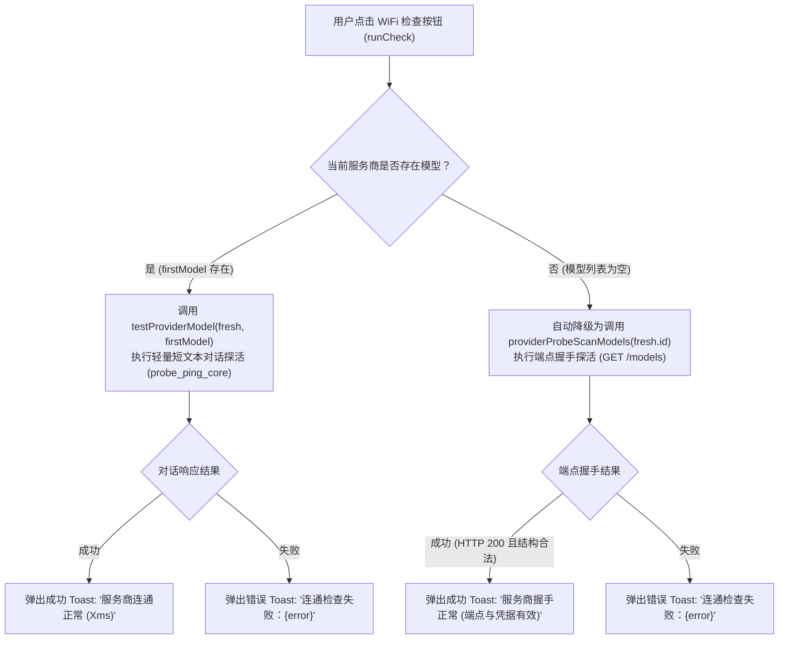
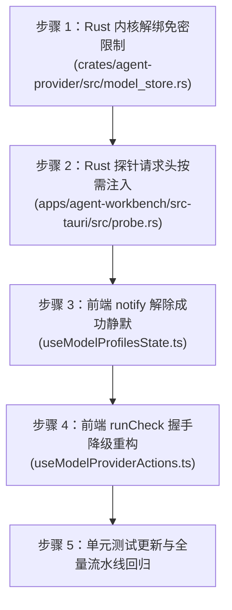

# 模型供应商设置：连通性探活与模型扫描链路实现详案 (Plan 04)

> **战役工作区**：`docs/workbench-interaction-repair/`  
> **关联总纲**：[`00-workbench-interaction-repair-master-plan.md`](./00-workbench-interaction-repair-master-plan.md) §四.维度 4 (D4)  
> **涉及核心文件**：  
> - `apps/crish-desktop/src/components/settings-models/useModelProviderActions.ts`（前端供应商动作状态机：`runCheck` / `runScan`）  
> - `apps/crish-desktop/src/components/settings-models/useModelProfilesState.ts`（前端模型设置全局枢纽：`notify` 反馈通道）  
> - `apps/agent-workbench/src-tauri/src/probe.rs`（Rust 原生探针实现：`probe_ping_core` / `probe_scan_models_core`）  
> - `crates/agent-provider/src/model_store.rs`（Rust 配置存储引擎：`resolve_provider` / `key_for` 凭据解析）  
> - `apps/crish-desktop/src/api/modelCatalogIpc.ts`（IPC 传输胶水层：`testProviderModel` / `scanProviderModels`）  
> - `apps/crish-desktop/src/components/settings-models/ModelListHeader.tsx`（UI 按钮入口：WiFi 检查与刷新扫描触发）  

---

## 一、概述与治理目标

在工作台“设置 - 模型”页面中，用户在配置模型供应商时遇到了两组致命的交互阻断故障：
1. **WiFi 按钮（检查服务商连通性）无法使用或静默无反应**：
   - 当用户新增了一个服务商且尚未配置任何模型时，点击模型列表头部的 WiFi 图标，系统抛出报错：`连通检查失败：请选择要测试的模型`；
   - 当用户配置了模型并点击 WiFi 按钮，即使后端网络探活完全成功，界面没有任何正向 Toast 提示，用户误以为点击无效、应用卡死。
2. **刷新按钮（自动获取服务商模型列表）报错凭据缺失**：
   - 点击刷新按钮时，控制台或界面弹出 `CREDENTIAL_MISSING` 报错（“供应商尚未配置有效凭据”）；
   - 对于本地私有网关或免密服务商（如本地运行的 Ollama `http://localhost:11434`、LM Studio、LocalAI 等），系统强行要求必须配置 API Key 凭据，否则拒绝执行任何模型发现。

经立体排查，上述故障是由于**探针前置依赖死锁、反馈通知策略失调与免密服务商凭据校验过严**三重架构断层叠加导致的：
- **模型依赖死锁**：前端 `useModelProviderActions.ts:runCheck` 将“服务商级”的连通性测试粗暴等同于“对话模型级”的单模型探活，强绑列表第一项模型（`firstModel`）；当服务商无模型时，向 Rust 端传递空字符串 `""`，触发 Rust `probe.rs:169` 的硬拦截校验；形成“**没有模型无法测服务商，测不了服务商不敢配模型**”的死锁环。
- **正向反馈截断**：`useModelProfilesState.ts:156` 的 `notify` 回调中存在遗留的历史策略 `if (ok) return;`，将所有成功的 Toast 提示（连通测试成功、模型同步成功、密钥保存成功）在源头静默吞噬，导致 UI 缺乏任何正向确认。
- **免密供应商阻断**：Rust 侧 `store.resolve_provider(&id)`（`model_store.rs:383-385`）将 `self.key_for(provider)?` 判定为必填项（`.ok_or_else(CREDENTIAL_MISSING)`），并且在 `probe.rs:344` 中对 OpenAI 协议强行组装 `Authorization: Bearer <empty>` 请求头，直接拦截了无 `api_key_ref` 的免密本地供应商。

本详案旨在彻底打破上述依赖死锁，打通连通性探针与模型自动扫描通路，实现完善的错误恢复、本地免密适配与即时明确的用户交互反馈。

---

## 二、现状断裂证据与根因穿透分析

### 1. 证据一：`useModelProviderActions.ts:113-115` 强绑第一项模型引发“死锁”

#### 1.1 源码证据
定位至 [`apps/crish-desktop/src/components/settings-models/useModelProviderActions.ts:107-126`](file:///c:/Software/conex/apps/crish-desktop/src/components/settings-models/useModelProviderActions.ts#L107-L126)：
```ts
// apps/crish-desktop/src/components/settings-models/useModelProviderActions.ts:107-126
  const runCheck = useCallback(async () => {
    if (!selected) return;
    setCheckBusy(true);
    try {
      const fresh =
        loadProfiles().find((p) => p.id === selected.id) || selected;
      const firstModel =
        selectProvider(selected.id)?.models[0]?.id || fresh.models[0] || '';
      const r = await testProviderModel(fresh, firstModel);
      if (r.ok) {
        notify(true, `服务商连通正常 (${r.latencyMs || 120}ms)`);
      } else {
        notify(false, `连通检查失败：${r.error || '无法建立握手连接'}`);
      }
    } catch (e) {
      notify(false, e instanceof Error ? e.message : String(e));
    } finally {
      setCheckBusy(false);
    }
  }, [selected, notify]);
```

Rust 端定位至 [`apps/agent-workbench/src-tauri/src/probe.rs:169-175`](file:///c:/Software/conex/apps/agent-workbench/src-tauri/src/probe.rs#L169-L175)：
```rust
// apps/agent-workbench/src-tauri/src/probe.rs:169-175
pub async fn probe_ping_core(req: ProbePingRequest) -> ProbePingResult {
    ...
    let Some(model) = req
        .model
        .as_deref()
        .filter(|model| !model.trim().is_empty())
    else {
        return failure("请选择要测试的模型".into());
    };
    ...
```

#### 1.2 逻辑穿透与调用链分析
UI 按钮（`ModelListHeader.tsx:38-59`）放置在“模型列表”正上方，Tooltip 说明为“检查服务商连通性”：
1. 用户在“服务商设置”中输入了 Base URL 与 API Key（或配置了本地 Ollama），尚未添加任何模型（`models: []`）。
2. 用户点击 WiFi 按钮意图验证刚刚填写的 Base URL 是否畅通。
3. `useModelProviderActions.ts` 读取 `firstModel`：由于 `models` 数组为空，`firstModel` 被回退赋值为空字符串 `""`。
4. 调用 `testProviderModel(fresh, "")`，底层发起 Tauri 命令 `provider_probe_ping`，携带 `model: None`。
5. Rust 核心函数 `probe_ping_core` 判断 `model` 为空，直接执行 `return failure("请选择要测试的模型".into())`，连网络请求都未发出就宣判失败！
6. 用户界面弹出红字错误：`连通检查失败：请选择要测试的模型`。
7. 此时用户无法得知网络/密钥是否正确，陷入逻辑死锁。

---

### 2. 证据二：`useModelProfilesState.ts:156-159` 的 `notify` 成功静默截断

#### 2.1 源码证据
定位至 [`apps/crish-desktop/src/components/settings-models/useModelProfilesState.ts:155-160`](file:///c:/Software/conex/apps/crish-desktop/src/components/settings-models/useModelProfilesState.ts#L155-L160)：
```ts
// apps/crish-desktop/src/components/settings-models/useModelProfilesState.ts:155-160
  /** 成功静默（含「已自动获取 N 个模型」）；失败才进 Toast，并带 error 皮。 */
  const notify = useCallback((ok: boolean, msg: string) => {
    if (ok) return;
    toast.show(msg, undefined, { type: 'error' });
  }, []);
```

前端单元测试证据定位至 [`apps/crish-desktop/src/components/settings-models/useModelProfilesState.test.tsx:277-292`](file:///c:/Software/conex/apps/crish-desktop/src/components/settings-models/useModelProfilesState.test.tsx#L277-L292)：
```tsx
// apps/crish-desktop/src/components/settings-models/useModelProfilesState.test.tsx:277-292
  it('notify 丢掉成功（已自动获取），失败才 toast 且带 error 皮', () => {
    toastShow.mockClear();
    const { result } = renderHook(() => useModelProfilesState());

    act(() => {
      result.current.notify(true, '已自动获取 7 个模型');
    });
    expect(toastShow).not.toHaveBeenCalled();

    act(() => {
      result.current.notify(false, '保存失败：x');
    });
    expect(toastShow).toHaveBeenCalledWith('保存失败：x', undefined, {
      type: 'error',
    });
  });
```

#### 2.2 交互影响穿透
在整个模型设置模块中，各操作均依赖 `notify(ok, msg)` 向用户反馈状态：
- WiFi 连通测试成功：`notify(true, "服务商连通正常 (${r.latencyMs || 120}ms)")`
- 自动扫描模型成功并同步：`notify(true, "已同步 ${selectedModels.length} 个模型（新增 ${result.newAppended} 个）")`
- API Key 保存成功：`notify(true, "密钥已保存，正在自动扫描服务器可用模型...")`
- 新增供应商成功：`notify(true, "服务商已添加，正在自动扫描可用模型...")`

然而，因为 `if (ok) return;` 这一行硬编码逻辑，**所有成功态的 Toast 提示被 100% 无条件丢弃**。用户在前端点击 WiFi 或同步按钮，系统在网络往返完成并成功落盘后，界面毫无波澜。在无任何动画反馈的情况下，用户无法区分“成功但静默”与“事件未触发/挂起”，产生严重的交互困惑。

---

### 3. 证据三：`probe_scan_models_core` 凭据缺失与免密服务商强求凭据

#### 3.1 源码证据
Rust 模型解析定位至 [`crates/agent-provider/src/model_store.rs:371-392`](file:///c:/Software/conex/crates/agent-provider/src/model_store.rs#L371-L392)：
```rust
// crates/agent-provider/src/model_store.rs:371-392
    pub fn resolve_provider(
        &self,
        provider_id: &str,
    ) -> Result<ResolvedProviderConfig, ModelsStoreError> {
        let state = self.lock()?;
        let snapshot = valid_snapshot(&state)?;
        let provider_id = provider_id.trim();
        let provider = snapshot
            .tree
            .find_provider(provider_id)
            .filter(|provider| provider.enabled)
            .ok_or_else(|| ModelsStoreError::new("PROVIDER_UNAVAILABLE", "供应商不存在或已停用"))?;
        let key = self
            .key_for(provider)?
            .ok_or_else(|| ModelsStoreError::new("CREDENTIAL_MISSING", "供应商尚未配置有效凭据"))?;
        Ok(ResolvedProviderConfig {
            revision: snapshot.revision.clone(),
            provider_id: provider_id.into(),
            provider: provider.clone(),
            api_key: Arc::new(key),
        })
    }
```

凭据检索逻辑 [`crates/agent-provider/src/model_store.rs:445-448`](file:///c:/Software/conex/crates/agent-provider/src/model_store.rs#L445-L448)：
```rust
// crates/agent-provider/src/model_store.rs:445-448
    fn key_for(&self, provider: &ProviderSpec) -> Result<Option<SecretString>, ModelsStoreError> {
        let Some(reference) = provider.api_key_ref.as_deref() else {
            return Ok(None);
        };
        match CredentialRef::parse(reference)...
```

探活扫描入口 [`apps/agent-workbench/src-tauri/src/probe.rs:281-290`](file:///c:/Software/conex/apps/agent-workbench/src-tauri/src/probe.rs#L281-L290)：
```rust
// apps/agent-workbench/src-tauri/src/probe.rs:281-290
    let id = profile_id.to_string();
    let config = match crate::config::blocking(move |store| store.resolve_provider(&id)).await {
        Ok(config) => config,
        Err(error) => {
            return ProbeScanResult {
                ok: false,
                models: vec![],
                error: Some(error.message),
            }
        }
    };
```

HTTP 探活请求头拼装 [`apps/agent-workbench/src-tauri/src/probe.rs:342-345`](file:///c:/Software/conex/apps/agent-workbench/src-tauri/src/probe.rs#L342-L345)：
```rust
// apps/agent-workbench/src-tauri/src/probe.rs:342-345
        ProtocolKind::OpenAiChat | ProtocolKind::OpenAiResponses => client
            .get(url)
            .header(AUTHORIZATION, format!("Bearer {api_key}")),
```

#### 3.2 根因穿透分析
当用户使用本地免密服务商（如 Ollama，默认运行在 `http://127.0.0.1:11434`，无需 API Key）或新建了一个供应商且尚未完成 DPAPI 密钥写入时：
1. 供应商的配置中 `provider.api_key_ref` 为 `None`。
2. `self.key_for(provider)?` 命中 `None` 分支，返回 `Ok(None)`。
3. `resolve_provider` 执行 `.ok_or_else(|| ModelsStoreError::new("CREDENTIAL_MISSING", "供应商尚未配置有效凭据"))`，直接返回错误！
4. `probe_scan_models_core` 匹配到 `Err(error)`，将错误原样包进 `ProbeScanResult { ok: false, error: Some("供应商尚未配置有效凭据") }`。
5. 前端刷新按钮报错 `CREDENTIAL_MISSING`，导致本地私有模型完全无法通过“自动获取”被系统发现。
6. 即使某些用户尝试通过输入假 Key 绕过 `CREDENTIAL_MISSING`，`probe.rs` 发起 `GET /models` 时仍强行附带 `Authorization: Bearer fake_key`，部分严格的反向代理或本地服务器会直接返回 401 Unauthorized。

---

## 三、总体技术设计与架构不变量

### 1. 探活通路分级降级状态机 (Tiered Probe State Machine)
服务商连通性探活应当区分“**服务商端点握手 (Provider Handshake)**”与“**模型对话探活 (Model Ping)**”两个不同级别：



### 2. 用户操作正向反馈不变量 (Feedback Invariant)
- **显式操作显式回执**：凡是用户主动发起的显式点击行为（WiFi 探活、模型扫描、模型同步、凭据保存），无论结果成败，必须给予用户明确的视觉回执。
- **语义色彩一致性**：
  - `ok === true`：必须调用 `toast.show(msg, undefined, { type: 'success' })`，以柔和且清晰的绿色气泡显示成功，告知用户网络延迟或同步数量；
  - `ok === false`：必须调用 `toast.show(msg, undefined, { type: 'error' })`，以醒目的红色气泡提示失败根因，阻断盲目重试。

### 3. 免密与可选凭据不变量 (Optional Credential Invariant)
- **免密服务商一等公民**：本地部署的大模型服务商（Ollama、vLLM、LM Studio、LocalAI 等）无需强行绑定 API Key。
- **解析层解耦**：`resolve_provider` 在供应商未指定 `api_key_ref` 时，允许回退为空密钥（`SecretString::default()`），不报错拦截。
- **按需添加请求头**：在向服务商端点（如 `/models`）发起探测时，仅在密钥非空（`!api_key.trim().is_empty()`）时才挂载 `Authorization`、`x-api-key` 或 `x-goog-api-key` 请求头；密钥为空时保持纯净请求，完美契合标准本地免密服务规范。

---

## 四、完整重构方案与详细代码实现说明

### 1. 前端：`useModelProviderActions.ts` 的 `runCheck` 降级重构

#### 1.1 修改点说明
- 在 `runCheck` 中判断 `firstModel` 是否存在。
- **有模型时**：保持调用对话探活链路 `testProviderModel(fresh, firstModel)`；
- **无模型时**：打破死锁，自动降级为调用 `providerProbeScanModels(fresh.id)` 进行 `/models` 端点握手探测。若接口连通且能正常通信，即代表 Base URL 与鉴权参数正确无误，提示“服务商握手正常 (端点与凭据有效)”，打破“未配模型无法测试”的僵局。

#### 1.2 修改前后对比

```diff
--- a/apps/crish-desktop/src/components/settings-models/useModelProviderActions.ts
+++ b/apps/crish-desktop/src/components/settings-models/useModelProviderActions.ts
@@ -12,6 +12,7 @@ import { loadProfiles, type ProviderProfile } from '../../api/providerProfiles';
 import {
   modelsCatalogStore,
   selectProvider,
 } from '../../api/modelsCatalogStore';
+import { providerProbeScanModels } from '../../api/provider-profiles/rustProfileStore';
 import { modelRefKey } from '../../api/modelsCatalogTypes';
 import { ensureProviderShell } from './catalogWriteGate';
 
@@ -112,12 +113,24 @@ export function useModelProviderActions(args: ModelProviderActionsArgs) {
         loadProfiles().find((p) => p.id === selected.id) || selected;
       const firstModel =
         selectProvider(selected.id)?.models[0]?.id || fresh.models[0] || '';
-      const r = await testProviderModel(fresh, firstModel);
-      if (r.ok) {
-        notify(true, `服务商连通正常 (${r.latencyMs || 120}ms)`);
+      if (firstModel) {
+        // 有模型：执行实际模型轻量短文本对话探活
+        const r = await testProviderModel(fresh, firstModel);
+        if (r.ok) {
+          notify(true, `服务商连通正常 (${r.latencyMs || 120}ms)`);
+        } else {
+          notify(false, `连通检查失败：${r.error || '无法建立握手连接'}`);
+        }
       } else {
-        notify(false, `连通检查失败：${r.error || '无法建立握手连接'}`);
+        // 无模型：自动降级为调用 /models 握手探活端点（验证 Base URL 与 Key 有效性），打破死锁
+        const r = await providerProbeScanModels(fresh.id);
+        if (r.status === 'ok' && r.data.ok) {
+          notify(true, '服务商握手正常 (端点与凭据已验证)');
+        } else {
+          const err =
+            r.status === 'error'
+              ? r.message
+              : r.data?.error || '无法建立握手连接';
+          notify(false, `连通检查失败：${err}`);
+        }
       }
     } catch (e) {
       notify(false, e instanceof Error ? e.message : String(e));
```

---

### 2. 前端：`useModelProfilesState.ts` 的 `notify` 解除成功静默

#### 2.1 修改点说明
- 废除原先的 `if (ok) return;` 阻断策略；
- 将 `notify` 改造为双轨映射：`ok ? 'success' : 'error'`；
- 成功信息展示绿色 Toast，失败信息展示红色 Toast。

#### 2.2 修改前后对比

```diff
--- a/apps/crish-desktop/src/components/settings-models/useModelProfilesState.ts
+++ b/apps/crish-desktop/src/components/settings-models/useModelProfilesState.ts
@@ -153,9 +153,8 @@ export function useModelProfilesState(): ModelProfilesStateResult {
     []
   );
 
-  /** 成功静默（含「已自动获取 N 个模型」）；失败才进 Toast，并带 error 皮。 */
+  /** 用户操作反馈 Toast：成功显示绿色 success，失败显示红色 error。 */
   const notify = useCallback((ok: boolean, msg: string) => {
-    if (ok) return;
-    toast.show(msg, undefined, { type: 'error' });
+    toast.show(msg, undefined, { type: ok ? 'success' : 'error' });
   }, []);
 
   /** 写盘回执后重读统一树，把失效的选中项收敛掉（树是唯一名单源）。 */
```

---

### 3. Rust 内核：`crates/agent-provider/src/model_store.rs` 支持免密服务商凭据解析

#### 3.1 修改点说明
- 在 `resolve_provider` 中，免密服务商（`api_key_ref` 为 `None`）的 `key_for` 返回 `Ok(None)`；
- 改用 `.unwrap_or_default()` 将其安全转换为 `SecretString::default()`（即空密钥），而不再执行 `.ok_or_else(CREDENTIAL_MISSING)`；
- 只有在显式配置了 `apiKeyRef: "keyring:..."` 却在 DPAPI/Keyring 中无法查找到密钥时（`key_for` 返回 `Err(...)`），才向外冒泡错误。

#### 3.2 修改前后对比

```diff
--- a/crates/agent-provider/src/model_store.rs
+++ b/crates/agent-provider/src/model_store.rs
@@ -382,7 +382,7 @@ impl ModelsStore {
             .ok_or_else(|| ModelsStoreError::new("PROVIDER_UNAVAILABLE", "供应商不存在或已停用"))?;
         let key = self
             .key_for(provider)?
-            .ok_or_else(|| ModelsStoreError::new("CREDENTIAL_MISSING", "供应商尚未配置有效凭据"))?;
+            .unwrap_or_default();
         Ok(ResolvedProviderConfig {
             revision: snapshot.revision.clone(),
             provider_id: provider_id.into(),
```

---

### 4. Rust 探针：`apps/agent-workbench/src-tauri/src/probe.rs` 优化免密服务商请求头

#### 4.1 修改点说明
- 在 `probe_scan_models_core` 中提取 `api_key`；
- 在组装 HTTP 请求头时，判断 `api_key` 是否非空；
- 若 `api_key` 为空，跳过 `Authorization`、`x-api-key`、`x-goog-api-key` 的添加，允许以纯净 HTTP 请求探测本地免密端点（Ollama 等）。

#### 4.2 修改前后对比

```diff
--- a/apps/agent-workbench/src-tauri/src/probe.rs
+++ b/apps/agent-workbench/src-tauri/src/probe.rs
@@ -301,7 +301,7 @@ pub async fn probe_scan_models_core(req: ProbeScanRequest) -> ProbeScanResult {
             error: Some("供应商尚未配置服务地址".into()),
         };
     };
-    let api_key = config.api_key.as_str();
+    let api_key = config.api_key.as_str().trim();
 
     let timeout_duration =
         Duration::from_millis(req.timeout_ms.unwrap_or(DEFAULT_PROBE_TIMEOUT_MS));
@@ -334,14 +334,26 @@ pub async fn probe_scan_models_core(req: ProbeScanRequest) -> ProbeScanResult {
         ProtocolKind::GoogleGenerateContent => format!("{endpoint}/models"),
     };
     let req_builder = match config.provider.protocol {
-        ProtocolKind::AnthropicMessages => client.get(url).header("x-api-key", api_key).header(
-            "anthropic-version",
-            agent_provider::request::ANTHROPIC_VERSION,
-        ),
-        ProtocolKind::GoogleGenerateContent => client.get(url).header("x-goog-api-key", api_key),
-        ProtocolKind::OpenAiChat | ProtocolKind::OpenAiResponses => client
-            .get(url)
-            .header(AUTHORIZATION, format!("Bearer {api_key}")),
+        ProtocolKind::AnthropicMessages => {
+            let mut req = client.get(url).header(
+                "anthropic-version",
+                agent_provider::request::ANTHROPIC_VERSION,
+            );
+            if !api_key.is_empty() {
+                req = req.header("x-api-key", api_key);
+            }
+            req
+        }
+        ProtocolKind::GoogleGenerateContent => {
+            let mut req = client.get(url);
+            if !api_key.is_empty() {
+                req = req.header("x-goog-api-key", api_key);
+            }
+            req
+        }
+        ProtocolKind::OpenAiChat | ProtocolKind::OpenAiResponses => {
+            let mut req = client.get(url);
+            if !api_key.is_empty() {
+                req = req.header(AUTHORIZATION, format!("Bearer {api_key}"));
+            }
+            req
+        }
     };
 
     let resp = match req_builder.send().await {
```

---

## 五、单元测试用例设计与立体验证方案

### 1. 前端单元测试覆盖设计

#### 1.1 `useModelProfilesState.test.tsx`：更新正向与反向 Toast 断言
更新历史断言，确保 `ok === true` 能正确分发 `type: 'success'` 的 Toast：

```tsx
// apps/crish-desktop/src/components/settings-models/useModelProfilesState.test.tsx
  it('notify 成功时 toast 带 success 皮，失败带 error 皮', () => {
    toastShow.mockClear();
    const { result } = renderHook(() => useModelProfilesState());

    // 1. 成功通知断言
    act(() => {
      result.current.notify(true, '已自动获取 7 个模型');
    });
    expect(toastShow).toHaveBeenCalledWith('已自动获取 7 个模型', undefined, {
      type: 'success',
    });

    toastShow.mockClear();

    // 2. 失败通知断言
    act(() => {
      result.current.notify(false, '保存失败：网络超时');
    });
    expect(toastShow).toHaveBeenCalledWith('保存失败：网络超时', undefined, {
      type: 'error',
    });
  });
```

#### 1.2 `useModelProviderActions.test.ts`：连通性探针降级测试
编写测试套件覆盖 `runCheck` 的无模型自动降级与有模型常规测试：

```tsx
describe('useModelProviderActions - runCheck', () => {
  it('当提供商无模型时，自动降级为调用 providerProbeScanModels 进行握手探活', async () => {
    const notify = vi.fn();
    const mockScan = vi.spyOn(rustProfileStore, 'providerProbeScanModels').mockResolvedValue({
      status: 'ok',
      data: { ok: true, models: [] },
    });

    const emptyModelProvider: ProviderProfile = {
      id: 'custom-ollama',
      name: 'Ollama Local',
      protocol: 'openai/chat',
      baseUrl: 'http://127.0.0.1:11434',
      models: [],
    };

    const { result } = renderHook(() =>
      useModelProviderActions({
        selected: emptyModelProvider,
        refresh: vi.fn(),
        notify,
        runAsLocalMutation: (fn) => fn(),
      })
    );

    await act(async () => {
      await result.current.runCheck();
    });

    // 验证：未调用 testProviderModel，直接调用了 providerProbeScanModels
    expect(mockScan).toHaveBeenCalledWith('custom-ollama');
    // 验证：弹出正向握手成功 Toast
    expect(notify).toHaveBeenCalledWith(true, '服务商握手正常 (端点与凭据已验证)');
  });

  it('当提供商拥有模型时，调用 testProviderModel 测试实际模型', async () => {
    const notify = vi.fn();
    const mockTest = vi.spyOn(modelCatalogIpc, 'testProviderModel').mockResolvedValue({
      ok: true,
      latencyMs: 88,
    });

    const configuredProvider: ProviderProfile = {
      id: 'custom-openai',
      name: 'OpenAI Direct',
      protocol: 'openai/chat',
      baseUrl: 'https://api.openai.com/v1',
      models: ['gpt-4o'],
    };

    const { result } = renderHook(() =>
      useModelProviderActions({
        selected: configuredProvider,
        refresh: vi.fn(),
        notify,
        runAsLocalMutation: (fn) => fn(),
      })
    );

    await act(async () => {
      await result.current.runCheck();
    });

    // 验证：调用了 testProviderModel 且传入第一项模型
    expect(mockTest).toHaveBeenCalledWith(configuredProvider, 'gpt-4o');
    expect(notify).toHaveBeenCalledWith(true, '服务商连通正常 (88ms)');
  });
});
```

---

### 2. Rust 侧单元测试覆盖设计

#### 2.1 `model_store_tests.rs`：免密服务商解析测试
在 `crates/agent-provider/src/model_store_tests.rs` 中增加无 `apiKeyRef` 字段的免密服务商测试：

```rust
#[test]
fn resolve_provider_supports_passwordless_local_provider() {
    let dir = tempfile::tempdir().unwrap();
    let store = ModelsStore::new(
        dir.path().join("models.yaml"),
        dir.path().join("secrets"),
        None,
    );
    let base = store.read().unwrap();
    // 构造一个没有 apiKeyRef 的本地 Ollama 服务商配置
    let tree: UnifiedModelsConfig = serde_json::from_value(serde_json::json!({
        "version": 2,
        "providers": {
            "ollama-local": {
                "baseUrl": "http://127.0.0.1:11434",
                "protocol": "openai/chat",
                "stream": true,
                "models": []
            }
        }
    })).unwrap();

    store.apply(tree, &base.revision).unwrap();

    // 验证：无需凭据即可正常 resolve_provider，返回空密钥而非报错
    let resolved = store.resolve_provider("ollama-local").expect("免密服务商必须能够成功解析");
    assert_eq!(resolved.provider_id, "ollama-local");
    assert_eq!(resolved.api_key.as_str(), "");
}
```

#### 2.2 `apps/agent-workbench/src-tauri/src/probe/tests.rs`：免密探针网络交互测试
模拟 Mock HTTP 服务器，验证在免密状态下请求不包含 `Authorization` 请求头：

```rust
#[tokio::test]
async fn probe_scan_models_passwordless_omits_authorization_header() {
    use axum::{
        extract::Request,
        routing::get,
        Json, Router,
    };
    use http::HeaderMap;

    let _guard = crate::config_test_support::CONFIG_TEST_LOCK
        .lock()
        .unwrap_or_else(|error| error.into_inner());

    let app = Router::new().route(
        "/models",
        get(|headers: HeaderMap| async move {
            // 断言：请求中绝不包含 Authorization 请求头
            assert!(
                !headers.contains_key("authorization"),
                "免密扫描请求不得携带 Authorization 头"
            );
            Json(serde_json::json!({
                "data": [
                    {"id": "llama3:latest", "context_window": 8192}
                ]
            }))
        }),
    );

    let listener = tokio::net::TcpListener::bind("127.0.0.1:0").await.unwrap();
    let addr = listener.local_addr().unwrap();
    let task = tokio::spawn(async move { axum::serve(listener, app).await.unwrap() });

    // 初始化无凭据的服务商配置
    let dir = tempfile::tempdir().unwrap();
    let store = std::sync::Arc::new(agent_provider::model_store::ModelsStore::new(
        dir.path().join("models.yaml"),
        dir.path().join("secrets"),
        None,
    ));
    let base = store.read().unwrap();
    let tree = serde_json::from_value(serde_json::json!({
        "version": 2,
        "providers": {
            "test-ollama": {
                "baseUrl": format!("http://{addr}"),
                "protocol": "openai/chat",
                "stream": true,
                "models": []
            }
        }
    })).unwrap();
    store.apply(tree, &base.revision).unwrap();
    crate::config::install_models_store_for_test(store.clone());

    let scan = probe_scan_models_core(ProbeScanRequest {
        profile_id: "test-ollama".into(),
        timeout_ms: Some(3000),
    }).await;

    assert!(scan.ok, "扫描必须成功: {:?}", scan.error);
    assert_eq!(scan.models.len(), 1);
    assert_eq!(scan.models[0].model, "llama3:latest");

    task.abort();
    crate::config::reset_config_stores_for_test();
}
```

---

### 3. 全量门禁校验命令矩阵

根据仓库规范，代码落盘后必须严格跑通以下立体验证流水线：

| 校验阶段 | 命令 | 预期结果与断言 |
| :--- | :--- | :--- |
| **Rust 编译与测试** | `cargo test -p conex-workbench -p agent-provider` | 所有探活与凭据测试 100% 通过（含免密测试与超时拦截） |
| **前端类型检查** | `npm run typecheck` | 0 error，无类型断裂 |
| **前端单元测试** | `npm run test:coverage -- --project=unit` | 全绿通过，覆盖 `useModelProfilesState.test.tsx` 正向 Toast 断言 |
| **行数门禁自检** | `npm run check:line-counts` | 涉及的前端文件保持在限制行数阈值之内 |

---

## 六、实施步骤与关联协作



1. **与 Plan 03 (DPAPI 凭据持久化) 的协同**：
   Plan 03 修复了 `config_secret_set` 的参数调用与 CAS 版本号传递，保证了已填写 API Key 的服务商能够成功将凭据写入 DPAPI 存储。本方案与之紧密配合：当凭据已写入时，刷新按钮调用 `providerProbeScanModels` 能够顺利读取 DPAPI 并完成鉴权；当凭据未填写或用户配置的是本地免密服务商时，本方案确保其平滑通过，不发生 `CREDENTIAL_MISSING` 阻断。
2. **与 Plan 01 (配置持久化单轨收敛) 的协同**：
   在 `confirmScannedModels` 中，扫描出的模型通过 `modelsCatalogStore.probeAndAppendModels` 原子化追加写入 `models.yaml`，配合本次解除静默的 `notify(true, '已同步 X 个模型')`，形成“扫描 -> 选择 -> 写入 -> 提示”的完整顺畅交互闭环。
