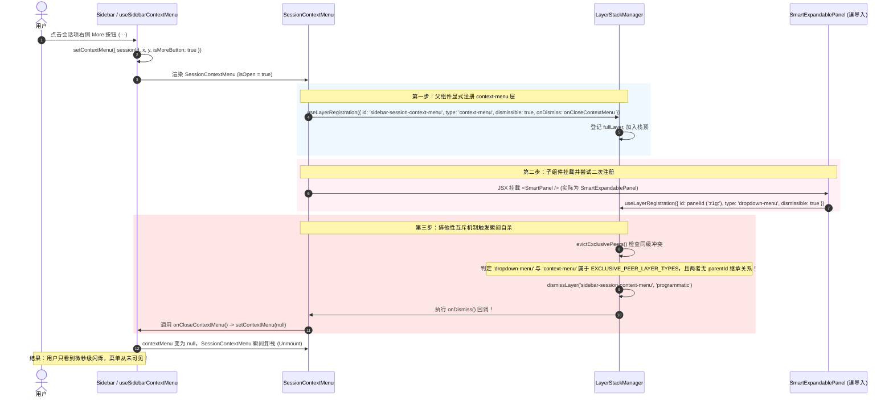
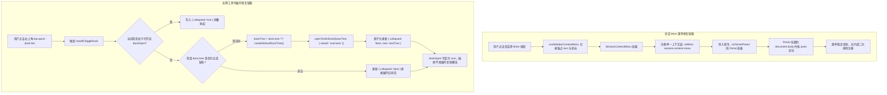

# 会话列表 More 菜单互斥自杀与右侧边栏展开死锁修复详案 (Plan 05)

> **战役工作区**：`docs/workbench-interaction-repair/`  
> **关联总纲**：[`00-workbench-interaction-repair-master-plan.md`](./00-workbench-interaction-repair-master-plan.md) §四.维度 5 (D5 & D6)  
> **涉及核心文件**：  
> - `apps/crish-desktop/src/components/sidebar/SessionContextMenu.tsx`（会话右键/更多操作上下文菜单适配器）  
> - `apps/crish-desktop/src/components/ui/SmartPanel/SmartPanel.tsx`（原生纯 Portal 浮层面板）  
> - `apps/crish-desktop/src/components/ui/SmartExpandablePanel/SmartExpandablePanel.tsx`（带 Radix Popover 与内部层注册的可扩展面板）  
> - `apps/crish-desktop/src/components/ui/internal/layer-stack/LayerStackManager.ts`（全局浮层调度中枢单核状态机）  
> - `apps/crish-desktop/src/components/binary-tree/TreeLeafPanel.tsx`（二叉树叶子微内核容器与右坞抽屉）  
> - `apps/crish-desktop/src/hooks/useTreePanelEvents.ts`（工作区全局面板事件桥）  
> - `apps/crish-desktop/src/store/layout-tree/dockLayoutModel.ts`（右坞空间模型与纯树算法）  

---

## 一、概述与治理目标

在工作台核心界面的日常交互中，用户反馈了两个高频阻断性操作故障：
1. **主界面会话列表 More (···) 按钮点击毫无反应**：在侧栏会话项中，用户点击更多操作按钮（`···`）时，上下文菜单完全不弹出，或在微秒级时间内闪烁后立刻消失，无法触发置顶、重命名、归档、分叉、删除等会话管理功能。
2. **右侧边栏展开按钮点击毫无反应**：在主对话工作区右上角，点击“展开右侧工具栏”按钮（`sidebar-right`）时，抽屉面板完全不展开，界面保持静止，按钮状态未激活，无法查看任务概览（Overview）或辅助工具。

经深层穿透排查，这两处故障表面上是“点击无反馈”的前端交互异常，但实质上暴露了**全局浮层层级调度互斥（LayerStack Eviction）机制下的依赖倒置与自杀式驱逐**，以及**二叉树空间布局展开状态机（Dock Split State Machine）对空树分支的死锁判定漏洞**。

### 治理目标
1. **消除浮层自杀式驱逐**：彻底厘清 `SessionContextMenu` 的组件归属，斩断跨层注册冲突，恢复纯 Portal 渲染架构，确保上下文菜单在左键 More 按钮与右键命中时 100% 稳定展开。
2. **解开右坞开合状态机死锁**：在叶子组件的局部触发链路中，补齐对空树（Empty Dock Tree）的智能判定与默认概览视图（`overview`）装填，与全局事件总线（`useTreePanelEvents`）实现契约统一，保证单栏对话视图下一键唤起右侧抽屉。
3. **建立防回归刚性测试门禁**：补充针对 `SessionContextMenu` 首次挂载生命周期层栈排他性断言，以及 `TreeLeafPanel` 空树点击生成概览页的单元测试，阻断后续重构中的破坏性漂移。

---

## 二、现状断裂证据与根因穿透分析

### 1. 会话列表 More 菜单：误导 Barrel 导出引发的自杀式驱逐 (D5)

#### 1.1 源码证据
定位至 [`apps/crish-desktop/src/components/sidebar/SessionContextMenu.tsx:1-13`](file:///c:/Software/conex/apps/crish-desktop/src/components/sidebar/SessionContextMenu.tsx#L1-L13)：

```tsx
import React, { useMemo } from 'react';

import {
  SmartPanel,
  type MenuItem,
  useLayerRegistration,
} from '@/components/ui'; // 致命导入点：桶文件污染
import type {
  SessionContextMenuState,
  SessionMenuAction,
} from './SidebarContextMenus';
import { AppIcon } from '@/components/ui/icons';
```

审查 Git 提交历史，在变更 `c18eeb80804cf9d5f96c928e17678dfd776323ef`（`[BATCH-WORKSPACE-SHELL]`）中，原有的相对导入被错误重构：
```diff
-import { SmartPanel, type MenuItem } from '../ui/SmartPanel';
-import { useLayerRegistration } from '../ui/internal/layer-registration/useLayerRegistration';
+import {
+  SmartPanel,
+  type MenuItem,
+  useLayerRegistration,
+} from '@/components/ui';
```

定位至统一导出桶文件 [`apps/crish-desktop/src/components/ui/index.ts:30`](file:///c:/Software/conex/apps/crish-desktop/src/components/ui/index.ts#L30) 与 [`SmartExpandablePanel/index.ts:1-4`](file:///c:/Software/conex/apps/crish-desktop/src/components/ui/SmartExpandablePanel/index.ts#L1-L4)：
```ts
// apps/crish-desktop/src/components/ui/index.ts
export * from './SmartExpandablePanel/index';

// apps/crish-desktop/src/components/ui/SmartExpandablePanel/index.ts
export {
  SmartExpandablePanel,
  SmartExpandablePanel as SmartPanel, // 别名遮蔽！
} from './SmartExpandablePanel';
```

#### 1.2 运行时调度层时序追踪与物理断裂过程
当用户点击会话项的 More 按钮时，系统在单帧内的执行过程如下：



#### 1.3 核心架构断裂点剖析
1. **排他同级驱逐机制（Exclusive Peer Eviction）的误伤**：
   在 [`layerStackTypes.ts:155-162`](file:///c:/Software/conex/apps/crish-desktop/src/components/ui/internal/layer-stack/layerStackTypes.ts#L155-L162) 中定义了排他浮层集合：
   ```ts
   export const EXCLUSIVE_PEER_LAYER_TYPES: ReadonlySet<LayerType> = new Set([
     'dropdown-menu',
     'context-menu',
     'cascade-submenu',
     'popover',
     'select',
     'combobox',
   ]);
   ```
   `LayerStackManager` 的核心不变量要求：**在整个应用内，同一时刻不允许并存两个非父子关系的弹出浮层**。当新浮层注册时，`findExclusivePeersToDismiss` 会扫描栈中所有不具备 `hasAncestor` 拓扑关系的互斥层并予以退栈清退（`dismissLayer(peerId, 'programmatic')`）。
2. **容器与浮层内外的职责越界**：
   - 原生 `SmartPanel`（位于 `components/ui/SmartPanel/SmartPanel.tsx`）是一个**纯粹的 Portal 渲染原语**。它本身**不调用** `useLayerRegistration`，它把层栈注册生命周期的控制权 100% 交由消费方组件（如 `SessionContextMenu`）自主管理。
   - `SmartExpandablePanel` 则是面向设置项选择、模型拾取器等独立触发场景的高阶组件，其内部封装了 Radix Popover 并硬编码注册了 `id: panelId, type: 'dropdown-menu'`。
   - 当 `SessionContextMenu` 误将 `SmartExpandablePanel` 当作纯面板使用时，组件内部无意中派生了第二个排他层，直接把外部声明的 `sidebar-session-context-menu` 主层判处死刑！
3. **Props 契约断层与坐标计算失效**：
   - 原生 `SmartPanel` 接受 `point: { x: number; y: number }`、`panelRef`、`position: { side, align, sideOffset }`。
   - `SmartExpandablePanel` 的定位完全依赖 Radix UI 的 Trigger 锚点，忽略传入的 `point` 坐标，且其接收的 `position` 为 `PositionOptions` 类型。这种 props 错位使得即使菜单未被销毁，其坐标也会坍塌在屏幕左上角 `(0, 0)`。

---

### 2. 右侧边栏展开按钮：空树判定下的状态机死锁 (D6)

#### 2.1 源码证据
定位至 [`apps/crish-desktop/src/components/binary-tree/TreeLeafPanel.tsx:109-114`](file:///c:/Software/conex/apps/crish-desktop/src/components/binary-tree/TreeLeafPanel.tsx#L109-L114)：

```tsx
// TreeLeafPanel.tsx:109-114
const dock = activeTab?.dock ?? leaf.dock ?? COLLAPSED_DOCK;
const isTerminalTab = activeTab?.kind === 'terminal';
const isBrowserTab = activeTab?.kind === 'browser';
const isStandaloneTab = isTerminalTab || isBrowserTab;
const dockOpen =
  isChatSurface &&
  !isLeafDraft &&
  !isStandaloneTab &&
  dock.collapsed !== true &&
  Boolean(dock.tree && !isDockTreeEmpty(dock.tree)); // 致命死锁条件：不仅要求 !collapsed，还硬性要求树非空！
```

再看该按钮的点击处理函数 [`TreeLeafPanel.tsx:221-230`](file:///c:/Software/conex/apps/crish-desktop/src/components/binary-tree/TreeLeafPanel.tsx#L221-L230)：

```tsx
// TreeLeafPanel.tsx:221-230
const handleToggleDock = useCallback(() => {
  if (!isChatSurface || isStandaloneTab) return;
  if (dockOpen) {
    updateLeafDock(leaf.id, { collapsed: true });
    return;
  }
  // 致命缺陷：展开时仅仅更新了 collapsed: false，根本未初始化 dock.tree！
  updateLeafDock(leaf.id, {
    collapsed: false,
  });
}, [dockOpen, isChatSurface, isStandaloneTab, leaf.id]);
```

以及抽屉的渲染门禁与触发按钮 [`TreeLeafPanel.tsx:356-396`](file:///c:/Software/conex/apps/crish-desktop/src/components/binary-tree/TreeLeafPanel.tsx#L356-L396)：

```tsx
// TreeLeafPanel.tsx:356-382
{dockOpen ? (
  <>
    {!isMaximized && (
      <LeafDockResizer ... />
    )}
    <div className={...} data-leaf-dock-drawer="true">
      <DockSplitWorkspace ... />
    </div>
  </>
) : null}

// TreeLeafPanel.tsx:384-396
{isChatSurface && !isLeafDraft && !isStandaloneTab && (
  <Button
    type="button"
    variant="ghost"
    className={`${styles.topSidePanelBtn} top-action-btn top-side-panel-btn`}
    data-testid="top-quick-dock-btn"
    data-active={dockOpen ? 'true' : 'false'}
    aria-label={dockOpen ? '收起右侧工具栏' : '展开右侧工具栏'}
    onClick={handleToggleDock}
  >
    <AppIcon name="sidebar-right" size={16} aria-hidden />
  </Button>
)}
```

#### 2.2 状态机死锁与调用链穿透
对于一个新初始化的会话（或尚未打开过任何工具的默认会话），其 `dock` 结构由 [`createDefaultDock`](file:///c:/Software/conex/apps/crish-desktop/src/store/layout-tree/sessionTabModel.ts) 生成，`dock.tree` 为包含一个空 Leaf（`tabs: []`）的空树，或者 `dock.tree = null`。

```mermaid
stateDiagram-v2
    [*] --> Collapsed_EmptyTree: 初始状态 (collapsed: true, tree: empty)
    
    state Collapsed_EmptyTree {
        note right of Collapsed_EmptyTree
            dockOpen 判定:
            !collapsed (False) && !isDockTreeEmpty (False)
            => dockOpen = False
        end note
    }

    Collapsed_EmptyTree --> Deadlock_Attempt: 用户点击右上角 sidebar-right 按钮
    
    state Deadlock_Attempt {
        note right of Deadlock_Attempt
            handleToggleDock 执行:
            updateLeafDock(leaf.id, { collapsed: false })
            仅更新了 collapsed 标志，tree 依然为空！
        end note
    }

    Deadlock_Attempt --> Collapsed_EmptyTree: 下一帧渲染重新计算 dockOpen
    note right of Collapsed_EmptyTree
        dockOpen 重新评估:
        dock.collapsed === false (满足)
        但是 Boolean(dock.tree && !isDockTreeEmpty) 依然为 False！
        => dockOpen 依然恒等于 False！
        => 抽屉不渲染 (render null)
        => 按钮 data-active="false"
        => 彻底陷入状态死锁！
    end note
```

#### 2.3 规范实现对比与设计漂移
对比全局事件桥 [`apps/crish-desktop/src/hooks/useTreePanelEvents.ts:56-84`](file:///c:/Software/conex/apps/crish-desktop/src/hooks/useTreePanelEvents.ts#L56-L84)：

```ts
// useTreePanelEvents.ts 规范逻辑
const offToggleRight = onUiEvent('toggle-right-panel', (detail) => {
  ...
  const dock = readLeafDock(node);
  const nextCollapsed = !dock.collapsed;
  if (nextCollapsed) {
    updateLeafDock(targetLeafId, { collapsed: true });
    return;
  }
  // 关键自愈逻辑：检测到空树时，立即注入默认工具 overview
  if (isDockTreeEmpty(dock.tree)) {
    const { tree: nextTree } = openToolInDock(dock.tree, {
      viewId: 'overview',
    });
    updateLeafDock(targetLeafId, { collapsed: false, tree: nextTree });
  } else {
    updateLeafDock(targetLeafId, { collapsed: false });
  }
});
```

显然，`TreeLeafPanel.tsx` 中的 `handleToggleDock` 在重构时漏掉了对 `isDockTreeEmpty` 的分支处理。当用户通过全局快捷键或外部菜单触发 `toggle-right-panel` 事件时，右侧边栏能够正常唤出并展示概览；但当用户直接点击右上角物理按钮时，直接命中了未处理空树的 `handleToggleDock`，引发了严重的交互不一致！

---

## 三、总体重构方案与架构不变量

### 1. 架构不变量 (Invariants)
1. **单一排他层真理源（Single Exclusive Layer Rule）**：
   - 任何复合菜单（如 `SessionContextMenu`）在 `LayerStackManager` 中必须且仅能拥有一个唯一的排他层注册（`type: 'context-menu'`）。
   - 内部子组件必须为纯渲染视图或纯 Portal，严禁私自二次调用 `useLayerRegistration`，杜绝内部组件驱逐宿主组件的荒谬现象。
2. **右坞开合与内容完备性公理（Dock Invariant）**：
   - `dockOpen === true` 当且仅当 `dock.collapsed !== true` 且 `dock.tree` 中包含至少一个活动的非空工具标签（Tab）。
   - 用户任何“意图展开”的操作（不管是通过事件还是直接点击按钮），都负有“确保树非空”的完备性责任。若当前树为空，必须原子化注入系统默认单例视图 `overview` 并激活，保证展开即可见。
3. **坐标传递精确性与几何解耦**：
   - 上下文菜单的位置由触发源计算出的全局物理坐标 `point: { x, y }` 精准供给，浮层容器使用 `position: fixed` 并经由 `usePanelPosition` 保证防溢出钳位，不依赖脆弱的 Radix DOM 探测。

### 2. 交互状态流转模型



---

## 四、详细代码落盘与变更规范

### 1. `SessionContextMenu.tsx` 导入源修正与纯 Portal 恢复

#### 1.1 修改文件
`apps/crish-desktop/src/components/sidebar/SessionContextMenu.tsx`

#### 1.2 变更方案
- 将 `SmartPanel` 的导入路径从 `@/components/ui` 改为相对路径 `../ui/SmartPanel`（从 `apps/crish-desktop/src/components/ui/SmartPanel/index.ts` 导入原生纯面板）。
- 保留 `useLayerRegistration` 从 `@/components/ui` 导入，负责外部单一层栈管理。
- 确保 `SmartPanel` 接收的 `items`、`point`、`triggerRef`、`position`、`role="menu"` 契约完整传递。

#### 1.3 代码变更对比
```tsx
// apps/crish-desktop/src/components/sidebar/SessionContextMenu.tsx

// ─── 修改前 ─────────────────────────────────────────────────────────────
import {
  SmartPanel,
  type MenuItem,
  useLayerRegistration,
} from '@/components/ui';
import type {
  SessionContextMenuState,
  SessionMenuAction,
} from './SidebarContextMenus';
import { AppIcon } from '@/components/ui/icons';

// ─── 修改后 ─────────────────────────────────────────────────────────────
import { SmartPanel, type MenuItem } from '../ui/SmartPanel';
import { useLayerRegistration } from '@/components/ui';
import type {
  SessionContextMenuState,
  SessionMenuAction,
} from './SidebarContextMenus';
import { AppIcon } from '@/components/ui/icons';
```

---

### 2. `TreeLeafPanel.tsx` 右坞展开逻辑与空树装填自愈

#### 2.1 修改文件
`apps/crish-desktop/src/components/binary-tree/TreeLeafPanel.tsx`

#### 2.2 变更方案
- 从 `../../store/layout-tree/dockLayoutModel` 引入纯树辅助方法：`createDefaultDockTree` 与 `openToolInDock`。
- 重构 `handleToggleDock` 回调：
  - 若 `dockOpen` 为真，则收起：`updateLeafDock(leaf.id, { collapsed: true })`。
  - 若 `dockOpen` 为假，检查当前 `dock.tree` 是否为空：`!dock.tree || isDockTreeEmpty(dock.tree)`。
  - 若为空，调用 `createDefaultDockTree()` 建立基础树干，通过 `openToolInDock(tree, { viewId: 'overview' })` 填入 `overview` 概览页，并以 `{ collapsed: false, tree: nextTree }` 更新叶子右坞状态。
  - 若不为空，保持既有内容展开：`updateLeafDock(leaf.id, { collapsed: false })`。
- 将 `dock.tree` 加入 `useCallback` 的依赖项数组，确保开闭判定实时感知最新树拓扑。

#### 2.3 代码变更对比
```tsx
// apps/crish-desktop/src/components/binary-tree/TreeLeafPanel.tsx

// ─── 引入纯函数依赖 ──────────────────────────────────────────────────────
import {
  createDefaultDockTree,
  openToolInDock,
} from '../../store/layout-tree/dockLayoutModel';

// ─── 修改前 ─────────────────────────────────────────────────────────────
    const handleToggleDock = useCallback(() => {
      if (!isChatSurface || isStandaloneTab) return;
      if (dockOpen) {
        updateLeafDock(leaf.id, { collapsed: true });
        return;
      }
      updateLeafDock(leaf.id, {
        collapsed: false,
      });
    }, [dockOpen, isChatSurface, isStandaloneTab, leaf.id]);

// ─── 修改后 ─────────────────────────────────────────────────────────────
    const handleToggleDock = useCallback(() => {
      if (!isChatSurface || isStandaloneTab) return;
      if (dockOpen) {
        updateLeafDock(leaf.id, { collapsed: true });
        return;
      }

      if (!dock.tree || isDockTreeEmpty(dock.tree)) {
        const baseTree = dock.tree ?? createDefaultDockTree();
        const { tree: nextTree } = openToolInDock(baseTree, {
          viewId: 'overview',
        });
        updateLeafDock(leaf.id, {
          collapsed: false,
          tree: nextTree,
        });
        return;
      }

      updateLeafDock(leaf.id, {
        collapsed: false,
      });
    }, [dockOpen, isChatSurface, isStandaloneTab, leaf.id, dock.tree]);
```

---

## 五、测试用例设计与回归门禁断言

为贯彻立体验证与防退避原则，本方案设计两个维度的针对性自动化测试套件。

### 1. `SessionContextMenu` 首次挂载生命周期与单层防自杀测试

#### 1.1 测试文件
`apps/crish-desktop/src/components/sidebar/SidebarContextMenus.exclusive.test.tsx`

#### 1.2 核心断言设计
```tsx
it('SessionContextMenu 首次挂载时不应发生内部互斥自杀（onClose 不被调用）', async () => {
  const menuRef = React.createRef<HTMLDivElement>();
  const triggerRef = React.createRef<HTMLButtonElement>();
  const onClose = vi.fn();
  const onAction = vi.fn();

  render(
    <>
      <button ref={triggerRef} type="button" data-testid="session-more-button">
        更多
      </button>
      <SessionContextMenu
        contextMenu={{
          x: 100,
          y: 200,
          sessionId: 'test-session-123',
          isMoreButton: true,
        }}
        menuRef={menuRef}
        isPinned={false}
        onSessionAction={onAction}
        onCloseContextMenu={onClose}
        contextMenuTriggerRef={triggerRef}
      />
    </>
  );

  // 1. 断言菜单成功渲染至 DOM 中
  const menu = await screen.findByTestId('session-context-menu');
  expect(menu).toBeInTheDocument();

  // 2. 核心断言：onCloseContextMenu 绝不能在挂载瞬间被自杀式调用！
  expect(onClose).not.toHaveBeenCalled();

  // 3. 断言 LayerStackManager 内部仅存在一个且仅一个 context-menu 类型的层
  const layers = layerStackService.getLayers();
  const sessionLayers = layers.filter(
    (l) => l.id === SESSION_CONTEXT_MENU_LAYER_ID
  );
  expect(sessionLayers).toHaveLength(1);
  expect(sessionLayers[0].type).toBe('context-menu');

  // 4. 严防同级污染：绝不存在任何属于该组件的竞争性 dropdown-menu 层
  const dropdownLayers = layers.filter((l) => l.type === 'dropdown-menu');
  expect(dropdownLayers).toHaveLength(0);
});

it('点击会话操作项能够正常响应回调并退出', async () => {
  const onAction = vi.fn();
  const onClose = vi.fn();
  renderSessionMenu({ onSessionAction: onAction, onCloseContextMenu: onClose });

  const renameOption = await screen.findByText('重命名');
  fireEvent.click(renameOption);

  expect(onAction).toHaveBeenCalledWith('rename');
});
```

---

### 2. `TreeLeafPanel` 空树点击右坞按钮唤醒 Overview 单元测试

#### 2.1 测试文件
新建或扩充于 `apps/crish-desktop/src/components/binary-tree/__tests__/TreeLeafPanel.dockToggle.test.tsx`（或扩充至 `TreeLeafPanel.routing.test.tsx`）

#### 2.2 核心断言设计
```tsx
describe('TreeLeafPanel 右坞展开按钮状态机自愈', () => {
  it('当 dock.tree 为空时，点击右坞按钮应自动装填 overview 标签并设置 collapsed: false', async () => {
    const leafId = 'leaf-test-dock';
    const sessionId = 'session-test-dock';
    
    // 构造一个初始折叠且 tree 为空的 Leaf
    const leaf = makeChatLeaf({
      id: leafId,
      sessionId,
      dock: {
        collapsed: true,
        tree: null, // 模拟初始空树
        widthRatio: 0.5,
      },
    });

    const updateSpy = vi.spyOn(workspaceShellModule, 'updateLeafDock');

    render(
      <TreeLeafPanel
        leaf={leaf}
        rect={{ left: 0, top: 0, width: 1000, height: 800 }}
        isActive={true}
        isDragSource={false}
      />
    );

    // 寻找右上角展开按钮
    const toggleBtn = await screen.findByTestId('top-quick-dock-btn');
    expect(toggleBtn).toBeInTheDocument();
    expect(toggleBtn.getAttribute('data-active')).toBe('false');

    // 触发点击
    fireEvent.click(toggleBtn);

    // 断言 updateLeafDock 接收到了正确的自愈 payload
    expect(updateSpy).toHaveBeenCalledTimes(1);
    const [calledLeafId, patch] = updateSpy.mock.calls[0];
    expect(calledLeafId).toBe(leafId);
    expect(patch.collapsed).toBe(false);
    expect(patch.tree).toBeDefined();

    // 深度断言：生成的 tree 中包含 overview 标签，且 activeTab 对应 overview
    const tabs = collectDockTabs(patch.tree!);
    expect(tabs.some((t) => t.viewId === 'overview')).toBe(true);

    updateSpy.mockRestore();
  });

  it('当 dock 已展开时，点击按钮应平滑收起（仅设置 collapsed: true）', async () => {
    const leafId = 'leaf-test-dock-open';
    const sessionId = 'session-test-dock-open';
    
    // 构造一个已有有效 overview 且已展开的 Leaf
    const { tree } = openToolInDock(createDefaultDockTree(), { viewId: 'overview' });
    const leaf = makeChatLeaf({
      id: leafId,
      sessionId,
      dock: {
        collapsed: false,
        tree,
        widthRatio: 0.5,
      },
    });

    const updateSpy = vi.spyOn(workspaceShellModule, 'updateLeafDock');

    render(
      <TreeLeafPanel
        leaf={leaf}
        rect={{ left: 0, top: 0, width: 1000, height: 800 }}
        isActive={true}
        isDragSource={false}
      />
    );

    const toggleBtn = await screen.findByTestId('top-quick-dock-btn');
    expect(toggleBtn.getAttribute('data-active')).toBe('true');

    fireEvent.click(toggleBtn);

    expect(updateSpy).toHaveBeenCalledWith(leafId, { collapsed: true });
    updateSpy.mockRestore();
  });
});
```

---

## 六、立体验证核对清单 (Checklist)

实施修改后，必须遵循以下步骤执行立体化验收：

- [ ] **代码静态检查与编译**：
  - 运行 `npx tsc --noEmit` 确保全仓无类型断裂。
  - 验证 `apps/crish-desktop/src/components/sidebar/SessionContextMenu.tsx` 中 `SmartPanel` 类型匹配无报错。
- [ ] **单元测试自动化门禁**：
  - 运行 `npx vitest run apps/crish-desktop/src/components/sidebar/SidebarContextMenus.exclusive.test.tsx`，确保全部 7+ 项层栈测试 100% 绿色通过。
  - 运行 `npx vitest run apps/crish-desktop/src/components/binary-tree/` 下相关测试，验证右坞展开状态机测试全部通过。
- [ ] **真实运行期端到端现场核对**：
  1. 启动桌面应用 `npm run dev:workbench`。
  2. **会话 More 按钮核对**：
     - 在左侧会话列表中，将鼠标悬停在任意已有会话项上；
     - 左键单击 `···` 更多操作按钮；
     - 观察上下文菜单是否瞬时稳定弹出在按钮右侧；
     - 点击外部区域，确认菜单平滑退栈退出；
     - 再次右键点击会话项，确认右键也能正常唤起同款菜单。
  3. **右侧工具坞按钮核对**：
     - 新建一个对话，此时右侧边栏处于折叠状态；
     - 点击右上角 `sidebar-right` 图标按钮；
     - 观察右侧边栏抽屉是否顺畅展开，并立即显示工作区概览（Overview）视图；
     - 再次点击该按钮，右侧边栏平滑折叠关闭；
     - 在右侧边栏打开文件或终端后再次收起再展开，验证上次打开的状态被正确保留而非强制重置。
