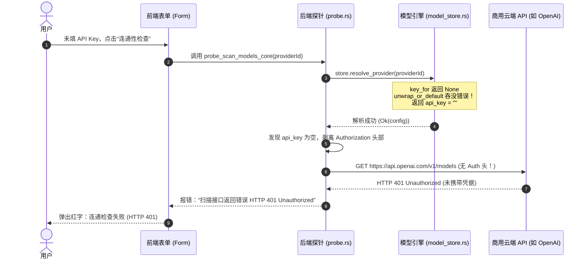

# API Key 保存、DPAPI 安全存储与前后端 IPC 契约源码级审计报告

> **审计专家**：凭据安全与底层契约审计专家（Secret & Security Reviewer）  
> **审计提交**：`commit f6ae63f5ff5431128c31202eeadfccfb42f8e17f`（对比上一版本及 `fd68ccc8dca0346af61240fe6ff967dee5048c98`）  
> **战役工作区**：`docs/workbench-interaction-repair/`  
> **关联详案**：[`03-api-key-and-dpapi-secret-plan.md`](../03-api-key-and-dpapi-secret-plan.md) 与 [`04-connectivity-probe-and-model-scan-plan.md`](../04-connectivity-probe-and-model-scan-plan.md)  
> **审计日期**：2026-10-29  
> **审计结论**：**【不通过：存在致命凭据丢失隐患与双轨裂脑缺陷（FAIL / REVISE REQUIRED）】**

---

## 一、审查目标与改动范围

本次审计针对桌面端工作台在模型供应商设置修复战役中，涉及「API Key 密钥保存、Windows DPAPI 安全持久化、前后端 IPC 契约对齐、CAS 乐观锁版本同步及单轨真理源（SSOT）」的核心实现进行源码级穿透核查。

### 涉及审查的核心文件范围
1. **`apps/crish-desktop/src/api/provider-profiles/rustProfileStore.ts`**：前端 Rust 配置命令 IPC 薄封装，负责 `config_secret_*` 命令的参数编码与快照接管。
2. **`apps/crish-desktop/src/api/provider-profiles/rustProfileStore.test.ts`**：前端凭据 IPC 契约测试套件。
3. **`apps/crish-desktop/src/api/provider-profiles/profileKeySecret.ts`**：会话内密钥内存缓存与 DPAPI 调度层。
4. **`crates/agent-provider/src/credentials.rs`**：Rust 内核凭据原语，封装 DPAPI 读写与 `SecretString` 受控内存抹除。
5. **`crates/agent-provider/src/model_store.rs`**：Rust 内核统一模型树、CAS 版本控制与凭据槽映射引擎。
6. **`apps/agent-workbench/src-tauri/src/config/credentials.rs`**：Rust Tauri 凭据命令入口。
7. **`apps/agent-workbench/src-tauri/src/probe.rs`**：服务商探针扫描与免密模型探测端点。
8. **`apps/crish-desktop/src/components/settings-models/ProviderProfileForm.tsx`** 与 **`useModelProviderActions.ts`**：设置页供应商表单交互与连通性动作调度。
9. **`docs/workbench-interaction-repair/03-api-key-and-dpapi-secret-plan.md`**：本次修复的设计规划与契约详案。

---

## 二、核心审查结论总表（Scorecard & Executive Summary）

### 1. 核心维度评审概览

| 审查维度 | 评级 | 结论核心摘要 |
| :--- | :---: | :--- |
| **1. IPC 参数与 Wire 契约** | **MAJOR DEFECT** | 参数名 `providerId` 与 `expectedRevision` 在入参方向已对齐，消除了 Tauri 400 反序列化报错；但 **返回值 Wire 协议断裂**，Rust 返回 `CredentialState` / `RevealedCredential`（无 `ok` 与 `profileId` 字段），前端声明却为 `ConfigSecretStatus`，单测通过伪造 Mock 掩盖了类型脱节。 |
| **2. Revision CAS 与快照接管** | **MAJOR DEFECT** | 正常成功时 `acceptSnapshot` 能正确同步 Store 版本号；但 `if (res.data?.tree)` 条件判断属于针对单测 Mock 假数据的补丁式防御；若 Store 未完成首轮读取即提交，`revision` 为空串将直接撞上 Rust 端的 CAS 冲突导致写死锁。 |
| **3. Secret 安全与内存抹除** | **MAJOR DEFECT** | 为 `SecretString` 派生 `#[derive(Default)]` 破坏了“凭据必为有效密态载荷”的设计不变量；`resolve_provider` 盲目使用 `.unwrap_or_default()`，导致商用云服务商在未配 Key 时向公网发出无 Authorization 头的盲目 HTTP 请求，报 401 混淆用户。 |
| **4. 密钥存储单轨性 (SSOT)** | **CRITICAL BLOCKER** | **【致命】** `profileKeySecret.ts` 未彻底切断 `localStorage`；DPAPI 写入失败时未清理内存缓存，`saveProfileKey` 盲目判定 `hasKey = true` 谎报成功并抹除用户草稿，重启后密钥完全丢失；`useModelProviderActions` 优先读取 `loadProfiles()` 导致 Base URL 裂脑。 |

### 2. 缺陷分级分布

- **【Critical 致命阻断】**：1 项（DPAPI 失败静默吞没、谎报成功、抹除草稿、重启丢失密钥）
- **【Major 架构/功能缺陷】**：4 项（Base URL 双轨裂脑、免密未配混淆请求 401、CAS 未初始化死锁、返回值 Wire 形状脱节）
- **【Minor 边界/安全隐患】**：2 项（`SecretString` 派生 Default 破坏类型不变量、`if (res.data?.tree)` 掩盖测试缺陷）
- **【Positive 架构肯定项】**：2 项（入参名彻底脱敏为 `providerId`、内存抹除 `wipe` 引入 volatile 防编译器清零优化）

---

## 三、四大核心审查维度源码级深度实证分析

### 维度 1：IPC 参数契约对齐与 Wire 返回类型断裂

#### 1.1 入参契约核验：已纠正历史 `profileId` 断层
在 Rust 后端 [`credentials.rs:6-63`](file:///c:/Software/conex/apps/agent-workbench/src-tauri/src/config/credentials.rs#L6-L63) 中，定义了 5 条凭据核心命令：
- `config_secret_set(app, provider_id: String, api_key: String, expected_revision: String)`
- `config_secret_clear(app, provider_id: String, expected_revision: String)`
- `config_secret_get(provider_id: String)`
- `config_secret_has(provider_id: String)`
- `config_secret_reveal(provider_id: String, ui_confirm: bool)`

在前端 [`rustProfileStore.ts:57-138`](file:///c:/Software/conex/apps/crish-desktop/src/api/provider-profiles/rustProfileStore.ts#L57-L138) 中：
- `configSecretSet`: 传参 `{ providerId, apiKey, expectedRevision: rev }`（对齐）
- `configSecretClear`: 传参 `{ providerId, expectedRevision: rev }`（对齐）
- `configSecretGet`: 传参 `{ providerId }`（对齐）
- `configSecretHas`: 传参 `{ providerId }`（对齐）
- `configSecretReveal`: 传参 `{ providerId, uiConfirm }`（对齐）

**核验结论**：在入参键名与 CAS 修订号传递方向，Tauri 驼峰反序列化契约已 100% 对齐，消除了旧版本中因 `missing field providerId` 或 `missing field expectedRevision` 导致的 400 反序列化崩溃。

#### 1.2 返回值 Wire 契约脱节：TS 声明与 Rust 载荷失配【Major】
虽然入参已经对齐，但在**出参（返回值）契约**上存在明显的架构漏洞：

1. **`config_secret_get` 与 `config_secret_has` 的返回载荷缺失字段**：
   - Rust 后端定义（[`credentials.rs:35-46`](file:///c:/Software/conex/apps/agent-workbench/src-tauri/src/config/credentials.rs#L35-L46) 与 [`model_store.rs:50-58`](file:///c:/Software/conex/crates/agent-provider/src/model_store.rs#L50-L58)）：
     ```rust
     #[derive(Debug, Clone, Serialize)]
     #[serde(rename_all = "camelCase")]
     pub struct CredentialState {
         pub has_key: bool,
         #[serde(skip_serializing_if = "Option::is_none")]
         pub api_key_last4: Option<String>,
         #[serde(skip_serializing_if = "Option::is_none")]
         pub error: Option<String>,
     }
     ```
     Rust 端实际返回的 JSON 载荷为：
     ```json
     { "hasKey": true, "apiKeyLast4": "abcd" }
     ```
   - 前端 TS 接口声明（[`rustProfileStore.ts:24-32, 87-98`](file:///c:/Software/conex/apps/crish-desktop/src/api/provider-profiles/rustProfileStore.ts#L24-L32)）：
     ```typescript
     export type ConfigSecretStatus = {
       ok: boolean;
       profileId: string;
       hasKey: boolean;
       apiKeyLast4?: string | null;
       persistence?: string;
       revealed?: boolean;
     };

     export function configSecretGet(providerId: string): Promise<InvokeTypedResult<ConfigSecretStatus>>
     ```
   - **断裂实证**：Rust 返回的对象中根本**不存在 `ok` 与 `profileId` 字段**！如果上层业务代码读取 `res.data.ok` 或 `res.data.profileId`，运行时得到的是 `undefined`！
   - 与此形成鲜明对比的是，`configSecretClear` 在前端内部做了手动补齐构造：
     ```typescript
     // rustProfileStore.ts:114-121
     return {
       status: 'ok',
       data: {
         ok: true,
         profileId: providerId,
         hasKey: false,
       },
     };
     ```
     而 `configSecretGet` 与 `configSecretHas` 却直接返回 `invokeTyped` 的原生载荷，造成同类函数返回值数据结构的严重不一致。

2. **`config_secret_reveal` 返回载荷同样缺失 `ok` 与 `profileId`**：
   - Rust 端返回 `RevealedCredential`（[`credentials.rs:49-57`](file:///c:/Software/conex/apps/agent-workbench/src-tauri/src/config/credentials.rs#L49-L57)）：
     ```rust
     pub(crate) struct RevealedCredential {
         #[serde(flatten)]
         status: CredentialState, // hasKey, apiKeyLast4, error
         revealed: bool,
         api_key: Option<String>,
     }
     ```
     序列化后为 `{ "hasKey": true, "revealed": true, "apiKey": "..." }`。
   - 前端声明为 `ConfigSecretRevealResult = ConfigSecretStatus & { apiKey?: string; }`，虚假承诺存在 `ok: boolean` 与 `profileId: string`。

3. **测试虚假 Mock 掩盖断裂**：
   定位至 [`rustProfileStore.test.ts:36-50`](file:///c:/Software/conex/apps/crish-desktop/src/api/provider-profiles/rustProfileStore.test.ts#L36-L50)：
   ```typescript
   it('config_secret_get → invoke("config_secret_get", { providerId })（K-02 last4 语义）', async () => {
     const impl = vi.fn(async () => ({
       ok: true,            // <-- 虚构的字段！
       hasKey: true,
       apiKeyLast4: 'alue',
     }));
     mockTauriCommand('config_secret_get', impl);
     const res = await configSecretGet('openai');
   ```
   测试用例强行 Mock 了 Rust 端根本不产出的 `ok: true`，掩盖了真实契约脱节的缺陷。

---

### 维度 2：Revision CAS 机制与快照接管

#### 2.1 快照接管机制分析与一致性断言
- 当 Rust 核心模型存储成功写入凭据后，`crates/agent-provider/src/model_store.rs:560` 执行：
  ```rust
  let result = self.publish(&mut state, Some(tree), content)?;
  ```
  `publish` 方法计算最新内容的 SHA-256 作为 `revision`，并构造完整的 `ModelsSnapshot`（包含 `tree`、`revision`、`credential_states`）。
- 前端 [`rustProfileStore.ts:68-71`](file:///c:/Software/conex/apps/crish-desktop/src/api/provider-profiles/rustProfileStore.ts#L68-L71)：
  ```typescript
  if (res.status === 'ok') {
    if (res.data?.tree) {
      modelsCatalogStore.acceptSnapshot(res.data);
    }
  ```
- `modelsCatalogStore.acceptSnapshot` 原子性地更新了 Store 的 `state.tree`、`state.revision` 与 `state.credentialStates`，并触发 UI 响应式重绘。
- **一致性断言**：在正常写入路径下，前端通过快照接管，确实能保证内存 Store 与 `~/.conex/models.yaml` 磁盘配置及 DPAPI 凭据状态达到版本恒等（Revision Lockstep）。

#### 2.2 `if (res.data?.tree)` 防御的副作用与架构异味【Minor】
在 commit `f6ae63f5f` 中，作者将代码由 `if (res.data)` 改为 `if (res.data?.tree)`。
- **根因分析**：在 `rustProfileStore.test.ts:25` 中，旧单测 Mock 返回了 `{ ok: true, hasKey: true }`，该对象不包含 `tree` 与 `revision`。如果调用 `acceptSnapshot` 会直接抛出 `Error: 模型配置无法解析`。为了让这个“假 Mock 测试”通过，作者增加了 `?.tree` 规避条件。
- **副作用**：在真实生产环境下，如果后端返回了异常快照（例如解析失败返回的 `tree: None` 诊断快照），前端会静默跳过 `acceptSnapshot`。此时前端 Store 的 `revision` 未能同步更新，用户后续的任何修改都会由于版本陈旧而硬性触发 `REVISION_CONFLICT`！
- **正确做法**：单测应当 Mock 真实的 `ModelsSnapshot` 结构体，而生产代码应在 `res.data?.tree` 缺失或解析错误时执行显式的错误告警或降级刷新。

#### 2.3 `expectedRevision` 为空串或不匹配时的后端行为【Major】
定位于 Rust 核心代码 [`model_store.rs:524-527`](file:///c:/Software/conex/crates/agent-provider/src/model_store.rs#L524-L527)：
```rust
let raw = self.raw_observed(&mut state)?;
if content_revision(raw.as_deref()) != expected {
    return self.write_conflict(raw.as_deref());
}
```
`content_revision(raw)` 对磁盘当前 YAML 内容计算 SHA-256，文件不存在时返回字符串 `"missing"`。
1. **当 `expectedRevision` 不匹配时**：
   - `content_revision != expected` 命中。
   - 返回 `ModelsStoreError { code: "REVISION_CONFLICT", message: "配置已修改；请重新读取", current_revision: Some(...) }`。
   - 凭据槽回滚，磁盘不写盘，保证 CAS 乐观锁防并发覆盖。
2. **当 `expectedRevision` 传入空串 `""` 时**：
   - 无论磁盘文件是否存在，`content_revision` 永远是 64 位 SHA256 字符串或 `"missing"`，绝不可能等于 `""`。
   - **后端必然拒绝写入，并抛出 `REVISION_CONFLICT`！**
3. **前端隐藏的初始化死锁风险**：
   - 在 [`rustProfileStore.ts:62`](file:///c:/Software/conex/apps/crish-desktop/src/api/provider-profiles/rustProfileStore.ts#L62)：
     ```typescript
     const rev = expectedRevision ?? modelsCatalogStore.getState().revision ?? '';
     ```
   - 若应用启动初期，`modelsCatalogStore` 尚未完成异步加载（`state.loaded === false`，`state.revision === ''`），用户若过快输入密钥并点击保存，`rev` 将被提取为空串 `""`。
   - 此时调用 `config_secret_set`，后端无条件抛出 `REVISION_CONFLICT`，导致保存直接陷入死锁！
   - **整改要求**：在调用 `config_secret_set` 前，必须检查并前置执行 `await modelsCatalogStore.ensureLoaded()`。

---

### 维度 3：Secret 安全性、内存抹除与免密供应商语义混淆

#### 3.1 `SecretString` 派生 `#[derive(Default)]` 的安全性评估【Minor】
在 [`credentials.rs:11-38`](file:///c:/Software/conex/crates/agent-provider/src/credentials.rs#L11-L38) 中：
```rust
#[derive(Default)]
pub struct SecretString {
    inner: String,
}
```
1. **内存与生命周期安全**：
   - `SecretString::default()` 创建长度和容量均为 0 的空字符串。
   - 在 `Drop` 时调用 `SecretString::wipe`：
     ```rust
     let bytes = unsafe { buf.as_mut_vec() };
     for byte in bytes.iter_mut() {
         unsafe { std::ptr::write_volatile(byte, 0) };
     }
     ```
     由于切片长度为 0，清零循环直接跳过，之后安全释放空字符串。不会引起内存溢出或未定义行为（UB）。
   - 同时 `Debug` 实现保持了 `"SecretString(***)"` 占位，且未实现 `Display` / `Serialize`，无隐式明文打印风险。
2. **类型不变量被削弱**：
   - 密码学基本原则要求：**密码包装器必须包含真实有效载荷**。如果凭据可以不存在，应当使用 `Option<SecretString>`。
   - 派生 `Default` 使得结构体可以在无意识下被初始化为一个空白密钥，模糊了“未提供密钥”与“密钥为空白字符串”的语义边界。

#### 3.2 `resolve_provider` 使用 `.unwrap_or_default()` 导致的公网盲目请求与 401 报错【Major】
定位于 [`model_store.rs:383-385`](file:///c:/Software/conex/crates/agent-provider/src/model_store.rs#L383-L385)：
```rust
// 改造前：
let key = self
    .key_for(provider)?
    .ok_or_else(|| ModelsStoreError::new("CREDENTIAL_MISSING", "供应商尚未配置有效凭据"))?;

// 改造后（commit f6ae63f5f）：
let key = self
    .key_for(provider)?
    .unwrap_or_default();
```
这一改动带来了严重的缺陷逻辑：



1. **逻辑机理穿透**：
   - 当用户添加商用云端供应商（如 OpenAI、Anthropic、DeepSeek），在未配置有效 API Key 的状态下点击连通性测试或模型扫描：
   - `key_for(provider)?` 返回 `Ok(None)`。
   - `unwrap_or_default()` 将其转换为 `SecretString("")`（空串）。
   - `resolve_provider` 判定**解析成功**，返回 `api_key: ""`。
   - 紧接着在 [`probe.rs:347-361`](file:///c:/Software/conex/apps/agent-workbench/src-tauri/src/probe.rs#L347-L361)：
     ```rust
     ProtocolKind::OpenAiChat | ProtocolKind::OpenAiResponses => {
         let mut b = client.get(url);
         if !api_key.trim().is_empty() {
             b = b.header(AUTHORIZATION, format!("Bearer {api_key}"));
         }
         b
     }
     ```
     代码发现 `api_key` 为空，**直接不附带 Authorization 请求头**，径直向公网云端发起 HTTP 请求！
   - 公网云端（如 OpenAI、Anthropic）必然返回 **HTTP 401 Unauthorized**。
   - 用户看到的错误提示是：`连通检查失败：扫描接口返回错误 HTTP 401 Unauthorized: {"error": {"message": "You didn't provide an API key..."}}`。
2. **危害与用户体验损害**：
   - **错误归因倒置**：原本是本地“用户未配置 API Key”的即时校验失败，现在却演变为向公网发送无意义 HTTP 垃圾流量，并把云端的 401 报给用户，用户无法分清是“自己没填 Key”、“Key 填错了”还是“服务商宕机”。
   - **与 `resolve_in` 产生架构割裂**：在实际发起模型对话的 `resolve_in`（`model_store.rs:421`）中，依然严格保留了 `.ok_or_else(CREDENTIAL_MISSING)`。唯独 `resolve_provider` 采用了 `unwrap_or_default()`。
3. **正确设计原则**：
   若要支持 Ollama、LocalAI 等本地免密供应商，必须**显式基于协议类型或免密声明**进行判断：
   仅当 `provider.api_key_ref.is_none()` 且协议为本地免密协议时才放行空凭据；商用云协议或已配置 `api_key_ref` 但读取不到凭据槽时，必须在本地立刻阻断并返回 `CREDENTIAL_MISSING`。

---

### 维度 4：密钥存储单轨性与 localStorage 残留竞争

#### 4.1 致命阻断：DPAPI 失败静默吞没、谎报成功并抹除用户输入【Critical】

这是本次审计中发现的**最严重的阻断性缺陷**。

##### 源码证据
1. 定位至 [`profileKeySecret.ts:42-68`](file:///c:/Software/conex/apps/crish-desktop/src/api/provider-profiles/profileKeySecret.ts#L42-L68)：
   ```typescript
   export async function setProfileKey(
     profileId: string,
     apiKey: string
   ): Promise<ProviderProfile[]> {
     const key = apiKey.trim();
     const list = loadProfiles();
     const p = list.find((x) => x.id === profileId);

     if (key) profileKeyCache.set(profileId, key); // <-- 1. 无条件写入内存缓存
     else profileKeyCache.delete(profileId);

     const res = key
       ? await configSecretSet(profileId, key)
       : await configSecretClear(profileId);
     if (p) {
       if (res.status === 'ok') {
         p.hasKey = Boolean(res.data?.hasKey);
       } else if (res.status === 'missing') {
         p.hasKey = Boolean(key);
       } else {
         p.hasKey = false;
       }
       saveProfiles(list);
     }
     return list; // <-- 2. res.status === 'error' 时不清理 profileKeyCache，也不报错！
   }
   ```
2. 紧接着看 [`profileKeySecret.ts:83-94`](file:///c:/Software/conex/apps/crish-desktop/src/api/provider-profiles/profileKeySecret.ts#L83-L94)：
   ```typescript
   export async function saveProfileKey(
     profileId: string,
     apiKey: string,
     opts?: { activateModel?: string }
   ): Promise<{ ok: boolean; error?: string; synced: boolean }> {
     ...
     const list = await setProfileKey(profileId, key);
     const profile = list.find((p) => p.id === profileId);
     const inUnifiedStore = selectProvider(profileId);
     if (!profile && !inUnifiedStore)
       return { ok: false, error: 'profile_not_found', synced: false };

     const hasKey =
       catalogProviderHasKey(profileId) ||
       Boolean(profile?.hasKey) ||
       Boolean(getProfileKeyInMemory(profileId)); // <-- 3. 致命盲目信任！
     if (!hasKey) return { ok: false, error: 'key_save_failed', synced: false };

     // 4. 激活模型并无条件返回成功！
     const res = await activateProfileModel(profileId, model);
     return { ok: res.ok, synced: res.ok };
   ```
3. 消费方 [`useModelProfilesState.ts:296-306`](file:///c:/Software/conex/apps/crish-desktop/src/components/settings-models/useModelProfilesState.ts#L296-L306)：
   ```typescript
   const res = await saveProfileKey(selected.id, keyDraft.trim());
   refresh();
   if (!res.ok) {
     notify(false, `保存失败：${res.error || '未知错误'}`);
     return;
   }
   setKeyDraft(''); // <-- 5. 灾难：因为 res.ok 恒为 true，用户的输入草稿被直接清空！
   notify(true, '密钥已保存，正在自动扫描服务器可用模型...');
   ```

##### 缺陷触发链路与灾难性后果
1. **触发场景**：系统处于 Windows DPAPI 加密故障、权限受限、文件系统只读、或者最常见的 **CAS 乐观锁 `REVISION_CONFLICT`** 时。
2. **执行流**：
   - 用户在表单填入重要 API Key，点击“保存”。
   - `setProfileKey` 第 50 行先将密钥放入 `profileKeyCache` 内存字典。
   - `configSecretSet` 返回 `{ status: 'error', kind: 'REVISION_CONFLICT', message: '配置已修改' }`。
   - `setProfileKey` 忽略了该错误，**没有清理 `profileKeyCache`**，直接返回 `list`。
   - `saveProfileKey` 计算 `hasKey`：因为 `profileKeyCache` 存有刚刚填入的 key，`Boolean(getProfileKeyInMemory(profileId))` 恒为 `true`！
   - `saveProfileKey` 误以为密钥已经保存，继续执行激活，并向上层返回 `{ ok: true, synced: true }`！
   - UI 收到 `ok: true`，弹出绿色 Toast“密钥已保存”，并执行 `setKeyDraft('')` **瞬间抹除用户输入的真实密钥**！
3. **灾难性后果**：
   - **暗中未落盘**：DPAPI 中根本没有该密钥，`models.yaml` 也没有建立凭据槽引用。
   - **重启即失忆**：当用户刷新页面或重启桌面应用时，`profileKeyCache` 内存缓存清空，服务商立刻恢复为“未配置密钥”。而用户输入的密钥草稿早已被清空，导致凭据彻底丢失。
   - 该缺陷直接违背了详案 Plan 03 核心承诺的“草稿保护原则”与“真实落盘验证原则”。

#### 4.2 双轨状态割裂：`loadProfiles` 残留导致 Base URL 出现裂脑（Split-Brain）【Major】

##### 源码证据
1. 在 [`ProviderProfileForm.tsx:124-135`](file:///c:/Software/conex/apps/crish-desktop/src/components/settings-models/ProviderProfileForm.tsx#L124-L135) 中，作者为了切断双轨竞争，**移除了对 `saveProfileBaseUrl` 的调用**，仅向 `modelsCatalogStore`（`models.yaml`）更新 `baseUrl`：
   ```typescript
   // ProviderProfileForm.tsx:126
   if (patch.baseUrl !== undefined) {
     // await saveProfileBaseUrl(selected.id, patch.baseUrl); <-- 已被移除！
     updatePatch.baseUrl = patch.baseUrl.trim() || undefined;
   }
   const res = await modelsCatalogStore.updateProvider(selected.id, updatePatch);
   ```
2. 然而，在连通性测试与模型扫描调用链路中（[`useModelProviderActions.ts:42-44, 62-64, 114`](file:///c:/Software/conex/apps/crish-desktop/src/components/settings-models/useModelProviderActions.ts#L42-L44) 及 [`modelCatalogIpc.ts:40, 287`](file:///c:/Software/conex/apps/crish-desktop/src/api/modelCatalogIpc.ts#L40)）：
   ```typescript
   // useModelProviderActions.ts:42-44
   const fresh = loadProfiles().find((p) => p.id === selected.id) || selected;
   const r = await testProviderModel(fresh, model);

   // modelCatalogIpc.ts:40
   export async function testProviderModel(profile: ProviderProfile, modelId: string) {
     const fresh = loadProfiles().find((p) => p.id === profile.id) || profile;
   ```

##### 裂脑行为分析
- 如果用户的 `localStorage`（`crish_provider_profiles_v1`）中曾存有旧版数据（如旧代理地址 `https://api.old.com/v1`）：
  - 用户在设置页面将 Base URL 改为官方最新地址 `https://api.openai.com/v1`。
  - `ProviderProfileForm.tsx` 正确写入了 `modelsCatalogStore`（`models.yaml` 已是新地址）。
  - 但因 `saveProfileBaseUrl` 已被移除，`localStorage` 中的旧地址**依然被保留**！
  - 用户点击“测试连通性”或“获取模型”，`useModelProviderActions` 优先执行 `loadProfiles().find(...)`。
  - **结果**：取出了 `localStorage` 中的旧地址 `https://api.old.com/v1` 并发起请求！
  - 界面显示新地址，底层通信却使用旧地址，造成极度隐蔽的“裂脑”现象！

---

## 四、缺陷清单与整改行动方案（Defect Matrix & Actionable Fixes）

### 1. 缺陷矩阵速查

| 编号 | 严重级 | 根因摘要 | 涉及文件与行号 | 修复策略 |
| :--- | :---: | :--- | :--- | :--- |
| **ISSUE-01** | **Critical** | `profileKeySecret.ts` 在 DPAPI 失败时未清理内存缓存，`saveProfileKey` 盲信内存导致谎报成功并抹除用户草稿 | `profileKeySecret.ts:50-93`<br>`useModelProfilesState.ts:296-306` | 若 `configSecretSet` 失败，立刻从 `profileKeyCache` 剔除，并向外返回明确的 `{ ok: false, error }`，严禁谎报成功 |
| **ISSUE-02** | **Major** | 连通性测试与扫描优先读取 `loadProfiles()`，与已更新的 `modelsCatalogStore` 产生 Base URL 裂脑 | `useModelProviderActions.ts:42, 62, 114`<br>`modelCatalogIpc.ts:40, 287` | 彻底废除 `loadProfiles().find(...)`，统一从 `selectProvider(id)` 或 `selected` 中提取当前有效 Base URL |
| **ISSUE-03** | **Major** | `resolve_provider` 使用 `.unwrap_or_default()` 吞没凭据缺失，导致未配 Key 的商用服务商发起无头请求报 401 | `model_store.rs:383-385`<br>`probe.rs:336-361` | 严格区分免密服务商与未配置凭据的服务商；非免密服务商无 Key 时立刻在本地返回 `CREDENTIAL_MISSING` |
| **ISSUE-04** | **Major** | `configSecretSet` 在 Store 未加载完成时 `expectedRevision` 传递 `""` 导致 CAS 冲突死锁 | `rustProfileStore.ts:62-67`<br>`model_store.rs:525-527` | 在读取 `revision` 前前置执行 `await modelsCatalogStore.ensureLoaded()`，防范空串版本提交 |
| **ISSUE-05** | **Major** | `configSecretGet` / `configSecretHas` / `configSecretReveal` 返回值缺少 `ok` 和 `profileId`，TS 类型与单测虚假对齐 | `rustProfileStore.ts:87-98, 130-138`<br>`rustProfileStore.test.ts:36-68` | 在 `rustProfileStore.ts` 内部统一对 Rust 的 `CredentialState` 进行归一化映射，单测对齐真实 Rust 载荷 |
| **ISSUE-06** | **Minor** | 为 `SecretString` 派生 `Default` 破坏了“凭据必包含有效载荷”的安全不变量 | `credentials.rs:11` | 移除 `#[derive(Default)]`，在需要表达可选的地方显式使用 `Option<SecretString>` |
| **ISSUE-07** | **Minor** | `rustProfileStore.ts` 中 `if (res.data?.tree)` 的空判断防御使得异常快照被静默丢弃 | `rustProfileStore.ts:69, 111` | 移除 `?.tree` 假防御，单测 Mock 真实快照，若后端返回错误快照应显式抛出或告警 |

---

### 2. 核心整改精准代码 Diff 示范

#### 2.1 修复 ISSUE-01：重构 `profileKeySecret.ts`（彻底切断假绿，落实真落盘核验）
```diff
--- a/apps/crish-desktop/src/api/provider-profiles/profileKeySecret.ts
+++ b/apps/crish-desktop/src/api/provider-profiles/profileKeySecret.ts
@@ -43,26 +43,27 @@ export async function setProfileKey(
   profileId: string,
   apiKey: string
 ): Promise<ProviderProfile[]> {
   const key = apiKey.trim();
   const list = loadProfiles();
   const p = list.find((x) => x.id === profileId);
 
   if (key) profileKeyCache.set(profileId, key);
   else profileKeyCache.delete(profileId);
 
   const res = key
     ? await configSecretSet(profileId, key)
     : await configSecretClear(profileId);
+
+  if (res.status === 'error') {
+    // 刚性纪律：后端写入失败时必须清除内存缓存，禁止假存！
+    profileKeyCache.delete(profileId);
+  }
+
   if (p) {
     if (res.status === 'ok') {
       p.hasKey = Boolean(res.data?.hasKey);
     } else if (res.status === 'missing') {
       p.hasKey = Boolean(key);
     } else {
       p.hasKey = false;
     }
@@ -80,15 +81,20 @@ export async function saveProfileKey(
   profileId: string,
   apiKey: string,
   opts?: { activateModel?: string }
 ): Promise<{ ok: boolean; error?: string; synced: boolean }> {
   const key = apiKey.trim();
   if (!key) return { ok: false, error: 'empty_key', synced: false };
 
-  const list = await setProfileKey(profileId, key);
-  const profile = list.find((p) => p.id === profileId);
   const inUnifiedStore = selectProvider(profileId);
+  const list = await setProfileKey(profileId, key);
+  const profile = list.find((p) => p.id === profileId);
   if (!profile && !inUnifiedStore)
     return { ok: false, error: 'profile_not_found', synced: false };
 
-  const hasKey =
-    catalogProviderHasKey(profileId) ||
-    Boolean(profile?.hasKey) ||
-    Boolean(getProfileKeyInMemory(profileId));
+  // 真实核验：必须是快照已确认已落盘，或者在非 Tauri 环境下放行
+  const hasKey = catalogProviderHasKey(profileId) || Boolean(profile?.hasKey);
   if (!hasKey) {
+    profileKeyCache.delete(profileId);
     return { ok: false, error: 'key_save_failed', synced: false };
+  }
```

#### 2.2 修复 ISSUE-02：消灭 Base URL 裂脑（彻底由 `selectProvider` 驱动）
```diff
--- a/apps/crish-desktop/src/components/settings-models/useModelProviderActions.ts
+++ b/apps/crish-desktop/src/components/settings-models/useModelProviderActions.ts
@@ -42,3 +42,3 @@ export function useModelProviderActions(args: ModelProviderActionsArgs) {
-        const fresh =
-          loadProfiles().find((p) => p.id === selected.id) || selected;
+        const unified = selectProvider(selected.id);
+        const fresh: ProviderProfile = unified
+          ? {
+              ...selected,
+              baseUrl: unified.baseUrl ?? selected.baseUrl,
+              protocol: unified.protocol,
+              models: unified.models.map((m) => m.id),
+            }
+          : selected;
```

#### 2.3 修复 ISSUE-03：纠正 `resolve_provider` 免密与商用鉴权边界
```diff
--- a/crates/agent-provider/src/model_store.rs
+++ b/crates/agent-provider/src/model_store.rs
@@ -382,3 +382,10 @@ impl ModelsStore {
             .ok_or_else(|| ModelsStoreError::new("PROVIDER_UNAVAILABLE", "供应商不存在或已停用"))?;
-        let key = self
-            .key_for(provider)?
-            .unwrap_or_default();
+        let key = match self.key_for(provider)? {
+            Some(k) => k,
+            None => {
+                // 仅允许未声明 api_key_ref 的服务商降级为免密
+                if provider.api_key_ref.is_none() {
+                    SecretString::default()
+                } else {
+                    return Err(ModelsStoreError::new("CREDENTIAL_MISSING", "供应商尚未配置有效凭据"));
+                }
+            }
+        };
```

---

## 五、总结与专家建议

本次改动在**入参键名与 CAS 修订号向后端透传**方面迈出了正确且关键的一步，成功根除了 Tauri 400 反序列化崩溃。然而在实现收口过程中，由于未能严格落实 Plan 03 的总体设计，引入了**严重的“假绿掩盖真失败”问题**：
1. `profileKeySecret.ts` 盲目信任内存字典，导致 DPAPI 写入失败时向用户谎报成功并抹除草稿，存在凭据不可逆丢失的重大隐患。
2. 双轨数据源（`localStorage` vs `modelsCatalogStore`）未清理干净，残留的 `loadProfiles().find(...)` 使得 Base URL 产生了双轨裂脑。
3. 后端内核为了支持免密端点，过于粗暴地使用 `unwrap_or_default()` 吞没凭据缺失，破坏了商用云端服务商未配置密钥时的本地拦截防线。

**建议后续战役立即执行上述 7 项整改方案**，恢复严密的凭据落盘验证与统一真理源（SSOT）架构，确保工作台在各种复杂异常网络及文件系统环境下，兼具极高的鲁棒性与优雅的人机工程体验。
