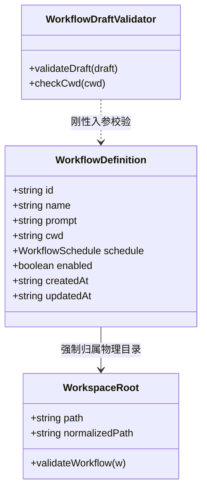
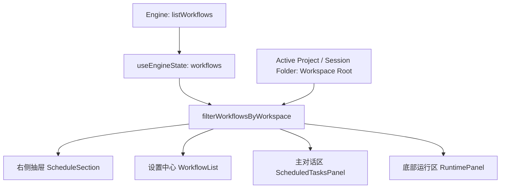

# 02-子Agent-工作区隔离定时任务方案

> **战役主题**：定时任务（Workflow / CronJob）按工作区目录（CWD / Workspace Root）强制物理隔离与彻底去全局化设计方案
> **用户权威裁决**：“第二个就是定时任务没有全局这一说，只能在工作区目录里面选择，所以其他项目在未绑定定时任务的情况下，是没有东西显示的。”
> **文档位置**：[`docs/workspace-scoped-workflows/independent-plans/02-子Agent-工作区隔离定时任务方案.md`](file:///c:/Software/conex/docs/workspace-scoped-workflows/independent-plans/02-子Agent-工作区隔离定时任务方案.md)
> **设计原则**：架构净收敛、单真源（SSOT）、拒绝魔术补丁、全链路端到端物理隔离

---

## 一、现状缺陷与代码位置精准剖析

系统当前在定时任务的设计与展示逻辑中，混入了“全局工作区”伪概念，且数据链路自下而上缺乏基于工作区物理根路径（`cwd`）的刚性过滤，导致多个工作区间定时任务互相穿透污染。

### 1. 表单层硬编码注入“全局”伪概念

* **文件位置**：[`apps/crish-desktop/src/components/settings/WorkflowForm.tsx:252-275`](file:///c:/Software/conex/apps/crish-desktop/src/components/settings/WorkflowForm.tsx#L252-L275)
* **代码实况**：
  ```tsx
  const projects = listProjects();
  const projectOptions = [
    { id: '', label: '默认工作区（全局）' },
    ...projects.map((p) => ({
      id: p.path,
      label: p.name,
      hint: p.path,
    })),
  ];
  ```
* **根因剖析**：
  `projectOptions` 的首项显式构造了 `{ id: '', label: '默认工作区（全局）' }`，向用户提供了“创建全局定时任务”的错误心智暗示，使表单允许 `draft.cwd` 提交为空字符串 `''`。底层将空字符串视同无绑定，进而沦为全系统可见的“幽灵任务”。

### 2. 右侧抽屉展示层未做工作区过滤与双源污染

* **文件位置**：[`apps/crish-desktop/src/components/overview/OverviewCard.tsx:43-46,136-141`](file:///c:/Software/conex/apps/crish-desktop/src/components/overview/OverviewCard.tsx#L43-L46)
* **代码实况**：
  ```tsx
  const activeSessionId = useSessionField(selectActiveSessionId);
  const session = useSessionField(selectActiveSession);
  const cronJobs = useSettingsField(selectScheduledTasks);
  const ds = useEngineState();
  // ...
  <ScheduleSection
    open={openSec.cronJobs}
    workflows={ds.workflows}
    cronJobs={cronJobs}
    onToggle={() => toggle('cronJobs')}
  />
  ```
* **根因剖析**：
  1. `OverviewCard` 消费 `useEngineState().workflows` 时，直接将引擎全量任务透传给 `ScheduleSection`，未读取当前项目路径，也未进行任何基于工作区的截断与过滤。
  2. `cronJobs` 来自 `settingsStore` 的历史遗留遥测字段（DEMO / ClientAPI 伪形态），不具备 `cwd` 字段，却与 `ds.workflows` 简单相加并全量展示在抽屉中，导致无论切换到哪个项目，徽标永远显示累加总数，列表永远展示其他项目的任务。

### 3. 右侧抽屉子组件 `ScheduleSection` 缺乏工作区感知与空态过滤

* **文件位置**：[`apps/crish-desktop/src/components/overview/ScheduleSection.tsx:25-49`](file:///c:/Software/conex/apps/crish-desktop/src/components/overview/ScheduleSection.tsx#L25-L49)
* **代码实况**：
  ```tsx
  {workflows.length + cronJobs.length > 0 ? (
    <span className={styles.pill}>{workflows.length + cronJobs.length}</span>
  ) : null}
  // ...
  {workflows.map((w) => { ... })}
  ```
* **根因剖析**：
  组件只按数组长度计数。由于上游下发了跨项目混合数据，组件在项目 B 中依然显示项目 A 的任务数量徽标与条目，直接违背了“其他项目未绑定定时任务时没有东西显示”的铁律。

### 4. 共享状态 Hook `useWorkflowsState` 未执行工作区隔离

* **文件位置**：[`apps/crish-desktop/src/components/settings/useWorkflowsState.ts:82-99,263-270,308-313`](file:///c:/Software/conex/apps/crish-desktop/src/components/settings/useWorkflowsState.ts#L82-L99)
* **根因剖析**：
  1. `useWorkflowsState` 内部的 `filtered` 派生只基于 `matchesFilter(w, filter)`（仅匹配启停与时间类型），完全没有按 `workspacePath` 过滤；
  2. 在 `ScheduledTasksPanel.tsx:43` 中调用 `useWorkflowsState({ surface: 'chat' })` 时，甚至未向 Hook 传入任何 `workspacePath`；
  3. `useWorkflowsState.ts:308-313` 的 `handleCreate` 方法在发起 `createWorkflow` 时，甚至直接遗漏了 `cwd` 字段的传参，导致聊天面板新建的任务直接沦为 `cwd: undefined`；
  4. 缓存层 `loadWorkflowsCache` 使用全局键 `crish_workflows_cache_v1`，全工作区共享同一份 localStorage 缓存，换项目后离线缓存瞬间越权穿透。

### 5. 草稿校验层未将 `cwd` 作为必填约束

* **文件位置**：[`apps/crish-desktop/src/api/workflow-api/workflowDraft.ts:169-199`](file:///c:/Software/conex/apps/crish-desktop/src/api/workflow-api/workflowDraft.ts#L169-L199)
* **代码实况**：
  `validateWorkflowDraft` 只校验了 `name`、`prompt` 与调度具体字段，对于 `draft.cwd` 视为空或无视，使得空工作区参数顺利通过前端校验并下发至 Tauri 后端。

### 6. Tauri / Rust 存储后端未强制阻断空工作区

* **文件位置**：[`apps/agent-workbench/src-tauri/src/workflow_commands.rs:905,1163-1177`](file:///c:/Software/conex/apps/agent-workbench/src-tauri/src/workflow_commands.rs#L905)
* **代码实况**：
  ```rust
  cwd: cwd.map(|c| c.trim().to_string()).filter(|c| !c.is_empty()),
  ```
  `StoredWorkflow.cwd` 类型被定义为 `Option<String>`。当入参为空或缺省时，后端静默转换为 `None` 并持久化，导致数据库中产生无工作区归属的孤儿任务。

---

## 二、去全局化领域模型设计

领域模型必须将定时任务视为**从属于具体物理工作区目录的一等资产**。不存在脱离物理目录独立存在的定时任务。



### 1. 实体与契约去可空化改造（TypeScript 侧）

1. **`WorkflowScheduleDraft` 契约强化**：
   * 将 `cwd?: string` 改为 `cwd: string`（必填，禁止缺省）：
     ```ts
     export type WorkflowScheduleDraft = {
       name: string;
       prompt: string;
       scheduleType: WorkflowScheduleType;
       dailyTime: string;
       intervalMinutes: string;
       cwd: string; // 必须绑定具体物理路径
     };
     ```
2. **草稿校验函数 `validateWorkflowDraft` 增强**：
   * 增加工作区路径刚性断言：
     ```ts
     export function validateWorkflowDraft(
       draft: WorkflowScheduleDraft | null | undefined
     ): string | null {
       if (!draft || typeof draft !== 'object') return '请填写完整配置';
       const name = String(draft.name ?? '').trim();
       const prompt = String(draft.prompt ?? '').trim();
       const cwd = String(draft.cwd ?? '').trim();
       if (!name && !prompt) return '请填写名称与提示词';
       if (!name) return '请填写名称';
       if (!prompt) return '请填写提示词';
       if (!cwd) return '请选择所属工作区项目';
       // ...调度校验
       return null;
     }
     ```

### 2. 跨平台路径归一化规范（Path Normalization & Comparison）

Windows 与类 Unix 系统在盘符大小写、斜杠方向、尾随斜杠上极易产生比较抖动（如 `c:\Software\conex` 与 `C:/Software/conex/`）。必须在前端基建中统一实现跨平台无损归一化与比较函数：

* **核心纯函数实现规范**：
  ```ts
  /**
   * 物理路径归一化：
   * 1. 剥除包裹引号与前导/尾随空白；
   * 2. 反斜杠 `\` 统一转为正斜杠 `/`；
   * 3. 折叠连续重复斜杠 `//`；
   * 4. 剥除末尾斜杠（单根目录 `/` 保留）；
   */
  export function normalizeFsPath(filePath: string | null | undefined): string {
    if (!filePath) return '';
    let p = filePath.trim();
    if (
      (p.startsWith('"') && p.endsWith('"')) ||
      (p.startsWith("'") && p.endsWith("'"))
    ) {
      p = p.slice(1, -1).trim();
    }
    if (!p) return '';
    p = p.replace(/\\/g, '/');
    p = p.replace(/\/{2,}/g, '/');
    if (p.length > 1 && p.endsWith('/')) {
      p = p.replace(/\/+$/, '');
    }
    return p;
  }

  /**
   * 工作区物理路径等价性判定：
   * Windows 盘符格式下实施大小写不敏感比对，类 Unix 系统按原始大小写比对。
   */
  export function areWorkspacePathsEqual(
    pathA: string | null | undefined,
    pathB: string | null | undefined
  ): boolean {
    const a = normalizeFsPath(pathA);
    const b = normalizeFsPath(pathB);
    if (!a || !b) return false;
    // 检测 Windows 盘符 (如 C:/) 或 Windows 宿主环境
    const isWindowsLike = /^[a-zA-Z]:\//.test(a) || /^[a-zA-Z]:\//.test(b);
    if (isWindowsLike) {
      return a.toLowerCase() === b.toLowerCase();
    }
    return a === b;
  }
  ```

### 3. Rust / Tauri 引擎侧守卫

* **`StoredWorkflow` 校验拦截**：
  在 [`apps/agent-workbench/src-tauri/src/workflow_commands.rs`](file:///c:/Software/conex/apps/agent-workbench/src-tauri/src/workflow_commands.rs) 中：
  * `create_workflow` 接收 `cwd: Option<String>` 时，若清洗后为空，必须阻断并返回 `CoreError::InvalidInput("工作区目录 (cwd) 为必填项，定时任务禁止脱离工作区存在")`；
  * `update_workflow` 若补丁中包含 `cwd: Some(String)`，同样校验非空；
  * 落库前执行 `cwd` 归一化（转正斜杠、去尾随斜杠），保证数据库真源的纯净性。

---

## 三、前端各消费端过滤契约（按当前工作区物理隔离）

前端四大定时任务展示场景必须全面遵循单一事实真源（SSOT）过滤。



### 1. 核心过滤选择器（Pure Selector）

在 [`apps/crish-desktop/src/components/settings/workflowsSharedLib.ts`](file:///c:/Software/conex/apps/crish-desktop/src/components/settings/workflowsSharedLib.ts) 中导出工作区隔离纯函数：

```ts
/**
 * 按工作区路径严格过滤工作流任务。
 * 若 workspacePath 未指定或为空，直接返回空数组 []，杜绝跨工作区泄漏。
 */
export function filterWorkflowsByWorkspace(
  workflows: readonly WorkflowDefinition[],
  workspacePath: string | null | undefined
): WorkflowDefinition[] {
  if (!workspacePath || !workspacePath.trim()) {
    return [];
  }
  return workflows.filter((w) =>
    w.cwd ? areWorkspacePathsEqual(w.cwd, workspacePath) : false
  );
}
```

### 2. 各消费端装配细则

| 消费端组件 | 当前物理文件路径 | 改造前缺陷 | 改造后契约 |
| :--- | :--- | :--- | :--- |
| **右侧抽屉面板** | [`OverviewCard.tsx`](file:///c:/Software/conex/apps/crish-desktop/src/components/overview/OverviewCard.tsx) / [`ScheduleSection.tsx`](file:///c:/Software/conex/apps/crish-desktop/src/components/overview/ScheduleSection.tsx) | 全量透传 `ds.workflows` 与 `cronJobs`，无视当前项目 | 1. `OverviewCard` 解析当前有效工作区路径：优先当前会话绑定项目，回退当前激活工作区 `getWorkspacePath()`；<br>2. 经过 `filterWorkflowsByWorkspace(ds.workflows, currentWorkspace)` 产出 `scopedWorkflows`；<br>3. 废除 `cronJobs` 伪数据下发（传空数组），仅消费 `scopedWorkflows`。 |
| **主对话区面板** | [`ScheduledTasksPanel.tsx`](file:///c:/Software/conex/apps/crish-desktop/src/components/settings/ScheduledTasksPanel.tsx) | 调用 `useWorkflowsState({ surface: 'chat' })` 缺省 `workspacePath` | 1. 提取当前工作区 `workspacePath = getWorkspacePath() || ''`；<br>2. 传参 `useWorkflowsState({ surface: 'chat', workspacePath })`；<br>3. 列表只显示本工作区任务，标题条目数 `workflows.length` 仅代表当前工作区。 |
| **设置中心面板** | [`SettingsScheduleTab.tsx`](file:///c:/Software/conex/apps/crish-desktop/src/components/settings/SettingsScheduleTab.tsx) | 虽传入 `workspacePath` 但内部 Hook 未执行 `cwd` 过滤 | 1. `useWorkflowsState` 在内部将 `workflows` 经 `filterWorkflowsByWorkspace` 裁剪为工作区限定集；<br>2. 顶部工具栏提供当前项目标识或切换器；<br>3. 新建与编辑自动继承该项目的 `workspacePath`。 |
| **运行面板** | [`RuntimePanel.tsx`](file:///c:/Software/conex/apps/crish-desktop/src/components/workspace/RuntimePanel.tsx) / [`PlansSection.tsx`](file:///c:/Software/conex/apps/crish-desktop/src/components/workspace/PlansSection.tsx) | `useRuntimePanelData` 统计全量 `ds.workflows.length` | 1. `useRuntimePanelData` 引入工作区过滤，`planCount` 仅统计当前工作区任务；<br>2. `PlansSection` 仅遍历展示属于当前工作区的卡片。 |

### 3. 会话自动继承与文件夹归属绑定

在主对话区通过定时任务创建会话时（[`workflowsSharedLib.ts:ensureScheduledSession`](file:///c:/Software/conex/apps/crish-desktop/src/components/settings/workflowsSharedLib.ts#L120)）：
* 当前实现仅调用了 `createSession({ id, title, activate })`，未写入 `folder`，导致创建的会话落入全局对话。
* 改造后：`ensureScheduledSession` 接收工作流的 `cwd`，自动解析 `projectId = resolveFolderToProjectId(cwd)`，在创建会话时写入 `folder: projectId`，保证执行会话同样与所属项目物理锁定。

---

## 四、未绑定定时任务时的纯净空态设计

当用户切至一个全新的项目，或未配置任何定时任务的项目时，界面必须呈现**极致克制、绝对无噪、零混淆**的纯净空态。

### 1. 右侧抽屉 `ScheduleSection` 空态表现
* **折叠头部（Header）**：
  * **数字 Badge 完全隐藏**：若 `scopedWorkflows.length === 0`，绝对不渲染 `<span className={styles.pill}>0</span>` 或其他数字，头部仅保留日历图标与“计划任务”纯文本；
  * **ARIA 语义对齐**：`aria-label="计划任务（无任务）"`。
* **展开主体（Body）**：
  * 仅展示单行轻柔占位：
    ```tsx
    <p className={`${styles.empty} ${styles.emptyQuiet}`}>无</p>
    ```
  * 不堆砌冗长的引导说明，不弹出教育性提示，保持与相邻 Agent / Files 区段的宁静风格高度一致。

### 2. 主对话区 `ScheduledTasksPanel` 空态表现
* **标题区**：
  * 条数标签显示为空白占位：`{workflows.length > 0 ? `${workflows.length} 条` : ''}`，绝不出现“0 条”；
* **内容区**：
  * 居中展示紧凑空态：
    * 主标题：`当前项目暂无定时任务`
    * 辅助提示：`可点击右上角「新建」或使用上方预设模版快速创建`
  * 不渲染任何跨项目的残留条目或历史任务。

### 3. 设置中心 `WorkflowList` 空态表现
* **全空态（无任何任务）**：
  * 显示：`当前项目暂无计划任务`；
* **筛选空态（切换到“按时间”或“已暂停”后无匹配）**：
  * 显示：`没有符合筛选的任务`；
* **未打开项目兜底态（处于通用对话且未打开项目目录）**：
  * 显示：`请先打开本地项目目录以管理定时任务`。

---

## 五、负产出与删除面清单

重构方案必须坚决清退历史死代码与全局伪分支，实现代码与概念的净收敛：

1. **删除 `WorkflowForm.tsx` 的全局选项**：
   * 彻底删除 [`apps/crish-desktop/src/components/settings/WorkflowForm.tsx:254`](file:///c:/Software/conex/apps/crish-desktop/src/components/settings/WorkflowForm.tsx#L254)：
     `- { id: '', label: '默认工作区（全局）' }`
   * 下拉列表仅渲染有效项目；无项目时禁用选择器并提示添加项目。
2. **删除跨项目数据穿透管道**：
   * 删除 [`apps/crish-desktop/src/components/overview/OverviewCard.tsx`](file:///c:/Software/conex/apps/crish-desktop/src/components/overview/OverviewCard.tsx) 中直接透传 `workflows={ds.workflows}` 与 `cronJobs={cronJobs}` 的代码；
   * 改为 `workflows={scopedWorkflows}`。
3. **删除遗留 `cronJobs` 伪聚合**：
   * 从 `ScheduleSection.tsx`、`OverviewCard.tsx` 中剔除将 `ds.workflows` 与 `cronJobs` 混同计算计数的死代码（`workflows.length + cronJobs.length`）；
   * 将 `ScheduleSectionProps.cronJobs` 标记废弃或直接清理。
4. **删除全局 localStorage 缓存污染**：
   * 改造 `workflowsSharedLib.ts` 中的 `loadWorkflowsCache` / `saveWorkflowsCache`，使其接受 `workspacePath` 作为缓存分片命名空间（如 `crish_workflows_cache_v1:${workspaceHash}`），杜绝全局一份缓存导致的会话间瞬时穿透。
5. **删除无 `cwd` 的缺省逻辑**：
   * 清除 `useWorkflowsState.ts` 中 `cwd: draft.cwd !== undefined ? draft.cwd : ...` 的模糊兜底，凡无明确 `cwd` 的新建请求一律在表单拦截期直接拒收。

---

## 六、单元测试与端到端验证方案

### 1. 路径归一化与比对测试套件
* **目标文件**：`apps/crish-desktop/src/api/__tests__/fsPathNormalize.test.ts`
* **用例清单**：
  1. Windows 反斜杠转正斜杠：`C:\foo\bar` 归一为 `C:/foo/bar`；
  2. Windows 盘符大小写不敏感比对：`areWorkspacePathsEqual('c:/foo/bar', 'C:/FOO/BAR') === true`；
  3. 尾随斜杠清理：`C:/foo/bar/` 与 `C:/foo/bar` 判定等价；
  4. 连续多斜杠折叠：`C://foo///bar` 归一为 `C:/foo/bar`；
  5. 异质路径判定：`C:/project-a` 与 `C:/project-b` 判定不等价。

### 2. 纯函数工作区过滤选择器测试
* **目标文件**：`apps/crish-desktop/src/components/settings/__tests__/workflowsWorkspaceFilter.test.ts`
* **用例清单**：
  1. 传入包含项目 A、项目 B 以及未绑定任务的列表，指定项目 A 路径，断言结果仅包含项目 A 的任务；
  2. 指定项目 B 路径，断言结果仅包含项目 B 的任务；
  3. 指定一个未配置任何任务的项目 C 路径，断言返回 `[]`，绝无其它项目任务泄漏；
  4. 传入 `workspacePath = ""` 或 `undefined`，断言返回 `[]`。

### 3. 表单校验与无全局选项测试
* **目标文件**：`apps/crish-desktop/src/components/settings/__tests__/WorkflowForm.test.tsx`
* **用例清单**：
  1. 挂载渲染 `WorkflowForm`（`variant="chat"`），检查项目选择器中的选项，断言不存在包含“全局”字样的选项；
  2. 当 `draft.cwd = ""` 时触发 `validateWorkflowDraft`，断言返回错误字符串 `'请选择所属工作区项目'`，校验不予放行。

### 4. 抽屉面板组件行为集成测试
* **目标文件**：`apps/crish-desktop/src/components/overview/__tests__/ScheduleSection.test.tsx`
* **用例清单**：
  1. 当 `workflows = []` 时，检查头部 DOM，断言不存在 `.pill` 徽标元素；
  2. 点击展开时，断言渲染单行静态文案 `<p>无</p>`；
  3. 当 `workflows` 传入属于当前项目的 2 个任务时，断言头部徽标展示数字 `2`，展开后列表精准呈现 2 个项目行。

### 5. 门禁与工程规范验证
1. **代码行数门禁（§11 治理铁律）**：
   运行 `npm run check:line-counts`，确保修改后的组件与状态文件严格遵守 UI < 500 行、业务逻辑 < 400 行的红线；
2. **TypeScript 严格类型检查**：
   运行 `npm run typecheck`，确保接口字段类型调整后全仓 0 错误；
3. **单元测试与覆盖率**：
   运行 `npm run test:coverage -- --project=unit`，确保相关模块单测全绿且满足覆盖率门禁要求。
