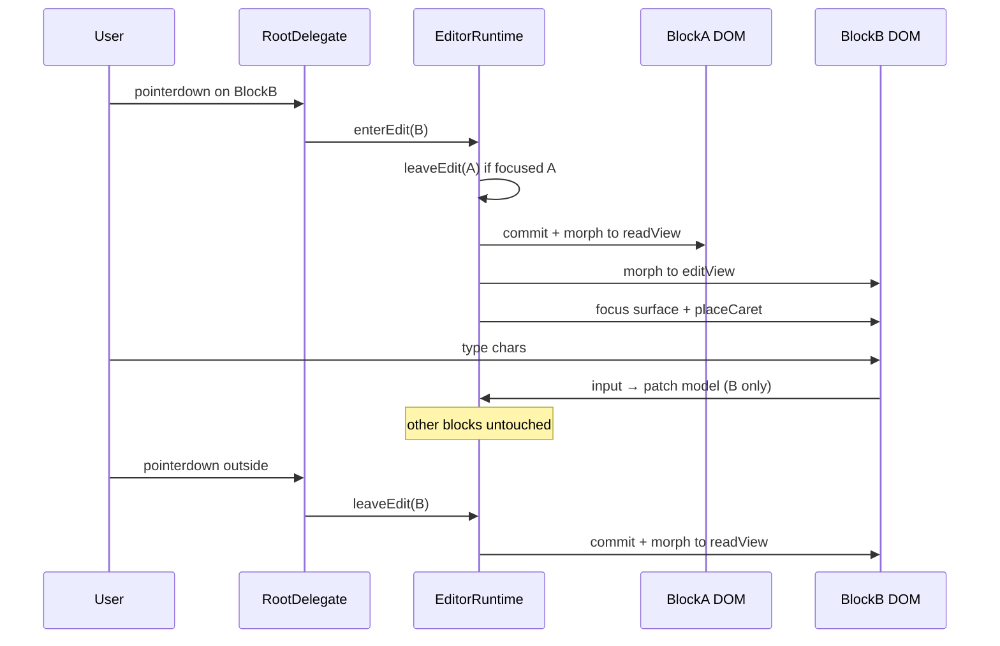

# 03 — 整行/块级渲染引擎（Line / Block Renderer）

> **状态**：设计中  
> **路径**：`docs/markdown-editor/03-line-renderer.md`  
> **消费者**：实现 agent（`js/markdown-editor/` 核心）、架构评审、实时预览验收  
> **依赖**：见 [01-architecture.md](./01-architecture.md) 数据模型；块类型见 [02-block-catalog.md](./02-block-catalog.md)  
> **不越界**：不写 slash 面板 UI（见 05）、不写 DnD 物理（见 04）、不写视觉 token 全集（见 07）

---

## 0. 目标与非目标

### 0.1 目标

解决当前 Notebook「整文档阅读 / 整页 contenteditable / blur 再 `innerHTML`」导致的 **实时预览失败**：

| 现状问题 | 块级渲染目标 |
|----------|--------------|
| 进入编辑 = 全文 raw MD 灰墙 | 仅 **聚焦块** 进入编辑态 |
| 退出编辑 = 全文 re-render | 失焦块立即变精致 **阅读组件** |
| 输入时看不到粗体/标题等效果 | 非聚焦块始终是最终呈现；聚焦块按策略实时反馈 |
| 光标在整页 contenteditable 中乱跳 | 光标绑定在 **单块** 的 edit surface 上 |
| `innerHTML = render(all)` 抹掉 DOM | **按 `blockId` 增量更新**，复用节点 |

一句话：**预览与编辑在块边界切换，热路径永不整页重渲。**

### 0.2 非目标（本篇）

- 协同 OT/CRDT  
- 完整表格合并单元格算法（引用 catalog）  
- Slash 菜单视觉与词条（见 05）  
- 虚拟列表完整实现细节（预留接口，>500 块再强制）  
- 将 ProseMirror/TipTap 作为强制依赖（可作对照；reference 阶段 vanilla 验证）

### 0.3 成功标准（验收一句话）

用户在段落中键入、中文 IME 组字、加粗、跨块方向键移动时：

1. 未聚焦块始终显示精致 HTML 阅读态；  
2. 聚焦块可编辑且 keystroke 预算 ≤16ms（P95，中等文档）；  
3. 失焦后该块立即变为阅读态且 **无需** 整文档 blur；  
4. 中文输入过程中块不会被拆/并/跳光标。

---

## 1. 渲染单元定义：块 vs 字符

### 1.1 术语

| 术语 | 定义 |
|------|------|
| **文档块（Block）** | 文档模型中的一等公民；有稳定 `id`、`type`、`props`、可选 `children` / `inlines`。是 **渲染与焦点的最小调度单位**。 |
| **行内节点（Inline）** | 块 **内部** 的文本与标记（text / bold / link / code-span…）。不单独占文档级焦点槽。 |
| **内部行（Internal line）** | 仅存在于多行块内部（代码块的一行、表格的一行）。**不是** 文档块；焦点仍落在父块。 |
| **字符（Character / Grapheme）** | 文本存储与 caret offset 的粒度；**不是** 渲染切换粒度。 |
| **渲染单元（Render unit）** | = 文档块。引擎按「一个 blockId → 一个 DOM 根」调度 read/edit。 |

### 1.2 为何不是「按字符渲染」

按字符/按 span 实时替换整页（典型 full-document contenteditable + 全量 reparse）会导致：

- IME composition 被中断；  
- 选区/caret 在 re-render 后丢失；  
- 无法做 Notion 式块把手、块拖拽、空块 placeholder；  
- 性能随文档长度线性恶化。

**决策：渲染调度粒度 = 块；文本编辑粒度 = 块内 offset（字符/ grapheme）。**

### 1.3 块边界（逻辑）

```
Document
 └── Block[]          ← 文档级兄弟块（可嵌套 list item 等，见 architecture）
      ├── id: BlockId
      ├── type: BlockType
      ├── props
      ├── inlines?: Inline[]     ← 段落/标题/引用等
      └── children?: Block[]     ← 列表项、toggle 等容器
```

**进入/离开编辑** 只发生在「某 `BlockId` 获得焦点」与「失去焦点」时，不因块内字符变化而改变其他块的 DOM 模式。

### 1.4 类型草稿

```ts
type BlockId = string; // 稳定 id，序列化到 MD 时可用 HTML comment 或 sidecar；v1 可仅内存 + JSON 快照

type BlockType =
  | 'paragraph'
  | 'heading'
  | 'bullet_list_item'
  | 'ordered_list_item'
  | 'todo_list_item'
  | 'quote'
  | 'code'
  | 'table'
  | 'divider'
  | 'image'
  | 'callout'
  | string; // 扩展注册

interface InlineText {
  type: 'text';
  text: string;
  marks?: Mark[];
}

interface Mark {
  type: 'bold' | 'italic' | 'strike' | 'code' | 'link';
  attrs?: Record<string, string>;
}

interface Block {
  id: BlockId;
  type: BlockType;
  props: Record<string, unknown>;
  inlines?: InlineText[]; // 简化：也可为 Inline 联合
  children?: Block[];
}

type ViewMode = 'read' | 'edit';

interface BlockViewState {
  blockId: BlockId;
  mode: ViewMode;
  // edit 态可选：composition、本地 draft 文本等
  composing?: boolean;
}
```

---

## 2. 双表示：`readView` + `editView`

每个块类型在注册表中提供 **两种视图**（或单组件内 `mode` 分支，语义等价）：

```ts
interface BlockTypeDefinition {
  type: BlockType;
  /** 阅读态：精致组件，非 contenteditable（或仅局部可点控件） */
  readView: (ctx: RenderContext) => HTMLElement;
  /** 编辑态：可输入表面 */
  editView: (ctx: RenderContext) => HTMLElement;
  /** 从 DOM/输入事件抽取模型补丁 */
  readFromEditSurface?: (el: HTMLElement, block: Block) => Partial<Block>;
  serialize: (block: Block) => string; // → Markdown 片段
  parse?: (mdLine: string, ctx: ParseCtx) => Block | null;
  // slash / keymap / schema 等见其他文档
}
```

### 2.1 两种实现风格（都合法）

**A. 双函数（推荐清晰边界）**

```
readView(block) → <div class="cx-block is-read" data-block-id>
editView(block) → <div class="cx-block is-edit" data-block-id>
```

切换时：对 **该节点** 做 replaceChild / morph，**其他块 DOM 不动**。

**B. 单根 + mode**

```
render(block, mode) → 同一 root，内部切换 class 与 contenteditable
```

适合 paragraph 这类「阅读态 HTML 与编辑态结构接近」的块；code/table 仍建议分叉实现。

### 2.2 引擎持有的运行时状态

```ts
interface EditorRuntime {
  doc: Block[];
  focusedBlockId: BlockId | null;
  /** blockId → 当前挂载的 DOM 根 */
  domMap: Map<BlockId, HTMLElement>;
  /** blockId → ViewMode */
  modeMap: Map<BlockId, ViewMode>;
  selection: EditorSelection | null;
  composing: boolean;
  rootEl: HTMLElement; // .cx-editor
}
```

**不变量：**

1. 任意时刻，`modeMap` 中最多 **一个** 块为 `'edit'`（v1；未来多选块拖拽除外）。  
2. `focusedBlockId === null` ⇒ 全部块 `'read'`。  
3. `domMap.get(id)` 的 `data-block-id` 必须等于 `id`。

### 2.3 视觉与交互分工

| 模式 | 职责 | 用户感知 |
|------|------|----------|
| `read` | 排版、语法高亮、任务勾选 UI、链接可点（可选修饰键）、表格只读样式 | Notion 阅读态 |
| `edit` | 接收键盘/IME/粘贴；维护 caret；toolbar 作用域 | 单块编辑器 |

---

## 3. 何时 HTML 阅读 / 何时可编辑

### 3.1 规则表

| 条件 | 块模式 | 说明 |
|------|--------|------|
| 块未聚焦 | **read** | 精致组件；`contenteditable=false` |
| 块聚焦（click / 键盘进入） | **edit** | paragraph 等：contenteditable 表面；code：textarea 或 monoline editor |
| 块内控件交互（todo checkbox） | 保持 **read** 或短暂不抢焦点 | 点击 checkbox **不** 进入编辑，只 toggle props |
| divider / 纯装饰块 | 始终 read；选中用「块选」而非文本 caret | 见 §10 |
| 只读宿主（分享预览） | 全局 forceRead | 无 editView |

### 3.2 伪代码

```ts
function shouldEdit(block: Block, focusedId: BlockId | null, opts: EditorOptions): boolean {
  if (opts.readOnly) return false;
  if (block.type === 'divider') return false; // 选中 ≠ 文本编辑
  return focusedId === block.id;
}
```

### 3.3 阅读态仍可交互的控件

允许在 `read` 下响应、且 **不** 触发 `enterEdit` 的事件目标：

- `[data-cx-no-edit]`：checkbox、链接（可配置）、折叠 chevron、块把手（DnD）  
- 事件委托：

```ts
rootEl.addEventListener('pointerdown', (e) => {
  const t = e.target as HTMLElement;
  if (t.closest('[data-cx-no-edit]')) return; // 不 enterEdit
  const blockEl = t.closest('[data-block-id]') as HTMLElement | null;
  if (!blockEl) return;
  enterEdit(blockEl.dataset.blockId!, caretFromPoint(e));
});
```

---

## 4. 模式切换算法

### 4.1 状态机

```
                    click / focusin on block
         ┌──────────────────────────────────────┐
         ▼                                      │
    ┌─────────┐   enterEdit(id)    ┌─────────┐  │
    │  ALL    │ ─────────────────► │ ONE     │──┘
    │  READ   │                    │ EDIT    │
    └─────────┘ ◄───────────────── └─────────┘
         ▲         leaveEdit / blur / Esc
         │
         │  arrow at boundary → leaveEdit(A) + enterEdit(B)
         └────────────────────────────────────
```

### 4.2 `enterEdit(blockId, caretHint?)`

```ts
async function enterEdit(blockId: BlockId, caretHint?: CaretHint) {
  if (runtime.focusedBlockId === blockId) {
    restoreCaret(blockId, caretHint);
    return;
  }
  // 1. 先提交并退出旧焦点块
  if (runtime.focusedBlockId) {
    await leaveEdit(runtime.focusedBlockId, { reason: 'switch' });
  }
  // 2. 标记
  runtime.focusedBlockId = blockId;
  runtime.modeMap.set(blockId, 'edit');
  // 3. 仅替换该块 DOM：read → edit
  const block = getBlock(blockId);
  const oldEl = runtime.domMap.get(blockId)!;
  const newEl = registry.get(block.type).editView({ block, runtime });
  morphOrReplace(oldEl, newEl); // 见 §8
  runtime.domMap.set(blockId, newEl);
  // 4. 聚焦编辑表面
  const surface = newEl.querySelector('[data-cx-edit-surface]') as HTMLElement;
  surface.focus({ preventScroll: true });
  // 5. 恢复 / 放置 caret
  placeCaret(surface, caretHint ?? 'end');
  emit('block:edit', { blockId });
}
```

### 4.3 `leaveEdit(blockId, opts)`

```ts
async function leaveEdit(blockId: BlockId, opts: { reason: string }) {
  if (runtime.composing) {
    // IME 未结束：延迟 leave（见 §6）
    runtime.pendingLeave = { blockId, opts };
    return;
  }
  const el = runtime.domMap.get(blockId);
  if (!el) return;
  // 1. 从 edit surface 同步模型
  commitEditSurface(blockId);
  // 2. 规范化空块（可选：空段落保留 placeholder）
  normalizeAfterCommit(blockId);
  // 3. 切回 read
  runtime.modeMap.set(blockId, 'read');
  if (runtime.focusedBlockId === blockId) runtime.focusedBlockId = null;
  const block = getBlock(blockId);
  const readEl = registry.get(block.type).readView({ block, runtime });
  morphOrReplace(el, readEl);
  runtime.domMap.set(blockId, readEl);
  emit('block:read', { blockId });
  scheduleAutosave();
}
```

### 4.4 触发源

| 触发 | 行为 |
|------|------|
| `pointerdown` 在块内（非 no-edit） | `enterEdit` + caret at point |
| `focusin` 冒泡到块（程序 focus） | 若尚未 edit 则 `enterEdit` |
| `focusout` / 相关 `focusin` 到另一块 | 旧块 `leaveEdit`；新块已由 enter 处理 |
| `Escape` | `leaveEdit` 当前块；焦点可回到 `.cx-editor` 容器 |
| 方向键到块边界 | 见 §4.5 |
| 点击编辑器外 | 全部 leave；`focusedBlockId = null` |

### 4.5 跨块方向键

仅在 **edit** 表面处理（捕获阶段或 surface 的 keydown）：

```ts
function onEditKeydown(e: KeyboardEvent, blockId: BlockId) {
  if (runtime.composing) return; // IME 中不跨块
  const surface = e.currentTarget as HTMLElement;
  if (e.key === 'ArrowUp' || e.key === 'ArrowLeft') {
    if (isCaretAtStart(surface)) {
      e.preventDefault();
      const prev = previousFocusableBlock(blockId);
      if (prev) enterEdit(prev.id, e.key === 'ArrowUp' ? 'end' : 'end');
    }
  }
  if (e.key === 'ArrowDown' || e.key === 'ArrowRight') {
    if (isCaretAtEnd(surface)) {
      e.preventDefault();
      const next = nextFocusableBlock(blockId);
      if (next) enterEdit(next.id, e.key === 'ArrowDown' ? 'start' : 'start');
    }
  }
  if (e.key === 'Enter' && !e.shiftKey) {
    // 段落类：拆块；代码块：换行（内部行）—— 见 catalog
    handleEnter(blockId, e);
  }
  if (e.key === 'Backspace' && isCaretAtStart(surface) && isEmpty(blockId)) {
    // 合并到上一块或删除空块
    handleBackspaceEmpty(blockId, e);
  }
}
```

**边界判定（contenteditable）：**

- `Selection.anchorNode` / `anchorOffset` 映射到块内 plain offset；  
- `offset === 0` ⇒ start；`offset === textLength` ⇒ end；  
- textarea：`selectionStart/End`。

### 4.6 时序（Mermaid）



---

## 5. 实时更新与 Marks 策略

### 5.1 输入路径（关键路径）

```
input / beforeinput on edit surface
  → 若 composing：只更新 composition 缓冲，不拆块、不跑 markdown 解析
  → 否则：
      updateBlockModel(blockId, newInlinesOrText)
      // 可选：轻量 markdown-as-you-type 规则
      maybeApplyAutoMark(blockId)
      // 不 re-render 其他块
      // 聚焦块：尽量 in-place 改文本，避免整块 replace（见 §13）
      markDirty(blockId)
      scheduleAutosave(debounce 300–500ms)
```

**禁止：** 任意 keystroke 触发 `root.innerHTML = renderDocument(doc)`。

### 5.2 Marks：两种策略并存

| 策略 | 行为 | 适用 |
|------|------|------|
| **Toolbar / 快捷键** | 选区上 toggle mark；模型 `inlines` 更新；edit surface 用 `document.execCommand` 兜底或自绘 mark DOM | 精确控制；中文后处理友好 |
| **Markdown-as-you-type** | 检测 `**text**`、`*text*`、`` `code` `` 在输入结束时折叠为 marks | 习惯 MD 的用户 |

#### 5.2.1 Markdown-as-you-type 规则（v1 建议）

仅在 **非 composing** 且 caret 处于规则闭合位置时触发：

| 模式 | 触发 | 结果 |
|------|------|------|
| `**…**` | 第二个 `**` 输入完成 | 包裹段 → bold mark，删除定界符 |
| `*…*` | 同上（注意与 `**` 优先级） | italic |
| `` `…` `` | 闭合 backtick | code mark |
| 行首 `# ` | space 后 | 块类型 → heading（见 slash/块转换） |
| 行首 `- ` / `* ` / `1. ` | space 后 | list item |
| 行首 ` ``` ` | Enter 或识别围栏 | code block |

实现提示：在 `input` 后对 **当前块纯文本** 跑小型自动规则状态机，**不要** 全文档 GFM parse。

#### 5.2.2 编辑态是否「所见即所得」

| 块类型 | 编辑态呈现 | 说明 |
|--------|------------|------|
| paragraph / heading / list / quote | **富文本 inline**（bold 等直接样式） | 阅读态与编辑态视觉接近 |
| code | **等宽纯文本**，无 MD 强调 | 内部即源码 |
| table | 单元格内短文本编辑 | 结构 UI 保持 |

**决策：** 段落类 edit surface 使用 **标记后的 DOM**（或 contenteditable + 受控 marks），而不是强制用户看 `**bold**` 源码（源码感仅在需要时通过「复制为 MD」体现）。若产品后续要「块内 MD 源码编辑」模式，作为块级 opt-in，非默认。

### 5.3 模型更新 API

```ts
function applyBlockPatch(blockId: BlockId, patch: Partial<Block>, origin: 'input' | 'toolbar' | 'paste' | 'ime') {
  const block = getBlock(blockId);
  Object.assign(block, patch);
  // 通知：仅订阅该块的视图
  emit('doc:patch', { blockId, patch, origin });
  if (origin !== 'ime' && runtime.modeMap.get(blockId) === 'read') {
    // 理论不应发生：edit 中 patch
    refreshReadView(blockId);
  }
}
```

---

## 6. IME 组字（中文输入）—— 硬约束

### 6.1 问题

中文等 IME 在 composition 期间会插入临时下划线文本；若此时：

- 用全文 parse 替换 DOM；  
- 因 `input` 触发 leaveEdit / 块拆分；  
- 重置 selection；

则会出现 **丢字、拆块、光标飞走**。

### 6.2 规则

```ts
surface.addEventListener('compositionstart', () => {
  runtime.composing = true;
});
surface.addEventListener('compositionend', (e) => {
  runtime.composing = false;
  // 组字结束：一次提交最终文本
  commitEditSurface(runtime.focusedBlockId!);
  maybeApplyAutoMark(runtime.focusedBlockId!);
  if (runtime.pendingLeave) {
    const p = runtime.pendingLeave;
    runtime.pendingLeave = null;
    leaveEdit(p.blockId, p.opts);
  }
});
```

| 禁止（composing === true） | 允许 |
|----------------------------|------|
| leaveEdit / enterEdit 切换 | 更新 composition 预览（浏览器默认） |
| markdown-as-you-type 折叠 | 无 |
| Enter 拆块 / Backspace 合块 | 无（交给 IME） |
| 整块 morph replace | 无 |
| 跨块方向键 | 无 |

### 6.3 `beforeinput` 优先

现代浏览器用 `beforeinput` 的 `isComposing` / `inputType`：

```ts
surface.addEventListener('beforeinput', (e: InputEvent) => {
  if (e.isComposing || runtime.composing) {
    // 不 preventDefault；不跑业务拆块
    return;
  }
  // handle InputEvent inputType: insertParagraph, deleteContentBackward...
});
```

### 6.4 验收（中文）

- 输入「你好世界」过程中候选栏存在时块结构不变；  
- compositionend 后模型含完整「你好世界」；  
- 组字中途 blur：应在 compositionend 后再 leave，或浏览器强制结束 composition 后 commit（记录平台差异：Chrome/Edge vs Safari）。

---

## 7. 多行块：内部行 vs 文档块

### 7.1 分类

| 类型 | 文档块？ | 编辑表面 | 内部换行 |
|------|----------|----------|----------|
| paragraph | 是 | contenteditable | Enter → **新文档块**（默认） |
| heading | 是 | contenteditable | Enter → 新 paragraph |
| code | 是（一个 code 块） | `<textarea>` 或 code mirror 轻量 | Enter → **内部换行**，不拆文档块 |
| table | 是（一个 table 块） | 每 cell 短 surface | Tab 切 cell；Enter 可下行 cell |
| list item | 是（每 item 一块或嵌套） | contenteditable | Enter → 新 item；空 item Enter → 退出列表 |
| quote | 是 | contenteditable | 可配置 |

### 7.2 Code 块 DOM 契约（摘要）

**Read：**

```html
<div class="cx-block cx-code is-read" data-block-id="b12" data-type="code">
  <div class="cx-code__toolbar" data-cx-no-edit>
    <span class="cx-code__lang">ts</span>
    <button type="button" data-cx-no-edit data-action="copy">复制</button>
  </div>
  <pre class="cx-code__pre"><code class="language-ts">...</code></pre>
</div>
```

**Edit：**

```html
<div class="cx-block cx-code is-edit" data-block-id="b12" data-type="code">
  <div class="cx-code__toolbar" data-cx-no-edit>...</div>
  <textarea
    class="cx-code__surface"
    data-cx-edit-surface
    spellcheck="false"
    rows="8"
  >...</textarea>
</div>
```

**模型：** `props.language: string`，`props.value: string`（完整源码，含 `\n`）。  
**不要** 为代码每一行创建文档级 Block（否则 DnD/焦点爆炸）。

### 7.3 Table

- 一个 `type: 'table'` 文档块；  
- `props.rows: string[][]` 或 cell 对象数组；  
- 编辑时 **仅当前 cell** 可有 edit surface；块级 `is-edit` 表示「表格处于编辑会话」；  
- 单元格内不做 markdown-as-you-type 的块级转换（避免 `|` 冲突）。

### 7.4 图示

```
Document blocks:     [P1] [P2] [CODE] [P3]
                          │
                          └─ internal lines of CODE:
                               line0
                               line1
                               line2
                         (still one focus target: CODE)
```

---

## 8. 增量 DOM 更新（按 blockId 复用）

### 8.1 核心原则

```
mountDocument(doc):
  for each block in order:
    if domMap has id and type unchanged:
      reuse node; if props dirty → patchReadOrEdit
    else:
      create readView; insert at correct index
  remove dom nodes whose id not in doc
```

**永不：** `editorRoot.innerHTML = ''` 后全量重建（除文档整体替换 / 首次 mount / 灾难恢复）。

### 8.2 `morphOrReplace`

```ts
function morphOrReplace(oldEl: HTMLElement, newEl: HTMLElement) {
  // 最小实现：同 parent 下 replaceChild
  oldEl.replaceWith(newEl);
  // 进阶：若 tag/class 骨架相同，只 patch 子树（减少闪烁）
}
```

### 8.3 补丁级别

| 事件 | DOM 操作范围 |
|------|----------------|
| 单块 props/inlines 变（read） | 仅该块 readView 刷新 |
| 聚焦切换 | 旧块 read←edit；新块 edit←read |
| 插入块 | 插入一个新节点 |
| 删除块 | remove 一个节点 |
| 重排（DnD） | 移动现有节点，不销毁 |
| 全文 load | mount 一次 |

### 8.4 Keyed 列表对齐算法（简化）

```ts
function reconcileChildren(parent: HTMLElement, nextIds: BlockId[], render: (id: BlockId) => HTMLElement) {
  const existing = new Map<BlockId, HTMLElement>();
  for (const child of Array.from(parent.children)) {
    const id = (child as HTMLElement).dataset.blockId;
    if (id) existing.set(id, child as HTMLElement);
  }
  let anchor: Node | null = parent.firstChild;
  for (const id of nextIds) {
    let el = existing.get(id);
    if (!el) el = render(id);
    if (el !== anchor) parent.insertBefore(el, anchor);
    else anchor = el.nextSibling;
    existing.delete(id);
    runtime.domMap.set(id, el);
  }
  for (const orphan of existing.values()) orphan.remove();
}
```

### 8.5 与虚拟列表

- `Virtualizer` 只挂载窗口内块；  
- 窗口外块不在 `domMap` 或标记 `detached`；  
- 焦点块必须强制在窗口内（scroll into view）。  
细节见 architecture；本篇保证 **API 可插拔**。

---

## 9. 空块与 Placeholder

### 9.1 空段落

```html
<div class="cx-block cx-paragraph is-edit is-empty" data-block-id="b3" data-type="paragraph">
  <p class="cx-paragraph__surface"
     data-cx-edit-surface
     contenteditable="true"
     data-placeholder="输入文字，或键入 /、 打开命令"
  ></p>
</div>
```

CSS：

```css
.cx-paragraph__surface.is-empty::before,
.cx-paragraph__surface[data-placeholder]:empty::before {
  content: attr(data-placeholder);
  color: var(--cx-fg-muted, #999);
  pointer-events: none;
  float: left; /* 或 absolute，按 visual system */
  height: 0;
}
```

注意：contenteditable 空时可能残留 `<br>`；规范化：

```ts
function isSurfaceEmpty(el: HTMLElement): boolean {
  const t = el.innerText.replace(/\u00a0/g, ' ').trim();
  return t.length === 0;
}
```

### 9.2 行为

| 状态 | 行为 |
|------|------|
| 空 edit + 输入 `/` 或 `、` | 打开 slash（见 05），不把字符写入（或写入后立即打开） |
| 空块 leaveEdit | 保留空 paragraph（便于继续点选）；连续多个空块可在 normalize 时折叠（可选） |
| 文档零块 | 自动插入一个空 paragraph |

### 9.3 其他类型 placeholder

- heading：`标题`  
- code：`编写代码…`  
- quote：`引用`  

文案走 i18n key，中文默认见上。

---

## 10. 选区模型（跨块）

### 10.1 两种选区

```ts
type EditorSelection =
  | {
      kind: 'text';
      blockId: BlockId;
      anchorOffset: number;
      focusOffset: number;
    }
  | {
      kind: 'block';
      blockIds: BlockId[]; // 有序
    };
```

| kind | 出现场景 |
|------|----------|
| `text` | 单块 edit 内原生 Selection / textarea |
| `block` | 块把手点击、Shift+上下扩展块选、拖蓝跨块结束后折叠为块选（v1 可简化） |

### 10.2 v1 建议范围

- **完整支持：** 单块内 text selection；方向键跨块移动 caret。  
- **块选：** 点击左边距/把手选中整块；Delete 删块；复制序列化为 MD。  
- **跨块拖蓝选文本：** v1 可降级为「扩展为块选」或「仅当前块」，避免整页 contenteditable 的复杂性。  
  **推荐 v1：** 跨块鼠标拖选 → 选中经过的 **块**（block selection），不模拟跨 contenteditable 的连续文本选区。

### 10.3 与浏览器 Selection 同步

```ts
document.addEventListener('selectionchange', () => {
  if (!runtime.focusedBlockId) return;
  const sel = document.getSelection();
  if (!sel || sel.rangeCount === 0) return;
  const surface = runtime.domMap.get(runtime.focusedBlockId)
    ?.querySelector('[data-cx-edit-surface]');
  if (!surface || !surface.contains(sel.anchorNode)) return;
  runtime.selection = {
    kind: 'text',
    blockId: runtime.focusedBlockId,
    anchorOffset: toOffset(surface, sel.anchorNode, sel.anchorOffset),
    focusOffset: toOffset(surface, sel.focusNode, sel.focusOffset),
  };
});
```

---

## 11. 粘贴（Paste）

### 11.1 优先级探测

```ts
async function onPaste(e: ClipboardEvent, blockId: BlockId) {
  e.preventDefault();
  const cd = e.clipboardData;
  if (!cd) return;

  const html = cd.getData('text/html');
  const plain = cd.getData('text/plain');
  const conex = cd.getData('application/x-conex-blocks+json'); // 可选内部格式

  if (conex) {
    insertBlocks(parseConexJson(conex), blockId);
    return;
  }

  const kind = detectPasteKind(html, plain);
  switch (kind) {
    case 'markdown':
      insertFromMarkdown(plain, blockId);
      break;
    case 'html':
      insertFromHtml(sanitize(html), blockId);
      break;
    default:
      insertPlainText(plain, blockId);
  }
}
```

### 11.2 探测启发式

```ts
function detectPasteKind(html: string, plain: string): 'markdown' | 'html' | 'plain' {
  if (plain && looksLikeMarkdown(plain) && !htmlHasRichSemantic(html)) {
    return 'markdown';
  }
  if (html && htmlHasRichSemantic(html)) return 'html';
  // 从 VS Code / 终端常只有 plain
  if (plain && looksLikeMarkdown(plain)) return 'markdown';
  return 'plain';
}

function looksLikeMarkdown(s: string): boolean {
  return /^(#{1,6}\s|```|[-*+]\s|\d+\.\s|\|.+\|)/m.test(s)
    || /(\*\*[^*]+\*\*|`[^`]+`)/.test(s);
}
```

### 11.3 插入语义

| 粘贴内容 | 单行目标块内 | 多块 MD |
|----------|--------------|---------|
| 无换行 plain | 插入当前 caret 文本 | — |
| 多段 plain/MD | 拆成多块，当前块分裂 | parse → Block[] 插入 |
| 单 cell 表内 | 仅纯文本 | 忽略块结构 |

### 11.4 安全

- HTML：DOMPurify 或白名单标签；去 `script`/`on*`；  
- 链接 `rel="noopener noreferrer"`；  
- 禁止 `javascript:` URL。

---

## 12. 复制（Copy）

### 12.1 序列化目标

剪贴板同时写入：

| MIME | 内容 |
|------|------|
| `text/plain` | 选区对应 Markdown（主格式） |
| `text/html` | 阅读态等价 HTML（便于贴到外部富文本） |
| `application/x-conex-blocks+json` | 可选，内部块 JSON，保证往返保真 |

```ts
function onCopy(e: ClipboardEvent) {
  const payload = serializeSelection(runtime.selection, runtime.doc);
  e.preventDefault();
  e.clipboardData?.setData('text/plain', payload.markdown);
  e.clipboardData?.setData('text/html', payload.html);
  if (payload.json) {
    e.clipboardData?.setData('application/x-conex-blocks+json', payload.json);
  }
}
```

### 12.2 `serializeSelection`

- `text` 选区：块类型的 `serializeInlineRange` 或退化为纯文本再包 marks；  
- `block` 选区：按序 `block.serialize` 拼接，块间 `\n\n`；  
- 无选区但有焦点：可复制当前块（可选，默认不）。

### 12.3 与 Markdown 往返

复制出的 MD 必须可被 parse 管线还原为 **语义等价** 块（允许 id 重新生成）。验收见 §17。

---

## 13. Caret 恢复（聚焦块 re-render 后）

### 13.1 何时需要恢复

| 场景 | 是否 re-render 聚焦块 | Caret |
|------|----------------------|-------|
| 普通打字 | **否**（浏览器改 DOM） | 原生保持 |
| toolbar 加粗 | 可能 patch mark DOM | 需保存/恢复 offset |
| markdown-as-you-type 折叠定界符 | 是 | 必须恢复 |
| 语法高亮（code textarea） | textarea value 设值会丢 caret | 保存 selectionStart |
| leave/enter 切换 | 是 | placeCaret by hint |

### 13.2 算法

```ts
interface CaretSnapshot {
  blockId: BlockId;
  offset: number;       // UTF-16 或 grapheme 策略需统一
  sticky?: 'before' | 'after';
}

function snapshotCaret(blockId: BlockId): CaretSnapshot | null {
  const surface = getSurface(blockId);
  if (!surface) return null;
  if (surface instanceof HTMLTextAreaElement) {
    return { blockId, offset: surface.selectionStart };
  }
  const sel = document.getSelection();
  if (!sel || !surface.contains(sel.focusNode)) return null;
  return { blockId, offset: toOffset(surface, sel.focusNode!, sel.focusOffset) };
}

function restoreCaret(snap: CaretSnapshot) {
  const surface = getSurface(snap.blockId);
  if (!surface) return;
  if (surface instanceof HTMLTextAreaElement) {
    surface.focus();
    surface.setSelectionRange(snap.offset, snap.offset);
    return;
  }
  const point = fromOffset(surface, snap.offset);
  const range = document.createRange();
  range.setStart(point.node, point.offset);
  range.collapse(true);
  const sel = document.getSelection();
  sel?.removeAllRanges();
  sel?.addRange(range);
}
```

### 13.3 原则

**优先避免** 在 input 热路径上替换聚焦块 DOM。  
仅在模型 marks 与 DOM 不同步时 patch，并 **同步** `snapshot → patch → restore`（同一帧，无 await）。

```ts
function withCaretPreserved(blockId: BlockId, mut: () => void) {
  const snap = snapshotCaret(blockId);
  mut();
  if (snap) restoreCaret(snap);
}
```

---

## 14. 性能预算

### 14.1 目标

| 指标 | 目标 |
|------|------|
| 单次 keystroke 处理（至 DOM 稳定） | **P95 < 16ms**（中等文档 ≤2k 块） |
| enterEdit / leaveEdit | P95 < 16ms |
| 全文首次 mount 2k 块 | < 200ms（可后虚拟化） |
| autosave serialize | 不阻塞输入；debounce + requestIdleCallback |

### 14.2 策略清单

1. **热路径零全量 parse**：只改当前块模型。  
2. **零全量 DOM wipe**。  
3. **read 块惰性**：不可见块不跑重语法高亮（IntersectionObserver）。  
4. **code 高亮异步**：离开 edit 或 idle 时高亮；edit 中用 textarea 纯文本。  
5. **事件委托**：一个 root 监听 pointer/keydown/paste，不给每块绑一套。  
6. **防抖 autosave** 300–500ms；输入时不 serialize 全文到 localStorage 同步。  
7. **对象池 / 复用** 块包装节点（可选）。  
8. **测量：** `performance.mark('kx-input-start')` … `measure`；dev 旗标。  

### 14.3 反模式

```ts
// ❌
surface.addEventListener('input', () => {
  const md = serializeAll(doc);
  root.innerHTML = MarkdownLite.render(md);
  // 再「找回」焦点 —— 必然失败或闪烁
});
```

```ts
// ✅
surface.addEventListener('input', () => {
  if (runtime.composing) return;
  commitEditSurface(focusedId); // O(块长)
});
```

---

## 15. 架构对比与推荐

### 15.1 contenteditable-document（整页）

```
┌─────────────────────────────────────┐
│  one contenteditable root           │
│  browser owns all carets            │
│  app re-parses HTML ↔ MD 全页       │
└─────────────────────────────────────┘
```

| 优点 | 缺点 |
|------|------|
| 原生跨行选区简单 | 光标/IME 与自定义渲染冲突大 |
| 实现起步快 | 块拖拽、块把手、空块 UX 难 |
| | 实时精致预览几乎必须整页规范化 → 卡顿 |
| | 安全与消毒面大 |

**现状 Notebook** 接近此模型的弱化版（整页 edit + blur 全量 render）。

### 15.2 block-per-row（块级）

```
┌──────── read P1 ────────┐
┌──────── edit P2 ────────┐  ← only one
┌──────── read CODE ──────┐
┌──────── read P3 ────────┐
```

| 优点 | 缺点 |
|------|------|
| 实时：失焦块即最终阅读态 | 跨块文本选区需自研 |
| IME 隔离在单 surface | 方向键边界需显式处理 |
| DnD/slash/块选自然 | 多 surface 焦点管理 |
| 增量更新简单 | 表格/嵌套列表要设计清楚 |
| 与 Notion 心智一致 | — |

### 15.3 推荐

**明确推荐：block-per-row 架构。**

理由对齐产品原则（README §2）：

1. 优雅阅读态默认；  
2. 整行渲染，避免整页乱光标；  
3. 可扩展块注册表；  
4. 性能：热路径局部化；  
5. 修复当前 blur-to-rerender 根本缺陷。

引擎基座：reference 阶段 **vanilla Block Model**；若后期成本过高，再评估 Lexical/ProseMirror **按块嵌入**，而非退回整页 MD textarea。

---

## 16. DOM 契约示例：段落块

### 16.1 Class 与属性约定

| 名称 | 含义 |
|------|------|
| `.cx-editor` | 编辑器根 |
| `.cx-block` | 任意块根 |
| `.cx-block.is-read` / `.is-edit` | 模式 |
| `.cx-block.is-empty` | 空内容 |
| `.cx-block.is-selected` | 块选 |
| `[data-block-id]` | 稳定 id |
| `[data-type]` | 块类型 |
| `[data-cx-edit-surface]` | 聚焦与输入目标 |
| `[data-cx-no-edit]` | 点击不进入编辑 |
| `.cx-block__handle` | 拖拽把手（DnD 文档） |

### 16.2 Paragraph — Read

```html
<div
  class="cx-block cx-paragraph is-read"
  data-block-id="blk_01HZX…"
  data-type="paragraph"
  draggable="false"
>
  <button
    type="button"
    class="cx-block__handle"
    data-cx-no-edit
    aria-label="拖动排序"
    tabindex="-1"
  ></button>
  <p class="cx-paragraph__body">
    你好，<strong>世界</strong>。
  </p>
</div>
```

### 16.3 Paragraph — Edit

```html
<div
  class="cx-block cx-paragraph is-edit"
  data-block-id="blk_01HZX…"
  data-type="paragraph"
>
  <button
    type="button"
    class="cx-block__handle"
    data-cx-no-edit
    aria-label="拖动排序"
    tabindex="-1"
  ></button>
  <p
    class="cx-paragraph__surface"
    data-cx-edit-surface
    contenteditable="true"
    role="textbox"
    aria-multiline="true"
    spellcheck="true"
  >你好，<strong>世界</strong>。</p>
</div>
```

### 16.4 模式切换时属性差分

| 属性 | read | edit |
|------|------|------|
| `is-read` / `is-edit` | is-read | is-edit |
| contenteditable | 无 / false | true on surface |
| `data-cx-edit-surface` | 无 | 有 |
| 子内容 | 渲染后 HTML | 同源 HTML（可编辑） |

### 16.5 从 surface 提交模型

```ts
function commitParagraph(blockId: BlockId) {
  const surface = getSurface(blockId)!;
  const inlines = domToInlines(surface); // 遍历 strong/em/a/code/text
  applyBlockPatch(blockId, { inlines }, 'input');
}
```

`domToInlines` 必须与 `inlinesToDom` 对称，保证 leave→read 无视觉跳动。

### 16.6 编辑器根结构

```html
<div class="cx-editor" data-cx-editor role="textbox" aria-multiline="true" aria-label="文档">
  <!-- blocks... -->
</div>
```

首次 focus 编辑器但无 focusedBlock：自动 `enterEdit` 第一块或末尾空块。

---

## 17. 实时预览验收测试计划

### 17.1 功能验收（必须全部通过）

| # | 用例 | 步骤 | 期望 |
|---|------|------|------|
| R1 | 失焦即预览 | 编辑 P1 输入 `**a**` 或 toolbar 加粗 → 点 P2 | P1 立即为阅读态粗体，无整页闪白 |
| R2 | 仅一块 edit | 连续点击三块 | 任意时刻 DOM 中仅一个 `.is-edit` |
| R3 | 中文 IME | 在空段用拼音输入「连接器」 | composition 中不拆块；结束后文本完整 |
| R4 | 方向键跨块 | caret 在 P1 末 → ↓ | 进入 P2 首；P1 变 read |
| R5 | 代码内部换行 | code 块 Enter 三次 | 仍一块；value 含 3 个 `\n` |
| R6 | 空块 placeholder | 聚焦空段 | 可见中文提示；输入后消失 |
| R7 | 粘贴 MD | 粘贴 `# T\n\npara` | 生成 heading + paragraph，非单段 raw |
| R8 | 复制 MD | 块选两块复制 | plain 为合法 MD；可再粘贴还原 |
| R9 | Caret 加粗 | 选词 Ctrl+B | 样式变；caret 仍在词后 |
| R10 | 外部 blur | 点 Notebook 外 | 当前块 read；autosave 触发 |
| R11 | 无整页 wipe | Performance/DOM 断点 | input 时 root 子节点 identity 保持（除当前块） |
| R12 | Escape | edit 中 Esc | leaveEdit；无残留 composing 错乱 |

### 17.2 性能验收

| # | 用例 | 方法 | 期望 |
|---|------|------|------|
| P1 | 100 块文档打字 | DevTools measure | P95 keystroke < 16ms |
| P2 | 2k 块滚动 + 编辑 | 虚拟化开/关对比 | 编辑块仍流畅；无全量 innerHTML |
| P3 | 快速切换 20 块 | 自动化 click | 无泄漏（domMap size ≈ 可见块数） |

### 17.3 往返与回归

| # | 用例 | 期望 |
|---|------|------|
| M1 | parse MD → 编辑 → serialize | 与黄金文件语义等价 |
| M2 | 旧 Notebook 文档打开 | 可挂载为块数组 |
| M3 | 消毒 | 粘贴 `<script>` 被剥除 |

### 17.4 自动化建议

```ts
// 伪测试
it('only one block in edit mode', async () => {
  await clickBlock('b1');
  await clickBlock('b2');
  expect(document.querySelectorAll('.cx-block.is-edit')).toHaveLength(1);
  expect(document.querySelector('[data-block-id="b2"]')!.classList.contains('is-edit')).toBe(true);
  expect(document.querySelector('[data-block-id="b1"]')!.classList.contains('is-read')).toBe(true);
});

it('IME composition does not leave edit', async () => {
  await enterEdit('b1');
  fire(surface, 'compositionstart');
  fire(surface, 'focusout'); // 模拟误触发
  expect(runtime.composing).toBe(true);
  expect(runtime.modeMap.get('b1')).toBe('edit');
  fire(surface, 'compositionend');
  // pendingLeave 才执行
});
```

### 17.5 手工探索清单（中文产品）

- [ ] 搜狗 / 微软拼音组字 + 方向键选候选  
- [ ] `、` 触发 slash（与 05 联调）  
- [ ] 表格内中文与 Tab  
- [ ] 长代码块复制  
- [ ] 暗色主题下 placeholder 对比度  

---

## 18. 与现有代码迁移

### 18.1 当前（失败模式）

`NotebookPanel.js`：

- `is-reading`：`innerHTML = MarkdownLite.render(md)`  
- click → 整容器 `contenteditable=true` 显示 raw md  
- `blur` → 再 render  

### 18.2 目标替换面

| 组件 | 变化 |
|------|------|
| `NotebookPanel` body | 挂载 `createMarkdownEditor({ initialMarkdown, onChange })` |
| `markdown-lite.js` | 过渡只读 fallback；块 readView 可复用其子集或替换 |
| 保存 | `editor.getMarkdown()` debounce → 原 autosave 通道 |

### 18.3 最小引擎 API（实现草稿）

```ts
interface MarkdownEditor {
  mount(el: HTMLElement): void;
  destroy(): void;
  setMarkdown(md: string): void;
  getMarkdown(): string;
  getBlocks(): Block[];
  focusBlock(id: BlockId, caret?: CaretHint): void;
  on(event: 'change' | 'autosave' | 'selection', cb: Function): () => void;
}

function createMarkdownEditor(options: {
  readOnly?: boolean;
  placeholder?: string;
  debounceMs?: number;
}): MarkdownEditor;
```

---

## 19. a11y

- 每块 edit surface：`role="textbox"` + `aria-multiline`（代码 textarea 原生）。  
- 块选：`aria-selected="true"` on `.cx-block`。  
- 把手：`aria-label`，默认 `tabindex="-1"`（鼠标/块菜单进入）。  
- 焦点可见：`:focus-visible` 轮廓，不依赖 hover 阴影洗版。  
- 实时预览不依赖仅颜色表达（粗体/标题有语义标签 `h1`–`h3`、`strong`）。  

---

## 20. 边界与失败

| 场景 | 处理 |
|------|------|
| 未知块类型 | read 显示为 paragraph + 警告 class；serialize 尽量保留 raw |
| 损坏 JSON 快照 | 回退 MD parse |
| composition 中 destroy | 移除监听；丢弃 pendingLeave |
| 超长单块（>100k 字符） | 警告；code 用 textarea 避免 contenteditable 卡死 |
| 只读 | 不挂 edit 监听；checkbox 可配置是否可点 |

---

## 21. 分期

| 期 | 交付 | DoD |
|----|------|-----|
| **L0** | 块模型 + mount + paragraph read/edit 切换 + 增量 reconcile | R1 R2 R10 R11 |
| **L1** | IME 安全、caret 恢复、placeholder、方向键跨块 | R3 R4 R6 R9 R12 |
| **L2** | code/table 多行块、paste/copy MD | R5 R7 R8 M1 |
| **L3** | markdown-as-you-type、性能标测、虚拟化钩子 | P1 P2；keystroke 预算达标 |
| **L4** | 与 slash/DnD 联调 | 见 04/05 |

---

## 22. 实现检查清单（给 coding agent）

- [ ] 无 `root.innerHTML = fullRender` 在 input/blur 路径  
- [ ] `focusedBlockId` 最多一块 `is-edit`  
- [ ] `compositionstart/end` 与 `pendingLeave`  
- [ ] 所有块根带 `data-block-id`  
- [ ] edit surface 带 `data-cx-edit-surface`  
- [ ] 控件带 `data-cx-no-edit`  
- [ ] `commit` 后 readView 与模型一致  
- [ ] 复制 `text/plain` 为 Markdown  
- [ ] 中文 placeholder 经 UTF-8 写入，无 `?`  
- [ ] 性能 mark 可开关  

---

## 23. 交叉引用

| 主题 | 文档 |
|------|------|
| Block 树 / 序列化总架构 | [01-architecture.md](./01-architecture.md) |
| 块类型 props | [02-block-catalog.md](./02-block-catalog.md) |
| 拖拽重排 | [04-dnd-reorder.md](./04-dnd-reorder.md) |
| `/` 与 `、` | [05-slash-commands.md](./05-slash-commands.md) |
| 扩展语法 | [06-extensions.md](./06-extensions.md) |
| 皮肤与动效禁令 | [07-visual-system.md](./07-visual-system.md) |
| Notebook 接入 | [08-integration.md](./08-integration.md) |
| 总路线图 | [09-implementation-roadmap.md](./09-implementation-roadmap.md) |

---

## 24. 修订记录

| 版本 | 日期 | 说明 |
|------|------|------|
| 0.1 | 2026-08-02 | 首版：块级双视图、切换算法、IME、增量 DOM、粘贴复制、性能与验收 |

---

## 附录 A — 关键路径伪代码汇总

```ts
// Root event delegation (sketch)
function bindEditor(root: HTMLElement, runtime: EditorRuntime) {
  root.addEventListener('pointerdown', (e) => {
    const t = e.target as HTMLElement;
    if (t.closest('[data-cx-no-edit]')) return;
    const blockEl = t.closest('[data-block-id]') as HTMLElement | null;
    if (!blockEl || !root.contains(blockEl)) return;
    enterEdit(blockEl.dataset.blockId!, caretFromPointer(e));
  });

  root.addEventListener('focusout', (e) => {
    const related = e.relatedTarget as Node | null;
    if (related && root.contains(related)) return; // 焦点仍在编辑器内
    if (runtime.focusedBlockId) leaveEdit(runtime.focusedBlockId, { reason: 'blur' });
  });

  root.addEventListener('keydown', (e) => {
    if (e.key === 'Escape' && runtime.focusedBlockId) {
      leaveEdit(runtime.focusedBlockId, { reason: 'escape' });
    }
  });

  root.addEventListener('paste', (e) => {
    if (!runtime.focusedBlockId) return;
    onPaste(e as ClipboardEvent, runtime.focusedBlockId);
  });

  root.addEventListener('copy', (e) => onCopy(e as ClipboardEvent));
}
```

## 附录 B — 为何「整行渲染」不是「每行一个 textarea」

常见误解：块级 = 视觉每一行一个 `<textarea>`。

| 方案 | 评价 |
|------|------|
| 每视觉行 textarea | 软换行与块语义错位；选区/无障碍差 |
| **每逻辑块一个 surface** | 段落可软换多行仍一块；代码块一 surface 多内部行 |

**整行渲染** 在本产品中的含义：

> 以 **逻辑块** 为调度单位做 read/edit 切换与精致预览，而不是以「整份文档」或「单个字符 DOM」为单位。

---

**完。** 本文可独立交给实现 agent：按 §21 L0→L3 开工，对照 §17 验收，DOM 契约以 §16 为准。
