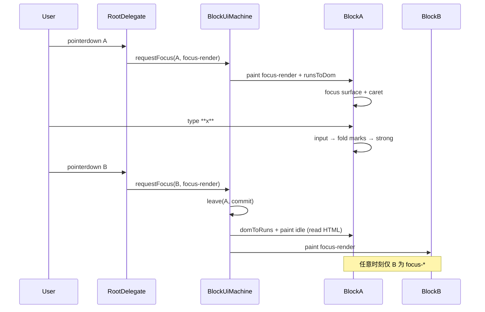
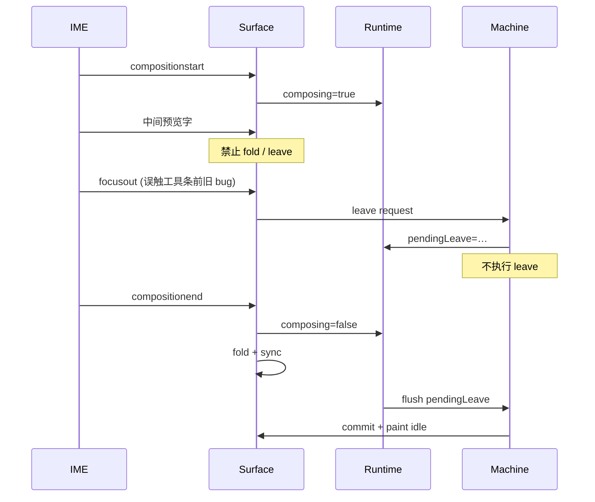

# 02 — 渲染 / 编辑模型（Render Model v3）

> ⚠️ **2026-08-03 终局转向**：`block-per-row` 换壳 **不作融合编辑终局**。  
> 见 [ux-readiness/11-SYSTEMIC-REFACTOR-PLAN.md](../ux-readiness/11-SYSTEMIC-REFACTOR-PLAN.md) · [BANNED-VISUAL-UX.md](../BANNED-VISUAL-UX.md) · **ux-D10**。  
> 本册部分约束仍有效（代码单表面、禁双壳、禁激活描边）；**调度模型以 11 为准**。

> **分册**：`docs/markdown-editor/v3-complete/02-render-model.md`  
> **角色**：mdx-v3-analyst-02 渲染模型规格  
> **状态**：冻结草案（对齐 README U2 / U3）· **部分 superseded by 11**  
> **读者**：实现 agent、迁移到 `packages/conex-mdx` 的 TS 工程师、产品验收  
> **依赖**：  
> - [README.md](./README.md) 用户硬约束 U1–U6  
> - [../03-line-renderer.md](../03-line-renderer.md) 块级调度基线  
> - [../10-data-format.md](../10-data-format.md) Doc / Block / TextRun  
> - [../blocks/code.md](../blocks/code.md) 代码块 Markdown 契约  
> - 现状实现：`js/markdown-editor/editor.js`（`readContentHtml` / `enterEdit` / `exitEdit`）  
> **不越界**：表格合并细节见 03；行内 marks 产品文案见 04；动效见 05；包结构总图见 07。

---

## 0. 摘要与成功判据

### 0.1 一句话

**未点击 = 精致阅读渲染；文本块聚焦 = 仍像渲染的 contenteditable（实时 marks）；代码块点击整块 = 单一表面源码编辑（禁止预览框+输入框双壳）。**

### 0.2 用户硬约束映射

| ID | 约束原文 | 本册职责 |
|----|----------|----------|
| **U2** | 未聚焦 = 正常渲染；代码未点 = 语法高亮；点击代码块 = 源码编辑；禁止双壳 | §3 状态机、§5 代码块 |
| **U3** | 其它文本块编辑时仍以渲染态为主；`**x**` 生效区显示加粗，非整行裸 MD | §4 文本块、§6 实时 marks、§7 数据流 |
| U4 | 表格结构化 | 仅接口边界，细节见 03 |
| U6 | 文档充分、代码易迁移 | §12 模块边界、全文规格深度 |

### 0.3 当前实现问题诊断（`editor.js`）

| 现象 | 根因（代码路径） | v3 目标 |
|------|------------------|---------|
| 文本编辑变「输入框/裸 MD」 | `enterEdit` 文本路径：`edit.innerText = block.text`，把含 `**` 的源串塞进 contenteditable | 以 **TextRun → 内联 HTML** 填充 surface；编辑时 **strong 即粗体** |
| 编辑态不像渲染 | 读态用 `U().inlineHtml(t)`，写态丢弃 HTML 结构 | **读/写同源 DOM 骨架**（mode 切换 class，不换语义树） |
| 代码块读态无高亮 | `readContentHtml('code')` 仅 `esc(t)` 包 `<pre><code>` | 读态 Prism/Shiki 或轻量 tokenizer → token span |
| 代码块 edit = textarea 替换 | 可接受为 **单一表面**；但 lang 输入与 textarea 叠在 wrap 里需精修 UX | **focus-source**：同一卡片内，pre 隐藏、source surface 显示；禁止再挂一份高亮预览 |
| `is-active` 全行描边/色块 | 样式层常配合 `.is-editing` | **禁止**激活整行厚描边；仅 caret / 极轻 focus ring / 把手 |

### 0.4 成功判据（验收一句话）

1. 任意文档默认全部块为 **精致 read**（代码高亮）。  
2. 点击段落：caret 进入该段，已有 `**bold**` 显示为 **粗体**，不是字面 `**bold**`。  
3. 在编辑中键入 `**x**` 后，闭合瞬间 `x` 变粗（或 debounce ≤1 帧策略见 §6），**定界符折叠**。  
4. 点击代码块：卡片内变为 **一个** 可编辑源码表面；**看不到**「上面彩色预览 + 下面灰 textarea」。  
5. Esc / 失焦：代码块提交 `text`+`lang`，立刻回到高亮 read。  
6. 中文 IME 组字期间：**不**折叠 marks、**不** leaveEdit、**不** 高亮重渲。

---

## 1. 术语与角色

| 术语 | 定义 |
|------|------|
| **Render unit** | 文档块（`blockId`）；调度 read/edit 的最小单位 |
| **Read surface** | 块在 idle/hover/viewOnly 下展示的精致 DOM（非 caret 主表面） |
| **Edit surface** | 接收键盘/IME 的节点：`[data-cx-edit-surface]` |
| **focus-render** | 文本类块的编辑态：contenteditable + 内联 marks 已渲染 |
| **focus-source** | 代码块（及可选「查看源码」）编辑态：纯文本源表面，单一壳 |
| **TextRun** | `{ text, marks? }[]`，运行时富文本真相（见 10-data-format） |
| **Inline MD cache** | `block.text` 与 runs 同步的 plain/MD 缓存字符串 |
| **双壳（禁止）** | 同一块同时挂载「高亮预览 DOM」+「独立输入框」，两者上下并列可见 |
| **裸 MD 行（禁止默认）** | 聚焦后整段显示 `**a**` / `# title` 源码字面量作为主编辑体验 |
| **Morph** | 同 `blockId` 节点上 patch class/子树，尽量不销毁块根 |
| **Commit** | 从 surface 抽取 runs/text → `model.updateBlock` |
| **viewOnly** | 宿主只读：无 enterEdit，控件可配置 |

---

## 2. 设计原则（冻结）

### 2.1 原则表

| # | 原则 | 说明 |
|---|------|------|
| P1 | **默认渲染** | 未聚焦块永远是最终呈现，不是半透明源码 |
| P2 | **编辑像阅读** | 文本块 focus-render 视觉接近 read；差异只在 caret、placeholder、极轻 focus |
| P3 | **源码是特例** | 默认仅 **代码块** 用 focus-source；段落不默认 raw |
| P4 | **单一表面** | 一块一时至多一个 edit surface；代码块 source 时隐藏高亮层 |
| P5 | **块级调度** | 热路径永不 `root.innerHTML = render(all)` |
| P6 | **IME 神圣** | composition 中禁止 DOM morph / marks 折叠 / 跨块 |
| P7 | **runs 优先** | 序列化优先 `runs`；DOM ↔ runs 对称；`text` 为缓存 |
| P8 | **无障碍语义** | 读态用 `h1–h6`/`strong`/`pre`；不只靠颜色 |
| P9 | **迁移友好** | 渲染与块逻辑按 `render/`、`blocks/` 分模块，vanilla→TS 可平移 |

### 2.2 与 `03-line-renderer` 的关系

| 03 概念 | v3 升级 |
|---------|---------|
| `ViewMode = read \| edit` | 细化为 **BlockUiState** 五态（§3） |
| edit = 可输入表面 | 文本 = **focus-render**；代码 = **focus-source** |
| markdown-as-you-type 可选 | **U3 强制**：实时 marks 为默认路径 |
| code edit = textarea | 保留 **单一表面**；明确禁止双壳；读态强制高亮 |
| 双函数 readView/editView | 文本块推荐 **同根 mode 分支**；代码块允许内部双层但 **互斥可见** |

### 2.3 与现状 `editor.js` API 对应

| 现状函数 | v3 职责 |
|----------|---------|
| `readContentHtml(block)` | → `renderReadInner(block)` + 代码高亮插件 |
| `buildBlockEl` | → `mountBlockShell` + `paintBlock` |
| `enterEdit(id)` | → `transition(id, 'focus-render' \| 'focus-source')` |
| `exitEdit(commit)` | → `commitBlock` + `transition(id, 'idle')` |
| `commitActiveFromDom` | → `domToRuns` / `sourceToText` |
| `textFromEditEl` / `innerText = block.text` | **废弃为默认路径**；改 `runsToDom` / `domToRuns` |

---

## 3. 块级状态机

### 3.1 状态枚举

```ts
/** 块 UI 状态（每块独立；全局最多一块处于 focus-*） */
type BlockUiState =
  | 'idle'           // 默认精致阅读
  | 'hover'          // 指针悬停（可选样式：把手显现）
  | 'focus-render'   // 文本类：contenteditable + 内联渲染
  | 'focus-source'   // 代码类：源码编辑表面
  | 'viewOnly';       // 全局只读覆盖（可与 idle 视觉相同，交互不同）

type BlockId = string;

interface BlockChromeState {
  blockId: BlockId;
  ui: BlockUiState;
  /** 代码块 focus-source 时 caret 在 source；lang 栏是否展开 */
  code?: {
    langOpen?: boolean;
    sourceFocused?: boolean;
  };
  /** IME */
  composing?: boolean;
  /** 悬停来自 pointer 还是键盘 roving */
  hoverSource?: 'pointer' | 'keyboard';
}
```

### 3.2 全局不变量

```
INV-1  ∀ 时刻，处于 focus-render ∪ focus-source 的块数 ≤ 1
INV-2  viewOnly 文档内：禁止进入 focus-*（checkbox 等只读控件除外）
INV-3  ui ∈ {idle, hover} ⇒ contenteditable=false 且无 source surface 可见
INV-4  ui = focus-source ⇒ 高亮 pre 不可见（display:none 或 unmount）
INV-5  ui = focus-render ⇒ 内联 DOM 含 marks 标签，禁止整段纯文本 raw MD 作为唯一呈现
INV-6  block 根 data-block-id 稳定；切换状态不换 id
```

### 3.3 状态转移图

```
                    pointerenter
         ┌──────────────────────────────┐
         │                              ▼
    ┌────────┐  pointerleave      ┌─────────┐
    │  idle  │ ◄───────────────── │  hover  │
    └───┬────┘                    └────┬────┘
        │                              │
        │  click / focus（文本类）        │ click
        ▼                              ▼
    ┌────────────────┐           （同左）
    │ focus-render   │
    └───────┬────────┘
            │ Esc / blur / 切块
            ▼
          idle

    代码块 click（整块可点区域）:
    idle|hover ──► focus-source ──Esc/blur──► idle

    全局 setReadOnly(true):
    * ──► viewOnly

    全局 setReadOnly(false):
    viewOnly ──► idle
```

### 3.4 转移表（完整）

| 当前 | 事件 | 守卫 | 下一状态 | 副作用 |
|------|------|------|----------|--------|
| idle | pointerenter | !viewOnly && !dragging | hover | 显示把手 opacity |
| hover | pointerleave | 仍非 focus | idle | 隐藏把手 |
| idle/hover | pointerdown 文本类块 | 非 `[data-cx-no-edit]` | focus-render | 先 leave 旧焦点；paint edit；placeCaret |
| idle/hover | pointerdown 代码块体 | 非 copy/lang | focus-source | 隐藏 pre；显示 source；focus |
| idle/hover | pointerdown copy | no-edit | 保持 | clipboard.write；live 区「已复制」 |
| idle/hover | pointerdown checkbox | no-edit | 保持 | toggle checked |
| focus-render | input | !composing | focus-render | dom→runs；maybeFoldMd；scheduleSave |
| focus-render | compositionstart | — | focus-render | composing=true |
| focus-render | compositionend | — | focus-render | composing=false；commit；pendingLeave? |
| focus-render | Escape | !composing | idle | commit；read paint |
| focus-render | focusout → 编辑器外 | !composing | idle | commit |
| focus-render | pointerdown 另一块 | — | 他块 focus-* | leave 本块 |
| focus-source | input | — | focus-source | patch text；不跑 MD 解析 |
| focus-source | Escape | — | idle | commit text+lang；高亮 read |
| focus-source | blur 到块外 | relatedTarget 不在块 | idle | 同上 |
| focus-source | blur 到 lang 输入 | 仍在块内 | focus-source | 不 commit leave |
| * | setViewOnly(true) | — | viewOnly | 强制 leave 无焦点 |
| viewOnly | 任何 enterEdit | — | viewOnly | no-op |
| focus-* | destroy | — | — | 移除监听；丢弃 pending |

### 3.5 伪代码：状态机核心

```ts
type Reason =
  | 'click'
  | 'keyboard'
  | 'escape'
  | 'blur'
  | 'switch'
  | 'api'
  | 'readonly';

interface TransitionOpts {
  reason: Reason;
  caret?: CaretHint;
  commit?: boolean; // default true on leave
}

class BlockUiMachine {
  private map = new Map<BlockId, BlockUiState>();
  focused: BlockId | null = null;
  composing = false;
  pendingLeave: { id: BlockId; opts: TransitionOpts } | null = null;
  viewOnly = false;

  get(id: BlockId): BlockUiState {
    if (this.viewOnly) return 'viewOnly';
    return this.map.get(id) ?? 'idle';
  }

  async requestFocus(id: BlockId, mode: 'focus-render' | 'focus-source', opts: TransitionOpts) {
    if (this.viewOnly) return;
    if (this.focused === id && this.get(id) === mode) {
      restoreCaret(id, opts.caret);
      return;
    }
    if (this.focused && this.focused !== id) {
      await this.leave(this.focused, { reason: 'switch', commit: true });
    }
    this.focused = id;
    this.map.set(id, mode);
    await paintBlock(id, mode, opts);
    emit('block:focus', { id, mode, reason: opts.reason });
  }

  async leave(id: BlockId, opts: TransitionOpts) {
    if (this.composing) {
      this.pendingLeave = { id, opts };
      return;
    }
    if (opts.commit !== false) commitBlock(id);
    this.map.set(id, 'idle');
    if (this.focused === id) this.focused = null;
    await paintBlock(id, 'idle', opts);
    emit('block:idle', { id, reason: opts.reason });
  }

  setHover(id: BlockId, on: boolean) {
    if (this.get(id) === 'focus-render' || this.get(id) === 'focus-source') return;
    if (this.viewOnly) return;
    this.map.set(id, on ? 'hover' : 'idle');
    paintChromeOnly(id); // 仅把手/类名，不重渲内容
  }
}
```

### 3.6 时序：点击段落 A → 点击段落 B



### 3.7 时序：代码块 click → Esc

```mermaid
sequenceDiagram
  participant U as User
  participant M as BlockUiMachine
  participant C as CodeBlock

  U->>C: click pre/code 区域
  C->>M: requestFocus(id, focus-source)
  M->>C: hide highlighted pre
  M->>C: show single source surface (textarea or plaintext CE)
  M->>C: focus source; caret at click y→line

  U->>C: edit source
  C->>C: model.text = value (no highlight)

  U->>C: Escape
  M->>C: commit text+lang
  M->>C: hide source; show pre
  M->>C: async highlight(text, lang)
  M->>C: ui=idle
```

### 3.8 hover 与 focus 的视觉优先级

```
priority(visual) =
  viewOnly chrome < idle < hover < focus-render ≈ focus-source

规则：
- hover 不得改变排版几何（避免 CLS）
- focus 不得使用「整块 2px 实线描边 + 背景洗色」
- 允许：左侧 2–3px 极淡 accent bar（可选，默认关）；caret；把手；:focus-visible ring 在 surface 上
```

### 3.9 viewOnly 细节

| 能力 | viewOnly |
|------|----------|
| 进入 focus-* | 否 |
| 任务勾选 | 可配置 `viewOnlyInteractiveChecks` |
| 链接点击 | 是 |
| 代码复制 | 是 |
| 代码高亮 | 是（强制 read 路径） |
| 选区复制 MD | 是（只读选择） |
| slash / DnD | 否 |

---

## 4. 文本块：focus-render 模型

### 4.1 适用类型

| type | focus 态 | 读态根语义 |
|------|----------|------------|
| `paragraph` | focus-render | `<p>` |
| `heading` | focus-render | `<h1>`–`<h6>` |
| `quote` | focus-render | `<blockquote>` |
| `bullet_item` / `ordered_item` / `task_item` | focus-render | 标记 + 文本 |
| `callout` 正文 | focus-render | 结构壳 + 可编区 |
| 单元格内文本 | focus-render（子表面） | 见 03 |
| `code` | **不是** focus-render | §5 |
| `divider` | 无文本编辑 | 块选 |

### 4.2 DOM 契约：同根 mode（推荐）

**禁止**（默认体验）：

```html
<!-- BAD：编辑时整段裸 MD -->
<div data-mdx-edit contenteditable="true">这是 **粗体** 与 `code`</div>
```

**要求**：

```html
<!-- READ / IDLE -->
<div class="cx-block cx-paragraph" data-block-id="b1" data-type="paragraph" data-ui="idle">
  <button class="cx-block__handle" data-cx-no-edit tabindex="-1" aria-label="拖动排序"></button>
  <div class="cx-block__body" data-cx-block-body>
    <p class="cx-p">这是 <strong>粗体</strong> 与 <code>code</code></p>
  </div>
</div>

<!-- FOCUS-RENDER：同一语义，body 升为 surface -->
<div class="cx-block cx-paragraph is-focus-render" data-block-id="b1" data-type="paragraph" data-ui="focus-render">
  <button class="cx-block__handle" data-cx-no-edit tabindex="-1" aria-label="拖动排序"></button>
  <div
    class="cx-block__body cx-p"
    data-cx-block-body
    data-cx-edit-surface
    contenteditable="true"
    role="textbox"
    aria-multiline="true"
    data-placeholder="输入正文，或键入 / 、 插入块…"
  >这是 <strong>粗体</strong> 与 <code>code</code></div>
</div>
```

要点：

1. **读态 HTML 与编态 HTML 对 marks 同构**（`inlinesToDom` 共用）。  
2. 切换时优先：给 body 加 `contenteditable` + `data-cx-edit-surface`，**不必** `innerHTML = raw text`。  
3. heading 读态用 `hN`；编态可保持 `hN` contenteditable 或 `div.cx-hN` 同步视觉 class——**字号/字重必须与读态一致**。

### 4.3 进入 focus-render 算法

```ts
async function enterFocusRender(id: BlockId, caret?: CaretHint) {
  const block = getBlock(id);
  assertTextual(block);

  const root = domMap.get(id)!;
  const body = root.querySelector('[data-cx-block-body]') as HTMLElement;

  // 1. 若当前 body 已是 runs 渲染结果，直接升权
  // 2. 若模型较 DOM 新，重刷 runsToDom
  if (isDirty(id) || !body.hasChildNodes()) {
    body.innerHTML = '';
    body.append(...runsToDomNodes(effectiveRuns(block)));
  }

  body.contentEditable = 'true';
  body.setAttribute('data-cx-edit-surface', '');
  body.setAttribute('role', 'textbox');
  body.setAttribute('aria-multiline', 'true');
  root.dataset.ui = 'focus-render';
  root.classList.add('is-focus-render');
  root.classList.remove('is-idle', 'is-hover');

  body.focus({ preventScroll: true });
  placeCaret(body, caret ?? 'end');
}
```

### 4.4 退出 focus-render 算法

```ts
async function leaveFocusRender(id: BlockId) {
  const root = domMap.get(id)!;
  const body = root.querySelector('[data-cx-edit-surface]') as HTMLElement | null;
  if (body) {
    const runs = domToRuns(body);
    const text = runsToInlineMd(runs); // 缓存
    applyBlockPatch(id, { runs, text }, 'blur');
    body.removeAttribute('contenteditable');
    body.removeAttribute('data-cx-edit-surface');
    // 读态可把 surface 降回 <p> 包装——若 body 本身是 p，仅改 class
    normalizeReadWrapper(root, getBlock(id));
  }
  root.dataset.ui = 'idle';
  root.classList.remove('is-focus-render');
  root.classList.add('is-idle');
}
```

### 4.5 为何现状 `innerText = block.text` 错误

```
block.text = "你好 **世界**"
enterEdit → edit.innerText = "你好 **世界**"
用户看见：字面星号          ← 违反 U3
exitEdit → inlineHtml 又变粗 ← 闪烁、心智分裂
```

正确流：

```
runs = [{text:"你好 "},{text:"世界", marks:[{type:'bold'}]}]
enter → DOM: 你好 <strong>世界</strong>
用户看见：你好 世界(粗)     ← 符合 U3
输入继续维护 DOM marks
exit → domToRuns 对称
```

### 4.6 空块与 Placeholder

```css
[data-cx-edit-surface]:empty::before,
[data-cx-edit-surface].is-empty::before {
  content: attr(data-placeholder);
  color: var(--cx-fg-muted);
  pointer-events: none;
  float: left;
  height: 0;
}
```

```ts
function syncEmptyClass(surface: HTMLElement) {
  const empty = isSurfaceEmpty(surface);
  surface.classList.toggle('is-empty', empty);
  // contenteditable 常插入 <br>：视为 empty
}
```

| 类型 | placeholder（zh-CN） |
|------|----------------------|
| paragraph | 输入正文，或键入 / 、 插入块… |
| heading | 标题 |
| quote | 引用 |
| list item | 列表项 |
| callout body | 提示内容 |
| code source | 编写代码… |

### 4.7 列表行结构

```html
<div class="cx-block cx-li" data-type="task_item" data-ui="focus-render">
  <button class="cx-block__handle" data-cx-no-edit …></button>
  <div class="cx-li__row">
    <input type="checkbox" class="cx-task-check" data-cx-no-edit aria-label="完成状态" />
    <div data-cx-edit-surface contenteditable="true" class="cx-li__text">…marks…</div>
  </div>
</div>
```

- checkbox **永不** 触发 enterEdit 抢占（已在块内则保持）。  
- 点击文字区进入 focus-render。

### 4.8 标题级别视觉

| level | 读/编 字号策略 |
|-------|----------------|
| 1 | 与 read `h1` token 相同 |
| 2 | 同 `h2` |
| … | … |
| 编态禁止「缩小成正文输入框」 | |

---

## 5. 代码块：高亮读 + 单一表面源码编

### 5.1 产品规则（U2 冻结）

1. **未点击**：语法高亮的精致卡片（lang 标签 + 复制 + `pre>code` token 化）。  
2. **点击整块**（代码区）：切换为 **源码编辑**；**同一卡片**，**禁止**预览+输入双壳。  
3. **Esc / 失焦**：提交，回到高亮。  
4. **lang 栏 / 复制**：`data-cx-no-edit`；复制在 source 模式仍可用。

### 5.2 块模型

```ts
interface CodeBlock {
  id: BlockId;
  type: 'code';
  indent: 0;
  text: string;      // 完整源码，含 \n；不用 runs
  lang?: string;     // '' = plaintext
  meta?: string;     // 信息串剩余，可选
}
```

### 5.3 DOM：互斥双层（不是双壳）

> **双层 vs 双壳**  
> - **允许**：DOM 内同时存在 `pre` 与 `textarea`，但通过 `hidden` / `display:none` / `inert` **互斥可见**，用户只感知一个表面。  
> - **禁止双壳**：两层同时可见（上预览下编辑），或拆成两个视觉卡片。

```html
<!-- IDLE：高亮 -->
<div class="cx-block cx-code" data-block-id="c1" data-type="code" data-ui="idle" data-lang="ts">
  <button class="cx-block__handle" data-cx-no-edit …></button>
  <div class="cx-code__card">
    <div class="cx-code__toolbar" data-cx-no-edit>
      <button type="button" class="cx-code__lang" data-cx-no-edit data-action="lang"
        aria-haspopup="listbox" aria-label="代码语言">ts</button>
      <button type="button" class="cx-code__copy" data-cx-no-edit data-action="copy"
        aria-label="复制代码">复制</button>
    </div>
    <pre class="cx-code__pre" data-cx-code-pre><code class="language-ts" data-cx-code-view>…tokens…</code></pre>
    <!-- source 未挂载或 hidden -->
    <textarea class="cx-code__source" data-cx-edit-surface data-cx-code-source hidden
      spellcheck="false" aria-label="代码块 TypeScript"></textarea>
  </div>
</div>

<!-- FOCUS-SOURCE：仅 source 可见 -->
<div class="cx-block cx-code is-focus-source" data-ui="focus-source" …>
  …
  <pre class="cx-code__pre" hidden inert>…</pre>
  <textarea class="cx-code__source" data-cx-edit-surface rows="N" style="min-height:…">…</textarea>
</div>
```

### 5.4 进入 focus-source

```ts
function enterFocusSource(id: BlockId, opts: { line?: number; col?: number; clickY?: number }) {
  const block = getBlock(id);
  const root = domMap.get(id)!;
  const pre = root.querySelector('[data-cx-code-pre]') as HTMLElement;
  const source = ensureSourceEl(root, block); // textarea or plaintext-only

  // 同步模型 → source（单一真相）
  source.value = block.text || '';
  autoSizeTextarea(source);

  pre.hidden = true;
  pre.setAttribute('inert', '');
  source.hidden = false;
  source.removeAttribute('inert');

  root.dataset.ui = 'focus-source';
  root.classList.add('is-focus-source');

  source.focus({ preventScroll: true });
  placeSourceCaret(source, opts);

  // 明确：不再保留可见高亮层
  assertSingleVisibleSurface(root);
}

function assertSingleVisibleSurface(root: HTMLElement) {
  const pre = root.querySelector('[data-cx-code-pre]') as HTMLElement;
  const src = root.querySelector('[data-cx-code-source]') as HTMLElement;
  const preVisible = pre && !pre.hidden && getComputedStyle(pre).display !== 'none';
  const srcVisible = src && !src.hidden && getComputedStyle(src).display !== 'none';
  if (preVisible && srcVisible) {
    throw new Error('CX_CODE_DOUBLE_SHELL');
  }
}
```

### 5.5 退出 focus-source（Esc / 失焦）

```ts
function leaveFocusSource(id: BlockId) {
  const root = domMap.get(id)!;
  const source = root.querySelector('[data-cx-code-source]') as HTMLTextAreaElement;
  const pre = root.querySelector('[data-cx-code-pre]') as HTMLElement;
  const code = pre.querySelector('[data-cx-code-view]') as HTMLElement;
  const langBtn = root.querySelector('[data-action="lang"]') as HTMLElement;

  const text = source.value;
  const lang = (root.dataset.lang || '').trim();
  applyBlockPatch(id, { text, lang }, 'blur');

  source.hidden = true;
  source.setAttribute('inert', '');
  pre.hidden = false;
  pre.removeAttribute('inert');

  // 同步高度，避免切换跳动
  // 高亮：可同步小文档；大文档 idle 异步
  paintCodeHighlight(code, text, lang);

  root.dataset.ui = 'idle';
  root.classList.remove('is-focus-source');
  root.classList.add('is-idle');
}
```

### 5.6 点击热区

| 点击目标 | 行为 |
|----------|------|
| `pre` / `code` / 卡片空白 | enter focus-source；caret 按 Y 映射行 |
| 复制按钮 | 复制 `block.text`；**不** enter |
| lang 按钮/选择器 | 打开语言列表；**不** enter source（若已 source 可改 lang） |
| 把手 | DnD；先 leave 他块 |
| toolbar 空白 | 不 enter（no-edit 容器） |

```ts
function onCodePointerDown(e: PointerEvent, id: BlockId) {
  const t = e.target as HTMLElement;
  if (t.closest('[data-cx-no-edit]')) return;
  if (machine.get(id) === 'focus-source') return;
  e.preventDefault();
  machine.requestFocus(id, 'focus-source', {
    reason: 'click',
    caret: { kind: 'code', clickY: e.clientY },
  });
}
```

### 5.7 Esc / 失焦提交策略

| 事件 | 行为 |
|------|------|
| `keydown Escape` | leaveFocusSource；焦点回 `.cx-editor` |
| `focusout` 且 `relatedTarget` 不在块根内 | leave |
| `focusout` 到 lang input / 复制按钮 | **不** leave |
| 点击另一块 | switch：先 commit 代码块 |
| `Mod+Enter` | leave 并 focus 下一块/新建 paragraph |
| 浏览器 tab 切走 | pagehide/visibility → commit（防丢字） |

```ts
function onCodeFocusOut(e: FocusEvent, id: BlockId) {
  const root = domMap.get(id)!;
  const rel = e.relatedTarget as Node | null;
  if (rel && root.contains(rel)) return;
  // 微任务：让同块内 mousedown→focus 先完成
  queueMicrotask(() => {
    if (machine.focused === id && !root.contains(document.activeElement)) {
      machine.leave(id, { reason: 'blur', commit: true });
    }
  });
}
```

### 5.8 lang 栏

| 交互 | 说明 |
|------|------|
| 展示 | toolbar 左侧；空 lang 显示「纯文本」 |
| 点击 | listbox：常见语言 + 自定义输入 |
| 修改 | 立即 `patch.lang`；若 idle 则 **重新高亮**；若 source 只改 dataset |
| a11y | `aria-label="代码语言"`；listbox 方向键 |
| sanitize | `/^[a-z0-9_+.#-]*$/i`；否则降为 `''` |

```ts
const LANG_PRESET = [
  '', 'ts', 'tsx', 'js', 'jsx', 'json', 'css', 'html', 'md', 'py',
  'go', 'rust', 'java', 'c', 'cpp', 'sh', 'sql', 'yaml', 'toml',
];

function setLang(id: BlockId, lang: string) {
  const safe = sanitizeLang(lang);
  applyBlockPatch(id, { lang: safe }, 'toolbar');
  const root = domMap.get(id)!;
  root.dataset.lang = safe;
  updateLangLabel(root, safe);
  if (machine.get(id) === 'idle' || machine.get(id) === 'hover') {
    rehighlight(id);
  }
}
```

### 5.9 复制按钮与 source 模式关系

| 模式 | 复制内容来源 |
|------|----------------|
| idle/hover | `block.text`（模型） |
| focus-source | **优先** `textarea.value`（未 commit 的最新） |
| 复制后 | `aria-live`：「已复制」；按钮文案短暂「已复制」 |

```ts
async function copyCode(id: BlockId) {
  const root = domMap.get(id)!;
  const src = root.querySelector('[data-cx-code-source]') as HTMLTextAreaElement | null;
  const text =
    src && !src.hidden ? src.value : getBlock(id).text || '';
  await navigator.clipboard.writeText(text);
  announce('已复制');
  flashCopyButton(root);
}
```

**复制不退出 source**；不抢 focus（`mousedown.preventDefault` 保焦点）。

### 5.10 语法高亮管道

```ts
interface Highlighter {
  /** 返回安全 HTML（已转义文本 + token span） */
  highlight(code: string, lang: string): string | Promise<string>;
  /** 可选：仅可见块 */
  supportsLang(lang: string): boolean;
}

// 默认：轻量正则 tokenizer 或 Prism 子集
// 大文档：requestIdleCallback + IntersectionObserver

async function paintCodeHighlight(codeEl: HTMLElement, text: string, lang: string) {
  const html = await highlighter.highlight(text, lang || 'text');
  // 禁止未消毒 HTML
  codeEl.innerHTML = html; // highlighter 必须自带 escape
  codeEl.className = lang ? `language-${lang}` : 'language-text';
}
```

| 规则 | |
|------|--|
| 编辑态 | **不做** token 高亮（避免 caret 地狱） |
| 读态 | 必须高亮（U2） |
| 未知语言 | plaintext + 可选 hint |
| 超长 > 50k chars | 延迟高亮或只高亮首屏；先显示 esc 文本 |

### 5.11 源表面选型

| 选项 | 优点 | 缺点 | v3 建议 |
|------|------|------|---------|
| `<textarea>` | IME 稳、实现简单 | 与 pre 字体对齐需 CSS | **默认** |
| `contenteditable=plaintext-only` | 易叠行号 | 浏览器差异 | 可选 |
| CodeMirror/Monaco | IDE 级 | 包体大 | 非 reference 默认 |

**行号（可选 P1）**：只在 read 显示；source 可用 CSS `background` 计数器或放弃，避免双壳复杂度。

### 5.12 键盘（代码块）

| 键 | 行为 |
|----|------|
| Enter | 插入 `\n`，**不**拆文档块 |
| Tab | 插入 2 空格（可配）；选中多行则缩进 |
| Shift+Tab | 减缩进 |
| Escape | leave → idle |
| Mod+Enter | leave + 下一段 |
| Mod+A | 全选 **代码文本**（非全文档） |
| Arrow 在首/末 | 可配置跨块；默认 source 内自由移动，到边界再跨块 |

### 5.13 高度与防跳动

```ts
function autoSizeTextarea(ta: HTMLTextAreaElement) {
  ta.style.height = 'auto';
  ta.style.height = Math.max(ta.scrollHeight, minCodeHeightPx) + 'px';
}

// enter 前记录 pre 高度，source 初始 min-height 对齐
function preserveCardHeight(root: HTMLElement) {
  const pre = root.querySelector('[data-cx-code-pre]') as HTMLElement;
  const h = pre.getBoundingClientRect().height;
  const src = root.querySelector('[data-cx-code-source]') as HTMLElement;
  src.style.minHeight = h + 'px';
}
```

### 5.14 反模式清单（代码）

| 禁止 | 原因 |
|------|------|
| 上 `pre` 下 `textarea` 同时可见 | 双壳，违反 U2 |
| 编辑时对 source 做 span 高亮 | 破坏 caret/IME |
| 每行一个文档 Block | 焦点/DnD 爆炸 |
| 点击复制也 enterEdit | 误操作 |
| 用整页 MD 渲染代替块高亮 | 性能与焦点灾难 |

---

## 6. 实时 Marks：contenteditable 内渲染算法

### 6.1 目标（U3）

用户在 focus-render 中输入 Markdown 行内语法时，**生效区域**显示为格式化结果：

| 输入过程 | 显示 |
|----------|------|
| 键入 `**` | 可暂存为字面或幽灵定界符 |
| 键入 `x` | 仍在组 mark 中 |
| 键入闭合 `**` | **`x` 呈粗体**，定界符从可见 DOM 移除 |
| 模型 | `runs: [{text:'x', marks:[{type:'bold'}]}]` |
| 序列化 MD | `**x**` |

**不是**：整行变成 raw 编辑器直到 blur。

### 6.2 三层数据

```
┌─────────────────────────────────────────────┐
│  Markdown 字符串（磁盘 / getMarkdown）        │
│  **hello** `code` [[wiki]]                  │
└──────────────────▲──────────────────────────┘
                   │ serialize / parse
┌──────────────────┴──────────────────────────┐
│  TextRun[]（运行时真相）                       │
│  [{text:hello, marks:[bold]}, {text: }, …]  │
└──────────────────▲──────────────────────────┘
                   │ runsToDom / domToRuns
┌──────────────────┴──────────────────────────┐
│  contenteditable DOM                         │
│  <strong>hello</strong> <code>…</code>     │
└─────────────────────────────────────────────┘
```

### 6.3 Mark 标签映射

| Mark type | DOM | 备注 |
|-----------|-----|------|
| bold | `<strong>` | 不用 `<b>` 作主 |
| italic | `<em>` | |
| strike | `<s>` | |
| underline | `<u>` | |
| code | `<code class="cx-code-span">` | 原子倾向 |
| link | `<a href data-cx-link>` | 编辑时点击策略见下 |
| highlight | `<mark>` | |
| wiki | `<a data-cx-wiki>` 或 span | |
| file | `<a data-cx-file>` | |
| tag | `<span data-cx-tag>` | |

嵌套：`bold+italic` → `<strong><em>…</em></strong>` 或扁平 marks 数组 + 单 span 多 class——**引擎统一一种**；推荐 **嵌套语义标签** 以利 a11y。

### 6.4 `runsToDom`

```ts
function effectiveRuns(block: Block): TextRun[] {
  if (block.runs && block.runs.length) return block.runs;
  if (block.text) return inlineMdToRuns(block.text);
  return [{ text: '' }];
}

function runsToDomNodes(runs: TextRun[]): Node[] {
  const out: Node[] = [];
  for (const run of runs) {
    let node: Node = document.createTextNode(run.text);
    const marks = run.marks || [];
    // 由内向外包
    for (let i = marks.length - 1; i >= 0; i--) {
      node = wrapMark(marks[i], node);
    }
    out.push(node);
  }
  return out;
}

function wrapMark(mark: TextMark, child: Node): HTMLElement {
  switch (mark.type) {
    case 'bold': return el('strong', {}, child);
    case 'italic': return el('em', {}, child);
    case 'strike': return el('s', {}, child);
    case 'underline': return el('u', {}, child);
    case 'code': return el('code', { class: 'cx-code-span' }, child);
    case 'link': return el('a', { href: mark.href, rel: 'noopener noreferrer', 'data-cx-link': '' }, child);
    case 'highlight': return el('mark', {}, child);
    // …
    default: return el('span', {}, child);
  }
}
```

### 6.5 `domToRuns`

```ts
function domToRuns(root: HTMLElement): TextRun[] {
  const runs: TextRun[] = [];
  const walk = (node: Node, active: TextMark[]) => {
    if (node.nodeType === Node.TEXT_NODE) {
      const t = node.nodeValue ?? '';
      if (!t) return;
      runs.push({ text: t, marks: active.length ? active.map(cloneMark) : undefined });
      return;
    }
    if (node.nodeType !== Node.ELEMENT_NODE) return;
    const el = node as HTMLElement;
    if (el.tagName === 'BR') {
      runs.push({ text: '\n', marks: active.length ? [...active] : undefined });
      return;
    }
    const next = active.concat(marksFromElement(el));
    for (const child of Array.from(el.childNodes)) walk(child, next);
  };
  walk(root, []);
  return normalizeRuns(runs); // 合并相邻同 marks
}

function marksFromElement(el: HTMLElement): TextMark[] {
  const tag = el.tagName.toLowerCase();
  if (tag === 'strong' || tag === 'b') return [{ type: 'bold' }];
  if (tag === 'em' || tag === 'i') return [{ type: 'italic' }];
  if (tag === 's' || tag === 'del') return [{ type: 'strike' }];
  if (tag === 'u') return [{ type: 'underline' }];
  if (tag === 'code') return [{ type: 'code' }];
  if (tag === 'a' && el.hasAttribute('data-cx-wiki')) {
    return [{ type: 'wiki', title: el.getAttribute('data-wiki-title') || el.innerText }];
  }
  if (tag === 'a') return [{ type: 'link', href: el.getAttribute('href') || '' }];
  if (tag === 'mark') return [{ type: 'highlight' }];
  return [];
}
```

### 6.6 Markdown-as-you-type 折叠状态机

仅在 **focus-render** 且 **!composing** 时运行。

#### 6.6.1 规则优先级

```
1. 行内 code  `…`
2. bold **…** 或 __…__
3. italic *…* 或 _…_（需避免与 bold 冲突）
4. strike ~~…~~
5. 自动 link（可选 P2）
```

#### 6.6.2 伪代码

```ts
interface FoldResult {
  runs: TextRun[];
  caret: number; // plain offset after fold
  didFold: boolean;
}

function maybeFoldMarkdown(surface: HTMLElement): void {
  if (runtime.composing) return;
  const snap = snapshotCaretOffset(surface);
  const plain = surfaceInnerPlain(surface); // 含尚未折叠的定界符文本

  // 策略 A：在「纯文本快照」上检测刚闭合的模式，再映射回 runs
  const fold = detectClosedDelimiter(plain, snap.offset);
  if (!fold) {
    // 仍同步 runs（浏览器可能已插入文本节点）
    softSyncRunsFromDom(surface);
    return;
  }

  const next = applyFold(plain, fold); // 去掉定界符，加 mark
  withCaretPreserved(surface, () => {
    surface.innerHTML = '';
    surface.append(...runsToDomNodes(next.runs));
  });
  restoreCaretOffset(surface, next.caret);
  applyBlockPatch(activeId, { runs: next.runs, text: runsToInlineMd(next.runs) }, 'input');
}

interface DelimFold {
  mark: TextMark;
  start: number; // inclusive content start in plain
  end: number;   // exclusive content end
  openLen: number;
  closeLen: number;
}

function detectClosedDelimiter(plain: string, caret: number): DelimFold | null {
  // 仅检查 caret 左侧刚输入的闭合符
  // 例：…**text**|  → bold
  const left = plain.slice(0, caret);

  // code
  let m = /`([^`\n]+)`$/.exec(left);
  if (m) {
    const closeLen = 1, openLen = 1;
    const end = caret - closeLen;
    const start = end - m[1].length;
    return { mark: { type: 'code' }, start, end, openLen, closeLen };
  }
  // bold
  m = /\*\*([^*\n]+)\*\*$/.exec(left);
  if (m) {
    return {
      mark: { type: 'bold' },
      start: caret - 2 - m[1].length,
      end: caret - 2,
      openLen: 2,
      closeLen: 2,
    };
  }
  // strike
  m = /~~([^~\n]+)~~$/.exec(left);
  if (m) { /* 类似 */ }
  // italic single * — 负向避免 **
  m = /(?<!\*)\*([^*\n]+)\*(?!\*)$/.exec(left);
  if (m) { /* italic */ }

  return null;
}
```

#### 6.6.3 定界符可见策略（产品选择）

| 策略 | 体验 | 建议 |
|------|------|------|
| **A. 闭合即折叠**（Typora 默认向） | 输入中可见 `**`，闭合后消失 | **v3 默认** |
| B. 始终隐藏源定界符，仅 WYSIWYG | 需工具条/快捷键为主 | 与 toolbar 并存 |
| C. 源码模式整块 | 违反 U3 默认 | 仅调试 flag |

### 6.7 Toolbar / 快捷键 marks

```ts
function toggleMark(markType: TextMark['type']) {
  const surface = getActiveSurface();
  if (!surface || runtime.composing) return;
  const sel = getTextSelection(surface);
  if (sel.isCollapsed) {
    // 插入空 mark 边界或记 pendingMark
    runtime.pendingMarks = xorMark(runtime.pendingMarks, markType);
    return;
  }
  withCaretPreserved(surface, () => {
    const runs = domToRuns(surface);
    const next = applyMarkOnRange(runs, sel.start, sel.end, markType);
    surface.innerHTML = '';
    surface.append(...runsToDomNodes(next));
  });
  commitSoft();
}
```

| 快捷键 | mark |
|--------|------|
| Mod+B | bold |
| Mod+I | italic |
| Mod+U | underline |
| Mod+Shift+S | strike |
| Mod+E | code |
| Mod+K | link 对话框 |

### 6.8 输入热路径（完整）

```
beforeinput
  if isComposing → return（不 prevent 业务）
  if inputType insertParagraph → handleEnterSplit（非 code）
  if deleteContentBackward at 0 → merge

input
  if composing → return
  syncEmptyClass
  maybeFoldMarkdown      // 实时 marks
  softSync model.runs    // debounce 0–16ms 可合并
  maybeOpenSlash
  scheduleAutosave(300–500ms)
  // 禁止 fullRender / 禁止其他块 DOM 动
```

### 6.9 与 `block.text` 同步

```ts
function runsToInlineMd(runs: TextRun[]): string {
  return runs.map(runToMd).join('');
}

function runToMd(run: TextRun): string {
  let s = escapeMdFragments(run.text);
  const marks = run.marks || [];
  // 固定嵌套顺序：code 最内，link 外，…
  for (const m of sortMarksForSerialize(marks)) {
    s = wrapMd(m, s);
  }
  return s;
}
```

**不变量**：`inlineMdToRuns(runsToInlineMd(runs))` 语义等价（允许 mark 顺序规范化）。

### 6.10 链接在 focus-render 中的点击

| 修饰 | 行为 |
|------|------|
| 单击 | 放置 caret（不导航） |
| Mod+单击 | 打开链接 |
| 工具条编辑 href | 弹出 |

```ts
surface.addEventListener('click', (e) => {
  const a = (e.target as HTMLElement).closest('a[data-cx-link]');
  if (!a) return;
  if (e.metaKey || e.ctrlKey) {
    // allow default or open
  } else {
    e.preventDefault();
  }
});
```

### 6.11 粘贴进文本块

| 剪贴板 | 处理 |
|--------|------|
| plain 单行 | insertText → 可触发 fold |
| plain 多段 MD | parse 多块插入 |
| html | sanitize → dom 片段 → domToRuns 合并 |
| 禁止 | 未经消毒的 script |

### 6.12 边界情况

| 场景 | 处理 |
|------|------|
| 跨 mark 删除 | 浏览器默认 + 事后 normalizeRuns |
| 在 strong 中间插入 | 继承 bold mark |
| 空 strong | 移除空 mark 节点 |
| 只输入 `****` | 不折叠空内容 |
| 中文后接 `**` | compositionend 后再 detect |
| emoji ZWJ | offset 用 UTF-16 一致策略；文档注明 |
| 嵌套列表 indent | 与 marks 无关，块级 |

---

## 7. 数据流：DOM ↔ runs ↔ markdown

### 7.1 总图

```
            parseMarkdown
 Markdown ──────────────► Doc.blocks[]
                               │
                               │ effectiveRuns / text
                               ▼
                         TextRun[]  ◄── toolbar / fold / ime commit
                               │
              runsToDom        │        domToRuns
                   ▼           │           ▲
              Edit/Read DOM ───┴───────────┘
                               │
                        serializeBlock
                               ▼
                          Markdown
```

### 7.2 按块类型数据路径

| 类型 | 主存 | DOM 写 | DOM 读 | MD |
|------|------|--------|--------|-----|
| paragraph 等 | `runs` + `text` | runsToDom | domToRuns | inline serialize |
| code | `text` + `lang` | source.value / highlight | source.value | fence |
| table | cells/rows | cell surfaces | read cells | gfm table |
| divider | — | hr | — | `---` |
| file_chip | path/text | 按钮/表单 | inputs | 扩展语法 |

### 7.3 Commit 统一入口

```ts
function commitBlock(id: BlockId) {
  const block = getBlock(id);
  const ui = machine.get(id);
  if (block.type === 'code') {
    const src = getSource(id);
    if (src) applyBlockPatch(id, { text: src.value, lang: readLang(id) }, 'commit');
    return;
  }
  if (block.type === 'table') {
    commitTable(id);
    return;
  }
  if (block.type === 'divider') return;
  const surface = getSurface(id);
  if (!surface) return;
  const runs = domToRuns(surface);
  const text = runsToInlineMd(runs);
  applyBlockPatch(id, { runs, text }, 'commit');
}
```

### 7.4 读路径 `paintIdle`

```ts
function paintIdle(id: BlockId) {
  const block = getBlock(id);
  const root = domMap.get(id)!;
  const body = root.querySelector('[data-cx-block-body]') as HTMLElement;

  switch (block.type) {
    case 'code':
      paintCodeRead(root, block);
      break;
    case 'table':
      paintTableRead(root, block);
      break;
    case 'divider':
      body.innerHTML = '<hr class="cx-hr" />';
      break;
    default:
      body.innerHTML = '';
      // 包装语义标签
      const wrap = readWrapperFor(block); // p / hN / blockquote
      wrap.append(...runsToDomNodes(effectiveRuns(block)));
      body.append(wrap);
  }
  root.dataset.ui = 'idle';
}
```

### 7.5 与现状 `readContentHtml` / `enterEdit` 对照

| 现状 | v3 |
|------|-----|
| `readContentHtml` 字符串拼 HTML | 类型化 `paint*` + `runsToDom` |
| code：无高亮 esc | `paintCodeHighlight` |
| text enter：`innerText = block.text` | `runsToDom` + contenteditable |
| exit：`content.innerHTML = readContentHtml` | `commit` + `paintIdle`（可 morph） |
| `htmlToInlineMd` 从 DOM 抽 MD 字符串 | 升为 `domToRuns` 再 `runsToInlineMd` |

### 7.6 序列化往返不变量

```
∀ block textual:
  serialize(parse(serialize(block))) ≡_sem block

≡_sem：忽略 BlockId；runs 规范化；空白策略按 GFM
```

代码块：

```
text 含 ``` → 围栏加长
lang sanitize
```

---

## 8. 与 Notion / Typora 对照

### 8.1 总表

| 维度 | Notion | Typora | Conex MDX v3（本规格） |
|------|--------|--------|------------------------|
| 默认呈现 | 块级 WYSIWYG | 全文实时预览 MD | **块级渲染默认** |
| 未聚焦块 | 精致阅读 | 同屏已渲染 | **精致阅读（U2）** |
| 段落编辑 | 直接富文本 | 源符可短暂可见后折叠 | **focus-render + 折叠（U3）** |
| 显示裸 MD 行 | 否（默认） | 源模式/未闭合时局部 | **默认否** |
| 代码块 | 点击后编辑纯文本；有语言 | 源/预览可切换 | **点击整块 source；读态高亮；禁双壳** |
| 代码双壳 | 否 | 部分主题/模式可能分栏 | **明确禁止** |
| 块把手 | 有 | 弱 | 有（hover） |
| 整行激活描边 | 极淡/无 | 无厚框 | **禁止厚描边** |
| 表格 | 结构化 | 源或结构化 | 结构化（U4） |
| slash | `/` | 较少 | `/` 与 `、` |
| 底层格式 | 专有 | Markdown | **Markdown + Block** |
| 多块焦点 | 单块编辑为主 | 文档流 | 单块 focus-* |
| IME | 成熟 | 成熟 | 硬约束 §10 |

### 8.2 体验对齐优先级

```
P0 对齐 Notion：块级焦点、阅读态默认、代码单表面
P0 对齐 Typora：行内 ** 实时折叠为样式
P1 视觉：无洗版选中底、把手 hover 显
不对齐：Notion DB、Typora 全窗口源码模式作为默认
```

### 8.3 代码块三家行为细表

| 操作 | Notion | Typora | Conex v3 |
|------|--------|--------|----------|
| 仅阅读 | 高亮/等宽 | 高亮 | **必须高亮** |
| 进入编辑 | 点入变可打字 | 点入或源模式 | **点整块 → focus-source** |
| 编辑时是否仍彩色 | 常无复杂 token caret | 视实现 | **无 token，纯源** |
| 退出 | 点外 | 点外 | Esc/blur |
| 复制 | 控件 | 选区 | toolbar 复制，source 中可用 |

### 8.4 文本 marks 三家

| 操作 | Notion | Typora | Conex v3 |
|------|--------|--------|----------|
| 输入 `**x**` | 不强调 MD，多用快捷键 | 折叠为粗体 | **折叠为粗体** |
| Ctrl+B | 有 | 有 | 有 |
| 编辑时见星号 | 否 | 输入瞬间可见 | 输入瞬间可见直至闭合 |

---

## 9. 禁止事项（硬禁令）

### 9.1 交互与 DOM

| ID | 禁令 | 违规后果 |
|----|------|----------|
| F1 | **双壳代码块**：高亮预览与输入框同时可见 | 验收失败 U2 |
| F2 | **文本默认裸 MD 编辑**：`innerText = block.text` 含 `**` 等作为主 UI | 验收失败 U3 |
| F3 | **激活全行厚描边 / 灰底洗版**（`.is-active` 大色块） | 视觉偏离 Notion 笔记 |
| F4 | **keystroke 全量** `root.innerHTML = render(doc)` | 丢光标、卡顿 |
| F5 | **composition 中** leaveEdit / fold marks / 拆块 | 中文丢字 |
| F6 | 代码编辑时 token span 包进 caret 路径 | caret 乱跳 |
| F7 | 多块同时 `contenteditable=true` | 焦点模型崩溃 |
| F8 | 用 `alert`/`prompt` 做 lang 选择（可用轻量 popover） | UX |
| F9 | 只读文档仍 enterEdit | 数据损坏风险 |
| F10 | 未消毒 HTML 进 read/highlight | XSS |

### 9.2 样式禁令（与 07 协同）

```
禁止：
- .is-editing { outline: 2px solid; background: rgba(…0.12); } 全块
- 编辑态字号突变为「表单 input」观感
- 代码 source 与 pre 同时 opacity>0

允许：
- surface:focus-visible { outline: 1px … } 紧贴文本
- hover 把手
- 极淡左侧 bar（可选 token）
```

### 9.3 API 禁令

```ts
// ❌
edit.innerText = block.text;

// ❌
content.innerHTML = `<pre>…</pre><textarea>…</textarea>`; // 两者可见

// ❌
model.onChange(() => fullRender());

// ✅
body.append(...runsToDomNodes(runs));
body.contentEditable = 'true';

// ✅
pre.hidden = true; source.hidden = false; // 互斥
```

---

## 10. 性能：大文档与中文 IME

### 10.1 预算

| 指标 | 目标 |
|------|------|
| keystroke → DOM 稳定 | P95 ≤ 16ms（≤2k 块，聚焦块 ≤5k 字） |
| enter/leave 块 | P95 ≤ 16ms |
| 代码高亮 5k 行 | idle 切片；不阻塞输入 |
| 首次 mount 500 块 | ≤ 100ms（可测） |
| autosave serialize | debounce 300–500ms；不进 input 同步路径 |

### 10.2 大文档策略

1. **增量 reconcile**：仅脏块 / 焦点块。  
2. **高亮懒加载**：`IntersectionObserver`；不可见代码块只 esc 文本。  
3. **虚拟列表钩子**（>500 块）：焦点块强制挂载。  
4. **runs 规范化** 合并同 marks，减 DOM 节点数。  
5. **fold 检测 O(块长)** 可接受；禁止 O(文档)。  
6. **事件委托** 单 root。  
7. **code leave** 高亮可 `requestIdleCallback`。  

```ts
function rehighlight(id: BlockId) {
  const job = () => paintCodeHighlight(…);
  if ('requestIdleCallback' in window) {
    requestIdleCallback(() => job(), { timeout: 200 });
  } else {
    setTimeout(job, 0);
  }
}
```

### 10.3 IME 中文硬约束

```ts
surface.addEventListener('compositionstart', () => {
  runtime.composing = true;
});
surface.addEventListener('compositionend', () => {
  runtime.composing = false;
  // 一次同步
  softSyncFromDom(activeId);
  maybeFoldMarkdown(getSurface(activeId)!);
  if (runtime.pendingLeave) {
    const p = runtime.pendingLeave;
    runtime.pendingLeave = null;
    machine.leave(p.id, p.opts);
  }
});
```

| composing=true 禁止 | 允许 |
|---------------------|------|
| leave / enter 切换 | 浏览器默认预览字 |
| maybeFoldMarkdown | — |
| Enter 拆块 | — |
| 方向键跨块 | — |
| 整块 morph | — |
| 代码高亮刷新 | — |

### 10.4 测量点

```ts
performance.mark('cx-input-start');
// … handle …
performance.mark('cx-input-end');
performance.measure('cx-input', 'cx-input-start', 'cx-input-end');
```

Dev flag：`localStorage.CX_MDX_PERF=1`。

### 10.5 内存

- `domMap` 与可见块一致；卸载块 `remove`。  
- highlighter 缓存：`lang+hash(text)` LRU ≤ 50。  
- 撤销栈存 runs 结构，不存整页 HTML。

---

## 11. 无障碍（a11y）

### 11.1 角色与属性

| 元素 | 属性 |
|------|------|
| 编辑器根 | `role="textbox"` `aria-multiline="true"` `aria-label="文档"` |
| focus-render surface | `role="textbox"` `aria-multiline="true"` |
| 代码 source | `aria-label="代码块 {语言}"` `spellcheck=false` |
| 代码 pre 读态 | 不额外 role；父卡 `aria-label` |
| 复制按钮 | `aria-label="复制代码"`；结果 `aria-live="polite"` |
| lang | `aria-haspopup="listbox"` |
| 块选 | `aria-selected="true"` |
| 把手 | `aria-label="拖动排序"` `tabindex="-1"` |

### 11.2 键盘可达

- 文档内方向键在块间移动（非 composing）。  
- Esc 退出 focus 到容器。  
- 复制/lang 可 Tab 到（toolbar 在 focus-source 时保留 tab 序）。  
- 焦点可见：`:focus-visible`。

### 11.3 语义 vs 纯样式

- 粗体必须 `strong`（或等价语义），不可仅 `font-weight` span 无语义。  
- 标题必须 level 对应 `hN` 或 `aria-level`。

### 11.4 实时区

```html
<div class="cx-live sr-only" aria-live="polite" aria-atomic="true"></div>
```

消息：已复制、已退出编辑（可选，避免嘈杂默认只复制）。

---

## 12. 迁移友好模块边界（TS）

### 12.1 建议包结构

```
packages/conex-mdx/
  src/
    index.ts
    model/
      types.ts          # Block, TextRun, Doc
      document.ts
      history.ts
    parse/
      markdown.ts
      inline.ts
    serialize/
      markdown.ts
      inline.ts
    render/             # ★ 本册核心
      machine.ts        # BlockUiState 状态机
      paint.ts          # paintIdle / paintFocus*
      runs-dom.ts       # runsToDom / domToRuns
      caret.ts
      reconcile.ts
      highlighter.ts    # 接口 + 默认实现
      forbidden.ts      # dev assert 双壳等
    blocks/
      paragraph.ts
      heading.ts
      list.ts
      code.ts           # ★ 代码块 enter/leave/copy/lang
      table.ts
      divider.ts
      callout.ts
    input/
      ime.ts
      fold-md.ts        # markdown-as-you-type
      keymap.ts
      paste.ts
    ui/
      slash.ts
      selection-toolbar.ts
    editor.ts           # createEditor 装配
```

### 12.2 `blocks/code.ts` 公共 API

```ts
export interface CodeBlockController {
  paintRead(root: HTMLElement, block: CodeBlock): void;
  enterSource(root: HTMLElement, block: CodeBlock, caret?: CodeCaretHint): void;
  leaveSource(root: HTMLElement, block: CodeBlock): { text: string; lang: string };
  assertNotDoubleShell(root: HTMLElement): void;
  copy(root: HTMLElement, block: CodeBlock): Promise<void>;
  setLang(root: HTMLElement, lang: string): void;
}
```

### 12.3 `render/machine.ts`

```ts
export type BlockUiState = 'idle' | 'hover' | 'focus-render' | 'focus-source' | 'viewOnly';
export declare class BlockUiMachine { /* §3.5 */ }
```

### 12.4 `render/runs-dom.ts`

```ts
export function runsToDomNodes(runs: TextRun[]): Node[];
export function domToRuns(root: HTMLElement): TextRun[];
export function normalizeRuns(runs: TextRun[]): TextRun[];
```

### 12.5 与 vanilla `editor.js` 迁移步骤

| 步 | 动作 | DoD |
|----|------|-----|
| M1 | 抽出 `domToRuns`/`runsToDom` 替换 `innerText=block.text` | 文本 U3 手工过 |
| M2 | 代码互斥层 + assert 双壳 | U2 手工过 |
| M3 | 读态高亮 | 快照测试 |
| M4 | 状态机替换 activeId 布尔 | 单焦点测试 |
| M5 | 搬到 TS 包，editor.js 变 thin wrapper | 宿主 API 不变 |

### 12.6 宿主稳定 API（不因内改而裂）

```ts
interface MarkdownEditor {
  mount(el: HTMLElement): void;
  destroy(): void;
  setMarkdown(md: string): void;
  getMarkdown(): string;
  getDoc(): Doc;
  setReadOnly(ro: boolean): void;
  focus(): void;
  on(event: 'change' | 'selection', cb: Function): () => void;
}
```

---

## 13. 块类型 × 状态矩阵

| type \ state | idle | hover | focus-render | focus-source | viewOnly |
|--------------|------|-------|--------------|--------------|----------|
| paragraph | 渲染 runs | 把手 | CE marks | — | 渲染 |
| heading | hN | 把手 | CE marks | — | 渲染 |
| list* | 标记+runs | 把手 | CE | — | 渲染；task 可勾 |
| quote | 引用样式 | 把手 | CE | — | 渲染 |
| callout | 结构 | 把手 | 体 CE | — | 渲染 |
| **code** | **高亮** | 把手+工具条 | — | **source** | 高亮+复制 |
| table | 网格 | chrome | 单元格 CE | — | 只读网格 |
| divider | hr | 可块选 | — | — | hr |
| file_chip | chip | — | 字段编辑（类 form，非裸 MD） | — | 按钮 |

---

## 14. 事件委托与焦点

### 14.1 Root 监听

```ts
function bindRoot(root: HTMLElement) {
  root.addEventListener('pointerdown', onPointerDown);
  root.addEventListener('pointerover', onPointerOver);
  root.addEventListener('focusout', onFocusOut);
  root.addEventListener('keydown', onKeyDown);
  root.addEventListener('paste', onPaste);
  root.addEventListener('copy', onCopy);
  document.addEventListener('selectionchange', onSelChange);
}
```

### 14.2 pointerdown 分流

```ts
function onPointerDown(e: PointerEvent) {
  const t = e.target as HTMLElement;
  if (t.closest('[data-cx-no-edit]')) {
    // copy / lang / checkbox / handle — 各处理
    handleNoEditAction(t, e);
    return;
  }
  const blockEl = t.closest('[data-block-id]') as HTMLElement | null;
  if (!blockEl) {
    machine.leaveAll({ reason: 'blur' });
    return;
  }
  const id = blockEl.dataset.blockId!;
  const type = getBlock(id).type;
  if (type === 'code') {
    machine.requestFocus(id, 'focus-source', { reason: 'click', caret: caretFromEvent(e) });
  } else if (type === 'divider') {
    selectBlocks([id]);
  } else {
    machine.requestFocus(id, 'focus-render', { reason: 'click', caret: caretFromEvent(e) });
  }
}
```

### 14.3 焦点陷阱注意

- slash 面板 mousedown `preventDefault` 防 blur。  
- 选区工具条同理。  
- lang listbox 同理。

---

## 15. Caret 与选区

### 15.1 Offset 模型

```ts
/** 块内 UTF-16 offset，基于 plain 文本（domToRuns 拼接） */
type PlainOffset = number;

interface TextCaret {
  blockId: BlockId;
  offset: PlainOffset;
}

interface CodeCaret {
  blockId: BlockId;
  index: number; // textarea selectionStart
}
```

### 15.2 `withCaretPreserved`

```ts
function withCaretPreserved(surface: HTMLElement, mut: () => void) {
  const snap = snapshotCaretOffset(surface);
  mut();
  if (snap != null) restoreCaretOffset(surface, snap);
}
```

**热路径原则**：普通字符输入 **不要** 整 surface `innerHTML` 重置；仅 fold 成功时重置。

### 15.3 跨块选区（v1）

- 文本拖选限制在单 surface。  
- 跨块拖选 → 块选（block selection）。  
- 与 03-line-renderer §10 一致。

---

## 16. 错误、边界与降级

| 场景 | 处理 |
|------|------|
| 未知 type | 当 paragraph 渲染；console.warn |
| runs 与 text 冲突 | **runs 优先**；dev 断言 |
| highlight throw | fallback `escapeHtml(text)` |
| clipboard 拒绝 | 降级 `execCommand('copy')`；失败 announce |
| composition 中 destroy | 清 listeners；不 commit 半成品或 commit 浏览器终态 |
| 空文档 | 自动一空 paragraph |
| 超大 code 100k+ | 警告；跳过重高亮 |
| Safari plaintext-only 缺 | textarea 回退 |
| viewOnly 下 setMarkdown | 允许，只 paint idle |

---

## 17. 测试用例表（≥30）

### 17.1 状态机与焦点

| # | 用例 | 步骤 | 期望 |
|---|------|------|------|
| T01 | 默认 idle 渲染 | mount 含段+代码 MD | 段有 HTML marks；代码有 token/高亮结构；无 textarea 可见 |
| T02 | 单焦点 | 点 A 再点 B | 仅 B 为 focus-*；A idle |
| T03 | hover 不改模式 | 鼠标划过未点 | data-ui hover 或等价 class；仍非 contenteditable |
| T04 | viewOnly 拒绝编辑 | setReadOnly 后点击 | 不出现 edit surface |
| T05 | Esc 退出段 | 段 focus-render → Esc | idle；runs 已 commit |
| T06 | 点编辑器外 | focus-render → 点外部 | leave commit |
| T07 | 把手不进编辑 | 仅 mousedown 把手 | 不 enter；或仅 DnD |
| T08 | checkbox no-edit | 点 task 框 | checked 翻转；若未编辑可不 focus-render |

### 17.2 文本 U3 / marks

| # | 用例 | 步骤 | 期望 |
|---|------|------|------|
| T09 | 读态粗体 | MD `**a**` | 见 strong，不见星号 |
| T10 | 进编辑仍粗体 | 点击该段 | surface 内仍为 strong，不是 `**a**` 字面 |
| T11 | 实时折叠 bold | 输入 `**x**` | 闭合后 x 为 strong；模型 runs bold |
| T12 | 实时 code span | 输入 `` `c` `` | code 标签 |
| T13 | italic 与 bold 冲突 | `**a*b**` 等 | 按优先级表稳定结果 |
| T14 | Mod+B | 选词加粗 | DOM+runs 更新；caret 保留 |
| T15 | 空段 placeholder | 聚焦空段 | 中文 placeholder 可见 |
| T16 | 输入后 placeholder 消 | 键入一字 | is-empty 移除 |
| T17 | leave 无闪烁 | 粗体段 leave | 读态几何/样式连续 |
| T18 | 链接单击 | focus 中点链接 | 不跳转；caret 进入 |
| T19 | 链接 Mod+单击 | | 导航/打开 |
| T20 | 往返 MD | 编 bold → getMarkdown | 含 `**` |

### 17.3 代码 U2

| # | 用例 | 步骤 | 期望 |
|---|------|------|------|
| T21 | 读态高亮 | mount ts 代码 | code 内有 token span 或等价；无双表面 |
| T22 | 点击进 source | 点 pre | textarea/source 可见；pre 不可见 |
| T23 | 断言无双壳 | enter source | `assertNotDoubleShell` 通过；查询可见 pre+ta 数量=1 表面 |
| T24 | Esc 回高亮 | 改 text → Esc | idle；text 保存；高亮更新 |
| T25 | 失焦提交 | source 中点另一段 | 代码 commit；他段 focus |
| T26 | Enter 不拆块 | source 中 Enter×3 | 仍一块；3 个 `\n` |
| T27 | 复制 idle | 点复制 | 剪贴板=模型 text；未进 source |
| T28 | 复制 source | 改 ta 未 blur → 复制 | 剪贴板=ta 最新值 |
| T29 | 复制不丢焦 | source 中点复制 | 仍 focus-source |
| T30 | 改 lang | 选 python | dataset 更新；idle 时重新高亮 |
| T31 | lang no-edit | 点 lang | 不误 enter；或保持 source |
| T32 | 高度不跳 | 高 pre → source | min-height 对齐，无大幅塌缩 |

### 17.4 IME / 性能 / 安全

| # | 用例 | 步骤 | 期望 |
|---|------|------|------|
| T33 | 中文组字 | composition 中输入 | 不 fold、不 leave、不拆块 |
| T34 | 组字后折叠 | 结束组字后输入 `**` 规则 | 仅 end 后 fold |
| T35 | 组字中 blur | composition + focusout | pendingLeave；end 后 leave |
| T36 | 多块 keystroke | 100 块文档打字 | 其他块 DOM identity 保持 |
| T37 | 禁全量 wipe | 监听 childList on root | input 时无全子树替换 |
| T38 | XSS | 粘贴 `<script>` / 代码 `</code>` | 转义；无执行 |
| T39 | 围栏加长 | text 含 ``` | serialize 围栏合法 |
| T40 | 快速切 20 块 | 自动化 click | 无泄漏；domMap 合理 |

### 17.5 补充

| # | 用例 | 步骤 | 期望 |
|---|------|------|------|
| T41 | heading 视觉 | 编辑 h1 | 字号仍为 h1 token |
| T42 | quote 编辑 | | 引用样式保留 |
| T43 | 列表标记稳定 | 进 edit | • / 1. 不进 text runs |
| T44 | divider 块选 | 点击 | 非 CE；可删 |
| T45 | slash 防 blur | 打开 slash 点项 | 不先错误 leave 丢触发符 |
| T46 | setMarkdown | 编辑中 API 设置 | 先 leave 或安全替换 |
| T47 | destroy | 编辑中销毁 | 无抛错；无泄漏监听 |
| T48 | 空 code placeholder | 空代码进 source | 见「编写代码…」 |
| T49 | 只读复制代码 | viewOnly 复制 | 成功 |
| T50 | 双块代码独立 | 两代码块 | 高亮与 source 状态互不污染 |

---

## 18. 实现检查清单（Coding Agent）

### 18.1 文本

- [ ] 删除（或 feature-flag 关掉）`edit.innerText = block.text` 默认路径  
- [ ] `runsToDom` / `domToRuns` 对称单测  
- [ ] focus-render 与 idle 共用 runs 渲染  
- [ ] `maybeFoldMarkdown` 在 !composing 下工作  
- [ ] placeholder 中文 UTF-8  

### 18.2 代码

- [ ] 读态高亮  
- [ ] enter/leave 互斥可见  
- [ ] dev `assertNotDoubleShell`  
- [ ] 复制与 lang 的 no-edit  
- [ ] Esc/blur/switch 均 commit  

### 18.3 全局

- [ ] BlockUiState 五态可查询（data-ui）  
- [ ] INV-1 单焦点  
- [ ] 无 input 路径 fullRender  
- [ ] IME pendingLeave  
- [ ] 性能 mark 可选  

---

## 19. 分期落地

| 期 | 交付 | 对应用例 |
|----|------|----------|
| **R0** | 文本 runs 编辑（修 U3 主因） | T09–T11 T17 T20 |
| **R1** | 代码互斥 source + 高亮（修 U2） | T21–T26 T23 |
| **R2** | 实时 fold + toolbar | T11–T14 |
| **R3** | 状态机 data-ui / 禁描边 | T01–T08 |
| **R4** | IME/性能硬化 | T33–T37 |
| **R5** | TS 模块拆分迁移 | §12 M1–M5 |

---

## 20. 伪代码附录：完整 `paintBlock`

```ts
async function paintBlock(
  id: BlockId,
  ui: BlockUiState,
  opts: TransitionOpts
) {
  const block = getBlock(id);
  const root = domMap.get(id)!;

  // chrome classes
  root.dataset.ui = ui;
  root.classList.toggle('is-idle', ui === 'idle' || ui === 'viewOnly');
  root.classList.toggle('is-hover', ui === 'hover');
  root.classList.toggle('is-focus-render', ui === 'focus-render');
  root.classList.toggle('is-focus-source', ui === 'focus-source');
  root.classList.toggle('is-view-only', ui === 'viewOnly');

  // 禁止厚描边 class 残留
  root.classList.remove('is-active-heavy'); // legacy purge

  switch (block.type) {
    case 'code':
      if (ui === 'focus-source') enterFocusSource(id, opts as any);
      else {
        if (wasSource(root)) leaveFocusSource(id);
        else paintCodeRead(root, block as CodeBlock);
      }
      break;
    case 'table':
      // 见 03
      paintTable(root, block, ui);
      break;
    case 'divider':
      paintDivider(root, block, ui);
      break;
    default:
      if (ui === 'focus-render') await enterFocusRender(id, opts.caret);
      else await paintTextRead(root, block);
  }
}
```

---

## 21. 伪代码附录：`onEditInput` v3

```ts
function onEditInput() {
  if (!machine.focused) return;
  if (runtime.composing) return;

  const id = machine.focused;
  const block = getBlock(id);
  if (block.type === 'code') {
    // source input 另绑定
    return;
  }

  const surface = getSurface(id);
  if (!surface) return;

  syncEmptyClass(surface);
  maybeFoldMarkdown(surface);

  const runs = domToRuns(surface);
  const text = runsToInlineMd(runs);
  // 不 addToHistory 每键；合成策略见 history 文档
  model.updateBlock(id, { runs, text }, { addToHistory: false, reason: 'update' });

  maybeOpenSlash(text, surface);
  scheduleAutosave();
  selToolbar?.sync();
}
```

---

## 22. 伪代码附录：代码块 `blocks/code.ts` 骨架

```ts
export function createCodeController(deps: {
  highlighter: Highlighter;
  announce: (s: string) => void;
}): CodeBlockController {
  return {
    paintRead(root, block) {
      const pre = root.querySelector('[data-cx-code-pre]') as HTMLElement;
      const src = root.querySelector('[data-cx-code-source]') as HTMLTextAreaElement;
      const code = pre.querySelector('[data-cx-code-view]') as HTMLElement;
      src.hidden = true;
      src.setAttribute('inert', '');
      pre.hidden = false;
      pre.removeAttribute('inert');
      code.textContent = block.text || ''; // 先纯文本
      void deps.highlighter.highlight(block.text || '', block.lang || '').then((html) => {
        code.innerHTML = html;
      });
      updateLangLabel(root, block.lang || '');
    },

    enterSource(root, block, caret) {
      const pre = root.querySelector('[data-cx-code-pre]') as HTMLElement;
      const src = root.querySelector('[data-cx-code-source]') as HTMLTextAreaElement;
      preserveCardHeight(root);
      src.value = block.text || '';
      pre.hidden = true;
      pre.setAttribute('inert', '');
      src.hidden = false;
      src.removeAttribute('inert');
      autoSizeTextarea(src);
      this.assertNotDoubleShell(root);
      src.focus();
      placeSourceCaret(src, caret);
    },

    leaveSource(root, block) {
      const src = root.querySelector('[data-cx-code-source]') as HTMLTextAreaElement;
      const lang = root.dataset.lang || block.lang || '';
      const text = src.value;
      this.paintRead(root, { ...block, text, lang });
      return { text, lang };
    },

    assertNotDoubleShell(root) {
      const pre = root.querySelector('[data-cx-code-pre]') as HTMLElement;
      const src = root.querySelector('[data-cx-code-source]') as HTMLElement;
      const vis = (el: HTMLElement) =>
        !!el && !el.hidden && getComputedStyle(el).display !== 'none' && getComputedStyle(el).visibility !== 'hidden';
      if (vis(pre) && vis(src)) throw new Error('CX_CODE_DOUBLE_SHELL');
    },

    async copy(root, block) {
      const src = root.querySelector('[data-cx-code-source]') as HTMLTextAreaElement;
      const text = src && !src.hidden ? src.value : block.text || '';
      await navigator.clipboard.writeText(text);
      deps.announce('已复制');
    },

    setLang(root, lang) {
      const safe = sanitizeLang(lang);
      root.dataset.lang = safe;
      updateLangLabel(root, safe);
    },
  };
}
```

---

## 23. CSS 契约（渲染相关最小集）

```css
/* 状态 */
.cx-block[data-ui="idle"] { }
.cx-block[data-ui="hover"] .cx-block__handle { opacity: 1; }
.cx-block[data-ui="focus-render"] { /* 禁止 heavy outline */ }
.cx-block[data-ui="focus-source"] { }

/* 禁令示例（不要启用）
.cx-block.is-editing {
  outline: 2px solid var(--accent);
  background: rgba(0,0,0,.06);
}
*/

.cx-block__body[data-cx-edit-surface]:focus {
  outline: none;
}
.cx-block__body[data-cx-edit-surface]:focus-visible {
  outline: 1px solid var(--cx-focus-ring, #3b82f6);
  outline-offset: 2px;
}

/* 代码互斥 */
.cx-code__source[hidden],
.cx-code__pre[hidden] {
  display: none !important;
}

.cx-code__source {
  width: 100%;
  border: 0;
  resize: none;
  font-family: var(--cx-font-mono);
  font-size: inherit;
  line-height: inherit;
  background: transparent;
  color: inherit;
  tab-size: 2;
}

/* marks 读/编一致 */
.cx-block strong { font-weight: 600; }
.cx-block code.cx-code-span {
  font-family: var(--cx-font-mono);
  font-size: 0.9em;
  padding: 0.1em 0.3em;
  border-radius: 4px;
  background: var(--cx-code-bg);
}
```

---

## 24. 与分册交叉引用

| 主题 | 分册 |
|------|------|
| 功能矩阵 | [01-feature-matrix.md](./01-feature-matrix.md) |
| 表格 | [03-table-advanced.md](./03-table-advanced.md) |
| 行内 marks 产品细则 | [04-inline-marks-live.md](./04-inline-marks-live.md) |
| 动效 | [05-motion-system.md](./05-motion-system.md) |
| 演示页 | [06-showcase-demo.md](./06-showcase-demo.md) |
| TS 包迁移总图 | [07-package-migration.md](./07-package-migration.md) |
| AI 端口 | [08-ai-ports.md](./08-ai-ports.md) |
| 旧块渲染引擎 | [../03-line-renderer.md](../03-line-renderer.md) |
| 数据格式 | [../10-data-format.md](../10-data-format.md) |
| 代码块 MD 契约 | [../blocks/code.md](../blocks/code.md) |

**冲突决议**：U2/U3 与本册 §3–§6、§9 优先于旧 `editor.js` 行为描述；优于 03 中「edit 可显示 raw」的宽松表述。

---

## 25. 修订记录

| 版本 | 日期 | 说明 |
|------|------|------|
| 0.1 | 2026-08-02 | 首版：五态状态机、代码单表面、文本实时 marks、对照表、禁令、数据流、性能 IME、≥50 用例、TS 模块边界 |

---

## 26. 长附录 A — 状态 × 事件决策树（文本块）

```
pointerdown on textual block
  if viewOnly → stop
  if target.closest no-edit → handle control only
  if focused == this && ui == focus-render
      → placeCaret at point; stop
  if focused == other
      → leave(other, commit)
  → ui = focus-render
  → ensure runs DOM
  → contentEditable true
  → focus + caret at point

keydown Escape
  if ui != focus-render → ignore or bubble
  if composing → ignore (or wait)
  → leave commit → ui idle

beforeinput insertParagraph
  if composing → ignore
  → splitBlock at caret
  → old block leave paint idle
  → new block focus-render caret 0

input
  if composing → return
  → fold? → patch DOM marks
  → domToRuns → model
  → slash?

compositionstart → composing true
compositionend → composing false → input pipeline → pendingLeave?

arrow left at offset 0
  → leave + focus prev block end
arrow right at end
  → leave + focus next start
```

---

## 27. 长附录 B — 状态 × 事件决策树（代码块）

```
pointerdown
  if copy → clipboard; prevent focus steal; stop
  if lang → open listbox; stop
  if handle → dnd path; stop
  if ui == focus-source → allow default (caret move in ta)
  else → leave other; enter focus-source; map Y to line

input on source
  → model.text = value (no history every key or coalesce)
  → autoSize
  → scheduleAutosave
  → NEVER highlight in place

keydown Tab → insert spaces / indent selection
keydown Escape → leaveFocusSource
keydown Mod+Enter → leave + focus next paragraph

focusout
  if relatedTarget inside root → stay
  else microtask leave if still focused && outside

leaveFocusSource
  → read ta + lang
  → patch model
  → hide ta show pre
  → idle highlight async
```

---

## 28. 长附录 C — `inlineMdToRuns` 简规

```ts
/**
 * 轻量行内解析（非完整 CommonMark）。
 * 用于：仅有 text 无 runs 时的升级；粘贴 plain。
 */
function inlineMdToRuns(md: string): TextRun[] {
  // 扫描：
  // - `code`
  // - **bold** __bold__
  // - *italic* _italic_
  // - ~~strike~~
  // - [text](url)
  // - [[wiki]]
  // 未匹配文本 → { text }
  // 实现可用手写 scanner；单测黄金集
}
```

黄金例：

| 输入 | runs 摘要 |
|------|-----------|
| `a**b**c` | a / b(bold) / c |
| `` a`b`c `` | a / b(code) / c |
| `**a*b**` | 引擎定义稳定即可，需单测锁 |
| `` | `[{text:''}]` |

---

## 29. 长附录 D — 与 `editor.js` 行级改造指引

> 仅文档指引，本任务不改业务代码。

### 29.1 `readContentHtml` code 分支

现状：

```js
case 'code':
  return '<pre class="mdx-pre" …><code>' + U().esc(t) + '</code></pre>';
```

目标：

```js
case 'code':
  return codeReadHtml(block); // toolbar + pre + hidden textarea + highlight async after mount
```

### 29.2 `enterEdit` 文本分支

现状关键问题行语义：

```js
edit.innerText = block.text || '';
```

目标：

```js
// 使用 inlineHtml 或 runsToDom
if (block.runs) edit.append(...runsToDomNodes(block.runs));
else edit.innerHTML = U().inlineHtml(block.text || '');
// 注意：innerHTML 路径需与 domToRuns 对称；优先 runs
```

### 29.3 `enterEdit` code 分支

现状已是 **替换为 wrap+textarea**（非双壳），接近 U2 的 source 侧。  
缺口：离开后高亮、与 read 工具条一致、assert 互斥、高度保持。

### 29.4 `exitEdit`

保持「commit + readContentHtml」结构，但 read 必须高亮；文本 commit 改 runs。

---

## 30. 长附录 E — 无障碍测试脚本（手工）

1. 仅键盘：Tab 进文档 → 方向键块间 → 输入 → Esc。  
2. 读屏：NVDA/旁白朗读 strong 为「加粗」。  
3. 复制按钮：宣告「已复制」。  
4. 高对比主题：placeholder 对比度 ≥ 4.5:1（或接受 muted 3:1 并文档化）。  
5. 减少动效：`prefers-reduced-motion` 下无高度动画（若有）。

---

## 31. 长附录 F — 性能场景剧本

| 剧本 | 操作 | 观察 |
|------|------|------|
| S1 | 2k 段滚动 | 滚动不触发全量高亮 |
| S2 | 聚焦第 1000 块打字 | 帧时间 <16ms P95 |
| S3 | 50k 字符代码 leave | 输入不卡；高亮可延迟出现 |
| S4 | 连续点 50 块 | 无节点泄漏（heap） |
| S5 | 中文长句组字 | 无 re-layout 抖动 |

---

## 32. 长附录 G — 数据类型完整草稿（渲染相关）

```ts
export type BlockUiState =
  | 'idle'
  | 'hover'
  | 'focus-render'
  | 'focus-source'
  | 'viewOnly';

export type CaretHint =
  | 'start'
  | 'end'
  | { kind: 'offset'; offset: number }
  | { kind: 'point'; x: number; y: number }
  | { kind: 'code'; index?: number; clickY?: number };

export interface RenderRuntime {
  doc: Doc;
  machine: BlockUiMachine;
  domMap: Map<BlockId, HTMLElement>;
  composing: boolean;
  pendingLeave: null | { id: BlockId; opts: TransitionOpts };
  pendingMarks: TextMark[];
  selection: EditorSelection | null;
  rootEl: HTMLElement;
  viewOnly: boolean;
  highlighter: Highlighter;
}

export interface Highlighter {
  highlight(code: string, lang: string): string | Promise<string>;
  supportsLang?(lang: string): boolean;
}

export type EditorSelection =
  | { kind: 'text'; blockId: BlockId; anchor: number; focus: number }
  | { kind: 'block'; blockIds: BlockId[] };
```

---

## 33. 长附录 H — 序列图：IME + 误 blur



---

## 34. 长附录 I — 双壳检测自动化

```ts
function queryVisibleCodeSurfaces(root: HTMLElement): number {
  let n = 0;
  const pre = root.querySelector('[data-cx-code-pre]') as HTMLElement | null;
  const src = root.querySelector('[data-cx-code-source]') as HTMLElement | null;
  const visible = (el: HTMLElement | null) =>
    !!el &&
    !el.hidden &&
    !el.hasAttribute('inert') &&
    getComputedStyle(el).display !== 'none' &&
    getComputedStyle(el).visibility !== 'hidden' &&
    getComputedStyle(el).opacity !== '0';
  if (visible(pre)) n++;
  if (visible(src)) n++;
  return n;
}

// 在任何 code paint 后：
expect(queryVisibleCodeSurfaces(root)).toBe(1);
```

---

## 35. 长附录 J — 文本「像渲染」的视觉差分允许表

| 元素 | idle | focus-render | 允许差分？ |
|------|------|--------------|------------|
| 字号字重行高 | 最终值 | 同 | 否（必须同） |
| 颜色 | 正文色 | 同 | 否 |
| marks 样式 | 有 | 有 | 否 |
| caret | 无 | 有 | 是 |
| placeholder | 空时 | 空时 | 是 |
| 把手 | hover 显 | 可保持 | 是 |
| focus ring | 无 | focus-visible | 是 |
| 背景洗色 | 无 | **无** | 禁止出现 |
| 整块 border | 无 | **无** | 禁止 |

---

## 36. 长附录 K — 产品 FAQ

**Q: 能否提供「整篇 Markdown 源码」模式？**  
A: 可作为全局调试/高级开关，**非默认**；默认必须 U2/U3。

**Q: 代码能不能编辑时也高亮？**  
A: v3 默认否（caret 风险）。P2 可评估 mirror 层，但仍须 **单一可编辑表面**，不能预览框+输入框。

**Q: 表格单元格跟段落同一套 marks 吗？**  
A: 是同一 `runs`/`fold` 内核；结构编辑见 03。

**Q: 与 03-line-renderer 的 editView 双函数冲突吗？**  
A: 不冲突。文本块推荐同根 mode；代码块内部互斥双层；对外仍是一块一根。

**Q: 现状 `is-active` class 怎么办？**  
A: 降级为轻量；去掉重背景；改 `data-ui`。

---

## 37. 长附录 L — 验收签字清单（产品）

- [ ] 未点击任何块时，文档像精致预览页  
- [ ] 段落编辑时加粗区已是粗体，不是 `**`  
- [ ] 输入 `**x**` 后 x 变粗  
- [ ] 代码未点有高亮  
- [ ] 代码点击后只有一个编辑表面  
- [ ] Esc 后代码恢复高亮且内容保留  
- [ ] 复制按钮好用且不破坏编辑  
- [ ] 中文输入不丢字不跳块  
- [ ] 无「整行蓝框/灰底」脏感  
- [ ] 大文档打字不卡顿（主观 + 抽样 measure）

---

## 38. 总结

本册将 v3 渲染模型冻结为：

1. **五态块状态机**：`idle | hover | focus-render | focus-source | viewOnly`。  
2. **代码块**：读高亮、点进 **单一** source、Esc/失焦提交；lang/复制与 source 协作但不双壳。  
3. **文本块**：contenteditable **内联 HTML marks**；DOM ↔ TextRun ↔ Markdown 闭环；实时折叠 `**` 等。  
4. **对标** Notion 块体验 + Typora 行内即时预览。  
5. **硬禁** 双壳、裸 MD 默认编辑、激活厚描边、全量 re-render、IME 期结构变更。  
6. **可迁移** `render/*` + `blocks/code.ts` 边界与 50 条测试。

**实现顺序建议**：R0 文本 runs → R1 代码互斥高亮 → R2 fold → R3 状态机清理 → R4 IME/性能 → R5 TS 包。

---

**完。** 本文独立交付实现 agent：严格满足 README **U2 / U3**；与 `editor.js` 的改造映射见 §29；验收以 §17 用例表为准。
