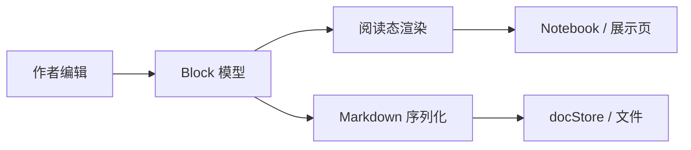

# 06 · 展示页（Showcase Demo）— 活文档信息架构

> **路径**：`docs/markdown-editor/v3-complete/06-showcase-demo.md`  
> **读者**：演示页实现 agent、产品验收、视觉联调  
> **宿主文件**：`markdown-editor.html`（可编辑活文档，**非**产品依赖，见 12-integration-contract）  
> **关联**：v3 README U1–U6 · CROSSCUTTING D16 · `00-product-vision` · `02-block-catalog` · `05-slash-commands` · `08-ai-ports` · `09-media-structure`  
> **修订**：2026-08-02 v3 首版

---

## 0. 一句话

把 `markdown-editor.html` 从「几段玩具 MD + 调试 FAB」升级为 **一页可编辑的完整能力清单（活文档）**：读者打开即见几乎全部用户承诺能力，点选即编辑，每章对应可勾验收点。

---

## 1. 目标 / 非目标

### 1.1 目标

| ID | 目标 | 说明 |
|----|------|------|
| S1 | **覆盖率** | 单页 MD 样例覆盖 U1 能力清单：基础 MD / 行内 marks / 列表任务 / 代码 / 表格（含合并示意）/ 媒体 / 结构（TOC·锚点·双链·tag）/ callout / 公式占位 / Mermaid 占位 / AI 说明块 / 导入导出提示 |
| S2 | **活文档** | 内容即文档、即验收剧本；非截图墙、非分 tab 玩具页 |
| S3 | **信息架构** | 章节有序、目录可导航；长文可扫读 |
| S4 | **交互诚实** | 无页顶格式条（D16）；调试与宿主能力进 `···` 菜单；侧栏 TOC 可选 |
| S5 | **验收映射** | 每章末尾或文内显式「验收点」表，QA 可对着点 |
| S6 | **可重置** | `··· → 重置示例` 恢复 SAMPLE 全文；复制 MD / 源码只读视图保留 |

### 1.2 非目标

| 非目标 | 原因 |
|--------|------|
| 多页 / 多路由 demo 站 | 增加维护成本；一页活文档更利于迁移对照 |
| 页顶「B / I / H1 / 表格…」永久工具条 | 违反 D16；与产品壳不一致 |
| 真实 AI 后端 / 真实上传云 | 展示页用 mock / 占位（见 08、09） |
| 完整 Mermaid / KaTeX 引擎必装 | v3 允许「占位块 + 源码可见」；有引擎时渐进增强 |
| 把 demo 壳当主软件依赖 | 集成只依赖 mount API + mdx CSS |
| 协同、评论、多用户光标 | 产品非目标 |

### 1.3 当前 demo 问题诊断（必须消灭）

| 问题 | 现状（`markdown-editor.html`） | 用户感知 | v3 对策 |
|------|-------------------------------|----------|---------|
| 内容太少 | ~40 行 SAMPLE：标题、列表、小表、一段代码、一则 callout | 「像玩具」 | 扩展为分章长文（建议 400–900 行 MD 源） |
| 能力不可见 | 无图片/视频/音频/附件、无 wiki/tag、无公式/mermaid、无合并表示意、无 TOC | 「功能是不是没做」 | 每类能力至少 1 个可操作样例 |
| 无验收路径 | 文案只有「快速上手」 | QA 无法对着清单打勾 | 每章「验收点」+ 文末总表 |
| 结构扁平 | 无侧栏目录，长文会更难扫 | 只会更糟 | 可选 TOC 侧栏（默认宽屏开） |
| 调试与产品混感 | 右下 `···` 已对；SAMPLE 仍像工程笔记 | 半成品 | 正文语气改为「产品说明文档」，调试能力只藏在菜单 |

---

## 2. 信息架构（IA）

### 2.1 页面骨架

```
┌─────────────────────────────────────────────────────────────┐
│ me-nav（极简）：Conex · 文档演示          [可选：TOC 开关]   │  ← 无格式按钮群
├──────────┬──────────────────────────────────────────────────┤
│ me-toc   │  me-main → me-paper                              │
│ （可选）  │    ├─ me-editor-host  (.mdx-root 活文档)         │
│ 目录侧栏  │    └─ me-source（只读，由 ··· 切换）             │
│ sticky   │                                                  │
├──────────┴──────────────────────────────────────────────────┤
│ me-fab ··· → 复制 MD / 重置 / 源码 / TOC / AI mock 开关…    │
└─────────────────────────────────────────────────────────────┘
```

| 区域 | 职责 | 禁止 |
|------|------|------|
| `me-nav` | 品牌返回、可选「目录」开关 | 加粗/标题/插入表等格式控件 |
| `me-toc` | 由文档 H1–H3 生成大纲；点击滚动到锚点 | 当作第二编辑面 |
| `me-paper` | 白纸阅读面；承载编辑器 | 页顶 sticky 格式条 |
| `me-fab` | 宿主/调试菜单 | 变成迷你工具条堆一排图标 |

### 2.2 宽屏 / 窄屏

| 断点 | TOC | 纸宽 |
|------|-----|------|
| ≥ 1100px | 默认显示（可关） | 纸宽 min(820px) 居中；TOC 固定左侧 ~220px |
| 720–1099 | 默认隐藏；`···` 或 nav 可开抽屉 | 纸宽 100% 内边距缩小 |
| < 720 | 隐藏 TOC；点击目录项后自动收 | padding 按现有 media query |

### 2.3 章节树（活文档大纲）

下列 **H2 顺序冻结**（实现 SAMPLE 时不得随意重排，便于验收编号稳定）：

| # | 章节 id（锚点） | 标题 | 覆盖能力 |
|---|-----------------|------|----------|
| 0 | `intro` | 关于本文档 | 产品定位、如何验收、交互总览 |
| 1 | `basics` | 基础 Markdown | 标题层级、段落、强调、链接、引用、分割线 |
| 2 | `lists` | 列表与任务 | 无序/有序/嵌套、任务勾选 |
| 3 | `inline` | 行内格式 | bold/italic/strike/code/link/highlight |
| 4 | `code` | 代码 | 多语言围栏、未点=高亮预览、点击=源码编辑（U2） |
| 5 | `mermaid` | Mermaid 图表（占位） | ` ```mermaid ` 块；无引擎时源码+占位卡 |
| 6 | `math` | 公式（占位） | `$$` 块级 + 行内 `$...$` 示意 |
| 7 | `table` | 表格 | 对齐、增删行列表意、**合并单元格示意** |
| 8 | `media` | 媒体与附件 | 图/视频/音频/附件块（见 09） |
| 9 | `structure` | 结构与双链 | TOC 自指、锚点、wiki、tag、反链说明 |
| 10 | `callout` | 提示与折叠 | GitHub Alerts / callout；toggle 若可用 |
| 11 | `ai` | AI 增强端口 | 能力说明 + mock 入口文案（实现见 08） |
| 12 | `io` | 导入导出与模式 | 复制 MD、pure-gfm 提示、源码只读 |
| 13 | `checklist` | 总验收清单 | 可勾 task list，对照 U1–U6 |

---

## 3. 交互说明（展示页壳）

### 3.1 原则（与产品一致）

1. **未聚焦 = 正常渲染**；聚焦块才进入编辑（U2/U3）。  
2. **无页顶格式条**；格式依赖：选区浮动条 + slash（`/` / `、`）+ 块把手。  
3. **激活块禁止**全行描边/底色（D16）。  
4. 源码视图是 **整页只读** 调试面，**不是**默认双 tab 主路径（D3）。

### 3.2 目录侧栏（可选）

| 行为 | 规格 |
|------|------|
| 数据源 | 运行时扫描 `heading` level 1–3；忽略展示页 nav 自身 |
| 点击 | `scrollIntoView` 对应块；hash 更新为 `#锚点`（锚点算法见 09） |
| 高亮 | IntersectionObserver：当前屏内最靠上的 H2/H3 高亮 |
| 开关 | nav 或 `··· → 显示/隐藏目录`；`localStorage.me-toc=1|0` 记忆 |
| 空态 | 无标题时 TOC 显示「添加标题后显示目录」 |

### 3.3 `···` 菜单（右下 FAB）

保留现有交互，**扩展**菜单项（分组用弱提示行，非按钮）：

```
调试 · Ctrl+\ 切换源码
────────────────
复制 Markdown
重置示例
查看源码 / 返回编辑
────────────────
显示目录 / 隐藏目录
AI 端口：Mock 开/关     ← 无后端时控制 08 行为
模拟上传失败             ← 09 验收用，可选
────────────────
（hint）本页非产品壳
```

| 项 | 行为 |
|----|------|
| 复制 Markdown | `getMarkdown()` → clipboard；toast |
| 重置示例 | `mountEditor(SAMPLE)`；清 source 模式 |
| 查看源码 | 只读 textarea 显示当前 MD；`Ctrl+\` 同 |
| TOC 开关 | 切换 `me-app` class `has-toc` |
| AI Mock | `localStorage` + 重挂载 options.ai（见 08） |
| 模拟上传失败 | 下次 `upload*` reject，用于 09 错误态 |

**禁止**在菜单堆「加粗、插表」等编辑命令。

### 3.4 键盘（展示页额外）

| 快捷键 | 行为 |
|--------|------|
| `Ctrl+\` / `Cmd+\` | 切换源码只读 |
| `Esc` | 先关 `···` 菜单；再交给编辑器 Esc 链 |
| `/` · `、` | 编辑器 slash（空段/行首） |

### 3.5 挂载 options（展示页推荐）

```js
MarkdownEditor.mount(host, {
  markdown: SAMPLE,
  autosaveMs: 280,
  mode: 'conex',
  features: {
    media: true,
    wikiLink: true,
    fileChip: true,
    mermaid: true,   // 无渲染器时仍解析为 code_block lang=mermaid
    math: true,
    toc: true,
    ai: true,
  },
  media: {
    uploadImage: demoUploadMock('image'),
    uploadFile: demoUploadMock('file'),
    // video/audio 同 09
  },
  ai: createDemoAiPort({ mock: true }),  // 见 08
  onOpenPath(path, meta) {
    toast('打开路径：' + path + ' (' + (meta && meta.kind) + ')');
  },
  onOpenDoc(title) {
    toast('打开文档：' + title);
  },
});
```

展示页 **用 toast 模拟宿主路由**，不接真实 Files/Notebook，避免 demo 耦合对话流。

---

## 4. 分章节样例 MD 全文

> 实现时将下列内容拼为单一 `SAMPLE` 字符串（可用 `` ` `` 模板或外部 `fixtures/showcase-v3.md` 再 fetch；**reference 允许内联**以保证双击 HTML 即开）。  
> 文中「验收点」用任务列表，便于真人勾选（勾选状态重置时丢弃，符合 demo）。

### 4.0 导语 + 交互总览

```markdown
# Conex Markdown 编辑器 · 完整能力展示

本文是一份**可编辑的活文档**：直接点击文字修改，用来验收 v3 承诺的几乎全部能力。  
它不是玩具段落集，而是按章节组织的产品说明 + 验收剧本。

> [!NOTE]
> **页面壳规则**：无页顶格式工具条；格式靠选区浮动条与 `/`（或中文 `、`）命令；调试能力在右下角 **···**。激活块不会出现整行描边或底色。

## 如何使用本页

1. 点击任意段落开始编辑；其它块保持精致阅读态
2. 空段输入 `/` 或 `、` 打开插入菜单
3. 悬停左侧六点把手拖拽重排块
4. 选中文字出现浮动格式条（B / I / 代码 / 链接…）
5. 右下 **···**：复制 Markdown、重置示例、查看源码（`Ctrl+\`）
6. 宽屏可开左侧 **目录** 跳转本章各节

### 验收点 · 导语

- [ ] 打开页面即见渲染后的标题/列表/callout，而非 raw MD 墙
- [ ] 页顶**没有**加粗/插表等永久格式按钮
- [ ] 右下 `···` 可复制、重置、切源码
```

### 4.1 基础 Markdown

```markdown
## 基础 Markdown

普通段落支持中英文混排。这是第二句，用来检查行高与段落间距是否克制（约 16px / 1.6）。

### 标题层级

正文之上应能区分 H1（本页标题）、H2（本章）、H3（本节）。H4–H6 若启用，字阶仍保持克制，避免「海报体」。

#### 四级标题示例

再下一级仅用于深文档；演示页以 H2/H3 导航为主。

### 强调与链接

你可以写 **粗体**、*斜体*、***粗斜体***、~~删除线~~，以及 `行内代码`。  
外链示例：[Conex 设计原则](https://example.com)（阅读态应带 `rel="noopener noreferrer"`）。

也支持 ==高亮==（Conex 扩展；pure-gfm 导出会降级为纯文本）。

### 引用

> 高级感来自克制：激活反馈只靠光标与把手，而不是色块框线。
>
> 引用可多行；在空引用段按 Enter 应能退出引用。

### 分割线

上方是说明，下方是新主题——用分割线隔开：

---

分割线后的段落应间距正常，且分割线本身可被把手拖拽。

### 验收点 · 基础

- [ ] H1–H3 视觉层级可辨
- [ ] 粗体/斜体/删除线/行内代码/链接渲染正确
- [ ] 引用块可编辑、可退出
- [ ] `---` 渲染为分割线且可 DnD
- [ ] 序列化往返不无故丢失 marks
```

### 4.2 列表与任务

```markdown
## 列表与任务

### 无序列表

- 第一项：点击后光标清晰
- 第二项：支持 **行内** 格式
  - 嵌套项 A（Tab 增加 indent）
  - 嵌套项 B
- 第三项：Backspace 在项首可提升/合并（按 list 规格）

### 有序列表

1. 解析与序列化保持有序标记
2. 中间插入新项后编号在阅读态正确
3. 与无序列表可互相转换（slash 或块菜单，若已实现）

### 任务列表

- [x] 去掉页顶「重置 / 源码 / 复制」工具条（历史债已清）
- [x] 去掉激活行描边与底色
- [ ] 阅读态点击 checkbox 可切换完成态并写回 `- [x]`
- [ ] 拖拽任务块后勾选状态不丢

### 验收点 · 列表

- [ ] 无序/有序/任务三类均可 slash 插入
- [ ] 嵌套 indent 可视化正确
- [ ] 任务勾选往返 GFM
```

### 4.3 行内格式（实时）

```markdown
## 行内格式（实时 marks）

在本段中选中「这段文字应能加粗」，用浮动条或快捷键 `Ctrl+B` 切换粗体；退出块后仍保持渲染，而不是露出 `**` 源码（U3）。

混合示例：库存 **预警** 已触发，详见 `src/alerts.ts` 与 [运维手册](https://example.com/ops)。  
删除线表示废弃：~~旧字段 user_name~~ → 新字段 `userName`。

### 验收点 · 行内

- [ ] 选区浮动条出现在选区上方，无选区立即消失
- [ ] 编辑时语法生效区显示为格式化结果，非整行裸 MD
- [ ] `Ctrl+B` / `Ctrl+I` / 行内代码快捷键可用（以 keyboard-map 为准）
```

### 4.4 代码块

```markdown
## 代码

**规则（U2）**：代码块未点击 = 语法高亮（或等宽）预览；**点击代码块 = 进入源码编辑态**。  
禁止「上面一个预览框、下面一个 textarea」双壳。

### JavaScript

```js
function greet(name) {
  return '你好，' + name;
}
console.log(greet('Conex'));
```

### TypeScript

```ts
export interface MountOptions {
  markdown?: string;
  autosaveMs?: number;
  onChange?: (md: string) => void;
}

export function mount(host: HTMLElement, options?: MountOptions): MarkdownEditorAPI;
```

### 无语言标记

```
plain log line 1
plain log line 2
```

行内代码：`MarkdownEditor.mount(host, { markdown })`。

### 验收点 · 代码

- [ ] 未聚焦代码块为预览态（有 lang 时尝试高亮）
- [ ] 单击进入单一编辑面（非双壳）
- [ ] 语言标签可展示；序列化保留 ` ```js ` 等
- [ ] 失焦回到预览态且内容不丢
```

### 4.5 Mermaid 占位

```markdown
## Mermaid 图表（占位）

无 Mermaid 运行时：显示为 **占位卡片**（标题「流程图」、可展开源码），或降级为带 `language-mermaid` 的代码块。  
有运行时：阅读态渲染 SVG；点击仍回源码编辑（与代码块同一套 U2 心智）。



### 验收点 · Mermaid

- [ ] ` ```mermaid ` 可解析且不崩溃
- [ ] 无引擎时占位或代码预览，不 eval 任意脚本
- [ ] 有引擎时阅读态出图；编辑改源后可再渲染
- [ ] pure-gfm 导出仍为 fence 源码
```

### 4.6 公式占位

```markdown
## 公式（占位）

块级公式（`$$`）。无 KaTeX/MathJax 时显示 LaTeX 源码 +「公式」占位样式；有引擎则阅读态排版。

$$
E = mc^2
$$

行内公式示意（若未实现行内 math atom，可先显示为代码样式或原文）：质能方程 $E=mc^2$ 常用于说明。

更复杂的展示：

$$
\int_{-\infty}^{\infty} e^{-x^2}\,dx = \sqrt{\pi}
$$

### 验收点 · 公式

- [ ] `$$` 围栏识别为 math_block（或等价）
- [ ] 无引擎不白屏；可编辑 latex 源
- [ ] 序列化保持 `$$` 往返
```

### 4.7 表格（含合并示意）

```markdown
## 表格

### 基础 GFM 表

| 能力 | 状态 | 说明 |
| --- | :---: | --- |
| 块编辑 | 可用 | 无全行高亮 |
| Slash | 可用 | `/` 与 `、` |
| 拖拽 | 可用 | 左侧把手 |
| 表格 + | 可用 | 右侧/底边圆形 + |
| 合并单元格 | v3 | 见下方示意 |

- 悬停表格：**右侧中部 +** 加列，**底边中部 +** 加行（禁止文字按钮「加行」「加列」）
- 右键表头 / 单元格：分面板（对齐、插删行列等）
- 单元格内支持行内格式；Tab / Shift+Tab 移动单元格

### 合并单元格示意

> [!IMPORTANT]
> GFM pipe **无法**无损表达任意 rowspan/colspan。v3 采用 Conex 扩展序列化（见 `03-table-advanced.md`）；  
> 下列用「逻辑表」描述验收意图——实现后在网格中应看到合并后的大单元格。

| 模块 | 子项 | 负责人 | 备注 |
| --- | --- | --- | --- |
| 编辑器核心 | 解析 | Alice | 跨「解析/序列化」可合并为同一职责单元格 |
| 编辑器核心 | 序列化 | Alice | （与上合并示意） |
| 展示页 | 活文档 | Bob | 单行 |

**交互验收意图**：

1. 选中「解析」「序列化」两行的「负责人」列 → 合并 → 显示单个 `Alice`
2. 取消合并后恢复两格
3. 导出 conex 模式保留合并元数据；pure-gfm 降级为重复单元格文本并警告（toast 或 callout）

### 验收点 · 表格

- [ ] 建表、改单元格、hover + 增行列
- [ ] 无「加行/加列」文字按钮
- [ ] 表头/单元格右键面板可用
- [ ] 合并/取消合并按 03 规格；往返不丢（conex mode）
- [ ] 单元格内 **粗体** 等 marks 可编辑
```

### 4.8 媒体与附件

```markdown
## 媒体与附件

> 详细数据形状与上传端口见 `09-media-structure.md`。展示页用 mock URL / 本地 blob。

### 图片


图片块应支持：阅读态展示、选中后改 alt、失败态（裂图占位）、粘贴/拖入上传（有 `media.uploadImage` 时）。

### 视频（块）

视频块在 MD 中可为扩展语法或 HTML 安全子集；展示页至少出现一块 **视频占位**：

```md
@[video](assets/icons/video.svg)
```

（实现若用 `video` block + props.src，序列化以 catalog 冻结为准。）

### 音频（块）

```md
@[audio](assets/icons/audio.svg)
```

### 附件 / 文件芯片

工作区文件引用（点击 toast 模拟打开）：

见核心处理 [[file:src/core-handler.ts]] 与说明文档 [[file:docs/plan.md|计划文档]]。

独占行芯片：

[[file:package.json]]

### 验收点 · 媒体

- [ ] 图片块渲染；缺 src 有占位
- [ ] 视频/音频块或明确占位 UI 可见
- [ ] file_chip 可点并触发 onOpenPath
- [ ] 上传 mock 成功插入；失败有错误提示（··· 可模拟失败）
```

### 4.9 结构：TOC / 锚点 / 双链 / tag

```markdown
## 结构与双链

### 文档内目录

宽屏左侧目录由 H1–H3 **自动生成**。你也可以在正文插入 TOC 块（若 slash `目录` 已挂）：

<!-- conex:toc -->

（解析为 `toc` 块时阅读态列出链接；点击跳转锚点。）

### 锚点

标题应带稳定锚点，例如本章 id 为 `structure`。  
从导语或其它节可用站内链接跳转（实现可用 `#structure` 或块 id）。

手动锚点示意（扩展，可选）：见 [回到代码章](#code)。

### Wiki 双链

文档型链接（宿主应开 Notebook / 文档 store，展示页 toast）：

完整报告见 [[doc:重构变更摘要.md]]，也可写显示名 [[doc:重构变更摘要.md|变更摘要]]。

### 标签

本页与发布相关：#showcase #markdown #v3  
标签为行内 atom；点击行为由宿主决定（过滤 / 搜索），展示页可 toast。

### 反链（Backlinks）

> [!TIP]
> **反链面板是宿主责任**：编辑器只维护本页出链（wiki/file/md-link）数据钩子；  
> 宿主查询「谁链向我」并在 Notebook 侧栏或桌面壳渲染。详见 09 §Backlinks。

本展示页不内嵌反链列表 UI；仅保留说明与 `editor.getOutlinks()` 类 API 的验收说明。

### 验收点 · 结构

- [ ] TOC 侧栏与标题同步；点击可滚动
- [ ] 标题锚点可被 URL hash 定位
- [ ] `[[doc:…]]` 渲染为 wiki chip 且可点
- [ ] `#tag` 识别为 tag mark
- [ ] 文档注明反链属宿主；编辑器提供出链枚举 API（若已实现）
```

### 4.10 Callout 与折叠

```markdown
## 提示与折叠

> [!NOTE]
> 信息提示：用于补充说明。

> [!TIP]
> 技巧：善用 `/` 与 `、` 插入结构。

> [!WARNING]
> 警告：pure-gfm 导出会丢失部分 Conex 扩展。

> [!CAUTION]
> 危险：不要把未消毒 HTML 当正文插入。

> [!IMPORTANT]
> 重要：合并单元格与 AI 端口为 v3 重点。

### 折叠（若已实现 toggle）

<details>
<summary>点击展开实现细节</summary>

折叠体内仍是块文档的一部分；序列化优先 details/summary 或扩展语法（见 catalog）。

</details>

### 验收点 · Callout

- [ ] 五类 Alert 有区分色与图标
- [ ] 可编辑 callout 正文
- [ ] 往返保留 kind
```

### 4.11 AI 说明块

```markdown
## AI 增强端口

编辑器 **不内置模型**。宿主注入 `options.ai`（rewrite / summarize / continue / review）。  
入口：**选区浮动条 · 右键 · slash**，仍然 **没有** 页顶大工具条。详见 `08-ai-ports.md`。

| 能力 | 说明 | 展示页 Mock |
|------|------|-------------|
| rewrite | 改写选区（可带意图：更短/更正式） | 返回加前缀文本 |
| summarize | 总结选区或当前块 | 返回要点列表 MD |
| continue | 自光标续写 | 返回续写段落 |
| review | 审阅建议（不强制写回） | 返回评论式 bullet |

**试玩**（Mock 开启时）：

1. 选中本句「请把这句改得更简练一些。」→ 浮动条 AI → 改写
2. 空段 `/` →「AI 续写」
3. 关闭 Mock 后入口应禁用或隐藏（非报错崩溃）

### 验收点 · AI

- [ ] 有 ai 时入口可见；替换策略符合 08（选区替换 / 插入下方）
- [ ] 无 ai 时禁用态清晰
- [ ] 请求中 loading；失败 toast；可取消（若规格要求）
- [ ] 不把 API Key 写进编辑器包
```

### 4.12 导入导出与模式

```markdown
## 导入导出与模式

| 操作 | 入口 | 说明 |
|------|------|------|
| 复制 Markdown | `···` | 当前文档 conex 或当前 mode |
| 查看源码 | `···` / `Ctrl+\` | 整页只读，非默认主路径 |
| 重置示例 | `···` | 恢复 SAMPLE |
| pure-gfm | 宿主/未来菜单 | 扩展降级；展示页可选 toast 说明 |

从外部粘贴：应尽量识别 GFM 表、列表、代码围栏；未知 HTML 消毒。

### 验收点 · IO

- [ ] 复制内容可在外部编辑器粘贴为合法 MD
- [ ] 源码视图与编辑视图内容一致（切回不丢）
- [ ] 重置后回到完整活文档，而非短玩具文
```

### 4.13 总验收清单（U1–U6 映射）

```markdown
## 总验收清单

### 对应用户硬约束

- [ ] **U1** 本页覆盖基础 / 代码 / 媒体 / 表 / 结构 / 编辑体验 / AI 槽 / 导入导出占位
- [ ] **U2** 代码块未点=预览，点击=源码编辑，无双壳
- [ ] **U3** 文本块编辑以渲染态为主，非整行裸 MD
- [ ] **U4** 表格结构化网格；单元格格式；合并可用或按 03 分期可验
- [ ] **U5** 表格与全局从「能点」到「能用」；动效不炸
- [ ] **U6** 规格文档充分（本分册 + 08 + 09 等）

### 展示页壳

- [ ] 无页顶格式条
- [ ] TOC 可选
- [ ] `···` 菜单完备
- [ ] 内容长度与结构不再像玩具

---

在空白处继续写点什么，或拖拽上方任意块验证 DnD…
```

---

## 5. 样例与验收点总表

| 章节 | 样例要点 | 验收 ID（建议） |
|------|----------|-----------------|
| 导语 | callout + 操作说明 | SH-00 |
| 基础 | 标题/强调/引用/hr | SH-01 |
| 列表 | ul/ol/task/嵌套 | SH-02 |
| 行内 | 浮动条实时 marks | SH-03 |
| 代码 | 多 lang + U2 | SH-04 |
| Mermaid | fence 占位 | SH-05 |
| 公式 | `$$` 占位 | SH-06 |
| 表格 | + / 右键 / 合并示意 | SH-07 |
| 媒体 | 图视音 + file_chip | SH-08 |
| 结构 | TOC/wiki/tag/反链说明 | SH-09 |
| Callout | 5 kind | SH-10 |
| AI | 四端口说明 + mock | SH-11 |
| IO | 复制/源码/重置 | SH-12 |
| 总表 | U1–U6 | SH-13 |

自动化建议（非展示页必须）：

- `tests/markdown-editor/showcase-parse.test.js`：对 SAMPLE 全文 parse 不抛、serialize 再 parse 稳定。  
- 可选 Playwright：打开 `markdown-editor.html` 断言无 `.me-toolbar-format` 类、存在 `···`、正文含「完整能力展示」。

---

## 6. 实现改造清单（`markdown-editor.html`）

| 步骤 | 改动 | 优先级 |
|------|------|--------|
| 1 | 替换 `SAMPLE` 为 §4 拼装全文（或 load fixture） | P0 |
| 2 | 增加可选 `me-toc` DOM + 标题扫描 | P0 |
| 3 | 扩展 `···` 菜单项（TOC/AI mock） | P0 |
| 4 | mount 时注入 `media` / `ai` mock | P0 |
| 5 | toast 承接 onOpenPath / onOpenDoc | P0 |
| 6 | 窄屏 TOC 抽屉 | P1 |
| 7 | hash 路由滚动 | P1 |
| 8 | 标题改为「完整能力展示」类产品文案 | P0 |

**CSS**：TOC 宽度、sticky、与 paper 间距；保持现有白纸阴影与无顶栏气质。  
**禁止**：为「好看」加回顶栏按钮群。

---

## 7. 与其它分册边界

| 分册 | 本展示页引用关系 |
|------|------------------|
| 02 render-model | 代码块 U2、文本 U3 行为以彼为准；本页只给可点样例 |
| 03 table-advanced | 合并算法与序列化；本页只给示意表 + 验收意图 |
| 08 ai-ports | 端口类型、替换策略、禁用态；本页 mock 与文案 |
| 09 media-structure | 块 props、上传、TOC/wiki/tag/backlinks；本页样例 MD |
| 07 package-migration | demo 不进 npm 包 |

---

## 8. 文案与 i18n

- 展示页 **中文优先**（产品母语）。  
- 代码标识符、fence lang、API 名保持英文。  
- toast 短句 ≤ 20 字为宜。

---

## 9. 完成定义（DoD）

- [ ] `markdown-editor.html` 打开后无需改代码即可看到 §2.3 全部 H2  
- [ ] SAMPLE 行数显著高于现状（建议 ≥ 300 行 MD 源）  
- [ ] 无页顶格式条；`···` + 可选 TOC 行为符合 §3  
- [ ] §5 验收表可人工跑通一轮  
- [ ] 重置后内容回到完整活文档  
- [ ] 与 08/09 术语一致（端口名、块 type、回调名）

---

## 10. 修订

| 版本 | 日期 | 说明 |
|------|------|------|
| 1.0 | 2026-08-02 | v3 展示页 IA + 分章样例全文 + 验收映射 |
