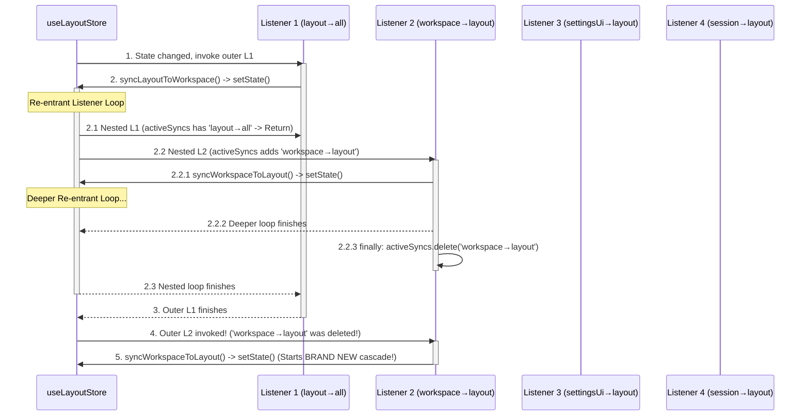

# Zustand Store 无限循环同步与状态交叉污染深入诊断报告

## 1. 执行摘要 (Executive Summary)

本报告对 `apps/crish-desktop/src/store/bootstrapStores.ts` 中 `useLayoutStore`、`useSessionStore`、`useWorkspaceStore` 与 `useSettingsUiStore` 之间的 4 向订阅逻辑进行了深度排查。

排查结论：
1. **架构认知与实现倒置**：`useSessionStore`、`useWorkspaceStore` 与 `useSettingsUiStore` 并非 4 个独立的 Zustand Store 实例，而全部是 `useLayoutStore` 的**同引用别名（Facade 门面）**（见 [sessionStore.ts:30](file:///c:/Software/conex/apps/crish-desktop/src/store/sessionStore.ts#L30)、[workspaceStore.ts:30](file:///c:/Software/conex/apps/crish-desktop/src/store/workspaceStore.ts#L30)、[settingsUiStore.ts:228](file:///c:/Software/conex/apps/crish-desktop/src/store/settingsUiStore.ts#L228)）。
2. **[StoreFreq] 每分钟 1,141 次更新死循环根源**：`bootstrapStores.ts` 将 4 个同步函数作为 4 个独立 Listener 挂载到了**同一个 Zustand Store 实例**上。当任一 State 发生变更时，Zustand 在遍历 Listener 列表过程中发起嵌套重入 `setState`，且 `finally` 块中擦除 path 锁，导致外层与内层 Listener 互相级联触发，产生同步爆炸式循环（产生单分钟 1,141+ 次通知）。
3. **[Invariant] `permissionMode should not be in sessionStore` 污染报警根源**：`bootstrapStores.ts` 中的断言逻辑假设 `useSessionStore` 是仅包含会话字段的独立 Store，但在当前 Phase 0/1 单 Store 架构下，`useSessionStore.getState()` 返回的就是完整的 `LayoutStore` 实例，天然包含 `permissionMode` 字段。断言逻辑与单 Store 架构产生直接矛盾，导致每 30 秒无条件抛出断言错误。

---

## 2. 4 向 Subscribe 闭环结构分析 (`bootstrapStores.ts`)

### 2.1 依赖关系与底层实例结构

在当前 Desktop Store 架构中，Store 并非拆分为 4 个独立 Memory 实体，而是统一维持在 `useLayoutStore` 中：

```typescript
// sessionStore.ts
export const useSessionStore = useLayoutStore;

// workspaceStore.ts
export const useWorkspaceStore = useLayoutStore;

// settingsUiStore.ts
export const useSettingsUiStore = useLayoutStore;
```

然而，在 [bootstrapStores.ts](file:///c:/Software/conex/apps/crish-desktop/src/store/bootstrapStores.ts#L125-L181) 中，`bootstrapStores()` 却对这 4 个符号分别执行了 `.subscribe(...)`：

```
                    ┌─────────────────────────────────────────┐
                    │      Zustand Singleton Store            │
                    │         (useLayoutStore)                │
                    └────────────────────┬────────────────────┘
                                         │ 4 Registrations
          ┌──────────────────────────────┼──────────────────────────────┐
          │                              │                              │
┌─────────▼─────────┐          ┌─────────▼─────────┐          ┌─────────▼─────────┐
│ Listener 1        │          │ Listener 2        │          │ Listener 3        │
│ layoutStore.sub   │          │ workspaceStore.sub│          │ settingsUiStore.sub│
└─────────┬─────────┘          └─────────┬─────────┘          └─────────┬─────────┘
          │                              │                              │
    path: layout→all               path: workspace→layout         path: settingsUi→layout
          │                              │                              │
  calls:                         calls:                         calls:
  syncLayoutToWorkspace()        syncWorkspaceToLayout()        syncSettingsUiToLayout()
  syncLayoutToSettingsUi()               │                              │
  syncLayoutToSession()                  │                              │
          │                              │                              │
          └──────────────────────────────┼──────────────────────────────┘
                                         │
                               ┌─────────▼─────────┐
                               │ Listener 4        │
                               │ sessionStore.sub  │
                               └─────────┬─────────┘
                                         │
                                   path: session→layout
                                         │
                                 calls: syncSessionToLayout()
```

### 2.2 4 向同步函数的实质

每个 `sync*` 函数的内部实现均为：从 `useLayoutStore.getState()` 取出部分字段，然后再调用 `use*Store.setState(...)`。由于 `useWorkspaceStore` / `useSessionStore` / `useSettingsUiStore` 均等于 `useLayoutStore`，因此每个同步函数本质上都是：
**“读取 Store 本身的字段，并重新 setState 写回 Store 本身”**。

```typescript
// syncLayoutToSession ()
function syncLayoutToSession(): void {
  const layout = useLayoutStore.getState();
  useSessionStore.setState({ sessions: layout.sessions, ... });
}

// syncSessionToLayout ()
function syncSessionToLayout(): void {
  const ss = useSessionStore.getState();
  useLayoutStore.setState({ sessions: ss.sessions, ... });
}
```

---

## 3. [StoreFreq] 高频更新死循环的精确触发路径

### 3.1 路径防重机制（activeSyncs）的失效点

`bootstrapStores.ts` 设计了 `const activeSyncs = new Set<string>()` 来阻止无限递归，但该机制在单 Store 架构下存在严重的**嵌套恢复点漏洞**：

1. **Zustand Listener 队列机制**：当 `useLayoutStore` 触发 `setState` 时，Zustand 会同步按注册顺序依次调用其内部 `listeners` 数组：`[Listener_Layout, Listener_Workspace, Listener_SettingsUi, Listener_Session]`。
2. **Listener_Layout 触发（L1）**：
   - 将 `'layout→all'` 放入 `activeSyncs`。
   - 执行 `syncLayoutToWorkspace()` -> 调用 `useWorkspaceStore.setState(...)`（即 `useLayoutStore.setState(...)`）。
3. **同步重入递归 (Re-entrant Call)**：
   - 内部 `setState` 立即暂停当前 L1 的后续执行，开启一轮**新的嵌套 Zustand listener 遍历**。
   - 嵌套遍历中，L1 执行：`activeSyncs.has('layout→all')` 为 `true`，直接 return。
   - 嵌套遍历中，L2 执行：`activeSyncs.has('workspace→layout')` 为 `false`！
   - L2 将 `'workspace→layout'` 放入 `activeSyncs`，并调用 `syncWorkspaceToLayout()` -> 再次调用 `useLayoutStore.setState(...)`！
4. **`finally` 块解锁导致锁失效**：
   - 当最深层的嵌套 `setState` 执行完毕后，L2 进入 `finally` 块：`activeSyncs.delete('workspace→layout')`！
   - 锁被释放，递归展开返回至最外层的 Zustand 监听器循环。
5. **外层循环继续推进**：
   - 此时最外层的 Zustand 循环从 L1 推进到 L2（Listener_Workspace）。
   - 由于内层递归已经退栈并执行了 `activeSyncs.delete('workspace→layout')`，此时外层的 L2 检查 `activeSyncs.has('workspace→layout')` **再次为 `false`**！
   - 外层 L2 再次触发 `syncWorkspaceToLayout()`，掀起第二波完整的同步嵌套更新流！
   - 同理，外层 L3（Listener_SettingsUi）、外层 L4（Listener_Session）随后的执行均会掀起新的嵌套更新流。

### 3.2 时序图



### 3.3 计数器爆炸点

由于每一次简单的状态变更（如遥测数据轮询、鼠标 Hover 预估、定时器触发）都会通过这种“外层+嵌套”多重重入放大数十倍，`_counters` 中记下的更新频率在 60 秒内迅速累计达 **1,141 次/分钟**。

---

## 4. [Invariant] `permissionMode should not be in sessionStore` 状态交叉污染的精确来源

### 4.1 源码位置

在 [bootstrapStores.ts:189-197](file:///c:/Software/conex/apps/crish-desktop/src/store/bootstrapStores.ts#L189-L197)：

```typescript
if (process.env.NODE_ENV === 'development') {
  const invariantInterval = setInterval(() => {
    const session = useSessionStore.getState();
    if ('permissionMode' in session) {
      console.error('[Invariant] permissionMode should not be in sessionStore');
    }
  }, 30000);
  unsubs.push(() => clearInterval(invariantInterval));
}
```

### 4.2 错误触发原因

1. **类型假象与单一 Store 事实**：
   开发者在编写此 Invariant 断言时，假想 `useSessionStore` 是一个独立只存 `SessionState` 的 Store 实例，因此断定 `permissionMode`（属于 Settings/UI 域）不应当出现在 `sessionStore` 的 State 中。
2. **实际对象引用**：
   在 [sessionStore.ts:30](file:///c:/Software/conex/apps/crish-desktop/src/store/sessionStore.ts#L30) 中：
   `export const useSessionStore = useLayoutStore;`
   因此 `useSessionStore.getState()` 返回的就是整个 `useLayoutStore` 的 State 对象。
3. **字段天然存在**：
   `LayoutStore` 在定义时包含了 `permissionMode: PermissionMode`（见 [layoutStore.ts:139](file:///c:/Software/conex/apps/crish-desktop/src/store/layoutStore.ts#L139) 与 [layoutStore.ts:235](file:///c:/Software/conex/apps/crish-desktop/src/store/layoutStore.ts#L235)）。
4. **必然命中的逻辑**：
   由于 `useSessionStore.getState()` 始终返回 `LayoutStore` 实例，`'permissionMode' in session` 的表达式结果**无条件为 `true`**。只要开发模式下开着该定时器，每 30 秒必然在 console 中打印错误 `[Invariant] permissionMode should not be in sessionStore`。

---

## 5. 影响评估 (Impact Assessment)

| 维度 | 影响级别 | 表现与危害 |
|------|----------|------------|
| **CPU 与性能** | **高 (High)** | 每次状态更新引发 4 向同步函数的无意义重入调用与对象浅拷贝，增加垃圾回收 (GC) 压力。 |
| **组件渲染** | **中 (Medium)** | 若部分组件使用了未做 memo / shallow 比较的 `useSessionStore` 全量 selector，会引发不必要的重复渲染。 |
| **开发者体验** | **中 (Medium)** | 控制台频繁刷新 `[StoreFreq]` 1141 updates 警告与 `[Invariant]` 假阳性错误日志，干扰正常调试。 |

---

## 6. 修复建议方案 (Remediation Plan)

### 6.1 架构层修复原则

在当前的 Phase 0/1 阶段，`useSessionStore` / `useWorkspaceStore` / `useSettingsUiStore` 均是 `useLayoutStore` 的门面别名。**同 Store 内部的字段根本不需要通过 `.subscribe()` 互相同步**。

### 6.2 代码修复路径 (`bootstrapStores.ts`)

1. **移除 4 向 Subscribe 循环同步**：
   完全删除 `bootstrapStores.ts` 中 `useLayoutStore.subscribe`、`useWorkspaceStore.subscribe`、`useSettingsUiStore.subscribe`、`useSessionStore.subscribe` 对 `sync*` 函数的调用。
2. **清理假阳性 Invariant 检查**：
   删除 `permissionMode in session` 的错误断言检查，或将其调整为对拆分后（Phase 2 多 Store 时代）独立 Store 实例的隔离性校验。
3. **保留 storeAccess 初始化与遥测日志**：
   保留 `initStoreAccess` 初始化，确保非 React 环境能正常访问 Store API。

---
*诊断完成时间：2026-07-26*
